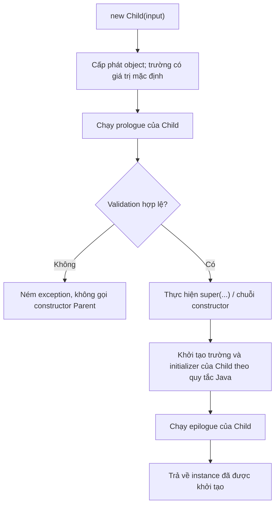

# Kiểm tra tham số và báo lỗi trước khi gọi hàm khởi tạo lớp cha trong Java 25

Khi một lớp con kế thừa lớp cha, constructor của lớp con thường cần chuyển tham số cho `super(...)`. Trước đây, việc kiểm tra đầu vào theo nhiều bước trong thân constructor trước lời gọi này bị hạn chế, khiến mã dễ phải đưa validation vào biểu thức đối số, helper tĩnh hoặc thực hiện kiểm tra sau khi lớp cha đã được khởi tạo. **Java 25 giải quyết trực tiếp bài toán đó bằng Flexible Constructor Bodies (JEP 513): cho phép đặt một đoạn mã có kiểm soát trước lời gọi `super(...)` hoặc `this(...)`.**

Bài này thuộc chương **Hàm khởi tạo linh hoạt** trong module `JAVA_VERSION_JAVA25`. Trọng tâm là **kiểm tra tham số, ném ngoại lệ rõ nghĩa và tránh tác dụng phụ của constructor lớp cha khi đầu vào không hợp lệ**. Các quy tắc được trình bày dựa trên Java SE 25 đã phát hành ổn định; không cần `--enable-preview`. Bạn sẽ thực hành một lớp con có validation nhiều bước, phân biệt prologue với epilogue, hiểu ranh giới *early construction context* và xây dựng kiểm thử để chứng minh thứ tự thực thi.

## 1. Kết quả học tập

Sau bài học, bạn có thể:

1. Giải thích vì sao kiểm tra tham số **trước `super(...)`** khác về hành vi so với kiểm tra **sau `super(...)`**.
2. Viết constructor Java 25 có **prologue** để chuẩn hóa, kiểm tra phạm vi và ném `IllegalArgumentException`/`NullPointerException` trước khi lớp cha nhận đầu vào.
3. Hiểu chính xác lúc nào được đọc tham số, biến cục bộ, thành viên `static` và lúc nào **không** được đọc/đưa ra ngoài đối tượng đang khởi tạo.
4. Phân biệt `super(...)` tường minh, `this(...)` ủy quyền và `super()` được compiler chèn ngầm.
5. Biết trường hợp đặc biệt cho phép **gán một số trường instance** của lớp hiện tại trước `super(...)`, nhưng không cho phép tùy ý đọc trường hoặc gọi instance method.
6. Viết kiểm thử JUnit chứng minh đầu vào sai khiến constructor cha **chưa được gọi**.
7. Nhận biết những rủi ro còn tồn tại: side effect ngay trong prologue, gọi method override từ constructor cha, cấu hình build chưa hỗ trợ Java 25.

### Bài toán xuyên suốt

Một lớp `ImportTask` kế thừa `BaseTask`. `BaseTask` ghi nhận một lần khởi tạo và giả định nhận tên tác vụ đã chuẩn hóa. `ImportTask` chỉ muốn gọi `BaseTask(...)` khi tên hợp lệ và `batchSize` nằm trong khoảng cho phép. Nếu đầu vào lỗi, ứng dụng cần ném ngoại lệ **trước khi chạy constructor cha**, để không tạo ra side effect không cần thiết hoặc thông điệp lỗi gây hiểu nhầm.

## 2. Java 25 chính thức hỗ trợ Flexible Constructor Bodies

**JEP 513 — Flexible Constructor Bodies** đã trở thành tính năng ngôn ngữ **hoàn thiện (permanent)** trong **Java SE 25**. Phần mới là constructor có thể có các câu lệnh trước lời gọi constructor tường minh:

```java
class Parent {
    Parent(String name) {
        System.out.println("Parent nhận: " + name);
    }
}

class Child extends Parent {
    Child(String input) {
        // Prologue: chạy trước constructor của Parent.
        String normalized = input.strip();
        if (normalized.isEmpty()) {
            throw new IllegalArgumentException("Tên không được rỗng");
        }

        super(normalized);

        // Epilogue: chạy sau khi superclass constructor trở về.
        System.out.println("Child đã khởi tạo xong");
    }
}
```

Ví dụ chỉ cần Java 25 GA, không cần bật preview. Khi `input` là chuỗi chỉ có khoảng trắng, `IllegalArgumentException` được ném **trước** lời gọi `super(normalized)`.

**Lưu ý:** ví dụ rút gọn này sẽ ném `NullPointerException` từ `input.strip()` nếu truyền `null`. Ở ứng dụng thật, nên dùng `Objects.requireNonNull` để chủ động đặt thông báo lỗi có ý nghĩa; xem mục 4.

### 2.1. Prologue, constructor invocation và epilogue

Theo JLS Java SE 25, constructor có lời gọi tường minh có hình thức khái niệm:

```text
Constructor {
    [các câu lệnh của prologue]

    super(...) hoặc this(...);

    [các câu lệnh của epilogue]
}
```

- **Prologue:** những câu lệnh nằm trước `super(...)` hoặc `this(...)`.
- **Constructor invocation:** đúng một lời gọi constructor tường minh, theo dạng `super(...)` hoặc `this(...)`; nó không phải lời gọi method thông thường.
- **Epilogue:** những câu lệnh nằm sau lời gọi constructor.
- **Early construction context:** bao gồm prologue và phần đánh giá đối số của constructor invocation. Ở giai đoạn này có những hạn chế nhằm ngăn việc dùng đối tượng còn đang khởi tạo.



Sơ đồ mô tả đường **`super(...)`** trực tiếp thông thường. Nếu dùng `this(...)`, quá trình ủy quyền đi qua một constructor khác của cùng lớp; các bước khởi tạo instance được Java tổ chức để chỉ thực hiện một lần theo chuỗi constructor. Một ngoại lệ ném từ prologue làm dừng chính constructor đó trước khi lời gọi tường minh của nó diễn ra.

### 2.2. Vì sao cần gọi `super(...)` **tường minh**?

Đây là điểm rất dễ nhầm:

```java
class ParentWithoutArgs {
    ParentWithoutArgs() {
        System.out.println("Constructor Parent đã chạy");
    }
}

class WrongAssumption extends ParentWithoutArgs {
    WrongAssumption(String value) {
        // Đoạn này KHÔNG chạy trước super() ngầm định.
        if (value == null) {
            throw new NullPointerException("value");
        }
    }
}
```

Vì không có lời gọi constructor tường minh, compiler **chèn `super();` ngầm trước toàn bộ câu lệnh trong thân constructor**. Do đó, khi gọi `new WrongAssumption(null)`, thông báo từ `ParentWithoutArgs()` vẫn xuất hiện trước ngoại lệ.

Muốn fail-fast thực sự trước superclass constructor, hãy viết:

```java
class FailFastChild extends ParentWithoutArgs {
    FailFastChild(String value) {
        if (value == null) {
            throw new NullPointerException("value");
        }

        super(); // Tường minh; chỉ đến đây nếu value hợp lệ.
    }
}
```

**Quy tắc nhớ:** đặt `if` ở đầu constructor **không tự động** có nghĩa là chạy trước lớp cha. Chỉ khi bạn có lời gọi `super(...)` hoặc `this(...)` tường minh ở **sau** prologue, các câu lệnh đó mới được chạy trước lời gọi constructor tương ứng.

## 3. Điều gì được phép làm trong prologue?

JEP 513 cho phép nhiều thao tác có ý nghĩa trước `super(...)`:

| Thao tác | Có được phép? | Lý do |
|---|---|---|
| Đọc tham số constructor | Có | Tham số đã tồn tại trước khi gọi constructor cha. |
| Khai báo, tính toán biến cục bộ | Có | Không cần truy cập instance đang khởi tạo. |
| `if`, `switch`, vòng lặp để validate | Có, theo quy tắc câu lệnh Java | Có thể kiểm tra đầu vào nhiều bước trước khi ủy quyền. |
| Ném `IllegalArgumentException` hoặc `NullPointerException` | Có | Thất bại sớm; không tiếp tục đến constructor cha. |
| Gọi hàm `static`/API thuần như `Objects.requireNonNull` | Có | Không phụ thuộc vào `this`. |
| Chuẩn hóa chuỗi bằng `String.strip()` trên tham số | Có | Đây là lời gọi trên **đối tượng tham số**, không phải `this` của lớp đang tạo. |
| Đọc `this.field` hoặc một instance field ngầm định | **Không** | Đối tượng hiện tại chưa qua ranh giới constructor invocation. |
| Gọi instance method của `this` hoặc dùng `this` làm đối số | **Không** | Có thể làm lộ đối tượng chưa được khởi tạo. |
| Gọi `super.someMethod()` / đọc `super.field` | **Không** | Chưa khởi tạo superclass. |
| Gán một trường instance **đủ điều kiện** của lớp hiện tại | Có điều kiện | Java 25 cho phép khởi tạo sớm trường của lớp hiện tại; xem mục 8. |
| Đặt `super(...)` trong mỗi nhánh `if` | Không | Cấu trúc constructor chỉ cho phép một constructor invocation tường minh ở vị trí ngữ pháp phù hợp. |

**Không nên hiểu sai:** các hạn chế liên quan đến **instance đang được tạo**, không phải mọi object. Chẳng hạn gọi `raw.strip()`, `pattern.matcher(input)` hoặc `validator.validate(input)` trên một object **được truyền từ ngoài vào** có thể hợp lệ nếu không truy cập `this` của lớp hiện tại.

Tham số truyền tới `super(...)` có thể là biến cục bộ được tính từ prologue. Nhờ đó validation trở nên dễ đọc hơn những biểu thức lồng nhau.

## 4. Ví dụ tối giản: kiểm tra trước khi kế thừa `BigInteger`

Đây là dạng ví dụ trực tiếp tương tự tài liệu ngôn ngữ Java 25. Giả sử muốn xây một `BigInteger` luôn dương:

```java
import java.math.BigInteger;

public final class PositiveBigInteger extends BigInteger {

    public PositiveBigInteger(long value) {
        if (value <= 0) {
            throw new IllegalArgumentException(
                "value phải lớn hơn 0");
        }

        super(Long.toString(value));
    }
}
```

Dùng thử trong một file khác:

```java
public class PositiveBigIntegerDemo {
    public static void main(String[] args) {
        System.out.println(new PositiveBigInteger(42)); // 42

        try {
            new PositiveBigInteger(0);
        } catch (IllegalArgumentException ex) {
            System.out.println(ex.getMessage()); // value phải lớn hơn 0
        }
    }
}
```

**Các bước thực thi khi `value=42`:** kiểm tra điều kiện, thấy hợp lệ, chuyển `long` thành `String` rồi gọi `BigInteger(String)`.

**Khi `value=0`:** ném ngoại lệ ở prologue; lời gọi `BigInteger(String)` **không được thực hiện**.

Không nên chuyển sang `super(Long.toString(value))` rồi mới kiểm tra `value <= 0`: lúc ấy superclass đã chạy, và bất biến của lớp con chỉ được phát hiện sau đó. Mục tiêu của tính năng là tránh trình tự sai này một cách tự nhiên.

## 5. Ví dụ hoàn chỉnh: ImportTask với kiểm tra nhiều tham số

Ví dụ sau là một file độc lập `ConstructorValidationDemo.java`. Lớp cha có bộ đếm constructor để chứng minh ranh giới thực thi. Lớp con chuẩn hóa tên, phát hiện null/blank và giới hạn kích thước batch trước khi giao tham số cho cha.

```java
import java.util.Objects;

public class ConstructorValidationDemo {

    static class BaseTask {
        static int constructorCalls;
        final String name;

        BaseTask(String name) {
            constructorCalls++;
            this.name = name;
            System.out.println("BaseTask initialized: " + name);
        }
    }

    static final class ImportTask extends BaseTask {
        final int batchSize;

        ImportTask(String rawName, int batchSize) {
            // PROLOGUE: không truy cập instance của ImportTask.
            String normalized = Objects
                .requireNonNull(rawName, "rawName")
                .strip();

            if (normalized.isEmpty()) {
                throw new IllegalArgumentException(
                    "Tên tác vụ không được rỗng");
            }

            if (normalized.length() > 80) {
                throw new IllegalArgumentException(
                    "Tên tác vụ không được quá 80 ký tự");
            }

            if (batchSize < 1 || batchSize > 1_000) {
                throw new IllegalArgumentException(
                    "batchSize phải thuộc khoảng 1..1000");
            }

            super(normalized); // Chỉ chạy sau tất cả validation.

            // EPILOGUE: lúc này đã có thể khởi tạo trạng thái instance.
            this.batchSize = batchSize;
        }
    }

    public static void main(String[] args) {
        try {
            new ImportTask("   ", 100);
        } catch (IllegalArgumentException ex) {
            System.out.println("Rejected: " + ex.getMessage());
        }

        System.out.println(
            "Parent calls after invalid input: "
                + BaseTask.constructorCalls);

        var task = new ImportTask("  daily import  ", 100);
        System.out.println("Normalized name: " + task.name);
        System.out.println("Batch size: " + task.batchSize);
        System.out.println(
            "Parent calls after valid input: "
                + BaseTask.constructorCalls);
    }
}
```

Chạy với JDK 25:

```bash
java --version
java ConstructorValidationDemo.java

# Hoặc biên dịch rồi chạy:
javac --release 25 ConstructorValidationDemo.java
java ConstructorValidationDemo
```

Kết quả mong đợi theo thứ tự:

```text
Rejected: Tên tác vụ không được rỗng
Parent calls after invalid input: 0
BaseTask initialized: daily import
Normalized name: daily import
Batch size: 100
Parent calls after valid input: 1
```

**Điểm quan trọng:** `constructorCalls=0` sau lỗi cho thấy constructor của lớp cha chưa được gọi. Đây là bằng chứng cụ thể, không phải chỉ nhìn xem ứng dụng có ném exception hay không.

`BaseTask.constructorCalls` là biến demo, không phải cơ chế production để đếm số object trong hệ thống đồng thời. Bộ đếm mutable `static int` không an toàn khi nhiều thread khởi tạo; dùng nó chỉ trong bài test chạy tuần tự. Với nghiệp vụ thật, tránh side effect không cần thiết trong constructor cha nếu có thể.

### 5.1. Vì sao phải validation trước khi chuẩn hóa?

`Objects.requireNonNull(rawName, "rawName")` bảo đảm thông báo rõ ràng cho dữ liệu null trước `rawName.strip()`. Sau đó, `strip()` bỏ khoảng trắng đầu/cuối, `isEmpty()` kiểm tra tên rỗng và `length()` đặt giới hạn.

Mỗi bước phục vụ một mục đích khác nhau: không chỉ muốn đoạn mã **compile**, mà còn muốn contract đầu vào ổn định để caller có thể sửa dữ liệu sai.

Lưu ý `String.length()` đếm **UTF-16 code units**, không phải số ký tự Unicode được người dùng nhìn thấy. Nếu sản phẩm cần giới hạn độ dài tên theo grapheme cluster, phải thiết kế một quy tắc kiểm tra khác; ví dụ giới hạn 80 code units là quy ước cho bài học.

## 6. Thiết kế exception đúng nghĩa

Kiểm tra trước `super(...)` rất hữu ích, nhưng việc ném ngoại lệ nào cũng là một phần của API.

| Trường hợp | Ngoại lệ hợp lý trong ví dụ | Cách truyền thông điệp |
|---|---|---|
| Tham số bắt buộc là `null` | `NullPointerException` từ `Objects.requireNonNull` | Nêu tên tham số; không lộ dữ liệu nhạy cảm. |
| Chuỗi rỗng sau `strip()` | `IllegalArgumentException` | Chỉ rõ thuộc tính thiếu/không hợp lệ. |
| Giá trị nằm ngoài phạm vi nghiệp vụ | `IllegalArgumentException` | Nêu khoảng hợp lệ. |
| String cần parse thành số | `NumberFormatException` hoặc chuyển thành `IllegalArgumentException` | Nêu định dạng/giới hạn; giữ nguyên cause nếu bọc lỗi. |
| Lớp cha từ chối đầu vào theo contract của nó | Ngoại lệ lớp cha ném | Không giả định prologue đã thay thế validation ở lớp cha. |

### 6.1. Lựa chọn cách báo lỗi

Ví dụ chuyển đổi một tham số thời gian dạng chuỗi:

```java
class BaseRetryPolicy {
    final int delaySeconds;

    BaseRetryPolicy(int delaySeconds) {
        if (delaySeconds < 1) {
            throw new IllegalArgumentException(
                "Delay phải dương");
        }
        this.delaySeconds = delaySeconds;
    }
}

final class ConfigurableRetryPolicy extends BaseRetryPolicy {

    ConfigurableRetryPolicy(String rawDelay) {
        String value = java.util.Objects
            .requireNonNull(rawDelay, "rawDelay")
            .strip();

        int delay;
        try {
            delay = Integer.parseInt(value);
        } catch (NumberFormatException ex) {
            throw new IllegalArgumentException(
                "delay phải là số nguyên", ex);
        }

        if (delay > 300 || delay < 1) {
            throw new IllegalArgumentException(
                "delay phải thuộc 1..300 giây");
        }

        super(delay);
    }
}
```

Đây là một constructor Java 25 hợp lệ: `try/catch`, biến cục bộ và `if` đều nằm trước `super(delay)`. Khi đầu vào là `"abc"` hoặc `"500"`, constructor `BaseRetryPolicy` không chạy.

**Không bao giờ** chuyển toàn bộ nội dung nhập nhạy cảm vào exception message. Với password, access token, session cookie, đường dẫn bí mật hoặc credential, chỉ nêu tên option và kiểu lỗi, không lặp giá trị thô vào logs.

### 6.2. Fail-fast không tự động thay thế mọi validation

Validation ở lớp con ngăn lỗi **đã biết trước lời gọi cha**. Nó không ngăn được lỗi từ lớp cha như tài nguyên không sẵn sàng, trạng thái phụ thuộc, hay điều kiện ở thời điểm chạy. Lớp cha vẫn phải bảo vệ bất biến của chính nó.

Đừng bắt mọi `RuntimeException` từ superclass rồi đổi thành thông báo "tham số sai": điều đó có thể che khuất lỗi hệ thống thật. Chỉ chuyển đổi loại ngoại lệ khi hợp đồng API yêu cầu và có đủ thông tin để diễn giải nguyên nhân chính xác.

## 7. Chuẩn bị dữ liệu trước `super(...)` thay vì nhét logic vào đối số

Một lợi ích lớn của JEP 513 là bạn có thể tạo biến trung gian, vừa dễ đọc vừa dễ kiểm tra.

```java
class AccountBase {
    final String accountCode;

    AccountBase(String accountCode) {
        this.accountCode = accountCode;
    }
}

final class ManagedAccount extends AccountBase {
    final int limit;

    ManagedAccount(String rawCode, int requestedLimit) {
        String code = java.util.Objects
            .requireNonNull(rawCode, "rawCode")
            .strip()
            .toUpperCase(java.util.Locale.ROOT);

        if (!code.matches("[A-Z][A-Z0-9_-]{2,19}")) {
            throw new IllegalArgumentException(
                "accountCode phải dài 3..20 và dùng A-Z, 0-9, _ hoặc -");
        }

        if (requestedLimit < 1 || requestedLimit > 10_000) {
            throw new IllegalArgumentException(
                "limit phải thuộc 1..10000");
        }

        super(code);
        this.limit = requestedLimit;
    }
}
```

So với việc đặt validation trong một hàm tĩnh lồng vào `super(validateAndNormalize(...))`, prologue cho phép tách các bước rõ ràng và thông báo lỗi phù hợp từng tham số.

**Quy tắc chọn validation:** giới hạn theo nghiệp vụ phải được mô tả bằng contract và test. Regex ở đây là minh họa cho mã kỹ thuật ASCII; nó không phải lựa chọn đúng cho mọi tên người dùng hoặc dữ liệu quốc tế hóa.

### 7.1. Không lạm dụng constructor để làm công việc nặng

Dù prologue được phép tính toán, hãy tránh gọi HTTP, database, đọc file lớn, phát event hoặc khởi chạy thread chỉ để lấy tham số cho `super(...)`. Những side effect như vậy có thể xảy ra **trước** khi một superclass constructor khác ném lỗi, làm rollback khó khăn.

Mẫu hợp lý là: kiểm tra đầu vào → chuẩn hóa/chuẩn bị giá trị cục bộ → `super(...)` → khởi tạo trường lớp con. Với công việc I/O hoặc transaction, cân nhắc một factory/application service có ranh giới lỗi và tài nguyên rõ hơn.

## 8. Early construction context: những giới hạn phải nhớ

Prologue là một **early construction context**. Không phải toàn bộ cú pháp Java bình thường đều có thể truy cập đối tượng chưa được khởi tạo.

### 8.1. Truy cập `this` và instance method — không hợp lệ

Ví dụ dưới đây **cố ý sai**, không nằm trong project runnable:

```java
class Parent {
    Parent() {}
}

class InvalidChild extends Parent {
    int value;

    InvalidChild(int input) {
        int oldValue = this.value; // SAI: đọc field của this.
        audit(input);              // SAI: gọi instance method của this.
        System.out.println(this);  // SAI: đưa this ra ngoài.
        super();
    }

    void audit(int input) {}
}
```

Tương tự, không dùng `super.hashCode()` hoặc đọc `super.someField` ở trước `super()`. Tránh tạo một non-static inner class cần giữ tham chiếu đến `this` ở giai đoạn này.

Cách sửa nếu chỉ cần validate tham số:

```java
class ValidChild extends Parent {
    int value;

    ValidChild(int input) {
        if (input < 0) {
            throw new IllegalArgumentException(
                "input phải không âm");
        }

        super();

        this.value = input; // Sau super(): dùng this bình thường.
    }
}
```

### 8.2. Ngoại lệ có chủ đích: gán sớm trường của lớp hiện tại

Java 25 **cho phép gán** một số instance field của lớp đang khởi tạo **trước** `super(...)`. Đây là ngoại lệ có kiểm soát, không phải quyền đọc/truyền `this` tùy ý. Ví dụ:

```java
class RendererBase {
    RendererBase() {
        render(); // Không nên làm trong thiết kế thư viện thông thường.
    }

    void render() {}
}

final class EarlyInitializedRenderer extends RendererBase {
    private final String caption;

    EarlyInitializedRenderer(String rawCaption) {
        String normalized = java.util.Objects
            .requireNonNull(rawCaption, "rawCaption")
            .strip();

        if (normalized.isEmpty()) {
            throw new IllegalArgumentException(
                "caption không được rỗng");
        }

        this.caption = normalized; // Gán trường blank final của lớp hiện tại.
        super();
    }

    @Override
    void render() {
        System.out.println(caption);
    }
}
```

`RendererBase()` gọi `render()` theo cơ chế dispatch đa hình, nên `EarlyInitializedRenderer.render()` có thể chạy khi constructor lớp cha đang thực thi. Việc gán `caption` trước `super()` giúp method được gọi nhìn thấy giá trị đã chuẩn hóa. Tuy nhiên, **gọi phương thức có thể bị override trong constructor lớp cha vẫn là thiết kế rủi ro**; nên tránh nếu có thể sửa API cha.

Không nên hiểu ví dụ này thành “được đọc `this.caption` trước `super()`”. Gán trường sớm là ngoại lệ hẹp, còn truy cập để đọc instance state vẫn bị hạn chế. Trường được gán sớm nên không có field initializer xung đột, đồng thời phải tuân theo quy tắc definite assignment của `final`. Thực hành validation thông thường **không cần** dùng ngoại lệ này; hãy ưu tiên biến cục bộ và gán field trong epilogue như `ImportTask`.

## 9. Kiểm tra trước lời gọi `this(...)` cũng hợp lệ

JEP 513 không chỉ áp dụng cho `super(...)`. Một constructor có thể validate và chuẩn hóa **trước khi ủy quyền** sang constructor khác của cùng lớp bằng `this(...)`.

```java
import java.util.Locale;
import java.util.Objects;

class RequestBase {
    final String requestCode;

    RequestBase(String requestCode) {
        this.requestCode = requestCode;
    }
}

final class SearchRequest extends RequestBase {
    final int pageSize;

    SearchRequest(String rawCode) {
        String normalized = Objects
            .requireNonNull(rawCode, "rawCode")
            .strip()
            .toUpperCase(Locale.ROOT);

        if (normalized.isEmpty()) {
            throw new IllegalArgumentException(
                "requestCode không được rỗng");
        }

        this(normalized, 50);
    }

    SearchRequest(String code, int pageSize) {
        String normalized = Objects
            .requireNonNull(code, "code")
            .strip();

        if (normalized.isEmpty()) {
            throw new IllegalArgumentException(
                "requestCode không được rỗng");
        }

        if (pageSize < 1 || pageSize > 100) {
            throw new IllegalArgumentException(
                "pageSize phải thuộc 1..100");
        }

        super(normalized);
        this.pageSize = pageSize;
    }
}
```

Với `new SearchRequest(" abc ")`, constructor một tham số chuẩn hóa thành `"ABC"`, rồi gọi `this("ABC", 50)`. Constructor hai tham số kiểm tra lần nữa và cuối cùng gọi `super("ABC")`.

**Tại sao validate lần nữa?** Vì constructor hai tham số cũng có thể được caller gọi trực tiếp. Mỗi constructor public/package API phải giữ đúng bất biến của đầu vào, thay vì giả định nó chỉ được gọi qua một đường ủy quyền.

**Không được** vừa gọi `this(...)` vừa gọi `super(...)` trong cùng thân constructor, hay gọi `this(...)` lặp vòng qua các constructor. Chuỗi ủy quyền cuối cùng phải tới một constructor thực hiện superclass initialization.

### 9.1. Record và constructor thay thế

Trong Java 25, record không được gọi `super(...)` tường minh, nhưng constructor phụ (noncanonical) của record có thể kiểm tra đầu vào **trước** `this(...)` tới canonical constructor:

```java
record Size(int width, int height) {
    Size {
        if (width <= 0 || height <= 0) {
            throw new IllegalArgumentException(
                "Kích thước phải dương");
        }
    }

    Size(String raw) {
        String text = java.util.Objects
            .requireNonNull(raw, "raw")
            .strip();

        String[] parts = text.split("x", -1);
        if (parts.length != 2) {
            throw new IllegalArgumentException(
                "Định dạng phải là widthxheight");
        }

        int width;
        int height;
        try {
            width = Integer.parseInt(parts[0].strip());
            height = Integer.parseInt(parts[1].strip());
        } catch (NumberFormatException ex) {
            throw new IllegalArgumentException(
                "width và height phải là số nguyên", ex);
        }

        this(width, height);
    }
}
```

`new Size("640x480")` hợp lệ; `new Size("abc")` bị từ chối trước `this(...)`. Canonical constructor của record vẫn bảo vệ bất biến “chiều rộng/chiều cao dương” dù caller dùng constructor nào. Đây là cách sử dụng tính năng mới mà không cần đưa toàn bộ validation thành một helper tĩnh phức tạp.

## 10. Cấu trúc constructor vẫn có những quy tắc bắt buộc

Flexible Constructor Bodies **không** biến `super(...)` và `this(...)` thành lệnh có thể đặt ở mọi nơi.

| Quy tắc Java 25 | Ví dụ hoặc hệ quả |
|---|---|
| Một thân constructor có **tối đa một** constructor invocation tường minh | Không vừa `this(...)` vừa `super(...)`. |
| Constructor invocation phải nằm tại vị trí ngữ pháp hợp lệ | Không đặt `super()` bên trong từng nhánh `if`, `try` hoặc vòng lặp. |
| Khi không có constructor invocation tường minh, superclass constructor không tham số được gọi **ngầm trước thân constructor** | `if` đầu thân không chạy trước `super()` ngầm. |
| Không truy cập tự do instance đang xây dựng trong prologue/đối số invocation | Hạn chế `this`, `super.field`, instance method/field read. |
| Một prologue có thể ném ngoại lệ | Khi ném, constructor invocation theo sau không được thực hiện. |
| Mọi constructor vẫn cần thỏa mãn definite assignment, kiểm tra kiểu và quyền truy cập | Có prologue không bỏ qua các luật `final`/visibility của Java. |
| Không thể đặt `return` để bỏ qua bắt buộc khởi tạo lớp cha | Dùng `throw` cho đầu vào không hợp lệ; không cố trả object chưa được khởi tạo. |
| Constructor cha có thể tiếp tục ném lỗi | Validation của con không thay thế hợp đồng của cha. |

### 10.1. Ví dụ sai về vị trí `super(...)`

```java
class Base { Base(int value) {} }

class InvalidBranches extends Base {
    InvalidBranches(int value) {
        if (value >= 0) {
            super(value); // SAI: constructor invocation trong nhánh if.
        } else {
            super(0);     // SAI: hai đường super được viết bên trong if.
        }
    }
}
```

Sửa bằng cách kiểm tra, chuẩn bị giá trị rồi gọi `super(...)` **một lần**:

```java
class ValidBranches extends Base {
    ValidBranches(int value) {
        if (value < 0) {
            throw new IllegalArgumentException(
                "value không được âm");
        }

        int normalized = value;
        super(normalized);
    }
}
```

Code sai ở trên chỉ dành để đọc/quan sát **compile error** trong bài tập, không đưa vào build chung của project.

## 11. Kiểm thử JUnit: chứng minh validation xảy ra trước lớp cha

Việc test nhận được `IllegalArgumentException` **chưa đủ**: nếu bạn validate sau `super()`, test cũng có thể thấy ngoại lệ nhưng superclass đã tạo side effect. Hãy xác minh **thứ tự và số lần chạy constructor cha**.

Với file `ConstructorValidationDemo.java` của mục 5, dùng JUnit Jupiter trong file `ConstructorValidationDemoTest.java` (cùng package):

```java
import static org.junit.jupiter.api.Assertions.*;

import org.junit.jupiter.api.BeforeEach;
import org.junit.jupiter.api.Test;

class ConstructorValidationDemoTest {

    @BeforeEach
    void resetCounter() {
        ConstructorValidationDemo.BaseTask.constructorCalls = 0;
    }

    @Test
    void blankNameFailsBeforeParentConstructor() {
        assertThrows(
            IllegalArgumentException.class,
            () -> new ConstructorValidationDemo.ImportTask("  ", 100));

        assertEquals(
            0, ConstructorValidationDemo.BaseTask.constructorCalls);
    }

    @Test
    void nullNameFailsBeforeParentConstructor() {
        var error = assertThrows(
            NullPointerException.class,
            () -> new ConstructorValidationDemo.ImportTask(null, 100));

        assertEquals("rawName", error.getMessage());
        assertEquals(
            0, ConstructorValidationDemo.BaseTask.constructorCalls);
    }

    @Test
    void invalidBatchSizeFailsBeforeParentConstructor() {
        assertThrows(
            IllegalArgumentException.class,
            () -> new ConstructorValidationDemo.ImportTask("import", 0));

        assertEquals(
            0, ConstructorValidationDemo.BaseTask.constructorCalls);
    }

    @Test
    void validInputInitializesParentExactlyOnce() {
        var task = new ConstructorValidationDemo.ImportTask(
            "  daily import  ", 250);

        assertEquals("daily import", task.name);
        assertEquals(250, task.batchSize);
        assertEquals(
            1, ConstructorValidationDemo.BaseTask.constructorCalls);
    }

    @Test
    void boundaryValuesAreAccepted() {
        var task1 = new ConstructorValidationDemo.ImportTask("a", 1);
        var task2 = new ConstructorValidationDemo.ImportTask("b", 1_000);

        assertEquals(1, task1.batchSize);
        assertEquals(1_000, task2.batchSize);
        assertEquals(
            2, ConstructorValidationDemo.BaseTask.constructorCalls);
    }
}
```

Những test này minh họa logic **chạy tuần tự**; chúng dùng một biến đếm static để quan sát. Nếu JUnit chạy test đồng thời, bộ đếm dùng chung có thể gây race và làm test không ổn định. Trong dự án thực tế, hãy tránh thay đổi trạng thái toàn cục trong test hoặc dùng thiết kế test fixture/đồng bộ phù hợp.

### 11.1. Kiểm tra cả đầu ra và thông điệp lỗi

Một bài test nên xác nhận:

- Đầu vào sai bị từ chối **trước khi superclass constructor chạy**.
- Loại ngoại lệ phản ánh đúng lỗi `null` hoặc sai domain.
- Thông điệp đủ rõ để caller sửa đầu vào, nhưng không lộ bí mật.
- Không có tác động phụ từ superclass khi một validation của con thất bại.
- Đầu vào chuẩn hóa đúng và superclass nhận đúng giá trị sau validation.
- Các giá trị biên `1` và `1000` được chấp nhận; `0` và `1001` bị từ chối.

Bài test để người đọc tự chạy với JDK 25 và JUnit 5. Đây không phải kết quả đã biên dịch hay thực thi trong môi trường viết tài liệu.

## 12. Kiểm tra công cụ build để dùng đúng Java 25

Khi dùng Flexible Constructor Bodies, compiler phải hiểu ngôn ngữ Java 25. Chỉ nhìn `java --version` chưa đủ nếu `javac`/IDE/Maven/Gradle dùng JDK khác.

```bash
java --version
javac --version

# Test file Java 25 trực tiếp:
javac --release 25 ConstructorValidationDemo.java
java ConstructorValidationDemo
```

Với Maven, dùng cấu hình compiler target phù hợp:

```xml
<properties>
    <maven.compiler.release>25</maven.compiler.release>
</properties>
```

Với Gradle Groovy DSL, khai báo toolchain:

```groovy
java {
    toolchain {
        languageVersion = JavaLanguageVersion.of(25)
    }
}
```

Ngoài toolchain, kiểm tra wrapper, compiler plugin và IDE có hỗ trợ Java 25. Nếu một project phải tiếp tục chạy trên JDK 21, **không** đặt `--release 25` rồi triển khai artifact xuống JDK 21. Hãy lựa chọn runtime tương thích hoặc chưa áp dụng cú pháp Java 25 trong phần mã cần tương thích ngược.

**Không dùng `--enable-preview` cho JEP 513 ở Java 25:** tính năng đã hoàn thiện. Không tự sao chép cấu hình preview từ bài viết Java 22–24, vì đó là những giai đoạn trước khi JEP 513 trở thành ngôn ngữ chuẩn.

## 13. Chẩn đoán lỗi và phương án sửa

| Triệu chứng | Nguyên nhân có thể | Cách sửa |
|---|---|---|
| Compiler báo `super(...) must be first` hoặc không nhận cú pháp | Dùng compiler/IDE chưa hỗ trợ Java 25 | Kiểm tra `javac --version`, toolchain và cập nhật công cụ. |
| Constructor cha vẫn chạy dù `if` đặt đầu thân constructor | Thiếu `super(...)` tường minh nên `super()` được compiler chèn trước thân | Đặt `super()` tường minh sau prologue. |
| Báo lỗi đọc `this.field` trước constructor invocation | Đang truy cập instance trong early construction context | Dùng tham số/biến cục bộ; đọc field sau `super()`. |
| Báo lỗi gọi instance method trước `super()` | Method cần receiver là `this` chưa được khởi tạo | Dùng phương thức `static` thuần hoặc validation trực tiếp. |
| Báo lỗi không thể đặt `super()` trong `if` | Constructor invocation nằm trong nhánh điều khiển | Kiểm tra trước, chỉ gọi `super(...)` một lần ở vị trí hợp lệ. |
| Báo lỗi `final` field chưa được gán | Chưa thỏa mãn definite assignment trên mọi đường đi hợp lệ | Gán đúng một lần trong prologue/epilogue theo quy tắc field. |
| Validation trả thông báo sai hoặc lộ dữ liệu nhạy cảm | Dùng thẳng tham số vào exception/log | Nêu tên tham số và điều kiện vi phạm, không in secret. |
| Test chỉ thấy exception nhưng superclass đã chạy | Validation nằm sau `super()` hoặc có `super()` ngầm | Thêm test side-effect/counter ở constructor cha. |
| Parent constructor gọi method override và thấy field chưa khởi tạo | Thiết kế superclass có virtual dispatch quá sớm | Ưu tiên sửa thiết kế superclass; cân nhắc gán trường đúng điều kiện trước `super()`. |
| Dữ liệu đã chuẩn hóa vẫn bị superclass từ chối | Contract lớp cha khắt khe hơn | Căn chỉnh bất biến, không bắt exception chung để che lỗi. |

### 13.1. Checklist review code

Trước khi merge code constructor Java 25 có prologue, kiểm tra:

1. **Đã có `super(...)` hoặc `this(...)` tường minh ở sau validation?**
2. **Mọi đường hợp lệ đều đi đến constructor invocation đúng một lần?**
3. **Prologue chỉ đọc tham số, biến local, static member hoặc object độc lập với `this`?**
4. **Đầu vào null, blank, sai định dạng, ngoài phạm vi đều được định nghĩa rõ?**
5. **Exception message không lộ dữ liệu nhạy cảm và không che lỗi hệ thống?**
6. **Trước constructor cha có side effect nào khó rollback không?**
7. **Có test chứng minh superclass chưa chạy với input sai?**
8. **Compiler, CI và runtime thật đều dùng Java 25 đã được hỗ trợ?**

## 14. Bài thực hành tự làm

### Bài A — Fail-fast trước superclass

Tạo `BaseConnection` có static counter tăng trong constructor và `SecureConnection` nhận `host`, `port`. Yêu cầu: `host` không null/blank, `port` thuộc `1..65535`; khi sai, phải ném `IllegalArgumentException` hoặc `NullPointerException` **trước khi BaseConnection constructor tăng counter**. Dùng `super(normalizedHost)` sau prologue.

**Bằng chứng cần nộp:** output của input sai và đúng, counter cha trước/sau và test ở hai giá trị biên cổng.

### Bài B — Sửa lỗi `super()` ngầm

Bắt đầu từ `WrongAssumption` ở mục 2. Chạy với input null, xác minh vì sao thông báo constructor cha xuất hiện. Sửa thành `FailFastChild` có `super()` tường minh đặt sau `if`; giải thích thứ tự mới.

### Bài C — Chuyển validation của constructor chain

Viết `SearchRequest` có hai constructor: một nhận `String rawCode`, một nhận `String code, int pageSize`. Tại constructor đầu tiên, chuẩn hóa `code` và ném lỗi nếu rỗng trước `this(...)`. Constructor thứ hai kiểm tra `pageSize` trước `super(...)`. Bảo đảm khi gọi trực tiếp constructor thứ hai, validation vẫn hoạt động.

### Bài D — Đọc compile errors

Tạo các lớp **riêng biệt** cố ý sai: đọc `this.field` trước `super()`, gọi instance method, đặt `super()` trong `if`, gọi `this(...)` cùng `super(...)`. Biên dịch từng file để đọc lỗi; không đặt tất cả ví dụ sai vào cùng project build chính.

### Bài E — Đánh giá thiết kế

Giả sử superclass gọi method override từ constructor và subclass cần một trường `final`. Hãy so sánh:

- Sửa superclass để không gọi method override trước khi object hoàn tất khởi tạo (ưu tiên nếu có thể).
- Gán sớm blank final field của subclass trong prologue, sau đó gọi `super()` (khi đúng quy tắc Java 25).

Giải thích vì sao giải pháp thứ hai hợp lệ trong phạm vi hẹp nhưng không khắc phục mọi rủi ro của virtual dispatch trong constructor.

## 15. Ma trận kiểm chứng và câu hỏi tự đánh giá

| Mã | Kịch bản | Kỳ vọng |
|---|---|---|
| FCB-01 | Compile `PositiveBigInteger` trên JDK 25 | Pass, không cần `--enable-preview`. |
| FCB-02 | `new PositiveBigInteger(0)` | Ném `IllegalArgumentException` trước `super(String)`. |
| FCB-03 | `ImportTask("   ", 100)` | Lỗi tên rỗng; `BaseTask.constructorCalls == 0`. |
| FCB-04 | `ImportTask(null, 100)` | `NullPointerException`; constructor cha chưa chạy. |
| FCB-05 | `ImportTask("import", 0)` | `IllegalArgumentException`; constructor cha chưa chạy. |
| FCB-06 | `ImportTask("  daily import ", 100)` | Chuẩn hóa tên; superclass chạy một lần. |
| FCB-07 | Constructor thiếu `super()` tường minh | Thân constructor chạy sau `super()` ngầm. |
| FCB-08 | Đọc `this.field` trước `super()` | Compiler báo lỗi early construction context. |
| FCB-09 | Gán blank final field lớp con trước `super()` | Hợp lệ nếu thỏa toàn bộ điều kiện JLS; không đọc lại field ở prologue. |
| FCB-10 | Đặt `super()` trong từng nhánh `if` | Compiler từ chối. |
| FCB-11 | `SearchRequest` có prologue trước `this(...)` | Validation và ủy quyền hoạt động đúng. |
| FCB-12 | `Size("640x480")` | Parse trong prologue và gọi canonical constructor của record. |
| FCB-13 | `Size("abc")` | Báo định dạng sai trước `this(...)`. |
| FCB-14 | Chạy build với `--release 25` và runtime 25 | Có thể chạy các ví dụ Java 25 mà không bật preview. |
| FCB-15 | Review message cho input nhạy cảm | Không lộ raw token/password/secret. |

**Câu hỏi tự kiểm tra:**

1. Vì sao Java 25 cho phép viết `if` trước `super(...)` mà vẫn không cho phép truy cập tự do `this`?
2. Khác biệt giữa constructor prologue và epilogue là gì?
3. Vì sao constructor không viết `super()` tường minh **không** được xem là có prologue trước cha?
4. Ném ngoại lệ trong prologue có làm constructor cha chạy không?
5. Trong `ImportTask`, vì sao `Objects.requireNonNull` được gọi trước `strip()`?
6. Vì sao dữ liệu không hợp lệ nên được kiểm tra trước khi lớp cha mở tài nguyên hoặc ghi log?
7. Gọi static helper trong prologue khác gì gọi instance helper của `this`?
8. Có thể đặt `super(...)` trong `if/else` để chọn hai constructor cha không? Giải thích.
9. Khi nào gán `this.field` trước `super()` được phép, và vì sao không được đọc tùy ý field đó?
10. Tại sao gọi method override từ superclass constructor vẫn là thiết kế rủi ro?
11. Prologue trước `this(...)` giúp ích gì khi có nhiều overload constructor?
12. Unit test nào chứng minh **thứ tự thực thi** chứ không chỉ chứng minh có exception?
13. Vì sao Java 25 không cần `--enable-preview` cho JEP 513?
14. Khi code phải hỗ trợ runtime Java 21, có thể dùng trực tiếp cú pháp này trong artifact production không?

**Tiêu chí hoàn thành:** Bạn viết được constructor kiểm tra tham số, chuẩn hóa dữ liệu và ném ngoại lệ **trước lời gọi constructor lớp cha**; giải thích được early construction context; có test chứng minh superclass không chạy khi dữ liệu không hợp lệ; và sử dụng trình biên dịch Java 25 ổn định, không dùng các cờ preview cũ.

## 16. Nguồn tham khảo chính thức

- [OpenJDK — JEP 513: Flexible Constructor Bodies](https://openjdk.org/jeps/513)
- [Oracle Java SE 25 Language Updates — Flexible Constructor Bodies](https://docs.oracle.com/en/java/javase/25/language/flexible-constructor-bodies.html)
- [Java Language Specification SE 25 — `8.8.7 Constructor Body và `8.8.7.1 Constructor Invocations](https://docs.oracle.com/javase/specs/jls/se25/html/jls-8.html#jls-8.8.7)
- [Java Language Specification SE 25 — `12.5 Creation of New Class Instances](https://docs.oracle.com/javase/specs/jls/se25/html/jls-12.html#jls-12.5)
- [Java Language Specification SE 25 — `16 Definite Assignment](https://docs.oracle.com/javase/specs/jls/se25/html/jls-16.html)
- [Oracle — Java Language Changes by Release](https://docs.oracle.com/en/java/javase/25/language/java-language-changes-release.html)

**Điểm cần nhớ:** Trong Java 25, constructor có thể **fail fast trước `super(...)`** bằng các câu lệnh rõ ràng. Đây là công cụ để bảo vệ bất biến và tránh side effect từ superclass khi tham số sai; nó không phải giấy phép truy cập một object đang khởi tạo dở. Giữ prologue ngắn, thuần tính toán/validation, dùng biến cục bộ, gọi constructor cha ở vị trí hợp lệ và để test xác minh đúng thứ tự.
