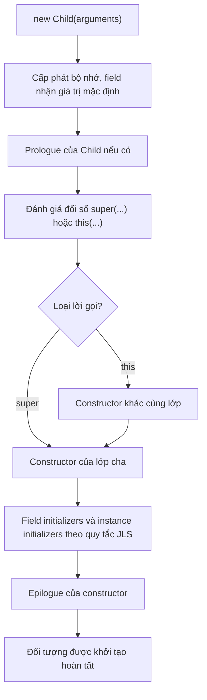

# Early construction context và các giới hạn sử dụng đối tượng đang khởi tạo

> **Chương:** Hàm khởi tạo linh hoạt  
> **Học phần:** `JAVA_VERSION_JAVA25` — tìm hiểu các khả năng Java 25 còn phù hợp với phát triển Java hiện đại, gồm compact source files, module import, flexible constructor bodies, ScopedValue và các công cụ như JFR/AOT cache.  
> **Phạm vi bài này:** Quy tắc **early construction context** trong **Flexible Constructor Bodies (JEP 513)**: code nào được đứng trước `super(...)`/`this(...)`, code nào được truy cập vào đối tượng đang khởi tạo, thứ tự thực thi và các lỗi thường gặp.  
> **Nguyên tắc phiên bản:** JEP 513 đã **final trong Java 25**. Những ví dụ dưới đây nhắm tới JDK 25 phát hành chính thức, **không** dùng cú pháp hoặc giả định từ các bản preview cũ.

## 1. Vì sao cần hiểu early construction context?

Khi tạo đối tượng Java, constructor lớp con thường cần gọi constructor lớp cha. Trước Java 25, lời gọi tường minh `super(...)` hoặc `this(...)` phải ở đầu thân constructor, gây khó khăn khi muốn kiểm tra và chuẩn bị đối số trước khi truyền cho lớp cha.

Ví dụ một lớp `PositiveAmount` kế thừa lớp cần giá trị số nguyên dương. Trong Java 25, ta có thể **kiểm tra dữ liệu trước khi lớp cha được khởi tạo**:

```java
class AmountBase {
    private final long value;

    AmountBase(long value) {
        this.value = value;
    }

    long value() {
        return value;
    }
}

class PositiveAmount extends AmountBase {
    PositiveAmount(long value) {
        if (value <= 0) {
            throw new IllegalArgumentException("amount must be positive");
        }
        super(value);
    }
}
```

Trong ví dụ:

1. `new PositiveAmount(50)` được gọi.
2. Điều kiện `value <= 0` được kiểm tra **trước** khi gọi `AmountBase(long)`.
3. Nếu dữ liệu hợp lệ, `super(value)` khởi tạo phần lớp cha.
4. Nếu không hợp lệ, constructor kết thúc bằng exception mà chưa gọi constructor cha.

Điều này giúp validation rõ ràng hơn, không phải viết helper static phức tạp chỉ để nhét logic vào biểu thức đối số của `super(...)`.

**Tuy nhiên**, tại thời điểm kiểm tra `value`, đối tượng `PositiveAmount` **chưa khởi tạo xong**. Java vẫn phải ngăn code đọc field instance, gọi instance method hoặc làm rò rỉ `this` trước khi chuỗi constructor hợp lệ. Tập quy tắc đó được gọi là *early construction context*.

Kết quả cần đạt: khi nhìn một đoạn code nằm trước `super(...)`, bạn có thể giải thích được **vì sao compile hoặc không compile**, đặc biệt trong các trường hợp dùng `this`, `super`, field, instance method, local variable, lambda và nested class.

## 2. Cấu trúc constructor Java 25: prologue và epilogue

Một constructor có lời gọi tường minh `super(...)` hoặc `this(...)` có cấu trúc logic:

```java
class Parent {
    Parent() {}
    Parent(int value) {}
}

class Child extends Parent {
    Child(int input) {
        // PROLOGUE: các statement trước lời gọi constructor.
        int prepared = Math.max(input, 0);

        super(prepared); // Explicit constructor invocation.

        // EPILOGUE: các statement sau lời gọi constructor.
        System.out.println("Child initialized");
    }
}
```

- **Prologue:** những *block statements* nằm trước lời gọi constructor tường minh.
- **Explicit constructor invocation:** một lời gọi `super(...)`, `this(...)` hoặc dạng qualified `super(...)` hợp lệ.
- **Epilogue:** những statement nằm sau lời gọi đó.
- **Early construction context:** **bao gồm toàn bộ prologue lẫn những biểu thức/construct nằm bên trong lời gọi constructor**, không chỉ các dòng đứng trước `super(...)`.

Một thân constructor có **tối đa một** explicit constructor invocation. Cấu trúc Java không cho phép đặt hai lời gọi `super(...)`/`this(...)` hoặc chọn một lời gọi bên trong từng nhánh `if` theo cách viết thông thường.

Nếu **không có** lời gọi constructor tường minh và lớp khác `Object`, Java dùng lời gọi `super()` **ngầm định ở đầu**, còn các statement trong thân constructor là epilogue. Do đó, code không được đẩy “lên trước super ngầm định” chỉ bằng cách bỏ từ khóa `super`.

Ví dụ không dùng prologue:

```java
class DefaultChild extends Parent {
    DefaultChild() {
        // Trình biên dịch xử lý như có super(); trước câu này.
        System.out.println("After implicit super()");
    }
}
```

### Sơ đồ khái niệm



Sơ đồ trên mô tả **luồng ý tưởng**, không phải một chuỗi thực thi tuyến tính cho mọi trường hợp `this(...)`: khi có constructor chaining, prologue/epilogue của từng constructor lồng nhau theo thứ tự lời gọi, còn field initializers của một lớp chỉ được chạy ở đúng bước khởi tạo tương ứng. Phần 7 sẽ mô tả chi tiết.

## 3. Định nghĩa chính xác early construction context

Theo **Java Language Specification Java SE 25, §8.8.7**:

> Một construct nằm trong early construction context của lớp `C` khi nó nằm ở **prologue constructor của `C`**, hoặc được **lồng trong explicit constructor invocation** của constructor `C`.

Ví dụ:

```java
class Parent {
    Parent(String text) {}
}

class Child extends Parent {
    Child(String raw) {
        String value = raw.strip();       // (1) early context
        if (value.isEmpty()) {            // (2) early context
            throw new IllegalArgumentException("empty");
        }
        super(value.toUpperCase());       // (3) biểu thức đối số cũng early context

        System.out.println(value);        // (4) epilogue
    }
}
```

Ở `(1)`, `(2)`, `(3)`, bạn có thể dùng parameter `raw`, local variable `value`, static method và các đối tượng **không phải chính `Child` đang tạo**. Nhưng không thể tùy ý gọi method/đọc field của `Child` bằng `this`, kể cả khi không viết từ khóa `this`. Sau `super(...)`, các quy tắc truy cập instance thông thường được áp dụng (vẫn phải tôn trọng definite assignment và luật constructor khác).

### Vì sao phải hạn chế?

Trong quá trình tạo `Child`, bộ nhớ dành cho instance đã được cấp phát, nhưng những phần bất biến mà constructor của superclass, field initializer và constructor của `Child` có nhiệm vụ thiết lập **chưa chắc đã được hoàn thành**. Nếu Java cho phép các lệnh như `this.publish()` hoặc `register(this)` từ prologue, code có thể quan sát/để lộ một instance ở trạng thái chưa hoàn tất.

Do đó, Java 25 phân biệt rõ:

- **Dùng input, local variable, static member, đối tượng khác:** được phép theo các quy tắc Java thông thường.
- **Đọc trạng thái instance hiện tại hoặc gọi instance method của nó:** bị hạn chế trong early context.
- **Gán bằng phép gán đơn cho một số field chưa có initializer của lớp đang tạo:** ngoại lệ **rất cụ thể**, sẽ bàn ở phần 6.

Điều này không phải một “static context” hoàn toàn: constructor vẫn gắn với một đối tượng đang tạo và JLS có ngoại lệ cho phép một vài thao tác gán sớm; nhưng **chưa phải giai đoạn được phép sử dụng instance thoải mái**.

## 4. Các thao tác được phép: input, local, static và đối tượng khác

### 4.1. Validation và chuẩn hóa đối số

```java
import java.util.Objects;

class NamedBase {
    NamedBase(String name) {
        System.out.println("Base name: " + name);
    }
}

class NamedChild extends NamedBase {
    NamedChild(String requestedName) {
        String normalized = Objects.requireNonNull(
            requestedName, "requestedName").trim();

        if (normalized.isEmpty()) {
            throw new IllegalArgumentException("Blank name");
        }

        super(normalized);
        System.out.println("Child ready");
    }
}
```

`requestedName` là parameter, `normalized` là local variable, `Objects.requireNonNull` là static method; không thao tác nào cần đọc `this`.

Các câu lệnh `if`, khai báo biến, phép tính, gọi static method, kiểm tra collection, vòng lặp hoặc `throw` trong prologue đều có thể phù hợp **nếu bản thân các biểu thức tuân thủ quy tắc early context**. JEP 513 không biến prologue thành nơi cấm mọi statement.

### 4.2. Gọi method trên đối tượng khác

```java
import java.util.Locale;

class Prefix {
    Prefix(String text) {}
}

class PrefixWithLocale extends Prefix {
    PrefixWithLocale(String input, Locale locale) {
        String cleaned = input.toUpperCase(locale);
        super(cleaned);
    }
}
```

`input` và `locale` không phải receiver `this` của `PrefixWithLocale`; gọi `input.toUpperCase(locale)` hợp lệ. Dù vậy, validation `locale != null` vẫn nên thực hiện để lỗi dễ hiểu hơn.

### 4.3. Static method và static field

```java
class ThresholdBase {
    ThresholdBase(int minimum) {}
}

class Threshold extends ThresholdBase {
    private static final int LOWEST = 1;

    Threshold(int given) {
        int minimum = Math.max(given, LOWEST);
        super(minimum);
    }
}
```

`Math.max` và `LOWEST` không phụ thuộc một instance `Threshold`. **Đừng nhầm** static field với instance field chỉ vì chúng cùng nằm trong lớp.

## 5. Các thao tác bị cấm: đọc hoặc sử dụng đối tượng đang tạo

Trong các đoạn code bên dưới, những dòng gây lỗi được cố tình đánh dấu `// ERROR`; mỗi đoạn là **ví dụ phản chứng riêng**, không phải mã cần giữ nguyên trong build sản phẩm.

### 5.1. `this`, field read và instance method

```java
class Base {
    Base() {}
    Base(int value) {}
    int baseCount = 2;
    void baseMethod() {}
}

class WrongChild extends Base {
    int count;
    int initial = 3;

    void greet() {}

    WrongChild(int value) {
        System.out.println(this);    // ERROR: sử dụng this
        // System.out.println(count); // ERROR: đọc instance field
        // System.out.println(initial); // ERROR: đọc field có initializer
        // greet();                   // ERROR: gọi instance method ngầm
        // this.greet();              // ERROR: gọi instance method qua this
        // getClass();                // ERROR: instance method thừa kế
        super(value);
    }
}
```

Một tham chiếu không ghi `this` như `count` hoặc `greet()` vẫn mang nghĩa `this.count`/`this.greet()` trong ngữ cảnh này; bỏ chữ `this` **không** làm nó trở thành thao tác hợp lệ. Dòng `System.out.println(this)` cũng bị cấm vì có thể làm lộ receiver chưa khởi tạo.

**Lưu ý:** ví dụ `WrongChild` được viết nhằm cho thấy lỗi tại đúng một dòng đang bật. Khi thử các dòng còn lại, hãy bỏ comment từng dòng một để so sánh diagnostic của compiler. Không gộp nhiều lỗi trong một lần test rồi suy diễn nguyên nhân.

### 5.2. `super` field và `super` method

```java
class ParentWithState {
    int state = 10;

    ParentWithState() {}

    void inspect() {}
}

class WrongSuper extends ParentWithState {
    WrongSuper() {
        // System.out.println(super.state); // ERROR: đọc super field
        // super.inspect();                  // ERROR: gọi super method
        // inspect();                        // ERROR: inherited instance method
        super();                             // constructor invocation hợp lệ
    }
}
```

`super()` ở đây là **lời gọi constructor** cho phép; `super.state`, `super.inspect()` hay `super::inspect` là những truy cập member của superclass khi superclass chưa được khởi tạo xong, nên không hợp lệ trong early context.

### 5.3. Method reference, lambda và rò rỉ receiver

```java
class WithCallback {
    WithCallback(Runnable callback) {}
}

class BadCallback extends WithCallback {
    void handle() {}

    BadCallback() {
        // Runnable r = this::handle;     // ERROR: captured this
        // Runnable r = () -> handle();   // ERROR: gọi instance method
        // Runnable r = () -> System.out.println(this); // ERROR
        super(() -> System.out.println("callback on other data")); // OK
    }
}
```

Một lambda **không nhắc tới đối tượng hiện tại** có thể được tạo trong prologue hoặc truyền vào `super(...)`. Nhưng **không** được dùng lambda hoặc inner class để “lách” hạn chế truy cập `this`: compiler vẫn áp dụng quy tắc early context cho construct nằm bên trong.

### 5.4. Constructor invocation không phải statement tùy ý trong control flow

```java
class WrongBranch extends Base {
    WrongBranch(boolean condition) {
        // if (condition) {
        //     super();  // ERROR: không đặt constructor invocation trong if
        // } else {
        //     super(1);
        // }
        super(condition ? 1 : 2); // OK: đúng một constructor invocation
    }
}
```

JLS quy định thân constructor có **tối đa một** explicit constructor invocation. Hãy tính đối số ở prologue hoặc trong biểu thức `super(...)`, không viết hai constructor invocations trong hai nhánh.

**Chốt:** early construction context không cấm Java statements nói chung; nó hạn chế **cách các statement ấy tham chiếu receiver chưa khởi tạo**.

## 6. Ngoại lệ quan trọng: phép gán sớm cho field của chính lớp

Nhận định “trước `super(...)` tuyệt đối không được dùng `this`” là **không chính xác** đối với Java 25 final. JLS cho phép một ngoại lệ có chủ đích: **phép gán đơn** (`=`) vào một **instance field do chính lớp đang xây dựng khai báo**, **chưa có initializer trong khai báo**, và **không nằm bên trong lambda/inner class** thuộc early construction context.

### 6.1. Ví dụ hợp lệ với blank `final` field

```java
class IdentityBase {
    IdentityBase() {}
}

class UserIdentity extends IdentityBase {
    private final String name;

    UserIdentity(String requestedName) {
        String validated = java.util.Objects.requireNonNull(requestedName);
        if (validated.isBlank()) {
            throw new IllegalArgumentException("name must not be blank");
        }

        this.name = validated; // OK: simple assignment vào blank final field
        super();               // OK: constructor cha được gọi sau phép gán sớm
    }

    String name() {
        return name;
    }
}
```

`name` là field **chưa có initializer**, nên `this.name = validated` dùng ngoại lệ cho phép của JLS. Có thể dùng tên đơn giản `name = validated` nếu không bị biến cục bộ che khuất và vẫn là phép gán hợp lệ.

Điều này đặc biệt hữu ích khi superclass constructor gọi một method được subclass override: field quan trọng có thể được thiết lập trước khi code ở superclass gọi phương thức đó. Nhưng vẫn **không** được dùng instance method của `UserIdentity` từ prologue.

### 6.2. Giới hạn chính xác của ngoại lệ

| Cách viết trong prologue | Hợp lệ? | Vì sao? |
|---|---|---|
| `this.id = input;` khi `int id;` | **Có** | Phép gán đơn vào field của lớp hiện tại, không có initializer |
| `id = input;` khi `int id;` | **Có** | Cùng ý nghĩa, nếu tên `id` trỏ tới field của lớp hiện tại |
| `this.name = input;` khi `final String name;` | **Có** | Blank final field có thể gán nếu thỏa definite assignment |
| `this.count = 5;` khi `int count = 1;` | **Không** | Field đã có initializer trong khai báo |
| `count++;` khi `int count;` | **Không** | `++` đọc giá trị cũ, không phải simple assignment |
| `count += 1;` | **Không** | Compound assignment vừa đọc vừa ghi |
| `int old = count;` | **Không** | Đọc instance field |
| `System.out.println(this.id);` | **Không** | Đọc field/receiver trong early context |
| `this.id = this.compute();` | **Không** | RHS gọi instance method của receiver chưa khởi tạo |
| `super.id = 5;` hoặc gán field kế thừa | **Không** | Field thuộc superclass, hoặc qualified `super` bị cấm |
| `Runnable r = () -> this.id = 5;` | **Không** | Gán sớm qua lambda không thuộc ngoại lệ |
| `this.id = other.id;` | **Có**, nếu `other` là object khác hợp lệ | LHS là phép gán được phép; RHS không đọc current instance |

**Quy tắc không đơn giản là “mọi phép ghi đều được”:** một phép gán `=` có thể vẫn không hợp lệ vì field đã có initializer, field thuộc superclass, RHS tham chiếu `this`, hoặc ràng buộc `final`/definite assignment.

### 6.3. Vì sao field có initializer bị loại trừ?

```java
class ExplicitInitializer extends IdentityBase {
    int score = 10;

    ExplicitInitializer(int supplied) {
        // this.score = supplied; // ERROR trong early context: field đã có initializer
        super();
        this.score = supplied;     // OK: sau super và instance field initializer
    }
}
```

Instance field initializers của lớp con được thực thi **sau khi** constructor superclass hoàn tất. Nếu cho phép gán sớm vào field đã có initializer, thứ tự có thể dẫn đến ghi đè giá trị vừa gán và nhầm lẫn về invariant. Java 25 giới hạn ngoại lệ vào field **không có** initializer.

### 6.4. Có được gán nhiều lần một blank field?

Khả năng gán sớm không xóa bỏ quy tắc `final` và definite assignment. Với `final` field, compiler vẫn đòi đường đi khởi tạo hợp lệ và ngăn các phép gán lặp vi phạm luật. Với field không `final`, Java cho phép ghi nhiều lần ở các giai đoạn khác nhau, nhưng **không** cho phép đọc nó trong early context chỉ vì vừa gán một giá trị ở dòng trước.

```java
class AssignButDoNotRead extends IdentityBase {
    int count;

    AssignButDoNotRead(int value) {
        this.count = value;       // OK
        // int next = this.count + 1; // ERROR: vẫn là đọc instance field
        super();
        System.out.println(count); // OK: sau super
    }
}
```

**Cách an toàn cho đa số ứng dụng:** dùng local variable để tính toán/validate, rồi gán field ở epilogue. Chỉ gán trước `super()` khi có lý do thiết kế rõ, ví dụ muốn bảo đảm dữ liệu sẵn sàng cho một callback từ constructor cha (và biết rủi ro của virtual dispatch trong constructor).

## 7. Thứ tự chạy thực tế và virtual dispatch từ constructor cha

Khái niệm early context dễ nhớ nhất qua thứ tự khởi tạo object:

1. JVM cấp phát object; các instance fields ban đầu có **giá trị mặc định** (`0`, `false`, `null`, ...).
2. Prologue của constructor được gọi chạy (nếu có) **trước** explicit `super(...)`/`this(...)`.
3. Đánh giá các arguments của constructor invocation, sau đó chạy constructor được gọi.
4. Khi một constructor trực tiếp gọi `super(...)` hoàn tất lời gọi cha, Java thực thi **instance field initializers và instance initializer blocks** của lớp hiện tại theo thứ tự khai báo.
5. Chạy epilogue của constructor hiện tại; nếu có chuỗi `this(...)`, quay lại những epilogue của các constructor delegating tương ứng.

JLS §12.5 mô tả chi tiết bảy bước cho khởi tạo đối tượng, kể cả trường hợp có nhiều lớp cha và `this(...)`. Đừng diễn giải “field đã được cấp phát bộ nhớ” thành “field đã trải qua initializer của lớp con”.

### 7.1. Ví dụ: superclass gọi method override

```java
class ParentCallbacks {
    ParentCallbacks() {
        describe(); // Virtual dispatch có thể gọi override ở lớp con.
    }

    void describe() {}
}

class ChildCallbacks extends ParentCallbacks {
    private final int id;
    private int level = 99;

    ChildCallbacks(int suppliedId) {
        if (suppliedId <= 0) {
            throw new IllegalArgumentException("id must be positive");
        }

        this.id = suppliedId; // Blank final field được gán trước super().
        super();

        System.out.println("After super: level=" + level);
    }

    @Override
    void describe() {
        System.out.println("From parent: id=" + id
                + ", level=" + level);
    }

    public static void main(String[] args) {
        new ChildCallbacks(42);
    }
}
```

Dự đoán output:

```text
From parent: id=42, level=0
After super: level=99
```

Giải thích:

- `id=42` vì prologue của `ChildCallbacks` đã gán `this.id` trước khi vào constructor `ParentCallbacks`.
- `level=0` lúc `ParentCallbacks()` gọi `describe()` vì field initializer `level = 99` của lớp con **chưa được chạy**.
- Sau khi `super()` trả về, initializer `level = 99` mới thực thi; epilogue in `99`.

**Cảnh báo thiết kế:** gọi method có thể override từ constructor cha thường là một mùi thiết kế vì subclass chưa khởi tạo đầy đủ. Java 25 cho phép chuẩn bị một số field sớm nhưng **không khiến mọi field, mọi invariant hoặc mọi dependency của subclass trở nên an toàn**. Nếu kiểm soát được thiết kế superclass, ưu tiên không gọi overridable method từ constructor. Dùng factory, callback sau initialization hoặc lifecycle thích hợp khi logic phức tạp.

### 7.2. `super()` không được bỏ qua

Flexible constructor bodies **không xóa yêu cầu khởi tạo superclass**. Một constructor thường vẫn phải dẫn đến đường gọi constructor cha hợp lệ qua `super(...)` hoặc chuỗi `this(...)`; không được chọn nhánh `if` để “không cần gọi super”, và không được bỏ `super(...)` để làm các statement trước nó tự động trở thành prologue.

Với constructor không có explicit invocation, Java coi như có `super()` **ngầm định trước epilogue**, không phải là `super()` được gọi sau các dòng đầu. Đây là khác biệt thường gây hiểu nhầm khi đọc code được viết trước Java 25.

## 8. `this(...)` cũng có early construction context

JEP 513 không chỉ mở rộng `super(...)`; prologue trước `this(...)` cũng được phép xử lý dữ liệu cục bộ.

Ví dụ một constructor `Price(int)` nhận số nguyên rồi ủy quyền sang constructor chuẩn `Price(String, int)`:

```java
import java.util.Objects;

final class Price {
    private final String currency;
    private final int cents;

    Price(int cents) {
        if (cents < 0) {
            throw new IllegalArgumentException("Negative amount");
        }
        this("USD", cents);
    }

    Price(String currency, int cents) {
        super();  // Có thể bỏ: implicit super() cũng hợp lệ.
        this.currency = Objects.requireNonNull(currency);
        this.cents = cents;
    }

    String currency() {
        return currency;
    }

    int cents() {
        return cents;
    }
}
```

Lời gọi `this("USD", cents)` phải nằm trực tiếp trong thân constructor đúng vị trí theo grammar, không thể được đặt trong nhánh điều kiện. Kiểm tra `cents` trước `this(...)` không cần truy cập trạng thái current object, nên hợp lệ.

**Điều cần nhớ:** với `this(...)`, các field initializers của lớp và superclass construction thuộc đường constructor cuối cùng đi tới `super(...)`, **không** chạy lại cho từng constructor delegating. Nếu bạn gán một blank `final` field sớm trong constructor delegating và constructor được gọi cũng cần gán cùng field, việc chứng minh definite assignment phức tạp hoặc có thể vi phạm luật `final`; vì vậy nên ưu tiên validation qua local variables trước `this(...)`, đặt field initialization ở một constructor có trách nhiệm rõ ràng.

### 8.1. Constructor chaining vẫn không cho phép đệ quy

```java
class BadDelegation {
    BadDelegation() {
        this(1);
    }

    BadDelegation(int value) {
        // this(); // ERROR nếu bật: chuỗi gọi constructor sẽ quay về chính nó
        super();
    }
}
```

JLS cấm constructor trực tiếp hoặc gián tiếp gọi chính nó qua chuỗi `this(...)`. Có prologue không thay đổi quy tắc này.

## 9. Local class, inner class, lambda và enclosing instance

Quy tắc early context nhắm tới **đối tượng C đang xây dựng**, không phải mọi instance ở ngoài thế giới.

### 9.1. Không được tạo inner member class cần chính `this` chưa khởi tạo

```java
class Container {
    class InnerTask {}

    Container() {
        // InnerTask task = new InnerTask(); // ERROR: cần Container.this chưa sẵn sàng
        super();
    }
}
```

`new InnerTask()` ngầm cần current `Container.this` làm enclosing instance; ở prologue của constructor `Container`, thao tác đó bị cấm. Cách phù hợp là dùng một **static nested class** không phụ thuộc enclosing instance, hoặc đợi tới epilogue.

```java
class SafeContainer {
    static class Task {}

    SafeContainer() {
        Task task = new Task(); // OK: không cần current outer instance
        super();
        System.out.println(task != null);
    }
}
```

### 9.2. Enclosing object khác với current object

Ví dụ dưới đây có **hai object khác nhau**: `Outer` đã tồn tại và đối tượng `Inner` mới đang khởi tạo.

```java
class Outer {
    int value = 7;

    class Inner {
        Inner() {
            System.out.println(Outer.this.value); // OK: Outer object riêng
            super();
        }
    }
}
```

Early context ở đây là của **`Inner`**. `Outer.this` tham chiếu tới enclosing `Outer` đã có, **không phải `Inner.this` đang khởi tạo**; việc đọc state của object bên ngoài có thể hợp lệ, như mô tả trong tài liệu Oracle. Đừng tổng quát hóa thành “mọi `this` đều luôn bị cấm”: phải xác định `this` thuộc lớp nào và receiver nào thực sự đang được xây dựng.

### 9.3. Lambda chỉ được dùng khi không capture current receiver

```java
class CallbackBase {
    CallbackBase(Runnable job) {}
}

class LambdaChild extends CallbackBase {
    LambdaChild(String input) {
        String text = input.strip();

        Runnable job = () -> System.out.println(text); // OK: capture local
        // Runnable bad = () -> System.out.println(this); // ERROR

        super(job);
    }
}
```

Lambda hợp lệ khi capture local effectively final và không tham chiếu current `this`. Việc định nghĩa một lambda **không** tự khiến những truy cập instance bên trong được hợp pháp hóa, kể cả khi lambda chỉ được gọi sau khi constructor hoàn tất.

## 10. Ứng dụng với record và những giới hạn thiết kế khác

**Record** có quy tắc constructor riêng. Java 25 cho phép đặt statement trước `this(...)` trong constructor **noncanonical** của record; tuy nhiên record constructor không thể gọi `super(...)` tường minh. Constructor canonical/compact canonical tiếp tục tuân thủ quy tắc riêng của record, không nên xem như bản sao constructor lớp thường.

```java
record Rectangle(int width, int height) {
    Rectangle(int size) {
        if (size < 0) {
            throw new IllegalArgumentException("size must be nonnegative");
        }
        this(size, size); // Canonical constructor của record
    }
}
```

Ở đây constructor một tham số là **noncanonical** và ủy quyền cho canonical `Rectangle(int, int)`. Validation trước `this(size, size)` dùng early construction context hợp lệ, không cần preview flag.

**Đừng áp dụng mù quáng vào enum hoặc những class được framework tạo.** Enum có cơ chế khởi tạo và lời gọi superclass đặc biệt; record có ràng buộc canonical constructor; class chịu quản lý của dependency injection/proxy phải được kiểm thử với framework thực tế. Flexible constructor bodies là thay đổi ngôn ngữ giúp viết validation và initialization an toàn, **không xóa bỏ các hợp đồng riêng của từng loại class**.

## 11. Quy tắc ra quyết định khi đọc code trước `super(...)`

Khi gặp một statement trong constructor, thay vì chỉ hỏi “nó nằm trước hay sau `super()`?”, hãy lần lượt xác định:

1. **Có explicit `super(...)` hoặc `this(...)` không?** Nếu có, phần trước là prologue; các biểu thức bên trong lời gọi cũng nằm trong early construction context.
2. **Statement có tham chiếu current receiver không?** Trực tiếp qua `this`/`super`, hoặc gián tiếp qua tên instance field, instance method, method reference, inner class cần enclosing instance.
3. **Nếu có, liệu nó đúng là *simple assignment* vào field của chính lớp, chưa có initializer, ngoài lambda/inner class?** Đây là ngoại lệ chính.
4. **Nếu không truy cập current receiver, statement vẫn phải hợp lệ theo Java bình thường:** kiểu dữ liệu, definite assignment, exception, scope, accessibility, điều kiện `final`/effectively final, constructor grammar.
5. **Khi runtime chạy, có side effect hoặc callback nào phát sinh trước khi đối tượng hoàn tất?** Code hợp lệ về cú pháp chưa chắc là code có thiết kế tốt.

Bảng tra nhanh:

| Code tại prologue / argument của invocation | Kết luận Java 25 | Giải thích ngắn |
|---|---|---|
| `if (x < 0) throw ...;` | Hợp lệ | `x` là parameter |
| `String clean = x.strip();` | Hợp lệ | Gọi method trên đối tượng khác current `this` |
| `int n = Math.max(0, x);` | Hợp lệ | Static method + local input |
| `super(clean);` | Hợp lệ | Constructor invocation tường minh |
| `this(clean);` | Hợp lệ | Constructor delegation tường minh |
| `this.id = x;` với `int id;` | Hợp lệ trong điều kiện giới hạn | Simple assignment vào field chưa có initializer |
| `this.id = x;` với `int id = 1;` | **Lỗi biên dịch** | Field có declaration initializer |
| `int a = this.id;` | **Lỗi biên dịch** | Đọc current instance |
| `id += 1;` | **Lỗi biên dịch** | Compound assignment đọc field |
| `toString();` hoặc `this.toString();` | **Lỗi biên dịch** | Instance method của receiver |
| `super.toString();` | **Lỗi biên dịch** | Member access qua `super` |
| `this::toString` | **Lỗi biên dịch** | Method reference capture receiver |
| `new Inner()` khi `Inner` là non-static member của current class | **Lỗi biên dịch** | Cần enclosing instance chưa sẵn sàng |
| `new StaticNested()` | Hợp lệ nếu type/access hợp lệ | Không cần instance hiện tại |
| `System.out.println(other.id);` | Hợp lệ nếu `other` có thể truy cập | Đọc object khác |
| `Outer.this.value` trong prologue của inner `Inner` | Có thể hợp lệ | Truy cập enclosing object **khác** |
| Đặt `super()` trong hai nhánh `if` | **Lỗi biên dịch** | Sai grammar constructor |
| Bỏ explicit `super()` rồi viết statements trước | Có thể hợp lệ, **nhưng không thành prologue** | Java chèn implicit `super()` ở đầu |

*Chú ý:* bảng giả định các biến/types khác đã khai báo hợp lệ. Với dòng có lỗi, compiler có thể phát nhiều diagnostic; cần nhìn đúng **ngữ cảnh trước/sau constructor invocation** thay vì chỉ so từ khóa.

## 12. Mẫu thiết kế phù hợp sản phẩm Java 25

### 12.1. Ưu tiên local variable cho validation và chuyển dữ liệu bất biến lên superclass

Ví dụ một `HttpEndpoint` có trường URL cần được chuẩn hóa:

```java
import java.net.URI;
import java.util.Objects;

class EndpointBase {
    private final URI endpoint;

    EndpointBase(URI endpoint) {
        this.endpoint = Objects.requireNonNull(endpoint);
    }

    URI endpoint() {
        return endpoint;
    }
}

final class HttpsEndpoint extends EndpointBase {
    HttpsEndpoint(String rawUrl) {
        URI prepared = URI.create(Objects.requireNonNull(rawUrl).trim());

        if (!"https".equalsIgnoreCase(prepared.getScheme())) {
            throw new IllegalArgumentException("HTTPS required");
        }
        if (prepared.getHost() == null) {
            throw new IllegalArgumentException("Host required");
        }

        super(prepared);
    }
}
```

Bước `URI.create`, validate scheme và host diễn ra trước khi tạo state của `EndpointBase`. Đây là use case trực tiếp của JEP 513, vì lỗi input được phát hiện sớm, dễ test, không cần truy cập receiver.

**Rủi ro còn lại:** đoạn này chưa thay thế toàn bộ chính sách kiểm tra URL an toàn (SSRF, DNS, port, redirect, credential). Trong sản phẩm, cần validation theo yêu cầu bảo mật riêng. Mục đích ở đây là mô tả early construction context, không phải xây dựng bộ lọc URL hoàn chỉnh.

### 12.2. Không gọi service bên ngoài trước `super()` nếu không thật sự cần

```java
class OrderGateway extends EndpointBase {
    OrderGateway(String rawUrl) {
        URI uri = URI.create(rawUrl);
        // externalClient.register(uri); // Không nên: side effect trước khi hoàn tất object
        super(uri);
    }
}
```

Dù một static/client khác có thể được gọi hợp lệ về mặt ngôn ngữ, **gọi network/database, ghi log dữ liệu nhạy cảm, đăng ký callback hoặc tạo resource có side effect** trong prologue là một quyết định rủi ro: constructor cha vẫn có thể lỗi; việc tạo object thất bại không tự hoàn tác những hiệu ứng đã xảy ra. Ưu tiên validation thuần túy, transformation và chuẩn bị dữ liệu bất biến.

### 12.3. Không dùng gán field sớm như một cách “thả `this` ra ngoài”

Trường hợp hợp lệ:

```java
final class PreparedChild extends IdentityBase {
    private final int id;

    PreparedChild(int id) {
        if (id < 1) {
            throw new IllegalArgumentException("id must be positive");
        }
        this.id = id; // Chỉ thiết lập field hiện tại.
        super();
    }
}
```

Không hợp lệ:

```java
class LeakyChild extends IdentityBase {
    LeakyChild() {
        // Registry.global().register(this); // ERROR: truy cập this
        super();
    }
}
```

Hạn chế early construction context là **hàng rào ngôn ngữ** bảo vệ trạng thái object; nhưng các vấn đề lớn hơn như callback từ superclass constructor, concurrent publication sau constructor hay escape của `this` từ instance initializer vẫn cần thiết kế cẩn thận.

### 12.4. Java 25 final khác với preview giai đoạn trước

Flexible constructor bodies đã trải qua các vòng preview trước Java 25; bạn có thể gặp bài viết cũ nhấn mạnh “statements before super” như một tính năng cần `--enable-preview`. Đối với **JDK 25 chính thức**:

- `super(...)` và `this(...)` được phép xuất hiện sau prologue hợp lệ.
- Quy tắc early construction context và ngoại lệ assignment được mô tả trong **JLS SE 25**.
- Biên dịch code Java 25 bằng `javac --release 25`, không cần `--enable-preview` cho JEP 513.
- Nếu IDE hoặc static analyzer báo lỗi tại `super(...)` sau một câu `if`, hãy kiểm tra Java language level/parser và JDK của project, không vội sửa code về workaround preview cũ.
- Nếu phải build cho runtime Java thấp hơn 25, **không** giả định cú pháp này có thể dùng chỉ nhờ máy build cài JDK 25; hãy giữ source release phù hợp runtime đã chọn.

**Giới hạn của tính năng:** JEP 513 chỉ thay đổi một phần cú pháp/ngữ nghĩa constructor. Nó không tự thiết lập các invariant về thread safety, không thay thế DI, không giải quyết toàn bộ vấn đề gọi method override từ superclass constructor, cũng không thay đổi quy tắc `final` và exception handling.

## 13. Tự kiểm chứng bằng `javac` — pass/fail đúng kỳ vọng

Thực hành sử dụng **JDK 25**. Kiểm tra:

```bash
java --version
javac --version
```

Cả JVM và compiler cần là JDK 25 tương thích. Mỗi ca đặt trong file riêng hoặc chỉnh theo hướng dẫn để tránh lỗi trùng tên lớp.

### 13.1. Ca thành công: validate và simple assignment trước `super()`

Tạo `EarlySuccess.java`:

```java
class BaseWithId {
    BaseWithId(int id) {
        System.out.println("Base id=" + id);
    }
}

public class EarlySuccess extends BaseWithId {
    private final int id;

    EarlySuccess(int id) {
        if (id <= 0) {
            throw new IllegalArgumentException("Invalid id");
        }
        this.id = id;  // JEP 513: phép gán sớm được phép
        super(id);
        System.out.println("Child id=" + this.id);
    }

    public static void main(String[] args) {
        new EarlySuccess(42);
    }
}
```

Biên dịch/chạy:

```bash
javac --release 25 EarlySuccess.java
java EarlySuccess
```

Dự kiến:

```text
Base id=42
Child id=42
```

Thử thay `new EarlySuccess(42)` bằng `new EarlySuccess(-1)`: lệnh biên dịch vẫn pass, nhưng lúc chạy ném `IllegalArgumentException` **trước khi** `BaseWithId` in gì. Điều này chứng minh prologue thực thi trước lời gọi superclass constructor.

### 13.2. Ca thất bại: đọc field trong early context

Tạo `EarlyReadError.java`:

```java
class ParentForRead {
    ParentForRead() {}
}

class EarlyReadError extends ParentForRead {
    int count;

    EarlyReadError() {
        int snapshot = this.count; // ERROR: đọc field current instance
        super();
    }
}
```

Thử:

```bash
javac --release 25 EarlyReadError.java
```

**Kỳ vọng:** compiler trả exit code khác 0, vì early context không được đọc field của receiver. Nếu bỏ dòng đọc, constructor có thể compile. Nếu chuyển dòng đọc **sang sau** `super()`, nó hợp lệ theo quy tắc instance access bình thường.

### 13.3. Ca thất bại: field đã có initializer

Tạo `EarlyInitializerError.java`:

```java
class EarlyInitializerError {
    int count = 10;

    EarlyInitializerError() {
        this.count = 20; // ERROR: field count có declaration initializer
        super();
    }
}
```

Kỳ vọng **compile fail**, dù `count` không phải `final`. Vấn đề là `count` có initializer khi khai báo, nên ngoại lệ simple assignment **không** áp dụng.

### 13.4. Ca thất bại: gọi instance method

Tạo `EarlyMethodError.java`:

```java
class EarlyMethodError {
    void inspect() {}

    EarlyMethodError() {
        inspect(); // ERROR: instance method current receiver
        super();
    }
}
```

Kỳ vọng **compile fail**. Thay `inspect()` bằng một static helper không dùng current `this` có thể hợp lệ.

### 13.5. Ma trận kiểm chứng

| Ca | `javac --release 25` | Chạy chương trình | Điều cần kết luận |
|---|---|---|---|
| Validate parameter trước `super(...)` | PASS | PASS nếu input hợp lệ | Prologue thực thi trước constructor cha |
| Gán `this.id = id` cho blank `final` field | PASS | PASS nếu constructor cha hoàn tất | Ngoại lệ simple assignment |
| Đọc `this.count` trước `super()` | FAIL | Không chạy | Đọc current field bị cấm |
| Gán sớm vào field `int count = 10;` | FAIL | Không chạy | Field có declaration initializer không được gán sớm |
| Gọi `inspect()` instance trước `super()` | FAIL | Không chạy | Không gọi instance method current receiver |
| `this::inspect` trước `super()` | FAIL | Không chạy | Không được capture current receiver |
| `count++` trước `super()` | FAIL | Không chạy | Compound read/write không phải simple assignment |
| `this(...)` sau validation local | PASS | PASS nếu chuỗi constructor hợp lệ | Early context áp dụng cho delegation |
| `super()` trong hai nhánh `if/else` | FAIL | Không chạy | Sai grammar constructor |
| `record` noncanonical validate trước `this(...)` | PASS | PASS | Record vẫn tuân thủ quy tắc constructor riêng |
| Superclass gọi overridden method | PASS | Có thể quan sát field chưa có initializer | Không coi việc compile là chứng cứ invariant an toàn |

Có thể tự động hóa các ca mong đợi **biên dịch thất bại** bằng một smoke-test script so sánh exit code; đừng đặt tất cả mã lỗi vào source sản phẩm hoặc coi mọi build fail đều “đạt bài”.

## 14. Bài tập tự đánh giá theo tình huống

### Bài tập 1 — Gán rồi đọc

Đoán đoạn nào hợp lệ:

```java
class Q1 {
    int value;

    Q1(int input) {
        this.value = input; // A
        // int copy = value; // B
        super();
    }
}
```

Giải thích vì sao A có thể hợp lệ nhưng B không hợp lệ dù A đứng trước B.

### Bài tập 2 — Không có explicit invocation

```java
class Q2 {
    int number = 5;

    Q2() {
        System.out.println(number);
    }
}
```

Dòng in `number` có thuộc early construction context không? Java coi `super()` ngầm định ở vị trí nào?

### Bài tập 3 — Lambda capture

```java
class Q3 {
    int code;

    Q3(int value) {
        Runnable ok = () -> System.out.println(value);
        // Runnable bad = () -> System.out.println(this.code);
        super();
    }
}
```

Vì sao lambda `ok` hợp lệ nhưng lambda `bad` không hợp lệ? Nếu tạo `bad` sau `super()`, còn những rủi ro nào khi truyền nó sang thread khác?

### Bài tập 4 — Trường có initializer

```java
class Q4 {
    int level = 7;

    Q4(int input) {
        // this.level = input;
        super();
        this.level = input;
    }
}
```

Dòng nào làm compiler lỗi nếu bỏ comment? Nếu `level` chuyển thành `final`, cần cân nhắc gì với initializer và phép gán ở epilogue?

### Bài tập 5 — Virtual dispatch

Đoán vì sao một superclass có thể quan sát `id=42` nhưng `level=0` dù subclass khai báo `int level = 99;`. Java 25 có khiến lời gọi overridable method trong constructor cha trở nên an toàn tuyệt đối không?

### Gợi ý đáp án

1. A hợp lệ vì simple assignment vào field `Q1.value` chưa có initializer. B đọc receiver trong early context, nên lỗi.
2. Không. Với constructor không có explicit invocation, `super()` được gọi ngầm định **trước** mọi statement thân constructor; `println(number)` thuộc epilogue.
3. `ok` chỉ capture parameter/local, còn `bad` tham chiếu current receiver. Sau `super()`, có thể hợp lệ về mặt ngôn ngữ, nhưng chuyển callback cho thread khác trước khi object tạo xong vẫn tiềm ẩn vấn đề publication và thread safety.
4. Gán sớm trước `super()` vào `level` đã có initializer bị cấm. Nếu `level` là `final` và đã có initializer, không được gán lại ở epilogue như một field thường.
5. `id` có thể được gán trong prologue; `level` mới có giá trị mặc định khi superclass gọi override, vì initializer `=99` của subclass chạy sau superclass constructor. Nguyên tắc “đừng gọi overridable method trong constructor” vẫn có giá trị.

## 15. Checklist hoàn thành và nguồn kiến thức đáng tin cậy

Bạn đạt mục tiêu bài học khi có thể:

- Giải thích được **prologue, explicit constructor invocation, epilogue và early construction context** trong constructor Java 25.
- Chỉ ra được early context bao gồm **cả đối số bên trong** `super(...)`/`this(...)`.
- Phân biệt được truy cập current receiver bị cấm (`this`, `super`, instance field read, instance method, method reference) với truy cập local, static hoặc object khác hợp lệ.
- Nêu đúng ngoại lệ **simple assignment vào field do lớp hiện tại khai báo và chưa có initializer**, không ở trong lambda/inner class, vẫn phải tuân thủ `final`/definite assignment.
- Mô tả thứ tự chạy: prologue → constructor invocation → superclass initialization → instance field/initializer → epilogue, cùng trường hợp đặc biệt khi gọi `this(...)`.
- Nhận diện rủi ro superclass gọi overridable method và hiểu việc gán sớm một field không bảo đảm các field khác đã sẵn sàng.
- Dự đoán được lỗi biên dịch khi gán field có initializer, dùng `count++`, `this::method`, tạo inner class cần current enclosing instance hoặc gọi `super()` trong nhánh.
- Viết được ví dụ record noncanonical validate trước `this(...)` mà không coi record canonical giống constructor lớp thường.
- Sử dụng `javac --release 25` để kiểm chứng **JEP 513 final**, không bật preview chỉ vì hướng dẫn cũ còn đề cập JEP 482/492.

### Tài liệu tham khảo

1. [JEP 513 — Flexible Constructor Bodies](https://openjdk.org/jeps/513): tính năng **final trong Java 25**, động cơ thiết kế và phạm vi.
2. [Oracle Java 25 — Flexible Constructor Bodies](https://docs.oracle.com/en/java/javase/25/language/flexible-constructor-bodies.html): các ví dụ hợp lệ/lỗi, early construction context, field assignment, nested classes và record.
3. [JLS Java SE 25 — §8.8.7 Constructor Body](https://docs.oracle.com/javase/specs/jls/se25/html/jls-8.html#jls-8.8.7): định nghĩa prologue, epilogue và early context.
4. [JLS Java SE 25 — §8.8.7.1 Constructor Invocations](https://docs.oracle.com/javase/specs/jls/se25/html/jls-8.html#jls-8.8.7.1): cú pháp `super(...)`/`this(...)`, giới hạn invocation.
5. [JLS Java SE 25 — §6.5.6.1 Simple Expression Names](https://docs.oracle.com/javase/specs/jls/se25/html/jls-6.html#jls-6.5.6.1): ngoại lệ gán sớm field của chính lớp, không có initializer và không trong lambda/inner class.
6. [JLS Java SE 25 — §12.5 Creation of New Class Instances](https://docs.oracle.com/javase/specs/jls/se25/html/jls-12.html#jls-12.5): thứ tự thực thi prologue, constructor call, initializer và epilogue.
7. [JLS Java SE 25 — §15.8.3 `this`](https://docs.oracle.com/javase/specs/jls/se25/html/jls-15.html#jls-15.8.3): giới hạn tham chiếu current object.
8. [Oracle JDK 25 — `javac` options](https://docs.oracle.com/en/java/javase/25/docs/specs/man/javac.html): cấu hình `--release 25` và chính sách preview.

**Ghi chú hiện hành:** Bài tập trung vào **JDK 25 chính thức** và các quy tắc còn phù hợp khi viết Java hiện đại. Với JDK mới hơn, ưu tiên kiểm tra JLS đúng phiên bản và compiler/toolchain thực dùng; không giữ các workaround từ giai đoạn preview như một quy tắc Java 25 và không dùng thao tác vượt qua hệ thống constructor thông thường để né giới hạn khởi tạo.
