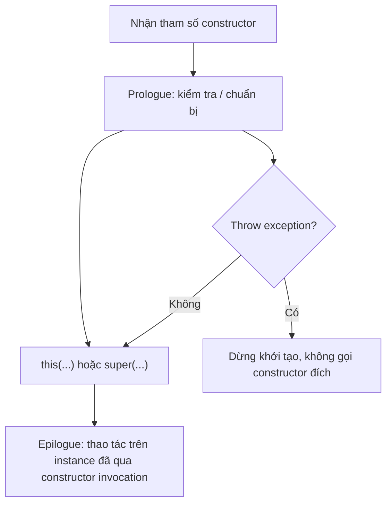
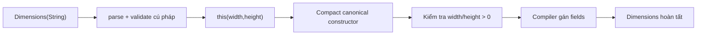

# Ràng buộc khi áp dụng cho kế thừa, lớp lồng và hàm khởi tạo record

**Flexible Constructor Bodies** là thay đổi ngôn ngữ được hoàn thiện trong **Java 25** qua **JEP 513**. Nó cho phép viết các câu lệnh **trước** lời gọi constructor khác bằng `super(...)` hoặc `this(...)`; tuy nhiên, đối tượng hiện tại vẫn đang trong giai đoạn xây dựng ban đầu. Vì vậy, lợi ích lớn nhất không nằm ở “được làm mọi việc trước `super()`”, mà ở khả năng **kiểm tra dữ liệu, chuẩn bị đối số và khởi tạo một số field có kiểm soát** mà vẫn giữ các bảo đảm an toàn của Java.

Bài thuộc chương **Hàm khởi tạo linh hoạt** của chương trình **Java 25** (`JAVA_VERSION_JAVA25`), tập trung vào ba trường hợp dễ nhầm: **kế thừa**, **lớp lồng** và **constructor của record**. Kiến thức và ví dụ dựa trên quy tắc Java Language Specification **SE 25**, không sử dụng cú pháp preview cũ của JEP 447/482/492 hay kỹ thuật đã legacy. Chúng hữu ích khi hiện đại hóa code Java, thiết kế object invariants và đánh giá codebase trong một đợt nâng cấp JDK.

## 1. Phân biệt prologue, constructor invocation và epilogue

Trong constructor có lời gọi tường minh, Java 25 cho phép cấu trúc:

```java
Child(Input input) {
    // Prologue: có thể kiểm tra/biến đổi dữ liệu.
    var prepared = prepare(input);

    // Tối đa một lời gọi constructor ở mức body này.
    super(prepared);

    // Epilogue: hoàn tất phần còn lại của Child.
    finishSetup();
}
```

Ví dụ trên là **mẫu cấu trúc**, không phải class độc lập để biên dịch: `prepare` nên là hàm static hoặc logic không cần instance hiện tại; `finishSetup()` là lời gọi instance sau `super(...)`. Theo JLS §8.8.7, phần trước `super(...)` hoặc `this(...)` gọi là **prologue**; phần sau là **epilogue**. Cả prologue và các biểu thức bên trong lời gọi constructor đều thuộc **early construction context** của lớp đang được tạo.



Nếu constructor **không** có lời gọi tường minh và không phải `Object`, Java xử lý như có `super();` ở đầu và các câu lệnh trong body là epilogue. Không được tự suy luận rằng compiler dời `super()` xuống sau mọi lệnh nếu người lập trình không viết nó.

| Quy tắc | Ý nghĩa thực tế |
| --- | --- |
| Cho phép câu lệnh trước `super(...)` hoặc `this(...)` | Có thể validate và tính toán trước khi chuyển điều khiển |
| Tại một constructor body chỉ có **tối đa một** constructor invocation | Không có hai nhánh `if/else` mỗi nhánh gọi `super(...)` |
| Không được dùng đối tượng hiện tại như đã hoàn tất khởi tạo trong prologue | Cấm phần lớn cách đọc field/gọi instance method của `this` |
| Không thể `return;` ở prologue | Muốn từ chối dữ liệu, dùng `throw`; epilogue có quy tắc riêng |
| Có thể ném exception trong prologue | Fail-fast trước các side effects có thể phát sinh từ constructor cha |
| Quy tắc `this(...)` và `super(...)` vẫn áp dụng | Không được tạo chu trình gọi constructor, không vượt quyền truy cập |

**Điểm mấu chốt:** Java 25 thay đổi vị trí được phép đặt các câu lệnh, **không** phá bỏ thứ tự khởi tạo object hay quyền truy cập của constructor cha.

## 2. Kế thừa: kiểm tra trước khi gọi constructor cha

Trước Java 25, mã thường phải dùng một hàm `static` ngay trong đối số của `super(...)` để validate. Java 25 cho phép biểu đạt ý định rõ ràng hơn.

```java
// AccountDemo.java — Java 25
import java.util.Objects;

class NamedResource {
    private final String name;

    NamedResource(String name) {
        this.name = name;
        System.out.println("Parent created: " + name);
    }

    String name() {
        return name;
    }
}

final class CustomerAccount extends NamedResource {
    private final String region;

    CustomerAccount(String rawName, String rawRegion) {
        String normalizedName =
                Objects.requireNonNull(rawName, "name").trim();
        String normalizedRegion =
                Objects.requireNonNull(rawRegion, "region").trim();
        if (normalizedName.isBlank() || normalizedRegion.isBlank()) {
            throw new IllegalArgumentException("name/region không được rỗng");
        }

        super(normalizedName);
        this.region = normalizedRegion;
    }

    String region() {
        return region;
    }
}

public class AccountDemo {
    public static void main(String[] args) {
        var account = new CustomerAccount("  An  ", " VN ");
        System.out.println(account.name() + " / " + account.region());
    }
}
```

```bash
javac --release 25 AccountDemo.java
java AccountDemo
```

Kết quả dự kiến:

```text
Parent created: An
An / VN
```

Những lệnh `Objects.requireNonNull`, `trim()` và `isBlank()` thao tác trên **tham số hoặc object đã có**, không đụng đến `this` đang được tạo. Phần `super(normalizedName)` gọi constructor cha chỉ **sau khi** dữ liệu hợp lệ. Lệnh gán `this.region` nằm sau đó, nên thuộc epilogue.

### Trường hợp validation thất bại

```java
new CustomerAccount("   ", "VN");
```

Lời gọi sẽ ném `IllegalArgumentException` trước khi `NamedResource(String)` chạy. Đây là lợi ích thực tế khi constructor cha có thao tác tốn chi phí, đăng ký một tài nguyên, ghi log hoặc có những side effects khác. Tuy nhiên, **đừng biến constructor thành nơi gọi mạng hoặc ghi database**; việc dựng object nên có tác dụng phụ nhỏ và dễ dự đoán.

### Không được gọi `super()` bên trong nhánh điều kiện

Ví dụ sau **không hợp lệ**:

```java
class Base {
    Base(int value) {}
}

class Broken extends Base {
    Broken(int value) {
        if (value > 0) {
            super(value); // SAI: invocation nằm trong if.
        } else {
            super(1);     // SAI: invocation nằm trong else.
        }
    }
}
```

Cách sửa là tính ra đối số, sau đó gọi **một** `super(...)` trong body:

```java
class Fixed extends Base {
    Fixed(int value) {
        int normalized = Math.max(1, value);
        super(normalized);
    }
}
```

Prologue có thể dùng `if` cho validation, nhưng **lời gọi constructor** không trở thành statement được phép phân nhánh như một lời gọi method thông thường.

## 3. Kế thừa: early construction context không được đọc `this`

Khi chưa đi qua constructor invocation, đối tượng đang hình thành chưa đạt trạng thái an toàn để bị quan sát. **Đoạn prologue và các biểu thức đối số `super(...)`/`this(...)` cùng bị hạn chế**.

| Cách viết trong prologue | Hợp lệ? | Giải thích |
| --- | --- | --- |
| `int n = argument + 1;` | Có | Đọc tham số/local |
| `if (argument < 0) throw ...;` | Có | Fail-fast mà không dùng instance |
| `String x = Objects.requireNonNull(arg);` | Có | Gọi static helper, thao tác trên object đầu vào |
| `int x = STATIC_CONSTANT;` | Có | Đọc static member phù hợp |
| `this.value = argument;` | **Có điều kiện** | Assignment đơn giản vào field của lớp hiện tại chưa có initializer, thỏa definite assignment |
| `this.value++` | Không | Phải đọc field hiện tại trước khi tăng |
| `int x = this.value;` | Không | Đọc object chưa qua super |
| `int x = value;` khi `value` là instance field | Không | Bỏ `this` không làm thao tác hợp lệ |
| `validate();` nếu là instance method của class hiện tại | Không | Ngầm dùng `this` |
| `this::validate` hoặc `this.toString()` | Không | Tham chiếu current instance |
| `super.check()` hoặc `super.value` | Không | Truy cập superclass instance trước khi khởi tạo |
| `new StaticNested()` | Có thể | Không cần enclosing instance của object hiện tại |
| `new Inner()` nếu `Inner` là inner class của current class | Không | Cần current object làm enclosing instance |

Ví dụ **cố ý sai**:

```java
class Parent {
    Parent(int x) {}
}

class IllegalUse extends Parent {
    int value;

    int transform(int n) {
        return n * 2;
    }

    IllegalUse(int input) {
        int old = value;           // SAI: đọc instance field.
        int next = transform(input); // SAI: gọi instance method.
        super(input);
    }
}
```

Sửa bằng thao tác thuần trên đầu vào hoặc static helper:

```java
class LegalUse extends Parent {
    private final int value;

    private static int transform(int n) {
        return Math.multiplyExact(n, 2);
    }

    LegalUse(int input) {
        int prepared = transform(input);
        super(prepared);
        this.value = prepared;
    }

    int value() {
        return value;
    }
}
```

**Cẩn thận:** không phải lời gọi method nào trong prologue cũng an toàn. Gọi method instance trên **một object đã được cung cấp riêng** là khác với gọi method trên **current `this`**; nhưng method đó vẫn có thể gây side effects. Ngoài tính hợp lệ của compiler còn phải xem tính quyết định, thứ tự thực thi và exception của code chuẩn bị dữ liệu.

## 4. Gán field trước `super()` và rủi ro virtual dispatch

Một bổ sung đáng chú ý của Java 25 là cho phép **gán sớm** vào một số instance fields của **lớp đang khởi tạo**. Mục đích điển hình: một constructor cha gọi method có thể bị override; method đó nhìn thấy field của lớp con **trước khi** epilogue lớp con chạy.

```java
// EarlyFieldDemo.java
class BaseView {
    BaseView() {
        show(); // Virtual dispatch: có thể gọi override của subclass.
    }

    void show() {
        System.out.println("Base");
    }
}

final class ConfiguredView extends BaseView {
    private final String label;

    ConfiguredView(String requestedLabel) {
        if (requestedLabel == null || requestedLabel.isBlank()) {
            throw new IllegalArgumentException("label không được rỗng");
        }
        this.label = requestedLabel; // Gán blank final field trước super.
        super();
    }

    @Override
    void show() {
        System.out.println(label);
    }
}

public class EarlyFieldDemo {
    public static void main(String[] args) {
        new ConfiguredView("READY");
    }
}
```

Kết quả dự kiến:

```text
READY
```

`label` là **blank final instance field** của `ConfiguredView`: không có initializer tại vị trí khai báo và được gán chính xác một lần bằng assignment hợp lệ trước `super()`. Đây **không phải** quyền đọc giá trị field rồi xử lý hay gọi `this.show()` trong prologue.

Những giới hạn quan trọng:

1. Phải là assignment được JLS cho phép tới field của **lớp hiện tại**; không gán vào field kế thừa qua `super`.
2. Không gán sớm như vậy cho field **đã có initializer** hoặc vi phạm quy tắc definite assignment/final.
3. Không được đọc field đó để tính giá trị mới trước constructor invocation, kể cả nếu vừa gán.
4. Không được để `this` thoát ra ngoài bằng cách truyền instance cho callback/registry trong prologue.
5. Nếu constructor cha gọi method có thể override, thiết kế vẫn có rủi ro khi method phụ thuộc vào **nhiều field chưa sẵn sàng** hoặc object có thể lọt ra bên ngoài.

**Khuyến nghị thiết kế:** dù kỹ thuật gán sớm giúp xử lý một số class hierarchy sẵn có, giải pháp tốt hơn trong nhiều trường hợp là **constructor cha không gọi các phương thức có thể override**. Hạn chế virtual dispatch khi object chưa hoàn tất và thiết kế class invariant đơn giản, bất biến khi có thể.

## 5. Kế thừa nhiều tầng và chuỗi `this(...)`

Một class có thể có nhiều constructor; prologue trước `this(...)` hỗ trợ chuẩn bị đối số cho constructor đích thay vì ép code vào một biểu thức rối:

```java
// JobDemo.java
import java.util.Objects;

class Job {
    private final String name;
    private final int retries;

    Job(String userInput) {
        String name = Objects.requireNonNull(userInput).trim();
        if (name.isBlank()) {
            throw new IllegalArgumentException("Tên job không hợp lệ");
        }
        this(name, 3);
    }

    Job(String name, int retries) {
        if (retries < 0) {
            throw new IllegalArgumentException("retries phải không âm");
        }
        super();
        this.name = name;
        this.retries = retries;
    }

    String describe() {
        return name + ":" + retries;
    }
}

public class JobDemo {
    public static void main(String[] args) {
        System.out.println(new Job(" import-report ").describe());
    }
}
```

Kết quả:

```text
import-report:3
```

Lời gọi `this(name, 3)` chuyển việc khởi tạo thật sang constructor đích. Không có “hai lần khởi tạo” object, và constructor đích vẫn phải bảo đảm invariant của nó. **Không tạo chu kỳ** `this(...)` trực tiếp hoặc gián tiếp; compiler sẽ từ chối. Nếu nhiều overload đều có validation, cần quyết định rõ validation nào là trách nhiệm chung của constructor đích để tránh lặp.

Lưu ý: nếu constructor đang định **ủy quyền qua `this(...)`**, đừng tự ý gán sớm những blank final fields mà constructor đích cũng định khởi tạo; như vậy có thể vi phạm definite assignment hoặc hợp đồng khởi tạo. Ưu tiên chuẩn bị **local variables** rồi chuyển tham số cho constructor đích.

### Thứ tự side effects trong hierarchy

```text
new Child(args)
  1. Chuẩn bị arguments của Child, nếu có
  2. Thực hiện prologue của Child
  3. Thực hiện constructor invocation của Child
       - constructor cha có thể có prologue của riêng nó
       - các constructor chạy theo thứ tự kế thừa
  4. Thực hiện phần còn lại của Child theo quy tắc JLS
```

Trong thực tế còn có field initializers và instance initializer blocks theo thứ tự ngôn ngữ định nghĩa. Nếu một class có cả `this(...)` chaining và khởi tạo field, không nên suy từ sơ đồ đơn giản này rằng các initializer sẽ chạy một lần cho **mỗi overload**. Nên tạo test đo thứ tự khi constructor có side effects, và đọc JLS §12.5 để hiểu chính xác.

## 6. Lớp lồng: phân biệt current object và enclosing object

Với **non-static inner class**, Java giữ một tham chiếu tới **enclosing instance**. Trong constructor của inner class, `this` chỉ object **inner** đang được tạo; `Outer.this` chỉ **object bên ngoài** đã tồn tại.

Nhờ vậy, các thao tác trên `Outer.this` có thể hợp lệ trong early construction context của **inner class**, miễn là chúng không bị ràng buộc khác:

```java
// OuterDemo.java
class Workspace {
    private int openedSessions = 0;

    void recordOpen() {
        openedSessions++;
    }

    class Session {
        private final int sessionId;

        Session(int sessionId) {
            if (sessionId <= 0) {
                throw new IllegalArgumentException("ID phải dương");
            }
            Workspace.this.recordOpen(); // Gọi trên Outer đã tồn tại.
            super();
            this.sessionId = sessionId;
        }

        int id() {
            return sessionId;
        }
    }

    Session open(int id) {
        return new Session(id);
    }

    int opened() {
        return openedSessions;
    }
}

public class OuterDemo {
    public static void main(String[] args) {
        var workspace = new Workspace();
        var session = workspace.open(42);
        System.out.println(session.id() + " / " + workspace.opened());
    }
}
```

Kết quả:

```text
42 / 1
```

Vì `Workspace.this` đã tồn tại, lệnh `Workspace.this.recordOpen()` không dùng **current Session instance**. Đây là sự khác biệt tinh tế nhưng quan trọng của quy tắc *early construction context*: không phải mọi biểu thức có chữ `this` đều bị cấm; vấn đề là **đang tham chiếu object nào**.

**Mặt trái:** trong prologue, nếu cập nhật `openedSessions` rồi `super()` hoặc phần sau của constructor thất bại, bộ đếm outer đã tăng dù `Session` chưa tạo xong. Khi thiết kế ứng dụng thực tế, thường nên chuyển việc ghi nhận hoàn thành sang **sau khi constructor thành công** (ví dụ method factory `open()`), thay vì cập nhật trạng thái bên ngoài trong prologue.

### Cố tạo inner class của current object trước `super()`

Ví dụ sau **không biên dịch**:

```java
class BadContainer {
    class Item {}

    BadContainer() {
        new Item(); // SAI: cần BadContainer.this chưa khởi tạo xong.
        super();
    }
}
```

Trong constructor `BadContainer()`, biểu thức `new Item()` cần chính `BadContainer.this` làm enclosing instance. Nhưng đây lại là current object trong early construction context, nên bị cấm.

**Thay thế hợp lệ:** dùng local object không gắn vào current instance hoặc static nested class nếu logic chuẩn bị không cần trạng thái outer:

```java
class GoodContainer {
    static class Validator {
        static String normalize(String raw) {
            return java.util.Objects.requireNonNull(raw).trim();
        }
    }

    private final String key;

    GoodContainer(String raw) {
        String normalized = Validator.normalize(raw);
        if (normalized.isBlank()) {
            throw new IllegalArgumentException("key rỗng");
        }
        super();
        this.key = normalized;
    }

    String key() {
        return key;
    }
}
```

Ở đây `Validator` là **static nested class**, không đòi hỏi enclosing object. Sự an toàn đến từ **không tham chiếu current instance**, chứ không đơn thuần vì kiểu có tên “nested”.

## 7. Qualified superclass constructor invocation trong kế thừa từ inner class

Khi **lớp cha là một inner class** của object khác, lời gọi constructor cha có thể cần chỉ rõ enclosing instance bằng cú pháp `enclosing.super(...)`.

```java
// QualifiedSuperDemo.java
import java.util.Objects;

class Outer {
    class Base {
        private final int value;

        Base(int value) {
            this.value = value;
        }

        int value() {
            return value;
        }
    }
}

class Derived extends Outer.Base {
    Derived(Outer enclosing, int rawValue) {
        Outer checked = Objects.requireNonNull(enclosing, "enclosing");
        if (rawValue < 0) {
            throw new IllegalArgumentException("rawValue âm");
        }
        checked.super(rawValue); // Chỉ rõ enclosing instance của Base.
    }
}

public class QualifiedSuperDemo {
    public static void main(String[] args) {
        var instance = new Derived(new Outer(), 5);
        System.out.println(instance.value());
    }
}
```

Kết quả dự kiến:

```text
5
```

Các bước validate `enclosing` và `rawValue` trước `checked.super(rawValue)` được phép vì sử dụng object/parameters đã có. Cú pháp **qualified `super`** vẫn chịu các yêu cầu của JLS: superclass phải thực sự là inner class có enclosing type tương ứng; biểu thức trước `.super` phải có kiểu phù hợp và accessible.

**Đừng nhầm:** `checked.super(rawValue)` là **constructor invocation đặc biệt**, không phải lời gọi tùy ý tới method `super.foo()`. Các lời gọi tới instance method của superclass qua `super` trong prologue vẫn không hợp lệ.

## 8. Static nested class, local class và lambda: không làm `this` hợp lệ

| Trường hợp | Mối quan hệ với current object trong prologue | Hướng sử dụng |
| --- | --- | --- |
| `static class Helper` lồng trong class hiện tại | Không cần enclosing instance | Dùng static helper để validate/normalize |
| `class Inner` không static thuộc class hiện tại | Cần current class instance | Không khởi tạo nó trong prologue của chính outer |
| `Outer.this` trong constructor của inner | Là enclosing instance, **khác current inner instance** | Có thể truy cập, nhưng tránh side effect sớm |
| Local variable `String validated` | Không có liên hệ tới instance chưa khởi tạo | An toàn cho việc chuẩn bị tham số |
| Lambda hoặc method reference thu giữ `this` hiện tại | Làm đối tượng thoát ra khỏi early context | Không dùng để lách ràng buộc |
| Local class phụ thuộc outer/current instance | Phụ thuộc ngữ cảnh tạo và capture | Cẩn thận: đặt khai báo trong prologue không làm mọi instance capture hợp lệ |

Ví dụ **cố ý sai** vì lambda tham chiếu current instance:

```java
class BadCallback {
    private String name;

    BadCallback(String name) {
        Runnable callback = () -> System.out.println(this.name);
        // SAI: callback sử dụng current this trong early context.
        super();
        this.name = name;
    }
}
```

Nếu cần một callback độc lập, capture **local data**:

```java
class SafeCallback {
    private final String name;

    SafeCallback(String rawName) {
        String normalized = java.util.Objects.requireNonNull(rawName).trim();
        Runnable reportInput = () -> System.out.println(normalized);
        // reportInput không capture current this.
        super();
        this.name = normalized;
        reportInput.run();
    }
}
```

Ví dụ trên minh họa giới hạn, không khuyến nghị dựng callback chỉ để in log. Quy tắc tổng quát là **không đưa một current object chưa được xây xong vào lambda, thread, event bus hoặc registry**.

## 9. Record: phân biệt canonical, compact và non-canonical constructors

Record là class bất biến theo mô hình các **record components** và được **ngầm `final`**, nên không thể có subclass kiểu `class X extends SomeRecord`. Record trực tiếp kế thừa `java.lang.Record`; nhà phát triển **không** được tùy ý gọi `super(...)` để khởi tạo record.

Ba loại constructor quan trọng:

| Loại record constructor | Nhận biết | Quy tắc với lời gọi constructor |
| --- | --- | --- |
| **Canonical constructor dạng thường** | Danh sách tham số tương ứng các components, ví dụ `Point(int x, int y)` | **Không** được chứa explicit `super(...)` hay `this(...)`; phải khởi tạo các component fields |
| **Compact canonical constructor** | `Point { ... }`, không ghi danh sách tham số | **Không** được chứa explicit constructor invocation; không được trực tiếp gán component field |
| **Non-canonical (auxiliary) constructor** | Danh sách tham số khác canonical, ví dụ `Point(String csv)` | **Bắt buộc** chứa `this(...)` đến constructor khác cùng record; Java 25 cho phép prologue trước lời gọi này |

Nhiều nhầm lẫn đến từ việc thấy **flexible constructors** rồi nghĩ mọi loại constructor record đều có quyền gọi `super(...)`. **Không đúng**: record có quy tắc riêng, và lợi ích trực tiếp nhất của JEP 513 với record là **được chuẩn bị dữ liệu trước `this(...)` trong non-canonical constructor**.

## 10. Compact canonical constructor: validate và chuẩn hóa components

Đây là kiểu constructor thường phù hợp nhất với record data:

```java
// EmailDemo.java
import java.util.Locale;
import java.util.Objects;

record EmailAddress(String value) {
    EmailAddress {
        value = Objects.requireNonNull(value, "email")
                .trim()
                .toLowerCase(Locale.ROOT);
        if (!value.contains("@") || value.startsWith("@")
                || value.endsWith("@")) {
            throw new IllegalArgumentException("email không hợp lệ");
        }
    }
}

public class EmailDemo {
    public static void main(String[] args) {
        System.out.println(new EmailAddress("  HELLO@EXAMPLE.ORG "));
    }
}
```

Kết quả dự kiến:

```text
EmailAddress[value=hello@example.org]
```

Trong `EmailAddress { ... }`, tên `value` là **tham số ngầm định**, **không** phải component field. Compiler sẽ tự gán component field từ giá trị của tham số sau khi body compact constructor hoàn thành bình thường.

**Không viết**:

```java
record BadEmail(String value) {
    BadEmail {
        this.value = value.trim(); // SAI: compact constructor cấm gán component field.
    }
}
```

**Và cũng không viết**:

```java
record BadPoint(int x, int y) {
    BadPoint {
        super(); // SAI: compact canonical constructor không có explicit invocation.
    }
}
```

Ngay cả sau Java 25, mục đích của compact canonical constructor vẫn là **kiểm tra/chuẩn hóa tham số**, để compiler đảm nhận việc gán fields. Dùng một phép kiểm tra email thật (theo protocol/application) nếu triển khai thực tế: điều kiện `contains("@")` phía trên chỉ là validation đơn giản minh họa cú pháp.

## 11. Normal canonical constructor: vẫn phải gán đầy đủ fields

Khi cần kiểm soát trực tiếp cách gán fields, dùng canonical constructor có danh sách tham số đầy đủ:

```java
// Rectangle.java
record Rectangle(int width, int height) {
    Rectangle(int width, int height) {
        if (width <= 0 || height <= 0) {
            throw new IllegalArgumentException("Cạnh phải dương");
        }
        this.width = width;
        this.height = height;
    }
}
```

Ở dạng **normal canonical constructor**, quy tắc cơ bản của record không thay đổi:

- Tham số khớp tên và kiểu với record components.
- Không khai báo `throws` tùy ý hoặc generic constructor không phù hợp canonical.
- Không được viết explicit `this(...)` hay `super(...)`.
- Phải bảo đảm khởi tạo hợp lệ các component fields.

JEP 513 **không** cho phép bỏ các nghĩa vụ này. Constructor record không được biến thành cơ chế kế thừa class tùy ý; nếu object có vòng đời phức tạp, cần xem lại việc chọn record hay class thường.

## 12. Non-canonical constructor của record: ứng dụng trực tiếp JEP 513

Với constructor phụ trợ, ta có thể validate input, parse và dùng các **local variables** trước khi gọi canonical constructor:

```java
// DimensionsDemo.java — Java 25
import java.util.Objects;

record Dimensions(int width, int height) {
    Dimensions {
        if (width <= 0 || height <= 0) {
            throw new IllegalArgumentException("Kích thước phải dương");
        }
    }

    Dimensions(String text) {
        String normalized = Objects.requireNonNull(text).trim();
        String[] parts = normalized.split("x", -1);
        if (parts.length != 2) {
            throw new IllegalArgumentException("Dùng cú pháp WIDTHxHEIGHT");
        }

        int width = Integer.parseInt(parts[0].trim());
        int height = Integer.parseInt(parts[1].trim());
        this(width, height);
    }
}

public class DimensionsDemo {
    public static void main(String[] args) {
        System.out.println(new Dimensions(" 640 x 480 "));
    }
}
```

```bash
javac --release 25 DimensionsDemo.java
java DimensionsDemo
```

Kết quả:

```text
Dimensions[width=640, height=480]
```

Luồng thực thi:



**Không được** để constructor phụ trợ tự gán `this.width` và `this.height` mà bỏ `this(...)`, vì record yêu cầu non-canonical constructor **ủy quyền** đến constructor khác cùng record. Dù Java 25 cho phép nhiều câu lệnh chuẩn bị trước đó, lời gọi `this(...)` vẫn là **bắt buộc**, không được đặt trong `if` hoặc `try` như lời gọi method thông thường.

### Ví dụ sai: constructor phụ trợ không ủy quyền

```java
record BrokenDimensions(int width, int height) {
    BrokenDimensions(String input) {
        int parsed = Integer.parseInt(input);
        // SAI: không có this(parsed, parsed).
    }
}
```

Sửa:

```java
record Square(int width, int height) {
    Square(String input) {
        int side = Integer.parseInt(input);
        this(side, side);
    }
}
```

Điểm cần nhớ: compiler sẽ kiểm tra xem **mọi đường thực thi hoàn tất bình thường** của constructor phụ trợ có chuyển qua constructor hợp lệ hay không theo cú pháp của constructor invocation. Không có một cơ chế “tự động gán component fields như compact canonical” cho non-canonical constructor.

## 13. Những trường hợp không nên áp dụng flexible constructor bodies

JEP 513 giúp code dễ đọc và validate sớm, nhưng không phải mọi tác vụ chuẩn bị đều thích hợp để đặt trước `super(...)`:

| Tình huống | Rủi ro | Lựa chọn phù hợp hơn |
| --- | --- | --- |
| Gọi HTTP hoặc database trước `super(...)` | Side effect dù object khởi tạo thất bại | Factory/service hoặc bước tạo tài nguyên riêng |
| Ghi event vào queue trong prologue | Đối tượng hoặc workflow chưa hoàn tất | Chỉ publish sau khi invariant đạt, ở lớp nghiệp vụ |
| Capture `this` trong lambda/callback | Thoát object đang khởi tạo; compiler có thể từ chối | Capture local input hoặc trì hoãn đến sau construction |
| Đọc field của subclass trong prologue | Early construction context cấm | Dùng constructor parameter/local và phép biến đổi thuần |
| Constructor cha gọi method override | Quan sát subclass chưa hoàn tất | Thiết kế cha không gọi overridable method; gán sớm field chỉ khi có lý do |
| Đặt `super(...)` trong `if/while/try` | Sai cú pháp constructor invocation | Chuẩn bị đối số, sau đó một lời gọi trực tiếp |
| Dùng `super(...)` trong record canonical | Trái quy tắc record | Compact/normal canonical và auxiliary `this(...)` |
| Dùng private inner helper cần `Outer.this` chưa sẵn sàng | Object enclosing chưa được xây xong | Static nested helper, top-level helper hoặc local values |

### Chỉ dẫn thiết kế có thể tái sử dụng

1. **Validate parameters sớm** bằng code không phụ thuộc current object.
2. **Normalize sang local variables** và dùng chính các biến đó cho constructor invocation.
3. Duy trì **một nguồn invariant**: tránh hai constructor chấp nhận điều kiện khác nhau.
4. Nếu cần gán blank final field trước super, chứng minh đó là **single assignment** đúng và không che việc thiết kế cha thiếu an toàn.
5. Với nested classes, xác định rõ **current object** và **enclosing object**.
6. Với record, phân biệt **compact canonical** và **non-canonical delegation** trước khi sửa code.
7. Biên dịch trên **JDK 25 trở lên** và giữ source/target phù hợp; không kỳ vọng code mới chạy với `--release 21`.

## 14. Phân loại lỗi biên dịch thường gặp

| Lỗi/hiện tượng | Nguyên nhân phổ biến | Cách xử lý |
| --- | --- | --- |
| Compiler yêu cầu `super()` ở đầu | Toolchain/source level cũ | Kiểm tra `javac --version` và `--release 25` |
| `cannot reference this before supertype constructor has been called` | Đọc/đưa current object ra ngoài trong prologue | Dùng parameters/local/static helper, hoặc dời xuống epilogue |
| `cannot reference super before supertype constructor has been called` | Gọi member trên `super` quá sớm | Chỉ gọi sau constructor invocation |
| `constructor invocation must be ...` | Đặt `super(...)` trong `if` hoặc cùng body có nhiều lời gọi | Một invocation tường minh ở đúng cấp body |
| `variable ... might already have been assigned` | Gán blank final field hai lần hoặc trong nhánh không hợp lệ | Thiết kế single assignment, tránh trộn với initializer |
| `cannot assign a value to final variable` | Gán vào record field/field đã khởi tạo | Điều chỉnh parameter trong compact record hoặc canonical field assignment phù hợp |
| `non-canonical constructor must delegate to another constructor` | Auxiliary record constructor thiếu `this(...)` | Validate rồi ủy quyền tới canonical constructor |
| `constructor call is recursive` | Hai overload `this(...)` gọi vòng nhau | Chọn một constructor gốc và chuỗi delegation không chu trình |
| Compiler không hiểu `Outer.this` | Không ở inner class hoặc enclosing object không hợp lệ | Xem lại cấu trúc nested class và phạm vi tham chiếu |
| Value khác dự đoán khi constructor cha gọi override | Dynamic dispatch lúc subclass chưa hoàn tất | Không gọi method override trong constructor cha, hoặc test gán sớm được phép |

**Đừng dựa hoàn toàn vào thông báo lỗi cụ thể:** nội dung diagnostic thay đổi theo compiler/JDK/IDE. Dùng JLS và một test case nhỏ để giải thích **quy tắc** chứ không chỉ chép lại chuỗi từ một bản `javac`.

## 15. Bài thực hành và kiểm thử

### Bài A — Kế thừa và validate trước khi gọi cha

Tạo `ValidatedOrder.java` có lớp `OrderBase` nhận mã đơn hàng đã chuẩn hóa. Lớp con `ValidatedOrder` nhận chuỗi thô, bỏ khoảng trắng, từ chối rỗng, kiểm tra cấu trúc, rồi mới gọi `super(code)`.

Yêu cầu:

- Không gọi instance method trong prologue.
- Thử giá trị `" ORD-001 "` và `"   "`.
- Chứng minh bằng một bộ đếm ở **test harness** rằng constructor cha không được gọi khi input sai.
- Giải thích vì sao `return;` không thay `throw` trong prologue.

### Bài B — Gán blank final field trước `super()`

Dựng một superclass có constructor gọi method `show()` có thể override, và subclass có blank final field `label`. So sánh hai cách:

1. `super(); this.label = label;`.
2. `this.label = label; super();` trên JDK 25.

Ghi output và giải thích **vì sao** giá trị nhìn thấy khác nhau khi superclass gọi method override. Cuối cùng, thiết kế lại superclass **không** gọi method override trong constructor và phân tích vì sao cách này đáng tin cậy hơn về lâu dài.

### Bài C — Inner class và enclosing instance

Tạo `Workspace` chứa `Session` (inner class). Trong constructor `Session`, thử:

- `Workspace.this.recordOpen()` trước `super()`.
- `this.toString()` trước `super()`.
- `new Helper()` nếu `Helper` là static nested class của `Workspace`.
- Tạo `new Item()` trong prologue của **constructor chính `Workspace`**, với `Item` là inner class.

Dự đoán trường hợp nào biên dịch, trường hợp nào lỗi và cảnh báo **side effects khi inner constructor thất bại**.

### Bài D — Ba loại record constructors

Dùng `Dimensions` từ mục 12. Thực hiện:

1. Compact canonical constructor kiểm tra hai chiều dương.
2. Non-canonical constructor nhận chuỗi `"800x600"`, parse trong prologue rồi `this(width, height)`.
3. Thử `"abc"`, `"0x600"` và `null`.
4. Cố ý thêm `super()` vào compact canonical để quan sát compiler error; sau đó bỏ.
5. Chuyển sang normal canonical constructor và thực hiện trực tiếp field assignment đúng.

Yêu cầu giải thích **vì sao auxiliary constructor không được tự khởi tạo fields**, còn compact constructor lại **không được tự gán component fields**.

### Ví dụ test JUnit 5

```java
import static org.junit.jupiter.api.Assertions.*;

import org.junit.jupiter.api.Test;

class DimensionsTest {
    @Test
    void parsesThroughAuxiliaryConstructor() {
        var result = new Dimensions(" 800 x 600 ");
        assertEquals(800, result.width());
        assertEquals(600, result.height());
    }

    @Test
    void rejectsInvalidDimensions() {
        assertThrows(IllegalArgumentException.class,
                () -> new Dimensions("0x600"));
        assertThrows(IllegalArgumentException.class,
                () -> new Dimensions("abc"));
    }

    @Test
    void rejectsNullInput() {
        assertThrows(NullPointerException.class,
                () -> new Dimensions((String) null));
    }
}
```

Ví dụ kiểm thử được viết cho **record `Dimensions` ở mục 12** và project có dependency JUnit 5. Không phải một test đã được chạy trong quá trình soạn bài.

### Checklist đánh giá

| Tiêu chí | Cách chứng minh |
| --- | --- |
| Chỉ dùng cú pháp Java 25 final | `javac --release 25`; không có `--enable-preview` |
| Biết prologue/epilogue | Chỉ ra điểm `super()/this()` trong mỗi ví dụ |
| Không vi phạm early construction context | Lỗi/sửa lỗi khi truy cập `this`, `super` và instance methods |
| Kế thừa an toàn | Validate trước parent constructor, biết rủi ro virtual dispatch |
| Lớp lồng đúng nghĩa | Phân biệt `Outer.this` và inner `this`, static nested helper |
| Record đúng quy tắc | Compact/normal canonical và non-canonical `this(...)` |
| Có test lỗi đầu vào | Null, rỗng, số không hợp lệ, exception timing |
| Không tạo side effect khó khôi phục | Review callback, log, database/IO trong prologue |

## 16. Tài liệu tham khảo

- [JEP 513 — Flexible Constructor Bodies](https://openjdk.org/jeps/513): trạng thái chính thức trong Java 25, động cơ, ví dụ và các trường hợp kế thừa.
- [Oracle Java 25 — Flexible Constructor Bodies](https://docs.oracle.com/en/java/javase/25/language/flexible-constructor-bodies.html): early construction context, field assignments, inner class và record.
- [JLS Java SE 25 §8.8.7 — Constructor Body](https://docs.oracle.com/javase/specs/jls/se25/html/jls-8.html#jls-8.8.7): prologue, epilogue và implicit super.
- [JLS Java SE 25 §8.8.7.1 — Constructor Invocations](https://docs.oracle.com/javase/specs/jls/se25/html/jls-8.html#jls-8.8.7.1): `this(...)`, `super(...)`, qualified super và giới hạn lời gọi.
- [JLS Java SE 25 §8.1.3 — Inner Classes and Enclosing Instances](https://docs.oracle.com/javase/specs/jls/se25/html/jls-8.html#jls-8.1.3): nested/inner classes và enclosing objects.
- [JLS Java SE 25 §8.10.4 — Record Constructor Declarations](https://docs.oracle.com/javase/specs/jls/se25/html/jls-8.html#jls-8.10.4): canonical, compact và non-canonical constructors.
- [JLS Java SE 25 §12.5 — Creation of New Class Instances](https://docs.oracle.com/javase/specs/jls/se25/html/jls-12.html#jls-12.5): thứ tự khởi tạo, constructor delegation và các initializers.

**Kết luận:** Flexible Constructor Bodies trong Java 25 cho phép **validate và chuẩn bị đầu vào trước `super(...)` hoặc `this(...)`**, nhưng vẫn bảo vệ object chưa hoàn tất xây dựng bằng quy tắc **early construction context**. Với **kế thừa**, không đọc/gọi current instance quá sớm và chỉ gán field theo điều kiện chặt chẽ; với **lớp lồng**, phân biệt current inner object với enclosing instance; với **record**, tôn trọng sự khác biệt giữa canonical, compact và auxiliary constructor. Đây là kỹ thuật hiện đại để làm constructor rõ ràng và an toàn hơn, không phải lý do để tăng side effects hoặc lách invariant của hệ thống.
