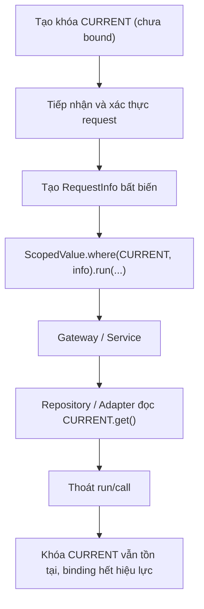
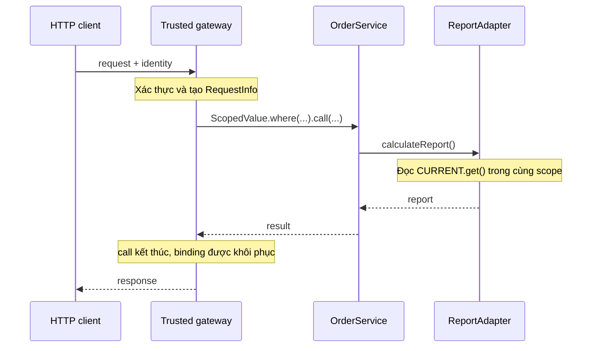

# Tạo khóa ScopedValue và thiết kế phạm vi truy cập khóa

> **Chương:** ScopedValue  
> **Phạm vi module:** `JAVA_VERSION_JAVA25` — tiếp cận những khả năng Java 25 còn hữu ích trong phát triển Java hiện đại, trong đó `ScopedValue` hỗ trợ truyền ngữ cảnh theo phạm vi lời gọi; có thể kết hợp khi thiết kế ứng dụng có virtual threads, các tác vụ có cấu trúc, observability và nghiệp vụ nhiều tầng.  
> **Đề bài:** Tạo khóa `ScopedValue<T>` đúng cách; phân biệt **khóa**, **binding**, **giá trị** và **dynamic scope**; chủ động quy hoạch ai được tạo binding, ai được đọc, scope bắt đầu/kết thúc ở đâu và behavior trong các luồng thực thi khác nhau.  
> **Ràng buộc thời sự:** Tập trung API **final theo JEP 506 trong Java 25**, còn phù hợp đến **27/11/2026**. Không dùng mẫu `ScopedValue.where(key, value, Runnable)` hoặc APIs preview cũ của các JDK trước; những trường hợp `StructuredTaskScope` chưa final trong JDK 25 được ghi rõ, không biến thành dependency bắt buộc của bài.

`ScopedValue` giải quyết một vấn đề rất thực tế: tại điểm nhận request, ứng dụng đã biết `requestId`, `tenantId` và một số thông tin ngữ cảnh đã kiểm tra, nhưng rất nhiều method phía dưới chỉ cần **đọc** những thông tin đó. Truyền ba tham số qua mọi tầng đôi khi làm API trở nên nhiễu; giữ chúng trong `ThreadLocal` thì phải quản lý lifetime và xóa giá trị cẩn thận. `ScopedValue` cung cấp một **binding theo phạm vi thực thi rõ ràng**, có thể được đọc từ các method sâu hơn mà không phải khai báo tham số trung gian.

Điều cốt lõi: **khóa `ScopedValue` không phải biến chứa giá trị toàn cục**. Một key có thể tồn tại suốt vòng đời ứng dụng nhưng giá trị binding chỉ có hiệu lực trong dynamic scope của lời gọi và với những thread được phép thừa hưởng binding theo cơ chế phù hợp.

## 1. Hiểu đúng bốn khái niệm

| Khái niệm | Trong Java 25 | Điều cần ghi nhớ |
|---|---|---|
| **Key / scoped value object** | `ScopedValue<RequestInfo> CURRENT = ScopedValue.newInstance();` | Đại diện cho **danh tính khóa**, không chứa một giá trị toàn cục |
| **Value** | `new RequestInfo("req-01", "shop-a")` | Object được truy cập thông qua key; nên bất biến, đặc biệt nếu chia sẻ sang child threads |
| **Binding** | `ScopedValue.where(CURRENT, info)` | Ánh xạ từ **key tới value** được đưa vào `Carrier` |
| **Dynamic scope** | `carrier.run(operation)` / `carrier.call(operation)` | Khoảng thực thi mà binding có hiệu lực; kết thúc dù operation thành công hay ném ngoại lệ |

Mô hình:



Hãy phân biệt:

- `newInstance()` **tạo key**, chưa có value; gọi `CURRENT.get()` ngay lúc đó sẽ thất bại.
- `where(key, value)` **tạo một `Carrier`** có mapping; chỉ khi gọi `run`/`call` mới thực thi code trong phạm vi có binding.
- `get()` tra binding đang có hiệu lực **cho thread hiện tại**.
- Sau khi `run`/`call` hoàn thành, binding cũ được **khôi phục tự động**; không cần `remove()`.
- `ScopedValue` có binding ổn định trong một scope, nhưng **không biến đối tượng mà binding tham chiếu thành immutable**. Nếu value là mutable object, các method vẫn có thể sửa object đó.

## 2. Các API final cần biết ở JDK 25

Mọi API trong bảng là `java.lang.ScopedValue` và `java.lang.ScopedValue.Carrier` **chính thức**, không cần `--enable-preview`.

| API | Công dụng | Hành vi cần nhớ |
|---|---|---|
| `ScopedValue.newInstance()` | Tạo một key mới | Key ban đầu chưa bound ở bất kỳ thread nào |
| `ScopedValue.where(KEY, value)` | Tạo `Carrier` chứa một ánh xạ | Chưa thực thi block mã nào |
| `carrier.where(KEY2, value2)` | Tạo **Carrier mới** có nhiều mapping | Carrier bất biến; không mutate bản trước |
| `carrier.run(Runnable)` | Chạy code không cần trả kết quả | Binding sống đúng trong lời gọi |
| `carrier.call(CallableOp)` | Chạy code và trả kết quả | Ngoại lệ của operation được chuyển tiếp; binding được khôi phục |
| `KEY.get()` | Đọc giá trị binding hiện hành | Ném `NoSuchElementException` nếu chưa bound |
| `KEY.isBound()` | Kiểm tra có binding trên thread hiện tại | Dùng khi binding là tùy chọn |
| `KEY.orElse(defaultValue)` | Đọc hoặc dùng fallback | Nếu **đã bound với `null`**, kết quả vẫn là `null` |
| `KEY.orElseThrow(exceptionSupplier)` | Đọc hoặc ném ngoại lệ có ý nghĩa nghiệp vụ | Hữu ích để báo thiếu request context |
| `carrier.get(KEY)` | Đọc mapping đã được chuẩn bị trên Carrier | **Khác** `KEY.get()`, không phụ thuộc active binding |

**Chú ý API cũ:** Các tài liệu preview trước Java 25 có thể viết `ScopedValue.where(KEY, value, () -> ...)`. Trong Java 25, cách thể hiện chính thức là **`ScopedValue.where(KEY, value).run(() -> ...)`**; tương tự cho `call(...)`.

### Khi nào dùng `run` và `call`?

Dùng `run` khi operation không cần trả giá trị:

```java
private static final ScopedValue<String> REQUEST_ID =
        ScopedValue.newInstance();

static void doLogging() {
    System.out.println("request=" + REQUEST_ID.get());
}

public static void main(String[] args) {
    ScopedValue.where(REQUEST_ID, "req-100")
            .run(() -> doLogging());
}
```

Dùng `call` khi operation trả giá trị:

```java
private static final ScopedValue<String> TENANT =
        ScopedValue.newInstance();

static String loadLabel() {
    return "tenant=" + TENANT.get();
}

public static void main(String[] args) {
    String label = ScopedValue.where(TENANT, "shop-a")
            .call(() -> loadLabel());
    System.out.println(label);
}
```

**Các đoạn ở đây là mảnh minh họa các thành phần của một class**, không phải mỗi đoạn là một file Java độc lập. Phần tiếp theo cung cấp project mẫu đầy đủ, chạy được.

## 3. Thiết kế key: private, static, final và tên có ý nghĩa

Một cách tạo key thường dùng trong Java 25:

```java
private static final ScopedValue<RequestInfo> CURRENT_REQUEST =
        ScopedValue.newInstance();
```

**Từng modifier có lý do:**

- **`private`:** Key là một dạng **capability**; code có tham chiếu tới key có khả năng đọc binding, và khi phù hợp còn có thể tạo binding mới bằng `ScopedValue.where(...)`. Giữ key private và chỉ cung cấp những phương thức truy cập có kiểm soát.
- **`static`:** Một key ổn định dùng lại giữa các request; **không** tạo một key mới cho mỗi lần đọc hoặc mỗi lớp dịch vụ.
- **`final`:** Không thay key sang một instance khác sau khi class khởi tạo, giữ identity của key nhất quán.
- **`ScopedValue<RequestInfo>`:** Kiểu generic thể hiện hợp đồng; nhóm các giá trị ngữ cảnh liên quan thành một record bất biến thay vì tạo hàng chục key rời.
- **Tên `CURRENT_REQUEST`:** Nói rõ phạm vi ngữ nghĩa; đừng dùng tên chung chung như `VALUE` hay `DATA` trong code nhiều module.

Đừng nhầm `private static final` với việc **binding được chia sẻ toàn cục**: key dùng chung, nhưng các thread/dynamic scopes có mapping riêng. Với hai request song song, mỗi request có thể đọc `CURRENT_REQUEST.get()` để nhận **giá trị của chính scope nó**, không phải một “current request” duy nhất của toàn JVM.

### Không chia sẻ key một cách tùy tiện

Xem hai lựa chọn:

```java
// Có thể bị mọi nơi tái bind nếu không có lớp bảo vệ.
public static final ScopedValue<RequestInfo> CURRENT_REQUEST =
        ScopedValue.newInstance();
```

```java
// Giới hạn quyền sở hữu key.
private static final ScopedValue<RequestInfo> CURRENT_REQUEST =
        ScopedValue.newInstance();

public static RequestInfo requireCurrent() {
    return CURRENT_REQUEST.orElseThrow(
            () -> new IllegalStateException("No request context")
    );
}
```

Lựa chọn thứ hai giúp **giấu danh tính key**, nhưng không tự tạo hệ thống authorization. Nếu bạn công khai phương thức `runWith(...)` để bất kỳ caller nào gắn `RequestInfo` không xác thực, caller vẫn có thể giả lập context. **Quyền tạo binding** nên giới hạn tại gateway/trusted boundary đã xác minh identity/tenant. Mặt khác, các accessor `requireCurrent()` cũng là capability đọc dữ liệu; hạn chế trả thông tin nhạy cảm hơn nhu cầu thực tế của caller.

## 4. Project hoàn chỉnh: hai tầng, một key được sở hữu tập trung

Tạo hai file trong cùng thư mục:

```text
scoped-values-lab/
  RequestContexts.java
  RequestContextDemo.java
```

Dùng JDK 25 hoặc mới hơn. Không cần thư viện ngoài và **không bật preview**.

### 4.1. File `RequestContexts.java`: chủ sở hữu key

```java
import java.util.Objects;
import java.util.function.Supplier;

public final class RequestContexts {

    private static final ScopedValue<RequestInfo> CURRENT =
            ScopedValue.newInstance();

    private RequestContexts() {
    }

    public record RequestInfo(String requestId, String tenantId) {
        public RequestInfo {
            Objects.requireNonNull(requestId, "requestId");
            Objects.requireNonNull(tenantId, "tenantId");

            if (requestId.isBlank() || tenantId.isBlank()) {
                throw new IllegalArgumentException(
                        "requestId/tenantId must not be blank");
            }
        }
    }

    // Trong production, giới hạn API bind ở trusted boundary.
    public static void runWith(RequestInfo info, Runnable operation) {
        Objects.requireNonNull(info, "info");
        Objects.requireNonNull(operation, "operation");
        ScopedValue.where(CURRENT, info).run(operation);
    }

    public static <R> R callWith(
            RequestInfo info, Supplier<R> operation) {
        Objects.requireNonNull(info, "info");
        Objects.requireNonNull(operation, "operation");
        return ScopedValue.where(CURRENT, info)
                .call(operation::get);
    }

    public static RequestInfo requireCurrent() {
        return CURRENT.orElseThrow(
                () -> new IllegalStateException(
                        "Request context is not bound"));
    }

    public static boolean isBound() {
        return CURRENT.isBound();
    }

    public static String currentTenantId() {
        return requireCurrent().tenantId();
    }
}
```

Trong lab, `runWith` và `callWith` là `public` để hai file độc lập trong default package dễ gọi. **Khi đưa vào ứng dụng thật**, đặt chúng trong một module ngữ cảnh có public read API, còn write/bind API chỉ cho phép code biên đáng tin cậy gọi (chẳng hạn package-private binder hoặc một gateway chuyên trách). Những module nghiệp vụ còn lại chỉ cần `currentTenantId()` hay một snapshot đã kiểm chứng.

**Record là shallow immutable:** `String` bất biến nên mẫu này an toàn cho concurrent read. Nếu record chứa `Map`, `List` hoặc object mutable, tạo defensive copy hoặc dùng immutable representation trước khi bind; `record` tự nó không làm các phần tử lồng nhau thành immutable.

### 4.2. File `RequestContextDemo.java`: dùng context ở tầng sâu

```java
public class RequestContextDemo {

    static String queryOrderSummary() {
        // Giả sử đây là tầng repository/adapter cách xa HTTP boundary.
        String tenant = RequestContexts.currentTenantId();
        return "orders for " + tenant;
    }

    static String service() {
        // Không phải nhận tenantId qua parameter ở mọi tầng.
        return queryOrderSummary();
    }

    public static void main(String[] args) {
        var first = new RequestContexts.RequestInfo(
                "req-001", "shop-a");
        var second = new RequestContexts.RequestInfo(
                "req-002", "shop-b");

        System.out.println("before=" + RequestContexts.isBound());

        String firstResult =
                RequestContexts.callWith(first, RequestContextDemo::service);

        String secondResult =
                RequestContexts.callWith(second, RequestContextDemo::service);

        System.out.println(firstResult);
        System.out.println(secondResult);
        System.out.println("after=" + RequestContexts.isBound());
    }
}
```

Biên dịch/chạy từ thư mục `scoped-values-lab`:

```bash
javac --release 25 RequestContexts.java RequestContextDemo.java
java RequestContextDemo
```

Kết quả kỳ vọng:

```text
before=false
orders for shop-a
orders for shop-b
after=false
```

**Giải thích kết quả:**

1. `RequestContexts` tạo key **một lần** khi class khởi tạo.
2. `callWith(first, ...)` tạo binding `CURRENT → first` cho thời gian chạy `service()` và `queryOrderSummary()`.
3. Khi `call` trả về, binding trước đó được khôi phục (trong demo là unbound).
4. `callWith(second, ...)` tạo binding độc lập tới `second` dù dùng **chính key `CURRENT`**.
5. Sau cùng `CURRENT` vẫn là static final key nhưng ở thread gọi đã **unbound**.

Từ đây bạn đã thấy điểm cốt lõi: **key sống lâu, binding sống ngắn**.

## 5. Thiết kế dynamic scope theo ranh giới nghiệp vụ

Phạm vi phù hợp thường bắt đầu sau khi xác thực/kiểm tra request và kết thúc sau khi xử lý xong một công việc logic.



### Chọn vị trí bind

**Nên:** bind ở điểm entry đã xác minh thông tin, bao bọc toàn bộ lời gọi nghiệp vụ đồng bộ cần context.

```java
// Minh họa bên trong gateway đã xác thực, không phải file độc lập.
// verifiedIdentity là dữ liệu do lớp authentication đã kiểm tra.
var info = new RequestContexts.RequestInfo(
        requestId, verifiedIdentity.tenantId());

OrderResult result = RequestContexts.callWith(
        info, () -> orderService.process(command));
```

Ở đây `OrderResult`, `orderService` và `verifiedIdentity` là các thành phần ứng dụng tự định nghĩa. Không lấy tenant trực tiếp từ HTTP header `X-Tenant-Id` chưa kiểm tra rồi coi việc bind bằng `ScopedValue` là bằng chứng được cấp quyền. **Context propagation khác authorization**.

**Không nên:** bind tại từng DAO/helper, tạo nhiều scopes không có chủ đích, hoặc để một worker lâu dài giữ scope cho nhiều công việc không liên quan.

### Thiết kế scope theo “đơn vị công việc”, không theo “toàn ứng dụng”

Ví dụ một HTTP request đồng bộ có thể dùng một dynamic scope đến hết service call. Với batch runner, mỗi record/job có thể có một scope riêng; với CLI, mỗi lần xử lý một command/transaction logic có thể có một scope. Cần biết điểm kết thúc ngay trong code:

```java
RequestContexts.runWith(jobInfo, () -> processOneJob(job));
```

Đừng mở `runWith` ở `main` rồi giữ ngữ cảnh của “user hiện tại” qua hàng ngàn job khác nhau; các request/job nên được cô lập.

## 6. Đọc key: bắt buộc, tùy chọn và phân biệt unbound/null

JDK 25 hỗ trợ các thao tác sau:

```java
private static final ScopedValue<String> REGION =
        ScopedValue.newInstance();

static String requireRegion() {
    return REGION.orElseThrow(
            () -> new IllegalStateException("Region context is required"));
}

static String optionalRegion() {
    return REGION.orElse("global");
}
```

- Nếu không bound, `REGION.get()` ném `NoSuchElementException`.
- `REGION.isBound()` trả về `false` nếu chưa có binding.
- `REGION.orElse("global")` trả fallback khi chưa bound; nên dùng cho các giá trị **thật sự tùy chọn**.
- `REGION.orElseThrow(...)` cho thông báo fail-fast rõ hơn khi context là **bắt buộc**.

### Binding thành null: hợp lệ nhưng dễ nhầm

Trong JDK 25, `ScopedValue.where(KEY, null)` **được phép**. Khi binding `null` đang hoạt động, `KEY.isBound()` là **`true`**, còn `KEY.get()` trả về `null`. Đây không giống trạng thái **unbound**.

```java
private static final ScopedValue<String> OPTIONAL_NOTE =
        ScopedValue.newInstance();

static void inspect() {
    System.out.println(OPTIONAL_NOTE.isBound());
    System.out.println(OPTIONAL_NOTE.orElse("default"));
}

public static void main(String[] args) {
    inspect(); // false, default

    ScopedValue.where(OPTIONAL_NOTE, (String) null)
            .run(() -> inspect()); // true, null
}
```

**Quy tắc thiết kế:** thường nên **từ chối null ở trusted binder** và dùng kiểu biểu đạt trạng thái thiếu dữ liệu rõ ràng. Trường hợp quyền truy cập bảo mật, tuyệt đối không dùng `orElse("admin")` hoặc một quyền cao làm fallback khi unbound — thiếu context phải fail closed.

## 7. Scope lồng nhau và rebinding có kiểm soát

Giả sử một request có tenant mặc định `shop-a` nhưng một thao tác con được phép sử dụng tenant `shop-b` theo quyết định nghiệp vụ đã được xác thực. Nested dynamic scope cho phép **gắn lại cùng key** tạm thời rồi khôi phục giá trị ngoài.

```java
public class NestedScopeDemo {
    private static final ScopedValue<String> TENANT =
            ScopedValue.newInstance();

    static void print(String stage) {
        System.out.println(stage + "=" + TENANT.get());
    }

    public static void main(String[] args) {
        ScopedValue.where(TENANT, "shop-a").run(() -> {
            print("outer-before");

            ScopedValue.where(TENANT, "shop-b").run(() -> {
                print("inner");
            });

            print("outer-after");
        });

        System.out.println("bound-after=" + TENANT.isBound());
    }
}
```

Chạy:

```bash
java NestedScopeDemo.java
```

Kết quả:

```text
outer-before=shop-a
inner=shop-b
outer-after=shop-a
bound-after=false
```

Nested scope **không thay đổi vĩnh viễn** binding bên ngoài. Có thể hình dung như một **stack** các binding: inner gần nhất được đọc trước, khi thoát inner sẽ khôi phục outer.

**Cảnh báo quyền hạn:** khả năng rebind là lý do nên giấu key hoặc giới hạn API binder. Nếu `TENANT` là key public, thư viện bất kỳ có thể tạm đặt tenant khác trong lời gọi con. Nested rebinding là cơ chế kỹ thuật, **không phải** cơ chế tự kiểm tra quyền impersonation. Code sở hữu key phải xác minh mọi thay đổi tenant theo chính sách ứng dụng.

## 8. Binding nhiều key bằng `Carrier`

Một request có thể cần ngữ cảnh tenant và trace label tách biệt:

```java
public class MultiKeyDemo {
    private static final ScopedValue<String> TENANT =
            ScopedValue.newInstance();
    private static final ScopedValue<String> REQUEST_ID =
            ScopedValue.newInstance();

    static String describe() {
        return TENANT.get() + "/" + REQUEST_ID.get();
    }

    public static void main(String[] args) {
        var carrier = ScopedValue.where(TENANT, "shop-a")
                .where(REQUEST_ID, "req-009");

        String label = carrier.call(MultiKeyDemo::describe);
        System.out.println(label);
        System.out.println("bound-outside=" + TENANT.isBound());
    }
}
```

`Carrier` là **immutable**, `where` tạo Carrier mới thay vì sửa Carrier cũ. `Carrier.get(KEY)` tra giá trị **của mapping**, kể cả khi chưa gọi `run`/`call`, trong khi `KEY.get()` chỉ đọc binding hiện hành của thread.

Điều này có hệ quả về bảo mật: **không lưu/đưa Carrier chứa thông tin nhạy cảm cho code không đáng tin cậy**. Một Carrier có thể giữ tham chiếu đến những giá trị được ánh xạ, kể cả khi scope chạy chưa bắt đầu.

### Khi nào gom nhiều trường vào một record?

Javadoc của JDK 25 khuyên dùng **số lượng key tương đối nhỏ**, vì cache per-thread cho scoped values có kích thước hữu hạn. Nếu nhiều field thường được bind và đọc cùng nhau, ưu tiên một record:

```java
record OperationContext(
        String requestId,
        String tenantId,
        String environment
) {}

private static final ScopedValue<OperationContext> CONTEXT =
        ScopedValue.newInstance();
```

Đừng tạo một `ScopedValue` riêng cho hàng trăm header/request attributes chỉ vì làm được. Nhưng cũng không nhét những dữ liệu khác miền bảo mật vào một object “God Context” rồi để mọi nơi được đọc tất cả. Thiết kế dựa trên **mức tin cậy, đơn vị công việc và quyền truy cập cần thiết**.

## 9. Ranh giới quyền truy cập: key như capability

Tài liệu Java 25 mô tả một `ScopedValue` object như **capability/key**. Ai có reference tới key có thể đọc giá trị khi key đang bound. Vì vậy, API boundary cần được định nghĩa trước khi đưa vào code production.

### Ba thiết kế thường gặp

| Thiết kế | Ưu điểm | Rủi ro | Khi nào dùng |
|---|---|---|---|
| `public static final ScopedValue<Context> KEY` | Dễ truy cập từ nhiều lớp | Code khác có thể đọc/rebind; khó kiểm soát | Chỉ với key không nhạy cảm, API được thiết kế rõ và có đánh giá rủi ro |
| `private static final KEY` + public `current()` | Không lộ key; kiểm soát cách đọc | Nếu `current()` trả toàn bộ context nhạy cảm, quyền đọc vẫn quá rộng | Phổ biến với các module tin cậy và context tối giản |
| `private static final KEY` + public `tenantId()`/`traceLabel()`, binder bị hạn chế | API chỉ lộ dữ liệu thật sự cần | Thêm công thiết kế facade, có thể phải chia module theo ownership | Ưu tiên với multi-tenant/security-sensitive systems |

**Ví dụ một facade chặt hơn:**

```java
public final class TenantContext {
    private static final ScopedValue<String> VERIFIED_TENANT =
            ScopedValue.newInstance();

    private TenantContext() {}

    // Package-private: chỉ trusted code cùng package bind.
    static void runAsVerified(String tenantId, Runnable operation) {
        if (tenantId == null || tenantId.isBlank()) {
            throw new IllegalArgumentException("tenantId is required");
        }
        ScopedValue.where(VERIFIED_TENANT, tenantId)
                .run(operation);
    }

    public static String requireTenantId() {
        return VERIFIED_TENANT.orElseThrow(
                () -> new IllegalStateException(
                        "Verified tenant context is missing"));
    }
}
```

Đây là một **mẫu thiết kế**, không tự đảm bảo tenant được xác minh. Lớp authentication/gateway phải gọi `runAsVerified` **sau** xác thực; package-private chỉ là hạn chế truy cập trong Java package, **không** là sandbox bảo mật đối với code không tin cậy chạy trong cùng JVM. Với module boundary quan trọng, kết hợp JPMS `exports`/dependency policy, review và kiểm thử authorization.

### Không đưa secret hoặc quyền hạn vào context tùy tiện

`ScopedValue` có thể vận chuyển một tham chiếu tới principal/identity đã được xác minh. Nó không mã hóa value, không tự ẩn thông tin khỏi log/heap dump, không tự xác thực chữ ký và không thay cho cơ chế authorization. Không đưa raw bearer token, password, private key vào value chỉ để các tầng dưới dễ gọi; ưu tiên data tối thiểu.

Nếu value chứa một object mutable mà nhiều phần của ứng dụng giữ reference, `private` key không ngăn những phần đã nhận reference sửa object. Vì vậy nên kết hợp **immutable context + giới hạn API reader**.

## 10. Thread confinement và virtual threads: phạm vi thực thi không tự truyền sang mọi thread

Binding của `ScopedValue` là **per-thread**. Trong JDK 25, việc gọi `Thread.startVirtualThread(...)` hoặc submit một `Runnable` vào `ExecutorService` không có nghĩa task mới tự nhận mọi scoped value của thread cha.

**Ví dụ đối chứng dùng virtual thread final (không cần preview):**

```java
public class ThreadBoundaryDemo {
    private static final ScopedValue<String> REQUEST =
            ScopedValue.newInstance();

    public static void main(String[] args) throws InterruptedException {
        ScopedValue.where(REQUEST, "req-parent").run(() -> {
            System.out.println("parent=" + REQUEST.get());

            Thread child = Thread.startVirtualThread(() -> {
                System.out.println("child-bound=" + REQUEST.isBound());
            });

            try {
                child.join();
            } catch (InterruptedException e) {
                Thread.currentThread().interrupt();
                throw new RuntimeException(e);
            }
        });
    }
}
```

Kỳ vọng:

```text
parent=req-parent
child-bound=false
```

Việc `child-bound=false` không chứng minh ScopedValue bị lỗi; nó phản ánh **không có cơ chế tự động chuyển binding** sang một thread bất kỳ. Cách truyền giá trị qua thread được thiết kế cụ thể tùy mô hình concurrency.

### Chuyển một context snapshot có chủ đích

Trong trường hợp thật sự cần chạy một task ở virtual thread độc lập, hãy **truyền value bằng tham số** rồi bind riêng ở thread con:

```java
public class ExplicitChildDemo {
    private static final ScopedValue<String> REQUEST =
            ScopedValue.newInstance();

    public static void main(String[] args) throws InterruptedException {
        ScopedValue.where(REQUEST, "req-007").run(() -> {
            String snapshot = REQUEST.get();

            Thread child = Thread.startVirtualThread(() -> {
                ScopedValue.where(REQUEST, snapshot).run(() -> {
                    System.out.println("child=" + REQUEST.get());
                });
            });

            try {
                child.join();
            } catch (InterruptedException e) {
                Thread.currentThread().interrupt();
                throw new RuntimeException(e);
            }
        });
    }
}
```

**Thiết kế an toàn:** snapshot nên bất biến, tối thiểu, không chứa secret không cần thiết. Nếu child task sống lâu hơn request gốc, hãy cân nhắc có nên chuyển ngữ cảnh đó hay tạo một job context độc lập; không tự kéo dài quyền truy cập chỉ vì có thể bind lại.

### Structured concurrency: có kế thừa, nhưng đừng dùng nhầm API preview

Javadoc JDK 25 ghi rõ scoped values có thể **được thừa hưởng trong task scope có cấu trúc**: các task tạo bằng `StructuredTaskScope.fork` thừa hưởng binding được capture khi tạo `StructuredTaskScope`. Tuy nhiên, **Structured Concurrency là tính năng preview riêng ở JDK 25 (JEP 505)**.

- `ScopedValue` **final**: có thể dùng ngay.
- `StructuredTaskScope` trong JDK 25 **preview**: muốn compile/run code dùng nó cần `--enable-preview`, và API có thể tiếp tục đổi ở JDK khác.
- Bài này **không yêu cầu** StructuredTaskScope để tránh dạy một API preview như API ổn định.
- Virtual threads không đồng nghĩa structured concurrency; thread được tạo trực tiếp bằng `Thread.startVirtualThread` không tự thực hiện inheritance có cấu trúc.

Khi thiết kế request concurrency, cần test riêng parent/child scope, join/cancel, exception và tình huống task chưa kết thúc trước khi outer scope thoát. Đừng dùng tên khái niệm “scoped” để suy diễn rằng binding sẽ truyền qua mọi thread pool hay qua HTTP/message broker.

## 11. Ngoại lệ, rollback scope và tính đúng đắn khi lỗi

Một ưu điểm của ScopedValue là không cần `finally { remove(); }` như một số pattern `ThreadLocal`. Nếu operation ném ngoại lệ, binding vẫn được khôi phục khi thoát `run`/`call`.

```java
public class ExceptionScopeDemo {
    private static final ScopedValue<String> USER =
            ScopedValue.newInstance();

    public static void main(String[] args) {
        System.out.println("before=" + USER.isBound());

        try {
            ScopedValue.where(USER, "demo-user").run(() -> {
                System.out.println("inside=" + USER.get());
                throw new IllegalStateException("task failed");
            });
        } catch (IllegalStateException expected) {
            System.out.println("caught=" + expected.getMessage());
        }

        System.out.println("after=" + USER.isBound());
    }
}
```

Kết quả:

```text
before=false
inside=demo-user
caught=task failed
after=false
```

Điều được **rollback** ở đây là **binding**, không phải transaction database hoặc sửa đổi trạng thái của object. Nếu operation ghi file, cập nhật CSDL hay mutate object, `ScopedValue` không tự đảo ngược các side effect đó.

### Ngoại lệ kiểm tra trong `call`

`Carrier.call` nhận `ScopedValue.CallableOp` cho phép operation trả kết quả và ném ngoại lệ. Nếu operation có checked exception, caller phải xử lý hoặc khai báo `throws` theo luật Java. `run(Runnable)` không cho ném checked exception trực tiếp từ lambda nếu không chuyển đổi/handle.

Đừng bắt mọi `Throwable` rồi trả giá trị mặc định chỉ vì context thiếu; nếu thiếu tenant/principal bắt buộc, báo lỗi rõ và **dừng xử lý**.

## 12. So với `ThreadLocal`: chọn theo mô hình dữ liệu

| Tiêu chí | `ScopedValue` trong Java 25 | `ThreadLocal` |
|---|---|---|
| Mục đích chính | Truyền **thông tin đọc chủ yếu một chiều** qua dynamic scope | Trạng thái gắn với thread, có thể update nhiều lần |
| Khởi tạo binding | `where(KEY, value).run/call` | `set(value)` |
| Thời điểm hết hiệu lực | Tự khôi phục khi rời scope | Duy trì đến khi `remove`/set khác hoặc thread kết thúc |
| Có cho phép callee gán giá trị mới vĩnh viễn trong outer scope? | Không; có thể nested rebind tạm thời | `set` làm thay đổi value của thread hiện tại |
| Bất biến của object được bind? | **Không tự đảm bảo** | Không tự đảm bảo |
| Truyền sang arbitrary executor/thread? | Không mặc định | `ThreadLocal` thường không; `InheritableThreadLocal` có semantics khác và cần cẩn trọng |
| Hợp với virtual threads / structured tasks? | Được thiết kế cho mô hình này | Có thể dùng nhưng cần xem chi phí và lifetime |
| Mức độ thay thế | Rất phù hợp cho request metadata read-only | Hợp hơn nếu thực sự cần mutable thread-confined state |

**Không nên thay mọi `ThreadLocal` bằng `ScopedValue` một cách cơ học.** Những context thực sự cần thay đổi liên tục hoặc được framework quản lý theo cơ chế riêng có thể vẫn cần `ThreadLocal`/framework API. Ngược lại, đối với request ID, localization options hoặc immutable execution policy được truyền một chiều, `ScopedValue` thường giúp mô hình hóa lifetime rõ hơn.

### Quan hệ với MDC và distributed tracing

`ScopedValue` không tự gắn `traceId` vào SLF4J MDC, không tự tạo OpenTelemetry span, không tự propagate qua HTTP/gRPC message headers. Trong một hệ thống observability, có thể sử dụng `ScopedValue` cho application context riêng nhưng vẫn phải dùng SDK/context propagation của tracer cho trace, và cơ chế logging integration cho MDC.

Không dùng một `ScopedValue` duy nhất để thay thế toàn bộ security context, transaction context, trace context và tenant context chỉ vì tất cả đều là “context”. Mỗi miền cần hợp đồng ownership, cách kế thừa và chính sách bảo mật riêng.

## 13. Testing: chứng minh scope không rò rỉ

Tối thiểu phải kiểm tra những tính chất:

1. Key chưa bound trước khi vào entry scope.
2. Lời gọi gián tiếp ở tầng sâu nhìn thấy đúng value.
3. Hai request xử lý tuần tự không ảnh hưởng nhau.
4. Nested rebinding khôi phục giá trị outer.
5. Khi operation ném ngoại lệ, key không còn bound ngoài scope.
6. Thread mới không tự nhận binding nếu không dùng cơ chế kế thừa có cấu trúc.
7. Value bắt buộc khi thiếu context dẫn tới fail closed thay vì fallback quyền cao.

Ví dụ JUnit 5 (đặt trong project test có JUnit dependency, không bắt buộc cho phần demo không dùng framework):

```java
import static org.junit.jupiter.api.Assertions.*;
import org.junit.jupiter.api.Test;

class RequestContextsTest {
    @Test
    void contextIsNotVisibleAfterCall() {
        var info = new RequestContexts.RequestInfo(
                "req-101", "shop-a");

        assertFalse(RequestContexts.isBound());

        String tenant = RequestContexts.callWith(
                info, RequestContexts::currentTenantId);

        assertEquals("shop-a", tenant);
        assertFalse(RequestContexts.isBound());
    }

    @Test
    void aSecondCallDoesNotSeePreviousTenant() {
        var first = new RequestContexts.RequestInfo("r1", "tenant-1");
        var second = new RequestContexts.RequestInfo("r2", "tenant-2");

        assertEquals("tenant-1",
                RequestContexts.callWith(
                        first, RequestContexts::currentTenantId));

        assertEquals("tenant-2",
                RequestContexts.callWith(
                        second, RequestContexts::currentTenantId));

        assertFalse(RequestContexts.isBound());
    }

    @Test
    void exceptionDoesNotLeakBinding() {
        var info = new RequestContexts.RequestInfo("r3", "tenant-3");

        assertThrows(IllegalArgumentException.class, () ->
            RequestContexts.runWith(info, () -> {
                assertEquals("tenant-3",
                        RequestContexts.currentTenantId());
                throw new IllegalArgumentException("expected");
            })
        );

        assertFalse(RequestContexts.isBound());
    }
}
```

Đối với ứng dụng dùng thread pool, hãy thực hiện test stress/multi-request có giám sát: cố tình trộn tenant khác nhau, xác nhận tất cả read lấy đúng tenant và scope không bị dùng vượt thời gian. Kết quả test đơn luồng không đủ để khẳng định tính đúng đắn concurrency.

## 14. Những sai lầm phổ biến khi tạo khóa

| Sai lầm | Vì sao nguy hiểm | Cách sửa |
|---|---|---|
| Mỗi lần gọi `newInstance()` tạo một key rồi dùng `get` trên key khác | Key được nhận diện bằng identity; binding nằm trên key cũ | Tạo key ổn định `private static final` tại owner |
| Công bố `public static final KEY` không có chính sách | Code khác có thể đọc/rebind tùy tiện | Giấu key, thiết kế read facade và trusted binder |
| Dùng `get()` khi không có binding | Ném `NoSuchElementException` | Rõ ràng: bắt buộc thì `orElseThrow`; tùy chọn thì `orElse`/`isBound` |
| Coi binding immutable là object immutable | Mutable object vẫn bị sửa qua reference | Dùng record + immutable fields, defensive copy |
| Bind ở mọi helper method | Scope chồng chéo, ownership mờ, audit khó | Bind một lần tại work-unit boundary đáng tin |
| Tin `Thread.startVirtualThread` tự kế thừa binding | Child không nằm trong structured inheritance | Truyền snapshot và bind lại có chủ đích hoặc dùng structured mechanism đúng version |
| Gắn tenant từ header chưa xác thực | ScopedValue không kiểm tra danh tính | Authenticate/authorize ở gateway trước khi bind |
| Giữ scope kéo dài vô hạn ở worker dài hạn | Dữ liệu bị gắn với work-unit không đúng hoặc dùng nhầm ngữ cảnh | Mỗi request/job có outer scope rõ ràng |
| Dùng null binding thay cho unbound mà không ghi hợp đồng | `isBound=true` nhưng `get=null` gây nhầm | Thường từ chối null ở binder |
| Tưởng `call` tự rollback side effects | Chỉ binding được khôi phục | Dùng transaction/compensation riêng |
| Lạm dụng hàng trăm keys nhỏ | Cache và lookup có thể kém hiệu quả, thiết kế khó hiểu | Gom fields liên quan vào immutable context record |
| Dùng preview API `StructuredTaskScope` trong bài không bật preview | Compile failure và dính API chưa final JDK 25 | Dạy ScopedValue final độc lập; nếu chọn preview thì khóa JDK/toolchain rõ |

## 15. Checklist thiết kế một key cho production

Trước khi tạo một `ScopedValue<T>` mới, trả lời các câu hỏi:

- [ ] **Giá trị là gì?** Có thực sự là metadata bất biến cần truyền qua nhiều tầng, hay nên dùng method parameter?
- [ ] **Ai sở hữu key?** Có một class/module rõ ràng, key `private static final` không?
- [ ] **Ai có quyền bind?** Entry boundary đã xác thực hay bất kỳ caller nào?
- [ ] **Ai có quyền đọc?** Có thể lộ chỉ accessor tối thiểu thay vì toàn object không?
- [ ] **Scope bắt đầu và kết thúc ở đâu?** Có bao trùm đúng work unit, tự khôi phục khi lỗi không?
- [ ] **Nested rebind có hợp lệ?** Cần chính sách impersonation/tenant switch nào?
- [ ] **Có task khác thread không?** Đã xác định propagation strategy, lifetime và nguyên tắc immutable/synchronization chưa?
- [ ] **Có secret/PII không?** Có thể thay bằng opaque id hay một snapshot ít nhạy cảm hơn không?
- [ ] **Có vô tình thay tracer/MDC/security context không?** Những context này có lifecycle riêng.
- [ ] **Test những gì?** Unbound, two requests, nested, exception, cross-thread, missing context, unauthorized binder.

Bài thực hành bổ sung: mở rộng `RequestContexts.RequestInfo` thêm `Locale` hoặc `ZoneId` đã được xác thực, thiết kế accessor tối thiểu, dùng `callWith` thực hiện định dạng báo cáo tại ba tầng. Sau đó đặt một luồng khác đọc key mà không có propagation và giải thích vì sao không bound. Cuối cùng tạo scope lồng nhau theo locale cho một thao tác được phép, chứng minh giá trị ngoài được khôi phục.

## 16. Tài liệu tham khảo chính thức

1. [JEP 506 — Scoped Values](https://openjdk.org/jeps/506): mục tiêu, trạng thái **final tại JDK 25**, tính chất one-way transmission và thiết kế dynamic scope.
2. [Java SE 25 — `java.lang.ScopedValue` API](https://docs.oracle.com/en/java/javase/25/docs/api/java.base/java/lang/ScopedValue.html): `newInstance`, `where`, `get`, `isBound`, `orElse`, `orElseThrow`, rebinding, inheritance và security guidance.
3. [Java SE 25 — `ScopedValue.Carrier` API](https://docs.oracle.com/en/java/javase/25/docs/api/java.base/java/lang/ScopedValue.Carrier.html): immutable carrier, `run`, `call`, `where`, trạng thái sau ngoại lệ.
4. [Java SE 25 — Scoped Values (Core Libraries)](https://docs.oracle.com/en/java/javase/25/core/scoped-values.html): giải thích khả năng truyền ngữ cảnh không cần tham số qua các tầng.
5. [Java SE 25 — Significant Changes](https://docs.oracle.com/en/java/javase/25/migrate/significant-changes-jdk-25.html): Scoped Values là tính năng đã hoàn tất, phân biệt Stable Values vẫn preview ở JDK 25.
6. [Java SE 25 — `java.lang.Thread` API](https://docs.oracle.com/en/java/javase/25/docs/api/java.base/java/lang/Thread.html): tạo virtual thread và ranh giới thread.
7. [Java SE 26 — `java.lang.ScopedValue` API](https://docs.oracle.com/en/java/javase/26/docs/api/java.base/java/lang/ScopedValue.html): đối chiếu tính năng vẫn tồn tại và có hướng dẫn tương thích trong bản JDK kế tiếp.

**Điểm mấu chốt:** Tạo một key `ScopedValue` **ổn định và được sở hữu rõ ràng**; chỉ code đáng tin được bind; chỉ code cần thiết được đọc; chọn `run`/`call` sao cho dynamic scope đúng work-unit và tự khôi phục sau khi thoát. `ScopedValue` final trong Java 25 giải quyết **truyền ngữ cảnh một chiều trong phạm vi thực thi**, chứ không tự động tạo quyền truy cập, bất biến hóa object hay truyền dữ liệu qua mọi thread/network.
