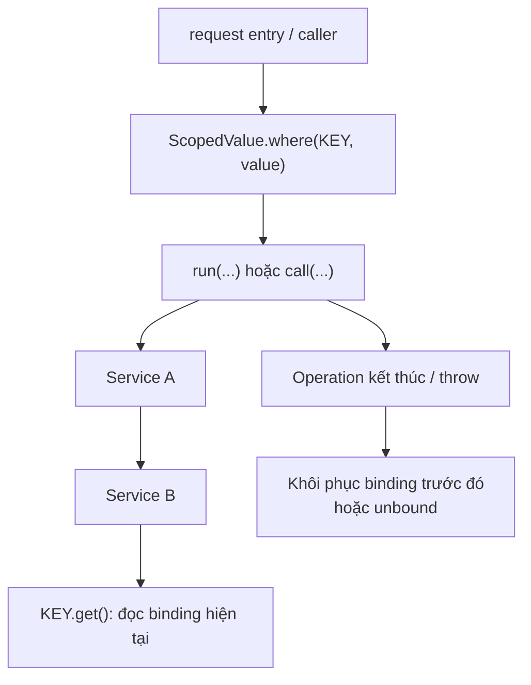
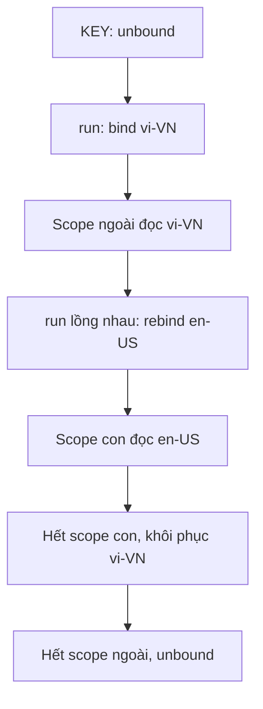

# Ràng buộc giá trị với run hoặc call theo phạm vi thực thi

## 1. Bối cảnh và mục tiêu

Trong **JAVA_VERSION_JAVA25**, Java 25 mang đến những khả năng vẫn hữu ích khi xây dựng ứng dụng Java hiện đại: compact source files, module import declarations, flexible constructor bodies, `ScopedValue`, API dẫn xuất khóa, AOT cache và quan sát JFR. Ở chương **ScopedValue**, chủ đề này tập trung vào cách **ràng buộc một giá trị với `run` hoặc `call` trong phạm vi thực thi** để một chuỗi method nhận được ngữ cảnh mà không cần truyền tham số qua mọi tầng.

**Phạm vi phiên bản:** `ScopedValue` được hoàn thiện trong **JDK 25 theo JEP 506 (Final)**. Các ví dụ trong bài dùng API chính thức `java.lang.ScopedValue` của Java 25, **không cần `--enable-preview`**. Những ví dụ cũ sử dụng `ScopedValue.runWhere(...)`, `callWhere(...)` hoặc các biến thể API ở giai đoạn preview không phải cú pháp nên áp dụng cho dự án Java 25.

Sau bài học, bạn có thể:

1. Tạo một **key** `ScopedValue<T>` và thực hiện binding trong phạm vi `run`/`call`.
2. Phân biệt **`Carrier.run(Runnable)`** với **`Carrier.call(ScopedValue.CallableOp)`**.
3. Mô tả chính xác **dynamic scope**: binding có hiệu lực trong lời gọi trực tiếp và gián tiếp trên thread hiện tại, tự được khôi phục khi kết thúc bình thường hoặc ném exception.
4. Xử lý trường hợp chưa bind, rebinding lồng nhau và nhiều giá trị trong một `Carrier`.
5. Phân biệt binding theo thread với việc **tự động truyền context sang async executor**; tránh suy diễn khả năng kế thừa sai.
6. Đánh giá khi nào `ScopedValue` phù hợp hơn `ThreadLocal` hoặc truyền tham số tường minh, cùng các giới hạn an toàn và khả năng kiểm thử.

## 2. Vấn đề: truyền ngữ cảnh qua nhiều tầng method

Giả sử mỗi request của ứng dụng có `requestId` và `tenantId`. Tầng HTTP gọi service, service gọi repository rồi các hàm nghiệp vụ khác. Một cách viết rất tường minh:

```java
String handle(String requestId, String tenantId) {
    return process(requestId, tenantId);
}

String process(String requestId, String tenantId) {
    return createInvoice(requestId, tenantId);
}

String createInvoice(String requestId, String tenantId) {
    return tenantId + ":" + requestId;
}
```

Đây không phải cách làm sai: **tham số tường minh vẫn phù hợp nhất** khi ngữ cảnh là đầu vào chính của method và chuỗi gọi ngắn. Nhưng khi hàng chục method ở giữa chỉ **truyền hộ** một ngữ cảnh không liên quan đến logic trực tiếp, danh sách tham số dễ trở nên cồng kềnh.

`ScopedValue` cung cấp một cơ chế **truyền ngữ cảnh một chiều trong phạm vi động**:

- **Caller** chọn giá trị và bind vào một key cho một đoạn thực thi.
- Các method được gọi từ đoạn đó có thể đọc giá trị bằng key nếu **có quyền truy cập chính đối tượng key**.
- Callee không thể `set(...)` để thay đổi binding của caller theo kiểu `ThreadLocal`; nếu cần giá trị khác, nó tạo **scope lồng nhau**.
- Binding tự động kết thúc khi operation được truyền cho `run` hoặc `call` kết thúc, kể cả khi có exception.



Không có biến global mutable “một requestId dùng cho tất cả request”. **Đối tượng key có thể được dùng chung**, nhưng **giá trị đang được bind được xác định theo thread và dynamic scope**.

## 3. API Java 25 cần nhớ

`ScopedValue` nằm trong `java.lang`, nên không cần khai báo `import` riêng. Khởi tạo key bằng `ScopedValue.newInstance()`:

```java
private static final ScopedValue<String> REQUEST_ID =
        ScopedValue.newInstance();
```

Key ban đầu **chưa được ràng buộc** với giá trị nào. Chỉ gọi `ScopedValue.where(KEY, value)` sẽ tạo một `ScopedValue.Carrier` chứa ánh xạ, **chưa làm giá trị có hiệu lực trên thread hiện tại**. Giá trị bắt đầu được bind khi gọi `run(...)` hoặc `call(...)` trên Carrier.

| API Java 25 | Vai trò | Điểm cần nhớ |
|---|---|---|
| `ScopedValue.<T>newInstance()` | Tạo key kiểu `T` chưa bound | Thường khai báo `private static final` |
| `ScopedValue.where(KEY, value)` | Tạo `Carrier` chứa một mapping | Chưa bind ngay |
| `carrier.where(OTHER, value)` | Tạo Carrier mới có thêm/thay mapping | Carrier **immutable** |
| `carrier.run(Runnable)` | Bind các key trong thời gian chạy tác vụ không trả kết quả | Trả về `void` |
| `carrier.call(CallableOp<R, X>)` | Bind các key trong thời gian chạy tác vụ trả kết quả | Trả `R`, có thể truyền exception kiểu `X` |
| `KEY.get()` | Đọc giá trị đang bound của thread hiện tại | Ném `NoSuchElementException` nếu chưa bound |
| `KEY.isBound()` | Kiểm tra thread hiện tại có binding hay không | Không kiểm tra toàn ứng dụng |
| `KEY.orElse(defaultValue)` | Đọc hoặc dùng fallback | Thích hợp với context không bắt buộc |
| `KEY.orElseThrow(supplier)` | Đọc hoặc ném exception tùy chỉnh | Thích hợp khi context là invariant |
| `carrier.get(KEY)` | Đọc mapping **trong Carrier**, không dựa vào dynamic scope | Ném lỗi nếu Carrier không chứa key |

Cú pháp `call` chính thức có dạng tổng quát:

```java
<R, X extends Throwable> R call(
        ScopedValue.CallableOp<? extends R, X> operation) throws X
```

Đây là **`ScopedValue.CallableOp`**, không phải lời gọi `Callable.call()` trên một thread pool. Khác biệt này quan trọng khi dùng lambda có checked exception.

### Tên và quyền truy cập key

Nên giữ key trong `private static final` nếu có thể. Tài liệu API coi một key như **capability**: có tham chiếu đến key thì code mới có thể đọc binding của key đó. Nếu muốn các lớp khác truy cập context, tạo một **accessor có kiểm soát** thay vì public hóa key hoặc cho tất cả module nhìn thấy mọi ngữ cảnh.

## 4. Dùng `run`: ràng buộc để thực thi tác vụ không trả kết quả

Ví dụ một lớp đầy đủ có `main`, chạy trên Java 25:

```java
public class RunExample {

    private static final ScopedValue<String> REQUEST_ID =
            ScopedValue.newInstance();

    static void handleRequest(String requestId) {
        ScopedValue.where(REQUEST_ID, requestId).run(() -> {
            log("start");
            processInvoice();
            log("done");
        });
    }

    static void processInvoice() {
        log("invoice created");
    }

    static void log(String message) {
        System.out.println("[" + REQUEST_ID.get() + "] " + message);
    }

    public static void main(String[] args) {
        System.out.println("before bound: " + REQUEST_ID.isBound());
        handleRequest("req-101");
        System.out.println("after bound: " + REQUEST_ID.isBound());
    }
}
```

Lưu thành `RunExample.java`, chạy:

```bash
javac --release 25 RunExample.java
java RunExample
```

Kết quả:

```text
before bound: false
[req-101] start
[req-101] invoice created
[req-101] done
after bound: false
```

Ba điều cần rút ra:

1. `ScopedValue.where(...)` **không gọi** `processInvoice()`; chính `run(...)` mới thực thi lambda với binding có hiệu lực.
2. `processInvoice()` và `log()` đọc được `REQUEST_ID` dù chúng không nhận `requestId` trong chữ ký. Đó là **dynamic scope**, không phải chỉ code cùng một block lambda mới đọc được.
3. Sau khi `run` trả về, `REQUEST_ID` không còn bound trong thread này (nếu trước đó chưa có binding). Không cần gọi `remove()` như với `ThreadLocal`.

**`run` không trả giá trị:** `Runnable.run()` có kiểu trả về `void`. Muốn nhận một kết quả từ operation, dùng `call` thay vì tạo biến mutable bên ngoài chỉ để lấy kết quả.

## 5. Dùng `call`: ràng buộc rồi lấy kết quả

Ví dụ xử lý một truy vấn có ngữ cảnh tenant:

```java
public class CallExample {

    private static final ScopedValue<String> TENANT =
            ScopedValue.newInstance();

    static String findInvoice(String number) {
        // Chỉ là dữ liệu giả minh họa context.
        return TENANT.get() + "/invoice/" + number;
    }

    static String lookup(String tenant, String number) {
        return ScopedValue.where(TENANT, tenant)
                .call(() -> findInvoice(number));
    }

    public static void main(String[] args) {
        String result = lookup("tenant-a", "INV-42");
        System.out.println(result);
        System.out.println("outside: " + TENANT.isBound());
    }
}
```

Kết quả:

```text
tenant-a/invoice/INV-42
outside: false
```

Ở đây `call`:

- Bind `TENANT` cho thời gian chạy lambda.
- Trả lại chuỗi do `findInvoice(...)` tạo ra.
- Khôi phục binding về trạng thái trước đó khi lambda trả về.

### `call` hỗ trợ checked exception

Khác `Runnable`, `ScopedValue.CallableOp<R, X>` cho phép lambda ném checked exception và để caller khai báo hoặc xử lý. Ví dụ:

```java
import java.io.IOException;

public class CheckedCallExample {
    private static final ScopedValue<String> REQUEST_ID =
            ScopedValue.newInstance();

    static String readDocument(String path) throws IOException {
        if (path.isBlank()) {
            throw new IOException("Missing path in " + REQUEST_ID.get());
        }
        return REQUEST_ID.get() + ": " + path;
    }

    static String execute(String path) throws IOException {
        return ScopedValue.where(REQUEST_ID, "req-102")
                .call(() -> readDocument(path));
    }

    public static void main(String[] args) throws IOException {
        System.out.println(execute("report.txt"));
    }
}
```

Không cần `--enable-preview` cho `call` trong Java 25. `IOException` được khai báo trên `execute` và `main` như với lời gọi checked-exception thông thường. Không nên dùng `run` với lambda cần ném checked exception mà không xử lý; chữ ký `Runnable.run()` không cho phép điều đó.

## 6. Dynamic scope: tại sao giá trị tự được khôi phục?

**Lexical scope** chỉ nói tới vị trí viết code trong một block. **Dynamic scope** nói tới chuỗi method thực sự được gọi trong khi operation còn đang chạy.

```text
caller
  -> ScopedValue.where(KEY, "A").run(
       service()
         -> repository()
           -> KEY.get()  // A
     )
  -> KEY.isBound() // false, nếu trước đó unbound
```

Binding không gắn vĩnh viễn với `service()`, `repository()` hay với tất cả các lần `repository()` được gọi. Nó chỉ có hiệu lực khi các method này chạy **trong phạm vi operation đã bind trên thread thích hợp**.

Ví dụ:

```java
public class ScopeLifetimeExample {
    private static final ScopedValue<String> USER =
            ScopedValue.newInstance();

    static void show() {
        System.out.println(USER.orElse("<unbound>"));
    }

    public static void main(String[] args) {
        show(); // <unbound>

        ScopedValue.where(USER, "Mai").run(() -> {
            show(); // Mai
        });

        show(); // <unbound>
    }
}
```

Một hiểu nhầm thường gặp là coi `Carrier` như một đối tượng context có thể “bật” binding bằng việc đưa nó vào field. Thực tế **Carrier không có trạng thái đang bật/tắt**; binding được thiết lập tạm thời **bởi lời gọi `run` hoặc `call`**.

## 7. Kết thúc bất thường: exception không làm rò binding

Điểm mạnh của `ScopedValue` là **khôi phục binding một cách có cấu trúc** kể cả khi operation ném exception.

```java
public class ExceptionExample {
    private static final ScopedValue<String> REQUEST_ID =
            ScopedValue.newInstance();

    public static void main(String[] args) {
        try {
            ScopedValue.where(REQUEST_ID, "req-failed").run(() -> {
                System.out.println("inside: " + REQUEST_ID.get());
                throw new IllegalStateException("business failure");
            });
        } catch (IllegalStateException ex) {
            System.out.println("caught: " + ex.getMessage());
        }

        System.out.println("bound after exception: " +
                REQUEST_ID.isBound());
    }
}
```

Kết quả:

```text
inside: req-failed
caught: business failure
bound after exception: false
```

`ScopedValue.Carrier.run` và `call` khôi phục binding khi operation thoát bình thường **hoặc** bất thường. Không cần đặt `REQUEST_ID.remove()` trong `finally`; `ScopedValue` không có `set`/`remove` theo cách `ThreadLocal`.

**Giới hạn:** binding tự được dọn không đồng nghĩa các resource khác cũng tự được dọn. File, connection, transaction, lock hay HTTP response vẫn cần `try-with-resources`, `finally` hoặc lifecycle riêng theo đúng contract.

## 8. Rebinding: cùng key, giá trị khác ở phạm vi lồng nhau

Java 25 cho phép **rebind** một key trong dynamic scope con. Khi scope con kết thúc, binding của scope ngoài được khôi phục.

```java
public class RebindingExample {
    private static final ScopedValue<String> LOCALE =
            ScopedValue.newInstance();

    static void printLocale(String phase) {
        System.out.println(phase + ": " + LOCALE.get());
    }

    public static void main(String[] args) {
        ScopedValue.where(LOCALE, "vi-VN").run(() -> {
            printLocale("outer 1");  // vi-VN

            ScopedValue.where(LOCALE, "en-US").run(() -> {
                printLocale("inner"); // en-US
            });

            printLocale("outer 2");  // vi-VN
        });

        System.out.println("bound at end: " + LOCALE.isBound());
    }
}
```

```text
outer 1: vi-VN
inner: en-US
outer 2: vi-VN
bound at end: false
```



Không có thao tác sửa binding hiện tại tại chỗ: `where(LOCALE, "en-US")` chỉ mở **binding mới trong thời gian chạy của scope lồng nhau**. Đây là **shadowing theo phạm vi**, không phải `ThreadLocal.set(...)`.

### Trường hợp scope con ném exception

Nếu `run` bên trong ném exception, sau khi stack unwinding đi qua scope con, binding `vi-VN` của scope ngoài vẫn được khôi phục. Nếu exception tiếp tục thoát khỏi scope ngoài, giá trị ngoài cũng được gỡ. Cơ chế có tính **LIFO** theo chuỗi dynamic scopes.

## 9. Nhiều key trong một `Carrier`

Một request thường có nhiều thuộc tính. Java 25 hỗ trợ chain `where(...)` trên `ScopedValue.Carrier`:

```java
import java.util.Locale;

public class MultiBindingExample {
    private static final ScopedValue<String> REQUEST_ID =
            ScopedValue.newInstance();
    private static final ScopedValue<Locale> LOCALE =
            ScopedValue.newInstance();

    static String renderGreeting() {
        String message = LOCALE.get().getLanguage().equals("vi")
                ? "Xin chào"
                : "Hello";

        return message + " [" + REQUEST_ID.get() + "]";
    }

    public static void main(String[] args) {
        var carrier = ScopedValue
                .where(REQUEST_ID, "req-103")
                .where(LOCALE, Locale.forLanguageTag("vi-VN"));

        System.out.println(REQUEST_ID.isBound()); // false
        System.out.println(carrier.get(REQUEST_ID)); // req-103

        String greeting = carrier.call(MultiBindingExample::renderGreeting);
        System.out.println(greeting);
        System.out.println(REQUEST_ID.isBound()); // false
    }
}
```

Các điểm quan trọng:

- `ScopedValue.where(...)` trả về `Carrier`; `Carrier.where(...)` trả về **Carrier mới**.
- `Carrier` là **immutable và thread-safe**. Việc thêm mapping không làm thay đổi Carrier cũ.
- `Carrier.get(KEY)` đọc **mapping có trong Carrier**, nên có thể truy xuất trước khi `run`/`call` thực sự bind trên thread.
- `KEY.get()` đọc **binding đang có trên thread**, nên trước `carrier.call(...)` trong ví dụ nó vẫn chưa có giá trị.
- Một Carrier có thể được dùng lại cho nhiều lời gọi, nhưng không nên giữ Carrier chứa request context nhạy cảm lâu hơn phạm vi cần thiết hoặc truyền cho đối tượng không tin cậy.

Nếu một Carrier có nhiều mapping cùng key, mapping **cuối cùng** cho key đó được sử dụng khi chạy operation; Carrier gốc không bị mutate.

## 10. Đọc khi chưa bound: `get`, `isBound` và fallback

`ScopedValue` key không có default binding ngầm. Trước hoặc sau dynamic scope, key có thể chưa bound.

```java
public class LookupExample {
    private static final ScopedValue<String> TENANT =
            ScopedValue.newInstance();

    static String optionalTenant() {
        return TENANT.orElse("public");
    }

    static String requiredTenant() {
        return TENANT.orElseThrow(
                () -> new IllegalStateException("Tenant context is missing"));
    }

    public static void main(String[] args) {
        System.out.println(TENANT.isBound());     // false
        System.out.println(optionalTenant());     // public

        try {
            requiredTenant();
        } catch (IllegalStateException ex) {
            System.out.println(ex.getMessage());
        }

        ScopedValue.where(TENANT, "tenant-a").run(() -> {
            System.out.println(TENANT.get());     // tenant-a
            System.out.println(requiredTenant()); // tenant-a
        });
    }
}
```

| Cách đọc | Khi bound | Khi unbound | Khi dùng |
|---|---|---|---|
| `TENANT.get()` | Trả giá trị | `NoSuchElementException` | Khi chắc chắn đã bind |
| `TENANT.isBound()` | `true` | `false` | Kiểm tra trước khi đọc |
| `TENANT.orElse("public")` | Giá trị đã bind | `"public"` | Context có fallback hợp lệ |
| `TENANT.orElseThrow(...)` | Giá trị đã bind | Ném exception do supplier cung cấp | Context là điều kiện bắt buộc |

**Không dùng fallback như biện pháp che lỗi bảo mật.** Ví dụ, nếu `tenantId` xác định dữ liệu được phép truy cập, tự chuyển tenant chưa bound thành `"public"` có thể dẫn tới truy vấn sai tenant. Nên fail-fast, xác minh principal/authorization và tách bạch việc **mang context** với việc **thực thi phân quyền**.

**Giá trị null:** API cho phép một binding có giá trị `null`, nhưng code ứng dụng thường nên dùng giá trị non-null đã kiểm tra để tránh hiểu nhầm “bound null” với “không bound”. Không biến `null` thành cách ngầm báo thiếu context.

## 11. Mẫu thực tế: request context bất biến và accessor có kiểm soát

Một mẫu kiến trúc rõ ràng là **gom ngữ cảnh liên quan vào record bất biến**, chỉ bind một key và cung cấp accessor:

```java
import java.util.Objects;

public final class RequestContexts {

    public record RequestContext(String requestId, String tenantId) {
        public RequestContext {
            Objects.requireNonNull(requestId);
            Objects.requireNonNull(tenantId);
            if (requestId.isBlank() || tenantId.isBlank()) {
                throw new IllegalArgumentException("Missing request context");
            }
        }
    }

    private static final ScopedValue<RequestContext> CURRENT =
            ScopedValue.newInstance();

    private RequestContexts() {}

    public static RequestContext current() {
        return CURRENT.orElseThrow(
                () -> new IllegalStateException("No request context"));
    }

    public static void runWith(RequestContext context, Runnable action) {
        ScopedValue.where(CURRENT, Objects.requireNonNull(context))
                .run(Objects.requireNonNull(action));
    }

    public static <R, X extends Throwable> R callWith(
            RequestContext context,
            ScopedValue.CallableOp<? extends R, X> action) throws X {

        return ScopedValue.where(CURRENT, Objects.requireNonNull(context))
                .call(Objects.requireNonNull(action));
    }
}
```

Dùng từ tầng entry point:

```java
public class RequestService {
    String createInvoice() {
        var context = RequestContexts.current();
        return context.tenantId() + ":" + context.requestId();
    }

    public static void main(String[] args) {
        var context = new RequestContexts.RequestContext(
                "req-104", "tenant-a");

        var service = new RequestService();

        String result = RequestContexts.callWith(
                context, service::createInvoice);

        System.out.println(result); // tenant-a:req-104
    }
}
```

Lợi ích:

1. Key được giữ **private**, các thành phần khác chỉ đọc qua `current()`.
2. Ngữ cảnh có tên, kiểu và validation rõ; không có nhiều key lặt vặt không kiểm soát.
3. `runWith`/`callWith` biểu thị **boundary** mà context bắt đầu và kết thúc.
4. Khi thay đổi cấu trúc context, code chỉ cần cập nhật record/accessor thay vì lặp các method `where` ở nhiều module.

**Giới hạn an toàn:** record chỉ bất biến nếu các thành phần của nó thực sự bất biến hoặc được bảo vệ thích hợp. Record chứa `List` mutable, `Map` mutable hoặc đối tượng chứa token vẫn cần defensive copy và chính sách dữ liệu. `ScopedValue` **không tự mã hóa, ẩn hoặc xác thực** dữ liệu.

## 12. Ranh giới theo thread: không tự động “chảy” qua executor

Javadoc Java 25 xác định binding theo **thread đang chạy**. Nó không tự đi theo mọi lời gọi `ExecutorService.submit(...)`, `CompletableFuture.supplyAsync(...)`, message queue callback hoặc `@Async` trong framework.

Ví dụ dùng virtual-thread executor nhưng **không** tạo structured task scope:

```java
import java.util.concurrent.Executors;

public class AsyncBoundaryExample {
    private static final ScopedValue<String> REQUEST =
            ScopedValue.newInstance();

    public static void main(String[] args) {
        try (var executor = Executors.newVirtualThreadPerTaskExecutor()) {
            ScopedValue.where(REQUEST, "req-parent").run(() -> {
                // Child task chạy ở thread mới, không tự nhận binding này.
                var task = executor.submit(
                        () -> System.out.println(
                                REQUEST.orElse("<not-bound>")));

                try {
                    task.get();
                } catch (Exception ex) {
                    throw new RuntimeException(ex);
                }
            });
        }
    }
}
```

Giá trị trong thread của tác vụ async thông thường được kỳ vọng là `<not-bound>`. Đừng suy rằng “virtual thread” tự động kế thừa tất cả dynamic scoped bindings từ thread gọi.

### Nếu phải chạy công việc qua async executor độc lập

Hãy xác định **ranh giới nghiệp vụ và context cần mang**, sau đó bind rõ ràng bên trong tác vụ, thay vì mặc định thread pool sẽ truyền hộ:

```java
import java.util.concurrent.Executors;

public class ExplicitAsyncBinding {
    private static final ScopedValue<String> REQUEST_ID =
            ScopedValue.newInstance();

    public static void main(String[] args) throws Exception {
        try (var executor = Executors.newVirtualThreadPerTaskExecutor()) {
            String requestId = "req-async-105";

            var future = executor.submit(() ->
                    ScopedValue.where(REQUEST_ID, requestId)
                            .call(() -> "processed: " + REQUEST_ID.get()));

            System.out.println(future.get());
        }
    }
}
```

Ở đây chúng ta **chủ động truyền dữ liệu requestId vào lambda** và **bind trong chính thread xử lý**. Đây là một quyết định tường minh, dễ kiểm toán; cần tránh capture secret hoặc đối tượng mutable có lifetime dài hơn yêu cầu.

### Structured concurrency trong Java 25

`ScopedValue` có cơ chế **kế thừa binding có cấu trúc** với `StructuredTaskScope`, bởi scope cha bảo đảm hoàn tất/đóng các subtasks trong vòng đời thích hợp. Tuy nhiên **`StructuredTaskScope` vẫn là preview API ở JDK 25** (JEP 505); sử dụng nó yêu cầu cấu hình preview và chấp nhận chính sách tiến hóa API. Do yêu cầu ưu tiên kiến thức **đã ổn định**, bài học này **không dùng preview API làm ví dụ bắt buộc**.

Đối với ứng dụng đã chọn structured concurrency theo phiên bản tương ứng, cần đối chiếu JDK documentation về quy tắc capture và inheritance; không gộp trường hợp đó với ordinary executors. Ngữ cảnh của OpenTelemetry/Micrometer/Spring hoặc distributed tracing cũng có cơ chế propagation riêng, không được mặc định thay bằng `ScopedValue`.

## 13. Khi nào nên dùng `ScopedValue` thay cho `ThreadLocal`?

`ThreadLocal` vẫn là Java API hợp lệ. Vấn đề không phải nó “đã bị xóa” hoặc “mọi ứng dụng đều phải chuyển”, mà là hai API phù hợp với những mô hình dữ liệu khác nhau.

| Tiêu chí | `ScopedValue` | `ThreadLocal` |
|---|---|---|
| Mô hình chính | Bind tạm trong một dynamic scope | Gắn giá trị với thread, có `set`/`remove` |
| Thay đổi giá trị trong quá trình chạy | Rebind bằng **scope lồng nhau** | Có thể `set` trực tiếp |
| Kết thúc lifetime | Khôi phục tự động sau `run`/`call` | Cần quản lý `remove()`/lifecycle |
| Truyền xuống call chain đồng bộ | Phù hợp | Có thể |
| Kế thừa qua ordinary executor | Không tự động | `ThreadLocal` cũng không tự động; `InheritableThreadLocal` có cơ chế và rủi ro riêng |
| Sử dụng với structured concurrency | Có hỗ trợ thừa kế binding theo cấu trúc | Khác mô hình, cần đánh giá kỹ |
| Dữ liệu mutable lâu dài trên từng worker | Không phải mô hình lý tưởng | Có thể phù hợp tùy thiết kế và cleanup |
| API chính thức từ Java 25 | JEP 506 **final** | API đã tồn tại lâu, vẫn được hỗ trợ |

**Ưu tiên `ScopedValue`** cho dữ liệu ngữ cảnh đọc một chiều, có lifetime gắn với một operation: request ID, trace metadata nội bộ, locale, tenant context đã xác minh và các thuộc tính bất biến khác.

**Ưu tiên tham số tường minh** nếu method thực sự cần dữ liệu đó như input nghiệp vụ rõ ràng hoặc chỉ có ít tầng gọi. **Không nên lạm dụng scope** để thay mọi tham số và tạo hidden dependencies khó test.

**Cân nhắc giữ `ThreadLocal`** nếu hệ thống thực sự cần trạng thái mutable được thay đổi theo thread và có quy trình cleanup đúng. Khi migrate, cần xác định framework đang quản lý ThreadLocal nào và không thay thế tùy tiện các cơ chế security/transaction/tracing framework đã triển khai.

## 14. Hiệu năng, bảo mật và các lỗi thiết kế cần tránh

### Hiệu năng và cardinality key

Javadoc Java 25 cho biết `ScopedValue.get()` tra cứu binding scope và có cache nhỏ theo thread. Tính năng được thiết kế để dùng **số lượng key tương đối nhỏ**, hỗ trợ truy cập nhanh, nhưng nhiều key được đọc luân phiên có thể làm giảm hiệu quả cache.

Khuyến nghị:

- Gom các thuộc tính cùng lifetime vào **một record/context object bất biến** khi hợp lý.
- Không tạo `ScopedValue.newInstance()` mới cho **mỗi lần request**, thay vì tái sử dụng key `static final`.
- Không đoán kết quả performance chỉ từ ví dụ; với workload thật, dùng JMH/JFR để đo và phân biệt chi phí binding với chi phí business code.
- Không lưu `Carrier` chứa thông tin nhạy cảm trong cache toàn cục hoặc hàng đợi kéo dài.

### Bảo mật và trách nhiệm context

`ScopedValue` chỉ giúp truyền context an toàn theo phạm vi: **nó không phải một hệ thống phân quyền**, không tự lọc dữ liệu tenant, không tự mã hóa token và không chặn mọi cách lưu tham chiếu tới một object.

Ví dụ ở tầng HTTP, cần xác thực principal và kiểm tra request/tenant được phép trước khi bind. Chỉ bind một `tenantId` do client cung cấp **không** khiến truy vấn trở nên an toàn. Cách tổ chức thường là:

```text
HTTP / RPC boundary
    -> authentication & authorization
    -> validate tenant / request metadata
    -> ScopedValue.where(CONTEXT, validatedContext).call(...)
         -> service
             -> repository
    -> binding tự khôi phục
```

Không tạo context từ input không tin cậy rồi cho downstream sử dụng như bằng chứng đã được xác thực.

### Những sai lầm dễ gặp

| Sai lầm | Hệ quả | Hướng sửa |
|---|---|---|
| Gọi `ScopedValue.where(...)` mà không `run`/`call` | Chỉ tạo Carrier, chưa bind | Gọi operation trên Carrier |
| Gọi `KEY.get()` trước hoặc sau scope | `NoSuchElementException` | Bind đúng boundary; dùng `isBound`/`orElseThrow` khi phù hợp |
| Mong `run` trả kết quả | `run` có kiểu `void` | Dùng `call` |
| Dùng `run` với checked exception chưa được xử lý | Không khớp `Runnable` | Dùng `call` hoặc xử lý exception |
| Mong inner rebinding thay đổi outer vĩnh viễn | Binding được khôi phục theo scope | Trả kết quả qua `call` hoặc tham số tường minh |
| Coi Carrier là thread context đang active | Sai semantics | Phân biệt `Carrier.get` và `KEY.get` |
| Mong ordinary executor tự kế thừa context | Key unbound ở worker | Bind tường minh tại worker hoặc dùng cơ chế propagation được hỗ trợ |
| Dùng context mutable chia sẻ giữa nhiều thread | Race condition | Immutable record hoặc synchronization thích hợp |
| Công bố key ở `public static` không kiểm soát | Mở rộng quyền đọc capability | Giữ key private, cung cấp accessor hạn chế |
| Dùng scoped value thay authorization hoặc transaction | Có thể tạo lỗ hổng dữ liệu/ngữ nghĩa | Giữ kiểm tra nghiệp vụ và lifecycle riêng |
| Sao chép `runWhere`/`callWhere` từ tutorial preview | Không đúng API final Java 25 | Dùng `ScopedValue.where(...).run(...)` hoặc `.call(...)` |

## 15. Kiểm thử hành vi `run` và `call`

Nên kiểm tra **giá trị trong scope, trạng thái sau scope, rebinding và exception**. Nếu dự án dùng JUnit Jupiter, ví dụ:

```java
import static org.junit.jupiter.api.Assertions.*;

import java.io.IOException;
import org.junit.jupiter.api.Test;

class ScopedValueTests {
    private static final ScopedValue<String> ID =
            ScopedValue.newInstance();

    @Test
    void runBindsOnlyInsideOperation() {
        assertFalse(ID.isBound());

        ScopedValue.where(ID, "req-test").run(() -> {
            assertTrue(ID.isBound());
            assertEquals("req-test", ID.get());
        });

        assertFalse(ID.isBound());
    }

    @Test
    void callReturnsResultAndRestoresBinding() {
        String result = ScopedValue.where(ID, "req-call")
                .call(() -> "value=" + ID.get());

        assertEquals("value=req-call", result);
        assertFalse(ID.isBound());
    }

    @Test
    void nestedBindingDoesNotOverwriteOuter() {
        ScopedValue.where(ID, "outer").run(() -> {
            assertEquals("outer", ID.get());

            ScopedValue.where(ID, "inner").run(() -> {
                assertEquals("inner", ID.get());
            });

            assertEquals("outer", ID.get());
        });

        assertFalse(ID.isBound());
    }

    @Test
    void exceptionRestoresBinding() {
        assertThrows(IOException.class, () ->
                ScopedValue.where(ID, "req-fail").call(() -> {
                    assertEquals("req-fail", ID.get());
                    throw new IOException("expected");
                }));

        assertFalse(ID.isBound());
    }
}
```

JUnit không đi kèm JDK; cần thêm `junit-jupiter` và test runner thích hợp trong build. Ở bước này không cần dùng preview APIs. Với multi-thread test, nên kiểm tra key của hai thread độc lập có giá trị khác nhau, và xác nhận ordinary executor không kế thừa binding ngoài dự kiến.

## 16. Thực hành tổng hợp: một request, hai nhánh và một vùng ghi đè tạm

Giả sử hệ thống nhận request `req-778` dưới tenant `north`. Bạn cần:

1. Bind cả `requestId` và `tenant` bằng `Carrier.where(...).where(...)`.
2. Dùng `call` chạy một method tạo chuỗi kết quả nghiệp vụ.
3. Bên trong, mở `run` con với cùng key `requestId` nhưng giá trị `req-778/admin` và in log.
4. Thoát `run` con rồi kiểm tra `requestId` quay về `req-778`.
5. Sau `call` ngoài, kiểm tra hai key đều unbound.

Một lời giải tham khảo:

```java
public class Practice {
    private static final ScopedValue<String> REQUEST =
            ScopedValue.newInstance();
    private static final ScopedValue<String> TENANT =
            ScopedValue.newInstance();

    static String process() {
        System.out.println("before inner: " + REQUEST.get());

        ScopedValue.where(REQUEST, REQUEST.get() + "/admin").run(() -> {
            System.out.println("inner: " + REQUEST.get());
        });

        System.out.println("after inner: " + REQUEST.get());
        return TENANT.get() + ":" + REQUEST.get();
    }

    public static void main(String[] args) {
        String result = ScopedValue
                .where(REQUEST, "req-778")
                .where(TENANT, "north")
                .call(Practice::process);

        System.out.println("result: " + result);
        System.out.println("request bound? " + REQUEST.isBound());
        System.out.println("tenant bound? " + TENANT.isBound());
    }
}
```

Kết quả:

```text
before inner: req-778
inner: req-778/admin
after inner: req-778
result: north:req-778
request bound? false
tenant bound? false
```

**Tiêu chí đạt:** không dùng mutable global, không gọi `ThreadLocal.set/remove`, không cần preview, hiểu rõ giá trị nào được nhìn thấy ở từng điểm và tại sao `call` trả kết quả mà binding không bị giữ lại.

## 17. Checklist khi review code

- [ ] Dùng API final **Java 25 / JEP 506**, không dùng mẫu preview `runWhere`/`callWhere` đã thay đổi.
- [ ] Khai báo `ScopedValue<T>` key có phạm vi truy cập hẹp, thường `private static final`.
- [ ] Phân biệt **Carrier mapping** với **binding đang hoạt động trên thread**.
- [ ] Dùng `run` cho tác vụ `void`, `call` cho tác vụ trả kết quả và có thể có checked exception.
- [ ] Binding có hiệu lực trong call chain trực tiếp/gián tiếp khi operation đang chạy trên thread thích hợp.
- [ ] Sau operation hoàn tất (kể cả throw), binding quay về trạng thái trước đó.
- [ ] Rebinding lồng nhau chỉ tạm ghi đè trong scope con; không mutate binding ngoài.
- [ ] Với nhiều key, sử dụng Carrier chain hoặc record context thay vì lặp thủ công quá nhiều nơi.
- [ ] Khi key unbound, lựa chọn `get`, `isBound`, `orElse`, `orElseThrow` có chủ đích.
- [ ] Không dùng fallback mặc định để vượt qua lỗi thiếu context bảo mật hoặc tenant.
- [ ] Không mặc định `ExecutorService`, `CompletableFuture` hoặc `@Async` sẽ kế thừa binding.
- [ ] Nếu dùng `StructuredTaskScope` ở Java 25, biết đó vẫn là **preview API** riêng biệt.
- [ ] Không xem `ScopedValue` thay thế authentication, authorization, transaction hay tracing propagation.
- [ ] Context chia sẻ giữa threads cần immutable hoặc được đồng bộ đúng cách.
- [ ] Có unit tests cho lifetime, rebinding, exception, kết quả `call` và ranh giới async.

### Tài liệu tham khảo chính thức

1. [JEP 506 — Scoped Values (Final in JDK 25)](https://openjdk.org/jeps/506)
2. [Oracle Java SE 25 API — java.lang.ScopedValue](https://docs.oracle.com/en/java/javase/25/docs/api/java.base/java/lang/ScopedValue.html)
3. [Oracle Java SE 25 API — ScopedValue.Carrier, run và call](https://docs.oracle.com/en/java/javase/25/docs/api/java.base/java/lang/ScopedValue.Carrier.html)
4. [Oracle Java SE 25 — Scoped Values Developer Guide](https://docs.oracle.com/en/java/javase/25/core/scoped-values.html)
5. [Oracle Java SE 25 API — ScopedValue.CallableOp](https://docs.oracle.com/en/java/javase/25/docs/api/java.base/java/lang/ScopedValue.CallableOp.html)
6. [JEP 505 — Structured Concurrency (Fifth Preview) in JDK 25](https://openjdk.org/jeps/505)
7. [Oracle Java SE 25 API — StructuredTaskScope (Preview)](https://docs.oracle.com/en/java/javase/25/docs/api/java.base/java/util/concurrent/StructuredTaskScope.html)
