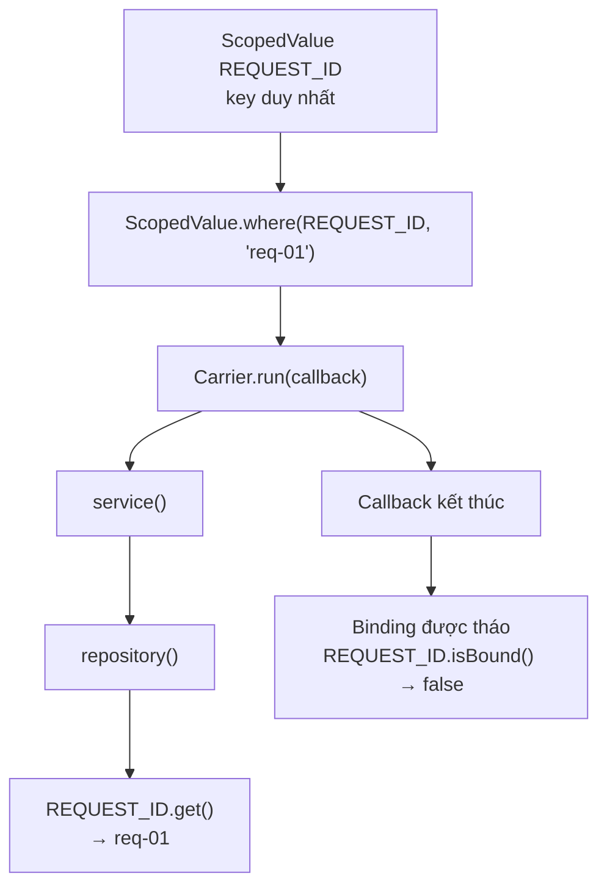
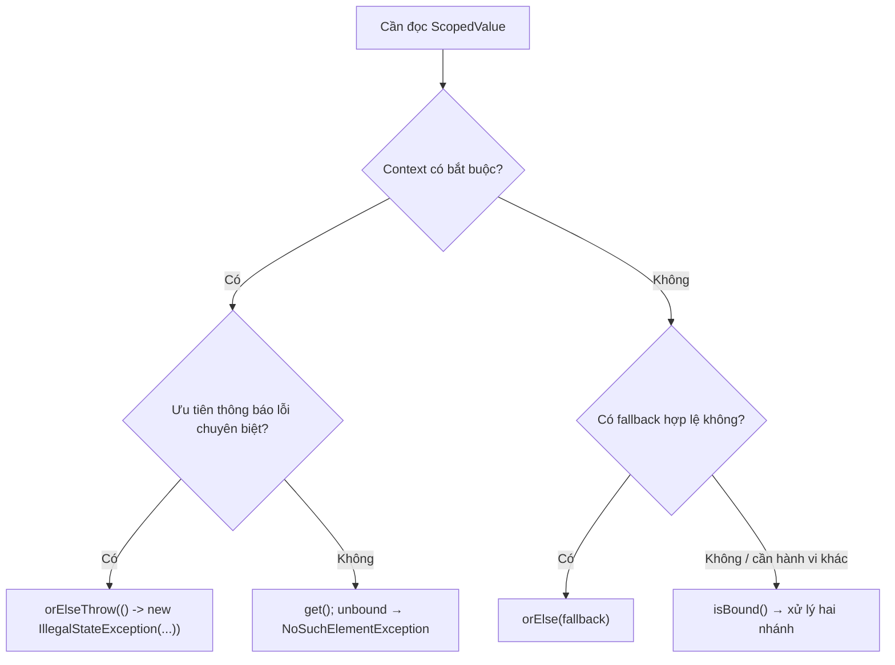
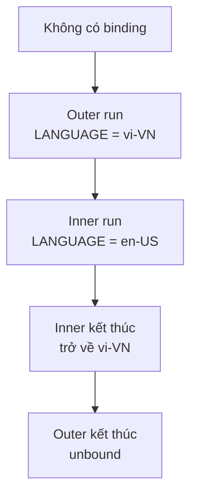
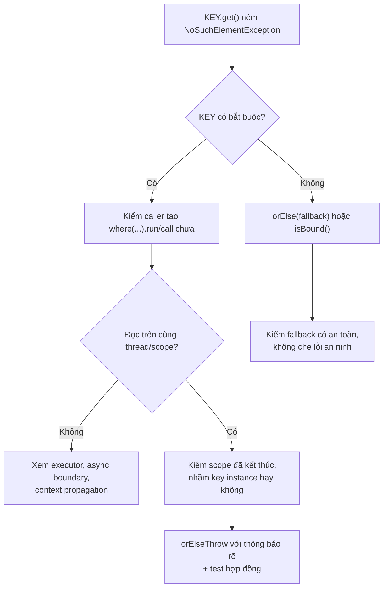

# Đọc giá trị, kiểm tra ràng buộc và xử lý trường hợp chưa có giá trị

Khi xử lý một yêu cầu trong ứng dụng Java, nhiều phương thức ở sâu trong call stack có thể cần cùng một thông tin như mã yêu cầu, locale hoặc tenant. Truyền tham số này qua tất cả các phương thức trung gian đôi khi khiến chữ ký khó đọc; lưu nó trong một biến toàn cục có thể gây lẫn dữ liệu giữa các yêu cầu. **`ScopedValue<T>`** cho phép ràng buộc một giá trị trong một *phạm vi thực thi động* (dynamic scope), rồi đọc nó từ các phương thức được gọi bên trong phạm vi đó.

Tuy nhiên, một lỗi rất dễ gặp là đọc `REQUEST_ID.get()` khi chưa có binding. Chương trình sẽ không nhận `null` theo mặc định: **`get()` ném `NoSuchElementException` nếu scoped value chưa được ràng buộc trên thread hiện tại**. Java 25 cung cấp những cách xử lý rõ ràng hơn: `isBound()`, `orElse(…)` và `orElseThrow(…)`. Chọn cách nào tùy thuộc việc thiếu ngữ cảnh có được phép hay là vi phạm một điều kiện bắt buộc của ứng dụng.

Bài **“Đọc giá trị, kiểm tra ràng buộc và xử lý trường hợp chưa có giá trị”** thuộc chương **ScopedValue** của module **JAVA_VERSION_JAVA25**. Phạm vi bài là Java 25 hiện đại, liên hệ với cách viết chương trình gọn, quản lý ngữ cảnh ứng dụng, virtual threads, tracing và tương thích khi nâng JDK; không sử dụng ví dụ của những bản preview đã thay đổi. **JEP 506 — Scoped Values đã trở thành tính năng chính thức (final) trong Java 25**, nên các ví dụ cơ bản không cần `--enable-preview`. Structured Concurrency vẫn là preview ở JDK 25, chỉ được đề cập như một cơ chế truyền binding có giới hạn, không làm phụ thuộc bắt buộc cho các bài tập.

> **Lưu ý:** mã nguồn trong bài là các ví dụ độc lập cho **JDK 25**. Hãy tạo từng tệp đúng tên trước khi chạy. Đây là bài soạn nội dung kiến thức, chưa phải báo cáo biên dịch hay benchmark. Những ví dụ request ID, tenant và user trong bài là dữ liệu giả, không được dùng làm hệ thống xác thực thực tế.

## 1. Kết quả học tập

Sau bài học, bạn có thể:

1. Tạo `ScopedValue<T>` bằng `newInstance()` và bind qua `ScopedValue.where(key, value).run(…)` hoặc `call(…)`.
2. Giải thích vì sao binding **chỉ có hiệu lực trong phạm vi động của thread hiện tại**, không phải một field được gán vĩnh viễn.
3. Phân biệt chính xác bốn phương thức: `get()`, `isBound()`, `orElse(T)` và `orElseThrow(Supplier)`.
4. Phân biệt ba trạng thái **unbound**, **bound với giá trị khác null** và **bound với null**.
5. Chọn fallback cho ngữ cảnh tùy chọn và fail-fast cho ngữ cảnh bắt buộc, nhất là tenant hoặc principal liên quan an ninh.
6. Hiểu nested binding, cách trả về binding cũ sau scope và hành vi khi một callback ném exception.
7. Viết JUnit tests cho trường hợp có/không có binding, null binding, rebinding và cách dùng nhiều keys.
8. Tránh nhầm lẫn với `ThreadLocal`, `Optional`, virtual threads hoặc context propagation của framework.

## 2. Tư duy đúng: key, binding và phạm vi động

Một `ScopedValue<T>` là **key** được dùng để tra cứu giá trị trong scope của một thread. Đối tượng key không phải là hộp chứa một biến có thể gán lại tùy ý.



Ví dụ đầy đủ:

```java
// File: BasicScopedValue.java
public class BasicScopedValue {

    private static final ScopedValue<String> REQUEST_ID =
            ScopedValue.newInstance();

    static void saveOrder() {
        System.out.println("Đang xử lý " + REQUEST_ID.get());
    }

    static void handleRequest() {
        saveOrder();
    }

    public static void main(String[] args) {
        System.out.println(REQUEST_ID.isBound()); // false

        ScopedValue.where(REQUEST_ID, "req-01").run(() -> {
            System.out.println(REQUEST_ID.isBound()); // true
            handleRequest();
        });

        System.out.println(REQUEST_ID.isBound()); // false
    }
}
```

Chạy với JDK 25:

```bash
javac --release 25 BasicScopedValue.java
java BasicScopedValue
```

Đầu ra:

```text
false
true
Đang xử lý req-01
false
```

Điều cần hiểu:

- `ScopedValue.newInstance()` tạo một key **chưa được bind** cho tất cả các threads.
- `ScopedValue.where(REQUEST_ID, "req-01")` tạo một `ScopedValue.Carrier` mô tả mapping.
- `Carrier.run(…)` **thực thi callback** với key đã bind trên thread hiện tại.
- Method được callback gọi sâu hơn như `saveOrder()` tra ra cùng binding mà không cần nhận tham số.
- Khi `run(…)` kết thúc, binding được tháo tự động. **Không gọi `remove()` như `ThreadLocal`**, và không có thao tác `set()` tương đương trên key.

**Điểm kiểm soát quan trọng:** tạo `Carrier` thôi chưa làm thay đổi `REQUEST_ID.isBound()` của thread. Binding xảy ra khi chạy `run(…)` hoặc `call(…)`.

## 3. Bốn phương thức đọc và kiểm tra trạng thái

Bảng sau dựa trên API `java.lang.ScopedValue` của Java SE 25.

| API | Khi **bound** | Khi **unbound** | Nên sử dụng |
|---|---|---|---|
| `T get()` | Trả giá trị hiện tại | Ném `NoSuchElementException` | Ở đường xử lý **bắt buộc đã có** context |
| `boolean isBound()` | `true` | `false` | Phân nhánh theo trạng thái binding |
| `T orElse(T other)` | Trả giá trị đang bind | Trả `other` | Giá trị ngữ cảnh tùy chọn, có fallback hợp lệ |
| `T orElseThrow(Supplier<? extends X>)` | Trả giá trị đang bind | Ném exception do supplier tạo | Context bắt buộc; muốn lỗi dễ chẩn đoán |

**Không có** instance method `getOrDefault(…)`, `set(…)`, `remove(…)` hoặc `orElseGet(…)` trong `ScopedValue` của Java 25. Cũng **không có `orElseThrow()` không tham số** như ở `java.util.Optional`: với `ScopedValue`, bạn phải truyền supplier để tạo exception.

### 3.1. Tình huống có binding

```java
// File: BoundAccess.java
public class BoundAccess {

    private static final ScopedValue<String> LOCALE =
            ScopedValue.newInstance();

    public static void main(String[] args) {
        ScopedValue.where(LOCALE, "vi-VN").run(() -> {
            System.out.println(LOCALE.isBound());
            System.out.println(LOCALE.get());
            System.out.println(LOCALE.orElse("en-US"));
            System.out.println(LOCALE.orElseThrow(
                    () -> new IllegalStateException("Thiếu locale")));
        });
    }
}
```

Đầu ra:

```text
true
vi-VN
vi-VN
vi-VN
```

Khi đã bound, `orElse("en-US")` **không lấy giá trị fallback**. `orElseThrow(…)` **không gọi exception supplier**. Nó trả giá trị hiện tại theo đúng contract.

### 3.2. Tình huống không có binding

```java
// File: UnboundAccess.java
import java.util.NoSuchElementException;

public class UnboundAccess {

    private static final ScopedValue<String> REQUEST_ID =
            ScopedValue.newInstance();

    public static void main(String[] args) {
        System.out.println(REQUEST_ID.isBound()); // false
        System.out.println(REQUEST_ID.orElse("no-request")); // no-request

        try {
            REQUEST_ID.get();
        } catch (NoSuchElementException ex) {
            System.out.println("get(): chưa có binding");
        }

        try {
            REQUEST_ID.orElseThrow(() ->
                    new IllegalStateException("Request context bắt buộc"));
        } catch (IllegalStateException ex) {
            System.out.println(ex.getMessage());
        }
    }
}
```

Đầu ra:

```text
false
no-request
get(): chưa có binding
Request context bắt buộc
```

`NoSuchElementException` là unchecked exception. Nếu code dùng `get()` trong đường đi tùy chọn mà không xử lý, lỗi sẽ xuất hiện tại runtime. Để thiết kế rõ ràng, hãy quyết định **trước** liệu key là bắt buộc hay không.

## 4. Quyết định dùng `get()`, `isBound()` hay fallback

Không phải cứ thấy `get()` có thể ném lỗi thì phải thay mọi lời gọi bằng `orElse(…)`. Nếu ngữ cảnh bắt buộc, fallback có thể che giấu bug.



| Loại context | Cách chọn | Lý do |
|---|---|---|
| Locale mặc định cho CLI | `LOCALE.orElse("vi-VN")` | Không có locale vẫn có thể dùng mặc định |
| Request ID phục vụ log phụ | `REQUEST_ID.orElse("standalone")` | Có thể log tác vụ chạy ngoài request |
| Tenant được dùng để chọn dữ liệu khách hàng | `TENANT.orElseThrow(…)` | Thiếu tenant phải **dừng an toàn**, không dùng tenant ngẫu nhiên |
| Principal/authorization context | `PRINCIPAL.orElseThrow(…)` | Không tự trao quyền bằng default |
| Header correlation tùy chọn | `if (TRACE.isBound()) { … }` | Chọn nhánh instrument hoặc bỏ qua |
| Phân tích trường hợp bound-null | `isBound()` + `get()` | Phải phân biệt “có binding chứa null” với unbound |

**Quy tắc bảo mật:** đối với tenant, identity hoặc quyền truy cập, “thiếu giá trị” không có nghĩa là quyền mặc định. Cần validate input ở biên hệ thống, tạo scope có chủ đích và **fail closed** khi scope bắt buộc không tồn tại.

## 5. `get()`: đọc trực tiếp và hiểu lỗi thiếu binding

Nếu một method được thiết kế chỉ chạy **bên trong** một scope nhất định, dùng `get()` là cách diễn đạt hợp đồng ngắn gọn:

```java
// File: RequiredRead.java
public class RequiredRead {

    private static final ScopedValue<String> TENANT =
            ScopedValue.newInstance();

    static String tablePartition() {
        return "orders_" + TENANT.get();
    }

    public static void main(String[] args) {
        ScopedValue.where(TENANT, "shop-vn").run(() -> {
            System.out.println(tablePartition()); // orders_shop-vn
        });

        // Không gọi tablePartition() ngoài scope ở đường đi hợp lệ.
    }
}
```

Ở đây `get()` cho biết *“method này yêu cầu có tenant context”*. Nếu ai đó gọi method ngoài scope, `NoSuchElementException` chỉ ra sai hợp đồng của caller.

### 5.1. Vì sao không nên bắt lỗi rồi âm thầm tiếp tục?

Đoạn sau là **anti-pattern**, đặc biệt khi context ảnh hưởng tới phân quyền hoặc dữ liệu:

```java
// CHỈ minh họa cách KHÔNG nên viết cho tenant bảo mật:
static String unsafeTenant() {
    try {
        return TENANT.get();
    } catch (java.util.NoSuchElementException ex) {
        return "public"; // Có thể truy cập sai vùng dữ liệu!
    }
}
```

Cách tốt hơn là quy định rõ:

```java
static String requiredTenant() {
    return TENANT.orElseThrow(() ->
            new IllegalStateException(
                    "Tenant context chưa được thiết lập"));
}
```

Khi quan sát log/trace ở production, thông báo lỗi chuyên biệt dễ định vị đường đi thiếu bước bind hơn. Nhưng **không log token, mật khẩu hoặc dữ liệu nhạy cảm** trong exception message.

### 5.2. Không dùng `get()` để kiểm tra tồn tại

Viết `get()` rồi catch `NoSuchElementException` chỉ để biết key đã được bind hay chưa là không cần thiết. Java 25 có `isBound()`, rõ hơn và tránh dùng exceptions làm luồng điều khiển thông thường.

## 6. `isBound()`: phân nhánh khi giá trị có thể thiếu

`isBound()` trả về boolean cho **thread đang gọi**, không phải trạng thái toàn hệ thống:

```java
// File: ConditionalRead.java
public class ConditionalRead {

    private static final ScopedValue<String> TRACE_LABEL =
            ScopedValue.newInstance();

    static String logPrefix() {
        if (TRACE_LABEL.isBound()) {
            return "[" + TRACE_LABEL.get() + "]";
        }

        return "[background]";
    }

    public static void main(String[] args) {
        System.out.println(logPrefix()); // [background]

        ScopedValue.where(TRACE_LABEL, "req-42").run(() -> {
            System.out.println(logPrefix()); // [req-42]
        });

        System.out.println(logPrefix()); // [background]
    }
}
```

Đây là trường hợp phù hợp vì tác vụ có thể được chạy trong request hoặc ngoài request; thiếu label không làm hỏng tính đúng nghiệp vụ.

### 6.1. Có cần kiểm `isBound()` trước mỗi `get()`?

**Không.** Với một key bắt buộc, việc chèn điều kiện ở mọi tầng làm lặp code và dễ che lỗi thiết kế. Có thể dùng `get()` hoặc `orElseThrow(…)` sau khi caller đã cam kết scope.

Với context tùy chọn và cần xử lý khác nhau theo nhánh, `isBound()` là lựa chọn hợp lý. Nếu chỉ muốn fallback giá trị, `orElse(…)` ngắn và rõ hơn.

### 6.2. Phạm vi và tính ổn định của kiểm tra

Trong cùng một đoạn thực thi đồng bộ không rời thread và không tạo nested binding khác, kiểm tra:

```java
if (REQUEST_ID.isBound()) {
    String id = REQUEST_ID.get();
    // dùng id
}
```

là cách hợp lý. Tuy nhiên, `ScopedValue` không biến các objects bên trong binding thành immutable, và **không bảo đảm context tự được truyền sang thread khác**. Nếu phương thức chuyển sang executor riêng ở giữa, thread mới có thể không có binding dù thread ban đầu vừa kiểm `isBound()` là `true`.

## 7. `orElse(T)`: fallback hợp lệ cho giá trị tùy chọn

`orElse(other)` trả về giá trị đang bind; nếu unbound, nó trả `other`. Nó tương tự về ý tưởng với `Optional.orElse(…)` nhưng **không đồng nhất về kiểu dữ liệu và trạng thái**.

```java
// File: OptionalLocale.java
public class OptionalLocale {

    private static final ScopedValue<String> LOCALE =
            ScopedValue.newInstance();

    static String effectiveLocale() {
        return LOCALE.orElse("vi-VN");
    }

    public static void main(String[] args) {
        System.out.println(effectiveLocale()); // vi-VN

        ScopedValue.where(LOCALE, "en-US").run(() -> {
            System.out.println(effectiveLocale()); // en-US
        });

        System.out.println(effectiveLocale()); // vi-VN
    }
}
```

Mức fallback phải theo hợp đồng của ứng dụng:

- **Được phép:** locale hiển thị mặc định, định dạng số, nhãn log cho batch job.
- **Cần cân nhắc:** region/partition nếu nó ảnh hưởng kết quả nghiệp vụ.
- **Không nên tự mặc định:** tenant, principal, quyền truy cập hoặc các thiết lập bảo mật bắt buộc.

### 7.1. Fallback được tính trước khi gọi `orElse(…)`

Biểu thức đối số Java được đánh giá **trước** lời gọi method:

```java
// Cách này luôn gọi expensiveDefault(), kể cả khi KEY đã bound:
String value = KEY.orElse(expensiveDefault());
```

Nếu việc tạo fallback tốn kém hoặc có side effect, không được kỳ vọng `orElse(…)` gọi nó một cách lazy.

Java 25 **không có** `ScopedValue.orElseGet(Supplier)`. Nếu thật sự cần lazy fallback, có thể tự viết một nhánh:

```java
String value = KEY.isBound()
        ? KEY.get()
        : expensiveDefault();
```

Hoặc bao bọc logic đó trong một method thích hợp. Đừng tìm ví dụ `ScopedValue.orElseGet(…)` từ `Optional` rồi cho rằng API ScopedValue cũng có method này.

### 7.2. Khi fallback là một record

Với nhiều thuộc tính của context, hãy gom vào một record có giá trị mặc định hợp lệ:

```java
record FormattingContext(String locale, String zone) {}

private static final ScopedValue<FormattingContext> FORMAT =
        ScopedValue.newInstance();

static FormattingContext currentFormat() {
    return FORMAT.orElse(new FormattingContext("vi-VN", "Asia/Ho_Chi_Minh"));
}
```

Code trên là ví dụ về **context hiển thị**. Không dùng cùng kiểu fallback để giả lập tenant hoặc principal bảo mật. Khi cần tránh tạo record mỗi lần gọi, có thể lưu fallback immutable trong một hằng `private static final`.

## 8. `orElseThrow(Supplier)`: bắt buộc có context, báo lỗi có ý nghĩa

Khi dữ liệu bắt buộc phải đến từ biên đã kiểm soát, `orElseThrow(…)` giúp diễn đạt rõ chính sách fail-fast:

```java
// File: RequiredContext.java
public class RequiredContext {

    private static final ScopedValue<String> TENANT_ID =
            ScopedValue.newInstance();

    static String currentTenant() {
        return TENANT_ID.orElseThrow(() ->
                new IllegalStateException(
                        "Tenant scope bắt buộc trước khi đọc dữ liệu"));
    }

    static void queryOrders() {
        String tenant = currentTenant();
        System.out.println("Query theo tenant: " + tenant);
    }

    public static void main(String[] args) {
        ScopedValue.where(TENANT_ID, "team-a").run(() -> {
            queryOrders();
        });
    }
}
```

Ở đây, exception supplier chỉ được sử dụng khi **chưa có binding**. Việc chọn `IllegalStateException` là hợp lý nếu method bị gọi sai ngữ cảnh, nhưng ứng dụng có thể định nghĩa exception riêng (ví dụ `MissingRequestContextException`) và chuyển nó thành log/response ở biên phù hợp.

### 8.1. Không nhầm với `Optional.orElseThrow()`

`java.util.Optional` có overload không tham số `orElseThrow()`. Trong API `ScopedValue` của **Java 25**, hình thức đúng là:

```java
// Đúng với ScopedValue Java 25:
String value = TENANT_ID.orElseThrow(
        () -> new IllegalStateException("Missing tenant"));
```

Không viết:

```java
// Sai: ScopedValue Java 25 không có overload không tham số này.
String value = TENANT_ID.orElseThrow();
```

Nếu bạn chỉ muốn `NoSuchElementException` mặc định, dùng `TENANT_ID.get()`. Khi muốn thông điệp lỗi phù hợp vận hành, dùng supplier.

### 8.2. Exception có thể mang loại tùy chọn

Method `orElseThrow(Supplier<? extends X>)` có generic `X extends Throwable` và khai báo `throws X`. Nếu supplier tạo **checked exception**, phương thức gọi cũng phải catch hoặc khai báo throws tương ứng.

Ví dụ rút gọn:

```java
import java.io.IOException;

static String tenantFromScope(ScopedValue<String> tenant)
        throws IOException {

    return tenant.orElseThrow(() ->
            new IOException("Thiếu tenant context"));
}
```

Chỉ dùng checked exception nếu đó là hợp đồng phù hợp cho caller. Đối với lỗi cấu hình lập trình hoặc thiếu scope bắt buộc trong code nội bộ, unchecked exception thường đơn giản hơn.

## 9. Ba trạng thái riêng: unbound, bound-null, bound-value

Đây là chi tiết **rất quan trọng** của API Java 25: `ScopedValue.where(key, value)` **cho phép `value` bằng `null`**. Khi đó key vẫn được coi là **bound**.

| Trạng thái | `isBound()` | `get()` | `orElse("fallback")` | `orElseThrow(…)` |
|---|---:|---|---|---|
| Chưa có binding | `false` | Ném `NoSuchElementException` | `"fallback"` | Ném exception tùy chọn |
| Bind với `"abc"` | `true` | `"abc"` | `"abc"` | `"abc"` |
| Bind với `null` | `true` | `null` | **`null`** | **`null`**, không ném |

Thử nghiệm:

```java
// File: BoundNull.java
public class BoundNull {

    private static final ScopedValue<String> NAME =
            ScopedValue.newInstance();

    public static void main(String[] args) {
        System.out.println(NAME.isBound());   // false
        System.out.println(NAME.orElse("guest")); // guest

        ScopedValue.where(NAME, null).run(() -> {
            System.out.println(NAME.isBound()); // true
            System.out.println(NAME.get() == null); // true

            // Đã bound: không dùng "guest" dù giá trị là null.
            System.out.println(NAME.orElse("guest") == null); // true

            // Không ném lỗi vì key có binding.
            System.out.println(NAME.orElseThrow(
                    () -> new IllegalStateException()) == null); // true
        });

        System.out.println(NAME.isBound()); // false
    }
}
```

**Ba trạng thái không nên bị nhập làm hai.** `isBound()` kiểm tra **sự tồn tại của binding**, không kiểm tra `get() != null`.

### 9.1. Cần giá trị khác null? Kiểm thêm

Nếu contract yêu cầu non-null, có hai chỗ kiểm:

**Tại biên trước khi bind** (ưu tiên):

```java
String validatedTenant = java.util.Objects.requireNonNull(
        incomingTenant, "tenantId must not be null");

ScopedValue.where(TENANT_ID, validatedTenant).run(() -> {
    service();
});
```

**Tại điểm đọc**, khi cần bảo vệ invariant:

```java
static String currentTenant() {
    String tenant = TENANT_ID.orElseThrow(() ->
            new IllegalStateException("Tenant chưa được bind"));

    return java.util.Objects.requireNonNull(
            tenant, "Tenant đã bind nhưng là null");
}
```

Các đoạn này minh họa logic trong class có khai báo `TENANT_ID` và `service()`; chúng không phải file standalone khi đứng riêng. Đối với an ninh, tốt nhất là **validate đầy đủ** chuỗi tenant có giá trị hợp lệ và đã được xác thực, không chỉ kiểm khác null.

### 9.2. Có nên bind null để biểu thị thiếu thông tin?

Thường **không nên**, vì làm mờ nghĩa của scope. Nếu thiếu context là bình thường, để key **unbound** hoặc dùng record/kiểu giá trị có trạng thái rõ ràng. Nếu cần phân biệt “đã xác định không có dữ liệu” với “chưa tạo scope”, hãy thiết kế một domain type rõ ràng thay vì dựa vào null ngầm.

## 10. Nested binding: giá trị gần nhất thắng, sau đó được khôi phục

Một key có thể được bind lại trong một scope con. Java sẽ tìm binding **gần nhất trên dynamic call stack** của thread đó.

```java
// File: NestedBinding.java
public class NestedBinding {

    private static final ScopedValue<String> LANGUAGE =
            ScopedValue.newInstance();

    static void printLanguage(String stage) {
        System.out.println(stage + ": " + LANGUAGE.orElse("unbound"));
    }

    public static void main(String[] args) {
        printLanguage("outside");

        ScopedValue.where(LANGUAGE, "vi-VN").run(() -> {
            printLanguage("outer");

            ScopedValue.where(LANGUAGE, "en-US").run(() -> {
                printLanguage("inner");
            });

            printLanguage("after inner");
        });

        printLanguage("after outer");
    }
}
```

Đầu ra:

```text
outside: unbound
outer: vi-VN
inner: en-US
after inner: vi-VN
after outer: unbound
```



**Rebinding không giống với `set()`:** mã bên trong tạo một phạm vi mới; nó không sửa binding của scope ngoài. Khi callback inner kết thúc, binding cũ tự xuất hiện trở lại. Đây là một trong những đặc tính giúp tránh tình trạng quên phục hồi state khi dùng thread-local mutable data.

### 10.1. Khi inner scope ném exception

Ngay cả khi callback ném lỗi, khi stack unwinds thì binding được khôi phục:

```java
// File: ExceptionRestoration.java
public class ExceptionRestoration {

    private static final ScopedValue<String> MARKER =
            ScopedValue.newInstance();

    public static void main(String[] args) {
        ScopedValue.where(MARKER, "outer").run(() -> {
            try {
                ScopedValue.where(MARKER, "inner").run(() -> {
                    throw new IllegalStateException("lab failure");
                });
            } catch (IllegalStateException expected) {
                System.out.println(MARKER.get()); // outer
            }
        });

        System.out.println(MARKER.isBound()); // false
    }
}
```

Không cần gọi `MARKER.remove()` ở `finally`. Bản thân `run(…)` quản lý thời gian sống binding. Lỗi nghiệp vụ vẫn phải được xử lý theo chính sách ứng dụng; ScopedValue chỉ đảm nhận **vòng đời ngữ cảnh**.

## 11. `Carrier.run()`, `Carrier.call()` và nhiều binding cùng lúc

`ScopedValue.where(key, value)` tạo một `ScopedValue.Carrier`. Từ đó:

- `run(Runnable)` chạy callback không trả kết quả với các bindings được áp dụng trên thread hiện tại.
- `call(ScopedValue.CallableOp)` chạy callback trả kết quả; exception từ callback được propagate.
- `where(otherKey, value)` trên Carrier tạo một **Carrier mới** với mapping bổ sung hoặc thay mapping của key hiện có.
- `Carrier.get(key)` đọc **mapping của Carrier**, khác với `key.get()` đọc binding của thread. Hai lời gọi không nên bị đánh đồng.

### 11.1. Bind nhiều giá trị

```java
// File: MultipleBindings.java
public class MultipleBindings {

    private static final ScopedValue<String> REQUEST_ID =
            ScopedValue.newInstance();

    private static final ScopedValue<String> LOCALE =
            ScopedValue.newInstance();

    static String format() {
        return REQUEST_ID.get() + " / " + LOCALE.get();
    }

    public static void main(String[] args) {
        ScopedValue.where(REQUEST_ID, "req-8")
                .where(LOCALE, "vi-VN")
                .run(() -> {
                    System.out.println(format());
                });

        System.out.println(REQUEST_ID.isBound()); // false
        System.out.println(LOCALE.isBound()); // false
    }
}
```

Đầu ra trong callback là `req-8 / vi-VN`. Nếu một key chưa có trong chain nhưng callback cố gọi `get()` của nó, nó vẫn có thể ném `NoSuchElementException`.

### 11.2. Trả kết quả với `call(…)`

```java
// File: CallWithResult.java
public class CallWithResult {

    private static final ScopedValue<Integer> RATE =
            ScopedValue.newInstance();

    static int estimate(int base) {
        return base * RATE.get();
    }

    public static void main(String[] args) {
        int result = ScopedValue.where(RATE, 3)
                .call(() -> estimate(25));

        System.out.println(result); // 75
        System.out.println(RATE.isBound()); // false
    }
}
```

Trong bài thực tế, `call(…)` phù hợp khi muốn bind tạm một context rồi **trả ra dữ liệu tính toán**, thay vì ghi một biến bên ngoài callback.

### 11.3. Đọc Carrier không đồng nghĩa đã bind vào thread

```java
// File: CarrierMapping.java
public class CarrierMapping {

    private static final ScopedValue<String> KEY =
            ScopedValue.newInstance();

    public static void main(String[] args) {
        ScopedValue.Carrier carrier =
                ScopedValue.where(KEY, "configured");

        System.out.println(carrier.get(KEY)); // configured
        System.out.println(KEY.isBound());    // false

        carrier.run(() -> {
            System.out.println(KEY.get()); // configured
        });

        System.out.println(KEY.isBound()); // false
    }
}
```

Đây là điểm phân biệt rất quan trọng khi debug: mapping tồn tại trong `Carrier` nhưng **thread context chưa thay đổi trước khi chạy callback**. Các Carrier là immutable và thread-safe; gọi `where(…)` tạo một carrier mới, không sửa carrier cũ.

## 12. Ca thực tế: request context có trường tùy chọn và trường bắt buộc

Một ứng dụng nhiều tenant có thể cần cả request ID, tenant ID và locale. Thay vì tạo một key riêng cho từng thuộc tính rồi truyền đi qua nhiều method, có thể gom thành record immutable.

```java
// File: RequestContextDemo.java
import java.util.Objects;

public class RequestContextDemo {

    record RequestContext(String requestId,
                          String tenantId,
                          String locale) {

        RequestContext {
            Objects.requireNonNull(requestId, "requestId");
            Objects.requireNonNull(tenantId, "tenantId");
            Objects.requireNonNull(locale, "locale");
            if (tenantId.isBlank()) {
                throw new IllegalArgumentException("Tenant không hợp lệ");
            }
        }
    }

    private static final ScopedValue<RequestContext> CURRENT =
            ScopedValue.newInstance();

    static String optionalLocale() {
        return CURRENT.isBound()
                ? CURRENT.get().locale()
                : "vi-VN";
    }

    static String requiredTenant() {
        return CURRENT.orElseThrow(() ->
                new IllegalStateException(
                        "Không có request context bắt buộc"))
                .tenantId();
    }

    static void loadOrderSummary() {
        System.out.println(
                "tenant=" + requiredTenant() +
                ", locale=" + optionalLocale());
    }

    public static void main(String[] args) {
        System.out.println(optionalLocale()); // vi-VN

        RequestContext context =
                new RequestContext("req-25", "team-a", "en-US");

        ScopedValue.where(CURRENT, context).run(() -> {
            loadOrderSummary();
        });

        System.out.println(CURRENT.isBound()); // false
    }
}
```

Đầu ra:

```text
vi-VN
tenant=team-a, locale=en-US
false
```

**Tại sao nên dùng một record?**

1. Context có danh sách thuộc tính và các invariant kiểm chứng được.
2. Binding được thiết kế như dữ liệu chỉ đọc; record không có setters.
3. Scope có số keys ít hơn và dễ bảo trì.
4. `requiredTenant()` vẫn fail-fast nếu thiếu context thay vì tự dùng một tenant có thể gây lộ dữ liệu.

**Nhưng** code này chỉ chứng minh cách truyền dữ liệu đã xác thực: nó **không** thực hiện authentication/authorization. Tenant ID phải được xác định và kiểm quyền ở biên ứng dụng. Bất kỳ tên tenant nào do client gửi cũng không được mặc nhiên tin cậy.

### 12.1. Ngữ cảnh tùy chọn trong batch jobs

Một background job đôi khi không chạy trong HTTP request, nên `CURRENT.isBound()` có thể là `false`. Nếu job chỉ cần locale hiển thị, có thể dùng default. Nhưng nếu job đọc dữ liệu tenant, nó phải được bind với một tenant hợp lệ hoặc phải có một API riêng cho tác vụ quản trị đa tenant; đừng dùng một giá trị mặc định im lặng.

### 12.2. Tránh “God context”

Không nhồi tất cả config, database connection, repository, transaction, token và mutable cache vào một `RequestContext` lớn. Dù dùng record, các thành phần bên trong có thể là objects mutable. ScopedValue chỉ đảm bảo binding không bị thay đổi trong cùng scope; **nó không biến object được bind thành bất biến hoặc thread-safe**.

## 13. Thread hiện tại khác với mọi thread khác

Java SE 25 mô tả binding của `ScopedValue` là **per-thread**. Điều này áp dụng cho platform threads và virtual threads theo ngữ nghĩa của ScopedValue.

Nếu một thread bind key rồi khởi tạo một thread khác bằng `Thread.ofVirtual().start(…)`, không nên kỳ vọng thread con tự nhìn thấy binding chỉ vì nó được tạo khi scope đang hoạt động.

```java
// File: ThreadBoundary.java
public class ThreadBoundary {

    private static final ScopedValue<String> REQUEST =
            ScopedValue.newInstance();

    public static void main(String[] args)
            throws InterruptedException {

        ScopedValue.where(REQUEST, "req-parent").run(() -> {
            System.out.println("parent=" + REQUEST.get());

            Thread worker = Thread.ofVirtual().start(() -> {
                System.out.println(
                        "worker bound=" + REQUEST.isBound());
            });

            try {
                worker.join();
            } catch (InterruptedException ex) {
                Thread.currentThread().interrupt();
                throw new RuntimeException(ex);
            }
        });
    }
}
```

Kết quả minh họa:

```text
parent=req-parent
worker bound=false
```

**Không có ngầm định inheritance** với `Thread.start()`, `Executors.newVirtualThreadPerTaskExecutor()` hoặc một `CompletableFuture.supplyAsync(…)` chạy trên executor bất kỳ. Tránh xem `ScopedValue` như một loại `InheritableThreadLocal`.

### 13.1. Khi cần truyền context rõ ràng sang một thread độc lập

Có thể truyền **giá trị immutable** qua parameter/capture rồi tạo một scope mới ở thread đích:

```java
// File: ExplicitPropagation.java
public class ExplicitPropagation {

    private static final ScopedValue<String> REQUEST =
            ScopedValue.newInstance();

    public static void main(String[] args)
            throws InterruptedException {

        ScopedValue.where(REQUEST, "req-parent").run(() -> {
            String id = REQUEST.get();

            Thread child = Thread.ofVirtual().start(() ->
                    ScopedValue.where(REQUEST, id).run(() -> {
                        System.out.println("child=" + REQUEST.get());
                    }));

            try {
                child.join();
            } catch (InterruptedException ex) {
                Thread.currentThread().interrupt();
                throw new RuntimeException(ex);
            }
        });
    }
}
```

Từ góc nhìn Java, đó là **binding mới trên thread đích**, không phải một cơ chế inheritance mặc định. Chỉ truyền context hợp lệ, theo nhu cầu, không đưa dữ liệu nhạy cảm hoặc mutable objects qua boundary thiếu kiểm soát.

### 13.2. Trường hợp đặc biệt: Structured Concurrency

API `StructuredTaskScope` hỗ trợ **thừa hưởng scoped value bindings** theo các điều kiện vòng đời có cấu trúc: scope được mở khi parent binding hoạt động, các child tasks được fork trong scope và join/close đúng quy tắc.

Tuy nhiên, **Structured Concurrency vẫn là preview trong JDK 25**. Đối với nội dung tập trung vào những kiến thức ổn định, ta không yêu cầu người học bật preview hoặc dùng API đó để đọc `ScopedValue`. Hãy phân biệt:

- **ScopedValue (JEP 506): final** trong JDK 25.
- **StructuredTaskScope/Structured Concurrency:** preview ở JDK 25; nếu áp dụng trong một dự án hiện đại, phải xác minh trạng thái/API của **phiên bản JDK đích**.

Không suy rằng mọi child thread tự inherit ScopedValue chỉ vì StructuredTaskScope hỗ trợ nó trong **một trường hợp đặc biệt**.

## 14. ScopedValue khác ThreadLocal và Optional ở đâu?

### 14.1. So với `ThreadLocal`

| Tiêu chí | `ScopedValue<T>` | `ThreadLocal<T>` |
|---|---|---|
| Mục tiêu chính | Truyền dữ liệu theo một chiều trong dynamic scope | Lưu trạng thái theo thread |
| Gán giá trị | `where(…).run/call` tạo binding giới hạn | `set(…)` có thể đổi giá trị |
| Kết thúc phạm vi | Tự khôi phục/unbind | Phải quản lý `remove()`/restore |
| Đọc khi chưa có | `get()` ném exception | `get()` thường là null nếu không có initial value |
| Default khi thiếu | `orElse(…)` | Có thể dùng `withInitial(…)` |
| Nested override | Rebinding tự phục hồi | Cần tự lưu/restore nếu dùng set |
| Quan hệ với child threads | Per-thread, inheritance có cấu trúc khi API hỗ trợ | `InheritableThreadLocal` là một cơ chế khác |
| Loại dữ liệu lý tưởng | Context chỉ đọc, immutable | State có nhu cầu cập nhật trong cùng thread |

`ThreadLocal` **không tự trở thành legacy** chỉ vì ScopedValue đã final. Nó vẫn phù hợp với một số thư viện/framework cần mutable per-thread state và có quy trình cleanup chuẩn. ScopedValue tốt hơn trong bài toán **one-way transmission** của context không cần chỉnh sửa.

### 14.2. So với `Optional<T>`

`Optional` biểu diễn dữ liệu có hoặc không có giá trị như một object trong Java. `ScopedValue` biểu diễn một **binding theo thread và scope**, không phải một container mà bạn truyền/giữ tự do như `Optional`.

Các bẫy quen thuộc:

- `Optional.orElseGet(Supplier)` có tồn tại, nhưng `ScopedValue.orElseGet` **không có**.
- `Optional.orElseThrow()` không tham số có tồn tại, nhưng `ScopedValue.orElseThrow()` **không có** trong Java 25.
- `Optional` không chứa giá trị null theo cách thông thường; `ScopedValue` **có thể được bind với null**.
- `Optional.isPresent()` nói về giá trị bên trong Optional; `ScopedValue.isBound()` nói về sự tồn tại binding **trên thread hiện tại**.

Đừng chọn ScopedValue chỉ vì “giống Optional nhưng toàn cục hơn”. Đây là hai abstraction rất khác nhau.

## 15. JUnit tests cho trạng thái bound, unbound và fallback

Để kiểm các hợp đồng một cách độc lập, có thể dùng JUnit 5. Các test dưới đây không cần preview feature của JDK 25; chỉ cần source/target Java 25 và dependency JUnit của dự án.

```java
// File: ScopedValueAccessTest.java
import static org.junit.jupiter.api.Assertions.*;

import java.util.NoSuchElementException;
import org.junit.jupiter.api.Test;

class ScopedValueAccessTest {

    private static final ScopedValue<String> KEY =
            ScopedValue.newInstance();

    @Test
    void unboundAccessors() {
        assertFalse(KEY.isBound());

        assertEquals("fallback", KEY.orElse("fallback"));

        assertThrows(NoSuchElementException.class,
                () -> KEY.get());

        assertThrows(IllegalStateException.class,
                () -> KEY.orElseThrow(
                        () -> new IllegalStateException("missing")));
    }

    @Test
    void boundAccessors() {
        ScopedValue.where(KEY, "present").run(() -> {
            assertTrue(KEY.isBound());
            assertEquals("present", KEY.get());
            assertEquals("present", KEY.orElse("fallback"));
            assertEquals("present", KEY.orElseThrow(
                    () -> new IllegalStateException("missing")));
        });

        assertFalse(KEY.isBound());
    }

    @Test
    void nullBindingIsStillBound() {
        ScopedValue.where(KEY, null).run(() -> {
            assertTrue(KEY.isBound());
            assertNull(KEY.get());
            assertNull(KEY.orElse("fallback"));
            assertNull(KEY.orElseThrow(
                    () -> new IllegalStateException("missing")));
        });
    }

    @Test
    void nestedBindingRestoresOuterValue() {
        ScopedValue.where(KEY, "outer").run(() -> {
            assertEquals("outer", KEY.get());

            ScopedValue.where(KEY, "inner").run(() -> {
                assertEquals("inner", KEY.get());
            });

            assertEquals("outer", KEY.get());
        });

        assertFalse(KEY.isBound());
    }

    @Test
    void exceptionDoesNotLeakBinding() {
        assertThrows(IllegalStateException.class,
                () -> ScopedValue.where(KEY, "temporary").run(() -> {
                    throw new IllegalStateException("boom");
                }));

        assertFalse(KEY.isBound());
    }
}
```

### 15.1. Tại sao test tách các trường hợp?

Test `unboundAccessors()` không chỉ kiểm exception mà còn kiểm **fallback đúng**. Test `nullBindingIsStillBound()` phân biệt null với unbound, điều nhiều người dễ sai nhất. Test `exceptionDoesNotLeakBinding()` kiểm vòng đời scope trong nhánh exception, một điểm mà cách lưu mutable thread-local thủ công dễ bỏ sót.

### 15.2. Test nhiều thread

Nếu cần kiểm concurrency, hãy tạo hai threads riêng biệt, mỗi thread tự bind cùng key với một giá trị khác rồi kiểm kết quả của mình. **Không chia sẻ một object mutable làm giá trị** nếu không có đồng bộ hóa; một `ScopedValue` key có thread-specific bindings không tự đảm bảo thread-safety của object được bind.

## 16. Thiết kế API cho thư viện hoặc service

Khi thiết kế reusable Java APIs, hãy **ghi rõ** context nào là bắt buộc, context nào tùy chọn. Không bắt client phải đoán bằng cách nhìn stack trace `NoSuchElementException`.

Ví dụ một API helper:

```java
// File: ContextAccess.java
import java.util.Objects;

public final class ContextAccess {

    private static final ScopedValue<String> REQUEST_ID =
            ScopedValue.newInstance();

    private ContextAccess() {}

    public static void withinRequest(
            String requestId,
            Runnable operation) {

        Objects.requireNonNull(requestId, "requestId");
        Objects.requireNonNull(operation, "operation");

        ScopedValue.where(REQUEST_ID, requestId).run(operation);
    }

    public static String requiredRequestId() {
        return REQUEST_ID.orElseThrow(() ->
                new IllegalStateException(
                        "Operation requires request context"));
    }

    public static String optionalRequestId() {
        return REQUEST_ID.orElse("background");
    }
}
```

Người gọi:

```java
// File: ContextClient.java
public class ContextClient {
    public static void main(String[] args) {
        System.out.println(ContextAccess.optionalRequestId());

        ContextAccess.withinRequest("req-100", () -> {
            System.out.println(ContextAccess.requiredRequestId());
        });

        System.out.println(ContextAccess.optionalRequestId());
    }
}
```

Chạy khi hai file cùng thư mục:

```bash
javac --release 25 ContextAccess.java ContextClient.java
java ContextClient
```

Đầu ra:

```text
background
req-100
background
```

Cách thiết kế này giữ key `private static final` và chỉ công bố những operations được phép. Bất kỳ code nào có khả năng đọc key có thể truy cập giá trị trong binding của thread; do đó **key cũng mang ý nghĩa capability**, cần cân nhắc quyền truy cập và ranh giới API.

### 16.1. Không dùng ScopedValue để thay xác thực

Một context API tốt có thể truyền tenant/user đã được kiểm tra, nhưng **không tự xác thực** đối tượng. Đừng gắn `String userId` và coi nó chứng minh quyền. Tại biên HTTP/message, vẫn phải có authentication, authorization, validation và giới hạn chia sẻ dữ liệu theo chính sách.

### 16.2. Chọn giá trị bất biến

Bản thân binding không bị đổi bằng `set()`, nhưng nếu bạn bind một `ArrayList`, các method sâu vẫn có thể sửa danh sách. Với request context, ưu tiên `record`, immutable collections và các value objects. Nếu context thực sự được chia sẻ với child tasks, người dùng API phải bảo đảm giá trị immutable hoặc mọi access được đồng bộ hóa phù hợp.

## 17. Lỗi thường gặp khi đọc ScopedValue

| Triệu chứng | Nguyên nhân | Cách xử lý |
|---|---|---|
| `get()` ném `NoSuchElementException` | Chưa bind key trên thread hiện tại | Tạo scope đúng chỗ hoặc dùng fallback nếu được phép |
| `isBound() == false` dù đã tạo Carrier | Carrier chỉ lưu mapping, chưa chạy `run/call` | Thực thi callback trong scope |
| `get() == null` nhưng `isBound() == true` | Đã bind null | Validate non-null ở biên; không nhầm với unbound |
| `orElse("x")` vẫn trả null | Key đã bound với null | Xử lý bound-null hoặc thay thiết kế |
| `orElseThrow(…)` không ném khi giá trị null | Key đã bound | Kiểm `Objects.requireNonNull` nếu contract yêu cầu |
| Không tìm thấy `orElseGet(…)` | ScopedValue không phải Optional | Dùng `isBound() ? get() : fallbackFactory()` |
| Compiler báo sai ở `orElseThrow()` | Thiếu Supplier; API JDK 25 không có overload này | Truyền supplier hoặc dùng `get()` |
| `where(…).run(…)` xong thì `get()` lỗi | Scope đã kết thúc | Chỉ đọc trong callback hoặc trả dữ liệu qua `call(…)` |
| Nested scope đọc giá trị ngoài không đúng | Binding gần nhất được ưu tiên | Kiểm vị trí rebind và ranh giới callback |
| Background worker không có context | Binding per-thread, executor không tự inherit | Truyền giá trị rõ ràng hoặc dùng context mechanism hỗ trợ |
| Tracing thiếu correlation dù request ID bound | ScopedValue không tự thay MDC/OTel context | Cấu hình propagation của framework tracing |
| Không compile `ScopedValue` | JDK/compiler source level quá cũ | Kiểm `javac -version` và `--release 25` |
| Code JDK 24 preview không còn compile | API preview thay đổi ở final | Dùng `ScopedValue.where(…).run/call` từ Java 25 |
| Test rò context sang case khác | Có thể code dùng ThreadLocal/runner ngoài scope, hoặc test gọi sai thread | Kiểm boundaries và cleanup framework; ScopedValue tự tháo scope đúng cách |
| App có tenant default không rõ | Dùng fallback cho quyền truy cập | Thay bằng fail-fast và xác thực ở biên |

### 17.1. Quy trình xử lý `NoSuchElementException`



Một nguyên nhân khác thường bị bỏ sót là **tạo hai ScopedValue keys khác nhau** dù cùng kiểu và cùng tên biến ở hai lớp. Hai lần `ScopedValue.newInstance()` tạo hai keys độc lập. Bind key A không khiến `get()` của key B có giá trị. Hãy quản lý key tập trung qua API có quyền truy cập phù hợp, không khởi tạo lại ở mỗi lần đọc.

## 18. Bài tập thực hành

### Bài 1 — Quan sát trạng thái trước, trong và sau scope

Tạo key `ScopedValue<String> CODE`. In `isBound()` và `orElse("none")` trước callback, trong `run(…)` được bind với `"A"` và sau callback. Ghi đúng ba kết quả mong đợi, giải thích vì sao không cần `remove()`.

### Bài 2 — Xử lý thiếu request ID

Viết hai methods:

- `optionalRequestId()` trả `"background"` khi không có binding.
- `requiredRequestId()` ném `IllegalStateException` với thông báo rõ nếu chưa có binding.

Chạy cả hai methods ở ngoài và trong scope, đối chiếu output/exception.

### Bài 3 — Khác biệt bound-null

Bind `null` vào `ScopedValue<String>`, rồi kiểm `isBound()`, `get()`, `orElse("fallback")` và `orElseThrow(…)`. Sau đó thêm một lớp validation không cho phép null.

### Bài 4 — Nested scopes

Bind `LOCALE = "vi-VN"` rồi vào scope con `LOCALE = "en-US"`. Tại ba thời điểm outer → inner → outer, in giá trị. Thử ném exception ở inner và bảo đảm outer vẫn được khôi phục.

### Bài 5 — Hai keys trong một Carrier

Tạo `REQUEST_ID` và `TENANT_ID`. Dùng chain `ScopedValue.where(REQUEST_ID, …).where(TENANT_ID, …).call(…)` để trả về một chuỗi từ hai keys. Kiểm hai keys đều unbound sau `call(…)`.

### Bài 6 — Carrier map so với thread binding

Tạo `var carrier = ScopedValue.where(KEY, "x");`. Kiểm `carrier.get(KEY)` và `KEY.isBound()` **trước** khi gọi `carrier.run(…)`. Giải thích vì sao kết quả khác nhau.

### Bài 7 — Truyền sang virtual thread

Bind key trên main thread rồi tạo thread bằng `Thread.ofVirtual().start(…)` và kiểm `isBound()`. Tiếp theo, capture giá trị immutable từ outer scope và bind lại trong child thread. Trình bày hai kết quả và ranh giới tin cậy cần lưu ý.

### Bài 8 — Kiểm lỗi khi dùng Optional API nhầm

Sửa đoạn mã không hợp lệ:

```java
// Sai: không phải API ScopedValue trong Java 25.
String value = REQUEST_ID.orElseGet(() -> "background");
String required = REQUEST_ID.orElseThrow();
```

Bản đúng:

```java
String value = REQUEST_ID.orElse("background");

String required = REQUEST_ID.orElseThrow(() ->
        new IllegalStateException("Missing request scope"));
```

### Bài 9 — Thiết kế tenant context an toàn

Thiết kế một request context dạng record chứa tenant ID đã xác thực và locale tùy chọn. Khi không có scope, locale được phép dùng default nhưng tenant phải báo lỗi. Trình bày chỗ validate và tests bảo vệ ba trạng thái unbound/bound-null/bound-value.

### Bài 10 — Tách API khỏi framework tracing

Trong service có ScopedValue cho request ID, việc mở thread pool làm mất trace correlation. Đề xuất cách đoán nguyên nhân dựa trên thread boundary và giải thích vì sao chỉ thêm `ScopedValue` **không tự cấu hình OpenTelemetry/MDC**. Phân biệt chuyển request ID nghiệp vụ với propagation trace context của framework.

## 19. Checklist hoàn thành

- [ ] Dùng JDK 25 và xác nhận `ScopedValue` final, không cần `--enable-preview`.
- [ ] Tạo key bằng `ScopedValue.newInstance()`, thường giữ `private static final`.
- [ ] Bind bằng `ScopedValue.where(key, value).run/call`, không tìm `set()/remove()`.
- [ ] Hiểu `get()` ném `NoSuchElementException` nếu key unbound.
- [ ] Dùng `isBound()` để kiểm tra tồn tại binding trên **thread hiện tại**.
- [ ] Dùng `orElse(T)` khi có fallback hợp lệ, hiểu đối số fallback được đánh giá sớm.
- [ ] Dùng `orElseThrow(Supplier)` cho context bắt buộc và thông báo lỗi rõ.
- [ ] Không nhầm `ScopedValue.orElseThrow()` với method không tham số của Optional.
- [ ] Phân biệt unbound, bound-null và bound-value.
- [ ] Validate non-null nếu contract yêu cầu, không dùng null như trạng thái ngầm.
- [ ] Hiểu rebinding lồng nhau và khôi phục scope khi callback thành công hoặc ném lỗi.
- [ ] Phân biệt `Carrier.get(key)` với `key.get()` trên thread.
- [ ] Không kỳ vọng executor/virtual thread tự inherit binding.
- [ ] Phân biệt ScopedValue final với Structured Concurrency preview trên JDK 25.
- [ ] Không dùng fallback “public/default tenant” nếu ảnh hưởng phân quyền.
- [ ] Ưu tiên immutable context và bảo vệ quyền truy cập key.
- [ ] Có JUnit tests cho unbound, null binding, nested binding, exception restoration.
- [ ] Không coi ScopedValue là giải pháp tự động cho tracing, logging MDC, authentication hay bảo mật.

## Tài liệu tham khảo chính thức

- [JEP 506 — Scoped Values](https://openjdk.org/jeps/506): mục tiêu, thiết kế và trạng thái chính thức của Scoped Values trong JDK 25.
- [Java SE 25 — ScopedValue API](https://docs.oracle.com/en/java/javase/25/docs/api/java.base/java/lang/ScopedValue.html): `newInstance()`, `get()`, `isBound()`, `orElse()`, `orElseThrow()` và `where()`.
- [Java SE 25 — ScopedValue.Carrier API](https://docs.oracle.com/en/java/javase/25/docs/api/java.base/java/lang/ScopedValue.Carrier.html): `run()`, `call()`, `where()`, `get(key)`, mapping bất biến và vòng đời.
- [Java SE 25 — NoSuchElementException](https://docs.oracle.com/en/java/javase/25/docs/api/java.base/java/util/NoSuchElementException.html): exception khi đọc key unbound.
- [Java SE 25 — ThreadLocal](https://docs.oracle.com/en/java/javase/25/docs/api/java.base/java/lang/ThreadLocal.html): so sánh mục tiêu mutable per-thread state.
- [Java SE 25 — Optional](https://docs.oracle.com/en/java/javase/25/docs/api/java.base/java/util/Optional.html): phân biệt `Optional.orElseGet()` và `Optional.orElseThrow()`.
- [JDK 25 — Release Notes](https://openjdk.org/projects/jdk/25): bối cảnh các API ổn định và preview khi nâng JDK.

## Kết luận

**Đọc ScopedValue đúng không chỉ là gọi `get()`.** Cần hiểu binding có đang hiện diện trên thread và trong scope hay không, giá trị đã bind có thể là `null` hay không, và dữ liệu thiếu có được phép dùng mặc định hay phải coi là lỗi. Với Java 25, bốn công cụ cốt lõi là **`get()` cho đường xử lý bắt buộc**, **`isBound()` để phân nhánh**, **`orElse(…)` cho fallback hợp lệ** và **`orElseThrow(…)` để fail-fast có thông điệp rõ ràng**.

Kết hợp chúng với `ScopedValue.where(…).run/call`, bạn có một cách truyền context không cần kéo dài danh sách tham số, có phạm vi sống ngắn và tự khôi phục sau callback. Nhưng context vẫn thuộc về thread/scope cụ thể, không tự đi qua mọi executor, không làm objects trở nên immutable và không thay thế authentication hay hệ thống tracing. Nắm chắc **unbound/bound-null/bound-value**, chọn fallback theo hợp đồng nghiệp vụ và kiểm thử cả nhánh lỗi là nền tảng để sử dụng ScopedValue an toàn trong ứng dụng Java hiện đại.
