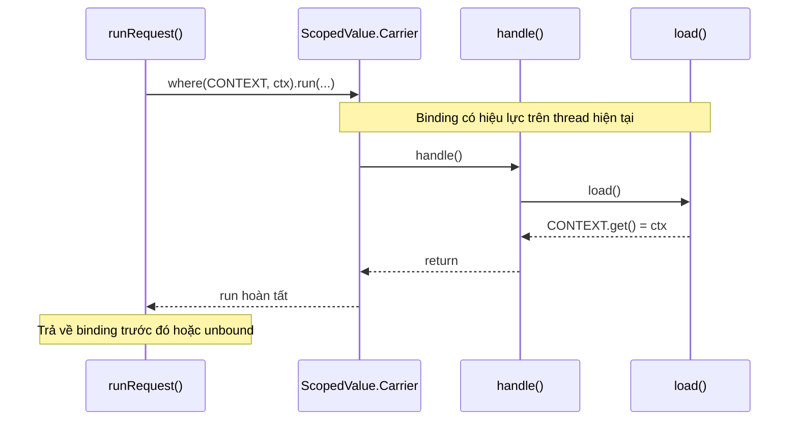
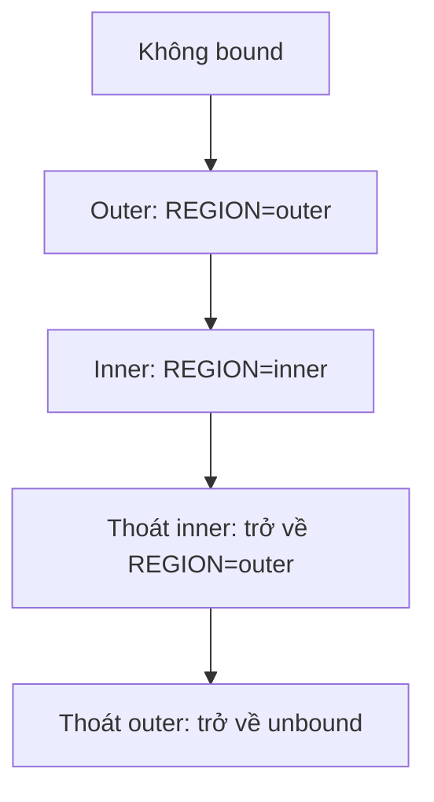
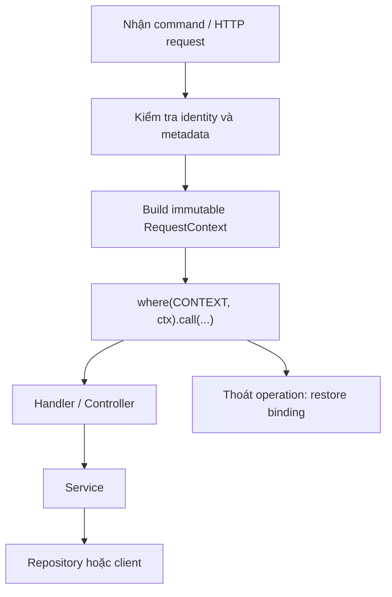
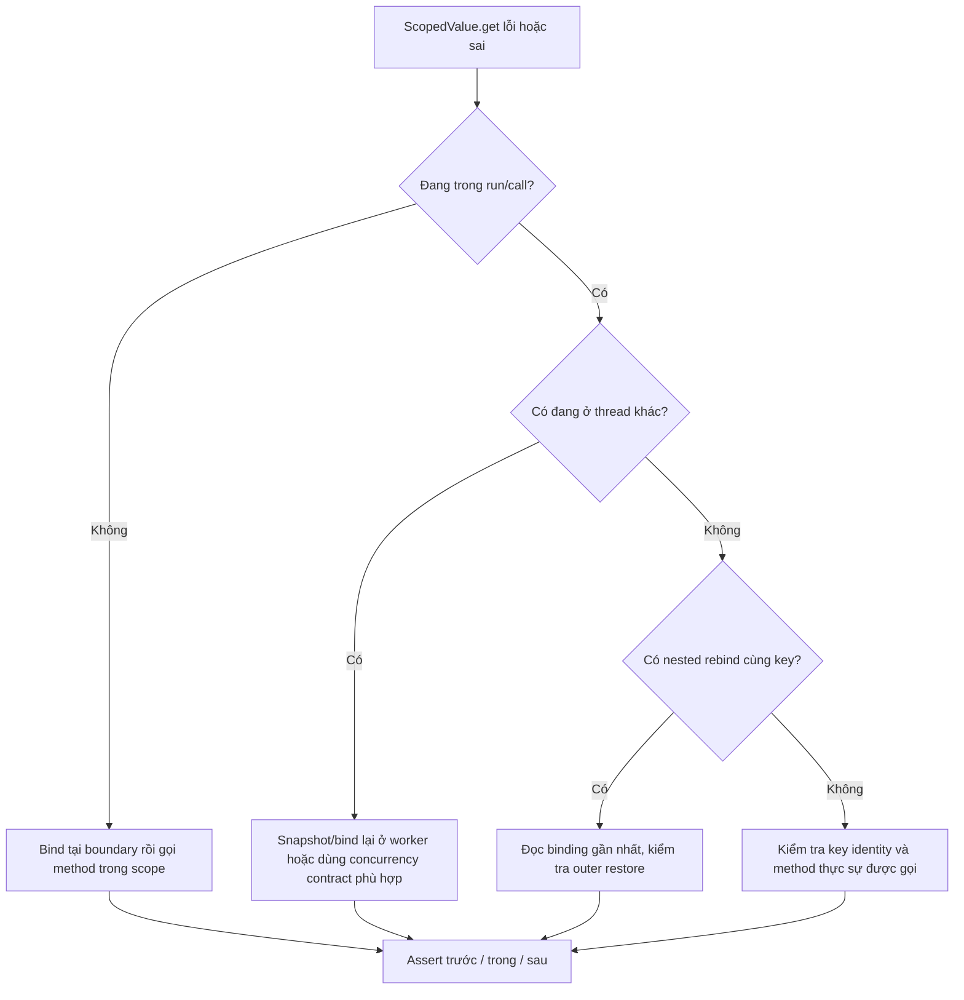

# Vòng đời ràng buộc và việc khôi phục ngữ cảnh sau khi thoát phạm vi

## 1. Vì sao vòng đời của `ScopedValue` quan trọng?

Trong một ứng dụng Java, thông tin như tenant hiện tại, mã tương quan request, phiên xử lý hay cấu hình chỉ đọc thường cần được nhiều method gọi sâu trong call stack sử dụng. Truyền đối tượng `RequestContext` qua mọi tham số có thể khiến nhiều method trung gian phải nhận dữ liệu mà bản thân không sử dụng. Sử dụng một biến toàn cục hoặc gắn dữ liệu tùy ý vào thread mà không quản lý vòng đời lại làm tăng nguy cơ **rò rỉ ngữ cảnh giữa hai request**.

**`ScopedValue` (JEP 506) đã trở thành API chính thức ở Java 25**. API này tạo một khóa kiểu `ScopedValue<T>` và cho phép gắn một giá trị với khóa đó **trong khoảng thời gian thực thi một khối công việc xác định**. Khi khối công việc hoàn tất — kể cả do ngoại lệ — giá trị sẽ tự trở về binding có trước, hoặc trở thành **unbound** nếu trước đó không có binding.

Bài học **“Vòng đời ràng buộc và việc khôi phục ngữ cảnh sau khi thoát phạm vi”** thuộc chương **ScopedValue** trong học phần **JAVA_VERSION_JAVA25**. Phạm vi học phần bao gồm các khả năng Java 25 còn áp dụng trong Java hiện đại: chương trình nguồn gọn, module import, hàm khởi tạo linh hoạt, `ScopedValue`, KDF API, AOT cache, quan sát JFR và đánh giá nâng cấp JDK. Bài này đi sâu vào **dynamic scope, binding/rebinding và sự khôi phục ngữ cảnh** chứ không chuyển sang dạy API đồng thời đang ở trạng thái preview.

### Sau bài học, bạn có thể

1. Phân biệt **khóa `ScopedValue`**, **giá trị được gắn**, **`Carrier`** và **binding đang có hiệu lực**.
2. Sử dụng API Java 25 chính thức: `ScopedValue.newInstance()`, `where(...).run(...)`, `where(...).call(...)`, `get()`, `isBound()` và `orElse(...)`.
3. Dự đoán chính xác trạng thái trước, trong và sau `run`/`call`, kể cả khi nested scopes gắn lại cùng khóa.
4. Giải thích cơ chế khôi phục khi return sớm hoặc khi method ném ngoại lệ.
5. Kiểm tra lỗi đọc ngoài scope, việc truyền task sang thread khác và dùng lại một `Carrier` đã tạo.
6. Thiết kế context một chiều, ưu tiên dữ liệu bất biến và biết khi nào nên dùng tham số tường minh hoặc `ThreadLocal`.
7. Viết kiểm thử JUnit 5 xác minh **không còn binding** sau khi phạm vi kết thúc.

**Điều kiện thực hành:** JDK 25 hoặc compiler/runtime hỗ trợ `java.lang.ScopedValue` chính thức; biên dịch với `javac --release 25`. Các ví dụ chính **không cần `--enable-preview`**. Không áp dụng các mẫu API cũ từ thời preview Java 21–24 như `ScopedValue.runWhere(...)` hoặc `ScopedValue.callWhere(...)`.

## 2. Ba khái niệm phải phân biệt

| Khái niệm | Ví dụ | Ý nghĩa |
|---|---|---|
| **Khóa `ScopedValue<T>`** | `private static final ScopedValue<String> TENANT = ScopedValue.newInstance();` | Đối tượng định danh nơi code có quyền đọc ngữ cảnh; bản thân khóa ban đầu chưa chứa binding |
| **`ScopedValue.Carrier`** | `ScopedValue.where(TENANT, "north")` | Ánh xạ dự kiến `TENANT -> "north"`; bất biến, chưa tự đưa binding vào thread |
| **Binding đang hiệu lực** | `carrier.run(() -> process())` | Trong lúc `process()` và các callee đồng bộ chạy, `TENANT.get()` nhận giá trị tương ứng trên thread hiện tại |

Một sai lầm phổ biến:

```java
private static final ScopedValue<String> TENANT = ScopedValue.newInstance();

void incorrect() {
    ScopedValue.where(TENANT, "north"); // Chỉ tạo Carrier; không chạy việc gì.
    System.out.println(TENANT.get());  // NoSuchElementException nếu trước đó unbound.
}
```

Cách đúng:

```java
private static final ScopedValue<String> TENANT = ScopedValue.newInstance();

void correct() {
    ScopedValue.where(TENANT, "north").run(() -> {
        System.out.println(TENANT.get()); // north
    });
    System.out.println(TENANT.isBound()); // false nếu trước đó unbound
}
```

`where` **không giống** `ThreadLocal.set`: nó không lưu giá trị vào một thread ngay khi được gọi. Một `Carrier` mô tả công việc cần chạy với những binding nào; `run` hoặc `call` thực thi công việc đó trong dynamic scope.

### 2.1. Dynamic scope khác lexical scope

*Lexical scope* phụ thuộc vị trí khai báo biến trong mã nguồn. *Dynamic scope* của `ScopedValue` phụ thuộc **chuỗi method call thực sự xảy ra trong khoảng thời gian binding còn hiệu lực**:



Một `private static final` key có thể tồn tại suốt vòng đời ứng dụng, nhưng binding theo request **không** tồn tại suốt vòng đời ấy. Đây là khác biệt cốt lõi để tránh mang dữ liệu request trước sang request sau.

### 2.2. API Java 25 hiện hành

| API | Tác dụng | Điều cần nhớ |
|---|---|---|
| `ScopedValue.newInstance()` | Tạo key mới, ban đầu unbound | Thường khai báo `private static final` |
| `ScopedValue.where(key, value)` | Tạo immutable `Carrier` với một mapping | **Chưa bắt đầu binding** |
| `carrier.where(key2, value2)` | Tạo `Carrier` mới chứa mapping bổ sung/thay thế | Không sửa `Carrier` cũ |
| `carrier.run(Runnable)` | Chạy công việc không trả kết quả | Tự khôi phục binding sau khi hoàn tất |
| `carrier.call(CallableOp<R,X>)` | Chạy công việc có kết quả hoặc checked exception | Trả kết quả/lan truyền ngoại lệ và khôi phục |
| `key.get()` | Đọc binding đang hiệu lực | Nếu unbound sẽ ném `NoSuchElementException` |
| `key.isBound()` | Kiểm tra có binding hay không | Phân biệt trạng thái với giá trị |
| `key.orElse(defaultValue)` | Đọc binding hoặc fallback nếu unbound | Không tạo binding mới |
| `key.orElseThrow(supplier)` | Đọc hoặc ném ngoại lệ do caller chọn | Thích hợp khi context là bắt buộc |

**Lưu ý về `null`:** `where(key, null)` được API cho phép, nên “đã bound” không có nghĩa “`get()` khác null”. Trong code nghiệp vụ nên tránh binding null: dùng object bất biến không null và diễn đạt trạng thái thiếu bằng `isBound()` hoặc exception rõ nghĩa. Phần lớn ví dụ trong bài giữ giá trị không null để tránh nhập nhằng.

## 3. Vòng đời bình thường: trước — trong — sau

Một demo hoàn chỉnh với một khóa:

```java
// File: ScopeLifecycle.java (Java 25)
public final class ScopeLifecycle {
    private static final ScopedValue<String> REQUEST_ID =
        ScopedValue.newInstance();

    private static void logRequest() {
        System.out.println("callee sees: " + REQUEST_ID.get());
    }

    public static void main(String[] args) {
        System.out.println("before: " + REQUEST_ID.isBound());

        ScopedValue.where(REQUEST_ID, "req-42").run(() -> {
            System.out.println("inside: " + REQUEST_ID.get());
            logRequest();
        });

        System.out.println("after: " + REQUEST_ID.isBound());
        System.out.println("fallback: " + REQUEST_ID.orElse("no-request"));
    }
}
```

Chạy trên JDK 25:

```bash
javac --release 25 ScopeLifecycle.java
java ScopeLifecycle
```

Đầu ra kỳ vọng:

```text
before: false
inside: req-42
callee sees: req-42
after: false
fallback: no-request
```

Đọc theo timeline:

```text
t0     REQUEST_ID chưa có binding             -> isBound() = false
t1     where(...) tạo Carrier                  -> vẫn chưa có binding
t2     carrier.run(...) bắt đầu                 -> binding req-42 được thiết lập
t3     main -> lambda -> logRequest()          -> get() = req-42
t4     lambda hoàn tất                          -> binding được tháo
t5     code sau run(...)                        -> isBound() = false
```

Khôi phục binding là **quy tắc của API**, không cần gọi `remove()`, `clear()` hay đặt `REQUEST_ID` thành null ở cuối scope. Thực tế không có một `ScopedValue.set(...)` đối ứng với `ThreadLocal.set(...)` để code ở sâu trong stack thay đổi tùy ý giá trị của scope hiện tại.

### 3.1. `run` không trả kết quả, `call` có kết quả

Khi công việc cần trả về một giá trị:

```java
public final class CallExample {
    private static final ScopedValue<String> REQUEST_ID =
        ScopedValue.newInstance();

    private static String createResult() {
        return "processed:" + REQUEST_ID.get();
    }

    public static void main(String[] args) {
        String result = ScopedValue.where(REQUEST_ID, "req-43")
            .call(CallExample::createResult);

        System.out.println(result);                 // processed:req-43
        System.out.println(REQUEST_ID.isBound());    // false
    }
}
```

`call` là một phương thức của `ScopedValue.Carrier`, **không phải** method trực tiếp của `ScopedValue` key. `CallableOp` tương tự một operation trả giá trị và có thể ném checked exception, khác với `Runnable` của `run`.

### 3.2. Dùng fallback hay fail-fast?

```java
private static final ScopedValue<String> TENANT = ScopedValue.newInstance();

static String optionalTenantLabel() {
    return TENANT.orElse("public");
}

static String requiredTenant() {
    return TENANT.orElseThrow(
        () -> new IllegalStateException("Thiếu tenant trong scope"));
}
```

Khi xử lý thao tác *không cần tenant*, fallback là hợp lý. Khi tenant là yêu cầu bảo mật/định tuyến dữ liệu, **không âm thầm chọn tenant mặc định**: ném exception với thông báo dễ chẩn đoán. `get()` khi unbound ném `NoSuchElementException`; `orElseThrow` giúp truyền ý nghĩa nghiệp vụ vào lỗi.

## 4. Nested scopes: binding gần nhất được ưu tiên

Một key có thể được gắn lại ở một dynamic scope lồng bên trong. Binding mới **che** binding của scope ngoài trong lúc scope trong hoạt động; khi scope trong kết thúc, binding ngoài được **khôi phục chính xác**.

```java
// File: NestedScopes.java
public final class NestedScopes {
    private static final ScopedValue<String> REGION =
        ScopedValue.newInstance();

    private static void show(String point) {
        System.out.println(point + " = " + REGION.get());
    }

    public static void main(String[] args) {
        ScopedValue.where(REGION, "outer").run(() -> {
            show("outer-before");

            ScopedValue.where(REGION, "inner").run(() -> {
                show("inner");
            });

            show("outer-after");
        });

        System.out.println("after-all = " + REGION.isBound());
    }
}
```

Kết quả:

```text
outer-before = outer
inner = inner
outer-after = outer
after-all = false
```

Trực quan:



Từ *rebind* không có nghĩa thay đổi giá trị của một object `ScopedValue`. Nó chỉ tạo binding mới ở scope **hẹp hơn**.

### 4.1. Shadowing không làm thay đổi parent

Nếu child scope gọi một method sâu, method đó chỉ thấy `inner`. Nhưng sau khi child scope kết thúc, parent vẫn thấy `outer`. Code trong child không thể dùng một lệnh “set global context” để làm outer binding mang giá trị `inner`.

Đây là điểm rất hữu ích với request nội bộ được giả lập, worker con chạy tác vụ thay thế tenant, hoặc test cần ghi đè correlation ID tạm thời.

### 4.2. Không nhầm giữa giá trị và tham chiếu

`ScopedValue` giữ một **reference tới value**; không tự đóng băng toàn bộ object graph. Nếu bạn bind một `ArrayList` rồi method con sửa nội dung list, parent vẫn thấy thay đổi của cùng object dù nested binding đã được gỡ. Việc **khôi phục binding** không hoàn tác mutation bên trong object được tham chiếu.

Vì vậy, ưu tiên `record`, `String` và các giá trị bất biến hoặc snapshot (`List.copyOf(...)`) cho context. Nếu chia sẻ qua nhiều thread, cần immutable context hoặc đồng bộ truy cập theo đúng quy tắc concurrency.

## 5. Nhiều key và `Carrier` bất biến

Một request thường cần nhiều metadata. Có thể gắn nhiều key trong **một** dynamic scope:

```java
// File: MultipleBindings.java
public final class MultipleBindings {
    private static final ScopedValue<String> REQUEST_ID =
        ScopedValue.newInstance();
    private static final ScopedValue<String> TENANT =
        ScopedValue.newInstance();

    public static void main(String[] args) {
        var carrier = ScopedValue.where(REQUEST_ID, "req-101")
            .where(TENANT, "tenant-a");

        System.out.println(REQUEST_ID.isBound()); // false
        System.out.println(TENANT.isBound());     // false

        carrier.run(() -> {
            System.out.println(REQUEST_ID.get()); // req-101
            System.out.println(TENANT.get());     // tenant-a
        });

        System.out.println(REQUEST_ID.isBound()); // false
        System.out.println(TENANT.isBound());     // false
    }
}
```

**Hai nguyên tắc:**

- `where(...).where(...)` tạo một immutable `Carrier` chứa nhiều mappings; binding thực tế chỉ xuất hiện trong phần thực thi `run`/`call`.
- Các bindings trong cùng `Carrier` được thiết lập đồng thời cho operation, rồi được khôi phục khi operation kết thúc. Nếu một key đã bound ở outer scope, sau đó nó trở về outer value; nếu trước đó unbound, nó trở lại unbound.

### 5.1. `Carrier.where` tạo bản mới, không sửa bản cũ

```java
private static final ScopedValue<String> TENANT = ScopedValue.newInstance();

static void demonstrate() {
    var base = ScopedValue.where(TENANT, "alpha");
    var override = base.where(TENANT, "beta");

    System.out.println(base.get(TENANT));     // alpha: mapping trong Carrier
    System.out.println(override.get(TENANT)); // beta: mapping trong Carrier
    System.out.println(TENANT.isBound());     // false: chưa run/call
}
```

`Carrier.get(key)` và `ScopedValue.get()` là **hai việc khác nhau**: `Carrier.get` đọc một mapping lưu trong object `Carrier`; `TENANT.get()` đọc binding có hiệu lực ở thread đang chạy. Trước `run`/`call`, chỉ `Carrier` có mapping.

### 5.2. Tránh lạm dụng quá nhiều key

Đặc tả JDK 25 ghi rõ cache tra cứu scoped values trên mỗi thread có kích thước nhỏ; dùng quá nhiều key truy cập luân phiên có thể làm giảm hiệu quả cache. Đối với context nghiệp vụ thường có nhiều trường nhưng cùng vòng đời, đóng gói vào một `record RequestContext(...)` rồi bind **một key** thường dễ duy trì và dễ kiểm soát hơn.


## 6. Khôi phục binding khi return sớm hoặc có exception

Một lợi ích quan trọng của `ScopedValue` so với việc tự quản lý `ThreadLocal` là **không cần quên/nhớ gọi `remove()` trong `finally`** để kết thúc ngữ cảnh. API có cấu trúc thời gian tồn tại: kết thúc `run`/`call` là hoàn tất binding ở phạm vi đó.

### 6.1. Return sớm vẫn khôi phục

```java
// File: EarlyExit.java
public final class EarlyExit {
    private static final ScopedValue<String> REQUEST =
        ScopedValue.newInstance();

    private static void process(boolean skip) {
        ScopedValue.where(REQUEST, "req-early").run(() -> {
            if (skip) {
                System.out.println("bỏ qua: " + REQUEST.get());
                return; // Chỉ thoát khỏi Runnable.
            }
            System.out.println("xử lý: " + REQUEST.get());
        });

        System.out.println("sau run: " + REQUEST.isBound());
    }

    public static void main(String[] args) {
        process(true);  // bỏ qua, sau run: false
        process(false); // xử lý, sau run: false
    }
}
```

Dù lambda kết thúc ở nhánh nào, binding vẫn tự tháo khi operation hoàn tất. Nếu bên ngoài có một binding khác cho cùng key, operation bên trong sẽ **trả về giá trị ngoài**, không phải trở thành unbound.

### 6.2. Runtime exception được truyền ra, binding vẫn được khôi phục

```java
// File: ExceptionCleanup.java
public final class ExceptionCleanup {
    private static final ScopedValue<String> REQUEST_ID =
        ScopedValue.newInstance();

    public static void main(String[] args) {
        try {
            ScopedValue.where(REQUEST_ID, "req-error").run(() -> {
                System.out.println("trước lỗi: " + REQUEST_ID.get());
                throw new IllegalStateException("mô phỏng lỗi xử lý");
            });
        } catch (IllegalStateException expected) {
            System.out.println("caught: " + expected.getMessage());
        }

        System.out.println("isBound sau catch: " + REQUEST_ID.isBound());
    }
}
```

Kỳ vọng:

```text
trước lỗi: req-error
caught: mô phỏng lỗi xử lý
isBound sau catch: false
```

Thứ tự: lỗi phát sinh trong lambda → `run` hoàn tất bất thường và **khôi phục scope** → ngoại lệ được ném tới `catch` bên ngoài. Vì vậy, `catch` không còn thấy binding `req-error` nếu trước đó key chưa bound.

**Ngoại lệ không bị nuốt.** `ScopedValue` chỉ quản lý vòng đời context, không tự ghi log, retry, rollback database hoặc xử lý lỗi nghiệp vụ.

### 6.3. Checked exception qua `call`

`ScopedValue.Carrier.call` nhận `ScopedValue.CallableOp` có thể khai báo checked exception. Ví dụ:

```java
// File: CheckedFailure.java
import java.io.IOException;

public final class CheckedFailure {
    private static final ScopedValue<String> OPERATION =
        ScopedValue.newInstance();

    private static String load(String filename) throws IOException {
        return ScopedValue.where(OPERATION, "read-" + filename).call(() -> {
            if (filename.isBlank()) {
                throw new IOException("Tên file trống");
            }
            return "loaded:" + OPERATION.get();
        });
    }

    public static void main(String[] args) {
        try {
            load("");
        } catch (IOException expected) {
            System.out.println(expected.getMessage());
        }
        System.out.println(OPERATION.isBound()); // false
    }
}
```

`call` trả kết quả khi thành công, ném checked exception khi operation thất bại, và **dù kết thúc theo đường nào** nó cũng khôi phục binding có trước. Khác với `run(Runnable)`, `call` là lựa chọn phù hợp cho operation cần trả giá trị/checked exception.

### 6.4. Lỗi trong inner scope không làm mất outer binding

```java
// File: NestedFailure.java
public final class NestedFailure {
    private static final ScopedValue<String> USER = ScopedValue.newInstance();

    public static void main(String[] args) {
        ScopedValue.where(USER, "outer-user").run(() -> {
            try {
                ScopedValue.where(USER, "temporary-user").run(() -> {
                    System.out.println(USER.get()); // temporary-user
                    throw new IllegalArgumentException("fail inner");
                });
            } catch (IllegalArgumentException expected) {
                System.out.println(USER.get()); // outer-user
            }
        });

        System.out.println(USER.isBound()); // false
    }
}
```

Ở `catch` **bên trong outer scope**, key đã trở lại `outer-user`. `catch` ở ngoài toàn bộ outer scope thì key đã trở thành unbound. Đây là tình huống thường xuyên gặp khi một thao tác bên trong tạm đổi ngữ cảnh để gọi dịch vụ khác nhưng có thể thất bại.

### 6.5. Không có “rollback dữ liệu” tự động

`ScopedValue` khôi phục **liên kết key → reference**, không khôi phục mọi tác động xảy ra trong operation:

| Tác động bên trong scope | Có tự đảo ngược khi thoát scope? |
|---|---|
| Binding của `ScopedValue` | **Có**: unbound hoặc previous binding |
| Giá trị của biến local trong code gọi | Không tự thay đổi |
| Thay đổi field trong object được bind | **Không**; object mutable vẫn giữ thay đổi |
| Ghi file/database | **Không**; cần transaction/compensation riêng |
| Gửi HTTP request hoặc thông điệp | **Không**; tác động đã phát sinh |
| Log/span đã gửi | **Không**; log/telemetry có lifecycle riêng |

Không dùng “scope đã thoát” làm bằng chứng rằng dữ liệu nghiệp vụ đã rollback hoặc tài nguyên khác đã đóng. Vẫn dùng `try-with-resources`, transaction và các cơ chế resource cleanup đúng mục đích.

## 7. Đọc ngữ cảnh ngoài phạm vi: unbound khác null

Mỗi `ScopedValue` mới được tạo là **unbound** cho tới khi một operation thực sự đặt binding cho thread hiện tại. Sau khi operation thoát, binding lại trở về trạng thái trước đó.

### 7.1. `get()` sẽ ném ngoại lệ nếu unbound

```java
// File: UnboundAccess.java
import java.util.NoSuchElementException;

public final class UnboundAccess {
    private static final ScopedValue<String> ID = ScopedValue.newInstance();

    public static void main(String[] args) {
        System.out.println(ID.isBound()); // false
        System.out.println(ID.orElse("anonymous")); // anonymous

        try {
            System.out.println(ID.get());
            throw new AssertionError("Không được tới đây");
        } catch (NoSuchElementException expected) {
            System.out.println("Không có binding hiện hành");
        }
    }
}
```

`get()` không trả một default value giả định và cũng không trả null do **không có binding**. Ngoại lệ `NoSuchElementException` phản ánh đúng trạng thái “không thuộc một dynamic scope có key này”.

Nếu key **đã được bind với giá trị null**, thì `isBound()` là true và `get()` có thể trả null. Đây là lý do không dùng `get() == null` làm cách kiểm tra key có bound hay không.

### 7.2. Chọn cơ chế đọc theo contract

| Tình huống | Gợi ý |
|---|---|
| Code bên trong phạm vi bắt buộc phải có context | `get()` hoặc `orElseThrow(...)` |
| Code có thể chạy ở cả ngoài/Trong request | `isBound()` trước khi đọc hoặc `orElse(default)` |
| Thiếu context là lỗi bảo mật/logic | `orElseThrow(() -> new IllegalStateException(...))` |
| Context là một field/parameter rõ nghĩa có thể truyền trực tiếp | Ưu tiên tham số method, không cần ScopedValue |

Với tenant identifier hoặc authorization context, tránh fallback sang một tenant mặc định làm code tiếp tục xử lý dữ liệu người dùng ở sai scope. Giá trị phải được **xác thực tại boundary**, sau đó mới bind để các phương thức tin cậy sử dụng.

### 7.3. `Carrier` không phải “snapshot active binding” vĩnh viễn

Một `Carrier` được tạo trước đó có thể được dùng lại để chạy một operation **mới**:

```java
private static final ScopedValue<String> LABEL = ScopedValue.newInstance();

static void carrierCanBeReused() {
    var carrier = ScopedValue.where(LABEL, "task-A");

    carrier.run(() -> System.out.println(LABEL.get())); // task-A
    System.out.println(LABEL.isBound());                // false

    carrier.run(() -> System.out.println(LABEL.get())); // task-A
    System.out.println(LABEL.isBound());                // false
}
```

`Carrier` là immutable mapping, không phải một context đang duy trì hiệu lực trên thread. **Mỗi `run`/`call` bắt đầu một dynamic scope mới**. Nếu value tham chiếu object mutable, cả hai lần chạy có thể dùng chung object đó; vì thế nên bind dữ liệu bất biến, nhất là nếu một Carrier được tái sử dụng đồng thời.

## 8. Không thể “giữ scope” bằng cách trả về một callback rồi chạy sau

Một lambda đóng trên **key** nhưng không tự đóng gói binding động của thread. Nếu bạn tạo callback trong một scope, trả callback ra ngoài rồi gọi nó sau khi scope kết thúc, callback không tự nhìn lại giá trị cũ.

```java
// File: DelayedWork.java
public final class DelayedWork {
    private static final ScopedValue<String> REQUEST_ID =
        ScopedValue.newInstance();

    public static void main(String[] args) {
        Runnable later = ScopedValue.where(REQUEST_ID, "req-once")
            .call(() -> (Runnable) () ->
                System.out.println(REQUEST_ID.orElse("unbound")));

        later.run(); // unbound, không phải req-once
    }
}
```

Nguyên nhân: `REQUEST_ID` là khóa, không phải một biến local chứa `"req-once"`. Binding chỉ có hiệu lực trong lúc operation `call` đang chạy. Khi `later.run()` được gọi, không có binding cũ để đọc.

Nếu cần một task bất đồng bộ mang context, hãy **lấy snapshot dữ liệu bất biến** khi còn ở scope rồi **tạo binding mới tại điểm thực thi task**:

```java
// Minh họa ngắn, giả định REQUEST_ID là ScopedValue<String> hợp lệ:
String snapshot = REQUEST_ID.get(); // Gọi khi còn ở scope.
Runnable later = () ->
    ScopedValue.where(REQUEST_ID, snapshot)
        .run(() -> processWithCurrentRequest());

// later chỉ có binding khi Runnable được thực thi.
```

Ví dụ trên là đoạn ghép vào một lớp có `REQUEST_ID` và `processWithCurrentRequest()`; không phải file Java độc lập. Snapshot là một giá trị rõ nguồn gốc, không phải phép “tự lan truyền ThreadLocal”. Chỉ giữ những thông tin thật sự được phép truyền qua ranh giới task, tránh kéo theo object mutable hoặc dữ liệu nhạy cảm không còn hợp lệ ở thời điểm thực thi.

## 9. Luồng, virtual threads và giới hạn kế thừa

### 9.1. Binding theo thread, không phải biến toàn cục

Khi hai thread cùng dùng một key static final, mỗi thread có thể có binding riêng mà không giẫm lên nhau:

```text
Thread A: where(TENANT, "A").run(...) -> TENANT.get() = "A"
Thread B: where(TENANT, "B").run(...) -> TENANT.get() = "B"
Sau mỗi run ở từng thread           -> quay về binding riêng có trước
```

Lợi thế đến từ **cấu trúc binding**, không phải `ScopedValue` biến mutable object thành thread-safe. Nếu cả hai thread bind chung một đối tượng mutable, việc sửa đối tượng đó vẫn cần đồng bộ như bình thường.

### 9.2. Thread mới hoặc executor thông thường không tự nhận binding

Không giả định rằng `new Thread(...)`, `Thread.ofVirtual()`, `Executors.newSingleThreadExecutor()` hoặc `CompletableFuture.supplyAsync(...)` tự động thừa kế binding của thread gửi task. Nguyên tắc API là binding **per-thread**; cơ chế kế thừa chỉ có bảo đảm cụ thể khi dùng cấu trúc thích hợp, không phải truyền ngầm vô điều kiện sang bất kỳ thread nào.

Một demo JDK 25 **không dùng API preview**:

```java
// File: ExecutorBoundary.java
import java.util.concurrent.ExecutorService;
import java.util.concurrent.Executors;

public final class ExecutorBoundary {
    private static final ScopedValue<String> CORRELATION =
        ScopedValue.newInstance();

    public static void main(String[] args) throws Exception {
        try (ExecutorService pool = Executors.newSingleThreadExecutor()) {
            String observed = ScopedValue.where(CORRELATION, "req-900")
                .call(() -> pool.submit(
                    () -> CORRELATION.orElse("no-binding")
                ).get());

            System.out.println(observed); // no-binding
            System.out.println(CORRELATION.isBound()); // false
        }
    }
}
```

Code ở worker đọc fallback vì worker thread không có cùng binding động của thread đã gọi `submit`. Sự tồn tại của cùng static key không đủ để tạo một giá trị trên worker.

### 9.3. Explicit propagation: truyền snapshot và bind lại trong worker

Khi bạn kiểm soát điểm gửi task, có thể thực hiện truyền ngữ cảnh một cách tường minh:

```java
// File: ExplicitPropagation.java
import java.util.concurrent.ExecutorService;
import java.util.concurrent.Executors;

public final class ExplicitPropagation {
    private static final ScopedValue<String> CORRELATION =
        ScopedValue.newInstance();

    public static void main(String[] args) throws Exception {
        try (ExecutorService pool = Executors.newSingleThreadExecutor()) {
            String result = ScopedValue.where(CORRELATION, "req-901")
                .call(() -> {
                    String snapshot = CORRELATION.get();
                    return pool.submit(() ->
                        ScopedValue.where(CORRELATION, snapshot)
                            .call(() -> "worker:" + CORRELATION.get())
                    ).get();
                });

            System.out.println(result); // worker:req-901
            System.out.println(CORRELATION.isBound()); // false
        }
    }
}
```

Ở thread worker, binding **mới** chỉ tồn tại trong `call` của worker và được tháo ngay khi task hoàn tất. Đoạn code không sử dụng `InheritableThreadLocal` hoặc cấu hình preview. Khi áp dụng vào production, cần đánh giá liệu snapshot phải là immutable DTO, có thời hạn/authorization hợp lệ hay không, và tránh truyền thông tin đã hết hiệu lực sang task chạy trễ.

### 9.4. Kế thừa qua structured concurrency: giới hạn theo version

Javadoc Java 25 mô tả `ScopedValue` có thể được **kế thừa bởi các subtasks trong `StructuredTaskScope`**: bindings được chụp khi mở task scope và các thread fork trong scope có thể kế thừa chúng, trong khi cấu trúc yêu cầu subtasks hoàn tất trước khi parent rời scope.

Tuy nhiên, **`StructuredTaskScope` là API *preview* ở Java 25 (JEP 505)**. Theo yêu cầu chỉ sử dụng kiến thức đã hoàn thiện và còn ổn định, bài này **không dùng code preview cho bài thực hành chính** và không khuyến nghị bật `--enable-preview` chỉ để làm ví dụ `ScopedValue`. Khi dùng một JDK mới hơn, cần đọc **đúng Javadoc của phiên bản đó**, không sao chép cú pháp `StructuredTaskScope` của một vòng preview cũ.

Điều cần nhớ là hai trường hợp khác nhau:

- `ScopedValue` chỉ có hiệu lực trong thread và dynamic scope hiện tại; executor tùy ý **không tự có inheritance**.
- Khi một API structured concurrency **được hỗ trợ trong runtime đang dùng** và bảo đảm truyền binding, các subtasks tuân thủ đúng ranh giới scope mới được thừa kế theo contract đó.

### 9.5. Không tự suy luận về log/tracing

`ScopedValue` không tự thay thế một hệ thống distributed tracing hay tự đẩy correlation ID vào SLF4J MDC, HTTP headers, OpenTelemetry spans hoặc JFR events. Muốn kết nối chúng, cần một lớp adapter/instrumentation có chủ đích. **Khôi phục ScopedValue binding** không có nghĩa logger hoặc tracer đã được dọn nếu các thư viện này sử dụng ngữ cảnh khác.


## 10. Ví dụ thực tế: một context chỉ đọc cho từng request

Một mẫu thiết kế tốt là tạo một object bất biến ở boundary, bind trong đúng thời gian xử lý request, cho phép code ở service/repository đọc thông tin cần thiết, rồi kết thúc binding tự động.

### 10.1. Bản Java 25 tự chứa

```java
// File: RequestFlow.java
import java.util.Objects;

public final class RequestFlow {
    record RequestContext(String requestId, String tenantId) {
        RequestContext {
            Objects.requireNonNull(requestId, "requestId");
            Objects.requireNonNull(tenantId, "tenantId");
            if (requestId.isBlank() || tenantId.isBlank()) {
                throw new IllegalArgumentException("ID không được trống");
            }
        }
    }

    private static final ScopedValue<RequestContext> CONTEXT =
        ScopedValue.newInstance();

    private static String repositoryLayer() {
        var ctx = CONTEXT.orElseThrow(
            () -> new IllegalStateException("Thiếu request context"));
        return "report:" + ctx.tenantId() + ":" + ctx.requestId();
    }

    private static String serviceLayer() {
        return repositoryLayer(); // Không phải nhận context qua tham số.
    }

    static String handle(String requestId, String tenantId) {
        var context = new RequestContext(requestId, tenantId);
        return ScopedValue.where(CONTEXT, context)
            .call(RequestFlow::serviceLayer);
    }

    public static void main(String[] args) {
        System.out.println(handle("request-A", "tenant-A"));
        System.out.println(CONTEXT.isBound());

        System.out.println(handle("request-B", "tenant-B"));
        System.out.println(CONTEXT.isBound());
    }
}
```

Đầu ra minh họa:

```text
report:tenant-A:request-A
false
report:tenant-B:request-B
false
```

Trong ví dụ, cả hai request được xử lý **tuần tự trên cùng thread**. Khi `handle` đầu tiên trả về, binding trở về unbound. Vì thế, `handle` thứ hai không thể vô tình kế thừa request ID hay tenant của lần trước.

Bản chất của pattern là truyền **context không cần thay đổi** đi một chiều đến các callee. Nếu code cần thay đổi dữ liệu nghiệp vụ, hãy trả kết quả tường minh hoặc ghi qua component có contract phù hợp; không lạm dụng ScopedValue như một biến toàn cục có thể sửa.

### 10.2. Vị trí tạo và kết thúc scope



Binding nên được mở tại một boundary có vòng đời **rõ ràng**. Không mở một scope mới ở mọi phương thức chỉ để “giữ context”. Nested rebinding có ích khi có ý định thay context tạm thời, nhưng tenant hoặc quyền truy cập phải được kiểm tra trước.

### 10.3. Chú ý tính tin cậy và bảo mật

`ScopedValue` không phải cơ chế xác thực hoặc cách ly bảo mật. Nếu user có thể gửi `tenantId`, phải **xác thực và kiểm tra quyền** trước khi tạo context; binding chỉ chuyển dữ liệu đã được chấp nhận cho code tin cậy.

Key thường nên là `private static final`. Code có quyền truy cập key có thể đọc binding và có thể tạo một binding lồng mới, nhưng nó không thể sửa binding đã có của outer scope. Không coi nested rebinding là cách thay đổi quyền truy cập hệ thống một cách tự động.

Tránh đưa token, mật khẩu hoặc dữ liệu nhạy cảm vào logs/JFR chỉ vì object context đang chứa chúng. Nếu cần trace correlation, nên chọn mã định danh được phép ghi và cấu hình chính sách quan sát riêng.

## 11. So sánh với `ThreadLocal` còn được hỗ trợ

`ThreadLocal` không bị loại bỏ ở Java 25. Tuy nhiên, đối với **ngữ cảnh chỉ đọc trong một lượt thực thi**, nó đòi người viết mã tự đảm bảo dọn dẹp.

```java
// Ví dụ ThreadLocal: tự dọn scope khi hoàn tất.
private static final ThreadLocal<String> REQUEST = new ThreadLocal<>();

static void handleWithThreadLocal() {
    REQUEST.set("request-A");
    try {
        doWork();
    } finally {
        REQUEST.remove();
    }
}
```

Nếu thiếu `finally` và thread được tái sử dụng trong pool, context cũ có thể còn tồn tại ở lượt tiếp theo. Nếu có nested `set(...)`, gọi `remove()` không tự khôi phục giá trị outer; phải lưu và restore giá trị cũ bằng tay.

| Thuộc tính | `ScopedValue` | `ThreadLocal` |
|---|---|---|
| Mục đích chính | Truyền context một chiều trong dynamic scope | Lưu state riêng cho thread |
| Gắn giá trị | `where(...).run/call` | `set(...)` |
| Thay trực tiếp giá trị hiện hành | Không có `set`; rebinding trong scope lồng | Có |
| Kết thúc | Tự trở về binding có trước | Cần `remove`/restore thủ công |
| Nested binding | Được hỗ trợ và khôi phục tự động | Tự lập trình logic restore |
| Thread pool thông thường | Không tự kế thừa binding | `ThreadLocal` thường cũng không tự kế thừa |
| Shared mutable value | Vẫn cần immutability/synchronization | Vẫn cần |
| Nên dùng khi | Request/operation context chỉ đọc | Per-thread mutable state hoặc thư viện đã quản lý lifecycle |

Trong các hệ thống dùng logging MDC, transaction manager, security context hoặc OpenTelemetry, framework có thể đã quản lý riêng lifecycle của chúng. Không thay thế hàng loạt bằng `ScopedValue` nếu chưa hiểu contract của framework, đặc biệt là ở ranh giới async.

## 12. Kiểm thử hồi quy bằng JUnit Jupiter

Một bài kiểm thử tốt phải khẳng định **sau khi thoát scope thì context được khôi phục**, không chỉ assert giá trị trong scope.

```java
// File: ScopedValueLifetimeTest.java
import static org.junit.jupiter.api.Assertions.*;

import java.util.NoSuchElementException;
import org.junit.jupiter.api.Test;

class ScopedValueLifetimeTest {
    private static final ScopedValue<String> TRACE =
        ScopedValue.newInstance();

    @Test
    void existsOnlyDuringRun() {
        assertFalse(TRACE.isBound());

        ScopedValue.where(TRACE, "trace-A").run(() -> {
            assertTrue(TRACE.isBound());
            assertEquals("trace-A", TRACE.get());
        });

        assertFalse(TRACE.isBound());
        assertEquals("no-trace", TRACE.orElse("no-trace"));
    }

    @Test
    void nestedScopeRestoresOuter() {
        ScopedValue.where(TRACE, "outer").run(() -> {
            assertEquals("outer", TRACE.get());

            ScopedValue.where(TRACE, "inner").run(() -> {
                assertEquals("inner", TRACE.get());
            });

            assertEquals("outer", TRACE.get());
        });

        assertFalse(TRACE.isBound());
    }

    @Test
    void exceptionStillRestoresBinding() {
        assertThrows(IllegalStateException.class, () ->
            ScopedValue.where(TRACE, "failed").run(() -> {
                assertEquals("failed", TRACE.get());
                throw new IllegalStateException("boom");
            })
        );

        assertFalse(TRACE.isBound());
    }

    @Test
    void creatingCarrierDoesNotBindCurrentThread() {
        var carrier = ScopedValue.where(TRACE, "prepared");

        assertFalse(TRACE.isBound());
        assertEquals("prepared", carrier.get(TRACE));

        carrier.run(() -> assertEquals("prepared", TRACE.get()));
        assertFalse(TRACE.isBound());
    }

    @Test
    void getFailsWhenUnbound() {
        assertFalse(TRACE.isBound());
        assertThrows(NoSuchElementException.class, TRACE::get);
    }

    @Test
    void callReturnsResultAndRestores() {
        String result = ScopedValue.where(TRACE, "value")
            .call(() -> "[" + TRACE.get() + "]");

        assertEquals("[value]", result);
        assertFalse(TRACE.isBound());
    }
}
```

Các test này chỉ dùng API `ScopedValue` chính thức của Java 25, không cần `--enable-preview`. Dự án cần cấu hình dependency JUnit 5/Jupiter và test runner phù hợp. Cùng một key static final dùng bởi nhiều test không làm các test chia sẻ binding giữa các thread: binding vốn là per-thread. Tuy nhiên dữ liệu mutable toàn cục **khác** vẫn cần cách ly nếu test chạy song song.

Nếu chỉ muốn dùng JDK 25, có thể chạy các file độc lập từ mục 3, 4 và 6:

```bash
javac --release 25 ScopeLifecycle.java NestedScopes.java ExceptionCleanup.java
java ScopeLifecycle
java NestedScopes
java ExceptionCleanup
```

Các file phải được tạo theo đúng ví dụ, không được đặt nhiều `public class` khác tên trong cùng file.

## 13. Chẩn đoán khi đọc context không đúng

| Triệu chứng | Nguyên nhân khả dĩ | Giải pháp |
|---|---|---|
| `NoSuchElementException` từ `get()` | Key unbound tại điểm gọi | Đặt operation trong `where(...).run/call`; dùng `orElseThrow` khi cần |
| Đã gọi `where` nhưng `isBound()` vẫn false | `where` chỉ tạo `Carrier` | Thực thi `run` hoặc `call` |
| Sau `run` key unbound | Đúng hành vi nếu không có outer binding | Không biến key thành global storage |
| Sau nested scope lại đọc giá trị outer | Khôi phục đúng contract | Phân biệt “restore” với “set” |
| `get()` trả null nhưng `isBound()` true | Có binding mang giá trị null | Tránh null, dùng immutable context được kiểm tra |
| Trả callback ra ngoài rồi gọi sau: mất context | Scope gốc đã kết thúc | Snapshot dữ liệu và bind lại khi callback chạy |
| Worker trong `ExecutorService` không có context | Binding không tự lan qua executor | Explicit propagation với `where(...).call` ở worker |
| Context object đã đổi giá trị sau scope | Object mutable được chia sẻ qua reference | Dùng record/snapshot/đồng bộ dữ liệu |
| `catch` bên ngoài không thấy binding lỗi | `run/call` đã khôi phục trước khi ném lỗi lên | Log khi còn trong scope hoặc truyền lỗi/context tường minh |
| `ScopedValue.runWhere` không tồn tại | Sao chép API preview đã lỗi thời | Dùng `ScopedValue.where(key, value).run(...)` |
| Bật preview dù chỉ dùng `ScopedValue` | Cấu hình từ JDK preview cũ | Bỏ cờ cho JDK 25 stable |
| MDC thiếu request ID trong khi `ScopedValue` có | Không có adapter kết nối hai hệ thống | Cấu hình logging/tracing integration và cleanup riêng |

### Quy trình kiểm tra



## 14. Bài thực hành tổng hợp và nghiệm thu

### Đề bài

Xây một chương trình xử lý hai request tuần tự trên cùng thread, dùng `record RequestContext(requestId, tenantId)` và `ScopedValue<RequestContext>`:

1. Request A có `request-a`/`tenant-a`.
2. Service sâu hơn đọc context qua `get()` mà không cần tham số xuyên suốt call chain.
3. Mở một inner scope tạm bind một context `tenant-override`, cố ý ném exception và bắt nó trong outer scope.
4. Trong outer scope sau `catch`, assert tenant vẫn là `tenant-a`.
5. Sau A, assert key unbound.
6. Request B có `request-b`/`tenant-b`, không nhìn thấy A.
7. Tạo callback trong B, gọi nó **sau khi B kết thúc**, giải thích vì sao key unbound.
8. Gửi một task sang executor thường, xác nhận worker không tự kế thừa binding; truyền immutable snapshot và bind lại tường minh.

Các phép kiểm tra mong đợi:

```text
Java compiler/runtime: 25.x
ScopedValue JEP 506 final: YES
--enable-preview: NOT REQUIRED

Before A: false
Inside A: tenant-a
Inside nested: tenant-override
After inner exception, still in A: tenant-a
After A: false
Inside B: tenant-b
After B: false
Delayed callback: unbound
Executor without propagation: unbound
Executor with explicit binding: request-b
After worker task: original worker binding restored
```

Đây là **mẫu kết quả**, không phải kết quả đã chạy. Trong ứng dụng thật, không cho phép override tenant/identity chỉ vì code có quyền mở nested scope; authorization phải được kiểm tra riêng.

### Checklist

| Tiêu chí | Bằng chứng |
|---|---|
| Key được định nghĩa rõ | `private static final ScopedValue<RequestContext>` |
| Bind đúng cách | `ScopedValue.where(...).run/call`, không dùng `runWhere` |
| Trong scope | `isBound()==true`, `get()` bằng giá trị đang bind |
| Sau scope bình thường | Binding được khôi phục hoặc unbound |
| Sau exception | Exception không bị nuốt và binding được restore |
| Inner scope | Inner value chỉ hiện diện ở inner operation |
| Dữ liệu context | `record`/snapshot bất biến, không mặc nhiên an toàn với mutable references |
| Callback/task chạy trễ | Hiểu vì sao không tự mang dynamic binding |
| Executor | Bind lại ở worker nếu cần truyền tường minh |
| Logging/tracing | Không giả định `ScopedValue` tự đồng bộ với MDC/span |
| Kiểm thử | Có assertion cả trước, trong và **sau** operation |
| API Java 25 | Không phụ thuộc preview hoặc cú pháp đã bị loại bỏ |

## 15. Tài liệu chính thức và phạm vi áp dụng

- [JEP 506 — Scoped Values](https://openjdk.org/jeps/506): mục đích, rebinding và trạng thái final trong Java 25.
- [Java SE 25 — `java.lang.ScopedValue`](https://docs.oracle.com/en/java/javase/25/docs/api/java.base/java/lang/ScopedValue.html): `newInstance`, `where`, `get`, `isBound`, `orElse`, `orElseThrow` và per-thread bindings.
- [Java SE 25 — `ScopedValue.Carrier`](https://docs.oracle.com/en/java/javase/25/docs/api/java.base/java/lang/ScopedValue.Carrier.html): immutable mappings, `run`/`call`, xử lý ngoại lệ và phục hồi.
- [Oracle — Significant Changes in JDK 25](https://docs.oracle.com/en/java/javase/25/migrate/significant-changes-jdk-25.html): `ScopedValue` đã là API chính thức.
- [Java SE 25 — `StructuredTaskScope`](https://docs.oracle.com/en/java/javase/25/docs/api/java.base/java/util/concurrent/StructuredTaskScope.html): chỉ tham khảo inheritance trong structured concurrency; **StructuredTaskScope vẫn là preview ở Java 25**.
- [Java SE 25 — Preview API List](https://docs.oracle.com/en/java/javase/25/docs/api/preview-list.html): đối chiếu các API cần cờ preview.
- [Java SE 25 — `ThreadLocal`](https://docs.oracle.com/en/java/javase/25/docs/api/java.base/java/lang/ThreadLocal.html): `set/get/remove` và vòng đời theo thread.

*Phạm vi cập nhật: 27/11/2026.* `ScopedValue` là API hoàn thiện của Java 25 và tiếp tục phù hợp trong Java hiện đại. Khi triển khai các thành phần khác như structured concurrency hoặc framework propagation, hãy tham khảo **phiên bản JDK/framework thực tế** thay vì sao chép mã preview từ những bản phát hành cũ.
