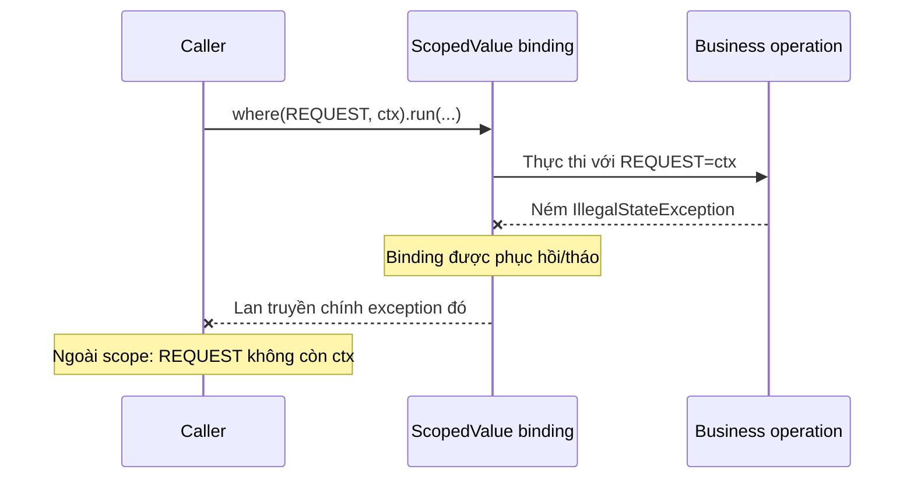
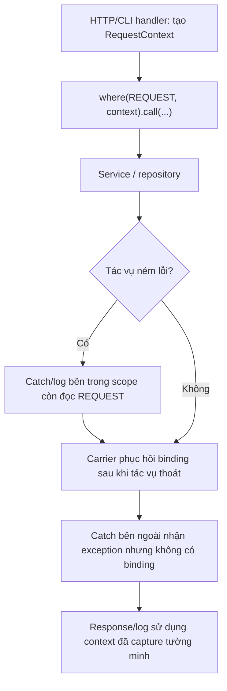

# ScopedValue trong Java 25: Lan truyền lỗi, ngoại lệ và bảo toàn ngữ cảnh khi thực thi kết thúc

Trong một ứng dụng Java hiện đại, nhiều phương thức cần biết **request ID**, người gọi, tenant hoặc thông tin chẩn đoán, dù các phương thức trung gian không cần khai báo thêm tham số. `ScopedValue` cho phép gắn một giá trị vào **phạm vi thực thi có giới hạn**, để những phương thức gọi sâu hơn có thể đọc. Khi tác vụ kết thúc, binding của `ScopedValue` tự được **tháo hoặc khôi phục về binding bên ngoài**, kể cả khi tác vụ ném ngoại lệ.

Điều này đặc biệt quan trọng ở đường đi có lỗi: bạn không muốn request thứ hai vô tình đọc request ID của request thứ nhất sau khi thread được tái sử dụng; cũng không muốn bắt ngoại lệ rồi phát hiện ngữ cảnh chẩn đoán đã biến mất một cách bất ngờ. Bài học thuộc chương **ScopedValue** của module `JAVA_VERSION_JAVA25`, tập trung vào **thứ tự thực thi, lan truyền ngoại lệ, phạm vi của ngữ cảnh và thiết kế điểm xử lý lỗi**.

**Phạm vi hiện hành:** `java.lang.ScopedValue` đã là API chính thức từ **Java 25** theo **JEP 506 — Scoped Values**, không cần `--enable-preview`. Các ví dụ chỉ dùng API ổn định của Java 25; `StructuredTaskScope` vẫn là API **preview trong Java 25** nên chỉ được nhắc đến như một khả năng tích hợp có điều kiện, không phải thành phần bắt buộc của bài lab. Không sử dụng cú pháp `ScopedValue.where(...).runWhere(...)` hoặc những mẫu mã từ các phiên bản preview cũ khi viết ứng dụng Java 25.

## 1. Mục tiêu và mô hình tư duy

Sau bài này, bạn có thể:

1. Giải thích `ScopedValue.where(KEY, value).run(...)` và `.call(...)` bắt đầu/kết thúc một **dynamic scope** như thế nào.
2. Phân biệt **lan truyền exception** với **lan truyền binding**: exception đi ngược lên caller, còn binding chỉ còn hiệu lực trong phạm vi đã định.
3. Viết `try/catch/finally` đúng chỗ để ghi log có ngữ cảnh mà không làm rò rỉ context sau khi tác vụ kết thúc.
4. Chứng minh binding được **khôi phục** khi có scope lồng nhau, kể cả khi scope con ném ngoại lệ.
5. Dùng `isBound()`, `get()`, `orElse(...)` và `orElseThrow(...)` một cách có chủ đích.
6. Phân biệt checked exception, unchecked exception và exception do executor/future bọc lại.
7. Hiểu rằng binding là **theo thread**; không mặc nhiên truyền qua thread mới, `ExecutorService`, callback bất đồng bộ hoặc message broker.
8. Kiểm thử rằng một lỗi không làm rò rỉ ngữ cảnh sang tác vụ kế tiếp, đồng thời không sử dụng preview API trong bộ ví dụ bắt buộc.

### Một hình dung ngắn



**Hai sự thật đồng thời đúng:** ngoại lệ vẫn truyền ra ngoài theo cơ chế Java bình thường; ngữ cảnh trong `ScopedValue` **không** sống thêm chỉ vì có ngoại lệ. Nếu cần gắn request ID vào báo lỗi ở bên ngoài scope, phải lưu thông tin đó có chủ đích hoặc xử lý/log trong scope.

## 2. Bắt đầu với API chính thức của Java 25

Tạo key dùng lại nhiều lần:

```java
private static final ScopedValue<String> REQUEST_ID =
    ScopedValue.newInstance();
```

`ScopedValue.newInstance()` trả một **key** có kiểu dữ liệu rõ ràng, ban đầu **chưa bound** trong tất cả thread. Phương thức `ScopedValue.where(REQUEST_ID, "req-123")` tạo một `Carrier` chứa mapping; **chỉ khi gọi `run(...)` hoặc `call(...)` thì mapping mới được thiết lập cho thời gian thực thi tác vụ ở thread hiện tại**.

| API Java 25 | Hành vi |
|---|---|
| `ScopedValue.newInstance()` | Tạo key mới, ban đầu unbound. |
| `ScopedValue.where(key, value)` | Tạo `Carrier` với một mapping; chưa thực thi tác vụ. |
| `carrier.where(otherKey, value)` | Trả `Carrier` mới bổ sung/thay mapping; không sửa carrier cũ. |
| `carrier.run(Runnable)` | Chạy tác vụ `void` trong scope, phục hồi binding khi kết thúc hoặc ném exception. |
| `carrier.call(ScopedValue.CallableOp)` | Chạy tác vụ trả giá trị, có thể lan truyền **checked exception** từ tác vụ. |
| `key.get()` | Đọc binding của thread hiện tại; nếu unbound, ném `NoSuchElementException`. |
| `key.isBound()` | Trả `true` nếu key có binding ở thread hiện tại. |
| `key.orElse(fallback)` | Dùng fallback khi **unbound**, không phải khi đã bound tới `null`. |
| `key.orElseThrow(supplier)` | Ném exception theo quy ước ứng dụng khi unbound. |

Đây là API chính thức của Java SE 25. Một số bài hướng dẫn từ giai đoạn preview có tên method khác; đừng sử dụng chúng khi code target Java 25.

### 2.1. Ví dụ tối giản: kết thúc bình thường

Tạo file `NormalScopeDemo.java`:

```java
public class NormalScopeDemo {

    private static final ScopedValue<String> REQUEST_ID =
        ScopedValue.newInstance();

    public static void main(String[] args) {
        System.out.println("Trước: " + REQUEST_ID.isBound());

        ScopedValue.where(REQUEST_ID, "req-101").run(() -> {
            System.out.println("Trong: " + REQUEST_ID.get());
            performBusinessOperation();
        });

        System.out.println("Sau: " + REQUEST_ID.isBound());
    }

    private static void performBusinessOperation() {
        System.out.println("Service thấy: " + REQUEST_ID.get());
    }
}
```

Chạy bằng Java 25:

```bash
java --version
java NormalScopeDemo.java
```

Kỳ vọng:

```text
Trước: false
Trong: req-101
Service thấy: req-101
Sau: false
```

`REQUEST_ID` được khai báo `static final` để cùng một key có thể được các phương thức trong lớp sử dụng. **Giá trị** `req-101` không phải biến global: nó chỉ bound trong thời gian chạy lambda. Dùng `static final ScopedValue<...>` không đồng nghĩa dữ liệu của mọi request được chia sẻ với nhau.

## 3. Khi tác vụ ném exception: điều gì xảy ra?

Theo Java SE 25 API, `Carrier.run(...)` và `Carrier.call(...)` bảo đảm: khi tác vụ kết thúc, **bình thường hoặc ngoại lệ**, mọi binding trong carrier được phục hồi về trạng thái trước scope. Nếu key trước đó chưa bound, nó trở thành **unbound**. Nếu key đã bound bởi một scope bao ngoài, binding của scope bao ngoài được khôi phục.

### 3.1. Ngoại lệ runtime đi ra ngoài, binding không đi theo

Tạo `ExceptionScopeDemo.java`:

```java
public class ExceptionScopeDemo {

    private static final ScopedValue<String> REQUEST_ID =
        ScopedValue.newInstance();

    public static void main(String[] args) {
        try {
            ScopedValue.where(REQUEST_ID, "req-failed").run(() -> {
                System.out.println("Trước khi lỗi: " + REQUEST_ID.get());
                throw new IllegalStateException("Thanh toán thất bại");
            });
        } catch (IllegalStateException ex) {
            System.out.println("Caller nhận lỗi: " + ex.getMessage());
            System.out.println(
                "Trong catch ngoài scope, bound? "
                    + REQUEST_ID.isBound());
        }

        System.out.println("Sau catch: " + REQUEST_ID.isBound());
    }
}
```

Output kỳ vọng:

```text
Trước khi lỗi: req-failed
Caller nhận lỗi: Thanh toán thất bại
Trong catch ngoài scope, bound? false
Sau catch: false
```

**Thứ tự quan trọng:** lỗi được ném trong operation → operation bị thoát → binding được tháo hoặc khôi phục → exception tiếp tục được ném ra caller → `catch` **bên ngoài** `run` chạy. Vì vậy, `catch` bên ngoài không được giả định `REQUEST_ID.get()` còn hợp lệ.

`ScopedValue` không tự nuốt, đổi loại hay bọc `IllegalStateException` thành một loại exception khác. Nếu có wrapper như `ExecutionException`, hãy xác định nó được tạo bởi lớp điều phối khác, ví dụ `Future.get()`, chứ không phải mặc định do `ScopedValue.Carrier.run`.

### 3.2. Catch nằm **trong** scope vẫn thấy context

Bạn có thể bắt lỗi ngay trong lambda của `run`:

```java
ScopedValue.where(REQUEST_ID, "req-102").run(() -> {
    try {
        doWorkThatMayFail();
    } catch (IllegalArgumentException ex) {
        System.err.println(
            "Request " + REQUEST_ID.get()
                + " bị từ chối: " + ex.getMessage());
        throw ex;
    }
});

private static void doWorkThatMayFail() {
    throw new IllegalArgumentException("Mã hàng không hợp lệ");
}
```

Đây là các đoạn được đặt **bên trong một class** có khai báo `REQUEST_ID`; nếu viết thử độc lập, đặt method trợ giúp trong class và gọi `ScopedValue.where(...)` từ một method khác.

Khối `catch` bên trong có thể đọc `REQUEST_ID.get()` vì nó vẫn thuộc dynamic scope. Sau `throw ex`, binding được phục hồi trước khi exception tới `catch` ở bên ngoài. **Quyết định xử lý lỗi ở biên nào sẽ quyết định nơi còn đọc được context**.

### 3.3. Nếu operation có `finally` thì sao?

`finally` trong thân lambda vẫn chạy khi binding còn hiệu lực:

```java
ScopedValue.where(REQUEST_ID, "req-103").run(() -> {
    try {
        process();
    } finally {
        System.out.println(
            "Cleanup log với context: " + REQUEST_ID.get());
    }
});
```

`finally` chạy khi stack đang rời khỏi thân tác vụ; sau đó `run` hoàn tất việc phục hồi binding. Đừng hiểu rằng ScopedValue tự đóng `InputStream`, rollback transaction hoặc giải phóng socket: nó chỉ bảo đảm **vòng đời binding**, còn tài nguyên thực vẫn cần `try-with-resources`, transaction manager hoặc cleanup riêng.

## 4. Checked exception với Carrier.call(...)

`Carrier.run(...)` nhận `Runnable` nên lambda không thể trực tiếp khai báo ném **checked exception** như `IOException`, trừ khi tự xử lý hoặc chuyển đổi. Đối với thao tác trả về kết quả và có thể ném checked exception, Java 25 cung cấp `Carrier.call(ScopedValue.CallableOp<...>)`, với tham số kiểu ngoại lệ.

Tạo `CheckedFailureDemo.java`:

```java
import java.io.IOException;

public class CheckedFailureDemo {

    private static final ScopedValue<String> REQUEST_ID =
        ScopedValue.newInstance();

    public static void main(String[] args) {
        try {
            String result = ScopedValue.where(REQUEST_ID, "req-201")
                .call(() -> loadReport());
            System.out.println(result);
        } catch (IOException ex) {
            System.err.println("Đọc báo cáo thất bại: " + ex.getMessage());
            System.out.println(
                "Request context còn bound? " + REQUEST_ID.isBound());
        }
    }

    private static String loadReport() throws IOException {
        String requestId = REQUEST_ID.get();
        throw new IOException("Không đọc được dữ liệu cho " + requestId);
    }
}
```

Kỳ vọng: thông báo `IOException` đến `catch` đúng loại và `REQUEST_ID.isBound() == false` sau khi `call` thoát. **`call` không mặc nhiên đổi `IOException` thành `RuntimeException`**. Phương thức `loadReport()` ở đây cố ý tạo lỗi, không đọc file thật; dùng để kiểm tra cơ chế exception propagation.

### 4.1. So sánh run và call

| Tình huống | Dùng API | Điểm cần nhớ |
|---|---|---|
| Chạy công việc không trả giá trị | `where(...).run(() -> ...)` | Lambda theo `Runnable`; unchecked exception vẫn lan truyền. |
| Tính giá trị, trả kết quả | `where(...).call(() -> value)` | Có giá trị trả về sau khi scope kết thúc. |
| Công việc có checked exception | `where(...).call(() -> methodThrowsIOException())` | Loại exception được suy luận/truyền tiếp qua generics. |
| Muốn xử lý checked exception ngay trong lambda | `run` với `try/catch` nội bộ | Cần chính sách xử lý rõ, không nuốt lỗi tùy tiện. |
| Kết thúc tác vụ trong mọi trường hợp | Cả `run` và `call` | Tự phục hồi binding khi return hoặc exception. |

**Cẩn thận với `finally`:** nếu code cleanup trong `finally` tự ném exception mới, Java có thể để exception đó thay thế exception ban đầu theo quy tắc thông thường. Dùng `try-with-resources` và kiểm tra suppressed exceptions khi quản lý tài nguyên. Đây là hành vi exception của Java, không phải chức năng đặc biệt của ScopedValue.

## 5. Phục hồi binding khi có scope lồng nhau

ScopedValue cho phép **rebinding**: một scope trong cùng thread tạm thời gắn key vào giá trị mới. Khi scope trong kết thúc, binding bên ngoài quay trở lại, kể cả khi scope trong ném ngoại lệ.

Tạo `NestedFailureDemo.java`:

```java
public class NestedFailureDemo {

    private static final ScopedValue<String> REQUEST_ID =
        ScopedValue.newInstance();

    public static void main(String[] args) {
        ScopedValue.where(REQUEST_ID, "outer-301").run(() -> {
            System.out.println("1. " + REQUEST_ID.get());

            try {
                ScopedValue.where(REQUEST_ID, "inner-302").run(() -> {
                    System.out.println("2. " + REQUEST_ID.get());
                    throw new IllegalStateException("Inner scope error");
                });
            } catch (IllegalStateException ex) {
                System.out.println("3. " + REQUEST_ID.get());
                System.out.println("   Error: " + ex.getMessage());
            }

            System.out.println("4. " + REQUEST_ID.get());
        });

        System.out.println("5. " + REQUEST_ID.isBound());
    }
}
```

Output:

```text
1. outer-301
2. inner-302
3. outer-301
   Error: Inner scope error
4. outer-301
5. false
```

Điều này cho thấy **restoration theo cấu trúc lồng nhau**, không phải “xóa key toàn cục”. Ngoại lệ được bắt trong scope ngoài nên chương trình có thể tiếp tục với `outer-301`. Khi scope ngoài kết thúc, key trở về unbound.

### 5.1. Nếu scope trong không bắt lỗi thì sao?

Ngoại lệ sẽ tiếp tục đi qua scope ngoài. Khi unwind, **mỗi** scope phục hồi binding của chính mình:

```java
try {
    ScopedValue.where(REQUEST_ID, "outer").run(() -> {
        ScopedValue.where(REQUEST_ID, "inner").run(() -> {
            throw new IllegalArgumentException("Bị lỗi sâu");
        });
    });
} catch (IllegalArgumentException ex) {
    System.out.println("Sau cả hai scope: " + REQUEST_ID.isBound());
}
```

Kỳ vọng in `false`. Không cần gọi `REQUEST_ID.remove()` vì **ScopedValue không có cơ chế `set/remove` như ThreadLocal**. Việc đóng scope bằng hoàn tất method là một phần hợp đồng API.

### 5.2. Đừng giữ Carrier rồi nghĩ nó là binding vĩnh viễn

`ScopedValue.where(KEY, value)` tạo một **Carrier immutable**, không phải đặt giá trị ngay:

```java
var carrier = ScopedValue.where(REQUEST_ID, "later");
System.out.println(REQUEST_ID.isBound()); // false

carrier.run(() -> {
    System.out.println(REQUEST_ID.get()); // later
});

System.out.println(REQUEST_ID.isBound()); // false
```

`Carrier.where(...)` tạo carrier mới, không mutate carrier ban đầu. Bạn có thể dùng carrier cho các tác vụ đồng bộ được kiểm soát, nhưng không dùng nó để giả định binding tự lan qua thread hoặc kéo dài mãi.

## 6. Unbound context và lỗi đọc ngữ cảnh

`ScopedValue.get()` là phương thức **đòi hỏi phải có binding**. Nếu gọi ngoài scope, nó ném `java.util.NoSuchElementException`. Với lớp service có hợp đồng “bắt buộc có context”, đây có thể là lỗi lập trình cần được phát hiện rõ; với thao tác tùy chọn, nên dùng `isBound` hoặc `orElse`.

Ví dụ:

```java
import java.util.NoSuchElementException;

public class MissingContextDemo {

    private static final ScopedValue<String> REQUEST_ID =
        ScopedValue.newInstance();

    public static void main(String[] args) {
        System.out.println(REQUEST_ID.isBound());    // false
        System.out.println(REQUEST_ID.orElse("none")); // none

        try {
            REQUEST_ID.get();
        } catch (NoSuchElementException ex) {
            System.out.println("Không có request context");
        }

        try {
            REQUEST_ID.orElseThrow(
                () -> new IllegalStateException("Missing request context"));
        } catch (IllegalStateException ex) {
            System.out.println(ex.getMessage());
        }
    }
}
```

| API | Khi bound `"req-1"` | Khi unbound |
|---|---|---|
| `isBound()` | `true` | `false` |
| `get()` | `"req-1"` | Ném `NoSuchElementException` |
| `orElse("default")` | `"req-1"` | `"default"` |
| `orElseThrow(() -> error)` | `"req-1"` | Ném exception được cung cấp |

### 6.1. Binding `null` khác unbound

API Java 25 **cho phép** `ScopedValue.where(KEY, null)` nếu `KEY` là kiểu tham chiếu thích hợp. Khi đó:

```java
ScopedValue.where(REQUEST_ID, (String) null).run(() -> {
    System.out.println(REQUEST_ID.isBound()); // true
    System.out.println(REQUEST_ID.get() == null); // true
    System.out.println(REQUEST_ID.orElse("fallback") == null); // true
});
```

`orElse("fallback")` chỉ dùng fallback khi **unbound**; nó không coi binding tới null là “không có”. Đối với request context phục vụ quan sát hoặc phân quyền, thường **nên từ chối null tại biên** bằng `Objects.requireNonNull` để tránh code sâu hơn xử lý mơ hồ.

## 7. Lỗi và ngữ cảnh chẩn đoán: chọn nơi bắt exception

Một hệ thống production thường có ít nhất ba vị trí xử lý lỗi:

1. **Lớp sâu** nơi lỗi phát sinh: có nghiệp vụ cụ thể, nhưng không nhất thiết cần biết HTTP hay request ID.
2. **Lớp biên bên trong `ScopedValue.where(...).run/call`**: còn có request context, thích hợp gắn metadata an toàn vào log hoặc exception.
3. **Lớp gọi bên ngoài `run/call`**: nhận exception sau khi binding đã được phục hồi; không nên giả định có thể đọc lại request context từ `ScopedValue.get()`.

Sơ đồ:



### 7.1. Ví dụ lớp biên bảo toàn context để phản hồi lỗi

Tạo `RequestBoundaryDemo.java`:

```java
import java.util.Objects;

public class RequestBoundaryDemo {

    record RequestContext(String requestId, String tenant) {
        RequestContext {
            Objects.requireNonNull(requestId, "requestId");
            Objects.requireNonNull(tenant, "tenant");
        }
    }

    private static final ScopedValue<RequestContext> CURRENT =
        ScopedValue.newInstance();

    public static void main(String[] args) {
        RequestContext context = new RequestContext("req-401", "tenant-a");

        try {
            ScopedValue.where(CURRENT, context).run(() -> {
                try {
                    processOrder();
                } catch (IllegalStateException ex) {
                    // Vẫn trong dynamic scope: có thể đọc CURRENT.
                    System.err.println(
                        "Error requestId=" + CURRENT.get().requestId()
                            + " code=ORDER_FAILED");
                    throw ex;
                }
            });
        } catch (IllegalStateException ex) {
            // Ngoài dynamic scope: CURRENT đã unbound.
            System.err.println(
                "Response error requestId=" + context.requestId());
        }

        System.out.println("Context sau request: " + CURRENT.isBound());
    }

    private static void processOrder() {
        if (!"tenant-a".equals(CURRENT.get().tenant())) {
            throw new IllegalStateException("Tenant không hợp lệ");
        }

        throw new IllegalStateException("Không thể xử lý đơn");
    }
}
```

Trong ví dụ, caller giữ biến `context` **tường minh** để tạo response khi scope đã kết thúc. Đó không phải “leak” của ScopedValue: object `RequestContext` vẫn là dữ liệu Java bình thường mà caller đã có; chỉ **binding theo thread** tự biến mất.

**Điểm thiết kế:** nếu caller cần request ID bên ngoài scope, hãy giữ thông tin đó như tham số hoặc return value rõ ràng, hoặc dùng kiểu exception chứa mã chẩn đoán an toàn. Không cố để binding sống lâu hơn để thuận tiện ghi log.

### 7.2. Có nên ném exception có request ID?

Có thể định nghĩa exception nghiệp vụ nhận mã lỗi và correlation ID kỹ thuật, nhưng tránh nhúng token, tài khoản, thông tin cá nhân hoặc quyền truy cập. Trong hệ thống lớn, hãy phân biệt:

- **Thông báo cho người dùng**: ngắn gọn, không chứa chi tiết nội bộ.
- **Log dành cho vận hành**: thông tin kỹ thuật đã cho phép, mức lỗi, request ID.
- **Exception cause**: giữ nguyên chuỗi nguyên nhân để điều tra, không che lỗi hệ thống.
- **Tracing span**: đánh dấu lỗi theo API instrumentation; `ScopedValue` tự nó **không tự tạo span**.

Nếu log một lỗi ở nhiều tầng, cân nhắc tránh ghi trùng stack trace; chọn một điểm log chính, các tầng khác chỉ thêm metadata cần thiết.

## 8. ScopedValue không tự đóng resource hay rollback transaction

Tự phục hồi binding **không đồng nghĩa** trạng thái bên ngoài được hoàn nguyên. Đoạn mã sau mở file stream và có thao tác nghiệp vụ: nếu ném lỗi, bạn vẫn cần cơ chế đóng file/rollback phù hợp.

```java
import java.io.IOException;
import java.nio.file.Files;
import java.nio.file.Path;

public class ResourceDemo {

    private static final ScopedValue<String> REQUEST_ID =
        ScopedValue.newInstance();

    public static long countBytes(Path file) throws IOException {
        return ScopedValue.where(REQUEST_ID, "file-job-501").call(() -> {
            try (var input = Files.newInputStream(file)) {
                System.out.println("Reading in " + REQUEST_ID.get());
                return input.transferTo(java.io.OutputStream.nullOutputStream());
            }
        });
    }
}
```

`try-with-resources` đóng `input` ngay cả khi `transferTo(...)` ném `IOException`. `ScopedValue.Carrier.call` khôi phục binding sau khi lambda thoát, bất kể nó trả `long` hay ném lỗi. **Hai trách nhiệm độc lập**:

| Thành phần | Điều được bảo đảm |
|---|---|
| `try-with-resources` | Đóng `AutoCloseable` theo quy tắc Java; xử lý suppressed exceptions. |
| Transaction manager | Commit hoặc rollback dữ liệu theo ranh giới giao dịch và chính sách đã cấu hình. |
| `ScopedValue.Carrier.run/call` | Khôi phục/tháo scoped bindings ở thread hiện tại. |
| Tracing/logging library | Quản lý span/MDC theo scope/cấu hình riêng, **không phải** do ScopedValue tự động. |

**Không** dùng `ScopedValue` làm công cụ thay thế database transaction, mutex, secret manager hoặc distributed context propagation.

### 8.1. Thứ tự cleanup, suppression và binding

Khi exception xảy ra trong `try-with-resources`, Java có thể gắn ngoại lệ từ `close()` vào `getSuppressed()` của exception chính. Khi lỗi được truyền qua `Carrier.call`, binding vẫn được phục hồi. Trong catch **bên ngoài** call, bạn có thể kiểm tra `ex.getSuppressed()` nhưng không đọc được `REQUEST_ID.get()` nếu không có scope bao ngoài.

Nếu cần ghi log với scoped context khi resource đang đóng, đặt `try/catch` **bên trong lambda** sau khi `try-with-resources` đã giải quyết việc đóng tài nguyên, rồi rethrow exception.

## 9. Nhiều ngữ cảnh và immutable Carrier

Một request có thể cần cả ID và môi trường nghiệp vụ. Bạn có thể dùng hai ScopedValue, nhưng JDK khuyến nghị giữ **số key nhỏ**; thông thường một `record` bất biến chứa nhiều trường sẽ đơn giản và hiệu quả hơn.

Ví dụ nhiều key:

```java
private static final ScopedValue<String> REQUEST_ID =
    ScopedValue.newInstance();

private static final ScopedValue<String> TENANT =
    ScopedValue.newInstance();

// Đoạn này chạy trong method của cùng class:
ScopedValue.where(REQUEST_ID, "req-601")
    .where(TENANT, "tenant-a")
    .run(() -> {
        System.out.println(REQUEST_ID.get());
        System.out.println(TENANT.get());
    });
```

Cả hai binding được khôi phục cùng ranh giới `run`, kể cả khi operation ném lỗi. `Carrier.where(...)` trả một carrier mới bất biến, **không thay đổi carrier cũ**.

Trong ứng dụng thật, ưu tiên gom các trường nhất quán vào một record:

```java
record RequestContext(
    String requestId,
    String tenantId,
    String operation
) {
    RequestContext {
        java.util.Objects.requireNonNull(requestId);
        java.util.Objects.requireNonNull(tenantId);
        java.util.Objects.requireNonNull(operation);
    }
}

private static final ScopedValue<RequestContext> CURRENT =
    ScopedValue.newInstance();

// Đoạn sau đặt trong method:
var context = new RequestContext("req-602", "tenant-a", "checkout");
ScopedValue.where(CURRENT, context)
    .run(() -> serviceLayer());
```

Record không tự động deep-immutable nếu chứa list/map mutable. Nếu cần truyền qua nhiều lời gọi hoặc nhiều thread, dùng các thành phần bất biến hoặc snapshot sao chép an toàn. Đừng gắn `ArrayList` mutable chia sẻ và xem ScopedValue đã giải quyết race condition.

## 10. Bảo toàn context khi xử lý nhiều request trên cùng thread

Với thread pool, một thread có thể lần lượt xử lý request A rồi request B. Binding có thời hạn giúp không để lại request A sau khi `run/call` kết thúc.

Tạo `SequentialRequestsDemo.java`:

```java
import java.util.List;

public class SequentialRequestsDemo {

    private static final ScopedValue<String> REQUEST_ID =
        ScopedValue.newInstance();

    public static void main(String[] args) {
        for (String id : List.of("req-A", "req-B")) {
            try {
                ScopedValue.where(REQUEST_ID, id).run(() -> {
                    System.out.println("Start " + REQUEST_ID.get());
                    if ("req-A".equals(id)) {
                        throw new IllegalStateException("A failed");
                    }
                    System.out.println("Success " + REQUEST_ID.get());
                });
            } catch (IllegalStateException ex) {
                System.out.println("Caught outside: " + ex.getMessage());
            }

            System.out.println("Unbound after " + id
                + ": " + !REQUEST_ID.isBound());
        }
    }
}
```

Output kỳ vọng:

```text
Start req-A
Caught outside: A failed
Unbound after req-A: true
Start req-B
Success req-B
Unbound after req-B: true
```

Điểm quan trọng là mỗi request **tự tạo scope mới**. Dù A thất bại, B không đọc ID của A.

### 10.1. So với ThreadLocal, trách nhiệm cleanup khác nhau

| Thuộc tính | `ScopedValue` Java 25 | `ThreadLocal` |
|---|---|---|
| Thời hạn binding | Giới hạn bởi `run/call` và các scope lồng nhau | Có thể tồn tại cho đến khi `remove()` hoặc thread kết thúc |
| Cập nhật giữa scope | Rebind trong scope con; không có `set` trực tiếp | `set` trên thread hiện tại |
| Cleanup sau exception | API tự phục hồi binding khi operation thoát | Người viết code phải `remove` trong `finally` khi cần |
| Truyền sang task async tự do | Không tự động cho `ExecutorService` tùy ý | `ThreadLocal` thường cũng không tự truyền; `InheritableThreadLocal` có quy tắc riêng |
| Mục tiêu sử dụng | Ngữ cảnh đọc một chiều, vòng đời có cấu trúc | State gắn với thread cần thay đổi/lifetime riêng |

`ThreadLocal` vẫn có trường hợp sử dụng hợp lệ; mục tiêu không phải xóa nó khỏi mọi ứng dụng. Với mô hình đọc ngữ cảnh từ caller xuống callee và phạm vi rõ ràng, `ScopedValue` giúp giảm rủi ro quên cleanup. Ngược lại, `ScopedValue` không phải biến có thể cập nhật tự do giữa request.

## 11. Khi có thread mới hoặc executor, ngữ cảnh không tự động đi theo

Theo API Java 25, binding được thiết lập **theo thread hiện tại**. Nó không tự trở thành biến global cho mọi thread hoặc được truyền tới mọi `CompletableFuture`/`ExecutorService`. Điều quan trọng khi xử lý ngoại lệ bất đồng bộ là biết **ngữ cảnh nằm ở task nào**, và exception được chuyển về caller như thế nào.

### 11.1. Dùng executor: truyền context tường minh rồi tạo scope trong task

Tạo `ExecutorFailureDemo.java`:

```java
import java.util.concurrent.ExecutionException;
import java.util.concurrent.Executors;
import java.util.concurrent.Callable;

public class ExecutorFailureDemo {

    private static final ScopedValue<String> REQUEST_ID =
        ScopedValue.newInstance();

    public static void main(String[] args)
            throws InterruptedException {

        String capturedRequestId = "req-701";

        try (var executor = Executors.newVirtualThreadPerTaskExecutor()) {
            Callable<String> task = () ->
                ScopedValue.where(REQUEST_ID, capturedRequestId).call(() -> {
                    System.out.println("Worker sees: " + REQUEST_ID.get());
                    throw new IllegalStateException("Downstream failed");
                });
            var future = executor.submit(task);

            try {
                future.get();
            } catch (ExecutionException ex) {
                System.out.println(
                    "Cause type: " + ex.getCause().getClass().getSimpleName());
            }

            // Binding không có ở thread gọi main.
            System.out.println("Main bound? " + REQUEST_ID.isBound());
        }
    }
}
```

Output kỳ vọng:

```text
Worker sees: req-701
Cause type: IllegalStateException
Main bound? false
```

**Không nhầm lớp bọc lỗi:** `ExecutionException` được tạo bởi `Future.get()` khi task hoàn thành thất bại; `ScopedValue.Carrier.call` đã lan truyền `IllegalStateException` ra khỏi task và phục hồi binding ở worker. Với `CompletableFuture.join()`, lỗi tác vụ có thể được quan sát dưới dạng `CompletionException`. Đó là semantics của concurrency API, không phải ScopedValue.

**Nếu thread gọi `future.get()` bị ngắt:** Java ném `InterruptedException`; trong ứng dụng thực, cân nhắc khôi phục interruption flag sau khi xử lý hoặc truyền tiếp ngoại lệ theo hợp đồng. Không nuốt interrupt và để công việc nền chạy không kiểm soát.

### 11.2. Structured concurrency: chỉ là phần mở rộng tùy chọn ở Java 25

Java 25 có `StructuredTaskScope` ở trạng thái **preview**. Khi dùng đúng API này, các task con được `fork` trong scope có thể **kế thừa scoped bindings** được capture khi mở task scope, và scope cha không đóng trước khi task con hoàn tất. Đây là một đặc tính có cấu trúc, không phải quy tắc mặc định của mọi executor.

Vì **SPECIAL_NOTE yêu cầu chỉ sử dụng kiến thức còn áp dụng**, bài lab chính **không phụ thuộc** `StructuredTaskScope` preview, không yêu cầu `--enable-preview` và không đưa mã preview vào ví dụ production. Đối với ứng dụng phải dùng Java 25 ổn định, truyền context tường minh vào task (như mục 11.1) hoặc sử dụng hạ tầng propagation đã kiểm chứng của framework.

### 11.3. Qua HTTP/message broker

Khi công việc rời JVM, binding không tự được serializable qua network. Nếu cần nối các thao tác, hãy thiết kế header hoặc event metadata như `correlationId`/`traceparent` theo chuẩn và chính sách bảo mật; phía nhận tạo **scope mới** sau khi xác thực, chuẩn hóa thông tin đó.

Không dùng `ScopedValue` như một transport protocol. Tracing context, MDC logging và distributed baggage có vòng đời riêng; cần mapping rõ ràng nếu muốn liên kết chúng với request context của ứng dụng.

## 12. Khi một callback chạy sau khi scope đã kết thúc

Một lỗi thường gặp là tạo callback trong `run` nhưng chỉ gọi nó **sau khi `run` đã trả về**. ScopedValue có **dynamic scope**, không phải lexical closure tự “đóng băng” binding.

Ví dụ:

```java
import java.util.NoSuchElementException;

public class EscapedCallbackDemo {

    private static final ScopedValue<String> REQUEST_ID =
        ScopedValue.newInstance();

    public static void main(String[] args) {
        Runnable callback =
            ScopedValue.where(REQUEST_ID, "req-801").call(() ->
                (Runnable) () ->
                    System.out.println(REQUEST_ID.get())
            );

        try {
            callback.run(); // Đã ở ngoài scope gốc.
        } catch (NoSuchElementException ex) {
            System.out.println("Callback không còn binding");
        }
    }
}
```

**Tại sao lỗi?** Closure giữ **key** `REQUEST_ID`, không giữ binding của dynamic scope đã kết thúc. Dù callback được tạo khi key bound, nó vẫn phải chạy **bên trong một scope có binding** mới đọc được `get()`.

Cách sửa khi callback cần ID sau đó:

```java
String capturedId =
    ScopedValue.where(REQUEST_ID, "req-802").call(() -> REQUEST_ID.get());

Runnable callback = () ->
    ScopedValue.where(REQUEST_ID, capturedId)
        .run(() -> System.out.println("Late task: " + REQUEST_ID.get()));

callback.run();
```

Ở đây, ta **capture giá trị bất biến** khi scope còn hiệu lực rồi **tạo scope mới** tại lúc chạy callback. Cần kiểm soát lifetime, quyền sử dụng và việc lưu trữ giá trị đã capture; nếu là dữ liệu nhạy cảm, không mặc nhiên cho callback giữ vô hạn.

## 13. Kiểm thử hồi quy: thành công, ngoại lệ, lồng nhau và executor

Bộ kiểm thử JUnit 5 sau bảo vệ hành vi quan trọng nhất: **đã thoát scope thì binding phải được phục hồi, bất kể operation thành công hay thất bại**. Tạo file `ScopedValueFailureTest.java`:

```java
import static org.junit.jupiter.api.Assertions.*;

import java.io.IOException;
import java.util.NoSuchElementException;
import org.junit.jupiter.api.Test;

class ScopedValueFailureTest {

    private static final ScopedValue<String> REQUEST =
        ScopedValue.newInstance();

    @Test
    void normalExitClearsBinding() {
        String value = ScopedValue.where(REQUEST, "A")
            .call(() -> REQUEST.get());

        assertEquals("A", value);
        assertFalse(REQUEST.isBound());
    }

    @Test
    void uncheckedExceptionDoesNotLeakBinding() {
        IllegalStateException thrown = assertThrows(
            IllegalStateException.class,
            () -> ScopedValue.where(REQUEST, "B").run(() -> {
                assertEquals("B", REQUEST.get());
                throw new IllegalStateException("failed");
            })
        );

        assertEquals("failed", thrown.getMessage());
        assertFalse(REQUEST.isBound());
    }

    @Test
    void checkedExceptionFromCallDoesNotLeakBinding() {
        IOException thrown = assertThrows(
            IOException.class,
            () -> ScopedValue.where(REQUEST, "C")
                .call(() -> {
                    assertEquals("C", REQUEST.get());
                    throw new IOException("I/O failed");
                })
        );

        assertEquals("I/O failed", thrown.getMessage());
        assertFalse(REQUEST.isBound());
    }

    @Test
    void innerFailureRestoresOuterBinding() {
        ScopedValue.where(REQUEST, "outer").run(() -> {
            assertThrows(
                IllegalArgumentException.class,
                () -> ScopedValue.where(REQUEST, "inner").run(() -> {
                    assertEquals("inner", REQUEST.get());
                    throw new IllegalArgumentException("invalid");
                })
            );

            assertEquals("outer", REQUEST.get());
        });

        assertFalse(REQUEST.isBound());
    }

    @Test
    void unboundGetThrowsNoSuchElementException() {
        assertFalse(REQUEST.isBound());
        assertThrows(NoSuchElementException.class, REQUEST::get);
        assertEquals("fallback", REQUEST.orElse("fallback"));
    }

    @Test
    void nullBindingIsNotTheSameAsUnbound() {
        ScopedValue.where(REQUEST, (String) null).run(() -> {
            assertTrue(REQUEST.isBound());
            assertNull(REQUEST.get());
            assertNull(REQUEST.orElse("fallback"));
        });

        assertFalse(REQUEST.isBound());
    }
}
```

Chạy bằng công cụ build đã cấu hình JUnit 5 và JDK 25. Những test này minh họa; STEP 4 chỉ viết tài liệu nên **chưa biên dịch/chạy test trong workspace người học**.

### 13.1. Test bắt lỗi ngoài scope và trong scope

Khi viết thêm test, lưu ý hai vị trí:

```java
ScopedValue.where(REQUEST, "D").run(() -> {
    try {
        throw new IllegalArgumentException("fail");
    } catch (IllegalArgumentException ex) {
        assertEquals("D", REQUEST.get()); // Catch bên trong scope.
    }
});

assertFalse(REQUEST.isBound()); // Sau khi scope kết thúc.
```

Nếu đặt `assertEquals("D", REQUEST.get())` ở `catch` bên ngoài `run`, test **nên thất bại** do unbound. Đó là chủ ý ngữ nghĩa, không phải bug của API.

### 13.2. Test tránh rò rỉ sang request kế tiếp

Chạy hai `ScopedValue.where(...)` liên tiếp **trong cùng thread**: request A ném lỗi, request B đọc binding của B. Sau mỗi scope, assert key unbound. Nếu callback bất đồng bộ thực tế được xử lý qua worker pool, thêm integration test xác nhận task đã bind context tường minh, sau đó chạy một task khác không bind và kiểm tra nó không thể thấy context trước.

## 14. Bảng lỗi thường gặp và hướng khắc phục

| Triệu chứng | Nguyên nhân | Cách xử lý |
|---|---|---|
| `NoSuchElementException` từ `KEY.get()` | Key đang **unbound** trong thread hiện tại. | Đảm bảo gọi trong `where(...).run/call` hoặc dùng `orElseThrow` với thông báo rõ. |
| Mất request ID trong `catch` bên ngoài | Operation đã thoát, binding được phục hồi đúng thiết kế. | Bắt/log trong scope hoặc giữ bản sao ID tường minh ở boundary. |
| Scope trong ném lỗi rồi scope ngoài đọc sai ID | Đọc sai thời điểm hoặc code dùng state bên ngoài, không phải ScopedValue. | Test nested rebinding; dùng `KEY.get()` đúng dynamic scope. |
| `Future.get()` ném `ExecutionException` | Exception của task được future bọc. | Đọc `getCause()`; không nhầm wrapper với ScopedValue. |
| Callback chạy muộn không thấy context | Callback thực thi sau khi `run/call` kết thúc. | Capture giá trị cần thiết rồi tạo binding mới trong callback. |
| Async worker không thấy binding | `ExecutorService` tùy ý không tự kế thừa. | Bind tường minh trong task hoặc dùng propagation của framework đã kiểm chứng. |
| Context có `null` dù `isBound()==true` | `where(key, null)` tạo binding null hợp lệ. | Validate non-null tại ingress khi contract yêu cầu. |
| `orElse(...)` không trả fallback | Key đang bound (kể cả bound null). | Dùng `isBound` và xác định semantics của null. |
| Log sau khi thoát scope thiếu correlation ID | ScopedValue không tự lưu vào MDC hay log. | Ghi log trong scope hoặc truyền explicit metadata. |
| Tài nguyên bị rò rỉ khi exception | Tưởng restoration của binding tự đóng resource. | Dùng `try-with-resources`, transaction management riêng. |
| `Carrier.where(...)` không “cập nhật” key | Carrier là immutable mapping và chưa thực thi. | Gọi `run/call` trên carrier mới; không coi where là set toàn cục. |
| Mã ví dụ preview không compile trên Java 25 GA | Dùng API ScopedValue từ JDK 21–24 hoặc `StructuredTaskScope` preview không bật. | Dùng `where(...).run/call` của Java 25; giữ preview ở bài riêng. |
| Nhiều ScopedValue keys khiến code khó theo dõi | Context bị chia nhỏ tùy tiện. | Gom dữ liệu liên quan vào record bất biến khi phù hợp. |
| Lỗi business không có request ID ở hệ thống ngoài | Binding JVM không đi qua mạng. | Đưa correlation metadata lên giao thức; tạo scope mới ở receiver. |

**Không khắc phục mất context bằng cách tăng lifetime vô hạn.** Mục tiêu của ScopedValue là định nghĩa rõ thời gian dữ liệu được phép nhìn thấy. Nếu một tác vụ thực sự cần context sau khi request kết thúc, nên xác định hợp đồng truyền dữ liệu và vòng đời độc lập của tác vụ đó.

## 15. Bài tập thực hành tổng hợp

### Bài A — Thất bại không làm rò rỉ binding

Viết một `ScopedValue<String> REQUEST_ID` và cho một tác vụ A ném `IllegalArgumentException` trong `run`, sau đó tác vụ B thực thi ở **cùng thread**. Đo `isBound()` trước, trong và sau hai lần chạy; minh họa việc B không thể đọc A.

**Tiêu chí:** A vẫn ném lỗi tới caller; khi rời `run`, key unbound; B chỉ nhìn thấy binding của B khi được tạo scope mới.

### Bài B — Checked exception trong call

Tạo `readConfig() throws IOException`. Dùng `ScopedValue.where(...).call(...)` để gọi. Trong helper, đọc `REQUEST_ID.get()` rồi chủ động ném `IOException`; bên ngoài catch đúng loại, kiểm tra key đã unbound. Giải thích vì sao `run` với lambda ném checked exception trực tiếp không phù hợp.

### Bài C — Scope lồng nhau và rebind

Tạo scope ngoài `tenant-a`, scope trong `tenant-b`, ném exception ở scope trong rồi bắt ở scope ngoài. Ghi thứ tự các giá trị nhìn thấy và khẳng định scope ngoài vẫn có `tenant-a` trước khi kết thúc.

### Bài D — Callback chạy muộn

Tạo `Runnable` ở trong scope, gọi nó ở ngoài scope và kiểm tra `NoSuchElementException`. Sửa bằng cách capture ID bất biến rồi `where(...).run(...)` khi callback thực thi. Giải thích nguy cơ lưu dữ liệu nhạy cảm quá lâu trong callback.

### Bài E — Executor và exception wrapper

Gửi một task qua `Executors.newVirtualThreadPerTaskExecutor()`; bind `REQUEST_ID` **bên trong task**. Chủ động ném lỗi; ở thread gọi, kiểm tra `ExecutionException.getCause()`. Chạy thêm một task không bind và xác minh không có context từ task trước.

### Bài F — Mô hình xử lý lỗi production

Đặt `RequestContext` trong một record immutable và bind ở entrypoint. Service sâu ném lỗi nghiệp vụ. Thiết kế boundary bắt/log trong scope, rồi trả lỗi/response bên ngoài bằng ID đã có tường minh. Không in secret, không nhầm ScopedValue với span/MDC/transaction.

## 16. Ma trận nghiệm thu

| Mã | Kịch bản | Kết quả kỳ vọng |
|---|---|---|
| SV-01 | `where(KEY, "A").run(...)` thành công | Trong scope thấy A; sau scope unbound. |
| SV-02 | `run` ném `IllegalStateException` | Caller nhận lỗi cùng loại; sau scope unbound. |
| SV-03 | `call` ném `IOException` | Checked exception được truyền tiếp; binding phục hồi. |
| SV-04 | Catch ở bên trong `run` | Vẫn đọc được context hiện hành. |
| SV-05 | Catch ngoài `run` | Không còn binding của scope vừa thoát. |
| SV-06 | Scope trong rebind rồi ném lỗi | Scope ngoài nhìn lại giá trị cũ. |
| SV-07 | Hai scope lồng nhau đều thoát do lỗi | Key trở về trạng thái ban đầu. |
| SV-08 | `get()` khi unbound | Ném `NoSuchElementException`. |
| SV-09 | `orElse("fallback")` khi unbound | Trả fallback. |
| SV-10 | `where(KEY, null)` | `isBound()==true`; `get()==null`. |
| SV-11 | `try-with-resources` trong `call` ném lỗi | Resource đóng, binding phục hồi. |
| SV-12 | Request A lỗi, request B chạy tiếp | B không nhìn thấy A khi chưa tạo scope mới. |
| SV-13 | `Future.get()` trên task thất bại | Nhận `ExecutionException`; cause là lỗi task. |
| SV-14 | Callback tạo trong scope, gọi sau scope | Không còn binding cũ; cần capture/bind mới. |
| SV-15 | Task trong executor không bind | Không giả định kế thừa context. |
| SV-16 | Task executor bind tường minh | Worker đọc đúng context của chính task đó. |
| SV-17 | Chạy trên JDK 25 GA, không bật preview | Tất cả ví dụ ổn định compile/run theo dự án lab. |
| SV-18 | Kiểm tra log/trace và dữ liệu lỗi | Không lộ token, secret hoặc ID vào metric label động. |

**Bằng chứng cần nộp:** `NormalScopeDemo`, `ExceptionScopeDemo`, `CheckedFailureDemo`, `NestedFailureDemo`, `ExecutorFailureDemo`, mã test `ScopedValueFailureTest`, output chạy thực tế trên JDK 25 và bảng kết quả SV-01..SV-18. Đối với các bài có file và executor, ghi rõ điều kiện test và tách lỗi môi trường khỏi lỗi ngữ nghĩa ScopedValue.

### Câu hỏi tự kiểm tra

1. Điều gì xảy ra với binding nếu `Carrier.run` ném `IllegalStateException`?
2. Tại sao `catch` bên ngoài `run` không thể dựa vào `KEY.get()` để lấy request ID cũ?
3. Nếu `catch` nằm trong lambda, context còn không? Vì sao?
4. `Carrier.call` khác `run` ở giá trị trả về và checked exception như thế nào?
5. Nếu scope trong bind `"inner"` rồi ném lỗi, scope ngoài sẽ đọc được giá trị nào?
6. Tại sao gọi `where(...)` riêng lẻ chưa tạo binding đang hoạt động?
7. `get()` ném ngoại lệ nào khi unbound? `orElseThrow` dùng khi nào?
8. Khác biệt giữa binding `null` và unbound là gì?
9. ScopedValue có tự đóng file, rollback transaction hoặc hoàn tất trace span không?
10. Khi task chạy qua `ExecutorService`, điều kiện nào bảo đảm đọc được context?
11. Tại sao một `Future.get()` có thể ném `ExecutionException` trong khi operation gốc ném `IllegalStateException`?
12. Một callback được tạo trong scope có tự giữ binding khi chạy sau đó không?
13. Vì sao nên dùng record immutable để gộp nhiều trường ngữ cảnh?
14. Vì sao `StructuredTaskScope` của Java 25 không phải phần bắt buộc của bài lab ổn định này?

**Tiêu chí hoàn thành:** Bạn giải thích và chứng minh được **ngoại lệ vẫn lan truyền bình thường nhưng ScopedValue binding được phục hồi khi dynamic scope kết thúc**, bao gồm scope lồng nhau; viết được boundary xử lý lỗi không rò rỉ request context, và xử lý executor/callback một cách tường minh thay vì giả định ngữ cảnh tự đi theo mọi task.

## 17. Tham khảo chính thức

- [Java SE 25 API — ScopedValue](https://docs.oracle.com/en/java/javase/25/docs/api/java.base/java/lang/ScopedValue.html)
- [Java SE 25 API — ScopedValue.Carrier](https://docs.oracle.com/en/java/javase/25/docs/api/java.base/java/lang/ScopedValue.Carrier.html)
- [Java SE 25 API — ScopedValue.CallableOp](https://docs.oracle.com/en/java/javase/25/docs/api/java.base/java/lang/ScopedValue.CallableOp.html)
- [OpenJDK JEP 506 — Scoped Values (tính năng hoàn thiện Java 25)](https://openjdk.org/jeps/506)
- [Java SE 25 API — StructuredTaskScope (preview, chỉ tham khảo để phân biệt)](https://docs.oracle.com/en/java/javase/25/docs/api/java.base/java/util/concurrent/StructuredTaskScope.html)
- [Oracle Java Language Guide — Java 25 language changes](https://docs.oracle.com/en/java/javase/25/language/java-language-changes-release.html)

**Điểm cần nhớ:** `ScopedValue` quản lý **vòng đời của binding**, không quản lý vòng đời mọi tài nguyên liên quan. `Carrier.run/call` tự khôi phục binding cả khi thành công lẫn thất bại; exception vẫn được truyền theo cơ chế Java. Thiết kế tốt là **log khi còn trong scope, mang dữ liệu chẩn đoán ra ngoài một cách tường minh, tạo scope mới tại biên bất đồng bộ, và không để context sống lâu hơn công việc sở hữu nó**.
