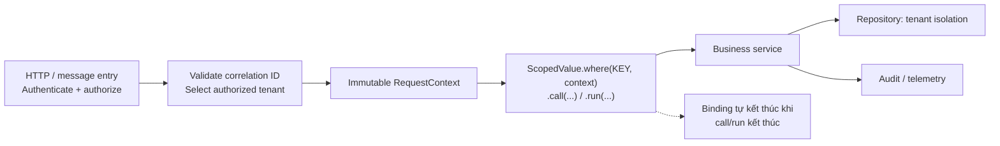
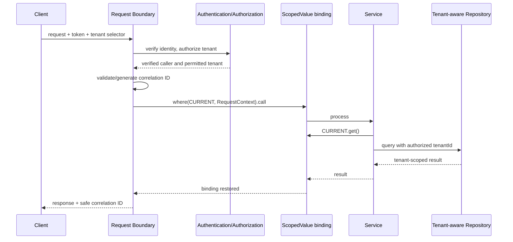
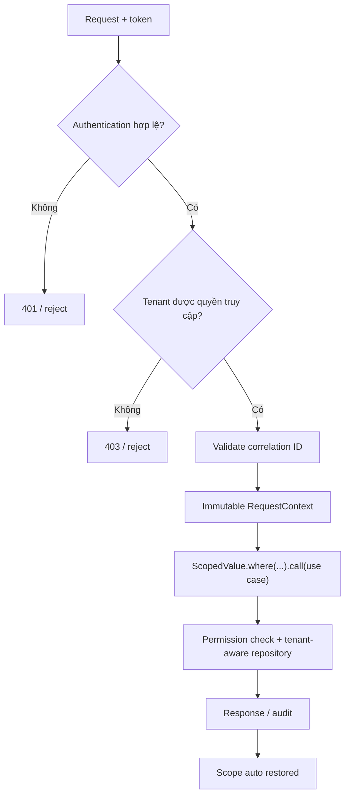

# Thiết kế ngữ cảnh yêu cầu gồm mã tương quan, tenant và thông tin người gọi

## 1. Bài toán: ba giá trị đi xuyên qua một lần xử lý

Giả sử ứng dụng Java xử lý yêu cầu đọc đơn hàng qua các lớp **HTTP entry point → use case → repository → audit logger**. Trong mỗi lần xử lý, những thành phần ở sâu bên trong đôi khi cần biết:

- **Mã tương quan (`correlationId`):** nối các dòng log hoặc bản ghi liên quan đến cùng một yêu cầu/luồng nghiệp vụ.
- **Tenant (`tenantId`):** định danh phạm vi dữ liệu của một khách hàng/tổ chức trong hệ thống đa tenant.
- **Người gọi (`caller`):** danh tính đã được xác thực và các quyền cần thiết cho quyết định truy cập.

Nếu truyền ba thông số qua mọi phương thức, API trung gian có thể bị “ô nhiễm” bởi tham số không liên quan đến trách nhiệm nghiệp vụ. Nếu thay bằng biến toàn cục hoặc `ThreadLocal` tùy tiện, hệ thống dễ quên dọn dữ liệu khi thread được tái sử dụng, dẫn tới log sai correlation ID hoặc — nghiêm trọng hơn — trộn ngữ cảnh tenant.

**Java 25 `ScopedValue`** cho phép gắn một **giá trị vào phạm vi thực thi có thời hạn**. Các phương thức được gọi **đồng bộ** bên trong phạm vi đó có thể đọc giá trị qua một khóa dùng chung, mà không cần truyền qua tất cả chữ ký phương thức.



**Điểm bảo mật quyết định:** `ScopedValue` là phương tiện truyền ngữ cảnh, **không phải** cơ chế xác thực hay phân quyền. Nếu ứng dụng gắn một `tenantId` chưa kiểm chứng vào `ScopedValue` rồi tin tưởng nó, lỗi bảo mật vẫn tồn tại dù API có bảo đảm phạm vi động.

Bài học **“Thiết kế ngữ cảnh yêu cầu gồm mã tương quan, tenant và thông tin người gọi”** thuộc chương **Ứng dụng ScopedValue** của module `JAVA_VERSION_JAVA25`. Nó tập trung vào cách dùng một API **đã chính thức trong Java 25**, cùng các biện pháp áp dụng hiện đại cho observability, đa tenant và bảo mật. Các chủ đề Java 25 khác như compact source files, module imports, constructor linh hoạt, KDF, AOT cache và JFR là bối cảnh của toàn module, không phải điều kiện tiên quyết cho `ScopedValue`.

### Mục tiêu học tập

Sau bài này, bạn có thể:

1. Thiết kế một `RequestContext` bất biến, gồm correlation ID, tenant ID và người gọi đã xác thực.
2. Mở và kết thúc binding bằng `ScopedValue.where(...).run(...)` hoặc `.call(...)`.
3. Hiểu `get()`, `isBound()`, `orElseThrow(...)`, nested rebinding và cơ chế khôi phục khi có exception.
4. Đặt việc xác thực, xác định tenant và kiểm tra quyền **trước** biên giới tạo ngữ cảnh.
5. Phân biệt propagation trong call stack đồng bộ với luồng làm việc bất đồng bộ/executor.
6. Kết nối ngữ cảnh với log/traces mà không phát tán thông tin người gọi hay tạo metric labels cardinality cao.
7. Viết kiểm thử phát hiện rò rỉ binding và truy cập sai tenant.

## 2. Trạng thái chính thức của ScopedValue trong Java 25

**JEP 506 — Scoped Values** được hoàn thiện thành tính năng **permanent** trong **Java SE 25**. API thuộc `java.lang.ScopedValue` trong module `java.base`, vì vậy source Java 25 thông thường có thể dùng tên `ScopedValue` mà không phải import tường minh. **Không cần `--enable-preview` chỉ để dùng `ScopedValue` trong Java 25.**

Các thao tác chính của API ổn định ở Java 25:

| API | Ý nghĩa |
| --- | --- |
| `ScopedValue.newInstance()` | Tạo khóa `ScopedValue<T>` ban đầu chưa có binding |
| `ScopedValue.where(key, value)` | Tạo `ScopedValue.Carrier` đại diện mapping khóa → giá trị |
| `carrier.run(Runnable)` | Thực thi đoạn code trả về `void` với các binding của carrier |
| `carrier.call(ScopedValue.CallableOp)` | Thực thi đoạn code trả về một kết quả; có thể truyền ngoại lệ |
| `key.get()` | Đọc giá trị của key đã bind **trên thread hiện tại**; không bind thì ném `NoSuchElementException` |
| `key.isBound()` | Kiểm tra key đang có binding hay không |
| `key.orElse(other)` / `orElseThrow(...)` | Đọc với fallback hoặc exception rõ ý nghĩa |
| `carrier.where(otherKey, otherValue)` | Tạo carrier mới có thêm binding; không sửa carrier cũ |

Ví dụ ngắn chỉ dùng tính năng Java 25 đã hoàn thiện:

```java
// ScopedHello.java
public class ScopedHello {
    private static final ScopedValue<String> REQUEST_ID =
            ScopedValue.newInstance();

    static void work() {
        System.out.println("requestId=" + REQUEST_ID.get());
    }

    public static void main(String[] args) {
        ScopedValue.where(REQUEST_ID, "req-42")
                .run(ScopedHello::work);

        System.out.println("bound after run: " + REQUEST_ID.isBound());
    }
}
```

Dự kiến:

```text
requestId=req-42
bound after run: false
```

Chạy bằng JDK 25:

```bash
java --version
javac --release 25 ScopedHello.java
java ScopedHello
```

**Không dùng tên API từ preview cũ** như một giả định mặc định. Bài học dùng mô hình `ScopedValue.where(...).run/call` và `ScopedValue.Carrier` đúng tài liệu Java SE 25.

### 2.1. Khái niệm “dynamic scope” và “binding theo thread”

Một binding có hiệu lực **trong quá trình chạy đoạn công việc** được truyền vào `run`/`call`, gồm các phương thức được nó gọi trực tiếp hoặc gián tiếp trên **cùng thread**. Khi công việc kết thúc bình thường hoặc ném exception, binding được **khôi phục về giá trị trước đó** (hoặc trở lại unbound).

Điều này khác `ThreadLocal.set(...)`: `ScopedValue` không đặt một giá trị vào thread rồi yêu cầu người viết nhớ `remove()`. Thay vào đó, phạm vi được giới hạn bởi điểm bắt đầu/kết thúc của một lần gọi.

Nhưng binding vẫn **theo từng thread**. Không được suy luận rằng mọi task chạy trên `ExecutorService`, `CompletableFuture`, thread mới hoặc virtual thread bất kỳ đều tự kế thừa giá trị. Kế thừa cross-thread trong Java gắn với cấu trúc đồng thời có quản lý vòng đời chặt chẽ; riêng `StructuredTaskScope` **vẫn là preview trong Java 25**, nên bài này không sử dụng nó trong các đoạn code sản xuất không bật preview.

### 2.2. Một record ngữ cảnh, một ScopedValue key

Javadoc khuyến nghị không dùng quá nhiều khóa `ScopedValue` hoạt động luân phiên; nếu cần nhiều thuộc tính, hãy nhóm thành một object nhỏ. Với ba thuộc tính của request, dùng:

```java
private static final ScopedValue<RequestContext> CURRENT =
        ScopedValue.newInstance();
```

Hãy để `RequestContext` là một `record` bất biến, trong đó những collection bên trong cũng được sao chép bất biến. Khóa `CURRENT` có thể là `private static final` trong lớp quản lý ngữ cảnh, để tránh tùy ý tạo binding từ mọi package.

**Khóa là capability.** Ai nắm được reference đến khóa có thể truy cập binding tương ứng; việc khóa private hạn chế khả năng nhìn thấy giá trị qua API. Tuy nhiên, một phương thức `current()` public vẫn cho phép mọi caller được gọi phương thức đó đọc ngữ cảnh, vì thế cần kiểm soát mức độ lộ API và **không đặt token, password hay raw credentials trong record**.

## 3. Thiết kế RequestContext có ngữ nghĩa và invariant rõ ràng

### 3.1. Ba thuộc tính, ba mục đích khác nhau

| Trường | Đến từ đâu? | Quy tắc | Không nên làm |
| --- | --- | --- | --- |
| `correlationId` | Header đã được kiểm tra hoặc ID do server sinh | Ký tự cho phép, giới hạn chiều dài, ổn định trong request | Tin mọi chuỗi client gửi; dùng làm bằng chứng xác thực |
| `tenantId` | Danh tính đã xác thực / quyết định chọn tenant đã được cấp quyền | Không rỗng, canonical, đã xác nhận quyền truy cập | Gán trực tiếp từ `X-Tenant-ID` do client tự khai báo |
| `caller` | Auth middleware/service đã xác minh identity | Subject ổn định, permissions/roles đã xác thực | Đưa JWT raw, session token hay mật khẩu vào context |

`correlationId` **không đồng nghĩa** với trace ID. Trace ID do hệ tracing tạo/tiếp nhận theo định dạng riêng, chịu ảnh hưởng sampling/propagation; correlation ID là định danh ứng dụng chọn để tra cứu log và phản hồi. Có thể đưa correlation ID vào trace attributes nếu policy cho phép, nhưng **không thay thế trace context propagation** bằng việc sao chép mỗi correlation ID.

`tenantId` không nên tự trở thành một metric label: nếu hệ thống có hàng nghìn tenant, cardinality và rò rỉ thông tin có thể tăng mạnh. Nên dùng label tổng quát như `operation`, `result`, `environment`; chi tiết tenant chỉ xuất hiện trong log/audit/trace phù hợp chính sách.

### 3.2. Record bất biến và sao chép roles

Ví dụ dưới đây dùng những kiểu có sẵn trong Java 25, không phụ thuộc framework:

```java
import java.util.Objects;
import java.util.Set;

record Caller(String subjectId, Set<String> permissions) {
    Caller {
        subjectId = requireText(subjectId, "subjectId");
        permissions = Set.copyOf(
                Objects.requireNonNull(permissions, "permissions"));
    }

    private static String requireText(String value, String field) {
        if (value == null || value.isBlank()) {
            throw new IllegalArgumentException(field + " is required");
        }
        return value;
    }
}

record RequestContext(
        String correlationId,
        String tenantId,
        Caller caller) {

    RequestContext {
        correlationId = requireText(correlationId, "correlationId");
        tenantId = requireText(tenantId, "tenantId");
        caller = Objects.requireNonNull(caller, "caller");
    }

    private static String requireText(String value, String field) {
        if (value == null || value.isBlank()) {
            throw new IllegalArgumentException(field + " is required");
        }
        return value;
    }
}
```

Đây là ví dụ mã trong **unnamed package** để dễ thử; trong hệ thống thật hãy đặt `Caller`/`RequestContext` vào package được phép của module và giới hạn visibility. `Set.copyOf(...)` chặn việc thay đổi trực tiếp tập permission qua một collection bên ngoài. `String` bất biến, `Caller` là record và `RequestContext` chỉ chứa các thành phần bất biến; nếu mở rộng sang một `List`/`Map` mutable, cần *defensive copy* tương ứng.

**Không nhầm “record bất biến” với bảo mật tự động.** `tenantId` vẫn có thể chứa giá trị sai nếu request entry tự ý tin một header giả mạo. Lớp record kiểm tra cấu trúc dữ liệu, còn **authentication + authorization** quyết định nội dung nào được phép bind.

## 4. Thiết lập ngữ cảnh tại ranh giới tin cậy của request

### 4.1. Thứ tự bắt buộc ở request entry point

Tại biên HTTP/gRPC/message consumer, thường nên thực hiện theo thứ tự:

1. **Authenticate:** xác minh token/session/chữ ký theo cơ chế hiện có và tạo `VerifiedIdentity`. Không tự giải mã JWT mà bỏ qua chữ ký, issuer, audience, expiry.
2. **Authorize tenant selection:** nếu client yêu cầu tenant `tenant-a`, bảo đảm người gọi được phép hoạt động trong tenant đó. Không coi `X-Tenant-ID` hoặc tenant trong URL là nguồn thẩm quyền tự thân.
3. **Xác định correlation ID:** chấp nhận header hợp lệ với giới hạn ký tự/độ dài, hoặc sinh ID mới; loại bỏ hoặc chuẩn hóa header không tin cậy để tránh log injection.
4. **Xây dựng immutable context:** chỉ chứa dữ liệu tối thiểu, đã qua kiểm chứng.
5. **Bind và thực thi:** `ScopedValue.where(CURRENT, context).call(() -> service.handle(...))`; mọi business work đồng bộ của request nên nằm bên trong lambda.
6. **Kết thúc scope:** để binding được tự khôi phục khi lambda trả về hoặc ném lỗi. Không giữ một carrier/binding global để dùng cho yêu cầu kế tiếp.



**Thiết kế fail-closed:** nếu không có verified identity hoặc người gọi không được truy cập tenant đích, từ chối request **trước khi mở binding**. Với job hệ thống không có người dùng cuối, định nghĩa một **service identity đã xác thực/ủy quyền** và giới hạn quyền rõ ràng, thay vì giả mạo `admin` hoặc dùng `tenantId="default"` để bỏ qua kiểm tra.

### 4.2. Ví dụ Java 25 độc lập: VerifiedIdentity → RequestContext → service

Ví dụ sau là **một tệp Java chạy được**, không dùng framework. `VerifiedIdentity` được giả định là kết quả mà lớp authentication bên ngoài đã kiểm chứng; code ở đây minh họa **tenant authorization tại entry point** và cách binding được dùng xuống service. Hàm `readOrder` là mô phỏng service, **không phải truy vấn database thật**.

```java
// RequestBoundaryDemo.java — JDK 25, no preview required
import java.util.Objects;
import java.util.Set;
import java.util.UUID;
import java.util.regex.Pattern;

public final class RequestBoundaryDemo {

    private static final ScopedValue<RequestContext> CURRENT =
            ScopedValue.newInstance();

    private static final Pattern SAFE_CORRELATION =
            Pattern.compile("[A-Za-z0-9][A-Za-z0-9._-]{0,63}");

    record VerifiedIdentity(
            String subjectId,
            Set<String> permissions,
            Set<String> authorizedTenants) {

        VerifiedIdentity {
            subjectId = requireText(subjectId, "subjectId");
            permissions = Set.copyOf(permissions);
            authorizedTenants = Set.copyOf(authorizedTenants);
        }
    }

    record Caller(String subjectId, Set<String> permissions) {
        Caller {
            subjectId = requireText(subjectId, "subjectId");
            permissions = Set.copyOf(permissions);
        }
    }

    record RequestContext(
            String correlationId,
            String tenantId,
            Caller caller) {

        RequestContext {
            correlationId = requireText(correlationId, "correlationId");
            tenantId = requireText(tenantId, "tenantId");
            caller = Objects.requireNonNull(caller);
        }
    }

    private static String requireText(String value, String field) {
        if (value == null || value.isBlank()) {
            throw new IllegalArgumentException(field + " is required");
        }
        return value;
    }

    private static String correlationId(String proposed) {
        return proposed != null
                && SAFE_CORRELATION.matcher(proposed).matches()
                ? proposed
                : UUID.randomUUID().toString();
    }

    static String handle(
            VerifiedIdentity verified,
            String requestedTenant,
            String proposedCorrelation,
            String orderId) {

        Objects.requireNonNull(verified, "verified identity required");

        // Selector do client cung cấp CHỈ là yêu cầu chọn tenant.
        // Quyền truy cập được xác định bởi identity đã xác minh.
        if (requestedTenant == null
                || !verified.authorizedTenants().contains(requestedTenant)) {
            throw new SecurityException("Tenant access denied");
        }

        var context = new RequestContext(
                correlationId(proposedCorrelation),
                requestedTenant,
                new Caller(verified.subjectId(), verified.permissions()));

        return ScopedValue.where(CURRENT, context)
                .call(() -> readOrder(orderId));
    }

    private static String readOrder(String orderId) {
        RequestContext ctx = CURRENT.get();

        if (!ctx.caller().permissions().contains("orders:read")) {
            throw new SecurityException("Missing orders:read");
        }

        // Dữ liệu thật phải được lọc theo tenant ở repository/DB.
        // Ở đây chỉ in dữ liệu minh họa, không gọi database.
        return "request=" + ctx.correlationId()
                + "; tenant=" + ctx.tenantId()
                + "; order=" + orderId;
    }

    public static void main(String[] args) {
        var verified = new VerifiedIdentity(
                "user-7",
                Set.of("orders:read"),
                Set.of("tenant-a"));

        System.out.println(handle(
                verified, "tenant-a", "req-42", "ORD-100"));

        System.out.println("Scope after response: "
                + CURRENT.isBound());
    }
}
```

Biên dịch/chạy:

```bash
javac --release 25 RequestBoundaryDemo.java
java RequestBoundaryDemo
```

Kết quả dự kiến:

```text
request=req-42; tenant=tenant-a; order=ORD-100
Scope after response: false
```

**Giới hạn ví dụ:** `main` tạo `VerifiedIdentity` giả để minh họa; **không dùng cách đó làm xác thực production**. Trong HTTP server thật, identity phải do middleware xác thực đáng tin cậy tạo. `readOrder` chỉ hiển thị ngữ cảnh; một repository thật phải thực hiện tenant isolation bằng điều kiện truy vấn, policy database hoặc Row-Level Security phù hợp, không chỉ dựa vào text `tenant` in ra.

### 4.3. Tenant selector và yêu cầu quyền theo từng tài nguyên

Một người gọi có thể được phép truy cập nhiều tenant. Header hoặc route parameter `tenant` khi đó là **đề nghị chọn tenant**, phải đối chiếu danh sách tenant đã được ủy quyền. Cách kiểm tra `authorizedTenants.contains(requestedTenant)` trong ví dụ là mức minh họa; production có thể cần chính sách quan hệ tổ chức, vai trò trên từng tenant, quyền của từng tài nguyên và đánh giá thay đổi quyền trong quá trình xử lý.

Không bao giờ đưa tenant do client gửi thẳng vào:

```java
// KHÔNG làm: tenant từ client trở thành ngữ cảnh đáng tin.
ScopedValue.where(CURRENT,
        new RequestContext(headerId, headerTenant, headerCaller))
        .run(() -> loadSensitiveData());
```

Lỗi ở đây **không phải do ScopedValue**; đó là lỗi *trust boundary*. `ScopedValue` sẽ truyền chính xác cả dữ liệu giả mạo nếu ứng dụng cung cấp dữ liệu giả mạo cho nó.

### 4.4. Một key private; API đọc có kiểm soát

Ở code nhiều package, có thể đặt key trong một lớp trung tâm:

```java
package com.example.context;

import java.util.Objects;
import java.util.function.Supplier;

public final class RequestScope {
    private static final ScopedValue<RequestContext> CURRENT =
            ScopedValue.newInstance();

    private RequestScope() { }

    public static RequestContext current() {
        return CURRENT.orElseThrow(
                () -> new IllegalStateException(
                        "No trusted request context bound"));
    }

    // Chỉ ranh giới tin cậy nên được phép gọi hàm tạo scope.
    public static void run(RequestContext context, Runnable action) {
        ScopedValue.where(
                CURRENT, Objects.requireNonNull(context, "context"))
                .run(action);
    }

    public static <R> R call(
            RequestContext context, Supplier<R> action) {
        return ScopedValue.where(
                CURRENT, Objects.requireNonNull(context, "context"))
                .call(action::get);
    }
}
```

Đoạn code giả định `RequestContext` ở cùng package hoặc đã được import. **Đây là phác thảo API**, cần chỉnh visibility để không cho module bất kỳ gọi `RequestScope.run` với context tự chế. Chẳng hạn, factory/binder có package-private visibility trong module entry point, còn service chỉ nhận một interface *read-only* đủ thông tin. Tránh biến một helper `public static run(...)` thành đường **mạo danh caller/tenant**.

`call(Supplier<R>)` là wrapper tiện dụng cho công việc không ném checked exception; API gốc `Carrier.call(ScopedValue.CallableOp)` cho phép truyền exception theo chữ ký riêng. Chỉ dùng wrapper khi đã hiểu ngoại lệ và quyền truy cập theo thiết kế.

## 5. Thời hạn binding, rebinding và hành vi khi có lỗi

### 5.1. Không bị rò ngữ cảnh khi kết thúc hoặc ném exception

Khác với kiểu quản lý `ThreadLocal` thủ công, `ScopedValue` tự phục hồi binding sau `run`/`call`, kể cả lúc lambda ném lỗi:

```java
// ScopeLife.java
public class ScopeLife {
    private static final ScopedValue<String> ID =
            ScopedValue.newInstance();

    public static void main(String[] args) {
        try {
            ScopedValue.where(ID, "req-1").run(() -> {
                System.out.println(ID.get());
                throw new IllegalStateException("business failure");
            });
        } catch (IllegalStateException expected) {
            System.out.println("Caught: " + expected.getMessage());
        }

        System.out.println("Is bound? " + ID.isBound());
    }
}
```

Kết quả:

```text
req-1
Caught: business failure
Is bound? false
```

Dọn binding do API thực hiện **không** tự dọn database transaction, file handle, span, MDC hay tài nguyên bên ngoài. Mỗi hệ thống quản lý tài nguyên vẫn cần `try-with-resources`/`finally` và ranh giới lifecycle riêng.

### 5.2. Rebinding trong phạm vi lồng nhau

Trong một scope hiện có, bạn có thể tạo binding mới cho **cùng key** trong một scope con. Sau scope con, binding ngoài được phục hồi:

```java
// NestedScope.java
public class NestedScope {
    private static final ScopedValue<String> REQUEST_TAG =
            ScopedValue.newInstance();

    public static void main(String[] args) {
        ScopedValue.where(REQUEST_TAG, "outer").run(() -> {
            System.out.println(REQUEST_TAG.get());

            ScopedValue.where(REQUEST_TAG, "inner").run(() -> {
                System.out.println(REQUEST_TAG.get());
            });

            System.out.println(REQUEST_TAG.get());
        });

        System.out.println(REQUEST_TAG.isBound());
    }
}
```

Kết quả:

```text
outer
inner
outer
false
```

Rebinding dùng cho một nhu cầu **có chủ đích** như luồng nghiệp vụ phụ được ủy quyền. **Không biến rebinding thành cách “đổi tenant” tùy tiện giữa request**. Một đoạn code sâu trong tầng repository không nên tự bind `tenantId` khác để vượt qua quyền truy cập; quyền thay đổi tenant phải được kiểm chứng tại một biên tin cậy.

### 5.3. Không bound, bound null và lỗi dùng sai

- Gọi `get()` khi key chưa bind sẽ ném `NoSuchElementException`. Đó là tín hiệu hữu ích nếu service **bắt buộc** được gọi bên trong request scope.
- `orElse(defaultValue)` phù hợp cho dữ liệu **thực sự optional**; không dùng default tenant hoặc default “admin” để che lỗi chưa bind ngữ cảnh.
- API `where(key, null)` có thể tạo binding với giá trị `null`. `isBound()` vẫn có thể trả `true` dù `get()` trả `null`. Do đó thiết kế context này dùng `Objects.requireNonNull(context)` và record có các trường bắt buộc không rỗng.
- Không dùng `ScopedValue.newInstance()` trong mỗi request để tạo **khóa mới**; key nên có định danh ổn định, được giữ riêng trong lớp quản lý. Mỗi request chỉ tạo giá trị `RequestContext` mới rồi bind nó.

## 6. Truy cập dữ liệu và cách ly tenant: binding không thay authorization

Một ngữ cảnh request có `tenantId` giúp các lớp service/repository biết tenant đang được phục vụ. Nhưng việc **đọc được tenant từ `ScopedValue` không tự bảo vệ dữ liệu**. Chính ranh giới truy cập phải thi hành các kiểm tra cần thiết.

### 6.1. Giữ tham số nghiệp vụ rõ ràng

```java
Order findOrder(String orderId);
```

`orderId` là tham số nghiệp vụ, nên truyền rõ trong chữ ký. Correlation ID lại thường là cross-cutting concern, có thể được đọc ở logging adapter; tenant đã qua kiểm tra được đọc ở repository/transaction boundary. Một số API domain cần tenant một cách tường minh để làm rõ hợp đồng, vẫn nên truyền `tenantId` nếu điều đó giúp bảo đảm correctness hoặc unit test dễ hiểu hơn. **Không dùng `ScopedValue` để giấu mọi tham số.**

Một repository đọc đơn hàng cần lọc theo **tenant và order**, ví dụ:

```sql
SELECT order_id, status
FROM orders
WHERE tenant_id = :tenant_id
  AND order_id = :order_id;
```

`:tenant_id` phải có nguồn gốc từ context **đã được cấp quyền**; `:order_id` là dữ liệu nghiệp vụ. Dùng parameterized query/prepared statements, không ghép chuỗi đầu vào vào SQL. Với JPA, JDBC, R2DBC và cache layer, cần kiểm chứng các data access paths đều áp dụng tenant filter. Có thể dùng thêm Row-Level Security của database phù hợp hệ quản trị để phòng vệ nhiều lớp; `ScopedValue` không tự thiết lập RLS.

### 6.2. Các đường rò dữ liệu ngoài database

| Hệ thống | Phải tách theo tenant khi nào? | Ví dụ |
| --- | --- | --- |
| Cache | Khi resource ID có thể trùng giữa tenants | Key gồm tenant + resource ID |
| Idempotency | Khi nhiều tenant dùng cùng client idempotency key | Namespace theo tenant |
| Object storage | Khi object key có thể trùng hoặc bucket dùng chung | Prefix/chính sách IAM riêng |
| Message routing | Khi worker tiêu thụ nhiều tenant | Tenant trong metadata được xác minh ở consumer |
| Audit | Khi log/audit chứa chủ thể và tài nguyên | Giới hạn quyền đọc và retention |
| Database session | Khi dùng session variable/role cho RLS | Set và reset trạng thái theo transaction/connection |

Ví dụ cache key `order:ORD-42` có thể trả dữ liệu sai nếu hai tenant cùng có đơn hàng `ORD-42`. Một cấu trúc nội bộ `tenant-a:order:ORD-42` giúp phân biệt phạm vi; nhưng không nên lộ những ID này qua API công khai nếu chúng là dữ liệu nhạy cảm.

### 6.3. Không rebind sang tenant khác để né kiểm tra

Rebinding là hành vi **được phép về cú pháp Java**, nhưng người viết mã phải kiểm tra quyền trước khi đổi context:

```java
// Anti-pattern: code không qua authorization tự thay tenant.
ScopedValue.where(CURRENT, unverifiedOtherTenantContext)
        .run(() -> repository.readAll());
```

Nếu có use case admin thực sự phải chuyển tenant, thiết kế một **entry point có authorization riêng**, audit nguyên nhân, phạm vi và tài nguyên. Chỉ expose các API binder cho thành phần tin cậy; một private key kết hợp code review/encapsulation giúp giảm khả năng giả mạo ngữ cảnh, nhưng không phải sandbox chống mọi mã độc trong cùng JVM.

## 7. Propagation đồng bộ và bất đồng bộ

### 7.1. Trong cùng thread: phương thức gọi lồng nhau nhìn thấy binding

```java
ScopedValue.where(CURRENT, context).run(() -> {
    controller.handle(); // -> service -> repository -> audit
});
```

Nếu toàn bộ xử lý trên **cùng thread** bên trong dynamic extent, các phương thức sâu hơn có thể đọc `CURRENT.get()`. Đó là trường hợp sử dụng chính của `ScopedValue`.

Nhưng callback của web framework có thể đổi thread, và một đoạn xử lý có thể tiếp tục sau khi `run` kết thúc. Với reactive pipelines như Reactor, cần dùng **context mechanism của framework** và bridge được hỗ trợ. Đừng mặc định gọi `ScopedValue.get()` trên bất kỳ thread nào cũng sẽ thấy request gốc.

### 7.2. ExecutorService không tự kế thừa binding

Ví dụ chạy trên JDK 25, không cần API preview:

```java
// ExecutorScopeDemo.java
import java.util.concurrent.Callable;
import java.util.concurrent.ExecutorService;
import java.util.concurrent.Executors;

public class ExecutorScopeDemo {
    private static final ScopedValue<String> ID =
            ScopedValue.newInstance();

    public static void main(String[] args) throws Exception {
        try (ExecutorService pool = Executors.newSingleThreadExecutor()) {
            ScopedValue.where(ID, "req-42").run(() -> {
                Callable<Boolean> plainProbe = ID::isBound;
                var withoutPropagation = pool.submit(plainProbe);
                String captured = ID.get();

                Callable<String> rebindProbe = () ->
                        ScopedValue.where(ID, captured).call(ID::get);
                var withExplicitPropagation = pool.submit(rebindProbe);

                try {
                    System.out.println(withoutPropagation.get());
                    System.out.println(withExplicitPropagation.get());
                } catch (Exception ex) {
                    throw new IllegalStateException(ex);
                }
            });
        }
    }
}
```

Kết quả dự kiến:

```text
false
req-42
```

Thread pool worker không thấy binding tạo ở thread gửi. Ở task thứ hai, chương trình **capture** giá trị rồi mở binding mới trong worker. Với request thực, capture **immutable `RequestContext`** nếu cần, và giữ các tác vụ này trong lifecycle request có kiểm soát. Mẫu trên chờ `Future.get()` trước khi scope ngoài kết thúc, tránh để các task sở hữu quyền request chạy vô hạn.

### 7.3. Virtual threads và Structured Concurrency

`ScopedValue` có thể được bind trong virtual thread giống như platform thread, nhưng việc tạo thread/virtual thread tùy ý **không bảo đảm tự kế thừa ngữ cảnh**. API `StructuredTaskScope` cung cấp cơ chế kế thừa scoped bindings với các subtasks có vòng đời được quản lý, **nhưng `StructuredTaskScope` vẫn là preview ở Java 25**. Vì yêu cầu chỉ dùng kiến thức đã hoàn thiện, bài này **không đưa API preview vào mã chạy chính**.

Một tác vụ `CompletableFuture.supplyAsync` hoặc `ExecutorService.submit` cũng không tự nhận `ScopedValue` từ thread submit. Cần chọn cách truyền context tường minh hoặc adapter chính thức của framework, rồi mở lại scope nơi task chạy nếu phù hợp.

### 7.4. Sau response hoặc qua message queue

Một background job không nên tiếp tục sử dụng toàn bộ `Caller`/permissions của HTTP request sau khi response đã hoàn thành, vì quyền có thể thay đổi và job thuộc vòng đời khác.

Đối với queue hoặc job scheduler:

1. Lưu một message/job payload tối thiểu, đã chuẩn hóa (ví dụ correlation ID, tenant selector, task type) và không chứa raw JWT/secret.
2. Consumer xác minh nguồn message, quyền của service identity và quyền xử lý tenant tại **thời điểm tiêu thụ**.
3. Tạo `JobContext` phù hợp, bind một scope **mới** cho lần xử lý job.
4. Dọn lifecycle của transaction, log MDC, spans và resource độc lập với `ScopedValue`.
5. Với request đi qua HTTP/gRPC giữa các process, dùng headers và distributed tracing propagation được phép; **ScopedValue binding không vượt qua network**.

| Mẫu thực thi | Khuyến nghị |
| --- | --- |
| Controller → service → repository đồng bộ cùng thread | `ScopedValue` là lựa chọn hợp lý cho cross-cutting context |
| Executor ngắn, chờ hoàn tất trong request | Capture immutable context, rebind có kiểm soát |
| Reactive/continuation đổi thread | Framework context propagation |
| Async job có lifecycle độc lập | Job identity + message metadata, xác minh quyền và mở scope mới |
| Nhiều process/service | Protocol headers và trace propagation; không dùng in-JVM binding làm giao thức |
| Task cần quyền khác | Service principal/quyền riêng, không giả định quyền request |

## 8. Correlation ID, logs, traces và metrics: liên kết nhưng không đánh đồng

### 8.1. Correlation ID không phải trace ID

Một request có thể mang:

```text
correlationId = req-42
traceId       = 9f6cf33ea95c492da9e81004f0ce8a71
spanId        = d1e1f66234be0a3c
```

Correlation ID là định danh ứng dụng dùng để tìm log/audit liên quan. Trace ID/span ID thuộc tracing system, cần exporter, sampling, context propagation và backend tương ứng. Có binding `ScopedValue` không chứng minh trace collector đang nhận được dữ liệu.

Nếu chuyển correlation ID qua HTTP headers, giới hạn ký tự/độ dài như ở `RequestBoundaryDemo`. Dùng tracing libraries được hỗ trợ để truyền trace headers và tạo spans; không tự coi correlation ID là parent trace ID.

### 8.2. ScopedValue không tự đi vào MDC

Loggers sử dụng **MDC (Mapped Diagnostic Context)** thường có cơ chế riêng. Cần adapter và cleanup; ví dụ với **SLF4J** (thư viện bên ngoài Java SE):

```java
// Snippet trong application đã tích hợp SLF4J.
RequestContext ctx = RequestScope.current();

try (var ignored = org.slf4j.MDC.putCloseable(
        "correlationId", ctx.correlationId())) {
    service.process();
}
```

`MDC.putCloseable` quản lý một entry tương ứng của MDC khi block kết thúc, nhưng **không tự truyền MDC hoặc ScopedValue qua thread khác**. Khi code reactive hoặc executor đổi thread, kiểm tra cơ chế log/tracing context của framework thực.

Không log nguyên `RequestContext.toString()`: record có thể chứa tenant ID, subject ID và permission list. Chỉ log những trường được cho phép với quyền truy cập, redaction và retention phù hợp.

### 8.3. Không đưa per-request IDs vào Prometheus labels

| Thuộc tính | Structured logs | Trace attributes | Metric labels |
| --- | --- | --- | --- |
| `correlationId` | Có thể ghi nếu qua kiểm tra ký tự | Có thể đưa vào theo policy | **Không**: high cardinality |
| `tenantId` | Chỉ khi có mục đích, kiểm soát quyền | Cân nhắc tính nhạy cảm | **Không mặc định**; dễ gây cardinality/rò rỉ |
| `caller.subjectId` | Chỉ audit có bảo vệ | Hạn chế | **Không** |
| `permissions` hoặc raw token | Không log trọn bộ | Không | **Không** |
| `operation`, `result`, `environment` | Thường phù hợp | Thường phù hợp | Thường phù hợp vì tập giá trị giới hạn |

`ScopedValue` không mã hóa giá trị. Đặc biệt, việc mọi service đều dễ đọc `caller` không có nghĩa có thể tự động ghi tất cả dữ liệu caller vào logs, metrics hoặc baggage.

## 9. Tích hợp với ứng dụng thật mà không vượt quá phạm vi của ScopedValue

### 9.1. Chọn điểm đặt binding

Với một ứng dụng dùng servlet/MVC, điểm đặt binding thường là lớp **request adapter** sau khi authentication và tenant authorization đã xác định trusted identity, nhưng trước khi gọi controller/use case đồng bộ. Cần bảo đảm:

- Authentication và tenant selector validation đã hoàn tất.
- Toàn bộ xử lý đồng bộ cần context nằm trong lambda `run/call`, kể cả error path và audit cần thiết.
- Binding đóng trước khi thread phục vụ request được trả về pool.
- Nếu web framework có cơ chế async hoặc callback chạy ở thread khác, bridge phải được xử lý rõ ràng; không xem method `filterChain.doFilter` luôn bao trùm mọi asynchronous completion.
- Log/MDC/tracing context được đóng và khôi phục bằng cơ chế riêng của chúng.

Pseudo-code thể hiện **thứ tự**, không phụ thuộc tên API cụ thể của một framework:

```java
// PSEUDOCODE: adapter cụ thể phải tùy chỉnh cho framework.
VerifiedIdentity caller = authenticateAndVerify(request);
String tenant = authorizeTenant(caller, request.requestedTenant());
String id = normalizeOrGenerateCorrelationId(request.correlationHeader());

RequestContext context = buildImmutableContext(id, tenant, caller);

return requestScope.call(context, () -> controller.process(request));
```

Ví dụ này **không có nghĩa** tự viết một `requestScope` tuỳ ý là đã cấu hình đầy đủ Spring Security/Jakarta Servlet/Reactor. Khi tích hợp framework, dùng API lifecycle thực của framework đó, đặc biệt những phần async. Java 25 cung cấp `ScopedValue`, còn authentication middleware, request lifecycle và context bridging do ứng dụng/framework đảm nhiệm.

### 9.2. Nên dùng một context hay nhiều keys?

Javadoc của Java 25 khuyến nghị **số lượng ScopedValue nhỏ**, vì cách tìm binding và cache theo thread có chi phí riêng. Với ba thuộc tính có cùng vòng đời request, một `RequestContext` record giúp cập nhật contract dễ hiểu hơn ba key rời.

Nếu có một dữ liệu khác vòng đời — ví dụ `deadline` dành riêng cho một thao tác nội bộ — có thể dùng key riêng hoặc truyền tham số tường minh thay vì nhét mọi thông tin vào `RequestContext`. Không biến context thành một “service locator” giữ connection, HTTP request body, transaction manager, mutable map hoặc object quá lớn.

### 9.3. Khi nào chọn ThreadLocal hoặc truyền tham số?

| Lựa chọn | Dùng khi | Rủi ro / giới hạn |
| --- | --- | --- |
| `ScopedValue<RequestContext>` | Context một chiều, bất biến, cùng dynamic scope | Không tự propagate qua thread/executor không cấu trúc; key access phải quản lý |
| Tham số method tường minh | Dữ liệu là phần quan trọng của business contract, cần dễ test và dễ review | Nhiều tầng có thể phải nhận tham số chỉ để chuyển tiếp |
| `ThreadLocal<T>` | Cần tương thích API/library có lifecycle đặc thù đã được kiểm soát | Mutable theo thread, phải remove/restore đúng; dễ rò khi dùng thread pool |
| Framework context (Reactor, tracing, security context) | Reactive/async hoặc framework đã cung cấp propagation thích hợp | Không đồng nhất tự động với ScopedValue; cần adapter được hỗ trợ |
| Message/job metadata | Qua process hoặc vòng đời request | Phải xác minh lại nguồn, quyền và dữ liệu khi consumer nhận |

`ScopedValue` không đơn giản là “ThreadLocal mới dùng cho mọi tình huống”. Nó được thiết kế cho **dữ liệu một chiều từ caller xuống callee** trong phạm vi động có quản lý, rất hợp với request context bất biến, nhưng không phù hợp làm một kho trạng thái mutable để nhiều tầng tự chỉnh sửa.

## 10. Bộ kiểm thử tối thiểu cho RequestContext

### 10.1. Unit test lifecycle: bound, restored, exception

Ví dụ JUnit 5, dùng riêng API `ScopedValue` chính thức:

```java
// ScopedLifecycleTest.java
import java.util.NoSuchElementException;
import org.junit.jupiter.api.Test;

import static org.junit.jupiter.api.Assertions.*;

class ScopedLifecycleTest {
    private static final ScopedValue<String> ID =
            ScopedValue.newInstance();

    @Test
    void missingScopeFailsClearly() {
        assertFalse(ID.isBound());
        assertThrows(NoSuchElementException.class, () -> ID.get());
    }

    @Test
    void valueExistsOnlyWithinCall() {
        String result = ScopedValue.where(ID, "req-A")
                .call(ID::get);

        assertEquals("req-A", result);
        assertFalse(ID.isBound());
    }

    @Test
    void nestedScopeRestoresPreviousValue() {
        ScopedValue.where(ID, "outer").run(() -> {
            assertEquals("outer", ID.get());

            ScopedValue.where(ID, "inner").run(() -> {
                assertEquals("inner", ID.get());
            });

            assertEquals("outer", ID.get());
        });

        assertFalse(ID.isBound());
    }

    @Test
    void exceptionDoesNotLeakBinding() {
        assertThrows(IllegalStateException.class, () ->
                ScopedValue.where(ID, "req-error").run(() -> {
                    throw new IllegalStateException("failure");
                }));

        assertFalse(ID.isBound());
    }
}
```

Đây là test về **lifetime của binding**. Nó không tự kiểm tra authentication, tenant isolation hay dữ liệu ngoài database.

### 10.2. Test từ chối tenant không được cấp quyền

Giả sử class `RequestBoundaryDemo` ở phần 4 đặt cùng package với test (hoặc API được export có chủ đích):

```java
import java.util.Set;
import org.junit.jupiter.api.Test;

import static org.junit.jupiter.api.Assertions.*;

class RequestBoundaryTest {

    @Test
    void rejectsUnauthorizedTenantBeforeBinding() {
        var caller = new RequestBoundaryDemo.VerifiedIdentity(
                "user-7", Set.of("orders:read"), Set.of("tenant-a"));

        assertThrows(SecurityException.class,
                () -> RequestBoundaryDemo.handle(
                        caller, "tenant-b", "req-test", "ORD-1"));
    }

    @Test
    void acceptsAuthorizedTenantWithVerifiedCaller() {
        var caller = new RequestBoundaryDemo.VerifiedIdentity(
                "user-7", Set.of("orders:read"), Set.of("tenant-a"));

        String result = RequestBoundaryDemo.handle(
                caller, "tenant-a", "req-test", "ORD-1");

        assertTrue(result.contains("tenant=tenant-a"));
    }

    @Test
    void enforcesOperationPermission() {
        var caller = new RequestBoundaryDemo.VerifiedIdentity(
                "user-7", Set.of("orders:list"), Set.of("tenant-a"));

        assertThrows(SecurityException.class,
                () -> RequestBoundaryDemo.handle(
                        caller, "tenant-a", "req-test", "ORD-1"));
    }
}
```

Các tests trên chỉ chứng minh logic boundary **được minh họa trong code**. Khi dùng hệ thống thật, cần integration test với authentication middleware, tenant-aware repository và dữ liệu của hai tenant có cùng `orderId`. Test phải bảo đảm tenant A không thể đọc/sửa tài nguyên của tenant B ngay cả khi cache, message consumer hoặc code path khác được kích hoạt.

### 10.3. Kiểm tra các thread không trộn request

Tạo hai task trên thread pool, mỗi task tự bind context khác nhau; kết quả phải giữ đúng giá trị và không rò qua lần xử lý kế tiếp:

```java
// ConcurrentScopeTest.java
import java.util.concurrent.Callable;
import java.util.concurrent.Executors;
import org.junit.jupiter.api.Test;

import static org.junit.jupiter.api.Assertions.*;

class ConcurrentScopeTest {

    private static final ScopedValue<String> TENANT =
            ScopedValue.newInstance();

    @Test
    void independentTasksKeepTheirOwnValues() throws Exception {
        try (var pool = Executors.newFixedThreadPool(2)) {
            Callable<String> aTask = () ->
                    ScopedValue.where(TENANT, "tenant-a").call(TENANT::get);
            Callable<String> bTask = () ->
                    ScopedValue.where(TENANT, "tenant-b").call(TENANT::get);
            var a = pool.submit(aTask);
            var b = pool.submit(bTask);

            assertEquals("tenant-a", a.get());
            assertEquals("tenant-b", b.get());

            Callable<Boolean> unboundProbe = TENANT::isBound;
            var nextTask = pool.submit(unboundProbe);
            assertFalse(nextTask.get());
        }
    }
}
```

Kết quả của hai tasks có thể hoàn thành theo bất kỳ thứ tự nào; do mỗi task tự bind rồi đóng scope, `nextTask` không được thấy một giá trị còn sót lại. Thử nghiệm này hữu ích nhưng chưa thay thế load/stress test các đường xử lý có thread hopping và cancellation.

### 10.4. Kiểm thử logging, async và tenant isolation ở staging

Một bộ kiểm tra tối thiểu nên có:

1. Request thiếu auth → từ chối trước binding.
2. Auth hợp lệ nhưng tenant không được cấp quyền → 403 hoặc lỗi quyền tương ứng, không trả dữ liệu.
3. Correlation header dài/chứa newline → bị thay bằng ID an toàn; không ghi raw header vào log.
4. Hai requests liên tiếp trên cùng worker thread → log/audit không mang correlation ID hoặc tenant của request trước.
5. Có exception ở service → scope kết thúc; transaction và MDC được dọn độc lập.
6. Async task không được cấu hình propagation → có báo thiếu context rõ, không fallback sang tenant mặc định.
7. Job từ queue → identity được xác minh lại, mở một `JobContext` mới.
8. Repository/cache → dữ liệu giữa tenant A/B không lẫn khi `orderId` trùng.
9. Logging/tracing → không lộ permissions/subject tokens; metric labels không có correlation ID.
10. Test với JDK 25 compiler và source level 25, không dựa vào API preview.

## 11. Bảng chẩn đoán lỗi

| Triệu chứng | Nguyên nhân thường gặp | Hướng kiểm tra |
| --- | --- | --- |
| `NoSuchElementException` từ `CURRENT.get()` | Gọi service ngoài scope hoặc trên thread khác | Truy lần caller; kiểm tra scope boundary và thread hop |
| `isBound() == true` nhưng `get() == null` | Code đã bind `null` | Chặn context null, dùng record invariant |
| Tenant của request trước xuất hiện ở request mới | Dùng `ThreadLocal`/MDC không dọn, static mutable state hoặc wrapper sai | Phân biệt giá trị trong ScopedValue và MDC; test với reused threads |
| Correlation ID biến mất trong `CompletableFuture` | Executor không tự inherit binding | Capture/rebind có kiểm soát hoặc dùng framework context |
| Trace có ID khác correlation ID | Hai cơ chế định danh khác nhau | Đối chiếu trace propagation, không tự ép chúng giống nhau |
| Auth đã qua nhưng vẫn truy cập nhầm tenant | Tenant selector chưa được authorize; repo/cache không phân vùng | Kiểm tra trust boundary và data access policy |
| Endpoint có log request nhưng không có trace | Sampling/exporter/tracing instrumentation lỗi | Tách kiểm tra tracing khỏi ScopedValue |
| Metrics tăng time series quá nhiều | Đưa correlationId/userId/tenantId high-cardinality vào labels | Dùng tags hữu hạn, chuyển chi tiết vào audit/log phù hợp |
| Không thấy context trong request reactive | Thread đổi trong pipeline | Dùng framework context/adapter, không giả định cùng thread |
| Job sau response dùng quyền người gọi cũ | Giữ `Caller` snapshot quá vòng đời | Dùng service identity, re-authorize job |
| `ScopedValue.where` không biên dịch | JDK/source level cũ hoặc copy ví dụ preview không tương thích | Kiểm tra `java --version`, `javac --version` và API Java 25 |
| `StructuredTaskScope` yêu cầu `--enable-preview` | Structured concurrency vẫn preview ở Java 25 | Không dùng preview trong baseline sản xuất nếu chưa cho phép |

## 12. Tình huống thực hành: một API đơn hàng đa tenant

### 12.1. Bối cảnh

Một API giả định nhận:

```text
GET /tenants/tenant-a/orders/ORD-100
Authorization: Bearer [token]
X-Correlation-ID: req-42
```

Ký hiệu `[token]` chỉ là placeholder minh họa, không phải token thật. Authentication middleware xác minh token và trả về `subjectId=user-7`, quyền `orders:read`, được phép đọc `tenant-a`. Request boundary tạo `RequestContext` và chạy use case trong một scope. Repository phải truy vấn cặp `tenant_id + order_id`; logs sử dụng correlation ID đã validate; tracing bridge được xử lý riêng.

**Luồng đúng:**



Giả sử có hai yêu cầu liên tiếp trên cùng platform thread: request A thuộc `tenant-a` và request B thuộc `tenant-b`. Khi `A` kết thúc, binding của A được khôi phục; khi B được bind, service phải thấy **chỉ ngữ cảnh B**. Nếu MDC còn hiển thị ID của A, nguyên nhân có thể là **MDC cleanup**, không phải việc `ScopedValue` giữ binding cũ.

### 12.2. Diễn tập sự cố

1. Client thay `tenant-a` bằng `tenant-b` dù identity chỉ được cấp `tenant-a`. Kỳ vọng **từ chối trước khi bind**.
2. Client gửi correlation ID chứa `\\n` và dài 500 ký tự. Kỳ vọng **server sinh ID mới**, không dùng raw header làm log key.
3. Use case ném `IllegalStateException` giữa chừng. Kỳ vọng exception vẫn lan truyền theo xử lý HTTP, `ScopedValue` không còn bound ngoài scope.
4. Service đẩy tác vụ lên executor nhưng không capture/rebind. Kỳ vọng worker **không thấy context**; không tự lấy tenant mặc định.
5. Có cache key chỉ gồm `orderId`. Kỳ vọng test hai tenant có cùng `orderId` phát hiện lỗi cách ly dù ScopedValue binding đúng.
6. Job chạy sau response dùng lại `Caller` cũ. Kỳ vọng thiết kế sửa bằng service identity và authorization theo lifecycle job.

### Câu hỏi tự đánh giá

1. Vì sao nên dùng một `ScopedValue<RequestContext>` thay cho ba key riêng trong phần lớn request handlers?
2. `correlationId` và `traceId` khác nhau như thế nào?
3. Một tenant ID lấy từ header có thể được bind ngay sau khi kiểm tra định dạng không? Vì sao?
4. `record RequestContext` đã bất biến thì có tự bảo đảm tenant authorization không?
5. `get()` và `orElseThrow(...)` giúp phát hiện service chạy ngoài scope thế nào?
6. Khi nested scope kết thúc, binding bên ngoài thay đổi ra sao?
7. Exception giữa `run` có làm binding tồn tại mãi không?
8. `ExecutorService.submit` mặc định có kế thừa `ScopedValue` không?
9. Vì sao `StructuredTaskScope` không được dùng như tính năng permanent của Java 25?
10. Vì sao cần tenant-aware query/cache dù repository đã đọc `CURRENT.get().tenantId()`?
11. Tại sao không đưa correlation ID vào Prometheus metric labels?
12. Cần làm gì khi chuyển từ HTTP request sang một background job độc lập?

## 13. Checklist triển khai và nguồn tham khảo

### 13.1. Checklist code review

- [ ] Toolchain, IDE và build dùng Java 25/source level phù hợp; không bật preview chỉ vì `ScopedValue`.
- [ ] `RequestContext` chứa tối thiểu correlation ID, tenant đã được ủy quyền và caller snapshot không có raw secrets.
- [ ] Correlation ID có giới hạn chiều dài/ký tự; invalid ID bị từ chối hoặc thay bằng ID server sinh, không gây log injection.
- [ ] Tenant selection được **authorize** dựa trên verified identity trước khi bind.
- [ ] ScopedValue key được giữ `private static final`, không `newInstance()` cho từng request.
- [ ] Binder/`current()` có visibility phù hợp; code không tin cậy không được tự tạo “trusted” scope.
- [ ] `where(...).run/call` bọc đúng synchronous processing lifetime, không giữ carrier toàn cục.
- [ ] Exception không làm rò binding; log MDC, span, transaction và database resource có lifecycle cleanup riêng.
- [ ] Async/executor/reactive thread hop được xử lý tường minh; job sau response có identity riêng.
- [ ] Repository, database RLS/cache/idempotency và queue đều enforce tenant isolation.
- [ ] Logs/traces không lộ caller permissions/secret; metrics tags có cardinality thấp.
- [ ] Có tests cho unauthorized tenant, reused thread, nested scopes, exception, async và dữ liệu hai tenant.

### 13.2. Tài liệu chuẩn theo Java 25

- [JEP 506 — Scoped Values](https://openjdk.org/jeps/506): tính năng được hoàn thiện trong Java 25, nguyên lý một chiều và phạm vi động.
- [Java SE 25 API — java.lang.ScopedValue](https://docs.oracle.com/en/java/javase/25/docs/api/java.base/java/lang/ScopedValue.html): `newInstance`, `where`, `get`, `isBound`, `orElse`, rebinding, per-thread semantics và lưu ý inheritance.
- [Java SE 25 API — ScopedValue.Carrier](https://docs.oracle.com/en/java/javase/25/docs/api/java.base/java/lang/ScopedValue.Carrier.html): `run`, `call` và cơ chế khôi phục binding.
- [Java SE 25 API — StructuredTaskScope](https://docs.oracle.com/en/java/javase/25/docs/api/java.base/java/util/concurrent/StructuredTaskScope.html): tính năng **preview trong Java 25**, tham khảo để hiểu giới hạn kế thừa cross-thread, không dùng trong ví dụ permanent.
- [Java SE 25 Language Changes by Release](https://docs.oracle.com/en/java/javase/25/language/java-language-changes-release.html): đối chiếu trạng thái của tính năng khi nâng JDK.

**Kết luận:** Với Java 25, `ScopedValue` là công cụ chính thức để chuyển một **RequestContext bất biến** qua chuỗi gọi đồng bộ trong phạm vi được quản lý. Thiết kế ngữ cảnh tốt bắt đầu từ **authentication, tenant authorization và validation của correlation ID**, sau đó mới tạo binding. Binding không thay thế cách ly dữ liệu, tracing, log context, quyền truy cập hay context propagation qua các ranh giới bất đồng bộ. Khi tách rõ trách nhiệm này và kiểm thử lifecycle chặt chẽ, ứng dụng có thể giảm tham số cross-cutting, giữ luồng xử lý dễ theo dõi và tránh rò ngữ cảnh giữa các yêu cầu.


