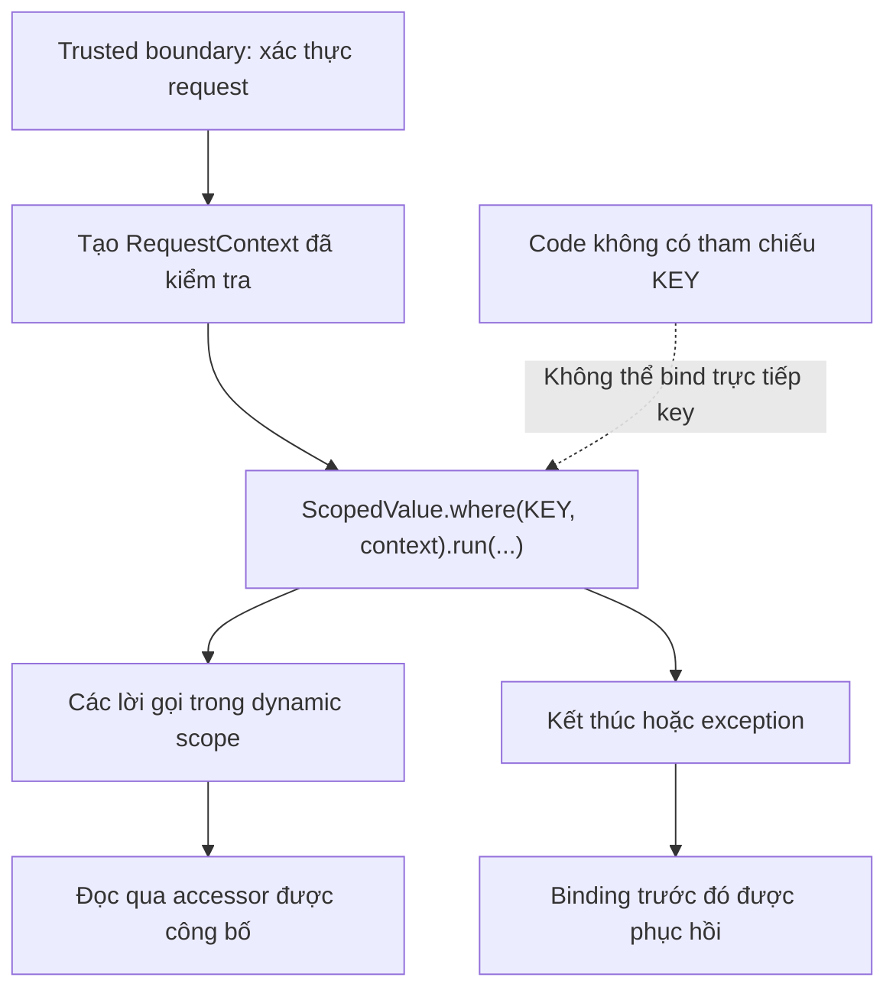
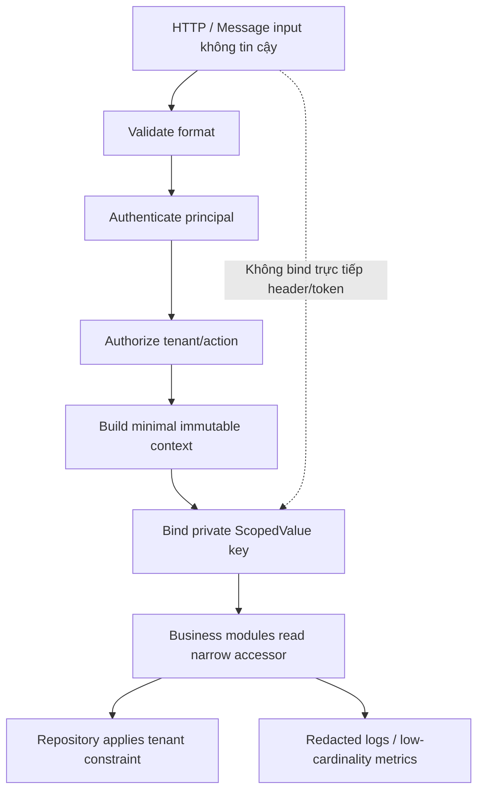

# Giới hạn dữ liệu nhạy cảm và quyền truy cập đối với khóa ngữ cảnh

**Scoped Values** là API chính thức từ Java 25 (JEP 506), cho phép một giá trị được gắn với **phạm vi thực thi động** (*dynamic scope*) để các phương thức được gọi bên trong phạm vi đó có thể đọc mà không phải truyền tham số qua mọi tầng. Cơ chế này hữu ích cho request context, tenant context, correlation metadata và một số thông tin chỉ đọc trong suốt một lần xử lý.

Tuy nhiên, một khóa `ScopedValue<T>` không phải là kho bí mật, hệ thống xác thực hay ranh giới sandbox. Quyền đọc/thiết lập binding phụ thuộc vào **ai nắm tham chiếu tới khóa**, cách ứng dụng công bố API truy cập và mã nào được thực thi trong scope. Giá trị được bind cũng có thể chứa dữ liệu nhạy cảm, được giữ lại ngoài dự kiến hoặc bị ghi vào log. Bài học này thuộc chương **Ứng dụng ScopedValue** của **Java 25** và tập trung vào đề bài **“Giới hạn dữ liệu nhạy cảm và quyền truy cập đối với khóa ngữ cảnh”**.

Phạm vi bài chỉ dùng API Scoped Values đã final trong Java 25; không dựa vào Structured Concurrency preview hay các cách truyền context đã lỗi thời. Mục tiêu là thiết kế khóa hẹp, giá trị tối thiểu, scope ngắn và kiểm soát truy cập rõ ràng.

## 1. Mô hình bảo mật: khóa là capability, binding là phạm vi

Một khóa Scoped Value được tạo bằng:

```java
private static final ScopedValue<RequestContext> CURRENT =
        ScopedValue.newInstance();
```

Đoạn code có hai thành phần khác nhau:

- **Key** (`CURRENT`) là đối tượng định danh binding. Code cần có tham chiếu đến key mới có thể gọi `get()`, `isBound()` hoặc tạo binding bằng `ScopedValue.where(key, value)`.
- **Value** (`RequestContext`) là dữ liệu gắn với key trong một dynamic scope. Các lời gọi nằm trong scope có thể đọc binding hiện hành.

Vì vậy, tham chiếu tới key hoạt động như một **capability trong thiết kế API của ứng dụng**: ai có key có khả năng đọc binding và tạo scope binding cho key đó. Khả năng này chịu các quy tắc truy cập Java thông thường (private, package-private, public, module boundaries), không phải một cơ chế sandbox để chống mã độc đã chạy trong cùng JVM.



**Không nên công khai key chỉ vì muốn tiện gọi.** Nếu một field `public static final ScopedValue<RequestContext>` được chia sẻ rộng, mọi code có thể truy cập field đó đều có thể tạo scope binding cho key và đọc binding trong scope của mình. Điều này có thể làm giả ngữ cảnh trong một nhánh gọi do code đó kiểm soát.

## 2. Tạo khóa riêng và chỉ công bố API đọc hẹp

Một thiết kế cơ bản giữ key ở trạng thái `private static final`, chỉ cung cấp phương thức đọc giá trị:

```java
package com.acme.context.api;

import java.util.Objects;
import java.util.regex.Pattern;

public record RequestContext(
        String tenantId,
        String subjectRef,
        String correlationId) {

    private static final Pattern SAFE_ID =
            Pattern.compile("[A-Za-z0-9_-]{8,64}");

    public RequestContext {
        tenantId = requireIdentifier(tenantId, "tenantId");
        subjectRef = requireIdentifier(subjectRef, "subjectRef");
        correlationId = requireIdentifier(correlationId, "correlationId");
    }

    private static String requireIdentifier(String value, String field) {
        Objects.requireNonNull(value, field);
        if (!SAFE_ID.matcher(value).matches()) {
            throw new IllegalArgumentException(field + " không hợp lệ");
        }
        return value;
    }
}
```

```java
package com.acme.context.internal;

import java.util.Optional;
import java.util.Objects;
import java.lang.ScopedValue;
import com.acme.context.api.RequestContext;

public final class RequestScope {
    private static final ScopedValue<RequestContext> CURRENT =
            ScopedValue.newInstance();

    private RequestScope() {}

    public static RequestContext current() {
        if (!CURRENT.isBound()) {
            throw new IllegalStateException("Không có RequestContext trong scope");
        }
        return CURRENT.get();
    }

    public static Optional<RequestContext> currentIfBound() {
        return CURRENT.isBound()
                ? Optional.of(CURRENT.get())
                : Optional.empty();
    }

    // Chỉ code trong package com.acme.context.internal có thể thiết lập binding.
    static void runWith(RequestContext context, Runnable action) {
        Objects.requireNonNull(context, "context");
        Objects.requireNonNull(action, "action");
        ScopedValue.where(CURRENT, context).run(action);
    }
}
```

Thiết kế trên thể hiện:

1. Key `CURRENT` không thể được truy cập trực tiếp từ package khác.
2. Code ở package nội bộ có thể gọi `RequestScope.current()`; module tiêu thụ chỉ thấy các accessor hẹp như `RequestContextAccess.tenantId()`.
3. Việc thiết lập binding được giới hạn qua `runWith(...)` có package access; trusted boundary trong cùng package `com.acme.context.internal` chịu trách nhiệm gọi.
4. `RequestContext` là record chứa `String` bất biến, tránh việc một module thay đổi field của context sau khi bind.

`RequestContext` là kiểu public ở ví dụ để các module có thể nhận kết quả từ accessor; **điều đó không làm key trở thành public**. Ở dự án JPMS, có thể export package API đọc context và giữ implementation/binder trong package hoặc module nội bộ. Nếu public API trả về object nhạy cảm, mọi caller được cấp quyền gọi API đó vẫn có thể đọc các trường của object; hãy thiết kế mức chi tiết phù hợp.

**Lưu ý về API mẫu:** `runWith` là package-private, nên boundary gọi nó phải thuộc package `com.acme.context.internal`. Dự án thật có thể đặt adapter xác thực trong cùng package hoặc thiết kế một facade hẹp được review; không đổi key thành public chỉ để giải quyết vấn đề wiring.

## 3. Phạm vi truy cập của key và các kiểu công bố API

| Cách khai báo key | Ai có thể tham chiếu key? | Rủi ro thiết kế |
| --- | --- | --- |
| `private static final` trong class | Chỉ code bên trong class (và các ngữ cảnh được Java cho phép) | Phù hợp khi muốn ẩn cả thao tác bind lẫn read |
| `static final` package-private | Code trong package | Package trở thành miền tin cậy; tránh đặt plugin không tin cậy cùng package |
| `public static final` | Mọi code đọc được class và field | Bất kỳ caller nào cũng có thể tạo binding riêng cho key |
| Trả key qua getter public | Mọi caller nhận được tham chiếu | Tương đương công bố capability, dù field gốc là private |
| Giữ key private, chỉ công bố accessor | Caller chỉ được đọc những dữ liệu accessor trả về | Phù hợp để giảm quyền, nhưng accessor vẫn cần kiểm soát dữ liệu |

**Tên key không phải bí mật.** Đổi tên biến, mã hóa tên hay đặt key trong class khó tìm không tạo ra bảo mật. Điều quan trọng là **không trao tham chiếu key cho code không cần quyền bind/đọc**, và không công bố accessor trả ra nhiều dữ liệu hơn nhu cầu.

Một accessor public như `RequestScope.current()` có nghĩa là mọi module có thể đọc toàn bộ `RequestContext` trong scope. Nếu module chỉ cần tenant, nên cân nhắc API trả đúng tenant identifier hoặc một interface chỉ cung cấp thao tác cần thiết. Đừng trao một object chứa nhiều dữ liệu nhạy cảm chỉ để lấy một trường.

### Phân biệt quyền đọc và quyền thiết lập binding

Scoped Value không có setter trên binding hiện hành; tuy vậy, code có key có thể **tạo một scope mới** bằng `ScopedValue.where(...)`. Trong scope mới đó, binding của key được thiết lập theo giá trị được cung cấp và khi thoát scope, binding bên ngoài được phục hồi.

Do đó:

- Chỉ công bố **getter/accessor** nếu caller cần đọc.
- Giữ API bind ở trusted boundary, không nhận một `RequestContext` tùy ý từ request bên ngoài.
- Không cho module nghiệp vụ tự bind tenant/subject tùy chọn để vượt qua kiểm tra ở lớp bảo mật.
- Không xem việc một key là `private` như bằng chứng rằng toàn bộ code trong JVM không thể truy cập dữ liệu.

## 4. Bind dữ liệu sau khi xác thực, không lấy quyền từ header

Một lỗi thiết kế phổ biến là đọc trực tiếp `X-Tenant-ID` từ HTTP header rồi bind thành tenant context. Header do client gửi **không chứng minh** người dùng có quyền truy cập tenant đó.

Luồng đúng nên là:

1. Xác thực danh tính từ session/token bằng security framework.
2. Kiểm tra principal được phép thao tác trong tenant mà request yêu cầu.
3. Lấy tenant và subject reference từ nguồn tin cậy (principal/authorization service).
4. Kiểm tra correlation ID theo format/độ dài; nếu không đáng tin, tạo ID nội bộ.
5. Tạo `RequestContext` tối thiểu.
6. Bind context chỉ quanh phần xử lý cần nó.

Ví dụ boundary trong package nội bộ `com.acme.context.internal`:

```java
package com.acme.context.internal;

import java.util.Objects;
import com.acme.context.api.RequestContext;

public final class AuthenticatedContextBoundary {
    private AuthenticatedContextBoundary() {}

    public static void runAs(
            VerifiedIdentity identity,
            String correlationId,
            Runnable action) {

        Objects.requireNonNull(identity, "identity");
        Objects.requireNonNull(action, "action");

        // VerifiedIdentity được tạo bởi lớp xác thực tin cậy,
        // không được dựng trực tiếp từ các header tùy ý.
        RequestContext context = new RequestContext(
                identity.authorizedTenantId(),
                identity.subjectReference(),
                correlationId);

        RequestScope.runWith(context, action);
    }
}
```

`VerifiedIdentity` là kiểu minh họa của security layer; dự án phải thay bằng principal đã xác thực và đã được kiểm tra quyền thực tế. Phương thức `runAs` chỉ nên được gọi từ boundary tin cậy. Nếu mọi module đều có thể gọi với một đối tượng do họ tự tạo, tên `runAs` không tạo ra bảo đảm bảo mật.

**ScopedValue không thay thế authorization.** Ở mỗi thao tác truy cập tài nguyên, ứng dụng vẫn phải kiểm tra người dùng được phép thực hiện hành động đó trên tenant/tài nguyên cụ thể. Context chỉ giúp cung cấp dữ liệu đã được xác thực cho các tầng xử lý; nó không tự chặn truy vấn sai tenant.

## 5. Chọn dữ liệu tối thiểu: không đưa bí mật vào context

Scoped Value chỉ nên chứa dữ liệu **cần thiết cho các method trong scope**. Cùng một dữ liệu có thể bị đọc bởi mọi code có quyền truy cập key và chạy trong dynamic scope.

| Dữ liệu | Có nên bind trực tiếp? | Khuyến nghị |
| --- | --- | --- |
| Tenant ID đã được xác thực | Có thể, nếu nhiều tầng cần tenant | Xác thực tại boundary, dùng identifier tối thiểu |
| Subject reference/pseudonymous ID | Có thể khi cần audit/authorization | Giới hạn người đọc, tránh lộ PII |
| Correlation ID đã chuẩn hóa | Thường phù hợp | Không dùng làm chứng thực hoặc metric label |
| Locale/time zone | Thường phù hợp | Giá trị nhỏ, không nhạy cảm |
| Danh sách quyền/role đầy đủ | Cân nhắc | Chỉ bind phần cần thiết; kiểm tra freshness và nguồn |
| Toàn bộ security principal | Thường không nên | Dùng một view/interface hẹp chỉ chứa dữ liệu cần thiết |
| HTTP request/session object | Không nên | Có vòng đời dài/khó đoán, giữ nhiều dữ liệu và tài nguyên |
| Password, raw bearer token, refresh token | Không | Không đưa credential vào context ngầm |
| Private key, secret key, key material mật mã | Không | Dùng key-management/cryptographic API chuyên dụng |
| JPA EntityManager, transaction/session object | Không nên | Dùng transaction/resource management phù hợp |
| Event payload lớn hoặc toàn bộ request body | Không | Truyền dữ liệu nghiệp vụ qua contract riêng có kiểm soát |

### Vì sao không nên lưu token hoặc secret?

- Mọi code được cấp quyền đọc key có thể lấy giá trị.
- Giá trị có thể xuất hiện trong heap dump, debugger, crash dump hoặc công cụ chẩn đoán.
- `toString()`, log exception hoặc debug statement có thể vô tình in object chứa dữ liệu.
- Một lambda/task có thể giữ reference lâu hơn scope dự kiến.
- Scoped Value **không xóa/zeroize bộ nhớ** khi scope kết thúc.

Nếu một tác vụ cần dùng credential, nên lấy credential đúng lúc từ secret manager/credential provider qua API có quyền hạn hẹp; không đặt raw secret vào một context chung chỉ vì muốn tránh truyền tham số.

## 6. Binding bất biến không có nghĩa object bên trong bất biến

Scoped Value cung cấp một **binding không thể thay đổi trong phạm vi đã bind**. Điều đó không tự làm object được tham chiếu trở thành immutable:

```java
import java.util.ArrayList;
import java.util.List;

final class MutableContext {
    final List<String> roles = new ArrayList<>();
}
```

Nếu bind một `MutableContext`, code giữ reference vẫn có thể gọi `roles.add(...)` trong scope. Những thread/task cùng nhìn thấy object đó có thể quan sát trạng thái bị thay đổi hoặc gặp race nếu dùng sai.

Ưu tiên record với thành phần bất biến:

```java
import java.util.Set;

public record AccessContext(
        String tenantId,
        String subjectRef,
        Set<String> authorities) {

    public AccessContext {
        authorities = Set.copyOf(authorities);
    }
}
```

`Set.copyOf(...)` tạo snapshot không sửa được của tập quyền đầu vào. Tuy nhiên, nếu kiểu phần tử mutable, chỉ sao chép collection là **shallow copy**; cần dùng phần tử bất biến hoặc tạo snapshot sâu phù hợp.

Không nên cập nhật role/tenant/permission giữa lúc request đang chạy bằng cách sửa object đã bind. Khi authorization thay đổi, tạo một context mới ở ranh giới xử lý mới hoặc truy vấn trạng thái quyền theo chính sách của ứng dụng.

## 7. Scope lồng nhau, phục hồi binding và exception cleanup

Một điểm bảo vệ quan trọng của Scoped Values là binding được giới hạn theo dynamic scope. Khi scope kết thúc bình thường hoặc bằng exception, binding trước đó được phục hồi tự động.

```java
import java.lang.ScopedValue;

public class NestedScopeDemo {
    private static final ScopedValue<String> TENANT =
            ScopedValue.newInstance();

    private static void printTenant(String phase) {
        System.out.println(phase + ": " + TENANT.get());
    }

    public static void main(String[] args) {
        ScopedValue.where(TENANT, "tenant-A").run(() -> {
            printTenant("outer");

            ScopedValue.where(TENANT, "tenant-B").run(() -> {
                printTenant("inner");
            });

            printTenant("outer-restored");
        });

        System.out.println("bound after scope: " + TENANT.isBound());
    }
}
```

Kết quả:

```text
outer: tenant-A
inner: tenant-B
outer-restored: tenant-A
bound after scope: false
```

Ví dụ cho thấy:

- Trong scope ngoài, `TENANT.get()` trả về `tenant-A`.
- Scope trong có thể bind lại **cùng key** thành `tenant-B`.
- Khi scope trong kết thúc, binding ngoài được phục hồi.
- Sau khi scope ngoài kết thúc, `isBound()` trả về `false` trên thread hiện tại.

### Exception không để binding rò qua scope tiếp theo

```java
private static final ScopedValue<String> REQUEST =
        ScopedValue.newInstance();

static void process(String id) {
    ScopedValue.where(REQUEST, id).run(() -> {
        if (id.equals("bad")) {
            throw new IllegalStateException("Lỗi xử lý");
        }
        System.out.println(REQUEST.get());
    });
}

public static void main(String[] args) {
    try {
        process("bad");
    } catch (IllegalStateException expected) {
        System.out.println("Đã bắt lỗi");
    }
    System.out.println(REQUEST.isBound()); // false ở scope ngoài
}
```

**Cleanup binding không phải zeroization.** Sau khi scope kết thúc, thread không còn binding hiện hành của key, nhưng object có thể vẫn được tham chiếu bởi biến cục bộ, task queue, log event, cache hoặc heap cho tới khi GC thu hồi. Không lưu context nhạy cảm vào một collection sống lâu rồi cho rằng dynamic scope đã xóa nó.

## 8. Kiểm soát accessor và phân quyền theo module

Trong ứng dụng nhiều module, không nên để mỗi module có một key public riêng chứa cùng một context đầy đủ. Làm vậy tạo nhiều nguồn sự thật, nhiều cách bind và khó xác định module nào chịu trách nhiệm xác thực.

Một thiết kế có thể tổ chức:

| Thành phần | Trách nhiệm | Quyền |
| --- | --- | --- |
| `security-boundary` | Xác thực principal, kiểm tra tenant access | Được tạo context và bind scope |
| `context-api` | Công bố kiểu context tối thiểu và accessor đọc | Được đọc các trường được công bố |
| `orders` | Dùng tenant/subject cần thiết cho xử lý đơn | Không tự tạo binding tenant tùy ý |
| `inventory` | Kiểm tra quyền truy cập kho theo tenant | Không đọc token hoặc principal đầy đủ |
| `notifications` | Dùng correlation metadata cần cho log/audit | Không nhận credential chỉ để gửi log |

Trong JPMS, có thể dùng:

```java
// module-info.java của module cung cấp API context
module com.acme.context {
    exports com.acme.context.api;
}
```

Phần implementation giữ key ở package không export:

```text
com.acme.context
├── module-info.java
└── com/acme/context
    ├── api
    │   ├── RequestContext.java
    │   └── RequestContextAccess.java
    └── internal
        ├── RequestScope.java
        └── AuthenticatedContextBoundary.java
```

Đây là **mô hình minh họa**, cần điều chỉnh package và module descriptor theo project. Nếu một module khác cần gọi binder, cung cấp một API boundary cụ thể và kiểm tra identity/authorization bên trong; không export package `internal` chỉ để tiện wiring.

Ví dụ facade đọc hẹp được đặt trong package export:

```java
package com.acme.context.api;

import com.acme.context.internal.RequestScope;

public final class RequestContextAccess {
    private RequestContextAccess() {}

    public static String tenantId() {
        return RequestScope.current().tenantId();
    }

    public static String correlationId() {
        return RequestScope.current().correlationId();
    }
}
```

Module khác chỉ thấy hai thao tác đọc đã công bố. Nó không thể lấy tham chiếu key hoặc gọi package-private binder. Không thêm accessor cho subject/authorities nếu module tiêu thụ không cần những dữ liệu đó.

Access modifier và module exports giảm bề mặt truy cập ở mức source/module. Chúng **không bảo vệ khỏi mã đã có quyền chạy trong cùng process**, agent được cấp quyền, debugger, heap dump hoặc lỗ hổng trong trusted code. Đối với plugin không tin cậy, cần isolation ở process/container/security boundary riêng.

## 9. Không biến context thành cơ chế phân quyền ngầm

Giả sử một service đọc tenant hiện hành:

```java
public Order findOrder(String orderId) {
    RequestContext context = RequestScope.current();
    return repository.findByTenantAndId(
            context.tenantId(), orderId)
        .orElseThrow(OrderNotFoundException::new);
}
```

Điều này giúp tenant filter nhất quán, nhưng vẫn cần xác minh:

1. `context.tenantId()` được tạo từ danh tính đã xác thực, không từ header tùy ý.
2. Principal được phép truy cập tenant đó theo policy hiện hành.
3. Repository thực sự áp dụng tenant condition ở mọi đường truy vấn; không có method “find by ID” bỏ qua tenant.
4. Các tác vụ nền, scheduled job và message consumer không tự động có request context của người dùng.
5. Những hành động quản trị/cross-tenant có policy riêng, audit riêng và quyền rõ ràng.

Không nên viết:

```java
// SAI VỀ THIẾT KẾ BẢO MẬT:
if (RequestScope.current().tenantId() != null) {
    // Cho phép mọi thao tác vì context đang tồn tại.
}
```

Việc context có mặt chỉ chứng minh có một binding trong scope; nó không chứng minh principal được phép thực hiện hành động. **Authentication, authorization và context propagation là ba vấn đề khác nhau.**

## 10. Scoped Values và xử lý bất đồng bộ

Scoped Value được thiết kế cho dữ liệu có **vòng đời gắn với luồng thực thi**. Nó không phải cơ chế truyền dữ liệu tự động qua mọi loại async boundary.

| Ranh giới | Có nên kỳ vọng binding hiện tại tự xuất hiện? | Cách thiết kế |
| --- | --- | --- |
| Lời gọi method đồng bộ bên trong scope | Có | Đọc qua accessor/key |
| Scope lồng nhau trên cùng thread | Có, theo binding hiện hành | Khi scope con kết thúc, scope ngoài được phục hồi |
| Child thread qua cơ chế hỗ trợ kế thừa context | Theo semantics của API tạo thread và phiên bản | Chỉ dùng khi đã kiểm chứng vòng đời/ownership |
| Thread pool executor có worker tồn tại từ trước | **Không nên kỳ vọng** | Đưa context tối thiểu vào task, bind lại quanh handler |
| `CompletableFuture` callback chạy trên executor khác | Không mặc định | Truyền task context rõ ràng và thiết lập scope trong callback |
| Message broker hoặc process khác | Không | Truyền metadata an toàn trong message/header, xác thực lại ở consumer |
| Replay sau restart | Không | Lưu event/correlation ID bền trong event/publication metadata |

Ví dụ cho executor: capture một context **đã được kiểm tra** vào task payload, rồi mở scope mới khi task thực thi:

```java
package com.acme.context.internal;

import java.util.concurrent.Executor;
import com.acme.context.api.RequestContext;

record NotificationTask(RequestContext context, String eventId) {}

final class NotificationDispatcher {
    private final Executor executor;

    NotificationDispatcher(Executor executor) {
        this.executor = executor;
    }

    void submit(NotificationTask task) {
        executor.execute(() ->
            RequestScope.runWith(task.context(), () -> {
                handle(task.eventId());
            })
        );
    }

    private void handle(String eventId) {
        RequestContext context = RequestScope.current();
        // Chỉ dùng các trường đã được boundary xác nhận.
        System.out.println(
                context.correlationId() + " -> " + eventId);
    }
}
```

Ví dụ giả định `NotificationDispatcher` thuộc package `com.acme.context.internal`, nên có thể gọi package-private `RequestScope.runWith`. Trong dự án thật, chỉ trusted adapter được phép tạo scope. `NotificationTask` chỉ nên chứa dữ liệu cần thiết; không đóng gói raw request, access token hoặc principal đầy đủ để chuyển vào queue.

Với framework có cơ chế context propagation riêng (ví dụ Micrometer Context Propagation), phải cấu hình và kiểm thử chính executor đang dùng. Cơ chế đó không tự thay thế việc truyền dữ liệu bền qua message broker hoặc restart.

### Structured concurrency không phải điều kiện để dùng ScopedValue

Scoped Values là API final trong Java 25. **Structured Concurrency trong JDK 25 vẫn là preview**, vì vậy không dùng API preview đó làm nền tảng bắt buộc của ví dụ production trong bài này. Khi ứng dụng chọn preview có chủ đích, phải bật/cố định toolchain và kiểm tra lại API theo JDK đích; còn thiết kế cơ bản của Scoped Values không cần dựa vào preview để bind/read trong một scope đồng bộ.

## 11. Logging, metrics và tracing không được làm lộ context

Một context an toàn có thể bị lộ ở lớp observability nếu ứng dụng ghi nguyên object hoặc gắn mọi ID vào metric tags.

| Kênh | Nên ghi | Tránh ghi |
| --- | --- | --- |
| Structured logs | Module, action, outcome, correlation ID đã chuẩn hóa nếu được phép | Password, bearer token, full principal, raw request |
| Trace attributes | Operation, module, event type; ID tra cứu có kiểm soát nếu policy cho phép | Secret, access token, toàn bộ context object |
| Metric tags | Module, event type, outcome có tập giá trị hữu hạn | User ID, order ID, token, correlation ID có cardinality cao |
| Error message | Error category và thông tin đã làm sạch | Serialize toàn bộ context hoặc exception có chứa secret |
| Audit record | Principal reference, tenant, action, decision và timestamp theo policy | Credential thô và dữ liệu không cần cho audit |

Ví dụ, thay vì:

```java
logger.info("request context={}", RequestScope.current());
```

dùng một allowlist field:

```java
RequestContext context = RequestScope.current();
logger.info("request accepted: tenantRef={}, correlationId={}",
        context.tenantId(), context.correlationId());
```

Chỉ ghi các trường này khi chính sách log cho phép và chúng đã được giảm thiểu/pseudonymize phù hợp. Tenant ID cũng có thể là dữ liệu nhạy cảm hoặc tạo cardinality cao ở hệ thống lớn. Với metrics, ưu tiên **nhóm tenant tier/region** có số giá trị nhỏ thay vì tenant ID riêng lẻ.

Nếu sử dụng MDC để bổ sung correlation ID vào log, chỉ đưa vào trường đã validate, đặt/clear trong scope tương ứng và kiểm tra không rò sang task kế tiếp của thread pool. Scoped Value và MDC là hai cơ chế khác nhau; binding Scoped Value không tự động đồng nghĩa MDC được cập nhật.

## 12. Các rủi ro bảo mật và biện pháp kiểm soát

| Rủi ro | Ví dụ | Biện pháp |
| --- | --- | --- |
| Caller giả mạo binding | Code tùy ý tạo scope tenant B rồi gọi service | Ẩn key, giữ binder ở trusted boundary, kiểm tra authorization |
| Lộ dữ liệu do accessor quá rộng | Mọi module đọc được toàn principal | Trả view/interface tối thiểu, giới hạn module/package |
| Credential bị giữ quá lâu | Bind raw JWT hoặc private key trong request context | Không bind secret; lấy từ secret manager khi cần |
| Context mutable | Module A sửa authorities mà module B đang dùng | Immutable record, defensive copy, không mutate sau bind |
| Rò dữ liệu qua async | Task closure giữ toàn context hoặc MDC | Truyền metadata tối thiểu, bind/cleanup tại worker |
| Cross-tenant access | Tin tenant ID từ header | Xác thực principal, authorize tenant và áp dụng tenant filter tại repository |
| Log/trace leakage | In cả context/exception/payload | Allowlist field, redaction, access control, retention |
| Cardinality bùng nổ | Gắn user/correlation ID vào metric | Dùng tag hữu hạn; định danh chi tiết ở log/trace có kiểm soát |
| Giả định scope xóa secret | Nghĩ kết thúc run là bộ nhớ đã zeroize | Không lưu secret; quản lý lifecycle bằng API mật mã chuyên dụng |
| Mã cùng JVM đọc dữ liệu | Plugin được cấp quyền gọi accessor | Không dùng ScopedValue làm sandbox; cô lập process nếu cần |

### Mô hình threat boundary tối thiểu



Nếu bước xác thực hoặc authorize thất bại, không mở scope chứa identity/tenant như thể request đã được chấp nhận. Ghi audit rejection theo schema an toàn và không dùng correlation ID từ client như bằng chứng danh tính.

## 13. Kiểm thử quyền truy cập và lifecycle của context

Một test chỉ xác nhận `CURRENT.get()` trả đúng chuỗi là chưa đủ. Cần kiểm tra **ai được bind, ai được đọc, dữ liệu nào được lưu và khi nào binding kết thúc**.

| ID | Ca kiểm thử | Kết quả mong đợi |
| --- | --- | --- |
| S01 | Gọi accessor khi chưa bind | Trả trạng thái unbound hoặc ném exception đã định nghĩa; không tạo context giả |
| S02 | Bind context hợp lệ | Code trong scope đọc đúng các trường được cấp |
| S03 | Scope lồng cùng key | Giá trị trong scope con thay thế tạm thời; scope ngoài phục hồi |
| S04 | Scope kết thúc bằng exception | Binding được phục hồi; không còn giá trị ở scope ngoài |
| S05 | Caller gửi tenant header giả | Không thể thay tenant được suy ra từ principal đã xác thực |
| S06 | Subject không có quyền trên tenant | Authorization từ chối dù context có tenant ID |
| S07 | Module không có quyền bind | Không truy cập trực tiếp private/package-private key hoặc binder |
| S08 | Context chứa collection đầu vào mutable | Snapshot không bị thay đổi từ collection gốc sau khi bind |
| S09 | Task pool xử lý hai request liên tiếp | Context của task trước không rò sang task sau |
| S10 | Message/replay sau restart | Metadata bền được xác thực và bind lại; không trông chờ scope cũ |
| S11 | Log/trace/error output | Không có token, password, secret hay full context ngoài allowlist |
| S12 | Metrics export | Không có subject/event/correlation ID trong tag có cardinality cao |
| S13 | Heap dump/debug review theo quy trình được phép | Không thấy credential thô được lưu trong context |
| S14 | Context hết hạn hoặc quyền bị thu hồi | Tác vụ mới kiểm tra lại policy; không dùng snapshot quyền cũ vô hạn |

### Ví dụ test cho nested scope và cleanup

```java
import static org.junit.jupiter.api.Assertions.*;

import org.junit.jupiter.api.Test;

class RequestScopeTest {
    @Test
    void nestedBindingRestoresOuterValue() {
        var outer = new RequestContext("tenant_A", "subject_1", "request_0001");
        var inner = new RequestContext("tenant_B", "subject_2", "request_0002");

        RequestScope.runWith(outer, () -> {
            assertEquals("tenant_A", RequestScope.current().tenantId());

            RequestScope.runWith(inner, () ->
                    assertEquals("tenant_B",
                            RequestScope.current().tenantId()));

            assertEquals("tenant_A", RequestScope.current().tenantId());
        });

        assertTrue(RequestScope.currentIfBound().isEmpty());
    }

    @Test
    void exceptionDoesNotLeakBinding() {
        var context = new RequestContext(
                "tenant_A", "subject_1", "request_0001");

        assertThrows(IllegalStateException.class, () ->
                RequestScope.runWith(context, () -> {
                    assertEquals(context, RequestScope.current());
                    throw new IllegalStateException("test");
                }));

        assertTrue(RequestScope.currentIfBound().isEmpty());
    }
}
```

Test dùng `RequestScope` ở mục 2 và package test có quyền gọi `runWith`. Nếu binder được giữ trong package nội bộ riêng, hãy kiểm tra qua **public trusted boundary** hoặc đặt test trong package được phép theo cấu trúc project; đừng mở key công khai chỉ để test dễ hơn.

## 14. Checklist thiết kế trước khi đưa vào production

Trước khi bind một dữ liệu vào Scoped Value, hãy trả lời:

**Về key và API**

- Key được tạo một lần ở phạm vi nào? Có thực sự cần `static final` không?
- Ai giữ tham chiếu key? Có thể ẩn key và chỉ công bố accessor không?
- API bind có giới hạn ở trusted boundary không, hay mọi module đều có thể đặt context tùy ý?
- Module nào được đọc từng trường? Có thể trả một view hẹp hơn không?

**Về dữ liệu**

- Giá trị có thực sự cần cho toàn dynamic scope không?
- Có chứa password, token, key material, full principal, request/session hoặc object mutable không?
- Có thể dùng subject reference pseudonymous thay PII không?
- Dữ liệu có bị log, serialize, đưa vào trace/metric tags hoặc lưu cache không?
- Khi scope kết thúc, có reference nào vẫn giữ object lại không?

**Về authorization và async**

- Context được tạo từ principal đã xác thực và tenant đã được authorize chưa?
- Repository/service có enforce quyền ở nơi thực thi không?
- Task executor, callback hoặc message consumer có nhận metadata rõ ràng và mở scope mới không?
- Retry/replay có event ID/correlation ID bền mà không cần giữ trace context cũ không?
- Chính sách quyền có thể thay đổi giữa các attempt không, và khi đó có kiểm tra lại không?

**Về vận hành**

- Log chỉ dùng allowlist field và có cleanup MDC không?
- Metrics tags có tập giá trị hữu hạn không?
- Có test nested scope, exception cleanup, tenant spoofing và context leak không?
- Quy trình heap dump, debugger, incident access có giới hạn quyền và retention không?

Nếu chưa trả lời được câu hỏi “ai có quyền bind giá trị này và tại sao?”, chưa nên đưa key vào API công khai.

## 15. Bài thực hành tổng hợp

### Bối cảnh

Một ứng dụng Java 25 có module `orders`, `inventory` và `notifications`. Mỗi HTTP request thuộc một tenant. Dịch vụ cần tenant ID để lọc đơn hàng, subject reference để audit và correlation ID để nối log. Đội phát triển đang định đưa cả JWT, principal và request object vào một `ScopedValue` public để các module dùng thuận tiện.

### Nhiệm vụ

1. **Phân loại dữ liệu:** tách tenant ID, subject reference, correlation ID, JWT, refresh token, request object và quyền truy cập thành nhóm “được phép cân nhắc”, “không bind” hoặc “chỉ lưu qua provider chuyên dụng”.
2. **Thiết kế key:** tạo private static final `ScopedValue<RequestContext>`, giữ key trong package nội bộ và công bố accessor chỉ đọc.
3. **Thiết kế boundary:** lấy tenant/subject từ principal đã xác thực, kiểm tra user có quyền vào tenant, kiểm tra correlation ID rồi tạo record immutable.
4. **Bind và đọc:** mở scope trong trusted boundary, đọc context trong service `orders`/`inventory`; bảo đảm code không thể tự chọn tenant qua request header.
5. **Kiểm thử nested scope:** bind tenant A, mở scope tenant B, kết thúc scope B và chứng minh tenant A được phục hồi.
6. **Kiểm thử lỗi:** ném exception giữa xử lý và xác minh không còn binding ở scope ngoài.
7. **Kiểm thử async:** chuyển một task qua thread pool, truyền context tối thiểu vào task và bind lại trong worker; xác nhận task sau không nhìn thấy ID của task trước.
8. **Kiểm thử retry/replay:** lưu event ID/correlation ID trong metadata được phép; sau mô phỏng restart, xác thực lại consumer và mở scope mới.
9. **Rà soát observability:** log allowlist, metric low-cardinality, trace không chứa token hoặc object context đầy đủ.
10. **Viết threat model:** nêu rõ trusted code, untrusted input, capability key, authorization checks, data retention và giới hạn của cùng-JVM access.

### Mẫu bàn giao

| Sản phẩm | Bằng chứng cần nộp | Trạng thái |
| --- | --- | --- |
| Context schema | Record immutable, trường tối thiểu, validation | Chưa thực hiện |
| Key/accessor design | Key private, binder giới hạn, accessor hẹp | Chưa thực hiện |
| Authentication boundary | Tenant/subject từ principal tin cậy và đã authorize | Chưa thực hiện |
| Lifecycle tests | Nested scope, exception cleanup, unbound access | Chưa thực hiện |
| Async/replay tests | Context truyền rõ, scope mới, event ID bền | Chưa thực hiện |
| Security review | Không credential/PII dư, không log full context | Chưa thực hiện |
| Metrics/log review | Không ID động trong tags, MDC được cleanup | Chưa thực hiện |
| Threat model | Ai bind/đọc, quyền nào, giới hạn nào | Chưa thực hiện |

**Tiêu chí hoàn thành:** người học giải thích được tại sao key là một capability, chứng minh chỉ trusted boundary có quyền thiết lập binding, chứng minh mọi module chỉ nhận đúng dữ liệu cần thiết, và kiểm tra tenant authorization ở nơi truy cập tài nguyên. Sau khi scope kết thúc hoặc exception xảy ra, binding phải được phục hồi; khi chuyển qua executor/replay, context phải được truyền bằng dữ liệu tối thiểu và thiết lập scope mới. Không có token/secret trong context chung, logs, traces hoặc metric tags.

## Tài liệu tham khảo

- [JEP 506 — Scoped Values](https://openjdk.org/jeps/506): API chính thức trong Java 25, mục tiêu và phạm vi dynamic binding.
- [Java SE 25 API — ScopedValue](https://docs.oracle.com/en/java/javase/25/docs/api/java.base/java/lang/ScopedValue.html): `newInstance`, `where`, `get`, `isBound` và `Carrier`.
- [Java 25 Language and API Documentation](https://docs.oracle.com/en/java/javase/25/docs/api/): đối chiếu API đúng JDK đích.
- [Java Platform Module System — JEP 261](https://openjdk.org/jeps/261): module encapsulation và ranh giới truy cập source/API.
- [OWASP Logging Cheat Sheet](https://cheatsheetseries.owasp.org/cheatsheets/Logging_Cheat_Sheet.html): dữ liệu không nên ghi log, kiểm soát nội dung và bảo vệ log.
- [OWASP Secrets Management Cheat Sheet](https://cheatsheetseries.owasp.org/cheatsheets/Secrets_Management_Cheat_Sheet.html): quản lý vòng đời, quyền truy cập và lưu trữ secret.

**Kết luận:** Scoped Values giúp truyền dữ liệu theo một phạm vi thực thi có giới hạn, nhưng mức an toàn phụ thuộc vào **quyền nắm key, API bind/read, nguồn tạo context và dữ liệu được lưu**. Giữ key riêng, công bố accessor tối thiểu, tạo context từ danh tính đã xác thực, ưu tiên giá trị immutable và tránh credential/PII không cần thiết. Khi scope kết thúc, binding được phục hồi nhưng bộ nhớ không được zeroize; khi đi qua executor hoặc restart, phải truyền metadata cần thiết và mở scope mới. Cách thiết kế này giữ được sự tiện lợi của Java 25 mà không biến ScopedValue thành một kênh chia sẻ bí mật hoặc cơ chế phân quyền ngầm.
