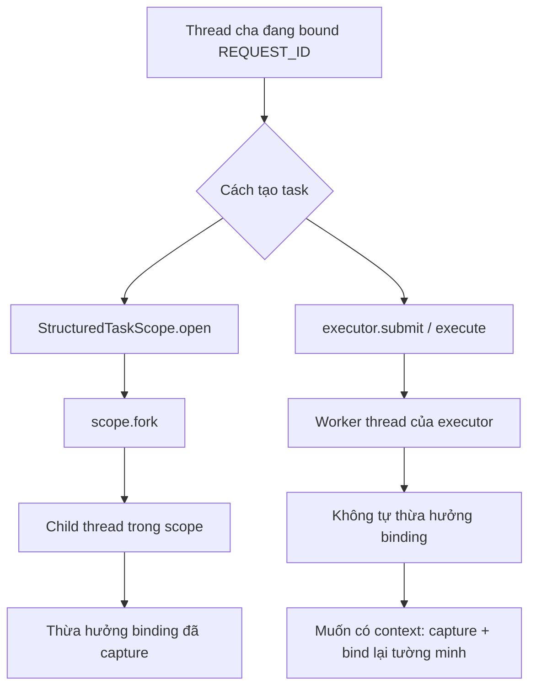
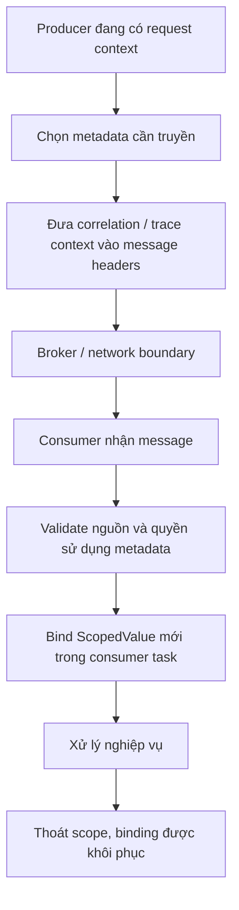

# Phân biệt kế thừa ràng buộc có cấu trúc với thực thi qua executor bất kỳ

> **Chương:** Ứng dụng ScopedValue  
> **Phạm vi:** `JAVA_VERSION_JAVA25` — sử dụng các khả năng Java 25 còn phù hợp trong phát triển Java hiện đại, đặc biệt `ScopedValue` để truyền ngữ cảnh trong một phạm vi thực thi, kết hợp virtual threads, tác vụ đồng thời, observability và thiết kế ứng dụng nhiều tầng.  
> **Mục tiêu:** Phân biệt **kế thừa binding qua `StructuredTaskScope.fork`** với việc gửi task qua một `Executor`/`ExecutorService` bất kỳ; biết khi nào context được tự kế thừa, khi nào phải capture và bind lại tường minh, cũng như cách tránh rò ngữ cảnh trong thread pool.
>
> **Mốc thời sự:** `ScopedValue` đã final trong JDK 25 (JEP 506). `StructuredTaskScope` vẫn là preview trong JDK 25 (lần preview thứ năm) và vẫn là preview ở JDK 27 (lần preview thứ bảy). Bài dùng cú pháp JDK 25 để minh họa chính xác phiên bản Java 25; khi chạy trên JDK 27 phải đối chiếu API preview của chính JDK 27.

Một request có thể đi qua nhiều tầng: HTTP controller, service, repository, adapter. `ScopedValue` cho phép các method sâu hơn đọc `requestId` hoặc `tenantId` mà không phải truyền tham số qua mọi method. Với lời gọi đồng bộ trên cùng thread, binding có hiệu lực trong dynamic scope đã mở.

Khó khăn xuất hiện khi một method gửi công việc sang thread khác. Một `StructuredTaskScope` được thiết kế để quản lý nhóm subtasks có vòng đời nằm trong scope của tác vụ cha; các binding hiện hành được **capture khi mở scope** và **kế thừa bởi thread được tạo qua `fork`**. Một `ExecutorService` thông thường có thể chạy task trên thread pool đã tồn tại, ngoài cây tác vụ đó; nó **không tự kế thừa ScopedValue binding** chỉ vì lệnh submit được gọi bên trong scope.

## 1. Nắm ba quy tắc trước khi viết code

| Quy tắc | Kết quả | Vì sao |
|---|---|---|
| `ScopedValue` binding có tính **per-thread** | `KEY.get()` đọc binding của thread đang chạy | Binding không phải biến toàn cục cho mọi thread |
| `StructuredTaskScope.open()` rồi `scope.fork(...)` | Subtask được tạo bởi scope **kế thừa binding được capture khi scope mở** | Scope tạo và quản lý quan hệ parent/child, đồng thời đợi subtasks kết thúc |
| `Executor.execute/submit(...)` bất kỳ | Không có bảo đảm binding được truyền sang worker | Executor không cam kết task là child thread của scope hiện tại |

Hãy phân biệt hai tình huống:



**Điều kiện quan trọng:** với structured inheritance, scope phải được mở **khi binding cần truyền đang có hiệu lực**. Nếu scope được mở khi chưa bound rồi sau đó mới bind key trước khi fork, runtime có thể phát hiện structure violation; không nên dựa vào thứ tự ngẫu nhiên để mong child nhận giá trị mới.

## 2. Binding được kế thừa trong StructuredTaskScope như thế nào?

`StructuredTaskScope` mô hình hóa một tác vụ cha chia thành các công việc con có liên quan. Các thread do `scope.fork` tạo ra nằm trong phạm vi của scope; `join` đợi kết quả theo chính sách của scope và `close` bảo đảm các thread trong scope đã kết thúc trước khi luồng cha đi tiếp qua ranh giới đóng scope.

Khi `StructuredTaskScope` được mở, nó capture các ScopedValue binding hiện hành. Những binding này được kế thừa bởi các thread thực thi subtasks. Điều này giải quyết một vấn đề về lifetime: outer `ScopedValue.where(...).run/call` không thể kết thúc bình thường trong khi child task còn sử dụng binding đã thừa hưởng, vì scope phải đợi các task con hoàn tất khi đóng.

```mermaid
sequenceDiagram
    participant P as Parent thread
    participant Scope as StructuredTaskScope
    participant C1 as Child thread 1
    participant C2 as Child thread 2
    P->>P: ScopedValue.where(REQUEST, ctx)
    P->>Scope: open() captures current bindings
    P->>Scope: fork(task 1)
    Scope->>C1: create child + inherit binding
    P->>Scope: fork(task 2)
    Scope->>C2: create child + inherit binding
    C1->>C1: REQUEST.get() = ctx
    C2->>C2: REQUEST.get() = ctx
    P->>Scope: join()
    C1-->>Scope: complete
    C2-->>Scope: complete
    Scope-->>P: joined; close waits for children
    P->>P: leave outer scope; binding restored
```

Ví dụ dưới đây thể hiện API `StructuredTaskScope` ở **JDK 25**. `ScopedValue` là final, nhưng `StructuredTaskScope` là preview nên **toàn bộ file sử dụng StructuredTaskScope phải bật preview** khi compile và run.

```java
import java.util.List;
import java.util.concurrent.StructuredTaskScope;

public class StructuredInheritanceDemo {

    private static final ScopedValue<String> REQUEST_ID =
            ScopedValue.newInstance();

    private static String loadProfile() {
        return "profile for " + REQUEST_ID.get();
    }

    private static String loadOrders() {
        return "orders for " + REQUEST_ID.get();
    }

    static List<String> loadDashboard(String requestId)
            throws Exception {

        return ScopedValue.where(REQUEST_ID, requestId).call(() -> {
            // Scope mở khi REQUEST_ID đã bound.
            try (var scope = StructuredTaskScope.open()) {
                var profile = scope.fork(
                        StructuredInheritanceDemo::loadProfile);
                var orders = scope.fork(
                        StructuredInheritanceDemo::loadOrders);

                // Chờ subtasks theo chính sách mặc định.
                scope.join();

                return List.of(profile.get(), orders.get());
            }
        });
    }

    public static void main(String[] args) throws Exception {
        System.out.println(loadDashboard("req-2501"));
    }
}
```

Biên dịch và chạy bằng JDK 25:

```bash
javac --release 25 --enable-preview StructuredInheritanceDemo.java
java --enable-preview StructuredInheritanceDemo
```

Kết quả minh họa:

```text
[profile for req-2501, orders for req-2501]
```

Cả hai method chạy trong child threads đều đọc cùng `REQUEST_ID` dù không nhận request ID qua tham số. Các subtasks được scope quản lý; outer `call` chỉ kết thúc sau khi try-with-resources đóng scope và các child đã hoàn tất.

### Vì sao mở scope bên trong binding?

Đúng thứ tự:

```java
ScopedValue.where(REQUEST_ID, "req-2501").run(() -> {
    try (var scope = StructuredTaskScope.open()) {
        scope.fork(() -> loadProfile());
        scope.join();
    }
});
```

Không nên đảo thứ tự:

```java
try (var scope = StructuredTaskScope.open()) {
    ScopedValue.where(REQUEST_ID, "req-2501").run(() -> {
        scope.fork(() -> loadProfile());
    });
    scope.join();
}
```

Trong trường hợp thứ hai, scope capture binding **trước khi** `REQUEST_ID` được bind. Khi `fork` thấy tập binding khác với lúc mở scope, cơ chế kiểm tra cấu trúc có thể ném `StructureViolationException` (preview API). Đây là bảo vệ lifetime, không phải lỗi ngẫu nhiên cần né bằng retry.

### Không phải mọi thread tạo trong block đều được kế thừa

Ngay cả khi đang ở bên trong `StructuredTaskScope`, chỉ thread được tạo thông qua **`scope.fork(...)`** thuộc quan hệ task scope đó mới nhận binding theo cơ chế structured inheritance. Một lệnh `new Thread(...)` hoặc `executor.submit(...)` đặt cạnh `scope.fork(...)` không tự biến thành child của scope.

## 3. StructuredTaskScope trong Java 25 vẫn là preview

Cần tách trạng thái của hai tính năng:

| Thành phần | JDK 25 | JDK 27 tại 27/11/2026 |
|---|---|---|
| `ScopedValue` / JEP 506 | **Final** | Vẫn là API chính thức |
| `StructuredTaskScope` | **Preview lần thứ năm** (JEP 505) | **Preview lần thứ bảy** (JEP 533) |
| `scope.fork` inheritance | Có trong StructuredTaskScope preview | Vẫn được mô tả trong API preview |
| Compile/run có `StructuredTaskScope` | Cần `--enable-preview` với release 25 | Cần `--enable-preview` với release 27; API có thể đã đổi |
| Chọn cho thư viện/ứng dụng cần API ổn định nhiều năm | ScopedValue có thể dùng độc lập | Không coi StructuredTaskScope là final chỉ vì JDK mới hơn |

**Lệnh dành cho JDK 25** trong bài là ví dụ khóa phiên bản:

```bash
javac --release 25 --enable-preview StructuredInheritanceDemo.java
java --enable-preview StructuredInheritanceDemo
```

Nếu dự án chuyển sang JDK 27, phải dùng compiler/runtime của JDK 27, bật preview theo release 27 và cập nhật source theo Javadoc/JEP hiện hành:

```bash
javac --release 27 --enable-preview StructuredInheritanceDemo.java
java --enable-preview StructuredInheritanceDemo
```

Đây chỉ là **cách bật preview flag**, không bảo đảm source API của JDK 25 vẫn compile không sửa trên JDK 27. Trong JDK 27, `StructuredTaskScope` đã tiếp tục thay đổi generic/result/exception và joiner APIs. Hãy đọc đúng Javadoc JDK 27 trước khi chuyển mã.

**Không cần preview flag cho ScopedValue đơn lẻ.** Nếu một class chỉ dùng `ScopedValue.where(...).run/call`, `get`, `isBound`, `orElse` mà không tham chiếu preview API, có thể compile/run như API Java 25 thông thường.

## 4. Vì sao ExecutorService không tự kế thừa?

`Executor` chỉ nhận một `Runnable`/`Callable` và quyết định **ở đâu, khi nào** thực thi. Nó không hứa rằng task chạy trên thread con vừa được tạo bởi thread đang submit. `ExecutorService` thường tái sử dụng worker threads; những worker đó có thể được tạo từ trước, sau đó phục vụ hàng nghìn task từ các request khác nhau.

Xem tình huống:

```java
private static final ScopedValue<String> REQUEST_ID =
        ScopedValue.newInstance();

static boolean workerHasRequestContext(ExecutorService pool)
        throws Exception {

    return ScopedValue.where(REQUEST_ID, "req-2502").call(() -> {
        Future<Boolean> result =
                pool.submit(REQUEST_ID::isBound);

        return result.get();
    });
}
```

Khi `pool.submit` chạy, thread hiện tại đang bound `REQUEST_ID`. Nhưng `pool` có thể đưa task lên một worker thread khác. Worker đó không nằm trong structured task scope, nên kết quả thông thường là:

```text
false
```

Nếu thay method reference bằng `REQUEST_ID.get()`, worker không có binding sẽ nhận `NoSuchElementException`. Đây là cách hoạt động đúng của per-thread binding.

**Một lỗi rất phổ biến:**

```java
ScopedValue.where(REQUEST_ID, "req-2502").run(() -> {
    executor.submit(() -> handle(REQUEST_ID.get()));
});
```

`run` chỉ bao quanh việc gọi `submit`. Sau khi `submit` trả về, outer binding có thể kết thúc trong khi task vẫn đang xếp hàng. Nó không phải cơ chế capture context cho worker.

### Executor tạo virtual thread cũng không tự trở thành structured scope

`Executors.newVirtualThreadPerTaskExecutor()` tạo virtual thread cho từng task, nhưng đây vẫn là executor API. Task không được fork qua `StructuredTaskScope` nên không có cam kết thừa hưởng ScopedValue binding của thread submit. **Virtual thread** là loại thread; **structured concurrency** là mô hình quản lý quan hệ parent/child và lifetime. Hai khái niệm liên quan nhưng không đồng nghĩa.

### Với CompletableFuture cũng cần cẩn trọng

`CompletableFuture.supplyAsync(...)` mặc định thường dùng common pool hoặc executor được truyền vào. API không cam kết capture ScopedValue context từ thread submit. Các continuation không async có thể chạy trên thread hoàn tất stage trước đó; vì vậy có trường hợp vô tình đọc được binding nếu vẫn ở cùng thread, nhưng không thể xem đó là hợp đồng propagation. Với `thenApplyAsync`/`supplyAsync`, hãy chủ động dùng executor có wrapper capture/rebind context nếu cần.

## 5. Cách truyền context tường minh qua executor

Khi cần gửi task qua một executor bất kỳ, cách rõ ràng là:

1. **Capture** immutable context trên thread đang bound, tại thời điểm submit.
2. Gửi task wrapper vào executor.
3. Trên worker thread, tạo binding mới bằng `ScopedValue.where(KEY, snapshot).run/call`.
4. Khi task kết thúc, scope trên worker tự khôi phục binding trước đó, kể cả khi task ném exception.

Không cần và không nên cố ép worker thread trở thành child của scope cha. Đây là một **dynamic scope độc lập trên worker**, có dữ liệu được truyền tường minh.

### 5.1. Tạo một context record và API wrapper

File `RequestContext.java`:

```java
import java.util.Objects;
import java.util.concurrent.Executor;

public final class RequestContext {

    private static final ScopedValue<Context> CURRENT =
            ScopedValue.newInstance();

    private RequestContext() {
    }

    public record Context(String requestId, String tenantId) {
        public Context {
            Objects.requireNonNull(requestId, "requestId");
            Objects.requireNonNull(tenantId, "tenantId");

            if (requestId.isBlank() || tenantId.isBlank()) {
                throw new IllegalArgumentException(
                        "requestId and tenantId must not be blank");
            }
        }
    }

    // Chỉ gọi ở trusted entry point sau khi xác thực context.
    public static void runWith(Context context, Runnable operation) {
        Objects.requireNonNull(context, "context");
        Objects.requireNonNull(operation, "operation");
        ScopedValue.where(CURRENT, context).run(operation);
    }

    public static String requestId() {
        return CURRENT.orElseThrow(
                () -> new IllegalStateException("Request context missing")
        ).requestId();
    }

    public static String tenantId() {
        return CURRENT.orElseThrow(
                () -> new IllegalStateException("Request context missing")
        ).tenantId();
    }

    public static boolean isBound() {
        return CURRENT.isBound();
    }

    // Gọi phương thức này khi thread hiện tại đang có context.
    public static Executor propagating(Executor delegate) {
        Objects.requireNonNull(delegate, "delegate");

        return command -> {
            Context snapshot = CURRENT.orElseThrow(
                    () -> new IllegalStateException(
                            "Cannot submit without request context")
            );

            delegate.execute(() ->
                    ScopedValue.where(CURRENT, snapshot).run(command)
            );
        };
    }
}
```

`CURRENT` là private; caller chỉ được bind qua `runWith` và đọc qua accessor. Trong ứng dụng thật, `runWith` phải được gọi sau khi request/tenant identity đã xác thực. Không lấy header chưa tin cậy rồi bind trực tiếp và coi ScopedValue là cơ chế authorization.

Record `Context` chứa hai `String` bất biến, phù hợp với việc chia sẻ qua thread. Nếu context chứa `Map`/`List` hoặc object mutable, hãy tạo defensive copy/immutable snapshot hoặc bảo đảm đồng bộ hóa trước khi chia sẻ.

### 5.2. Dùng wrapper với CompletableFuture

File `ExecutorPropagationDemo.java`:

```java
import java.util.concurrent.CompletableFuture;
import java.util.concurrent.Executor;
import java.util.concurrent.Executors;

public class ExecutorPropagationDemo {

    public static void main(String[] args) {
        var context = new RequestContext.Context(
                "req-2503", "tenant-a");

        try (var pool = Executors.newFixedThreadPool(2)) {
            RequestContext.runWith(context, () -> {
                Executor requestExecutor =
                        RequestContext.propagating(pool);

                var tenant = CompletableFuture.supplyAsync(
                        RequestContext::tenantId,
                        requestExecutor
                );

                var requestId = CompletableFuture.supplyAsync(
                        RequestContext::requestId,
                        requestExecutor
                );

                System.out.println(tenant.join());
                System.out.println(requestId.join());
            });
        }
    }
}
```

Kết quả:

```text
tenant-a
req-2503
```

`RequestContext.propagating(pool)` tạo một Executor wrapper. Mỗi lần `execute` được gọi, wrapper capture context hiện hành trên thread submit và bind lại trong task chạy trên pool. Khi task xong, `run` tự khôi phục binding của worker; task tiếp theo không nhận context của request trước.

`ExecutorService` được đóng bằng try-with-resources (khả dụng từ Java 19). Trong ứng dụng production, chọn chính sách shutdown/timeout phù hợp với lifecycle ứng dụng thay vì tạo một thread pool mới cho mỗi request.

### 5.3. Nếu dùng Callable/Future

Cùng nguyên tắc có thể áp dụng với `Callable` trả kết quả:

```java
static <T> Future<T> submitWithContext(
        ExecutorService delegate,
        Callable<T> task) {

    Context snapshot = RequestContext.currentSnapshot();

    return delegate.submit(() ->
            ScopedValue.where(CURRENT, snapshot).call(task::call)
    );
}
```

Đây là **mảnh minh họa API**; trong thiết kế thực, cung cấp `currentSnapshot()` và binder trong cùng lớp sở hữu key, hoặc một wrapper có quyền truy cập key. Không công khai key chỉ để code ngoài tự bind.

## 6. So sánh các mô hình thực thi

| Cách chạy task | Có tự kế thừa ScopedValue? | Cách có context |
|---|---|---|
| Gọi method đồng bộ trong cùng thread | **Có**, vì cùng thread đang trong dynamic scope | Không cần wrapper |
| `StructuredTaskScope.fork` | **Có**, binding được capture khi scope mở và thừa hưởng vào subtask | Mở scope bên trong binding |
| `new Thread(...)` | Không | Capture value rồi bind trong thread mới |
| `Thread.startVirtualThread(...)` | Không tự động | Capture value rồi bind trong virtual thread |
| `ExecutorService.submit` | Không tự động | Wrapper capture/rebind cho từng task |
| `newVirtualThreadPerTaskExecutor` | Không tự động chỉ vì dùng virtual thread | Wrapper hoặc cơ chế propagation riêng |
| `CompletableFuture.supplyAsync` | Không có bảo đảm | Truyền executor wrapper vào overload async |
| `ForkJoinPool.commonPool()` | Không tự động | Tránh dùng common pool khi task cần context mà không có wrapper |
| Message broker / HTTP / RPC sang process khác | Không có kế thừa JVM | Inject/extract metadata theo protocol, rồi bind lại ở consumer sau kiểm tra |

**Lưu ý:** một executor có thể thực thi task trực tiếp trên caller thread (ví dụ direct executor), khi đó task thấy binding do vẫn cùng thread. Nhưng hợp đồng chung của `Executor` không đảm bảo điều đó; code phải thiết kế theo trường hợp task chạy trên worker khác.

## 7. Capture context đúng thời điểm và đúng phạm vi

Capture **khi submit**, không capture một lần khi tạo thread pool:

```java
Executor requestExecutor = RequestContext.propagating(pool);
```

Wrapper ở phần 5 lấy snapshot mỗi khi `execute` được gọi, vì thế cùng một pool có thể phục vụ nhiều request với context khác nhau:

```java
RequestContext.runWith(contextA, () -> {
    requestExecutor.execute(() -> log(RequestContext.tenantId()));
});

RequestContext.runWith(contextB, () -> {
    requestExecutor.execute(() -> log(RequestContext.tenantId()));
});
```

Task đầu nhận `tenant-A`; task sau nhận `tenant-B`. Worker vật lý có thể giống nhau, nhưng mỗi task có binding độc lập và scope được khôi phục khi kết thúc.

**Không làm như sau:**

- Capture một context lúc startup rồi dùng lại cho tất cả task.
- Lấy context từ một mutable global field hoặc biến static có thể bị ghi đè giữa các request.
- Đặt binding thủ công trên worker và quên khôi phục.
- Đưa toàn bộ security principal/token vào context chỉ vì task có thể đọc được.
- Dùng snapshot sau khi request đã hết hiệu lực nếu nghiệp vụ không cho phép task tiếp tục với quyền cũ.

### Scope wrapper phải bao trọn toàn bộ task

Đúng:

```java
delegate.execute(() ->
    ScopedValue.where(CURRENT, snapshot).run(command)
);
```

Không đúng:

```java
ScopedValue.where(CURRENT, snapshot).run(() ->
    delegate.execute(command)
);
```

Cách sai chỉ bound trên thread submit trong thời gian gọi `execute`; worker vẫn không có binding. Đặt `run` bên trong Runnable mà executor thực thi mới tạo scope ở đúng thread.

## 8. Giới hạn lifetime, lỗi và task pool reuse

Một ưu điểm quan trọng của ScopedValue là binding tự kết thúc khi `run`/`call` thoát, bình thường hay bằng exception. Khi dùng wrapper cho pool, điều đó bảo vệ worker khỏi việc context request trước rò sang task kế tiếp.

```java
delegate.execute(() -> {
    ScopedValue.where(CURRENT, snapshot).run(() -> {
        processRequest();
        // Nếu processRequest ném exception,
        // binding vẫn được khôi phục khi run kết thúc.
    });
});
```

Đừng nhầm việc khôi phục **binding** với rollback side effect. Nếu task đã ghi database, gửi email hoặc mutate object dùng chung rồi ném exception, ScopedValue không hoàn tác những thao tác đó. Transaction, retry và compensation cần cơ chế riêng.

### Xử lý task bị hủy

Nếu task bị cancel/interrupted, code trong task cần tôn trọng interruption và kết thúc nhanh. Khi task kết thúc, scope binding tự khôi phục. Nếu task bỏ qua interrupt và tiếp tục chạy, context vẫn bound cho tới khi task thực sự thoát; vì thế cần thiết kế timeout/cancellation có giới hạn.

Với StructuredTaskScope, `close` đợi child threads trong scope hoàn tất. Một subtask không phản hồi interruption có thể làm việc đóng scope kéo dài. Điều này là bảo đảm lifetime, không phải lỗi của ScopedValue.

### Giá trị phải immutable hoặc được đồng bộ hóa

ScopedValue chia sẻ **tham chiếu**; nó không copy object. Nếu `Context` chứa mutable list và hai child tasks cùng sửa, bạn vẫn có race condition. Hãy dùng record với field immutable, collection immutable/defensive copy hoặc synchronization phù hợp. Đây là yêu cầu cả với structured inheritance lẫn explicit executor propagation.

## 9. Mở rộng sang message broker và dịch vụ khác

Kế thừa ScopedValue chỉ tồn tại trong phạm vi JVM/thread được hỗ trợ. Khi gửi message sang Kafka/RabbitMQ, gọi HTTP/gRPC sang service khác hoặc ghi task vào persistent queue, không có thread parent còn sống để tự kế thừa binding.

Một consumer cần thực hiện chu trình:



Chỉ serialize những dữ liệu thực sự cần: correlation ID, tenant identifier đã xác thực hoặc trace propagation headers theo chuẩn. Không serialize raw bearer token, session object hay toàn bộ security context. Consumer phải kiểm tra tenant/authorization theo cơ chế của service nhận; message header không tự là bằng chứng đáng tin.

Với tracing, dùng OpenTelemetry/Micrometer propagation cho trace headers. Không cho rằng `ScopedValue` thay thế `traceparent` hoặc MDC. Hai cơ chế có thể cùng tồn tại nhưng có ownership và semantics riêng.

## 10. Kiểm tra các lỗi phổ biến

| Triệu chứng | Nguyên nhân | Cách xử lý |
|---|---|---|
| Parent thấy value, pool worker báo unbound | Executor không tự thừa hưởng | Capture và bind lại trong worker |
| Task chạy khi outer `run` đã kết thúc | Chỉ bao `submit` bằng binding | Đưa binding vào wrapper thực thi task |
| Scope subtask không thấy binding | Mở `StructuredTaskScope` ngoài binding | Mở scope sau khi binding đã active |
| `StructureViolationException` khi fork | Binding hiện tại khác binding được capture lúc scope mở | Giữ binding ổn định từ open tới fork; thiết kế nested scope đúng thứ tự |
| Task đầu chạy đúng, task sau đọc tenant cũ | Tự quản lý thread-local/mutable worker state hoặc wrapper không bind từng task | Capture từng lần submit, dùng `run` để tự restore |
| CompletableFuture đôi lúc có context, đôi lúc mất | Continuation chạy trên các thread khác nhau | Truyền executor wrapper cho các stage async cần context |
| Virtual thread không có value | Nhầm virtual thread với child của StructuredTaskScope | Truyền context tường minh hoặc fork qua structured scope |
| Task có context nhưng dữ liệu bị thay đổi | Object bind là mutable và được chia sẻ | Immutable snapshot hoặc synchronization |
| Dữ liệu tenant cũ tiếp tục được dùng sau request | Task nền có lifetime dài hơn quyền context | Xác định chính sách task-after-request, revalidate quyền |
| Không compile được StructuredTaskScope | Preview API chưa bật hoặc API target đã đổi | Bật preview đúng release, cập nhật theo Javadoc đích |
| `ScopedValue` final vẫn bị yêu cầu preview | Source còn tham chiếu StructuredTaskScope hoặc API preview khác | Tách code final và code preview; chỉ bật preview cho phần cần |

## 11. Lựa chọn kiến trúc theo mục tiêu

| Mục tiêu | Lựa chọn ưu tiên | Lý do |
|---|---|---|
| Nhiều method đồng bộ cần đọc cùng request metadata | ScopedValue final với `run`/`call` | Không phải chuyền tham số qua mọi tầng, lifetime rõ |
| Chia một request thành subtasks có liên quan, phải join/cancel cùng nhau | StructuredTaskScope nếu chấp nhận preview | Có inheritance, quản lý lifetime và cancellation theo cấu trúc |
| Gửi task vào pool dùng chung, có lifecycle độc lập | Executor wrapper capture/rebind | Context được truyền tường minh cho đúng task |
| Chạy async stage của CompletableFuture | Context-aware Executor | Không phụ thuộc common pool/continuation thread |
| Job tồn tại sau request hoặc được lưu để chạy sau | Tạo job context mới, chỉ truyền metadata cần thiết | Không giữ request scope/quyền cũ kéo dài ngoài ý muốn |
| Giao tiếp qua broker/service khác | Protocol propagation + bind ở consumer | JVM scoped binding không đi qua network |
| Ứng dụng yêu cầu API hoàn toàn final | ScopedValue + executor propagation tường minh | Không phụ thuộc StructuredTaskScope preview |

**Quyết định thực tế:** `ScopedValue` có thể dùng như API final cho binding một chiều; inheritance qua StructuredTaskScope là một khả năng có giá trị nhưng vẫn gắn với preview API ở JDK 27. Nếu không muốn chấp nhận preview, dùng executor wrapper có capture/rebind tường minh hoặc truyền context qua tham số ở ranh giới task.

## 12. Bài tập thực hành

**Bối cảnh:** ứng dụng đa tenant có `RequestContext(requestId, tenantId)`. HTTP request gọi đồng bộ `OrderService` rồi tách hai tác vụ đọc `ProfileService` và `InvoiceService`.

### Bài A — Structured inheritance (JDK 25 preview)

1. Bind `RequestContext` ở HTTP entry point sau xác thực.
2. Mở `StructuredTaskScope` bên trong binding.
3. Fork hai subtask đọc `RequestContext.tenantId` mà không truyền tenant làm tham số.
4. Join và aggregate kết quả.
5. Chạy một subtask lỗi, xác minh scope xử lý failure/cancel và outer binding được khôi phục.

### Bài B — Arbitrary executor

1. Dùng `Executors.newFixedThreadPool(2)`.
2. Trong request scope, submit `RequestContext.isBound` trực tiếp và ghi kết quả.
3. Quan sát worker không có binding tự động.
4. Bọc executor bằng `RequestContext.propagating`.
5. Gửi hai request có tenant khác nhau liên tiếp; xác nhận mỗi task đọc đúng tenant của lần submit tương ứng.
6. Làm một task ném exception, rồi submit task khác để kiểm tra worker không giữ context cũ.

### Bài C — CompletableFuture

1. Gọi `CompletableFuture.supplyAsync` với common pool và kiểm tra không có bảo đảm context.
2. Truyền context-aware executor vào overload async.
3. Dùng `thenApplyAsync` với cùng executor nếu stage tiếp theo cũng cần context.
4. Giải thích vì sao `thenApply` không async có thể chạy trên thread hoàn tất stage và không phải cơ chế propagation ổn định.

### Bài D — JDK upgrade

1. Chạy sample StructuredTaskScope với JDK 25 và `--enable-preview`.
2. Kiểm tra release notes/Javadoc JDK 27: StructuredTaskScope vẫn preview, lần thứ bảy.
3. Cập nhật source theo API JDK 27 và build bằng `--release 27 --enable-preview`.
4. Giữ một test cho phần ScopedValue final chạy không cần preview để bảo đảm logic context không bị phụ thuộc nhầm vào API preview.

**Tiêu chí đạt:** giải thích được binding nào được capture ở thời điểm nào, thread nào nhận binding, vì sao pool không tự kế thừa, cách bind lại an toàn và tại sao scope phải kết thúc trước khi outer binding bị khôi phục.

## 13. Checklist review code

- [ ] `ScopedValue` key được sở hữu ổn định; value tối thiểu và immutable.
- [ ] Structured scope được mở trong binding mà subtasks cần kế thừa.
- [ ] Chỉ `scope.fork` được xem là child task có structured inheritance.
- [ ] Không giả định `new Thread`, virtual-thread executor hoặc arbitrary pool tự kế thừa.
- [ ] Executor wrapper capture context **mỗi lần submit**.
- [ ] Worker binding được mở bên trong task, không chỉ quanh lệnh submit.
- [ ] Exception/cancellation vẫn dẫn tới khôi phục binding.
- [ ] Không chia sẻ mutable context nếu chưa có synchronization.
- [ ] Không giữ tenant/security context lâu hơn quyền hợp lệ.
- [ ] Message/network boundary có protocol propagation và validation riêng.
- [ ] StructuredTaskScope được nhận diện là preview đúng JDK mục tiêu; flags và source tương ứng.
- [ ] Test hai request liên tiếp trên cùng pool để phát hiện rò context.

## 14. Tài liệu tham khảo chính thức

1. [Java SE 25 — ScopedValue API](https://docs.oracle.com/en/java/javase/25/docs/api/java.base/java/lang/ScopedValue.html): binding per-thread, inheritance giới hạn, capture khi tạo StructuredTaskScope, immutable/synchronization.
2. [Java SE 25 — StructuredTaskScope API](https://docs.oracle.com/en/java/javase/25/docs/api/java.base/java/util/concurrent/StructuredTaskScope.html): `open`, `fork`, `join`, `close`, binding inheritance và JDK 25 preview.
3. [JEP 506 — Scoped Values](https://openjdk.org/jeps/506): API ScopedValue final trong JDK 25 và truyền dữ liệu một chiều.
4. [JEP 505 — Structured Concurrency (Fifth Preview)](https://openjdk.org/jeps/505): trạng thái và thiết kế StructuredTaskScope trong JDK 25.
5. [Java SE 27 — StructuredTaskScope API](https://docs.oracle.com/en/java/javase/27/docs/api/java.base/java/util/concurrent/StructuredTaskScope.html): trạng thái preview và inheritance semantics của JDK 27.
6. [JEP 533 — Structured Concurrency (Seventh Preview)](https://openjdk.org/jeps/533): tiến trình thay đổi API trong JDK 27.
7. [JDK 27 Release Notes](https://www.oracle.com/java/technologies/javase/27-relnote-issues.html): xác nhận Structured Concurrency vẫn là preview ở JDK 27.
8. [Java SE 25 — ExecutorService API](https://docs.oracle.com/en/java/javase/25/docs/api/java.base/java/util/concurrent/ExecutorService.html): hợp đồng thực thi task và lifecycle executor.

**Điểm mấu chốt:** Structured inheritance chỉ xảy ra khi binding đang active lúc mở `StructuredTaskScope` và task được tạo qua `fork` trong scope đó. Một executor bất kỳ không có hợp đồng kế thừa binding; hãy capture immutable context ở lúc submit và bind lại bên trong task. `ScopedValue` final không cần preview, nhưng StructuredTaskScope vẫn preview ở JDK 27, nên phải cân nhắc version/API churn trước khi chọn nó làm nền tảng production.
