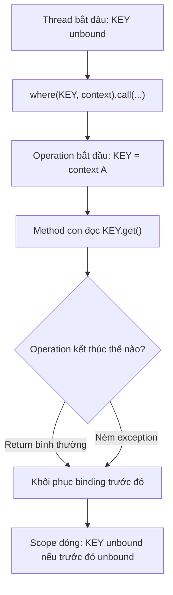
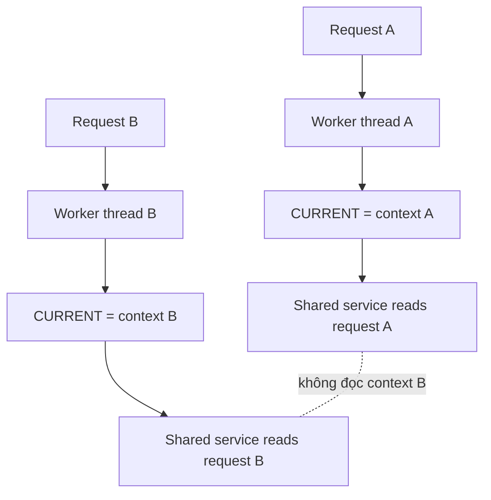
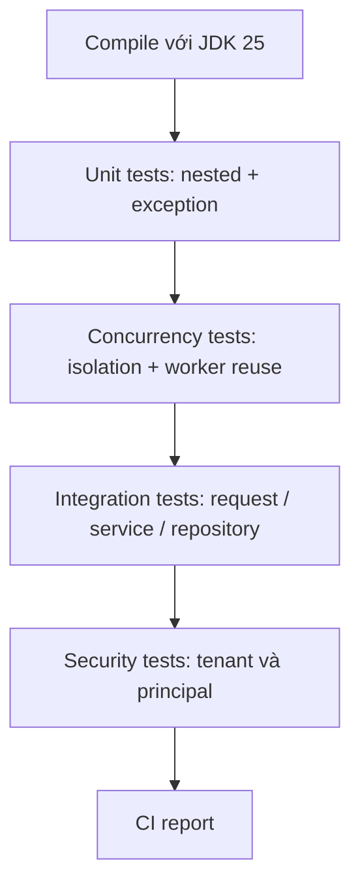

# Kiểm thử phạm vi lồng, ngoại lệ và tính độc lập giữa các yêu cầu đồng thời

## 1. Mục tiêu và phạm vi Java 25

Trong **JAVA_VERSION_JAVA25**, `ScopedValue` là cơ chế truyền dữ liệu theo phạm vi thực thi, phù hợp với các giá trị ngữ cảnh cần được đọc xuyên suốt call chain mà không phải thêm tham số vào mọi method. Bài này tập trung vào ba đặc tính quyết định độ an toàn khi áp dụng vào ứng dụng thực tế:

1. **Phạm vi lồng (nested scope):** binding mới chỉ có hiệu lực trong scope con và binding của scope cha được khôi phục khi scope con kết thúc.
2. **Khôi phục khi có ngoại lệ:** binding được gỡ hoặc khôi phục cả khi operation trả về bình thường lẫn khi ném exception.
3. **Tính độc lập giữa yêu cầu đồng thời:** mỗi thread nhìn thấy binding riêng của nó; một request không được đọc nhầm context của request khác, kể cả khi worker thread được tái sử dụng.

`ScopedValue` được hoàn thiện trong **Java 25 theo JEP 506**, do đó các ví dụ dùng API final và không cần `--enable-preview`. Bài chỉ dùng API ổn định cho phần kiểm thử chính. `StructuredTaskScope` được nhắc tới ở phần ranh giới async vì nó vẫn là **preview trong JDK 25**; không dùng preview đó làm nền tảng bắt buộc cho bài thực hành.

Sau bài học, bạn có thể viết test chứng minh:

- Binding có hiệu lực đúng trong khoảng thời gian dự kiến.
- Scope lồng nhau không làm thay đổi vĩnh viễn giá trị của scope cha.
- Exception không để lại binding rò rỉ sau khi method kết thúc.
- Hai request chạy đồng thời không nhìn thấy context của nhau.
- Một thread pool tái sử dụng worker không mang context cũ sang task kế tiếp.
- Việc truyền context sang executor hoặc thread khác phải được thực hiện theo cơ chế rõ ràng.

## 2. Mô hình cần kiểm thử: một key, nhiều request context

Giả sử ứng dụng có các tầng:

- `RequestHandler`: xác thực request, tạo context đã được kiểm tra và mở scope.
- `OrderService`: xử lý nghiệp vụ đơn hàng.
- `InvoiceService`: lập hóa đơn.
- `AuditService`: ghi nhận request ID để đối soát.

Một request có thể mang `requestId`, `tenantId` và `userId`. Nếu các giá trị này có cùng vòng đời và được đọc xuyên call chain, nên gom chúng vào một record bất biến rồi bind **một key** thay vì tạo nhiều key không cần thiết.

```java
record RequestContext(
        String requestId,
        String tenantId,
        String userId) {

    RequestContext {
        java.util.Objects.requireNonNull(requestId);
        java.util.Objects.requireNonNull(tenantId);
        java.util.Objects.requireNonNull(userId);

        if (requestId.isBlank() || tenantId.isBlank() || userId.isBlank()) {
            throw new IllegalArgumentException("Request context is incomplete");
        }
    }
}
```

Key được khai báo một lần và dùng chung:

```java
final class RequestContextHolder {

    private static final ScopedValue<RequestContext> CURRENT =
            ScopedValue.newInstance();

    private RequestContextHolder() {}

    static RequestContext current() {
        return CURRENT.orElseThrow(
                () -> new IllegalStateException("Request context is not bound"));
    }

    static void runWith(RequestContext context, Runnable operation) {
        ScopedValue.where(CURRENT, context).run(operation);
    }

    static <R, X extends Throwable> R callWith(
            RequestContext context,
            ScopedValue.CallableOp<? extends R, X> operation) throws X {

        return ScopedValue.where(CURRENT, context).call(operation);
    }
}
```

Ví dụ dùng key `private static final` và chỉ công bố các thao tác cần thiết. Đối tượng `RequestContext` là record với các thành phần immutable (`String`), phù hợp để chia sẻ an toàn trong các trường hợp structured inheritance nếu ứng dụng dùng cơ chế đó.

**Lưu ý bảo mật:** `tenantId` hoặc `userId` trong context chỉ là dữ liệu đã được xác minh ở boundary; việc bind một giá trị không tự thực hiện authentication/authorization. Không bind trực tiếp tenant do client gửi rồi coi đó là quyền truy cập hợp lệ.

## 3. Xác định vòng đời của một binding

`ScopedValue` có **binding theo thread**. Caller tạo mapping bằng `ScopedValue.where(KEY, value)` rồi gọi `run` hoặc `call` để thực thi operation trong dynamic scope đó.



| Thời điểm | Trạng thái khi trước đó chưa bind |
|---|---|
| Trước `run`/`call` | `KEY.isBound() == false` |
| Bên trong operation | `KEY.isBound() == true` và `KEY.get()` trả context |
| Method con được gọi trực tiếp/gián tiếp | Đọc được binding nếu có tham chiếu tới key |
| Sau khi operation return | Binding được gỡ |
| Sau khi operation throw | Binding cũng được gỡ; exception tiếp tục truyền ra |
| Nếu đang có binding cha | Sau scope con, giá trị cha được khôi phục |

Không gọi `remove()` như với `ThreadLocal`. Binding là tạm thời và được API quản lý theo cấu trúc lời gọi.

## 4. Kiểm thử scope lồng nhau và rebinding

Một scope con có thể **rebind cùng key** bằng giá trị khác. Giá trị mới chỉ được nhìn thấy trong scope con; khi scope con kết thúc, giá trị của scope cha xuất hiện trở lại.

Ví dụ độc lập:

```java
public class NestedScopeDemo {

    private static final ScopedValue<String> REQUEST =
            ScopedValue.newInstance();

    static void printRequest(String step) {
        System.out.println(step + " = " + REQUEST.get());
    }

    public static void main(String[] args) {
        ScopedValue.where(REQUEST, "req-parent").run(() -> {
            printRequest("outer-before");

            ScopedValue.where(REQUEST, "req-child").run(() -> {
                printRequest("inner");
            });

            printRequest("outer-after");
        });

        System.out.println("bound-after = " + REQUEST.isBound());
    }
}
```

Kết quả mong đợi:

```text
outer-before = req-parent
inner = req-child
outer-after = req-parent
bound-after = false
```

**Điều cần chứng minh:**

- `req-child` không ghi đè vĩnh viễn `req-parent`.
- Không có thao tác khôi phục thủ công sau scope con.
- Khi scope ngoài kết thúc, key trở lại trạng thái unbound.

### Kiểm thử bằng JUnit

```java
import static org.junit.jupiter.api.Assertions.*;

import org.junit.jupiter.api.Test;

class ScopedValueNestedTest {

    private static final ScopedValue<String> REQUEST =
            ScopedValue.newInstance();

    @Test
    void nestedBindingRestoresOuterValue() {
        assertFalse(REQUEST.isBound());

        ScopedValue.where(REQUEST, "req-parent").run(() -> {
            assertEquals("req-parent", REQUEST.get());

            ScopedValue.where(REQUEST, "req-child").run(() -> {
                assertEquals("req-child", REQUEST.get());
            });

            // Khi scope con kết thúc, binding cha được khôi phục.
            assertEquals("req-parent", REQUEST.get());
        });

        assertFalse(REQUEST.isBound());
    }

    @Test
    void nestedBindingCanBeReboundMoreThanOnce() {
        ScopedValue.where(REQUEST, "A").run(() -> {
            assertEquals("A", REQUEST.get());

            ScopedValue.where(REQUEST, "B").run(() -> {
                assertEquals("B", REQUEST.get());

                ScopedValue.where(REQUEST, "C").run(() -> {
                    assertEquals("C", REQUEST.get());
                });

                assertEquals("B", REQUEST.get());
            });

            assertEquals("A", REQUEST.get());
        });

        assertFalse(REQUEST.isBound());
    }
}
```

Các scope được đóng theo thứ tự LIFO. Nếu có ba scope lồng nhau, sau khi scope C đóng thì B được khôi phục; sau khi B đóng thì A được khôi phục.

## 5. Kiểm thử exception trong scope con

Không chỉ đường return bình thường mới phải khôi phục binding. Nếu scope con ném exception, scope cha vẫn giữ binding cũ khi exception được bắt **bên trong scope cha**.

```java
import static org.junit.jupiter.api.Assertions.*;

import org.junit.jupiter.api.Test;

class ScopedValueExceptionTest {

    private static final ScopedValue<String> REQUEST =
            ScopedValue.newInstance();

    @Test
    void exceptionInInnerScopeRestoresOuterBinding() {
        ScopedValue.where(REQUEST, "outer").run(() -> {
            assertEquals("outer", REQUEST.get());

            assertThrows(IllegalStateException.class, () ->
                    ScopedValue.where(REQUEST, "inner").run(() -> {
                        assertEquals("inner", REQUEST.get());
                        throw new IllegalStateException("expected failure");
                    }));

            // Exception đã được bắt; scope ngoài vẫn còn hiệu lực.
            assertEquals("outer", REQUEST.get());
        });

        assertFalse(REQUEST.isBound());
    }

    @Test
    void exceptionEscapingOuterScopeLeavesKeyUnbound() {
        assertThrows(IllegalArgumentException.class, () ->
                ScopedValue.where(REQUEST, "req-failed").run(() -> {
                    assertEquals("req-failed", REQUEST.get());
                    throw new IllegalArgumentException("business error");
                }));

        assertFalse(REQUEST.isBound());
    }
}
```

Có hai tình huống khác nhau:

1. **Exception chỉ thoát khỏi scope con:** caller ở scope cha bắt exception; binding cha tiếp tục có hiệu lực.
2. **Exception thoát khỏi cả scope ngoài:** operation ngoài kết thúc bất thường; binding ngoài cũng được gỡ.

Không cần viết `try/finally` để gỡ ScopedValue. Tuy nhiên các tài nguyên khác như file, connection, lock và transaction vẫn cần lifecycle/cleanup riêng; việc binding được khôi phục không tự đóng tài nguyên.

## 6. Kiểm thử tính độc lập giữa hai yêu cầu đồng thời

Điểm quan trọng của ScopedValue là **cùng một key có thể được bind với các giá trị khác nhau trên các thread khác nhau**. Key là đối tượng dùng chung; binding là trạng thái theo thread.

Giả sử hai request đồng thời:

- Request A: `requestId=req-A`, `tenantId=tenant-a`.
- Request B: `requestId=req-B`, `tenantId=tenant-b`.

Kỳ vọng mỗi request chỉ đọc context của chính nó dù cả hai cùng gọi một service và cùng sử dụng một key `CURRENT`.



### Ví dụ kiểm thử đồng thời với ExecutorService

```java
import static org.junit.jupiter.api.Assertions.*;

import java.util.concurrent.CountDownLatch;
import java.util.concurrent.Executors;
import java.util.concurrent.Future;
import java.util.concurrent.TimeUnit;

import org.junit.jupiter.api.Test;

class ScopedValueConcurrentTest {

    record Context(String requestId, String tenantId) {}

    private static final ScopedValue<Context> CURRENT =
            ScopedValue.newInstance();

    @Test
    void concurrentRequestsReadTheirOwnBindings() throws Exception {
        try (var executor = Executors.newFixedThreadPool(2)) {
            var bothEntered = new CountDownLatch(2);
            var release = new CountDownLatch(1);

            Future<String> requestA = executor.submit(() ->
                    ScopedValue.where(
                            CURRENT, new Context("req-A", "tenant-a"))
                            .call(() -> {
                                bothEntered.countDown();
                                if (!release.await(5, TimeUnit.SECONDS)) {
                                    throw new IllegalStateException("test timed out");
                                }
                                return CURRENT.get().requestId()
                                        + ":" + CURRENT.get().tenantId();
                            }));

            Future<String> requestB = executor.submit(() ->
                    ScopedValue.where(
                            CURRENT, new Context("req-B", "tenant-b"))
                            .call(() -> {
                                bothEntered.countDown();
                                if (!release.await(5, TimeUnit.SECONDS)) {
                                    throw new IllegalStateException("test timed out");
                                }
                                return CURRENT.get().requestId()
                                        + ":" + CURRENT.get().tenantId();
                            }));

            try {
                // Đảm bảo cả hai operation đã vào scope trước khi đọc.
                assertTrue(bothEntered.await(5, TimeUnit.SECONDS));
            } finally {
                release.countDown();
            }

            assertEquals("req-A:tenant-a", requestA.get(5, TimeUnit.SECONDS));
            assertEquals("req-B:tenant-b", requestB.get(5, TimeUnit.SECONDS));
        }
    }
}
```

`CountDownLatch` giữ cả hai task trong scope cho tới khi cùng được giải phóng. Nhờ vậy test xác nhận chúng thực sự chạy đồng thời, không chỉ lần lượt chạy nhanh đến mức không phát hiện được việc dùng chung một biến mutable.

Kết quả kỳ vọng:

| Task | Binding đang hoạt động | Kết quả |
|---|---|---|
| Request A | `req-A / tenant-a` | `req-A:tenant-a` |
| Request B | `req-B / tenant-b` | `req-B:tenant-b` |

Test này **không** chứng minh một request được phép truy cập tenant của request kia; nó chứng minh mỗi thread đọc binding đã được thiết lập cho thread đó. Kiểm tra authorization và tenant isolation ở tầng nghiệp vụ vẫn phải có test riêng.

## 7. Kiểm thử worker thread được tái sử dụng, tránh context rò rỉ

Một rủi ro thực tế là thread pool giữ worker sau khi task kết thúc. Nếu dùng `ThreadLocal` mà quên `remove()`, request sau có thể đọc giá trị còn sót lại. ScopedValue được thiết kế để binding tự khôi phục khi `run`/`call` hoàn tất.

Dùng một thread duy nhất để bảo đảm hai task chạy trên **cùng worker**:

```java
import static org.junit.jupiter.api.Assertions.*;

import java.util.concurrent.Executors;
import org.junit.jupiter.api.Test;

class ScopedValueWorkerReuseTest {

    private static final ScopedValue<String> REQUEST =
            ScopedValue.newInstance();

    @Test
    void nextTaskDoesNotSeePreviousBinding() throws Exception {
        try (var executor = Executors.newSingleThreadExecutor()) {
            var first = executor.submit(() ->
                    ScopedValue.where(REQUEST, "req-first")
                            .call(REQUEST::get));

            var second = executor.submit(REQUEST::isBound);

            assertEquals("req-first", first.get());
            assertFalse(second.get());
        }
    }
}
```

Nếu task đầu kết thúc bình thường, task thứ hai phải thấy key **unbound**. Có thể bổ sung biến thể task đầu ném exception:

```java
var failed = executor.submit(() ->
        ScopedValue.where(REQUEST, "req-failed").run(() -> {
            throw new IllegalStateException("expected");
        }));

var next = executor.submit(REQUEST::isBound);
```

Trong bài test thật, cần lấy kết quả `Future` đầu và xác nhận exception qua `ExecutionException`; sau đó xác nhận task tiếp theo trả `false`. Không bỏ qua exception của task đầu vì điều đó sẽ khiến test không chứng minh được đường thoát bất thường.

**Điều kiện quan trọng:** phải thực sự dùng lại cùng executor/worker; tạo một executor mới cho mỗi task sẽ không kiểm tra được hiện tượng rò context do thread reuse.

## 8. Ranh giới giữa các thread: không mặc định kế thừa binding

ScopedValue binding là **per-thread**. Các lời gọi đồng bộ trực tiếp và gián tiếp trên cùng thread đọc được binding hiện tại; một `ExecutorService` thông thường, `CompletableFuture.supplyAsync(...)` hoặc callback `@Async` không tự động kế thừa binding của thread gọi.

Ví dụ, caller đang bind `req-parent` rồi submit task:

```java
class NoImplicitInheritanceDemo {
    private static final ScopedValue<String> REQUEST =
            ScopedValue.newInstance();

    public static void main(String[] args) throws Exception {
        try (var executor = Executors.newSingleThreadExecutor()) {
            String observed = ScopedValue.where(REQUEST, "req-parent").call(() -> {
                var task = executor.submit(
                        () -> REQUEST.orElse("<unbound>"));
                return task.get();
            });

            System.out.println(observed); // <unbound>
        }
    }
}
```

Để truyền context sang task executor, cần **capture dữ liệu một cách tường minh** và bind trên thread thực thi:

```java
try (var executor = Executors.newVirtualThreadPerTaskExecutor()) {
    String requestId = "req-async-201";

    var task = executor.submit(() ->
            ScopedValue.where(REQUEST, requestId)
                    .call(REQUEST::get));

    System.out.println(task.get()); // req-async-201
}
```

Ví dụ này truyền chuỗi request ID vào lambda và bind trong worker. Đây là quyết định tường minh, không phải cơ chế tự kế thừa; caller chọn chính xác dữ liệu nào được mang qua boundary.

### StructuredTaskScope trong Java 25

JDK 25 có cơ chế kế thừa ScopedValue khi sử dụng `StructuredTaskScope`: binding được capture khi mở scope và được thừa kế bởi các subtask tạo bằng `fork`. Scope cha phải đợi/đóng structured scope đúng cách để binding không kết thúc trước khi subtask hoàn tất.

Tuy nhiên `StructuredTaskScope` vẫn là **preview trong JDK 25 (JEP 505)**. Muốn sử dụng phải bật preview và chấp nhận API có thể thay đổi; do đó bài thực hành ổn định này không phụ thuộc vào nó. Nếu triển khai trên JDK mới hơn, hãy kiểm tra trạng thái JEP/API của đúng phiên bản đó trước khi chọn preview flag hoặc đưa structured concurrency vào production. Khi dự án quyết định thử, hãy tạo bộ kiểm thử riêng cho đúng JDK, đúng preview version và quy tắc đóng scope.

Dù dùng structured inheritance hay bind thủ công, nếu value được chia sẻ giữa các thread thì đối tượng value phải **immutable**, hoặc mọi truy cập cần được đồng bộ hóa thích hợp. ScopedValue bảo vệ vòng đời binding; nó không tự làm một object mutable trở nên thread-safe.

## 9. Kiểm thử nhiều key và context bất biến

Khi request cần nhiều metadata, có hai cách phổ biến:

- Dùng nhiều key trong một Carrier.
- Gom thành một record context rồi bind một key.

Với ứng dụng cần kiểm thử sự độc lập của cả tenant, request và locale, một record thường dễ review hơn:

```java
import java.util.Locale;

class RequestContextRenderTest {
    record RequestContext(
            String requestId,
            String tenantId,
            Locale locale) {}

    private static final ScopedValue<RequestContext> CURRENT =
            ScopedValue.newInstance();

    static String render() {
        var context = CURRENT.get();
        return context.tenantId() + ":" + context.locale().toLanguageTag()
                + ":" + context.requestId();
    }

    static String renderWith(RequestContext context) {
        return ScopedValue.where(CURRENT, context)
                .call(RequestContextRenderTest::render);
    }

    static boolean isBound() {
        return CURRENT.isBound();
    }
}
```

Test với hai context:

```java
var a = new RequestContextRenderTest.RequestContext(
        "req-A", "tenant-a", Locale.forLanguageTag("vi-VN"));
var b = new RequestContextRenderTest.RequestContext(
        "req-B", "tenant-b", Locale.US);

String resultA = RequestContextRenderTest.renderWith(a);
String resultB = RequestContextRenderTest.renderWith(b);

assertEquals("tenant-a:vi-VN:req-A", resultA);
assertEquals("tenant-b:en-US:req-B", resultB);
assertFalse(RequestContextRenderTest.isBound());
```

Nếu cần kiểm tra riêng `Carrier`, hãy nhớ `ScopedValue.where(KEY, value)` chỉ tạo mapping; binding thực sự bắt đầu khi gọi `run` hoặc `call`. `Carrier.get(KEY)` đọc mapping trong Carrier, còn `KEY.get()` đọc binding đang hoạt động trên thread.

Không đưa một object context có `Map` hoặc `List` mutable vào nhiều thread rồi giả định ScopedValue đã bảo vệ dữ liệu. Dùng immutable collections, defensive copy hoặc đồng bộ hóa nếu value có trạng thái thay đổi.

## 10. Ma trận kiểm thử nên có trong dự án

Một suite đầy đủ nên kiểm tra ít nhất các trường hợp sau:

| ID | Tình huống | Thiết lập | Kết quả bắt buộc |
|---|---|---|---|
| SV-01 | Unbound ban đầu | Chưa gọi `where` | `isBound() == false` |
| SV-02 | Bind bằng `run` | Gọi `where(KEY, A).run` | Trong operation đọc được A |
| SV-03 | Bind bằng `call` | Gọi `where(KEY, A).call` | Trả kết quả đúng, binding kết thúc |
| SV-04 | Nested rebind | Scope A mở scope B | Trong B là B; sau B trở lại A |
| SV-05 | Ba tầng nested | A → B → C | Sau C là B; sau B là A |
| SV-06 | Exception trong scope con | B ném exception, A bắt | A vẫn đọc được binding A |
| SV-07 | Exception thoát scope ngoài | A ném exception ra caller | Key unbound sau khi caller bắt |
| SV-08 | Hai request đồng thời | Hai thread bind A và B | Không có kết quả chéo |
| SV-09 | Worker reuse | Hai task nối tiếp trên một worker | Task sau không thấy binding cũ |
| SV-10 | Worker reuse sau exception | Task đầu ném exception | Task sau vẫn unbound |
| SV-11 | Async không truyền ngầm | Parent bind rồi submit ordinary executor | Worker không được giả định sẽ thấy binding parent |
| SV-12 | Explicit async binding | Capture context và bind trong worker | Worker đọc đúng context được truyền |
| SV-13 | Mutable context | Thử value mutable giữa các thread | Test chứng minh immutable/synchronization hoặc phát hiện race |
| SV-14 | Context thiếu | Gọi accessor khi unbound | Fail-fast theo contract, không dùng tenant mặc định sai |

Đối với test concurrency, tránh dùng `Thread.sleep` để “hy vọng” hai task chạy chồng nhau. Dùng `CountDownLatch`, `CyclicBarrier` hoặc `Phaser` để điều khiển đồng bộ. Mọi test có timeout để tránh treo CI nếu một task không đến được barrier.

## 11. Những lỗi test dễ tạo kết quả giả

**Chỉ kiểm tra hai request chạy lần lượt:** điều đó không chứng minh tính độc lập khi concurrent. Dùng barrier/latch để hai operation cùng ở trong scope trước khi đọc.

**Tạo hai executor riêng:** mỗi executor có worker riêng nên không kiểm tra được thread reuse. Dùng một `newSingleThreadExecutor` và submit task theo thứ tự.

**Bắt exception quá sớm:** nếu exception bị catch bên trong operation rồi code tiếp tục, test không chứng minh scope khôi phục khi operation kết thúc bất thường. Để exception thoát khỏi `run`/`call` rồi bắt ở caller hoặc scope cha.

**Kiểm tra `isBound` trên thread khác:** binding là per-thread; kết quả ở thread kiểm thử không đại diện cho worker. Đọc và assert ngay trong worker.

**Dùng chung context mutable:** hai thread có binding khác nhau nhưng vẫn có thể trỏ đến cùng một object mutable. Binding độc lập không đồng nghĩa object độc lập.

**Cho rằng ordinary executor kế thừa context:** điều này tạo test sai nếu môi trường test dùng wrapper hoặc executor đặc biệt có propagation. Test rõ cơ chế truyền đang dùng và không suy ra hành vi của executor khác.

**Chỉ kiểm tra `ScopedValue`, không kiểm tra business state:** binding có thể đúng trong khi tenant authorization, transaction hoặc dữ liệu lưu vẫn sai. Kiểm tra output nghiệp vụ và quyền truy cập độc lập.

## 12. Cách tích hợp test vào CI

Một pipeline có thể tổ chức theo ba lớp:



Khuyến nghị:

1. **Unit tests:** kiểm tra dynamic scope, rebinding, unbound và exception restoration nhanh, không cần Spring context.
2. **Concurrency tests:** dùng executor có số worker cố định và barrier/latch để tái lập race có kiểm soát.
3. **Integration tests:** xác nhận request context đúng qua các tầng service và transaction.
4. **Security tests:** chứng minh tenant/user context được xác minh, không thể thay bằng input không tin cậy.
5. **Async tests:** kiểm tra chính xác executor/framework wrapper đang dùng; nếu chủ động truyền context, xác nhận chỉ metadata được phép mới được capture.
6. **Timeout và cleanup:** mỗi test phải có timeout; luôn giải phóng latch trong `finally` để worker không bị kẹt khi assertion fail.
7. **Không chạy preview vô tình:** build/test ổn định không nên bật `--enable-preview` chỉ để dùng `ScopedValue`. Nếu thử `StructuredTaskScope` preview, tách profile/job và ghi rõ JDK.

Ví dụ Gradle test configuration tối thiểu (JUnit dependency do dự án quản lý):

```groovy
dependencies {
    testImplementation("org.junit.jupiter:junit-jupiter")
}

tasks.test {
    useJUnitPlatform()
}
```

Với Maven, khai báo `junit-jupiter` trong `test scope` và dùng Surefire tương thích. Không cần thêm thư viện chỉ để sử dụng `ScopedValue` vì API này thuộc `java.base`.

## 13. Bài thực hành tổng hợp

Xây một service xử lý request với `RequestContext(requestId, tenantId, userId)`:

1. Tạo key `ScopedValue<RequestContext>` dạng `private static final`.
2. Tạo `runWith` và `callWith` wrapper để mở boundary context.
3. Viết test cho binding bình thường và trường hợp key unbound.
4. Viết scope A → B → C, xác nhận giá trị được khôi phục đúng thứ tự.
5. Cho scope B ném exception; bắt exception ở scope A và xác nhận A vẫn còn binding.
6. Cho scope A ném exception ra test; xác nhận key unbound sau khi bắt exception.
7. Dùng `newFixedThreadPool(2)` và `CountDownLatch` để chạy hai request đồng thời; xác nhận mỗi request trả đúng tenant/request ID.
8. Dùng `newSingleThreadExecutor` để chạy task có binding rồi task không bind; xác nhận task thứ hai không thấy context cũ.
9. Submit một task async từ trong scope cha; chứng minh ordinary executor không tự kế thừa binding; sau đó capture context và bind rõ ràng trong task.
10. Thêm một test xác thực tenant ở boundary; không cho phép tenant do client cung cấp trở thành quyền truy cập nếu chưa được xác minh.
11. Chạy lặp test concurrency nhiều lần trong CI, giữ timeout hữu hạn và báo cáo lỗi đủ để tái hiện.

### Tiêu chí hoàn thành

- Binding của scope con không làm thay đổi scope cha.
- Binding được khôi phục sau return và throw.
- Hai request chạy đồng thời không đọc nhầm context.
- Thread pool tái sử dụng không làm rò binding giữa hai task.
- Async boundary có cơ chế truyền context rõ ràng; không dựa trên giả định inheritance.
- Value được chia sẻ là immutable hoặc được bảo vệ bằng synchronization.
- Authentication/authorization và kiểm tra business data không phụ thuộc vào việc chỉ có một ScopedValue binding.

## 14. Checklist review trước khi merge

- [ ] Key có phạm vi truy cập hợp lý, thường `private static final`; không công bố capability không cần thiết.
- [ ] Context được xác thực và kiểm tra trước khi bind ở request boundary.
- [ ] Có test nested rebinding và khôi phục binding cha.
- [ ] Có test exception trong scope con và exception thoát scope ngoài.
- [ ] Có test hai request đồng thời bằng synchronization primitive, không dùng sleep.
- [ ] Có test worker reuse trên cùng một thread pool worker.
- [ ] Có test task tiếp theo sau exception để phát hiện binding rò rỉ.
- [ ] Test đọc binding ngay trên thread cần kiểm chứng.
- [ ] Không giả định ordinary executor, CompletableFuture hoặc callback framework tự kế thừa context.
- [ ] Context được capture và bind tường minh khi đi qua async boundary.
- [ ] Nếu dùng StructuredTaskScope trong JDK 25, đã tách biệt preview flag, test profile và đánh giá rủi ro API.
- [ ] Giá trị chia sẻ giữa threads immutable hoặc có đồng bộ hóa.
- [ ] Không dùng ScopedValue thay authentication, authorization, transaction hay resource cleanup.
- [ ] Mọi test concurrency có timeout và giải phóng latch/barrier kể cả khi assertion thất bại.

### Tài liệu tham khảo chính thức

1. [JEP 506 — Scoped Values (Final in JDK 25)](https://openjdk.org/jeps/506)
2. [Java SE 25 API — java.lang.ScopedValue](https://docs.oracle.com/en/java/javase/25/docs/api/java.base/java/lang/ScopedValue.html)
3. [Java SE 25 API — ScopedValue.Carrier](https://docs.oracle.com/en/java/javase/25/docs/api/java.base/java/lang/ScopedValue.Carrier.html)
4. [Java SE 25 — Scoped Values Developer Guide](https://docs.oracle.com/en/java/javase/25/core/scoped-values.html)
5. [Java SE 25 API — StructuredTaskScope (Preview)](https://docs.oracle.com/en/java/javase/25/docs/api/java.base/java/util/concurrent/StructuredTaskScope.html)
6. [JEP 505 — Structured Concurrency (Fifth Preview in JDK 25)](https://openjdk.org/jeps/505)
