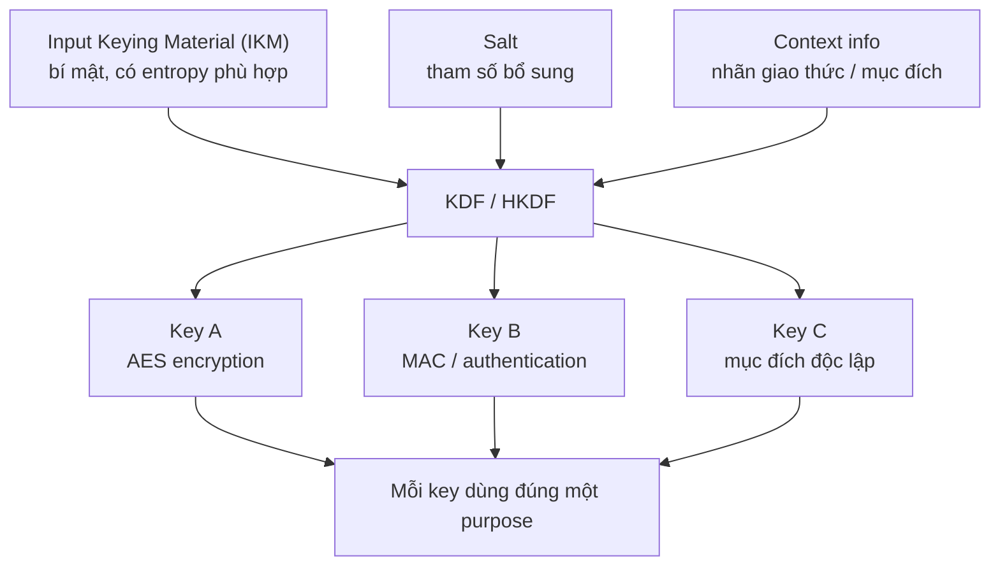
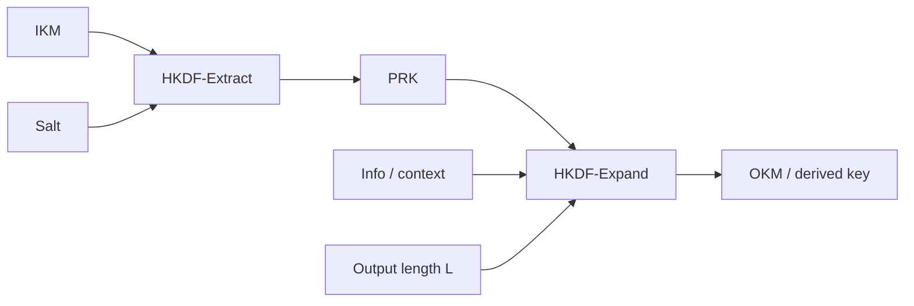

# Mục đích và trạng thái chính thức của Key Derivation Function API trong Java 25

Một ứng dụng bảo mật thường cần nhiều khóa cho các mục đích khác nhau: mã hóa dữ liệu, xác thực thông điệp, bảo vệ một phiên giao tiếp hoặc tách khóa theo từng giao thức. Nếu chỉ có một nguồn vật liệu khóa bí mật (*input keying material — IKM*), làm thế nào để dẫn xuất các khóa con có cấu trúc, có thể tái tạo khi hai bên chia sẻ cùng đầu vào và tránh dùng chung một khóa cho nhiều mục đích? **Key Derivation Function (KDF)** giải quyết bài toán đó.

Trong **Java 25**, JDK cung cấp API chuẩn **javax.crypto.KDF** để ứng dụng yêu cầu một thuật toán dẫn xuất khóa từ Java Cryptography Architecture (JCA). API này không còn ở trạng thái thử nghiệm: **JEP 510 — Key Derivation Function API đã được hoàn thiện (final) trong JDK 25**, không thay đổi so với bản preview của JDK 24. JDK tham chiếu có hỗ trợ HKDF qua provider SunJCE, với các tên thuật toán chuẩn như **HKDF-SHA256**, **HKDF-SHA384** và **HKDF-SHA512**.

Bài thuộc chương **API dẫn xuất khóa** của module **JAVA_VERSION_JAVA25**. Nội dung tập trung vào mục đích, trạng thái chính thức, vị trí của KDF trong JCA, cách HKDF hoạt động và cách ứng dụng Java 25 sử dụng API an toàn. Theo yêu cầu chỉ lấy kiến thức còn phù hợp hiện nay, bài phân biệt KDF với password hashing, encryption, random key generation và key management; không hướng dẫn thuật toán lỗi thời hoặc cách tự xây dựng crypto primitives.

> **Phạm vi và nguyên tắc bảo mật:** ví dụ sử dụng HKDF-SHA256 theo RFC 5869 và API chính thức Java SE 25. Mã mẫu minh họa cách gọi API, không thay thế thiết kế mật mã, review bảo mật, quản lý khóa, KMS/HSM hay chính sách mật mã của tổ chức. Không đưa khóa bí mật, mật khẩu, token hoặc dữ liệu production vào log, source code hay bài thực hành.

## 1. Mục tiêu học tập

Sau bài này, bạn có thể:

1. Giải thích KDF là gì, đầu vào IKM/salt/context info có ý nghĩa ra sao và khi nào cần dẫn xuất khóa con.
2. Nêu đúng trạng thái của **JEP 510** trong Java 25: API final, không cần bật preview.
3. Phân biệt KDF với hash thông thường, password-based KDF, key generation, key agreement và encryption.
4. Nhận diện các thành phần chính: **KDF**, **KDFParameters**, **KDFSpi**, **HKDFParameterSpec** và **SecretKey**.
5. Sử dụng **KDF.getInstance("HKDF-SHA256")**, tạo **HKDFParameterSpec** và gọi **deriveKey(…)**.
6. Phân biệt **deriveKey(…)** trả **SecretKey** với **deriveData(…)** trả raw byte array.
7. Chọn **info** có domain separation, hiểu vai trò của salt và giới hạn độ dài output của HKDF.
8. Nhận biết lỗi provider/algorithm/parameters và kiểm tra khả năng hỗ trợ trên JDK triển khai.
9. Tránh dùng HKDF cho mật khẩu người dùng hoặc hiểu nhầm KDF tự tạo entropy, mã hóa dữ liệu hay lưu trữ khóa.
10. Đánh giá việc đưa API KDF vào hệ thống Java hiện đại và xây checklist bảo mật phù hợp.

## 2. Trạng thái chính thức của KDF API trong Java 25

**Trạng thái: Final trong JDK 25.**

**JEP 510 — Key Derivation Function API** được đưa vào Java 25 dưới dạng API chính thức. Trước đó, API được preview trong Java 24 qua JEP 478; JDK 25 hoàn thiện API mà không thay đổi thiết kế. Vì vậy:

- Java 25 có thể dùng **javax.crypto.KDF** trong mã nguồn bình thường.
- Không cần **--enable-preview** để biên dịch hoặc chạy KDF API.
- Không cần dùng cú pháp preview hoặc thư viện riêng chỉ để gọi HKDF khi provider JDK có hỗ trợ.
- Các JDK cũ hơn Java 25 không có API **KDF** trong Java SE; không thể dùng **--enable-preview** của JDK cũ để có API được final ở JDK 25.

Ví dụ kiểm tra toolchain:

```bash
java -version
javac -version
```

Biên dịch với target Java 25:

```bash
javac --release 25 KeyDerivationDemo.java
java KeyDerivationDemo
```

Không thêm **--enable-preview** cho ví dụ này. Nếu project dùng Maven/Gradle, compiler toolchain và **--release** cần tương thích với JDK 25.

### 2.1. KDF nằm ở đâu trong Java Cryptography Architecture?

KDF API thuộc module nền tảng **java.base**, package **javax.crypto**. Các type quan trọng:

| Type | Vai trò |
|---|---|
| **javax.crypto.KDF** | API cấp cao để tạo instance thuật toán KDF và dẫn xuất key/data |
| **javax.crypto.KDFParameters** | Interface nhóm các tham số khởi tạo riêng của một KDF |
| **javax.crypto.KDFSpi** | Service Provider Interface để provider cung cấp thuật toán KDF |
| **javax.crypto.spec.HKDFParameterSpec** | Mô tả tham số cho các pha Extract, Expand hoặc Extract-then-Expand của HKDF |
| **javax.crypto.SecretKey** | Biểu diễn khóa bí mật được dẫn xuất |
| **java.security.Provider** | Thành phần đăng ký các implementation JCA |

JDK triển khai tham chiếu cung cấp HKDF trong provider **SunJCE**. Khi dùng JDK khác hoặc provider tùy chỉnh, khả năng hỗ trợ algorithm name và tham số có thể khác; phải kiểm tra provider thực tế trong môi trường triển khai.

### 2.2. Những thuật toán KDF có tên chuẩn trong Java SE 25

Java Security Standard Algorithm Names của Java 25 quy định các tên sau:

| Tên | Mô tả |
|---|---|
| **HKDF-SHA256** | HMAC-based Extract-and-Expand KDF dùng SHA-256 |
| **HKDF-SHA384** | HMAC-based Extract-and-Expand KDF dùng SHA-384 |
| **HKDF-SHA512** | HMAC-based Extract-and-Expand KDF dùng SHA-512 |

Các tên trên là **tên thuật toán KDF**, không phải tên thuật toán của khóa đầu ra. Ví dụ:

```java
KDF hkdf = KDF.getInstance("HKDF-SHA256");
SecretKey aesKey = hkdf.deriveKey("AES", derivationSpec);
```

**HKDF-SHA256** xác định hàm dẫn xuất. Chuỗi **AES** xác định algorithm label của **SecretKey** được trả về. Không nhầm hai giá trị này.

## 3. KDF giải quyết vấn đề nào?

Giả sử một phiên giao tiếp có một shared secret được tạo bởi một cơ chế key agreement an toàn. Ứng dụng cần:

- Một khóa dùng mã hóa dữ liệu phiên.
- Một khóa khác dùng xác thực hoặc bảo vệ một mục đích riêng.
- Một khóa khác nữa cho một giao thức con hoặc vai trò cụ thể.

Dùng cùng một khóa bí mật cho tất cả các mục đích có thể làm các miền bảo mật phụ thuộc lẫn nhau. KDF cho phép tạo các khóa dẫn xuất có quan hệ với nguồn IKM nhưng **tách biệt theo salt, thuật toán và context info**.



**KDF không tạo ra entropy từ dữ liệu yếu.** Nếu IKM có entropy thấp hoặc đã bị lộ, việc tạo ra một chuỗi dài hơn không biến nó thành một khóa an toàn. KDF biến đổi và mở rộng vật liệu khóa theo một thuật toán có phân tích mật mã, với điều kiện đầu vào và tham số phù hợp.

### 3.1. Một KDF không phải là mọi thứ liên quan đến khóa

| Khái niệm | Nhiệm vụ | Ví dụ API/thuật toán |
|---|---|---|
| Random key generation | Tạo khóa ngẫu nhiên mới | **KeyGenerator**, **SecureRandom** |
| Key agreement | Hai bên thiết lập shared secret | **KeyAgreement** với ECDH/X25519 |
| Key derivation | Tạo khóa con từ IKM và context | **KDF** với HKDF |
| Hash | Tạo digest từ dữ liệu | **MessageDigest** |
| Password hashing | Lưu xác minh mật khẩu với chi phí chống dò | Argon2id, scrypt, PBKDF2 |
| Encryption | Mã hóa/giải mã dữ liệu | **Cipher**, AES-GCM |
| Key management | Lưu, phân quyền, rotate, revoke khóa | KMS/HSM, vault, keystore |

Một hệ thống hoàn chỉnh có thể dùng nhiều thành phần nối tiếp nhau. Ví dụ: ECDH tạo shared secret; HKDF dẫn xuất key cho phiên; AES-GCM mã hóa dữ liệu; KMS hoặc một cơ chế quản lý khóa kiểm soát vòng đời khóa gốc.

## 4. HKDF hoạt động như thế nào?

Java 25 cung cấp HKDF theo RFC 5869. HKDF có hai pha chính:

1. **Extract:** chuyển IKM thành pseudorandom key (PRK), thường dùng salt làm tham số.
2. **Expand:** từ PRK và **info**, tạo output keying material (OKM) với độ dài mong muốn.



### 4.1. Extract

Pha Extract dùng HMAC với salt làm khóa và IKM làm đầu vào để tạo PRK. Có thể hình dung:

\[
PRK = HMAC(salt, IKM)
\]

Salt không nhất thiết phải là bí mật. Nó giúp phân tách các lần dẫn xuất hoặc các context có cùng IKM. Theo RFC 5869, nếu ứng dụng không cung cấp salt, HKDF dùng một giá trị zero-filled có độ dài phù hợp với hash function. Trong thiết kế mới, cần quyết định salt theo giao thức thay vì bỏ qua nó một cách tùy tiện.

### 4.2. Expand

Pha Expand dùng PRK và **info** để tạo output keying material:

\[
OKM = HKDF\text{-}Expand(PRK, info, L)
\]

Trong đó:

- **PRK** là kết quả Extract hoặc pseudorandom key hợp lệ.
- **info** là dữ liệu context/application-specific.
- **L** là số byte output cần dẫn xuất.

**info** giúp tách khóa theo **mục đích**. Ví dụ hai bên có thể dùng các nhãn khác nhau như **orders/v1/encryption** và **orders/v1/authentication** để không dùng chung cùng một output key cho hai mục tiêu.

### 4.3. Giới hạn output

RFC 5869 giới hạn độ dài output của HKDF tối đa:

\[
L \leq 255 \times HashLen
\]

Với HKDF-SHA256, **HashLen = 32 byte**, nên giới hạn tối đa theo RFC là 8.160 byte. Không nên yêu cầu output dài chỉ vì API cho phép; hãy dẫn xuất đúng kích thước mà thuật toán đích cần.

| Mục đích | Kích thước output thường gặp |
|---|---:|
| AES-128 | 16 byte |
| AES-256 | 32 byte |
| Một khóa HMAC-SHA-256 | Theo yêu cầu giao thức/chính sách, thường ít nhất 32 byte |
| Nhiều khóa con | Có thể dẫn xuất riêng bằng context info khác nhau |

Độ dài phù hợp còn phụ thuộc thuật toán đích, chuẩn giao thức và chính sách mật mã. Không tự chọn kích thước chỉ dựa vào ví dụ.

## 5. Phân biệt IKM, salt và info

Ba đầu vào thường bị dùng lẫn nhau nhưng có ý nghĩa khác nhau.

| Thành phần | Vai trò | Có cần bí mật? | Ví dụ |
|---|---|---|---|
| IKM | Vật liệu khóa gốc đưa vào KDF | Thường **có** | Shared secret từ ECDH, secret từ KMS |
| Salt | Tham số cho Extract, hỗ trợ phân tách đầu vào | Thông thường **không** | Bytes ngẫu nhiên được lưu kèm metadata |
| Info | Context và mục đích của khóa đầu ra | Thông thường **không** | **my-service/v1/aes-gcm/encryption** |

**IKM phải đến từ nguồn đáng tin cậy:** key agreement, key management service, HSM hoặc một nguồn ngẫu nhiên mật mã phù hợp. Không lấy một chuỗi tùy ý do người dùng nhập làm IKM rồi coi kết quả là khóa an toàn.

**Salt không phải password salt theo nghĩa tự động làm chậm đoán mật khẩu.** HKDF là một hàm HMAC-based KDF nhanh; salt của HKDF không biến nó thành password hashing function.

**Info không phải bí mật.** Nó là nhãn để khóa dẫn xuất gắn với một context. Khi hai bên cần tạo cùng key, hai bên phải thống nhất chính xác encoding, protocol version, purpose, role và các giá trị context được đưa vào **info**.

### 5.1. Domain separation

Không nên dẫn xuất cùng một output rồi dùng cho cả mã hóa và xác thực chỉ vì hai tác vụ đều cần 32 bytes. Hãy tạo context riêng:

```java
byte[] encryptionInfo =
        "shop/v1/aes-gcm/encryption-key"
                .getBytes(StandardCharsets.UTF_8);

byte[] authenticationInfo =
        "shop/v1/hmac/authentication-key"
                .getBytes(StandardCharsets.UTF_8);
```

Cùng IKM và salt nhưng **info** khác nhau sẽ cho các output khác nhau theo HKDF. Đây là kỹ thuật domain separation: tách khóa theo mục đích để giảm việc tái sử dụng key ngoài ý muốn.

Trong giao thức thực tế, không tự nghĩ ra chuỗi context nếu đã có chuẩn giao thức quy định cách encode label. Dùng đúng serialization và domain separation theo specification.

## 6. API KDF của Java 25: các method cốt lõi

**javax.crypto.KDF** cung cấp các method chính:

| API | Mục đích |
|---|---|
| **KDF.getInstance(String algorithm)** | Lấy KDF implementation theo tên thuật toán |
| **KDF.getInstance(String algorithm, Provider provider)** | Chọn provider cụ thể |
| **KDF.getInstance(String algorithm, KDFParameters params)** | Tạo KDF đã khởi tạo với tham số KDF |
| **deriveKey(String alg, AlgorithmParameterSpec spec)** | Dẫn xuất và trả về **SecretKey** |
| **deriveData(AlgorithmParameterSpec spec)** | Dẫn xuất và trả về **byte[]** |
| **getAlgorithm()** | Tên thuật toán KDF |
| **getProviderName()** | Provider đã được chọn |
| **getParameters()** | Tham số khởi tạo KDF, nếu có |

Phân biệt hai nhóm tham số:

- **KDFParameters** dùng khi khởi tạo một KDF instance bằng overload **getInstance(…)** có tham số.
- **AlgorithmParameterSpec** mô tả đầu vào của một lần dẫn xuất trong **deriveKey(…)** hoặc **deriveData(…)**.

Với HKDF, **HKDFParameterSpec** là một **AlgorithmParameterSpec**, không phải một **KDFParameters** để nhầm đưa vào sai overload.

### 6.1. deriveKey() và deriveData()

**Ưu tiên deriveKey() khi kết quả là khóa mật mã:**

```java
SecretKey key = kdf.deriveKey("AES", derivationSpec);
```

Kết quả là **SecretKey** mang algorithm label **AES**, phù hợp để truyền trực tiếp cho API như **Cipher.init(…)**.

**deriveData() trả raw bytes:**

```java
byte[] material = kdf.deriveData(derivationSpec);
```

Chỉ dùng khi ứng dụng thực sự cần byte array làm keying material cho một giao thức hoặc API khác. Nếu keying material không thể export/extract từ provider, **deriveData()** có thể ném **UnsupportedOperationException**. Tránh biến raw key bytes thành chuỗi để log, serialize hoặc gửi qua kênh không bảo vệ.

## 7. Ví dụ HKDF-SHA256 hoàn chỉnh trên Java 25

Ví dụ sau tạo một IKM và salt ngẫu nhiên cho mục đích minh họa, sau đó dẫn xuất một AES-256 **SecretKey**. Trong production, IKM thường đến từ shared secret hoặc hệ thống quản lý khóa; không nên sinh một key mới ở mỗi lần chạy nếu giao thức cần hai bên tái tạo cùng key.

```java
// File: HkdfAesKeyDemo.java
import java.nio.charset.StandardCharsets;
import java.security.GeneralSecurityException;
import java.security.SecureRandom;
import java.security.spec.AlgorithmParameterSpec;
import java.util.Arrays;
import javax.crypto.KDF;
import javax.crypto.SecretKey;
import javax.crypto.spec.HKDFParameterSpec;

public class HkdfAesKeyDemo {

    public static void main(String[] args)
            throws GeneralSecurityException {

        SecureRandom random = new SecureRandom();

        // Chỉ tạo IKM ngẫu nhiên để minh họa API.
        byte[] ikm = new byte[32];
        byte[] salt = new byte[32];
        random.nextBytes(ikm);
        random.nextBytes(salt);

        byte[] info = "demo/v1/aes-gcm/content-key"
                .getBytes(StandardCharsets.UTF_8);

        try {
            KDF hkdf = KDF.getInstance("HKDF-SHA256");

            AlgorithmParameterSpec parameters =
                    HKDFParameterSpec.ofExtract()
                            .addIKM(ikm)
                            .addSalt(salt)
                            .thenExpand(info, 32);

            SecretKey key = hkdf.deriveKey("AES", parameters);

            System.out.println("KDF: " + hkdf.getAlgorithm());
            System.out.println("Key algorithm: " + key.getAlgorithm());
            System.out.println("Provider: " + hkdf.getProviderName());
        } finally {
            // Best-effort clearing; không bảo đảm xóa mọi bản sao trong JVM.
            Arrays.fill(ikm, (byte) 0);
        }
    }
}
```

Biên dịch và chạy trên JDK 25:

```bash
javac --release 25 HkdfAesKeyDemo.java
java HkdfAesKeyDemo
```

**Giải thích:**

1. **KDF.getInstance("HKDF-SHA256")** yêu cầu provider cung cấp HKDF với SHA-256.
2. **HKDFParameterSpec.ofExtract()** bắt đầu cấu hình pha Extract.
3. **addIKM(ikm)** cung cấp input keying material.
4. **addSalt(salt)** cung cấp salt.
5. **thenExpand(info, 32)** yêu cầu chạy Extract rồi Expand, tạo 32 bytes.
6. **deriveKey("AES", parameters)** trả **SecretKey** algorithm AES.

Trong ví dụ, salt và IKM đều được tạo ngẫu nhiên để dễ chạy độc lập. Trong một giao thức hai bên cần cùng key, hai bên phải có cùng IKM, salt, info, thuật toán và encoding; salt có thể được truyền/lưu công khai cùng metadata cần thiết. **Không log IKM hoặc key**. Việc **Arrays.fill** chỉ là best-effort vì JVM/provider có thể đã tạo bản sao nội bộ.

### 7.1. Delayed provider selection

Khi không chỉ định provider, **KDF** có thể trì hoãn việc chọn provider cho tới lúc **deriveKey()** hoặc **deriveData()** được gọi. Việc này giúp implementation chọn provider có thể xử lý đúng loại key material thực tế, ví dụ key không extractable nằm trong thiết bị phần cứng.

Lấy provider từ **chính instance đã thực hiện derivation**:

```java
KDF hkdf = KDF.getInstance("HKDF-SHA256");
SecretKey key = hkdf.deriveKey("AES", parameters);

String selectedProvider = hkdf.getProviderName();
```

Không gọi **getProviderName()** hoặc **getParameters()** quá sớm nếu cần delayed selection; việc chọn provider có thể đã xảy ra và không thể đổi sau đó.

## 8. Sử dụng tham số HKDF cho từng pha

**HKDFParameterSpec** mô hình hóa ba trường hợp: Extract, Expand và Extract-then-Expand.

### 8.1. Extract rồi Expand — trường hợp phổ biến

```java
AlgorithmParameterSpec spec =
        HKDFParameterSpec.ofExtract()
                .addIKM(ikm)
                .addSalt(salt)
                .thenExpand(info, 32);
```

Đây là cách thông dụng khi bắt đầu với IKM và muốn dẫn xuất key hoàn chỉnh. **thenExpand(info, length)** tạo specification cho cả hai pha.

### 8.2. Chỉ Extract

Nếu giao thức cần PRK làm kết quả của pha Extract:

```java
HKDFParameterSpec extractSpec =
        HKDFParameterSpec.ofExtract()
                .addIKM(ikm)
                .addSalt(salt)
                .extractOnly();
```

**extractOnly()** tạo specification cho pha Extract. Nếu cần giữ PRK hoặc truyền sang bước khác, hãy chọn representation và key algorithm label phù hợp với provider/giao thức; không tự ý export PRK hoặc xem nó là khóa mã hóa cuối cùng.

### 8.3. Chỉ Expand từ PRK đã có

Nếu một giao thức đã cung cấp PRK hợp lệ và yêu cầu chỉ thực hiện Expand:

```java
HKDFParameterSpec expandSpec =
        HKDFParameterSpec.expandOnly(prk, info, 32);

SecretKey encryptionKey =
        kdf.deriveKey("AES", expandSpec);
```

**prk** ở đây phải là pseudorandom key phù hợp với HKDF Expand, không phải một password hoặc chuỗi tùy ý. Nếu bạn có IKM ban đầu và chưa thực hiện Extract đúng cách, hãy dùng Extract-then-Expand thay vì bỏ qua pha đầu.

## 9. info và việc dẫn xuất nhiều khóa con

Một lợi ích quan trọng của HKDF là có thể tạo các khóa con độc lập theo purpose. Ví dụ, một session secret được dùng cho cả hai chiều giao tiếp và hai mục đích mã hóa/xác thực. Hãy sử dụng context labels khác nhau theo protocol specification.

```java
byte[] clientToServerInfo =
        "chat/v2/client-to-server/aes-key"
                .getBytes(StandardCharsets.UTF_8);

byte[] serverToClientInfo =
        "chat/v2/server-to-client/aes-key"
                .getBytes(StandardCharsets.UTF_8);
```

Cùng IKM và salt nhưng **info** khác nhau tạo output khác nhau. Không nên chỉ dựa vào tên biến ở code; label phải được chuẩn hóa, version hóa và hai phía của giao thức phải thống nhất byte encoding.

### 9.1. Không dùng cùng một output cho mọi mục đích

Nếu hệ thống cần key mã hóa và key xác thực riêng, hãy dẫn xuất hai output với context khác nhau, hoặc theo chuẩn giao thức đã định nghĩa. Không tự tái sử dụng AES key làm HMAC key chỉ vì cả hai API đều nhận **SecretKey**.

### 9.2. Không bỏ qua version/protocol context

Khi protocol thay đổi, label nên có phiên bản hoặc namespace để tránh vô tình dùng lại output key giữa hai phiên bản có semantics khác nhau. Tuy nhiên, đừng thêm thông tin tùy tiện trái với chuẩn giao thức: encoding và thứ tự các thành phần phải thống nhất giữa các bên.

## 10. KDF khác password hashing như thế nào?

Đây là điểm bảo mật cần nhớ nhất khi áp dụng KDF.

**HKDF được thiết kế để dẫn xuất khóa từ IKM có entropy phù hợp**, không phải để lưu mật khẩu người dùng. HKDF dựa trên HMAC và chạy nhanh; kẻ tấn công có thể thử rất nhiều candidate password nếu bạn đưa password yếu trực tiếp vào HKDF.

| Bài toán | Cách phù hợp | Ghi chú |
|---|---|---|
| Dẫn xuất key từ shared secret ECDH | HKDF | Dùng salt/info theo giao thức |
| Tạo key con từ master secret | HKDF hoặc KDF phù hợp | Tách key theo purpose |
| Lưu mật khẩu đăng nhập | Password hashing KDF | Dùng Argon2id, scrypt hoặc PBKDF2 theo chính sách |
| Mã hóa dữ liệu | AEAD như AES-GCM hoặc ChaCha20-Poly1305 | Cần nonce, authentication tag và key management |
| Tạo khóa ngẫu nhiên mới | **KeyGenerator**/**SecureRandom** hoặc KMS | KDF không thay nguồn entropy |

PBKDF2 vẫn là thuật toán password-based derivation được chuẩn hóa và có thể sử dụng qua các API phù hợp như **SecretKeyFactory**; Argon2id và scrypt thường được lựa chọn khi cần memory-hard password hashing, thông qua implementation/provider được đánh giá. **Các lựa chọn này không phải là HKDF** và không nên bị gộp vào một ví dụ HKDF-SHA256.

Không làm những việc sau:

- Không gọi HKDF-SHA256 trực tiếp trên password người dùng rồi lưu output như password hash.
- Không dùng SHA-256(password) hoặc HKDF(password) thay password hashing có work factor.
- Không dùng salt của HKDF để tuyên bố password guessing đã được làm chậm.
- Không tự chọn iteration/memory parameters cho password hashing mà bỏ qua threat model và tiêu chuẩn tổ chức.

## 11. KDF không mã hóa dữ liệu và không quản lý vòng đời khóa

Sau khi dẫn xuất một **SecretKey**, ứng dụng vẫn cần API mã hóa thích hợp. Ví dụ nếu key dùng với AES-GCM, cần chọn nonce/IV duy nhất cho mỗi lần mã hóa với cùng key:

```java
Cipher cipher = Cipher.getInstance("AES/GCM/NoPadding");

byte[] nonce = new byte[12];
new SecureRandom().nextBytes(nonce);

GCMParameterSpec gcm = new GCMParameterSpec(128, nonce);
cipher.init(Cipher.ENCRYPT_MODE, derivedKey, gcm);

byte[] ciphertext = cipher.doFinal(plaintext);
```

Đây là phần minh họa cách sử dụng key sau khi dẫn xuất; **không phải toàn bộ quy trình mã hóa production**. Ứng dụng còn phải lưu/truyền nonce đúng cách, xác thực dữ liệu bổ sung nếu có, quản lý key rotation, kiểm soát truy cập và tránh nonce reuse với cùng key.

KDF không cung cấp các chức năng sau:

- Sinh nguồn entropy khi IKM không đủ mạnh.
- Lưu key vào KMS/HSM hoặc kiểm soát quyền sử dụng.
- Tự rotate/revoke khóa.
- Mã hóa plaintext.
- Xác thực thông điệp hoặc đảm bảo tính toàn vẹn nếu chưa kết hợp primitive phù hợp.
- Đồng bộ bí mật giữa hai bên nếu hai bên không có cùng đầu vào và tham số.

## 12. Provider, algorithm availability và delayed selection

JCA cho phép các security providers đăng ký implementation. **KDF.getInstance("HKDF-SHA256")** yêu cầu một implementation theo tên chuẩn; provider thực tế có thể phụ thuộc JDK distribution và security configuration.

Trên JDK tham chiếu Java 25, SunJCE cung cấp HKDF. Nếu ứng dụng chạy trên runtime khác, hãy kiểm tra:

```java
KDF kdf = KDF.getInstance("HKDF-SHA256");

// Sau khi thực hiện deriveKey/deriveData:
SecretKey key = kdf.deriveKey("AES", parameters);
System.out.println(kdf.getProviderName());
```

Nếu không có provider hỗ trợ algorithm, **getInstance(…)** ném **NoSuchAlgorithmException**. Nếu provider có thuật toán nhưng không hỗ trợ tham số, có thể gặp **InvalidAlgorithmParameterException**.

### 12.1. Khi nào chỉ định provider?

Chỉ định provider khi có yêu cầu triển khai rõ ràng, ví dụ:

- Chính sách bắt buộc một provider đã được đánh giá hoặc chứng nhận.
- Key material nằm trong thiết bị phần cứng và chỉ provider tương ứng mới truy cập được.
- Cần hành vi nhất quán giữa các môi trường đã kiểm soát.

Không hard-code tên provider chỉ vì thấy ví dụ trên Internet. Việc pin provider có thể làm ứng dụng không chạy ở môi trường không cài provider đó. Hãy phối hợp với chính sách bảo mật, triển khai JDK và HSM/KMS của hệ thống.

### 12.2. KDF instance có thread-safe không?

Tài liệu Java SE 25 nêu rõ: trừ khi implementation quy định khác, các method của một **KDF object không thread-safe**. Nếu nhiều threads cần sử dụng cùng instance đồng thời, ứng dụng phải đồng bộ hóa. Cách đơn giản hơn thường là tạo KDF instance riêng cho từng operation/thread khi chi phí và provider cho phép.

Không mặc định lưu một **KDF object** trong singleton rồi gọi đồng thời từ mọi request mà không có kiểm chứng hoặc synchronization.

## 13. Xử lý lỗi và kiểm tra tham số

Các exception thường gặp:

| Exception | Nguyên nhân thường gặp | Cách xử lý |
|---|---|---|
| **NoSuchAlgorithmException** | Provider không hỗ trợ tên KDF hoặc key algorithm đầu ra | Kiểm tên chuẩn, JDK/provider và thuật toán đích |
| **InvalidAlgorithmParameterException** | HKDF spec không hợp lệ, độ dài không hợp lệ hoặc provider không hỗ trợ | Kiểm IKM, salt, info, output length và provider |
| **NoSuchProviderException** | Provider được chỉ định không đăng ký | Kiểm cấu hình provider |
| **NullPointerException** | Tham số bắt buộc là null | Validate đầu vào ở biên |
| **UnsupportedOperationException** | deriveData yêu cầu output không extractable | Dùng deriveKey nếu cần giữ key trong provider |

Ví dụ wrapper có xử lý lỗi ở biên:

```java
public SecretKey deriveKey(
        byte[] ikm,
        byte[] salt,
        byte[] info) {

    Objects.requireNonNull(ikm, "ikm");
    Objects.requireNonNull(salt, "salt");
    Objects.requireNonNull(info, "info");

    try {
        KDF kdf = KDF.getInstance("HKDF-SHA256");

        AlgorithmParameterSpec spec =
                HKDFParameterSpec.ofExtract()
                        .addIKM(ikm)
                        .addSalt(salt)
                        .thenExpand(info, 32);

        return kdf.deriveKey("AES", spec);
    } catch (NoSuchAlgorithmException
             | InvalidAlgorithmParameterException ex) {
        throw new IllegalStateException(
                "Không thể dẫn xuất AES key bằng HKDF-SHA256", ex);
    }
}
```

Đây là ví dụ xử lý lỗi cho service nội bộ. Ứng dụng thực tế cần quyết định lỗi nào là cấu hình deployment, lỗi nào là dữ liệu đầu vào, và không trả chi tiết provider/secret ra response của người dùng.

### 13.1. Kiểm tra độ dài và dữ liệu

Trước khi gọi KDF, xác nhận:

- IKM có nguồn gốc và entropy phù hợp.
- Salt và info dùng đúng encoding và độ dài theo giao thức.
- Output length không vượt giới hạn thuật toán.
- Algorithm name là tên chuẩn mà provider hỗ trợ.
- Output key algorithm tương thích với primitive sẽ sử dụng.
- Hai phía có cùng input/context khi cần tái tạo cùng khóa.

Không dùng phép kiểm tra **ikm.length >= 32** như một chứng minh tổng quát rằng IKM có 256 bit entropy. Độ dài bytes và entropy thực tế là hai khái niệm khác nhau.

## 14. Kiểm thử KDF đúng cách

Một bài kiểm thử nên kiểm **tính nhất quán và contract**, không in key ra console.

### 14.1. Cùng đầu vào phải cho cùng output

Với HKDF, nếu algorithm, IKM, salt và info giống nhau, output phải giống nhau theo định nghĩa thuật toán. Test có thể so sánh encoded key trong môi trường test khi provider trả key extractable; tránh đưa giá trị này vào log:

```java
@Test
void sameInputsDeriveSameKey() throws Exception {
    byte[] ikm = new byte[32];
    byte[] salt = new byte[32];
    byte[] info = "test/v1/aes-key"
            .getBytes(StandardCharsets.UTF_8);

    Arrays.fill(ikm, (byte) 0x11);
    Arrays.fill(salt, (byte) 0x22);

    SecretKey first = deriveAes256Key(ikm, salt, info);
    SecretKey second = deriveAes256Key(ikm, salt, info);

    assertEquals("AES", first.getAlgorithm());
    assertArrayEquals(first.getEncoded(), second.getEncoded());
}
```

Đây là test unit với dữ liệu giả, không phải test dùng khóa production. Nếu provider trả non-extractable key, **getEncoded()** có thể là null; khi đó kiểm tra qua một operation mật mã test hoặc provider-specific mechanism phù hợp thay vì ép extract key.

### 14.2. Thay info phải tạo output khác

```java
@Test
void differentPurposeLabelsDeriveDifferentKeys() throws Exception {
    byte[] ikm = testIkm();
    byte[] salt = testSalt();

    SecretKey encryptionKey = deriveAes256Key(
            ikm, salt, utf8("service/v1/encryption"));

    SecretKey authenticationKey = deriveAes256Key(
            ikm, salt, utf8("service/v1/authentication"));

    assertFalse(Arrays.equals(
            encryptionKey.getEncoded(),
            authenticationKey.getEncoded()));
}
```

Bài test này minh họa domain separation cho một provider trả key bytes. Trong production, không dựa vào một test đơn lẻ để chứng minh thuật toán an toàn; cần kiểm vector theo RFC, test interoperability với phía còn lại và review protocol encoding.

### 14.3. Dùng test vectors của RFC 5869

Để kiểm tính đúng của HKDF, dùng test vectors chính thức từ RFC 5869 cho các trường hợp Extract-and-Expand, Extract-only và Expand-only. Các vector xác nhận kết quả bytes theo IKM/salt/info/output length đã công bố. Không tự tạo expected output bằng chính implementation đang được kiểm thử.

## 15. Bảo vệ key material trong ứng dụng

KDF là một phần của chuỗi bảo vệ khóa. Những nguyên tắc sau cần được áp dụng:

1. **Không hard-code IKM hoặc derived key** trong source, YAML, Dockerfile hay Git repository.
2. Lấy IKM từ key agreement, KMS/HSM hoặc nguồn được tổ chức kiểm soát.
3. Không log **SecretKey.getEncoded()**, IKM, PRK, derived bytes hoặc credential.
4. Hạn chế số nơi có thể đọc key và chỉ bind key vào operation cần thiết.
5. Dùng context info để tách purpose, protocol version, direction và role theo chuẩn.
6. Lưu salt/metadata công khai nếu cần tái tạo key; bảo đảm không thay đổi hoặc mất metadata.
7. Thiết kế key rotation và versioning; khi master secret thay đổi, phải có quy trình chuyển dữ liệu đã mã hóa.
8. Kiểm provider, algorithm availability và yêu cầu compliance trên từng môi trường.
9. Xóa byte arrays tạm theo best-effort khi có thể; hiểu rằng JVM/provider có thể tạo bản sao nội bộ.
10. Không tự triển khai HKDF bằng cách nối HMAC thủ công khi API chuẩn và provider được hỗ trợ đã có sẵn.

### 15.1. Có nên cache SecretKey?

Việc giữ derived key trong memory có thể giảm chi phí derivation, nhưng tăng thời gian tồn tại của secret và phạm vi truy cập. Cần dựa vào threat model, vòng đời phiên, key rotation và chính sách quản lý khóa. Không cache vô hạn một key dùng cho nhiều tenant/session nếu protocol yêu cầu tách khóa.

### 15.2. Salt có cần lưu không?

Nếu hai bên cần tái tạo cùng key, bên nhận phải có đúng salt đã dùng (nếu salt không được cố định bởi protocol). Salt thường không cần bí mật, có thể lưu cùng ciphertext hoặc metadata. Tuy nhiên, tính toàn vẹn của metadata vẫn quan trọng: protocol phải bảo vệ các tham số cần thiết khỏi bị thay đổi trái phép.

## 16. Các hiểu nhầm thường gặp

| Hiểu nhầm | Cách hiểu đúng |
|---|---|
| KDF API còn preview ở Java 25 | JEP 510 là **final** trong Java 25 |
| Cần --enable-preview để dùng KDF | Không cần trên JDK 25 |
| KDF.getInstance("AES") tạo AES key | AES là thuật toán key đầu ra trong deriveKey; KDF algorithm ví dụ là HKDF-SHA256 |
| HKDF tạo entropy mới | KDF không làm IKM yếu trở thành mạnh |
| Salt phải bí mật | Salt HKDF thường không cần bí mật |
| info là key | info là context/application-specific input |
| HKDF là password hashing | HKDF không thay Argon2id/scrypt/PBKDF2 |
| KDF tự mã hóa dữ liệu | KDF chỉ dẫn xuất keying material |
| deriveData() luôn dùng được | Có thể bị từ chối nếu output không extractable |
| KDF instance thread-safe | API không cam kết thread safety; cần đồng bộ hoặc instance riêng |
| Một key có thể dùng cho mọi mục đích | Nên tách key theo domain/purpose bằng context phù hợp |
| Salt mất thì có thể tự tạo salt mới | Nếu cần tái tạo key cũ, phải có đúng tham số đã dùng |
| Có API chuẩn nghĩa mọi provider đều hỗ trợ mọi KDF | Phải kiểm provider và algorithm availability |

## 17. Lộ trình áp dụng KDF API trong dự án Java hiện đại

Một quy trình triển khai có kiểm soát:

1. **Xác định bài toán:** cần dẫn xuất key từ shared secret, master key hay password? Nếu là password, chọn password hashing KDF phù hợp thay vì HKDF.
2. **Chọn thuật toán:** đối chiếu chuẩn giao thức, security policy và provider. Với HKDF, chọn biến thể hash phù hợp như SHA-256/384/512.
3. **Định nghĩa inputs:** xác định nguồn IKM, salt, info, output length, protocol version và purpose.
4. **Xác minh provider:** kiểm JDK distribution, provider, algorithm names và yêu cầu hardware/compliance.
5. **Tích hợp API:** dùng KDF.getInstance, HKDFParameterSpec và deriveKey.
6. **Tách khóa theo mục đích:** dùng info/context labels đúng chuẩn, tránh reuse cùng key cho nhiều vai trò.
7. **Kiểm thử:** chạy RFC test vectors, interoperability test, invalid-parameter test và key lifecycle tests.
8. **Bảo vệ runtime:** không log secret, giới hạn key exposure, kiểm memory/caching/rotation.
9. **Triển khai từng môi trường:** xác minh provider và JDK version ở local, CI, staging và production.
10. **Theo dõi nâng cấp:** khi thay JDK/provider, kiểm algorithm support, provider selection và kết quả interoperability.

## 18. Bài tập thực hành

**Bài 1 — Trạng thái API:** Giải thích vì sao KDF không cần --enable-preview trên Java 25. Nêu JEP chính thức và phiên bản preview trước đó.

**Bài 2 — Tách thuật toán:** Viết một method lấy KDF bằng HKDF-SHA256, sau đó dẫn xuất một SecretKey algorithm AES. Chỉ ra tham số nào là tên KDF, tham số nào là tên key đầu ra.

**Bài 3 — Vai trò input:** Dùng cùng IKM và salt nhưng hai giá trị info khác nhau cho encryption và authentication. Giải thích vì sao domain separation hữu ích.

**Bài 4 — Extract và Expand:** Vẽ sơ đồ HKDF Extract-then-Expand và chỉ ra addIKM, addSalt, thenExpand tương ứng với thành phần nào.

**Bài 5 — Key bytes hay SecretKey:** So sánh deriveKey() với deriveData(). Nêu lý do ưu tiên SecretKey khi dùng với JCA Cipher và trường hợp raw bytes có thể bị từ chối.

**Bài 6 — Password:** Một hệ thống muốn lưu password đăng nhập bằng cách gọi HKDF-SHA256 trên chuỗi password. Hãy review thiết kế và đề xuất password hashing KDF phù hợp.

**Bài 7 — Provider:** Viết đoạn code lấy getProviderName() sau khi derive key. Giải thích delayed provider selection và vì sao không nên gọi thông tin provider quá sớm nếu key material gắn với hardware provider.

**Bài 8 — Độ dài:** Với HKDF-SHA256, tính giới hạn output tối đa theo RFC 5869. Chọn output 32 bytes cho AES-256 và giải thích vì sao không cần yêu cầu output lớn hơn.

**Bài 9 — Kiểm thử:** Viết unit test chứng minh cùng IKM/salt/info cho kết quả lặp lại và info khác nhau tạo key khác nhau. Không in key bytes ra console.

**Bài 10 — Thiết kế production:** Lập checklist nguồn IKM, salt persistence, info encoding, key rotation, provider compliance, log redaction và interoperability.

## 19. Checklist hoàn thành

- [ ] Nêu đúng JEP 510 là API final trong Java 25.
- [ ] Biết JEP 478 là bản preview ở JDK 24; không dùng preview flag cho Java 25 final.
- [ ] Hiểu KDF dẫn xuất key từ IKM và dữ liệu bổ sung, không tự tạo entropy.
- [ ] Phân biệt IKM, salt, info và output length.
- [ ] Mô tả được Extract và Expand của HKDF theo RFC 5869.
- [ ] Biết tên chuẩn HKDF-SHA256, HKDF-SHA384, HKDF-SHA512.
- [ ] Phân biệt KDF algorithm với output key algorithm trong deriveKey.
- [ ] Dùng HKDFParameterSpec.ofExtract() và thenExpand(…) đúng cách.
- [ ] Biết khi nào dùng deriveKey() và giới hạn của deriveData().
- [ ] Kiểm provider/algorithm availability trên JDK triển khai.
- [ ] Hiểu delayed provider selection và giới hạn thread safety của KDF instance.
- [ ] Không dùng HKDF để hash password hoặc thay thế password-based KDF.
- [ ] Không nhầm KDF với key generation, key agreement, encryption hay key management.
- [ ] Tách key theo purpose bằng context info đúng protocol.
- [ ] Không log, hard-code hoặc commit IKM/PRK/derived keys.
- [ ] Có test vectors/interoperability tests và kế hoạch key rotation.

## Tài liệu tham khảo chính thức

- [JEP 510 — Key Derivation Function API](https://openjdk.org/jeps/510): mục tiêu, trạng thái final trong Java 25 và ví dụ API.
- [Java SE 25 — javax.crypto.KDF](https://docs.oracle.com/en/java/javase/25/docs/api/java.base/javax/crypto/KDF.html): getInstance, delayed provider selection, deriveKey, deriveData và thread safety.
- [Java SE 25 — HKDFParameterSpec](https://docs.oracle.com/en/java/javase/25/docs/api/java.base/javax/crypto/spec/HKDFParameterSpec.html): Extract, Expand và Extract-then-Expand.
- [Java SE 25 — KDFParameters](https://docs.oracle.com/en/java/javase/25/docs/api/java.base/javax/crypto/KDFParameters.html): tham số khởi tạo KDF.
- [Java SE 25 — KDFSpi](https://docs.oracle.com/en/java/javase/25/docs/api/java.base/javax/crypto/KDFSpi.html): SPI dành cho provider.
- [Java Security Standard Algorithm Names](https://docs.oracle.com/en/java/javase/25/docs/specs/security/standard-names.html): tên HKDF-SHA256/384/512.
- [Java Cryptography Architecture Reference Guide — The KDF Class](https://docs.oracle.com/en/java/javase/25/security/java-cryptography-architecture-jca-reference-guide.html): sử dụng KDF và provider SunJCE.
- [RFC 5869 — HMAC-based Extract-and-Expand Key Derivation Function (HKDF)](https://www.rfc-editor.org/rfc/rfc5869): định nghĩa thuật toán và test vectors.
- [NIST SP 800-56C Rev. 2](https://csrc.nist.gov/pubs/sp/800/56/c/r2/final): khuyến nghị dẫn xuất key từ shared secret trong các cơ chế key establishment.

## Kết luận

**Key Derivation Function API là một phần chính thức của Java 25, không còn là preview.** JEP 510 đưa KDF vào JCA với API thống nhất để tạo implementation theo provider và dẫn xuất key dưới dạng SecretKey hoặc dữ liệu bytes. Trong JDK 25, HKDF-SHA256/384/512 là các thuật toán có tên chuẩn; HKDF giúp biến IKM có chất lượng phù hợp thành những khóa con tách biệt theo salt và context info.

Điều quan trọng là dùng đúng công cụ cho đúng bài toán: **HKDF để dẫn xuất khóa từ vật liệu khóa có entropy phù hợp; password hashing KDF để bảo vệ mật khẩu; Cipher để mã hóa; KMS/HSM để quản lý vòng đời khóa.** Khi thiết kế info, salt, output length, provider và key rotation theo giao thức rõ ràng, Java 25 cho phép ứng dụng dùng một API chuẩn, có khả năng tích hợp với JCA và dễ kiểm chứng hơn trong quá trình phát triển hiện đại.
