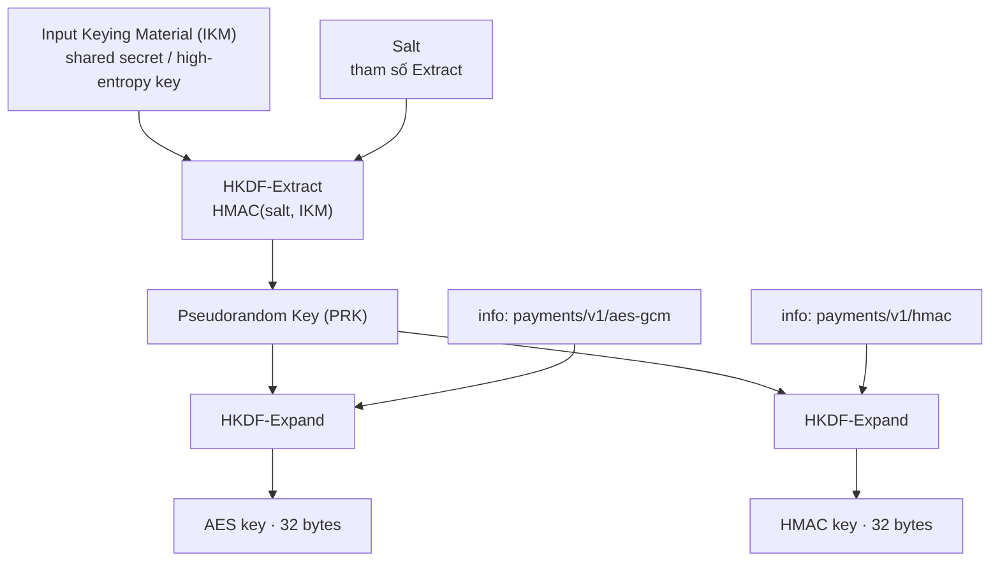
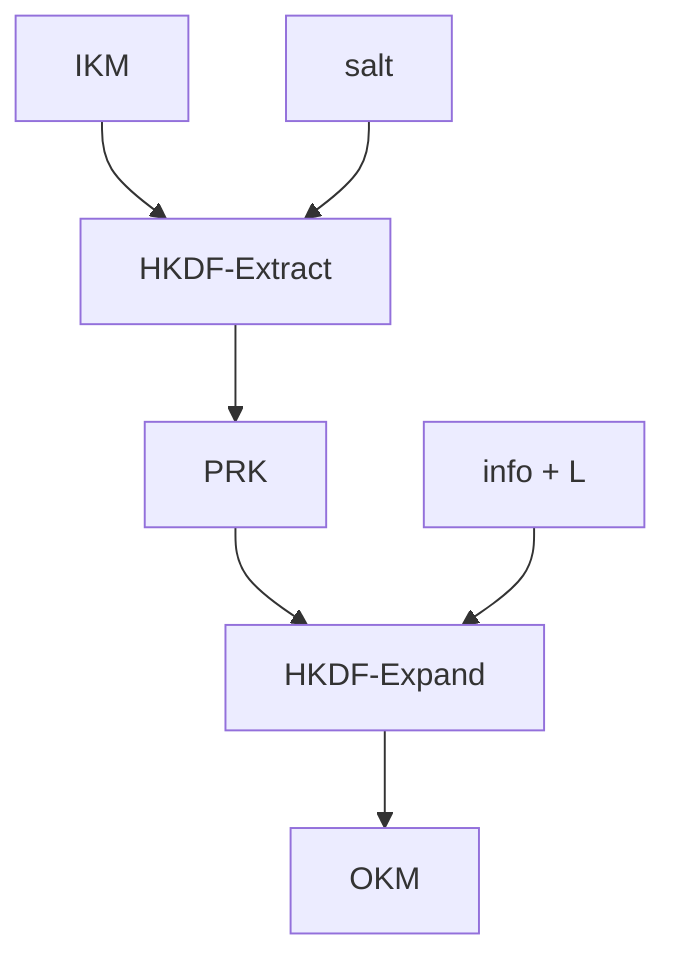

# HKDF và vai trò của vật liệu khóa đầu vào, salt, info cùng độ dài đầu ra

Một ứng dụng thường cần nhiều khóa cho các mục đích khác nhau: mã hóa dữ liệu, xác thực thông điệp, bảo vệ phiên giao tiếp hoặc tách khóa theo từng giao thức. Tái sử dụng một khóa gốc cho mọi mục đích làm tăng phạm vi ảnh hưởng nếu khóa bị lộ. **HKDF (HMAC-based Extract-and-Expand Key Derivation Function)** giúp tạo các khóa dẫn xuất từ vật liệu khóa đầu vào có entropy phù hợp, với ngữ cảnh và độ dài đầu ra được xác định rõ.

Trong **Java 25**, Key Derivation Function API đã trở thành API chính thức theo **JEP 510**. JDK cung cấp lớp `javax.crypto.KDF` cùng `HKDFParameterSpec` để thực hiện HKDF mà không phải tự viết vòng lặp HMAC. Bài này thuộc chương **API dẫn xuất khóa** của module `JAVA_VERSION_JAVA25`, tập trung giải thích bốn thành phần quyết định kết quả: **IKM, salt, info và output length**.

> **Phạm vi hiện hành:** Các ví dụ sử dụng API ổn định từ Java 25, không cần `--enable-preview`. HKDF được đặc tả trong RFC 5869. Java SE 25 chuẩn hóa các tên `HKDF-SHA256`, `HKDF-SHA384` và `HKDF-SHA512`. HKDF phù hợp với vật liệu khóa có entropy tốt, chẳng hạn shared secret từ key agreement hoặc pre-shared key; nó **không phải password hashing/KDF chậm để chống đoán mật khẩu**.

## 1. Key derivation giải quyết vấn đề gì?

Giả sử hệ thống có một shared secret từ quá trình trao đổi khóa. Ứng dụng cần tạo khóa AES để mã hóa payload và khóa HMAC để xác thực một định dạng thông điệp khác. Không nên dùng trực tiếp cùng một dãy byte cho tất cả mục đích. Ta cần một phép dẫn xuất tạo ra các khóa khác nhau, có thể tái tạo từ cùng đầu vào hợp lệ, nhưng được tách biệt theo ngữ cảnh.



HKDF chia công việc thành hai giai đoạn:

1. **Extract:** chuyển IKM thành một khóa giả ngẫu nhiên có độ dài cố định, gọi là PRK.
2. **Expand:** dùng PRK cùng **info** để tạo lượng keying material có độ dài cần thiết.

Nếu ứng dụng đã có một PRK đủ điều kiện theo giao thức, có thể dùng riêng giai đoạn Expand. Trong trường hợp thông thường, dùng **Extract-then-Expand** giúp chuẩn hóa vật liệu đầu vào trước khi sinh khóa.

### 1.1. HKDF không tạo entropy từ dữ liệu yếu

KDF là phép **dẫn xuất**; nó không biến một bí mật yếu thành bí mật mạnh. Nếu IKM chỉ là chuỗi `123456` hoặc mật khẩu người dùng, kẻ tấn công có thể thử đoán mật khẩu rồi chạy HKDF tương ứng.

Đối với mật khẩu người dùng, cần một password-based KDF có chi phí tính toán/bộ nhớ được hiệu chỉnh để làm chậm việc đoán, ví dụ **Argon2id** hoặc **PBKDF2** theo yêu cầu tương thích và tuân thủ. Java 25 có các thuật toán PBKDF2 qua API mật mã hiện có như `SecretKeyFactory`; điều đó không có nghĩa `KDF.getInstance("HKDF-SHA256")` là password hashing. Hãy dùng thư viện/provider được duy trì và cấu hình đúng chính sách bảo mật của hệ thống.

## 2. Bốn thành phần của HKDF

| Thành phần | Tên đầy đủ | Vai trò | Có cần giữ bí mật? |
|---|---|---|---|
| **IKM** | Input Keying Material | Bí mật/entropy đầu vào để dẫn xuất | Thường **có**; bảo vệ như key material |
| **salt** | Salt cho Extract | Làm bước Extract vững chắc hơn, tách các lần/miền dẫn xuất | Thông thường **không** |
| **info** | Context and application-specific information | Gắn đầu ra với mục đích, giao thức, phiên bản, vai trò | Thông thường **không** |
| **L** | Output length | Quy định số **byte** keying material cần sinh | Không phải bí mật |

Bốn thành phần này không thay thế nhau:

- Thay đổi **IKM** thay đổi bí mật gốc.
- Thay đổi **salt** thay đổi kết quả Extract/PRK.
- Thay đổi **info** tách các đầu ra theo mục đích ngay cả khi IKM và salt giống nhau.
- Thay đổi **L** lấy số byte đầu ra khác nhau từ quá trình Expand.

Không bỏ một tham số chỉ vì chương trình vẫn tạo ra khóa. Hãy xác định ý nghĩa của nó trong hợp đồng giao thức và lưu đủ metadata để hai phía có thể dẫn xuất cùng khóa.

## 3. IKM — vật liệu khóa đầu vào

**IKM** là đầu vào của HKDF-Extract. Ví dụ hợp lệ thường là:

- Shared secret từ ECDH/ECDHE hoặc một key agreement đã xác thực.
- Bí mật ngẫu nhiên được sinh bằng `SecureRandom` và lưu trong kho khóa an toàn.
- Pre-shared key có entropy đủ cao và được phân phối an toàn.
- Một hoặc nhiều thành phần `SecretKey`, bao gồm khóa không cho phép export, nếu provider hỗ trợ thao tác trên key material đó.

IKM không nhất thiết phải là `byte[]`. API Java 25 cho phép thêm IKM dưới dạng `byte[]` hoặc `SecretKey`. Có thể gọi `addIKM(...)` nhiều lần để cung cấp các phần vật liệu khóa theo thứ tự; điều này hữu ích khi một phần nằm trong thiết bị mật mã và không thể trích xuất ra JVM.

### 3.1. IKM phải có entropy phù hợp

HKDF được thiết kế để xử lý vật liệu đầu vào có thể chưa phân bố đều, ví dụ shared secret từ key agreement. Nhưng nó không phải phép sửa một nguồn bí mật dễ đoán. Nếu đầu vào bị lộ, mọi khóa dẫn xuất từ nó cũng có nguy cơ bị lộ.

| Nguồn IKM | Đánh giá | Ghi chú |
|---|---|---|
| Shared secret từ key agreement được xác thực | Phù hợp | Bảo vệ quy trình trao đổi khóa và xác thực peer |
| Random secret đủ dài từ CSPRNG | Phù hợp | Quản lý vòng đời và lưu trữ bí mật |
| Pre-shared key entropy cao | Phù hợp | Có quy trình provisioning/rotation |
| Password người dùng | Không dùng HKDF trực tiếp | Chọn password KDF chuyên dụng |
| Timestamp, user ID, số thứ tự | Không phù hợp làm bí mật | Dữ liệu công khai/dễ đoán |
| Hash của dữ liệu công khai | Không tự tạo bí mật | Hash không làm tăng entropy |

### 3.2. IKM có thể gồm nhiều phần

```java
var params = HKDFParameterSpec.ofExtract()
    .addIKM(labelBytes)
    .addIKM(sharedSecretBytes)
    .addIKM(deviceSecret)
    .addSalt(salt)
    .thenExpand(info, 32);
```

Các phần IKM được cung cấp theo thứ tự. Theo tài liệu API, implementation HKDF ghép các phần IKM thành một giá trị dùng trong Extract. Đây là khả năng hữu ích cho trường hợp một phần key material nằm trong `SecretKey` không extractable; nó không phải lý do để tự ghép các mảng byte tùy tiện trong mọi ứng dụng.

Nếu dùng nhiều thành phần, giao thức cần xác định rõ thứ tự, định dạng và ranh giới từng thành phần. Không ghép dữ liệu không có cấu trúc như `ab + c` và `a + bc` rồi mong muốn chúng được phân biệt. Nếu cần cấu trúc phức tạp, dùng encoding có độ dài hoặc format đã chuẩn hóa.

## 4. Salt — tham số của giai đoạn Extract

HKDF-Extract được định nghĩa:

```text
PRK = HMAC-Hash(salt, IKM)
```

Trong HMAC, **salt** đóng vai trò khóa của HMAC trong bước Extract; **IKM** là dữ liệu đầu vào HMAC. Không nhầm thứ tự: salt là key của HMAC Extract, còn IKM là message/data.

Theo RFC 5869:

- Salt là tham số **tùy chọn**.
- Nếu không cung cấp salt, HKDF dùng chuỗi byte 0 có độ dài bằng **HashLen**.
- Salt thường là giá trị ngẫu nhiên hoặc giả ngẫu nhiên và **không cần bí mật**.
- Một salt có chất lượng thấp hơn vẫn có thể đóng góp vào tính độc lập của kết quả; khi ứng dụng có thể tạo salt phù hợp, RFC khuyến khích cung cấp nó.

Với `HKDF-SHA256`, `HashLen = 32 bytes`. Một salt ngẫu nhiên 32 byte là lựa chọn thông dụng; RFC không quy định rằng mọi ứng dụng bắt buộc salt phải đúng 32 byte.

### 4.1. Salt giúp gì?

Salt giúp bước Extract ít phụ thuộc vào việc IKM có phân bố đều hay không và hỗ trợ tách kết quả giữa những lần/miền sử dụng. Nó cũng giúp tránh việc hai ứng dụng dùng cùng IKM nhưng mặc định sinh cùng PRK khi không có context đầu vào khác.

Salt **không phải**:

- Một mật khẩu thứ hai cần giấu.
- Một nonce AES-GCM.
- Một IV cho phép mã hóa.
- Một cách thay thế IKM.
- Một phép tăng entropy cho password yếu.

Salt thường được lưu cùng metadata của ciphertext hoặc phiên làm việc, vì bên nhận cần cùng salt để tái tạo khóa. Không cần giấu salt, nhưng cần xác thực metadata theo thiết kế giao thức để tránh việc kẻ tấn công thay đổi tham số ngoài ý muốn.

### 4.2. Sinh salt trong Java 25

```java
import java.security.SecureRandom;

public final class SaltGenerator {

    private static final SecureRandom RANDOM = new SecureRandom();

    private SaltGenerator() {}

    public static byte[] newHkdfSalt() {
        byte[] salt = new byte[32]; // 32 bytes cho HKDF-SHA256
        RANDOM.nextBytes(salt);
        return salt;
    }
}
```

`SecureRandom` là API tạo dữ liệu ngẫu nhiên mật mã. Độ dài 32 byte ở đây là lựa chọn minh họa phù hợp với `HashLen` của SHA-256; hãy dùng cấu hình theo giao thức/thuật toán thực tế. Không sử dụng `new Random()` để tạo IKM hoặc salt cho mật mã.

### 4.3. Có thể bỏ salt không?

Có. RFC 5869 định nghĩa rõ trường hợp không có salt và thay bằng chuỗi zero có độ dài `HashLen`. Java API cho phép không gọi `addSalt(...)`:

```java
var specWithoutSalt = HKDFParameterSpec.ofExtract()
    .addIKM(ikm)
    .thenExpand(info, 32);
```

Nhưng “API cho phép bỏ” không có nghĩa “luôn nên bỏ”. Trong thiết kế mới, nếu giao thức có thể tạo và lưu salt phù hợp, hãy dùng nó. Nếu giao thức yêu cầu tái lập chính xác khóa giữa hai bên, salt phải được truyền/lưu cùng metadata của phiên.

## 5. Info — phân tách khóa theo ngữ cảnh

`info` là dữ liệu ứng dụng/giao thức gắn vào bước Expand. Nó cho phép cùng một PRK tạo ra các khóa khác nhau theo **mục đích sử dụng**.

Ví dụ, cùng IKM và salt nhưng dùng các giá trị info:

```text
com.example.payments/v1/aes-256-gcm/encryption
com.example.payments/v1/hmac-sha256/authentication
com.example.payments/v1/client-to-server
com.example.payments/v1/server-to-client
```

Các đầu ra sẽ khác nhau vì info tham gia vào HKDF-Expand. Đây là cơ chế **domain separation**: khóa dành cho mã hóa không bị dùng nhầm làm khóa HMAC, và khóa cho chiều client-to-server được tách khỏi chiều server-to-client.

### 5.1. Info không phải bí mật

`info` thường là nhãn công khai, mô tả context và mục đích. Không đưa mật khẩu, token hay private key vào info với kỳ vọng chúng được bảo vệ; HKDF không mã hóa tham số này. Thay vào đó, đưa các bí mật thực sự vào IKM và kiểm soát quyền truy cập vào key material.

### 5.2. Chọn info có tính ổn định và không nhập nhằng

Một giá trị info nên thể hiện:

- Tên ứng dụng hoặc protocol.
- Phiên bản format/giao thức.
- Thuật toán hoặc vai trò của khóa đích.
- Chiều truyền hoặc loại phiên, nếu giao thức có phân biệt.

Ví dụ:

```java
import java.nio.charset.StandardCharsets;

byte[] info = (
    "com.example.billing/v1/aes-256-gcm/encryption"
).getBytes(StandardCharsets.UTF_8);
```

Không dùng một chuỗi quá chung như `key` cho mọi ứng dụng. Nếu info gồm nhiều trường động, hãy dùng encoding có ranh giới rõ (length-prefix, CBOR/ASN.1 theo giao thức hoặc format đã chuẩn hóa). Tránh nối chuỗi tự do vì nhiều bộ trường khác nhau có thể tạo ra cùng byte sequence.

### 5.3. Tách khóa theo mục đích

```java
byte[] encryptionInfo = (
    "com.example.billing/v1/aes-256-gcm/encryption"
).getBytes(StandardCharsets.UTF_8);

byte[] authenticationInfo = (
    "com.example.billing/v1/hmac-sha256/authentication"
).getBytes(StandardCharsets.UTF_8);
```

Khi dùng cùng IKM, salt và thuật toán HKDF, hai giá trị info khác nhau tạo hai đầu ra khác nhau theo mục tiêu của HKDF. Không được vì thế mà bỏ qua lựa chọn thuật toán đích, độ dài key, nonce, tag hoặc protocol authentication; domain separation chỉ là một thành phần của thiết kế.

## 6. Output length — độ dài đầu ra L

HKDF-Expand tạo **OKM** (Output Keying Material) có độ dài **L tính bằng byte**:

```text
HKDF-Expand(PRK, info, L) -> OKM
```

Với HKDF dùng HMAC hash có đầu ra **HashLen byte**, giới hạn của RFC 5869 là:

```text
0 < L <= 255 * HashLen
```

Ví dụ:

| Thuật toán | HashLen | L tối đa theo RFC 5869 |
|---|---:|---:|
| HKDF-SHA256 | 32 bytes | 8.160 bytes |
| HKDF-SHA384 | 48 bytes | 12.240 bytes |
| HKDF-SHA512 | 64 bytes | 16.320 bytes |

Đây là giới hạn giao thức, không phải khuyến nghị tạo một khóa AES dài hàng nghìn byte. Chọn độ dài **theo thuật toán tiêu thụ key**:

| Mục đích | Độ dài ví dụ | Ý nghĩa |
|---|---:|---|
| AES-128 | 16 bytes | 128 bit |
| AES-256 | 32 bytes | 256 bit |
| HMAC-SHA256 key material | 32 bytes thường dùng | Key material 256 bit |
| Nonce AES-GCM | Thường 12 bytes | Đây là nonce riêng, không phải HKDF output key length |

**Không nhầm bit và byte:** `32` là 32 byte = 256 bit. `256` truyền cho `thenExpand(..., length)` có nghĩa 256 **byte**, không phải khóa AES-256.

### 6.1. Chọn độ dài theo key algorithm

Khi dùng `KDF.deriveKey("AES", spec)`, tên thuật toán `AES` mô tả loại `SecretKey` trả về. `length` trong `HKDFParameterSpec` vẫn do ứng dụng chọn. Với AES-256, yêu cầu 32 byte:

```java
var params = HKDFParameterSpec.ofExtract()
    .addIKM(ikm)
    .addSalt(salt)
    .thenExpand(info, 32);

SecretKey aesKey = KDF.getInstance("HKDF-SHA256")
    .deriveKey("AES", params);
```

Đừng yêu cầu 16 byte rồi đặt tên khóa là AES-256. Provider có thể từ chối tổ hợp key algorithm/length không hợp lệ bằng `InvalidAlgorithmParameterException` hoặc lỗi phù hợp.

## 7. Hai giai đoạn Extract và Expand theo RFC 5869

### 7.1. Extract

```text
PRK = HMAC-Hash(salt, IKM)
```

Mục đích là đưa vật liệu IKM về một pseudorandom key có độ dài `HashLen`. PRK là vật liệu bí mật và cần được bảo vệ như key material. Nếu IKM đã là pseudorandom key có chất lượng phù hợp, một ứng dụng có thể dùng Expand-only theo giao thức đã thiết kế.

### 7.2. Expand

Với `HashLen` là độ dài đầu ra của hash, HKDF tạo các khối:

```text
T(0) = empty
T(1) = HMAC(PRK, T(0) || info || 0x01)
T(2) = HMAC(PRK, T(1) || info || 0x02)
T(3) = HMAC(PRK, T(2) || info || 0x03)
...
OKM = lấy L byte đầu của T(1) || T(2) || ...
```

Các khối được nối lại và lấy `L` byte đầu tiên làm OKM. Bộ đếm cuối mỗi khối là một byte; do đó `L` không vượt quá `255 * HashLen`.

### 7.3. Extract-then-Expand là lựa chọn thông dụng



Trong ứng dụng Java 25, `HKDFParameterSpec.ofExtract().addIKM(...).addSalt(...).thenExpand(info, length)` mô tả cả hai bước trong một parameter spec. Đây là cách đơn giản và ít có nguy cơ quản lý PRK trung gian sai.

## 8. Dùng Key Derivation Function API trong Java 25

Java 25 đưa `javax.crypto.KDF` thành API chính thức. JEP 510 hoàn thiện API đã preview ở Java 24. Các lớp chính:

| Lớp/API | Vai trò |
|---|---|
| `javax.crypto.KDF` | Lấy implementation theo tên thuật toán, gọi derive |
| `KDF.getInstance(...)` | Chọn algorithm/provider |
| `KDF.deriveKey(alg, spec)` | Trả về `SecretKey` có algorithm được yêu cầu |
| `KDF.deriveData(spec)` | Trả về byte array raw |
| `javax.crypto.spec.HKDFParameterSpec` | Khai báo Extract, Expand hoặc Extract-then-Expand |
| `HKDFParameterSpec.Builder` | Tích lũy IKM/salt rồi tạo parameter spec |
| `HKDFParameterSpec.expandOnly(...)` | Chỉ mô tả Expand khi đã có PRK |

Tên thuật toán chuẩn trong Java SE 25:

- `HKDF-SHA256`
- `HKDF-SHA384`
- `HKDF-SHA512`

Trong JDK reference implementation, các thuật toán này được cung cấp bởi security provider đi kèm. Provider khác có thể có tập thuật toán riêng; xác minh provider và chính sách mật mã của runtime thực tế trước khi triển khai.

### 8.1. Ví dụ Java 25 hoàn chỉnh: dẫn xuất AES-256 key

```java
import java.nio.charset.StandardCharsets;
import java.security.GeneralSecurityException;
import java.security.SecureRandom;
import javax.crypto.KDF;
import javax.crypto.SecretKey;
import javax.crypto.spec.HKDFParameterSpec;

public class HkdfAesKeyDemo {

    private static final SecureRandom RANDOM = new SecureRandom();

    public static void main(String[] args) throws GeneralSecurityException {
        // Demo dùng byte ngẫu nhiên. Production thường nhận IKM
        // từ một key agreement hoặc secret store đã được bảo vệ.
        byte[] ikm = new byte[32];
        byte[] salt = new byte[32];

        RANDOM.nextBytes(ikm);
        RANDOM.nextBytes(salt);

        byte[] info = (
            "com.example.billing/v1/aes-256-gcm/encryption"
        ).getBytes(StandardCharsets.UTF_8);

        KDF hkdf = KDF.getInstance("HKDF-SHA256");

        var spec = HKDFParameterSpec.ofExtract()
            .addIKM(ikm)
            .addSalt(salt)
            .thenExpand(info, 32);

        SecretKey aesKey = hkdf.deriveKey("AES", spec);

        System.out.println("Key algorithm: " + aesKey.getAlgorithm());
        System.out.println("KDF algorithm: " + hkdf.getAlgorithm());
        // Provider đã được chọn sau thao tác derive.
        System.out.println("Provider: " + hkdf.getProviderName());

        // Không in key bytes ra terminal/log.
    }
}
```

Chạy bằng JDK 25 GA:

```bash
java --version
javac --release 25 HkdfAesKeyDemo.java
java HkdfAesKeyDemo
```

**Giải thích:**

1. `ikm` là vật liệu khóa đầu vào; trong ví dụ nó được tạo ngẫu nhiên chỉ để minh họa.
2. `salt` là 32 byte ngẫu nhiên cho HKDF-SHA256.
3. `info` phân biệt khóa dùng cho encryption trong ứng dụng/phiên bản cụ thể.
4. `thenExpand(info, 32)` yêu cầu 32 byte đầu ra.
5. `deriveKey("AES", spec)` trả về `SecretKey`, không yêu cầu ứng dụng tự cắt byte array rồi dựng key thủ công.
6. `getProviderName()` được gọi **sau derive**, khi provider selection đã diễn ra.

Không dùng IKM ngẫu nhiên mới mỗi lần mã hóa nếu cần giải mã lại sau đó mà không lưu/tra cứu vật liệu tương ứng. Trong hệ thống thật, IKM phải được tạo, lưu, trao đổi và xoay vòng theo một giao thức rõ ràng; salt và info cũng phải được lưu/tái tạo chính xác.

### 8.2. Lấy dữ liệu thô với deriveData

Khi mục tiêu là một byte sequence chứ không phải `SecretKey`:

```java
byte[] okm = KDF.getInstance("HKDF-SHA256")
    .deriveData(
        HKDFParameterSpec.ofExtract()
            .addIKM(ikm)
            .addSalt(salt)
            .thenExpand(info, 32)
    );

System.out.println("Derived bytes: " + okm.length);
```

`deriveData` trả byte array có thể đọc được. Hãy chỉ dùng nó khi thực sự cần raw keying material; nếu mục tiêu là khóa mã hóa, ưu tiên `deriveKey` để giữ kết quả trong abstraction `SecretKey`. Provider có thể từ chối export key material không extractable bằng `UnsupportedOperationException`.

### 8.3. Kiểm tra tên thuật toán và provider

```java
import java.security.Provider;
import java.security.Security;

for (Provider provider : Security.getProviders()) {
    Provider.Service service = provider.getService("KDF", "HKDF-SHA256");
    if (service != null) {
        System.out.println(provider.getName()
            + " implements " + service.getAlgorithm());
    }
}
```

Danh sách provider/thuật toán phụ thuộc JDK distribution và cấu hình bảo mật. Không tự động hard-code tên provider chỉ vì một môi trường development đang có provider đó; trong môi trường yêu cầu HSM/FIPS, chọn provider theo policy và kiểm thử key material thực tế.

## 9. Phân biệt Extract-only, Expand-only và Extract-then-Expand

Java 25 cung cấp cả ba kiểu parameter spec:

| Kiểu | Khi dùng | API tạo |
|---|---|---|
| Extract | Cần tạo PRK từ IKM/salt, chưa sinh khóa cuối | `HKDFParameterSpec.ofExtract().addIKM(...).addSalt(...).extractOnly()` |
| Expand | Đã có PRK hợp lệ theo giao thức | `HKDFParameterSpec.expandOnly(prk, info, length)` |
| ExtractThenExpand | Có IKM và muốn dẫn xuất khóa cuối trong một thao tác | `HKDFParameterSpec.ofExtract().addIKM(...).addSalt(...).thenExpand(info, length)` |

### 9.1. Extract-only rồi Expand-only

Ví dụ:

```java
import javax.crypto.KDF;
import javax.crypto.SecretKey;
import javax.crypto.spec.HKDFParameterSpec;

KDF hkdf = KDF.getInstance("HKDF-SHA256");

// Bước 1: lấy PRK.
SecretKey prk = hkdf.deriveKey(
    "HmacSHA256",
    HKDFParameterSpec.ofExtract()
        .addIKM(ikm)
        .addSalt(salt)
        .extractOnly()
);

// Bước 2: dùng PRK để sinh AES key cho mục đích cụ thể.
SecretKey aesKey = hkdf.deriveKey(
    "AES",
    HKDFParameterSpec.expandOnly(prk, info, 32)
);
```

Trong ví dụ, `prk` phải được bảo vệ như khóa bí mật. Chỉ tách hai bước khi kiến trúc cần tái sử dụng PRK theo giao thức hoặc cần thao tác với các phần key material đặc biệt. Với use case đơn giản, `thenExpand` giảm việc phải quản lý PRK trung gian.

### 9.2. Nhiều phần IKM/salt

`HKDFParameterSpec.Builder` cho phép gọi `addIKM` và `addSalt` nhiều lần, bao gồm dạng `SecretKey`. API được thiết kế cho trường hợp một phần IKM/salt nằm trong key store hoặc phần cứng mật mã và không thể export thành `byte[]`. Builder không thread-safe; tạo builder mới cho mỗi lần dẫn xuất và không chia sẻ một builder giữa các thread.

## 10. Output length trong thực tế: chọn khóa đúng kích thước

Hãy bắt đầu từ thuật toán đích, rồi xác định độ dài cần thiết:

| Khóa đích | Algorithm trong deriveKey | L | Info gợi ý |
|---|---|---:|---|
| AES-128 | `AES` | 16 bytes | `.../aes-128-gcm/encryption` |
| AES-256 | `AES` | 32 bytes | `.../aes-256-gcm/encryption` |
| HMAC-SHA256 | `HmacSHA256` | 32 bytes thường dùng | `.../hmac-sha256/authentication` |
| Key material cho protocol cụ thể | Theo protocol | Theo đặc tả | Có version và role của protocol |

Không tự đặt L chỉ dựa vào số byte của IKM. HKDF-Extract tạo PRK có độ dài theo hash; Expand tạo đúng số byte L. Độ dài IKM và độ dài khóa cuối là hai đại lượng khác nhau.

### 10.1. Ví dụ tách hai khóa từ cùng một PRK

```java
byte[] encryptionInfo = (
    "com.example.chat/v1/aes-256-gcm"
).getBytes(StandardCharsets.UTF_8);

byte[] authenticationInfo = (
    "com.example.chat/v1/hmac-sha256"
).getBytes(StandardCharsets.UTF_8);

KDF hkdf = KDF.getInstance("HKDF-SHA256");

SecretKey prk = hkdf.deriveKey(
    "HmacSHA256",
    HKDFParameterSpec.ofExtract()
        .addIKM(ikm)
        .addSalt(salt)
        .extractOnly()
);

SecretKey encryptionKey = hkdf.deriveKey(
    "AES",
    HKDFParameterSpec.expandOnly(prk, encryptionInfo, 32)
);

SecretKey authenticationKey = hkdf.deriveKey(
    "HmacSHA256",
    HKDFParameterSpec.expandOnly(prk, authenticationInfo, 32)
);
```

Hai key được dẫn xuất từ cùng IKM và salt nhưng khác info. Đây là cách domain separation; nó **không** cho phép dùng sai thuật toán hoặc tự bỏ authentication. Nếu ứng dụng dùng AES-GCM, cần nonce đúng quy tắc (thường 96 bit) và không tái sử dụng nonce với cùng AES key. HKDF không sinh nonce cho bạn.

## 11. Kiểm chứng HKDF bằng test vector của RFC 5869

Một cách đáng tin cậy để xác nhận implementation là dùng test vector công khai của RFC. Test case 1 dùng HKDF-SHA256:

| Tham số | Giá trị |
|---|---|
| IKM | Byte `0b` lặp 22 lần |
| Salt | `000102030405060708090a0b0c` |
| Info | `f0f1f2f3f4f5f6f7f8f9` |
| L | 42 bytes |
| PRK | `077709362c2e32df0ddc3f0dc47bba6390b6c73bb50f9c3122ec844ad7c2b3e5` |
| OKM | `3cb25f25faacd57a90434f64d0362f2a2d2d0a90cf1a5a4c5db02d56ecc4c5bf34007208d5b887185865` |

### 11.1. Java test dùng deriveData

```java
import static org.junit.jupiter.api.Assertions.assertEquals;

import java.util.HexFormat;
import javax.crypto.KDF;
import javax.crypto.spec.HKDFParameterSpec;
import org.junit.jupiter.api.Test;

class HkdfRfc5869Test {

    @Test
    void matchesRfc5869Sha256TestCase1() throws Exception {
        HexFormat hex = HexFormat.of();

        byte[] ikm = hex.parseHex("0b".repeat(22));
        byte[] salt = hex.parseHex(
            "000102030405060708090a0b0c");
        byte[] info = hex.parseHex(
            "f0f1f2f3f4f5f6f7f8f9");

        byte[] expected = hex.parseHex(
            "3cb25f25faacd57a90434f64d0362f2a"
          + "2d2d0a90cf1a5a4c5db02d56ecc4c5bf"
          + "34007208d5b887185865");

        byte[] actual = KDF.getInstance("HKDF-SHA256")
            .deriveData(
                HKDFParameterSpec.ofExtract()
                    .addIKM(ikm)
                    .addSalt(salt)
                    .thenExpand(info, 42)
            );

        assertEquals(hex.formatHex(expected), hex.formatHex(actual));
    }
}
```

Test này so sánh output với vector đã công bố, không phải một giá trị tự chọn. Nếu kết quả khác, kiểm tra algorithm name, byte encoding, thứ tự IKM/salt, info, output length và provider trước khi sửa code mật mã.

### 11.2. Vì sao dùng test vector thay vì chỉ kiểm tra độ dài?

Một test kiểu `assertEquals(32, key.getEncoded().length)` chỉ chứng minh output có 32 byte. Nó không chứng minh IKM, salt, info và thứ tự Extract/Expand đúng. Test vector giúp xác nhận cả chuỗi phép tính cho một bộ input đã biết.

Trong ứng dụng production, giữ thêm test interoperability giữa hai implementation/provider nếu giao thức cần trao đổi khóa với hệ thống khác. Không in PRK, OKM hoặc secret bytes ra log khi test thất bại; báo tên testcase và metadata không bí mật.

## 12. An toàn khi sử dụng key đã dẫn xuất

HKDF chỉ là một phần của thiết kế mật mã. Sau khi có `SecretKey`, vẫn cần sử dụng đúng thuật toán tiêu thụ khóa.

### 12.1. Không in key bytes hoặc đưa vào log

Tránh:

```java
System.out.println(HexFormat.of().formatHex(aesKey.getEncoded()));
```

Thay bằng log metadata không nhạy cảm:

```java
System.out.println("Derived algorithm: " + aesKey.getAlgorithm());
```

`SecretKey.getEncoded()` có thể trả raw key bytes nếu key extractable; với key không extractable, kết quả có thể là `null`. Không gọi nó chỉ để debug. Ưu tiên truyền `SecretKey` trực tiếp vào `Cipher.init`/`Mac.init`.

### 12.2. Lưu đủ metadata để dẫn xuất lại

Bên giải mã cần IKM tương ứng, salt, info, thuật toán KDF và L giống bên mã hóa. Thông thường:

- Lưu salt và version/identifier của KDF cạnh ciphertext hoặc record.
- Xác định info theo protocol version và mục đích khóa.
- Lấy IKM từ key store/HSM/secret management đã bảo vệ.
- Không lưu PRK/derived key ở nơi không được bảo vệ.
- Có kế hoạch rotation, migration và thu hồi key material.

Salt có thể công khai, nhưng metadata vẫn cần được bảo vệ tính toàn vẹn theo giao thức. Nếu attacker sửa version/algorithm/info, hai phía có thể dẫn xuất khóa khác hoặc gây lỗi xác thực.

### 12.3. Không tái sử dụng key cho nhiều vai trò

Dùng info khác nhau cho encryption và authentication; chọn độ dài và algorithm đúng cho từng key. Không lấy 64 byte output rồi tùy tiện cắt nửa đầu cho AES, nửa sau cho HMAC nếu giao thức chưa định nghĩa cách phân chia đó. Dùng hai lần Expand với info riêng thường diễn đạt ý định tốt hơn.

### 12.4. HKDF không mã hóa dữ liệu

`KDF.deriveKey` tạo key. Nó không thực hiện encryption, authentication, nonce management hoặc lưu trữ. Một quy trình mã hóa thường có các thành phần:

1. Nguồn IKM/secret được xác thực và bảo vệ.
2. HKDF tạo khóa với salt, info, L rõ ràng.
3. `Cipher` dùng thuật toán AEAD (ví dụ AES-GCM) với nonce đúng.
4. Ciphertext, nonce, salt và metadata được lưu/truyền theo format.
5. Phía nhận tái tạo khóa đúng và xác thực tag trước khi sử dụng plaintext.

## 13. Provider, thread safety và lỗi API

### 13.1. KDF object và Builder không thread-safe

Tài liệu Java SE 25 ghi rõ `KDF` không thread-safe theo mặc định; `HKDFParameterSpec.Builder` cũng không thread-safe. Không chia sẻ một instance KDF/Builder để nhiều thread dẫn xuất đồng thời mà không đồng bộ.

Một mẫu đơn giản là tạo KDF và Builder mới cho mỗi lần dẫn xuất:

```java
SecretKey deriveKey(byte[] ikm, byte[] salt, byte[] info)
        throws GeneralSecurityException {

    KDF kdf = KDF.getInstance("HKDF-SHA256");

    var spec = HKDFParameterSpec.ofExtract()
        .addIKM(ikm)
        .addSalt(salt)
        .thenExpand(info, 32);

    return kdf.deriveKey("AES", spec);
}
```

Nếu tối ưu hiệu năng bằng reuse, phải tuân thủ tài liệu provider cụ thể và đồng bộ hóa đúng. Đừng suy luận rằng các API JCA khác thread-safe thì `KDF` cũng vậy.

### 13.2. Delayed provider selection

Khi gọi `KDF.getInstance("HKDF-SHA256")` mà chưa chỉ định provider, việc chọn provider có thể được trì hoãn đến khi `deriveKey` hoặc `deriveData` chạy. Điều này giúp chọn provider có khả năng thao tác trên key material thực tế, ví dụ khóa không extractable trong HSM.

Vì vậy, nếu làm việc với hardware key, **không gọi `getProviderName()` hoặc `getParameters()` quá sớm** rồi giả định provider đó chắc chắn hỗ trợ key material đưa vào sau. Hãy thực hiện derivation trước, sau đó mới kiểm tra provider đã được chọn.

### 13.3. Lỗi có thể gặp

| Lỗi | Nguyên nhân thường gặp | Hướng kiểm tra |
|---|---|---|
| `NoSuchAlgorithmException` | Provider không có tên KDF yêu cầu | Kiểm tra JDK/provider và tên HKDF-SHA256/384/512 |
| `InvalidAlgorithmParameterException` | Parameter spec hoặc tổ hợp key algorithm/length không hợp lệ | Kiểm tra IKM, salt, info, L và thuật toán key đích |
| `IllegalArgumentException` | Độ dài đầu ra không dương khi tạo spec | Bảo đảm L > 0 |
| L vượt giới hạn | L > 255 * HashLen | Giảm L hoặc thiết kế lại key derivation theo protocol |
| `UnsupportedOperationException` từ deriveData | Key material không extractable qua provider | Dùng deriveKey nếu đích là SecretKey; kiểm tra provider |
| Khóa hai bên khác nhau | Salt/info/IKM/version/length không giống nhau | So metadata và encoding chính xác, không log bí mật |
| Dẫn xuất từ password không an toàn | HKDF không làm chậm brute force | Chọn password KDF phù hợp |
| Sai output dù đúng độ dài | Sai thứ tự tham số hoặc encoding | Chạy test vector RFC 5869 |

## 14. Những nhầm lẫn cần tránh

| Nhầm lẫn | Điều đúng |
|---|---|
| IKM chính là salt | IKM là vật liệu khóa; salt là tham số Extract riêng. |
| Salt phải bí mật | Salt HKDF thường công khai; IKM mới là bí mật quan trọng. |
| Info là password/secret | Info là context label; không dùng để che giấu dữ liệu. |
| L tính bằng bit | L tính bằng **byte**. |
| HKDF-SHA256 luôn tạo AES-256 | Chỉ khi yêu cầu 32 byte và dùng key algorithm AES phù hợp. |
| HKDF dùng được trực tiếp cho password | HKDF không phải password hashing/KDF chậm. |
| Java 25 KDF API là preview | API chính thức trong Java 25 theo JEP 510. |
| KDF tự mã hóa payload | KDF chỉ dẫn xuất key material; dùng Cipher/Mac riêng. |
| Salt thay thế nonce | Salt cho key derivation; nonce thuộc thuật toán mã hóa. |
| Có thể chia sẻ một KDF object giữa mọi thread | API không thread-safe theo mặc định. |
| Tự viết HMAC loop tốt hơn API chuẩn | Ưu tiên API/provider đã được kiểm thử; không tự triển khai HKDF. |
| Tên provider luôn chọn ngay ở getInstance | Provider selection có thể bị trì hoãn đến derive. |

## 15. Ma trận kiểm thử và bài thực hành

### 15.1. Ma trận kiểm thử

| Mã | Kịch bản | Kết quả kỳ vọng |
|---|---|---|
| KDF-01 | Gọi KDF.getInstance("HKDF-SHA256") trên JDK 25 có provider hỗ trợ | Tạo được KDF instance |
| KDF-02 | Dẫn xuất AES key với IKM/salt/info và L=32 | Nhận SecretKey algorithm AES |
| KDF-03 | Cùng IKM/salt/info/L chạy hai lần | Cùng output nếu provider/algorithm/input giống nhau |
| KDF-04 | Thay IKM | Output thay đổi |
| KDF-05 | Giữ IKM nhưng thay salt | PRK và output thay đổi |
| KDF-06 | Giữ IKM/salt nhưng thay info | Output thay đổi |
| KDF-07 | Thay L từ 16 thành 32 | Độ dài OKM thay đổi đúng số byte |
| KDF-08 | Đặt L bằng 0 | Bị từ chối |
| KDF-09 | Đặt L vượt 255 * HashLen | Bị implementation từ chối |
| KDF-10 | Không gọi addSalt | Theo RFC, dùng salt zero mặc định có độ dài HashLen |
| KDF-11 | Dùng Expand-only với PRK hợp lệ | Tạo output theo info và L |
| KDF-12 | Dùng Extract-only | Thu được PRK có độ dài HashLen |
| KDF-13 | Chạy RFC 5869 SHA-256 test case 1 | Output trùng vector RFC |
| KDF-14 | Dùng IKM dưới dạng SecretKey không extractable | Chỉ pass khi provider hỗ trợ key material đó |
| KDF-15 | Chạy nhiều thread | Mỗi thread dùng KDF/Builder riêng hoặc đồng bộ đúng |
| KDF-16 | Gọi getProviderName sau derive | Xác định provider thực sự đã xử lý |
| KDF-17 | Thử dùng password ngắn làm IKM | Thiết kế bị từ chối ở review; chuyển sang password KDF |
| KDF-18 | Kiểm tra log | Không có IKM, PRK, OKM hay raw key bytes |

### 15.2. Bài tập A — Tách AES và HMAC key

Từ cùng một IKM có entropy cao và salt:

1. Dẫn xuất AES-256 key với info `.../aes-256-gcm/encryption` và L=32.
2. Dẫn xuất HMAC-SHA256 key với info `.../hmac-sha256/authentication` và L=32.
3. Xác nhận hai key khác nhau bằng test trong môi trường lab; không in raw key ra log.
4. Ghi lại salt, info, thuật toán và độ dài để tái tạo kết quả.
5. Giải thích vì sao không dùng cùng một info cho hai mục đích.

### 15.3. Bài tập B — Thay đổi một tham số mỗi lần

Dùng cùng IKM cố định cho test (không dùng secret production). Chạy các trường hợp:

- Cùng salt, info, L: output phải tái lập.
- Đổi riêng salt: output đổi.
- Đổi riêng info: output đổi.
- Đổi riêng L: độ dài output thay đổi.
- Bỏ salt: xác minh hành vi theo RFC và so với trường hợp salt zero HashLen.

Không đưa test IKM cố định vào code production; dữ liệu vector chỉ dành cho kiểm thử.

### 15.4. Bài tập C — Kiểm tra RFC 5869

Chạy `HkdfRfc5869Test` và so output với test case 1. Sau đó thử SHA-384 hoặc SHA-512 với vector tương ứng nếu provider hỗ trợ, và ghi rõ tên provider/algorithm. Nếu có khác biệt, kiểm tra byte encoding và độ dài trước khi kết luận JDK có lỗi.

### 15.5. Bài tập D — Đánh giá sai lầm dùng password

Viết một đề xuất thiết kế dùng password người dùng làm IKM trực tiếp rồi dẫn xuất AES key bằng HKDF. Phản biện đề xuất bằng cách giải thích khả năng offline guessing và thay thế bằng password KDF phù hợp. Chỉ dùng dữ liệu thử nghiệm, không lấy password thật của người dùng.

## 16. Checklist review thiết kế HKDF

Trước khi đưa code vào production, review các câu hỏi:

- IKM đến từ nguồn nào? Nó có entropy đủ cao và được bảo vệ như secret không?
- Nếu IKM gồm nhiều phần, thứ tự/encoding có được đặc tả rõ không?
- Salt có được tạo/lưu/truyền nhất quán? Có cần random salt theo protocol không?
- Info có phân biệt application, protocol version, key purpose và direction không?
- Encoding info có không nhập nhằng và ổn định giữa các ngôn ngữ/runtime không?
- L có đúng **byte length** của key đích và nằm trong giới hạn RFC không?
- Có dùng deriveKey thay vì export raw key không cần thiết?
- Provider/JDK version và thuật toán có nằm trong policy bảo mật không?
- Có test vector RFC và test interoperability?
- KDF/Builder có bị chia sẻ đồng thời sai cách?
- Salt và metadata có được lưu để tái tạo khóa không?
- Có rotation/revocation và migration key version?
- Có tránh dùng HKDF trực tiếp cho password yếu?
- Nonce, authentication tag và thuật toán mã hóa có được quản lý độc lập?
- Không có secret/derived key trong logs, metrics, crash dump không cần thiết?

## 17. Câu hỏi tự đánh giá

1. IKM khác salt như thế nào trong HKDF-Extract?
2. Vì sao salt có thể công khai nhưng vẫn có vai trò bảo mật?
3. Khi bỏ salt, RFC 5869 quy định giá trị thay thế là gì?
4. Info tham gia vào bước nào và giúp tách khóa theo mục đích ra sao?
5. Tại sao cùng IKM và salt nhưng hai info khác nhau có thể tạo hai key khác nhau?
6. L được tính bằng bit hay byte? Với AES-256 cần L bao nhiêu?
7. Giới hạn output HKDF theo RFC 5869 được tính như thế nào?
8. Khi nào dùng Extract-only, Expand-only và Extract-then-Expand?
9. Vì sao HKDF không phù hợp để trực tiếp dẫn xuất key từ password người dùng?
10. Java 25 cung cấp những tên KDF HKDF chuẩn nào?
11. Khác nhau giữa deriveKey và deriveData là gì?
12. Vì sao nên tránh gọi getProviderName trước lần derive đầu tiên khi dùng key material trong HSM?
13. Vì sao KDF và HKDFParameterSpec.Builder không nên được chia sẻ đồng thời mà không đồng bộ?
14. HKDF có thay thế AES-GCM nonce hoặc authentication tag không?
15. Vì sao RFC test vector quan trọng hơn việc chỉ assert output có đúng 32 byte?

**Tiêu chí hoàn thành:** Bạn giải thích được chính xác vai trò của **IKM, salt, info và L**, viết được code Java 25 dùng KDF/HKDFParameterSpec để tạo key có mục đích rõ ràng, kiểm tra được kết quả bằng RFC 5869 test vector, và biết giới hạn của HKDF trong thiết kế password/key management.

## 18. Nguồn tham khảo chính thức

- [OpenJDK JEP 510 — Key Derivation Function API (final trong Java 25)](https://openjdk.org/jeps/510)
- [Java SE 25 API — javax.crypto.KDF](https://docs.oracle.com/en/java/javase/25/docs/api/java.base/javax/crypto/KDF.html)
- [Java SE 25 API — HKDFParameterSpec](https://docs.oracle.com/en/java/javase/25/docs/api/java.base/javax/crypto/spec/HKDFParameterSpec.html)
- [Java SE 25 API — HKDFParameterSpec.Builder](https://docs.oracle.com/en/java/javase/25/docs/api/java.base/javax/crypto/spec/HKDFParameterSpec.Builder.html)
- [Java SE 25 Security Standard Algorithm Names — KDF Algorithms](https://docs.oracle.com/en/java/javase/25/docs/specs/security/standard-names.html)
- [Oracle JDK Providers — KDF algorithms](https://docs.oracle.com/en/java/javase/25/security/oracle-providers.html)
- [RFC 5869 — HMAC-based Extract-and-Expand Key Derivation Function](https://www.rfc-editor.org/rfc/rfc5869)
- [RFC 9106 — Argon2 Memory-Hard Function for Password Hashing and Proof-of-Work](https://www.rfc-editor.org/rfc/rfc9106)

**Điểm cần nhớ:** HKDF tạo key material từ IKM thông qua Extract và Expand. **Salt** giúp Extract, **info** tách ngữ cảnh, còn **L** quyết định số byte đầu ra. Java 25 cung cấp API chính thức để thực hiện HKDF; ứng dụng vẫn phải chọn IKM có entropy phù hợp, định nghĩa metadata nhất quán, bảo vệ key material và sử dụng khóa theo đúng thuật toán đích.
