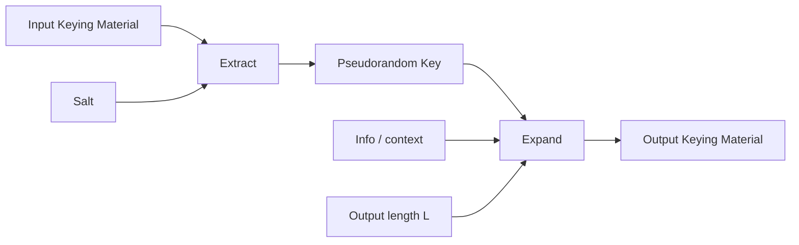
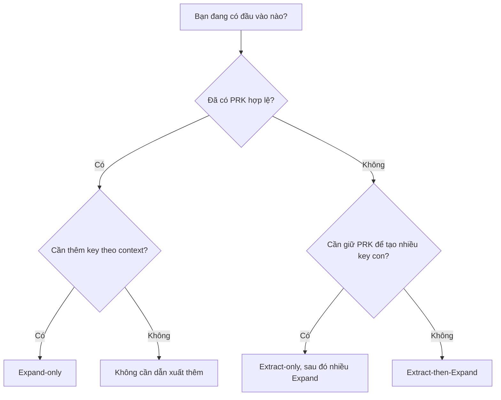

# Phân biệt các bước extract, expand và kết hợp extract với expand

## 1. Vì sao cần hiểu ba cách dẫn xuất khóa?

Một ứng dụng thường bắt đầu với một bí mật gốc (shared secret từ trao đổi khóa, material từ thiết bị bảo mật hoặc một nguồn khóa được quản lý). Từ nguồn đó, hệ thống cần tạo các khóa riêng cho từng mục đích: mã hóa dữ liệu, xác thực thông điệp, bảo vệ một phiên hoặc phân tách các thành phần trong một giao thức. Nếu tự cắt chuỗi byte, nối chuỗi tùy ý hoặc gọi HMAC theo cách không thống nhất, rất dễ tạo ra các khóa có quan hệ không mong muốn hoặc không tương thích với bên còn lại.

Java 25 đưa **Key Derivation Function API** vào nền tảng qua **JEP 510**. API này đã là tính năng chính thức, không còn yêu cầu preview. Trong Java SE 25, thuật toán HKDF theo RFC 5869 có các tên chuẩn `HKDF-SHA256`, `HKDF-SHA384` và `HKDF-SHA512`. Với HKDF, quy trình được chia thành hai bước có mục đích khác nhau:

- **Extract**: chuẩn hóa input keying material (IKM) thành một pseudorandom key (PRK).
- **Expand**: dùng PRK và ngữ cảnh ứng dụng để sinh output keying material (OKM) với độ dài cần thiết.
- **Extract-then-Expand**: thực hiện hai bước liên tiếp trong một lần gọi, là lựa chọn phổ biến khi bắt đầu từ shared secret hoặc IKM chưa được chuẩn hóa thành PRK.

Bài **Phân biệt các bước extract, expand và kết hợp extract với expand** thuộc chương **API dẫn xuất khóa** của học phần **JAVA_VERSION_JAVA25**. Học phần khám phá các khả năng Java 25 còn áp dụng trong phát triển hiện đại, gồm compact source files, module imports, flexible constructor bodies, `ScopedValue`, KDF API, AOT cache, JFR và đánh giá nâng cấp JDK. Bài này tập trung vào cách lựa chọn đúng từng chế độ HKDF và cách gọi API Java 25 hiện hành.

### Sau bài học, bạn có thể

1. Giải thích vai trò của IKM, salt, PRK, info và OKM.
2. Chọn `extractOnly` khi cần tạo PRK có thể tái sử dụng trong nhiều phép Expand.
3. Chọn `expandOnly` khi đã có PRK đủ mạnh và chỉ cần tạo các khóa theo ngữ cảnh.
4. Chọn `thenExpand` để thực hiện Extract và Expand liền nhau cho một mục đích.
5. Sử dụng `KDF.getInstance`, `deriveKey`, `deriveData` và `HKDFParameterSpec` trong Java 25.
6. Phân biệt key object với raw bytes, kiểm tra provider và giới hạn độ dài output.
7. Tránh dùng HKDF như thuật toán băm mật khẩu hoặc tự thiết kế giao thức mật mã.

> **Phạm vi hiện hành:** các ví dụ dùng `javax.crypto.KDF` và `javax.crypto.spec.HKDFParameterSpec` đã final trong Java 25. Không sử dụng tên method từ bản preview cũ, không bật `--enable-preview` và không tự cài đặt HMAC/HKDF bằng vòng lặp trong mã ứng dụng.

## 2. Nền tảng: KDF và HKDF giải quyết vấn đề gì?

### 2.1. KDF không phải hàm băm thông thường

Một hàm băm như SHA-256 nhận dữ liệu và tạo digest. KDF có một mục tiêu khác: **dẫn xuất material cho khóa mật mã từ nguồn đầu vào và ngữ cảnh**, theo một quy trình có phân tích bảo mật.

Ví dụ, sau một phép trao đổi khóa Diffie–Hellman, hai bên có thể thu được cùng một shared secret. Shared secret đó là đầu vào quan trọng, nhưng giao thức thường không nên dùng trực tiếp cùng một byte sequence cho tất cả mục đích. KDF có thể tạo khóa mã hóa và khóa xác thực riêng, có ngữ cảnh rõ ràng.

| Thành phần | Vai trò | Ví dụ |
|---|---|---|
| IKM (Input Keying Material) | Bí mật đầu vào cần xử lý | Shared secret từ ECDH/X25519, secret từ KEM |
| Salt | Giá trị bổ trợ cho bước Extract; thường không cần bí mật | Salt ngẫu nhiên hoặc nonce công khai theo giao thức |
| PRK (Pseudorandom Key) | Kết quả chuẩn hóa của Extract | Khóa trung gian có độ dài HashLen |
| Info | Ngữ cảnh ứng dụng/giao thức cho Expand | `app-v1/encryption/aes-256-gcm` |
| OKM (Output Keying Material) | Byte/key được dẫn xuất cho mục đích cuối | AES key 256-bit, HMAC key |

**Không nhầm IKM với mật khẩu người dùng.** HKDF được thiết kế cho key material có entropy phù hợp, không làm chậm quá trình đoán mật khẩu và không phải password hashing/KDF chuyên dụng. Với mật khẩu, hãy dùng password hashing/password-based derivation phù hợp như Argon2id, scrypt hoặc PBKDF2 theo yêu cầu hệ thống; trong JCA, PBKDF2 được cung cấp qua `SecretKeyFactory` chứ không phải ba thuật toán HKDF của `KDF`.

### 2.2. HKDF là một KDF hai giai đoạn

RFC 5869 định nghĩa HKDF theo mô hình HMAC-based Extract-and-Expand:



Hai bước giải quyết hai việc khác nhau:

- **Extract** tập trung entropy từ IKM thành PRK có định dạng/độ dài phù hợp với hàm băm HMAC đã chọn.
- **Expand** tạo ra một hoặc nhiều đầu ra theo context, từ PRK đó.

RFC cho phép bỏ Extract khi đầu vào đã là một PRK đủ mạnh theo yêu cầu của giao thức. Tuy nhiên, không tự ý bỏ bước chỉ vì IKM “trông có vẻ ngẫu nhiên”; cần căn cứ vào đặc tả giao thức và nguồn tạo khóa.

### 2.3. Công thức để đọc kết quả đúng

Với một hàm băm HMAC được chọn (ví dụ SHA-256), ký hiệu `HashLen` là số byte đầu ra của hàm băm. RFC 5869 mô tả:

```text
HKDF-Extract(salt, IKM) -> PRK

PRK = HMAC-Hash(salt, IKM)

HKDF-Expand(PRK, info, L) -> OKM

N = ceil(L / HashLen)
OKM = first L bytes of T(1) | T(2) | ... | T(N)
```

Ở bước Extract, `salt` là khóa HMAC và `IKM` là dữ liệu được đưa vào HMAC. Không đảo hai đối số này. Ở bước Expand, `PRK` là khóa HMAC; `info` gắn kết quả với mục đích/ngữ cảnh cụ thể.

Các giới hạn quan trọng:

- PRK đầu vào cho Expand phải có ít nhất `HashLen` byte.
- `L` phải lớn hơn 0.
- `L` không được vượt quá `255 × HashLen` theo RFC 5869.
- Với HKDF-SHA256, `HashLen = 32` byte, nên giới hạn output là 8.160 byte.
- `info` có thể rỗng theo RFC, nhưng trong ứng dụng thường nên cung cấp nhãn ngữ cảnh phân biệt mục đích.

### 2.4. Salt và info không có cùng vai trò

| Thuộc tính | Salt | Info |
|---|---|---|
| Dùng ở bước | Extract | Expand |
| Có phải bí mật? | Thường không; RFC định nghĩa salt là giá trị không bí mật | Không cần bí mật |
| Mục tiêu | Hỗ trợ quá trình trích xuất PRK, tăng tính độc lập giữa các lần dùng | Phân tách kết quả theo ứng dụng, giao thức và mục đích |
| Ví dụ | Nonce hoặc salt ngẫu nhiên theo giao thức | `service-A/v2/encryption-key` |
| Có thể lặp? | Tùy thiết kế giao thức; không tự ý tái sử dụng nếu protocol quy định khác | Phải khác nhau giữa các mục đích cần tách biệt |

Salt không thay thế IKM và không phải “mật khẩu thứ hai”. Info không phải khóa bí mật; nó là dữ liệu context được đưa vào Expand để tạo domain separation. Nếu cùng một PRK được dùng để sinh AES key và HMAC key, phải dùng hai info label khác nhau.

## 3. API dẫn xuất khóa trong Java 25

### 3.1. Những kiểu chính

| API | Package | Trách nhiệm |
|---|---|---|
| `KDF` | `javax.crypto` | Tạo đối tượng thực thi thuật toán KDF và gọi phép dẫn xuất |
| `HKDFParameterSpec` | `javax.crypto.spec` | Mô tả chế độ Extract, Expand hoặc Extract-then-Expand |
| `HKDFParameterSpec.Builder` | `javax.crypto.spec` | Tạo spec Extract hoặc ExtractThenExpand |
| `HKDFParameterSpec.Extract` | `javax.crypto.spec` | Đầu vào cho Extract-only |
| `HKDFParameterSpec.Expand` | `javax.crypto.spec` | PRK, info và độ dài cho Expand-only |
| `HKDFParameterSpec.ExtractThenExpand` | `javax.crypto.spec` | Đầu vào cho cả hai bước |
| `SecretKey` | `javax.crypto` | Đại diện key object được dẫn xuất hoặc dùng làm IKM/PRK |

Tạo đối tượng HKDF:

```java
import javax.crypto.KDF;

KDF hkdf = KDF.getInstance("HKDF-SHA256");
```

Các tên thuật toán chuẩn trong Java SE 25:

| Tên | HMAC/hash được dùng | HashLen |
|---|---|---:|
| `HKDF-SHA256` | HMAC-SHA-256 | 32 byte |
| `HKDF-SHA384` | HMAC-SHA-384 | 48 byte |
| `HKDF-SHA512` | HMAC-SHA-512 | 64 byte |

Trong Oracle JDK 25, tài liệu provider liệt kê cả ba thuật toán HKDF trong `SunJCE`. Một Java implementation khác có thể cung cấp provider/thuật toán khác; hãy xác minh trên runtime thực tế bằng `KDF.getInstance(...)`. Không hard-code tên provider trong ứng dụng tổng quát nếu không có yêu cầu triển khai phần cứng/chính sách mật mã cụ thể.

### 3.2. Hai cách nhận output

```java
SecretKey key = hkdf.deriveKey("AES", derivationSpec);
byte[] raw = hkdf.deriveData(derivationSpec);
```

- `deriveKey(alg, spec)` trả về `SecretKey` với thuật toán đích như `AES`, `HmacSHA256` hoặc `Generic`.
- `deriveData(spec)` trả về byte array của output keying material. Phương thức có thể ném `UnsupportedOperationException` nếu material không thể trích xuất (ví dụ key được giữ trong phần cứng và không export được).

**Ưu tiên `deriveKey`** khi output là khóa sẽ dùng tiếp với `Cipher`, `Mac` hoặc một API JCA khác. Dạng `SecretKey` giúp provider giữ representation phù hợp, bao gồm trường hợp key không thể export. Chỉ dùng `deriveData` khi ứng dụng thực sự cần raw bytes và provider cho phép extract.

### 3.3. Cách tạo parameter spec

Java 25 cung cấp ba dạng đầu vào cho HKDF:

```java
// Extract-only
HKDFParameterSpec.Extract extractSpec =
    HKDFParameterSpec.ofExtract()
        .addIKM(ikm)
        .addSalt(salt)
        .extractOnly();

// Expand-only
HKDFParameterSpec.Expand expandSpec =
    HKDFParameterSpec.expandOnly(prk, info, 32);

// Extract-then-Expand
HKDFParameterSpec.ExtractThenExpand combinedSpec =
    HKDFParameterSpec.ofExtract()
        .addIKM(ikm)
        .addSalt(salt)
        .thenExpand(info, 32);
```

`where`/`thenExpand` không thực hiện tính toán mật mã ngay; chúng xây dựng spec mô tả đầu vào. Phép dẫn xuất chỉ chạy khi truyền spec cho `deriveKey` hoặc `deriveData`.

Builder cho phép gọi `addIKM` và `addSalt` nhiều lần, nhận cả `byte[]` và `SecretKey`. Cách này hữu ích khi IKM được ghép từ nhiều thành phần hoặc một phần đang nằm trong thiết bị mật mã không export được. Các phần được thêm vào được giữ theo thứ tự và implementation HKDF kết hợp chúng theo quy tắc của RFC.

## 4. Extract-only: chuẩn hóa IKM thành PRK

### 4.1. Mục đích

Extract-only thực hiện bước:

```text
PRK = HMAC-Hash(salt, IKM)
```

Kết quả PRK có độ dài bằng `HashLen` của thuật toán HKDF. Với HKDF-SHA256, PRK là 32 byte.

Chọn Extract-only khi:

- IKM có thể chưa phân bố đồng đều hoặc được tạo từ một phép trao đổi khóa.
- Bạn cần một PRK trung gian để thực hiện nhiều phép Expand với các info khác nhau.
- Protocol định nghĩa rõ một giai đoạn Extract riêng và nhiều giai đoạn dẫn xuất con.
- Bạn muốn giữ PRK dưới dạng `SecretKey` để tiếp tục sử dụng với provider mà không phải chuyển thành byte array.

Nếu IKM đã là một PRK đủ mạnh theo giao thức, có thể chỉ Expand. Đây là quyết định giao thức, không phải tối ưu hóa tùy tiện.

### 4.2. Java 25: tạo PRK bằng `extractOnly`

```java
import javax.crypto.KDF;
import javax.crypto.SecretKey;
import javax.crypto.spec.HKDFParameterSpec;

public final class ExtractExample {

    public static SecretKey extractPrk(
            byte[] ikm,
            byte[] salt) throws Exception {

        KDF hkdf = KDF.getInstance("HKDF-SHA256");

        HKDFParameterSpec.Extract params =
            HKDFParameterSpec.ofExtract()
                .addIKM(ikm)
                .addSalt(salt)
                .extractOnly();

        // "Generic" là SecretKey algorithm dành cho key material tổng quát.
        return hkdf.deriveKey("Generic", params);
    }
}
```

`Generic` là tên thuật toán `SecretKey` tổng quát, thường dùng để biểu diễn key material đầu vào cho một phép dẫn xuất khác. Không dùng PRK này trực tiếp làm AES key hay HMAC key; PRK là **khóa trung gian** để Expand.

Nếu chỉ cần raw bytes trong một test/lab, có thể gọi `hkdf.deriveData(params)` thay cho `deriveKey("Generic", params)`. Khi dùng raw bytes, ứng dụng phải tự chịu trách nhiệm lưu giữ và xóa bản sao phù hợp; key object không export được có thể khiến `deriveData` không khả dụng.

### 4.3. Salt có bắt buộc không?

RFC 5869 cho phép không cung cấp salt. Khi không có salt, HKDF-Extract sử dụng chuỗi zero có độ dài `HashLen`. Trong API, có thể tạo spec không gọi `addSalt`:

```java
HKDFParameterSpec.Extract params =
    HKDFParameterSpec.ofExtract()
        .addIKM(ikm)
        .extractOnly();
```

Tuy vậy, nếu protocol có salt hoặc có thể tạo salt phù hợp, hãy tuân thủ protocol đó. Không tự bỏ salt chỉ vì API cho phép. Salt thường không cần giữ bí mật và có thể được truyền cùng dữ liệu phiên theo thiết kế.

### 4.4. Nhiều phần IKM và salt

Builder cho phép ghép nhiều phần:

```java
HKDFParameterSpec.Extract params =
    HKDFParameterSpec.ofExtract()
        .addIKM(protocolLabel)
        .addIKM(sharedSecret)
        .addIKM(additionalSecret)
        .addSalt(peerNonce)
        .addSalt(localNonce)
        .extractOnly();
```

Implementation HKDF kết hợp các IKM và salt theo thứ tự được thêm. Điều này đặc biệt hữu ích khi một phần IKM là `SecretKey` không export được từ hardware provider. Không tự ghép các thành phần theo một thứ tự tùy ý: thứ tự, label và encoding phải khớp với đặc tả giao thức của cả hai bên.

### 4.5. Điều gì Extract không làm?

Extract không:

- Mã hóa dữ liệu hoặc tạo ciphertext.
- Tạo entropy mới từ nguồn đầu vào hoàn toàn không có entropy.
- Thay thế một phép trao đổi khóa an toàn.
- Tăng chi phí đoán mật khẩu theo kiểu password hashing.
- Tự sinh một nhóm khóa cuối cùng cho từng mục đích.

Extract chỉ tạo PRK từ IKM và salt theo HKDF. Nếu nguồn IKM bị lộ hoặc không đủ entropy, Extract không thể biến nó thành một bí mật mạnh hơn nguồn ban đầu.


## 5. Expand-only: tạo output từ một PRK đã có

### 5.1. Mục đích

Expand-only thực hiện:

```text
OKM = HKDF-Expand(PRK, info, L)
```

Chế độ này phù hợp khi ứng dụng **đã có PRK** từ một bước Extract trước đó hoặc từ một giao thức đã quy định rõ cách tạo PRK. Nó không nhận IKM và salt; nó nhận PRK, info và độ dài output.

Dùng Expand-only khi:

- Một lần Extract đã tạo PRK, sau đó cần nhiều khóa con.
- Hai bên đã có PRK theo đúng giao thức và cần dẫn xuất khóa theo label khác nhau.
- IKM đầu vào đã là một pseudorandom key đủ mạnh theo contract giao thức, nên Extract không cần thiết.
- Muốn tách bước chuẩn hóa secret khỏi bước tạo từng khóa mục đích.

**Không truyền shared secret thô vào vị trí PRK chỉ để bỏ Extract.** PRK phải thỏa yêu cầu của HKDF Expand; thông thường nó là kết quả Extract.

### 5.2. Java 25: gọi `expandOnly`

Giả sử `prk` đã được tạo bằng Extract-only hoặc được cung cấp an toàn bởi một giao thức:

```java
import javax.crypto.KDF;
import javax.crypto.SecretKey;
import javax.crypto.spec.HKDFParameterSpec;

public final class ExpandExample {

    public static SecretKey expandAesKey(
            SecretKey prk,
            byte[] info) throws Exception {

        KDF hkdf = KDF.getInstance("HKDF-SHA256");

        HKDFParameterSpec.Expand params =
            HKDFParameterSpec.expandOnly(prk, info, 32);

        return hkdf.deriveKey("AES", params);
    }
}
```

`HKDFParameterSpec.expandOnly(prk, info, 32)` mô tả phép Expand tạo 32 byte output. `deriveKey("AES", params)` yêu cầu kết quả được biểu diễn dưới dạng `SecretKey` thuật toán `AES`.

Nếu cần raw output bytes thay vì key object, dùng `deriveData(params)`. Với key không export được, phương thức raw data có thể không khả dụng; dùng `deriveKey` để giữ key ở dạng `SecretKey` nếu provider hỗ trợ.

### 5.3. `info` tạo domain separation

Một PRK có thể tạo nhiều output. Để tránh sử dụng cùng một output cho nhiều mục đích, hãy đưa nhãn mục đích vào `info`:

```java
byte[] encryptionInfo =
    "orders-service/v1/encryption/aes-256-gcm"
        .getBytes(StandardCharsets.UTF_8);

byte[] authenticationInfo =
    "orders-service/v1/authentication/hmac-sha256"
        .getBytes(StandardCharsets.UTF_8);

SecretKey encryptionKey =
    hkdf.deriveKey("AES",
        HKDFParameterSpec.expandOnly(prk, encryptionInfo, 32));

SecretKey authenticationKey =
    hkdf.deriveKey("HmacSHA256",
        HKDFParameterSpec.expandOnly(prk, authenticationInfo, 32));
```

Hai phép Expand dùng chung PRK nhưng khác `info` và thuật toán đích. Điều này tạo các output theo ngữ cảnh riêng. Các nhãn trong ví dụ chỉ minh họa; trong giao thức thực, cả hai bên phải thống nhất **chính xác byte sequence** của info, bao gồm encoding, thứ tự trường, version và role nếu có.

Không chỉ đặt nhãn “encryption” và “authentication” nếu protocol cần phân biệt thêm client/server, direction, epoch hoặc session. Domain separation phải theo đặc tả giao thức, không tự đặt một chuỗi tùy ý rồi kỳ vọng tương thích với implementation khác.

### 5.4. Giới hạn độ dài Expand

Với HKDF, độ dài output `L` phải:

- Lớn hơn 0.
- Không vượt quá `255 × HashLen`.
- Phù hợp với kích thước khóa của thuật toán đích.

Ví dụ HKDF-SHA256 có HashLen 32 byte, nên tối đa theo RFC là `255 × 32 = 8.160` byte. Điều đó **không có nghĩa** nên tạo một khóa AES dài 8.160 byte; mỗi thuật toán đích có kích thước key hợp lệ riêng. Với AES-256, yêu cầu 32 byte; với HMAC-SHA-256, độ dài khóa cần được chọn theo chính sách và đặc tả giao thức.

### 5.5. Khi nào không nên dùng Expand-only?

Không dùng Expand-only khi bạn chỉ có một mật khẩu hoặc một secret có entropy không rõ và chưa có quy trình chuẩn hóa phù hợp. Cũng không dùng nó để tự “bù” cho IKM ngắn hoặc yếu. Nếu đầu vào chưa phải PRK, hãy làm đúng Extract-then-Expand theo giao thức.

## 6. Extract-then-Expand: thực hiện hai bước trong một lần gọi

### 6.1. Mục đích

Extract-then-Expand là mô hình mặc định phổ biến khi bắt đầu từ IKM. Nó thực hiện:

```text
PRK = HKDF-Extract(salt, IKM)
OKM = HKDF-Expand(PRK, info, L)
```

Chọn chế độ kết hợp khi:

- Đầu vào là shared secret vừa thu được từ key agreement hoặc KEM.
- Ứng dụng cần một khóa cuối cho một mục đích cụ thể.
- Không cần giữ PRK làm trạng thái trung gian cho nhiều bước sau.
- Muốn API diễn đạt rõ một phép dẫn xuất hoàn chỉnh với salt, info và output length.

### 6.2. Java 25: `thenExpand`

```java
import java.nio.charset.StandardCharsets;
import javax.crypto.KDF;
import javax.crypto.SecretKey;
import javax.crypto.spec.HKDFParameterSpec;

public final class CombinedExample {

    public static SecretKey deriveAesKey(
            byte[] ikm,
            byte[] salt) throws Exception {

        byte[] info = "orders/v1/encryption/aes-256-gcm"
            .getBytes(StandardCharsets.UTF_8);

        KDF hkdf = KDF.getInstance("HKDF-SHA256");

        HKDFParameterSpec.ExtractThenExpand params =
            HKDFParameterSpec.ofExtract()
                .addIKM(ikm)
                .addSalt(salt)
                .thenExpand(info, 32);

        return hkdf.deriveKey("AES", params);
    }
}
```

Phân tích:

1. `ofExtract()` tạo builder cho đầu vào Extract.
2. `addIKM(ikm)` cung cấp input keying material.
3. `addSalt(salt)` thêm salt.
4. `thenExpand(info, 32)` hoàn tất spec Extract-then-Expand với context và output length.
5. `deriveKey("AES", params)` thực hiện toàn bộ phép dẫn xuất và trả về key AES.

Không cần tự gọi HMAC để lấy PRK rồi lại tự chạy HMAC vòng lặp Expand. API và provider chịu trách nhiệm triển khai HKDF theo thuật toán được chọn.

### 6.3. Ví dụ hoàn chỉnh tạo khóa AES-256 trong lab

Đoạn dưới đây dùng byte ngẫu nhiên làm IKM để minh họa cách gọi API. Trong ứng dụng thực, IKM thường đến từ một nguồn secret đã được xác định như shared secret của key agreement/KEM hoặc key material do hệ thống bảo mật quản lý; không thay thế protocol bằng cách tạo một mảng ngẫu nhiên mới cho mỗi lần mã hóa.

```java
// File: HkdfAesKeyDemo.java — Java 25, không cần preview.
import java.nio.charset.StandardCharsets;
import java.security.SecureRandom;
import javax.crypto.KDF;
import javax.crypto.SecretKey;
import javax.crypto.spec.HKDFParameterSpec;

public final class HkdfAesKeyDemo {

    public static void main(String[] args) throws Exception {
        SecureRandom random = new SecureRandom();

        // Chỉ là IKM thử nghiệm; production cần nguồn key material đúng protocol.
        byte[] ikm = new byte[32];
        random.nextBytes(ikm);

        // Salt không cần bí mật; cần lưu/truyền nếu protocol phải dẫn xuất lại.
        byte[] salt = new byte[32];
        random.nextBytes(salt);

        byte[] info =
            "demo-service/v1/aes-256-gcm".getBytes(StandardCharsets.UTF_8);

        KDF hkdf = KDF.getInstance("HKDF-SHA256");

        HKDFParameterSpec.ExtractThenExpand params =
            HKDFParameterSpec.ofExtract()
                .addIKM(ikm)
                .addSalt(salt)
                .thenExpand(info, 32);

        SecretKey aesKey = hkdf.deriveKey("AES", params);

        System.out.println("KDF: " + hkdf.getAlgorithm());
        System.out.println("Derived key algorithm: " + aesKey.getAlgorithm());
        System.out.println("Derived AES key ready");
        // Không in aesKey.getEncoded() hoặc giá trị secret ra log.
    }
}
```

Ví dụ chỉ xác minh rằng API có thể tạo một `SecretKey` AES. Nó chưa mã hóa dữ liệu, chưa chứng minh hai bên đồng bộ salt/info và chưa thay thế một giao thức quản lý khóa hoàn chỉnh. Trong production, salt, context và thông tin phiên phải được lưu/truyền theo protocol; không dùng một salt mới không được chia sẻ rồi mong hai bên dẫn xuất cùng khóa.

### 6.4. Khi nào combined là lựa chọn phù hợp?

Nếu mỗi lần handshake tạo một shared secret và cần một khóa phiên, Extract-then-Expand thường là cách diễn đạt dễ kiểm tra nhất. Nếu cùng một PRK cần tạo nhiều khóa con với context khác nhau, hãy tách Extract và thực hiện nhiều phép Expand. Hai cách cho cùng kết quả khi sử dụng **cùng thuật toán, IKM, salt, info và độ dài**.

## 7. So sánh ba chế độ và cách chọn

| Tiêu chí | Extract-only | Expand-only | Extract-then-Expand |
|---|---|---|---|
| Input chính | IKM, salt | PRK, info, L | IKM, salt, info, L |
| Output | PRK | OKM | OKM |
| Số giai đoạn thực hiện | Chỉ Extract | Chỉ Expand | Cả hai |
| Cần IKM? | Có | Không | Có |
| Cần PRK sẵn? | Không | Có | Không |
| Cần info? | Không | Có (có thể rỗng theo RFC) | Có (có thể rỗng theo RFC) |
| Dùng khi | Chuẩn hóa secret trung gian | Đã có PRK, cần key theo mục đích | Tạo khóa cuối từ IKM trong một flow |
| API Java | `extractOnly()` + `deriveKey/deriveData` | `expandOnly(...)` + `deriveKey/deriveData` | `thenExpand(...)` + `deriveKey/deriveData` |

Quyết định nhanh:



Không chọn chế độ chỉ vì nó có ít dòng code hơn. Căn cứ vào **trạng thái đầu vào** và **cấu trúc giao thức**: PRK đã có chưa, có cần tái sử dụng PRK cho nhiều nhãn hay không, và hai bên có thống nhất các tham số không.


## 8. Tách Extract một lần, Expand nhiều khóa con

Một lý do quan trọng để dùng Extract-only là **một PRK có thể làm gốc cho nhiều phép Expand**. Mỗi phép Expand nên có `info` riêng để tách mục đích của khóa.

### 8.1. Tạo PRK rồi dẫn xuất hai khóa khác nhau

Ví dụ dưới đây tạo khóa AES và HMAC từ cùng một PRK:

```java
import java.nio.charset.StandardCharsets;
import javax.crypto.KDF;
import javax.crypto.SecretKey;
import javax.crypto.spec.HKDFParameterSpec;

public final class MultipleDerivedKeys {

    public static void main(String[] args) throws Exception {
        byte[] ikm = loadSharedSecretFromKeyAgreement();
        byte[] salt = loadProtocolSalt();

        KDF hkdf = KDF.getInstance("HKDF-SHA256");

        HKDFParameterSpec.Extract extractParams =
            HKDFParameterSpec.ofExtract()
                .addIKM(ikm)
                .addSalt(salt)
                .extractOnly();

        SecretKey prk = hkdf.deriveKey("Generic", extractParams);

        byte[] encryptionInfo =
            "service/v1/encryption/aes-256-gcm"
                .getBytes(StandardCharsets.UTF_8);

        byte[] authenticationInfo =
            "service/v1/authentication/hmac-sha256"
                .getBytes(StandardCharsets.UTF_8);

        SecretKey aesKey = hkdf.deriveKey(
            "AES",
            HKDFParameterSpec.expandOnly(prk, encryptionInfo, 32)
        );

        SecretKey macKey = hkdf.deriveKey(
            "HmacSHA256",
            HKDFParameterSpec.expandOnly(prk, authenticationInfo, 32)
        );

        System.out.println(aesKey.getAlgorithm());
        System.out.println(macKey.getAlgorithm());
    }

    private static byte[] loadSharedSecretFromKeyAgreement() {
        throw new UnsupportedOperationException("Thay bằng key agreement của ứng dụng");
    }

    private static byte[] loadProtocolSalt() {
        throw new UnsupportedOperationException("Thay bằng salt theo protocol");
    }
}
```

Hai method `load...` là placeholder cho integration thực tế; ví dụ này tập trung vào phần dẫn xuất. Không copy nguyên class và kỳ vọng nó chạy độc lập. Trong production, lấy shared secret từ một key agreement/KEM đã được cấu hình đúng, và lấy salt theo protocol.

### 8.2. Tại sao hai khóa phải có `info` khác nhau?

Nếu cùng PRK, cùng `info`, cùng độ dài và cùng thuật toán HKDF, output sẽ giống nhau. Để tách khóa theo mục đích, info phải thể hiện đủ ngữ cảnh, chẳng hạn:

| Khóa | Info gợi ý |
|---|---|
| AES encryption | `orders/v1/key/encryption/aes-256-gcm` |
| HMAC authentication | `orders/v1/key/authentication/hmac-sha256` |
| Client-to-server | `orders/v1/direction/client-to-server` |
| Server-to-client | `orders/v1/direction/server-to-client` |
| Key cho epoch mới | `orders/v1/epoch/42` |

Trong protocol thực, cần thống nhất encoding và cách ghép các trường. Nếu các thành phần có độ dài thay đổi, không nối chuỗi tùy tiện theo kiểu `"ab" + "c"` vì có thể trùng biểu diễn với `"a" + "bc"`. Dùng cấu trúc được chuẩn hóa, length-prefix hoặc encoding có trường rõ ràng.

### 8.3. Không dùng lại khóa đầu ra cho mục đích khác

HKDF cho phép tạo nhiều khóa con, nhưng không có nghĩa một khóa AES có thể dùng làm HMAC key hoặc ngược lại. Hãy chọn `alg` phù hợp trong `deriveKey` và tách `info` cho từng mục đích. Không đưa một output vào nhiều primitive chỉ để giảm số lần dẫn xuất.

## 9. Kiểm thử kết quả theo RFC 5869

Kiểm thử mật mã nên có **test vector chuẩn**. Việc hai lần chạy cùng tham số cho cùng output chỉ chứng minh tính xác định của phép gọi; nó chưa đủ chứng minh triển khai tương thích RFC.

### 9.1. Test vector HKDF-SHA256 của RFC 5869

RFC 5869, Appendix A.1, đưa ra một test vector SHA-256 với:

- IKM: byte `0b` lặp 22 lần.
- Salt: `000102030405060708090a0b0c`.
- Info: `f0f1f2f3f4f5f6f7f8f9`.
- Output length: 42 byte.

Kết quả OKM mong đợi:

```text
3cb25f25faacd57a90434f64d0362f2a
2d2d0a90cf1a5a4c5db02d56ecc4c5bf
34007208d5b887185865
```

Test JUnit 5:

```java
import static org.junit.jupiter.api.Assertions.assertArrayEquals;

import java.util.HexFormat;
import javax.crypto.KDF;
import javax.crypto.spec.HKDFParameterSpec;
import org.junit.jupiter.api.Test;

class HkdfRfc5869Test {

    @Test
    void matchesRfc5869Sha256TestCaseOne() throws Exception {
        byte[] ikm = HexFormat.of().parseHex("0b".repeat(22));
        byte[] salt = HexFormat.of().parseHex(
            "000102030405060708090a0b0c"
        );
        byte[] info = HexFormat.of().parseHex(
            "f0f1f2f3f4f5f6f7f8f9"
        );
        byte[] expected = HexFormat.of().parseHex(
            "3cb25f25faacd57a90434f64d0362f2a"
          + "2d2d0a90cf1a5a4c5db02d56ecc4c5bf"
          + "34007208d5b887185865"
        );

        KDF hkdf = KDF.getInstance("HKDF-SHA256");

        HKDFParameterSpec.ExtractThenExpand params =
            HKDFParameterSpec.ofExtract()
                .addIKM(ikm)
                .addSalt(salt)
                .thenExpand(info, 42);

        byte[] actual = hkdf.deriveData(params);

        assertArrayEquals(expected, actual);
    }
}
```

Test này dùng `deriveData` vì RFC vector được biểu diễn dưới dạng raw bytes. Nó phù hợp với test/lab trên provider cho phép export output. Nếu provider dùng key không extractable, hãy kiểm tra phần key object qua API thích hợp hoặc chạy test vector trên một provider software được phê duyệt; không thay thế bằng cách export bí mật từ HSM trái với chính sách.

### 9.2. Kiểm thử tách bước và combined cho cùng kết quả

Với cùng IKM, salt, info, thuật toán và độ dài, phép Extract-then-Expand phải cho cùng output với Extract-only rồi Expand-only:

```java
import static org.junit.jupiter.api.Assertions.assertArrayEquals;

import java.nio.charset.StandardCharsets;
import javax.crypto.KDF;
import javax.crypto.SecretKey;
import javax.crypto.spec.HKDFParameterSpec;
import org.junit.jupiter.api.Test;

class HkdfModeEquivalenceTest {

    @Test
    void splitExtractAndExpandMatchesCombinedMode() throws Exception {
        byte[] ikm = new byte[32];
        byte[] salt = new byte[32];
        byte[] info = "demo/v1/encryption".getBytes(StandardCharsets.UTF_8);

        // Dữ liệu test cố định; không dùng làm secret production.
        for (int i = 0; i < ikm.length; i++) {
            ikm[i] = (byte) (i + 1);
            salt[i] = (byte) (100 + i);
        }

        KDF hkdf = KDF.getInstance("HKDF-SHA256");

        SecretKey combined = hkdf.deriveKey(
            "AES",
            HKDFParameterSpec.ofExtract()
                .addIKM(ikm)
                .addSalt(salt)
                .thenExpand(info, 32)
        );

        SecretKey prk = hkdf.deriveKey(
            "Generic",
            HKDFParameterSpec.ofExtract()
                .addIKM(ikm)
                .addSalt(salt)
                .extractOnly()
        );

        SecretKey split = hkdf.deriveKey(
            "AES",
            HKDFParameterSpec.expandOnly(prk, info, 32)
        );

        // Chỉ đọc encoding trong test trên software provider extractable.
        assertArrayEquals(combined.getEncoded(), split.getEncoded());
    }
}
```

Trong production, không nên gọi `getEncoded()` chỉ để so sánh hoặc log key. Test trên giả định provider lab trả key software có thể export; key lưu trong hardware provider có thể không trả raw encoding.

### 9.3. Kiểm thử điều kiện biên

Bổ sung các ca kiểm thử cho:

- `length` bằng 0 hoặc âm: không hợp lệ.
- `length` lớn hơn `255 × HashLen`: provider phải từ chối.
- `prk` thiếu độ dài theo yêu cầu HMAC: Expand không hợp lệ.
- Sai thuật toán hoặc provider không hỗ trợ: kiểm tra `NoSuchAlgorithmException` hoặc `InvalidAlgorithmParameterException`.
- `info` khác nhau: output phải được tách theo context.
- IKM/salt có nhiều phần: thứ tự `addIKM`/`addSalt` phải giống nhau ở hai bên.

Không chỉ kiểm tra rằng “không ném exception”. Một ca test cần xác minh đúng thuật toán, đúng tham số, đúng output hoặc lỗi phù hợp.
## 10. Provider, key object và khả năng tương thích

### 10.1. Tên thuật toán không đảm bảo mọi provider đều giống nhau

Java Cryptography Architecture (JCA) cho phép provider cung cấp implementation. Java SE 25 quy định tên chuẩn `HKDF-SHA256`, `HKDF-SHA384` và `HKDF-SHA512`. Tài liệu Oracle JDK 25 liệt kê ba thuật toán này trong `SunJCE`; một provider khác có thể không hỗ trợ tất cả.

Kiểm tra trên runtime thật:

```java
import javax.crypto.KDF;

KDF hkdf = KDF.getInstance("HKDF-SHA256");
System.out.println(hkdf.getAlgorithm());
```

Nếu không có provider hỗ trợ thuật toán, `getInstance` ném `NoSuchAlgorithmException`. Nếu provider tồn tại nhưng không hỗ trợ tham số/key material cụ thể, thao tác có thể ném `InvalidAlgorithmParameterException`.

### 10.2. Không chỉ định provider một cách tùy tiện

Trong ứng dụng tổng quát, thường nên gọi:

```java
KDF hkdf = KDF.getInstance("HKDF-SHA256");
```

thay vì cố định:

```java
// Không nên hard-code nếu không có yêu cầu triển khai cụ thể.
KDF hkdf = KDF.getInstance("HKDF-SHA256", "SunJCE");
```

Việc chỉ định provider có thể cần thiết khi tổ chức yêu cầu một HSM, PKCS#11 token hoặc provider đã được kiểm định. Nếu không, hard-code provider làm giảm khả năng thay thế implementation và bỏ qua provider tối ưu hơn.

### 10.3. Delayed provider selection

Nếu không chỉ định provider, `KDF.getInstance` có thể trì hoãn việc chọn provider đến lúc gọi `deriveKey`/`deriveData`. Điều này giúp provider được chọn có khả năng xử lý key material thực tế, kể cả key không export được.

Nếu gọi `getProviderName()` hoặc `getParameters()` quá sớm, provider có thể được chọn trước khi API nhìn thấy key material. Provider được chọn lúc đó có thể không hỗ trợ key được truyền vào sau này; vì vậy chỉ kiểm tra provider sau một phép dẫn xuất thực tế khi cần chẩn đoán.

### 10.4. `KDF` và `HKDFParameterSpec.Builder` không thread-safe

Javadoc Java 25 ghi rõ các method trên `KDF` không được bảo đảm thread-safe; `HKDFParameterSpec.Builder` cũng không thread-safe. Với xử lý đồng thời:

- Tạo `KDF` instance riêng cho từng tác vụ/thread, hoặc đồng bộ hóa nếu dùng chung.
- Tạo Builder riêng cho mỗi lần xây parameter spec.
- Không chia sẻ một Builder đang được xây dở giữa nhiều thread.
- `SecretKey` đầu ra có thể được truyền theo contract của API sử dụng, nhưng không biến object mutable khác trong ứng dụng thành thread-safe.

### 10.5. Giữ key ở dạng `SecretKey` khi có thể

`deriveKey` trả về `SecretKey` để các API mật mã tiếp tục sử dụng. `deriveData` xuất raw bytes và có thể không hoạt động với key không export được. Vì thế:

- Dùng `deriveKey("AES", spec)` nếu output là khóa AES.
- Dùng `deriveKey("HmacSHA256", spec)` nếu output là khóa HMAC.
- Dùng `deriveKey("Generic", extractSpec)` để biểu diễn PRK trung gian trong flow Expand-only.
- Chỉ dùng `deriveData` khi cần byte array và provider cho phép trích xuất.

Không in key ra log, không đưa key vào exception message, telemetry hoặc metric label. Không lưu khóa raw trong file cấu hình chỉ để tránh gọi lại KDF.

## 11. Ranh giới bảo mật: HKDF không phải password hashing

HKDF là KDF cho key material có entropy thích hợp. Nó được thiết kế nhanh, không có tham số work factor để làm chậm việc thử mật khẩu hàng loạt. Vì vậy, **không dùng HKDF-SHA256 trực tiếp với password người dùng** để tạo khóa lưu trữ mật khẩu hoặc thay thế password hashing.

| Nhu cầu | Cơ chế phù hợp |
|---|---|
| Tạo khóa phiên từ shared secret ECDH/X25519/KEM | HKDF với tham số theo protocol |
| Dẫn xuất các khóa con theo mục đích từ PRK | HKDF Expand với info tách biệt |
| Lưu password đăng nhập | Password hashing như Argon2id hoặc scrypt; PBKDF2 khi chính sách/chuẩn yêu cầu |
| Tạo số ngẫu nhiên hoặc nonce | `SecureRandom` theo yêu cầu primitive |
| Mã hóa dữ liệu | `Cipher` với thuật toán/mode/nonce phù hợp |
| Xác thực thông điệp | `Mac` hoặc AEAD theo protocol |

JDK 25 có tên `PBKDF2WithHmacSHA256` trong `SecretKeyFactory` của provider phù hợp, nhưng đó là một API/thuật toán khác. Nếu hệ thống yêu cầu Argon2id, cần thư viện/provider hỗ trợ đã được đánh giá; không giả định JDK 25 `KDF` có sẵn Argon2.

### 11.1. Quy tắc chọn IKM

IKM cần đến từ nguồn có entropy và lifecycle được xác định. Ví dụ:

- Shared secret tạo từ một phép key agreement đúng tham số.
- Shared secret từ KEM đã được decapsulate thành công.
- Secret do một HSM hoặc hệ thống quản lý khóa cung cấp.
- Material tổng hợp theo một protocol đã đặc tả.

Không lấy một chuỗi tên người dùng, tenant ID, số điện thoại, timestamp hoặc một UUID không bí mật làm IKM để sinh khóa bảo mật. Các giá trị này có thể làm context/info, nhưng không thay thế nguồn secret.

### 11.2. Quy tắc chọn salt và info

- Dùng salt theo protocol; nếu tự thiết kế ứng dụng, ưu tiên salt ngẫu nhiên hoặc nguồn salt phù hợp, không cần giữ bí mật.
- Lưu hoặc truyền salt nếu cần bên kia dẫn xuất lại cùng khóa.
- Dùng info để gắn kết quả với protocol/version/role/direction/purpose.
- Cả hai phía phải sử dụng cùng encoding và byte sequence.
- Không dùng cùng một info cho hai mục đích cần tách biệt.
- Không nhét bí mật cần bảo vệ vào info; info không phải secret key.

### 11.3. Quy tắc chọn độ dài và thuật toán đích

Độ dài output của HKDF không tự quyết định khóa đó hợp lệ với thuật toán nào. Ví dụ:

| Output | Độ dài minh họa | Thuật toán đích |
|---|---:|---|
| AES-128 | 16 byte | `AES` |
| AES-256 | 32 byte | `AES` |
| HMAC-SHA-256 | Chọn theo policy/protocol; ví dụ 32 byte | `HmacSHA256` |
| PRK HKDF-SHA256 | 32 byte | `Generic` trong flow trung gian |

Không yêu cầu output 8.160 byte chỉ vì đó là giới hạn RFC. Hãy sinh đúng độ dài mà primitive đích yêu cầu và protocol đã định nghĩa.


## 12. Chẩn đoán lỗi khi dùng KDF API

| Triệu chứng | Nguyên nhân thường gặp | Cách xử lý |
|---|---|---|
| `NoSuchAlgorithmException: HKDF-SHA256` | Provider trên runtime không cung cấp thuật toán | Kiểm tra JDK/vendor/provider và tên thuật toán chuẩn |
| `InvalidAlgorithmParameterException` | Spec không hợp lệ, PRK/length không được hỗ trợ hoặc provider không nhận dạng tham số | Kiểm tra loại `HKDFParameterSpec`, HashLen và output length |
| `IllegalArgumentException` khi tạo spec | `length` bằng 0 hoặc âm | Đặt output length lớn hơn 0 |
| Expand bị từ chối | PRK không đủ độ dài cho hash đã chọn | Dùng PRK hợp lệ từ Extract đúng thuật toán |
| `UnsupportedOperationException` từ `deriveData` | Provider không cho export output keying material | Dùng `deriveKey` và giữ kết quả ở dạng `SecretKey` |
| Hai bên tạo khóa khác nhau | Khác salt, info, IKM, algorithm, length hoặc encoding | So sánh từng byte parameter theo protocol |
| AES key không dùng được với `Cipher` | Sai thuật toán đích, sai độ dài hoặc key provider không tương thích | Dùng `deriveKey("AES", ...)` và kiểm tra provider/cipher |
| Output giống nhau cho hai mục đích | Tái sử dụng cùng PRK, info, độ dài và thuật toán | Thiết kế info label riêng cho từng mục đích |
| Không thể dùng `getProviderName()` để kiểm tra key hardware | Provider bị chọn trước khi đưa key material vào | Thực hiện phép dẫn xuất trước rồi kiểm tra provider |
| Lỗi trong môi trường HSM nhưng chạy trên máy dev | Provider software và hardware hỗ trợ key/parameter khác nhau | Test trên đúng token, provider, quyền và cấu hình production |

### 12.1. Quy trình kiểm tra theo thứ tự

1. Xác nhận runtime là JDK 25 hoặc Java implementation hỗ trợ `javax.crypto.KDF`.
2. Kiểm tra `KDF.getInstance("HKDF-SHA256")` thành công.
3. Xác nhận provider hỗ trợ dạng key material đang dùng: `byte[]` hay `SecretKey` không export được.
4. Kiểm tra đúng chế độ spec: `extractOnly`, `expandOnly` hoặc `thenExpand`.
5. Kiểm tra salt, info, IKM và PRK được cung cấp theo đúng protocol, đúng thứ tự.
6. Xác minh output length và thuật toán đích.
7. So sánh kết quả với RFC test vector hoặc một implementation đã được kiểm định.
8. Nếu dùng HSM/PKCS#11, chạy test trên chính provider và thiết bị triển khai; không coi test trên SunJCE software là bằng chứng HSM tương thích.

Không tự sửa lỗi bằng cách đổi thuật toán xuống SHA-1 hoặc tắt policy bảo mật. Nếu provider không hỗ trợ thuật toán mong muốn, chọn một provider/implementation đã được phê duyệt và kiểm tra khả năng tương thích của toàn bộ hệ thống.

## 13. Bài thực hành tổng hợp

### 13.1. Bài A — So sánh Extract-only và Expand-only

Viết một chương trình thực hiện:

1. Tạo IKM và salt cho môi trường lab.
2. Dùng `extractOnly` để lấy `SecretKey prk` bằng `deriveKey("Generic", ...)`.
3. Dùng `expandOnly(prk, info, 32)` để tạo AES-256 key.
4. Thay info bằng một nhãn khác và tạo HMAC key.
5. Ghi lại algorithm name và số lần dẫn xuất; không ghi raw key.

Câu hỏi: vì sao hai khóa con có thể dùng chung PRK nhưng cần info khác nhau?

### 13.2. Bài B — So sánh combined với split flow

Dùng cùng một IKM, salt, info và output length:

- Nhánh 1: `ofExtract().addIKM(...).addSalt(...).thenExpand(...)`.
- Nhánh 2: `extractOnly()` để lấy PRK, rồi `expandOnly(...)`.

So sánh output trong một test trên provider software có thể export key. Hai kết quả phải giống nhau khi tất cả tham số giống nhau.

### 13.3. Bài C — Xác minh RFC 5869

Chạy test vector HKDF-SHA256 ở mục 9.1. Nếu kết quả khác:

- Kiểm tra chính xác IKM có 22 byte `0b`.
- Kiểm tra salt và info theo hex.
- Kiểm tra output length là 42 byte.
- Kiểm tra đang gọi `HKDF-SHA256`.
- Kiểm tra không đảo `salt` và `IKM`.

Không chấp nhận test chỉ vì không có exception; phải so byte array với expected vector.

### 13.4. Bài D — Domain separation

Từ một PRK, tạo ba khóa:

| Khóa | Info | Output length |
|---|---|---:|
| AES encryption | `app/v1/key/encryption/aes-256-gcm` | 32 byte |
| HMAC authentication | `app/v1/key/authentication/hmac-sha256` | 32 byte |
| Client-to-server traffic | `app/v1/key/direction/client-to-server` | Theo protocol |

Giải thích vì sao không dùng chung một info string cho cả ba. Đối chiếu cách mã hóa context để hai bên tạo ra cùng bytes.

### 13.5. Bài E — IKM không export được

Trong môi trường có HSM hoặc provider hỗ trợ non-extractable `SecretKey`:

1. Nhận IKM dưới dạng `SecretKey`.
2. Gọi `addIKM(secretKey)` thay vì export bytes.
3. Thử `deriveKey` để giữ output ở dạng key object.
4. Thử `deriveData` và ghi nhận nếu provider từ chối export.
5. So sánh hành vi trên provider software và hardware theo chính sách tổ chức.

Không giả lập “non-extractable key” bằng một object `SecretKey` tùy chỉnh trong production. Dùng cơ chế key handle của provider thực tế.

### 13.6. Tiêu chí nghiệm thu

| Tiêu chí | Bằng chứng |
|---|---|
| API Java 25 | Dùng `javax.crypto.KDF` và `HKDFParameterSpec` chính thức, không preview |
| Extract-only | Tạo được PRK từ IKM và salt |
| Expand-only | Dùng PRK hợp lệ tạo output theo info/length |
| Combined | Dẫn xuất được output trong một spec `thenExpand` |
| Tương đương | Split flow và combined cho cùng kết quả với tham số giống nhau |
| RFC vector | Test case 1 của RFC 5869 cho output đúng |
| Domain separation | Các mục đích có info labels khác nhau |
| Provider | Xác minh thuật toán trên runtime/provider đích |
| Key handling | Không log hoặc export raw key ngoài nhu cầu test |
| Password safety | Không dùng HKDF trực tiếp làm password hashing |
| Protocol | Salt/info/encoding/length khớp đặc tả hai bên |

## 14. Checklist áp dụng trong dự án thực tế

Trước khi đưa HKDF vào một ứng dụng:

- [ ] Nguồn IKM là shared secret/key material phù hợp, không phải password có entropy thấp.
- [ ] Đặc tả giao thức xác định rõ HKDF hash, salt, info và output length.
- [ ] Chọn Extract-only, Expand-only hoặc Extract-then-Expand theo đúng trạng thái đầu vào.
- [ ] Info phân biệt protocol, version, role, direction và mục đích khi cần.
- [ ] Không tái sử dụng một output key cho nhiều primitive.
- [ ] Output length hợp lệ theo cả HKDF và thuật toán đích.
- [ ] Dùng `deriveKey` nếu cần giữ key trong `SecretKey`/provider.
- [ ] Đã kiểm tra provider và phần cứng thực tế; không chỉ kiểm tra trên laptop.
- [ ] Có test vector RFC và test tương đương giữa split/combined.
- [ ] Không in key, PRK hoặc IKM ra log, exception, metrics hay trace.
- [ ] Đã xem xét lifecycle, lưu trữ và xóa các byte array tạm theo chính sách.
- [ ] Không tự triển khai HMAC/HKDF hoặc tự thiết kế protocol nếu có đặc tả chuẩn.

## 15. Tài liệu tham khảo và phạm vi phiên bản

Các nguồn dưới đây mô tả API đã final và chuẩn HKDF đang áp dụng:

- [JEP 510 — Key Derivation Function API](https://openjdk.org/jeps/510): API KDF chính thức trong Java 25; xem lịch sử preview ở JDK 24 và trạng thái final ở JDK 25.
- [Java SE 25 API — `javax.crypto.KDF`](https://docs.oracle.com/en/java/javase/25/docs/api/java.base/javax/crypto/KDF.html): `getInstance`, `deriveKey`, `deriveData`, delayed provider selection và lưu ý thread safety.
- [Java SE 25 API — `HKDFParameterSpec`](https://docs.oracle.com/en/java/javase/25/docs/api/java.base/javax/crypto/spec/HKDFParameterSpec.html): các spec Extract, Expand và Extract-then-Expand.
- [Java SE 25 API — `HKDFParameterSpec.Builder`](https://docs.oracle.com/en/java/javase/25/docs/api/java.base/javax/crypto/spec/HKDFParameterSpec.Builder.html): `addIKM`, `addSalt`, `extractOnly` và `thenExpand`.
- [Java Security Standard Algorithm Names — KDF](https://docs.oracle.com/en/java/javase/25/docs/specs/security/standard-names.html): tên chuẩn `HKDF-SHA256`, `HKDF-SHA384` và `HKDF-SHA512`.
- [Oracle JDK Providers Documentation](https://docs.oracle.com/en/java/javase/25/security/oracle-providers.html): các thuật toán KDF được liệt kê trong `SunJCE` và hướng dẫn lựa chọn provider.
- [RFC 5869 — HMAC-based Extract-and-Expand Key Derivation Function](https://www.rfc-editor.org/rfc/rfc5869): định nghĩa Extract, Expand, salt, info, giới hạn output và test vectors.

*Phạm vi đối chiếu: 27/11/2026.* `KDF` và `HKDFParameterSpec` là API chính thức của Java 25; ví dụ không yêu cầu `--enable-preview`. Danh sách thuật toán và provider phải được xác minh trên JDK/vendor thực tế, đặc biệt khi ứng dụng dùng HSM hoặc PKCS#11. Bài chỉ hướng dẫn HKDF cho key material; không dùng nó thay thế password hashing hoặc một giao thức trao đổi khóa hoàn chỉnh.

