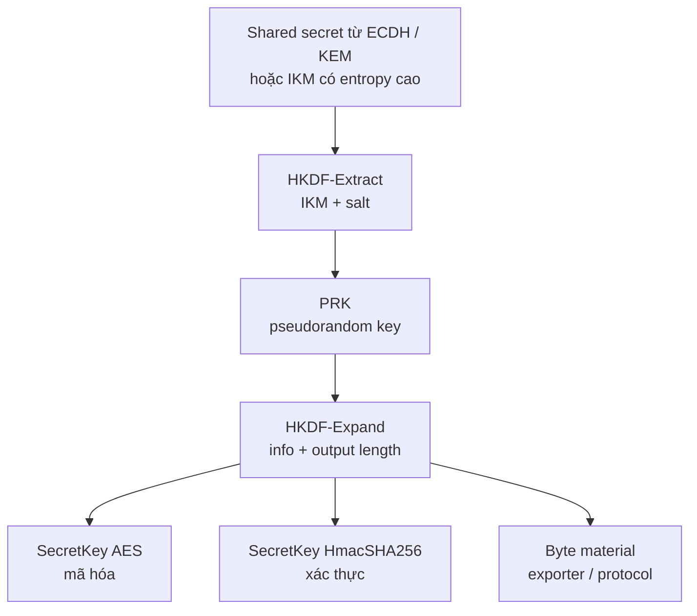
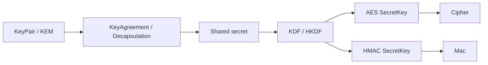

# Dẫn xuất SecretKey hoặc dữ liệu byte theo mục đích sử dụng

## 1. Từ một bí mật gốc đến nhiều khóa có mục đích riêng

Một kết nối bảo mật có thể cần nhiều loại khóa: khóa mã hóa dữ liệu, khóa xác thực thông điệp, khóa bảo vệ metadata hoặc khóa dành riêng cho từng chiều truyền. Nếu dùng cùng một chuỗi byte cho tất cả mục đích, việc phân tách trách nhiệm và luân chuyển khóa trở nên khó kiểm soát.

**Key Derivation Function (KDF)** là hàm mật mã dùng một nguồn khóa đầu vào (*input keying material*, IKM) và các tham số phù hợp để tạo ra khóa hoặc dữ liệu khóa mới. Với Java 25, ứng dụng có API chuẩn `javax.crypto.KDF` để thực hiện quy trình này thông qua kiến trúc provider của JCA.

Ví dụ về một key schedule:



Mỗi đầu ra nên được gắn với **một mục đích cụ thể** bằng tham số `info`. Khi dùng cùng IKM và salt, hai nhãn `info` khác nhau tạo ra các đầu ra tách biệt theo thiết kế HKDF. Các bên tham gia giao thức phải thống nhất chính xác IKM, salt, info, thuật toán và độ dài.

Bài học **“Dẫn xuất SecretKey hoặc dữ liệu byte theo mục đích sử dụng”** thuộc chương **API dẫn xuất khóa** của module `JAVA_VERSION_JAVA25`. Nội dung tập trung vào API Java 25 đã chính thức, thuật toán HKDF, cách chọn `deriveKey` hoặc `deriveData`, tách khóa theo mục đích và những điều kiện an toàn khi tích hợp vào ứng dụng.

### Mục tiêu học tập

Sau bài học, bạn có thể:

1. Phân biệt KDF với hàm băm, sinh khóa ngẫu nhiên, thỏa thuận khóa và mã hóa.
2. Giải thích HKDF-Extract, HKDF-Expand, IKM, salt, PRK và info.
3. Dùng `KDF.getInstance("HKDF-SHA256")` cùng `HKDFParameterSpec` trong Java 25.
4. Chọn `deriveKey` để nhận `SecretKey` hoặc `deriveData` để nhận `byte[]`.
5. Dẫn xuất các khóa khác nhau cho AES, HMAC hoặc dữ liệu giao thức bằng nhãn mục đích riêng.
6. Kiểm tra provider, độ dài đầu ra, khả năng tương thích và lỗi tham số.
7. Tránh dùng HKDF trực tiếp với mật khẩu yếu, tái sử dụng nhầm khóa hoặc làm lộ key material.

## 2. API KDF chính thức trong Java 25

**JEP 510 — Key Derivation Function API** đưa API KDF vào Java SE 25. Các lớp `KDF` và `KDFSpi` trong package `javax.crypto` có từ Java 25; `HKDFParameterSpec` trong `javax.crypto.spec` cũng có từ Java 25. Đây là API chuẩn, không phải tính năng preview cần bật `--enable-preview`.

Các thành phần chính:

| Thành phần | Vai trò |
| --- | --- |
| `javax.crypto.KDF` | Engine API để yêu cầu provider thực hiện key derivation |
| `javax.crypto.KDFParameters` | Interface nhóm các tham số khởi tạo dành cho KDF implementation hỗ trợ |
| `javax.crypto.KDFSpi` | SPI để provider triển khai thuật toán KDF |
| `javax.crypto.spec.HKDFParameterSpec` | Mô tả tham số Extract, Expand hoặc Extract-then-Expand của HKDF |
| `javax.crypto.SecretKey` | Đại diện cho khóa bí mật được dẫn xuất |
| `java.security.Provider` | Cung cấp implementation thuật toán qua JCA |

Java 25 chuẩn hóa các tên thuật toán KDF sau trong Java Security Standard Algorithm Names:

| Tên chuẩn | Thuật toán |
| --- | --- |
| `HKDF-SHA256` | HKDF dùng HMAC-SHA-256 |
| `HKDF-SHA384` | HKDF dùng HMAC-SHA-384 |
| `HKDF-SHA512` | HKDF dùng HMAC-SHA-512 |

JDK Reference Implementation cung cấp các implementation HKDF trong provider `SunJCE`. Ứng dụng vẫn nên kiểm tra runtime/provider mục tiêu có hỗ trợ tên thuật toán và kiểu key material đang dùng hay không; provider bên thứ ba hoặc runtime khác có thể có tập dịch vụ khác.

**Không cần tự viết HMAC loop hoặc tự cắt byte để tạo khóa** khi đã có implementation KDF tương thích. Dùng API JCA giúp ứng dụng tách phần lựa chọn thuật toán khỏi implementation provider, đồng thời cho phép thay provider khi môi trường có yêu cầu HSM hoặc chính sách mật mã riêng.

### 2.1. Tạo một KDF instance

Cách lấy instance cơ bản:

```java
import javax.crypto.KDF;

KDF hkdf = KDF.getInstance("HKDF-SHA256");
```

`getInstance` có thể ném `NoSuchAlgorithmException` nếu không có provider phù hợp. Có các overload để chỉ định provider hoặc tham số khởi tạo `KDFParameters` khi implementation cần. Với HKDF, phần tham số Extract/Expand thường được truyền vào thao tác dẫn xuất thông qua `HKDFParameterSpec`.

Không nhầm hai kiểu tham số:

- `KDFParameters` là abstraction cho tham số khởi tạo của một implementation KDF.
- `HKDFParameterSpec` là `AlgorithmParameterSpec` mô tả IKM, salt, info và độ dài cho thao tác HKDF cụ thể.

### 2.2. Java 25, không phải ví dụ preview cũ

Khi thực hành trên JDK 25, kiểm tra:

```bash
java --version
javac --version
```

Biên dịch ví dụ với source level Java 25:

```bash
javac --release 25 HkdfExample.java
java HkdfExample
```

Không thêm `--enable-preview` chỉ để sử dụng `KDF` hoặc `HKDFParameterSpec`. Nếu project còn biên dịch bằng `--release 17` hoặc `--release 21`, những API mới này không có sẵn trong target đó; cần đánh giá và nâng baseline trước khi dùng.

## 3. KDF làm gì và không làm gì?

### 3.1. KDF là bước dẫn xuất từ key material đã có

KDF nhận IKM, có thể nhận thêm salt và thông tin ngữ cảnh, rồi tạo key material đầu ra. Nó hữu ích khi một giao thức có shared secret nhưng cần nhiều khóa độc lập theo từng mục đích.

Ví dụ: sau khi hai bên hoàn thành ECDH hoặc KEM, họ có một shared secret. Dùng HKDF để dẫn xuất khóa AES và khóa HMAC riêng:

- `IKM`: shared secret có entropy phù hợp từ bước thỏa thuận/đóng gói khóa.
- `salt`: dữ liệu ngẫu nhiên hoặc transcript context được giao thức quy định; thường không cần bí mật.
- `info`: nhãn giao thức, phiên bản, mục đích, hướng truyền hoặc context đã chuẩn hóa.
- `length`: số byte cần tạo.
- Đầu ra: `SecretKey` hoặc byte array theo API được chọn.

KDF **không tạo thêm entropy** từ một đầu vào yếu. Nếu IKM là chuỗi cố định công khai hoặc mật khẩu dễ đoán, HKDF không thể biến nó thành bí mật mạnh.

### 3.2. Phân biệt với các API mật mã khác

| API / khái niệm | Công việc chính | Khi nào dùng |
| --- | --- | --- |
| `SecureRandom` | Tạo dữ liệu ngẫu nhiên mật mã | Sinh salt, nonce hoặc key material ngẫu nhiên |
| `KeyGenerator` | Sinh khóa mới cho thuật toán đối xứng | Tạo một khóa AES ngẫu nhiên độc lập |
| `KeyAgreement` | Hai bên tạo shared secret từ khóa riêng/công khai | ECDH hoặc các cơ chế thỏa thuận khóa |
| `KEM` | Encapsulate/decapsulate để thiết lập shared secret | Giao thức dùng cơ chế đóng gói khóa |
| `KDF` | Dẫn xuất khóa/dữ liệu từ IKM và tham số | Tách shared secret thành khóa theo mục đích |
| `Cipher` | Mã hóa/giải mã dữ liệu | AES-GCM, ChaCha20-Poly1305 |
| `Mac` | Tạo/kiểm tra mã xác thực thông điệp | HMAC-SHA-256 |
| `MessageDigest` | Tính digest không khóa | Hash nội dung; không thay KDF cho key separation |

Sơ đồ thường gặp:



`KeyAgreement` hoặc `KEM` tạo/thiết lập bí mật chung; `KDF` dẫn xuất các khóa phục vụ những chức năng tiếp theo. Hai API có thể phối hợp, nhưng không thay thế nhau.

### 3.3. KDF không phải hàm mã hóa

`KDF.deriveKey("AES", spec)` chỉ tạo đối tượng `SecretKey` mang thuật toán AES. Nó không mã hóa plaintext, không tạo nonce AES-GCM và không tự xác thực ciphertext. Ứng dụng vẫn phải gọi `Cipher` với mode, nonce/IV, AAD và quy tắc lưu trữ phù hợp.

Tương tự, `deriveData` chỉ trả byte đầu ra. Nó không tự biến byte array thành một giao thức an toàn hoặc đảm bảo ứng dụng dùng đúng độ dài/thuật toán.

## 4. Hiểu HKDF: Extract, Expand, salt và info

Java 25 hỗ trợ HKDF theo **RFC 5869**. HKDF gồm hai giai đoạn có thể dùng riêng hoặc kết hợp.

### 4.1. HKDF-Extract

Extract nhận IKM và salt để tạo **pseudorandom key (PRK)**. Về mặt khái niệm:

```text
PRK = HMAC(salt, IKM)
```

Salt là đầu vào công khai trong nhiều giao thức; nó không phải password và không phải khóa mã hóa. Khi giao thức không cung cấp salt, RFC 5869 định nghĩa giá trị mặc định bằng chuỗi zero có độ dài phù hợp với hash. Trong ứng dụng thực tế, hãy tuân theo đặc tả giao thức; khi tự thiết kế một key schedule, dùng salt được sinh/trao đổi và lưu trữ theo quy tắc rõ ràng.

### 4.2. HKDF-Expand

Expand dùng PRK và `info` để tạo output keying material (OKM) có độ dài mong muốn:

```text
OKM = HKDF-Expand(PRK, info, length)
```

`info` là dữ liệu ngữ cảnh ứng dụng, thường công khai. Ví dụ nhãn có thể xác định `order-service/v1/aes-gcm/client-to-server` hoặc `order-service/v1/hmac/server-to-client`. Cùng một IKM và salt nhưng info khác nhau sẽ phân tách đầu ra theo mục đích.

HKDF giới hạn độ dài đầu ra tối đa là **255 lần độ dài đầu ra của hàm HMAC**. Với HKDF-SHA256, hash length là 32 byte nên giới hạn lý thuyết là `255 × 32 = 8160` byte. Không vì giới hạn cho phép mà yêu cầu một output lớn tùy tiện; chỉ dẫn xuất độ dài cần thiết cho thuật toán hoặc giao thức.

### 4.3. Extract-then-Expand trong một thao tác

Trường hợp phổ biến, ứng dụng không cần giữ PRK riêng. Dùng builder:

```java
var spec = HKDFParameterSpec.ofExtract()
        .addIKM(inputKeyMaterial)
        .addSalt(salt)
        .thenExpand(info, 32);
```

`thenExpand(info, length)` tạo parameter spec cho cả Extract và Expand. Đây thường là lựa chọn dễ dùng nhất khi có IKM ban đầu và muốn dẫn xuất trực tiếp khóa đích.

### 4.4. Extract-only và Expand-only

API cũng hỗ trợ những trường hợp cần tách hai giai đoạn:

| Cách tạo parameter | Mục đích |
| --- | --- |
| `HKDFParameterSpec.ofExtract().addIKM(...).addSalt(...).extractOnly()` | Chỉ thực hiện Extract để nhận PRK |
| `HKDFParameterSpec.expandOnly(prk, info, length)` | Expand từ một PRK đã có |
| `HKDFParameterSpec.ofExtract().addIKM(...).addSalt(...).thenExpand(info, length)` | Thực hiện cả hai giai đoạn |

Chỉ tách hai giai đoạn khi giao thức cần chia sẻ PRK trong một key schedule hoặc có nhiều bước Expand được quy định rõ. Thông thường không cần tự lưu PRK vào database hoặc log. PRK vẫn là key material nhạy cảm; quản lý nó như một bí mật.

### 4.5. Thêm nhiều phần IKM hoặc salt

`HKDFParameterSpec.Builder` cho phép gọi `addIKM` và `addSalt` nhiều lần. Điều này hữu ích khi IKM gồm nhiều thành phần hoặc một thành phần nằm trong `SecretKey` không extractable, ví dụ phần cứng mật mã. Provider cần hỗ trợ kiểu key material đó.

Builder không thread-safe. Sau khi gọi `thenExpand` hoặc `extractOnly`, object spec được tạo là immutable theo API. Không dùng chung builder đang thay đổi giữa nhiều luồng.


## 5. Chọn `deriveKey` hay `deriveData`?

`KDF` có hai cách trả kết quả:

| Phương thức | Kiểu trả về | Phù hợp khi |
| --- | --- | --- |
| `deriveKey(String alg, AlgorithmParameterSpec spec)` | `SecretKey` | Kết quả là khóa dùng với `Cipher`, `Mac` hoặc API mật mã khác |
| `deriveData(AlgorithmParameterSpec spec)` | `byte[]` | Giao thức cần raw keying material hoặc một chuỗi byte dẫn xuất |

### 5.1. Ưu tiên SecretKey cho thao tác mật mã

Ví dụ dẫn xuất khóa AES 256-bit:

```java
var spec = HKDFParameterSpec.ofExtract()
        .addIKM(ikm)
        .addSalt(salt)
        .thenExpand(info, 32);

SecretKey aesKey = KDF.getInstance("HKDF-SHA256")
        .deriveKey("AES", spec);
```

Hai tham số thuật toán có ý nghĩa khác nhau:

- `"HKDF-SHA256"` là thuật toán KDF thực hiện quá trình dẫn xuất.
- `"AES"` là thuật toán của đối tượng `SecretKey` đầu ra.

Độ dài `32` ở `thenExpand` là số **byte**, tương ứng 256 bit. Với HMAC-SHA-256, đầu ra 32 byte cũng là kích thước phù hợp để tạo khóa HMAC. Luôn chọn độ dài theo thuật toán đích và đặc tả giao thức.

`SecretKey` cho phép provider giữ khóa ở dạng opaque hoặc gắn với thiết bị/phần cứng nếu provider hỗ trợ. Không gọi `getEncoded()` chỉ để log hoặc kiểm tra khóa; với khóa không extractable, phương thức này có thể trả `null`.

### 5.2. Dùng byte[] khi giao thức thực sự yêu cầu raw material

Ví dụ tạo 32 byte dữ liệu dẫn xuất:

```java
var spec = HKDFParameterSpec.ofExtract()
        .addIKM(ikm)
        .addSalt(salt)
        .thenExpand(info, 32);

byte[] keyingMaterial = KDF.getInstance("HKDF-SHA256")
        .deriveData(spec);

try {
    // Dùng keyingMaterial đúng theo đặc tả giao thức.
} finally {
    java.util.Arrays.fill(keyingMaterial, (byte) 0);
}
```

`deriveData` trả dữ liệu thô. API có thể ném `UnsupportedOperationException` nếu keying material đầu ra không extractable. Mảng byte là dữ liệu nhạy cảm; chỉ giữ trong thời gian cần thiết, không ghi ra log, không đưa vào exception message và xóa best-effort sau khi sử dụng.

`Arrays.fill` không bảo đảm xóa mọi bản sao do JVM, JIT hoặc provider có thể tạo trong quá trình xử lý. Nếu cần bảo vệ key material trong phần cứng hoặc tránh xuất byte ra heap ứng dụng, ưu tiên `deriveKey` và provider hỗ trợ khóa opaque/non-extractable.

### 5.3. Không chuyển đổi SecretKey sang byte[] khi không cần

Không nên mặc định thực hiện:

```java
SecretKey key = hkdf.deriveKey("AES", spec);
byte[] raw = key.getEncoded();
SecretKey duplicate = new SecretKeySpec(raw, "AES");
```

Việc này có thể xuất key material khỏi provider, tạo thêm bản sao bí mật và làm mất lợi ích của key object opaque. Dùng trực tiếp `SecretKey` với `Cipher` hoặc `Mac`. Chỉ lấy byte array khi hợp đồng giao thức hoặc API đích thật sự yêu cầu.

## 6. Ví dụ Java 25: tách khóa AES và HMAC từ cùng IKM

Một ứng dụng giả định cần hai khóa từ cùng shared secret: khóa AES cho mã hóa và khóa HMAC cho xác thực. Ta dùng chung IKM và salt, nhưng **dùng hai nhãn info khác nhau** để tách mục đích.

```java
// HkdfKeySeparation.java — Java 25, no preview required
import java.nio.charset.StandardCharsets;
import java.security.InvalidAlgorithmParameterException;
import java.security.NoSuchAlgorithmException;
import java.security.SecureRandom;
import java.util.Arrays;

import javax.crypto.KDF;
import javax.crypto.SecretKey;
import javax.crypto.spec.HKDFParameterSpec;

public class HkdfKeySeparation {

    private static SecretKey derive(
            byte[] ikm,
            byte[] salt,
            String purpose,
            String keyAlgorithm,
            int outputLength)
            throws NoSuchAlgorithmException,
                   InvalidAlgorithmParameterException {

        byte[] info = purpose.getBytes(StandardCharsets.UTF_8);

        var spec = HKDFParameterSpec.ofExtract()
                .addIKM(ikm)
                .addSalt(salt)
                .thenExpand(info, outputLength);

        // Tạo KDF cục bộ cho lần dẫn xuất này.
        KDF hkdf = KDF.getInstance("HKDF-SHA256");
        return hkdf.deriveKey(keyAlgorithm, spec);
    }

    public static void main(String[] args) throws Exception {
        // Dữ liệu ngẫu nhiên chỉ để minh họa API.
        // Ứng dụng thật thường nhận IKM từ KeyAgreement/KEM hoặc
        // một nguồn key material có entropy cao được quản lý an toàn.
        byte[] ikm = new byte[32];
        byte[] salt = new byte[32];
        SecureRandom random = new SecureRandom();
        random.nextBytes(ikm);
        random.nextBytes(salt);

        try {
            SecretKey encryptionKey = derive(
                    ikm,
                    salt,
                    "order-platform/v1/aes-gcm/encryption",
                    "AES",
                    32);

            SecretKey authenticationKey = derive(
                    ikm,
                    salt,
                    "order-platform/v1/hmac/authentication",
                    "HmacSHA256",
                    32);

            System.out.println("Encryption key algorithm: "
                    + encryptionKey.getAlgorithm());
            System.out.println("Authentication key algorithm: "
                    + authenticationKey.getAlgorithm());

        } finally {
            // Xóa best-effort bản IKM do ứng dụng giữ.
            Arrays.fill(ikm, (byte) 0);
            // Salt không phải bí mật; ứng dụng có thể cần lưu/trao đổi nó.
        }
    }
}
```

Biên dịch và chạy:

```bash
javac --release 25 HkdfKeySeparation.java
java HkdfKeySeparation
```

Kết quả dự kiến:

```text
Encryption key algorithm: AES
Authentication key algorithm: HmacSHA256
```

Điểm cần chú ý:

1. `ikm` trong ví dụ được sinh ngẫu nhiên chỉ để demo; trong giao thức thực tế, hai bên cần có cùng IKM thông qua cơ chế thỏa thuận/thiết lập bí mật đã xác thực.
2. `salt` không cần giữ bí mật, nhưng bên nhận phải có đúng giá trị salt để tái tạo khóa. Nếu lưu ciphertext hoặc session state, lưu metadata salt/phiên bản theo thiết kế giao thức.
3. Chuỗi `info` là nhãn miền (*domain separation*), không phải secret. Dùng hằng số/encoding ổn định, bao gồm phiên bản giao thức và mục đích.
4. Hai khóa đầu ra có mục đích khác nhau. Không dùng khóa AES để làm HMAC hoặc ngược lại.
5. Ví dụ chỉ dẫn xuất khóa; khi mã hóa AES-GCM, ứng dụng vẫn phải tạo nonce đúng chuẩn và bảo đảm nonce không lặp với cùng một khóa.

### 6.1. Quy tắc xây dựng info không mơ hồ

Một nhãn như `order-platform/v1/aes-gcm/encryption` có thể phù hợp khi các thành phần là hằng số. Nếu `info` được tạo từ nhiều trường biến thiên, không ghép chuỗi tùy tiện khiến hai bộ trường khác nhau tạo cùng một chuỗi. Dùng encoding có quy tắc, ví dụ length-prefix hoặc cấu trúc serialization đã được đặc tả.

Các chiều có thể đưa vào info khi giao thức yêu cầu:

- Tên giao thức và phiên bản.
- Thuật toán hoặc loại khóa đầu ra.
- Hướng truyền `client-to-server` / `server-to-client`.
- Vai trò của bên tham gia.
- Mục đích như `encryption`, `authentication` hoặc `exporter`.

Cả hai bên phải dùng cùng byte sequence. Không tự thêm locale, dấu phân cách hoặc cách viết hoa/thường khác nhau giữa các implementation.

### 6.2. Dùng SecretKey với API đích

Sau khi dẫn xuất, truyền trực tiếp key object cho JCA. Ví dụ dùng khóa HMAC:

```java
Mac mac = Mac.getInstance("HmacSHA256");
mac.init(authenticationKey);
byte[] tag = mac.doFinal(payload);
```

Với khóa AES, API mã hóa có thể nhận `encryptionKey`:

```java
Cipher cipher = Cipher.getInstance("AES/GCM/NoPadding");
cipher.init(Cipher.ENCRYPT_MODE, encryptionKey,
        new GCMParameterSpec(128, nonce));
cipher.updateAAD(aad);
byte[] ciphertext = cipher.doFinal(plaintext);
```

Đây là phần tích hợp minh họa; `nonce` phải được tạo/quản lý sao cho **không lặp lại với cùng AES-GCM key**, còn `aad` phải được hai phía xác định giống nhau. Lưu nonce và metadata cần thiết cùng ciphertext; KDF không tạo nonce và không tự quản lý vòng đời của chúng.

## 7. Dẫn xuất raw data cho protocol hoặc exporter

Có trường hợp API đích cần byte material thay vì `SecretKey`, ví dụ một protocol exporter hoặc một định dạng dẫn xuất riêng. Khi đó dùng `deriveData`, nhưng hãy giữ output trong bộ nhớ càng ngắn càng tốt.

Ví dụ helper:

```java
import java.nio.charset.StandardCharsets;
import javax.crypto.KDF;
import javax.crypto.spec.HKDFParameterSpec;

static byte[] deriveExporter(
        byte[] ikm,
        byte[] salt,
        String label,
        int length) throws Exception {

    var spec = HKDFParameterSpec.ofExtract()
            .addIKM(ikm)
            .addSalt(salt)
            .thenExpand(label.getBytes(StandardCharsets.UTF_8), length);

    return KDF.getInstance("HKDF-SHA256").deriveData(spec);
}
```

Caller chịu trách nhiệm xóa byte array sau khi dùng:

```java
byte[] exporter = deriveExporter(
        ikm, salt, "example-protocol/v1/exporter", 32);

try {
    // Chuyển exporter vào API đích đã được đặc tả.
} finally {
    Arrays.fill(exporter, (byte) 0);
}
```

Không dùng `deriveData` chỉ vì `byte[]` dễ thao tác hơn `SecretKey`. Hãy ưu tiên `deriveKey` nếu output là một khóa được dùng bởi JCA; dùng raw data khi API đích yêu cầu chính xác dạng byte hoặc khi giao thức định nghĩa rõ cách diễn giải.

## 8. Provider, khả năng tương thích và vòng đời đối tượng

### 8.1. Kiểm tra thuật toán được provider hỗ trợ

`KDF` là engine class của JCA. `getInstance` tìm provider có implementation của tên thuật toán được yêu cầu. Với Java 25 JDK Reference Implementation, `SunJCE` cung cấp HKDF; môi trường khác có thể cài provider khác hoặc chính sách hạn chế thuật toán.

Ví dụ xử lý lỗi thuật toán không tồn tại:

```java
try {
    KDF hkdf = KDF.getInstance("HKDF-SHA256");
    // Thực hiện deriveKey/deriveData với parameter spec hợp lệ.
} catch (java.security.NoSuchAlgorithmException ex) {
    throw new IllegalStateException(
            "Runtime không có provider hỗ trợ HKDF-SHA256", ex);
}
```

`NoSuchAlgorithmException` cho biết không tìm được implementation phù hợp. `InvalidAlgorithmParameterException` cho biết provider không chấp nhận parameter spec hoặc tổ hợp thuật toán/độ dài được yêu cầu. Không bắt các lỗi này rồi âm thầm chuyển sang hash hoặc thuật toán yếu hơn.

### 8.2. Không khóa cứng provider nếu không có yêu cầu

Thông thường, dùng:

```java
KDF hkdf = KDF.getInstance("HKDF-SHA256");
```

JCA chọn provider phù hợp theo danh sách đã đăng ký. Chỉ chỉ định provider tường minh khi chính sách bảo mật, chứng nhận, HSM hoặc triển khai hệ thống yêu cầu. Việc ghi cứng `"SunJCE"` có thể khiến ứng dụng không chạy trên runtime khác dù runtime đó có provider tương thích.

Nếu không chỉ định provider, `KDF` có **delayed provider selection**: lựa chọn provider có thể được hoãn đến `deriveKey`/`deriveData` để xét cả key material thực tế, ví dụ một `SecretKey` không extractable từ thiết bị phần cứng. Vì vậy, không gọi `getProviderName()` hoặc `getParameters()` trước thao tác dẫn xuất nếu bạn cần provider có thể xử lý key material cụ thể; sau khi derivation chọn provider, có thể truy vấn tên provider để ghi nhận vận hành.

### 8.3. KDF và builder không thread-safe

Theo Java SE 25 API:

- `KDF` không thread-safe trừ khi implementation cụ thể ghi rõ ngoại lệ.
- `HKDFParameterSpec.Builder` không thread-safe.
- Parameter spec đã build là immutable theo API.

Mẫu dễ quản lý là tạo `KDF` và builder tại phạm vi thao tác dẫn xuất như ví dụ trước, hoặc đồng bộ rõ ràng nếu ứng dụng thật sự chia sẻ instance. Không đặt một `KDF` mutable vào static singleton rồi dùng đồng thời từ nhiều request mà không có kiểm soát.

### 8.4. Khi nào cần provider riêng?

Provider có thể triển khai dịch vụ KDF bằng `javax.crypto.KDFSpi`. Điều này phù hợp với nhà cung cấp thư viện mật mã, tích hợp HSM hoặc một thuật toán KDF bổ sung đã được chuẩn hóa và đánh giá. Phần lớn ứng dụng nên dùng implementation có sẵn từ provider đáng tin cậy thay vì tự viết `KDFSpi` hoặc tự cài đặt thuật toán.

## 9. Không dùng HKDF thay cho password hashing

HKDF được thiết kế cho **input key material có entropy đủ cao**, ví dụ shared secret từ ECDH/KEM hoặc một master secret được tạo và bảo vệ an toàn. Nó rất nhanh; vì vậy không phù hợp để chống đoán mật khẩu của người dùng.

| Nguồn đầu vào | Hướng xử lý |
| --- | --- |
| Shared secret từ key agreement/KEM | HKDF là lựa chọn phù hợp để tách khóa theo mục đích |
| Master secret ngẫu nhiên, được quản lý an toàn | HKDF có thể dẫn xuất khóa con theo protocol/context |
| Mật khẩu do con người chọn | Dùng password hashing/KDF có chủ đích làm chậm brute-force, ví dụ Argon2id hoặc scrypt; PBKDF2 khi chính sách/khả năng tương thích yêu cầu |
| Một chuỗi cố định hoặc ID công khai | Không có entropy bí mật đủ; HKDF không làm nó trở thành secret |
| Nonce/IV hoặc salt công khai | Không dùng riêng chúng làm IKM bí mật |

Trong Java 25, danh sách tên KDF chuẩn được quy định cho `KDF` là `HKDF-SHA256`, `HKDF-SHA384` và `HKDF-SHA512`. `PBKDF2WithHmacSHA256` thuộc nhóm dịch vụ `SecretKeyFactory`, không phải một tên HKDF trong `KDF`. Nếu ứng dụng cần password-based derivation, hãy chọn implementation password KDF phù hợp, cấu hình salt và chi phí theo chính sách hiện hành, đồng thời lưu thông số để có thể kiểm chứng/nâng cấp sau này.

**Không làm:**

```java
// Sai mục đích: HKDF không phải password hashing.
byte[] passwordBytes = password.getBytes(StandardCharsets.UTF_8);
var spec = HKDFParameterSpec.ofExtract()
        .addIKM(passwordBytes)
        .thenExpand(info, 32);
byte[] key = KDF.getInstance("HKDF-SHA256").deriveData(spec);
```

Một mật khẩu có entropy thấp có thể được thử hàng loạt ngoại tuyến. HKDF không có cost factor để làm mỗi lần đoán tốn tài nguyên như password KDF chuyên dụng. Đừng thay password hashing bằng `SHA-256(password)` hoặc HKDF.

## 10. Quy tắc bảo mật khi thiết kế key schedule

### 10.1. Chọn IKM đúng nguồn

- Dùng shared secret có entropy phù hợp từ một cơ chế thiết lập khóa đã được thiết kế và xác thực.
- Không dùng public key, nonce, correlation ID, tenant ID hoặc dữ liệu công khai làm IKM.
- Không hard-code master key trong source code, Docker image, YAML cấu hình hoặc repository.
- Nếu IKM đến từ HSM/PKCS#11 hoặc provider phần cứng, xác minh provider có hỗ trợ nhận `SecretKey` trực tiếp qua `addIKM(SecretKey)`.

KDF không xác thực bên tham gia giao thức. Nếu shared secret đến từ một key exchange chưa được xác thực, việc dẫn xuất khóa không sửa được nguy cơ man-in-the-middle.

### 10.2. Salt và info không giống nhau

| Tham số | Mục đích | Có cần bí mật? | Quy tắc |
| --- | --- | --- | --- |
| IKM | Nguồn key material | **Có** trong các trường hợp dùng secret | Bảo vệ nguồn, không log hoặc phát tán |
| Salt | Làm đầu vào Extract và hỗ trợ phân tách các lần dẫn xuất | Thường **không** | Theo protocol; lưu/truyền cùng metadata nếu cần tái tạo |
| Info | Ràng buộc đầu ra với ứng dụng, phiên bản và mục đích | **Không** | Dùng label rõ ràng, encoding ổn định |
| Output length | Số byte cần dẫn xuất | Không | Đúng độ dài mà thuật toán đích yêu cầu |

Salt không phải mật khẩu, IV của AES hay khóa bí mật. Thay salt sẽ thay đổi đầu ra, vì vậy các bên cần dùng cùng salt để tái tạo cùng khóa. `info` nên khác nhau cho mỗi mục đích, ví dụ khóa mã hóa và khóa HMAC, cũng như hai hướng truyền nếu protocol cần phân biệt.

### 10.3. Key separation và domain separation

Nếu cùng IKM được dùng cho nhiều tác vụ, không gọi HKDF lặp lại với cùng salt, cùng info và cùng độ dài rồi kỳ vọng có khóa khác nhau. Các đầu vào giống nhau tạo đầu ra xác định giống nhau. Hãy đặt nhãn riêng:

```text
protocol/v1/aes-gcm/client-to-server
protocol/v1/aes-gcm/server-to-client
protocol/v1/hmac/client-to-server
protocol/v1/exporter/session-metadata
```

Các label trên là ví dụ. Chốt một vocabulary và encoding dùng chung cho mọi implementation. Khi đổi protocol version, thay đổi key schedule phải được ghi vào đặc tả; không tự thêm chuỗi vào một phía khiến hai bên dẫn xuất khác nhau.

### 10.4. Quản lý khóa, logging và bộ nhớ

- Không log IKM, PRK, output key, `SecretKey.getEncoded()`, password hoặc byte array dẫn xuất.
- Không đưa key material vào exception message, metrics label, tracing attribute hay telemetry payload.
- Ưu tiên `SecretKey` và provider giữ key opaque khi có thể.
- Nếu buộc phải có `byte[]`, giới hạn lifetime và xóa best-effort bằng `Arrays.fill` sau khi dùng; hiểu rằng JVM/provider có thể còn bản sao.
- Dùng secret manager, keystore hoặc HSM theo yêu cầu hệ thống; KDF không phải kho lưu khóa.
- Ghi nhận key version, thuật toán, provider và metadata công khai cần thiết; không ghi secret.
- Có kế hoạch rotation: thay đổi IKM/key version hoặc salt/info theo giao thức, lưu metadata đủ để đọc dữ liệu cũ trong thời gian chuyển đổi.

### 10.5. KDF không thay thế quy tắc của thuật toán đích

Nếu dùng khóa AES-GCM được dẫn xuất, vẫn cần nonce duy nhất cho mỗi lần mã hóa với cùng khóa, xác minh authentication tag khi giải mã và quản lý AAD đúng giao thức. Nếu dùng HMAC, vẫn phải xác minh MAC theo API và cách so sánh phù hợp. KDF chỉ cung cấp key material; nó không tự tạo protocol an toàn.

## 11. Kiểm thử bằng vector chuẩn và kiểm thử key separation

### 11.1. Kiểm thử RFC 5869 HKDF-SHA256

Một test tốt nên xác nhận implementation khớp vector công khai của RFC 5869. Test case 1 dùng IKM 22 byte có giá trị `0b`, salt 13 byte, info 10 byte và đầu ra 42 byte.

```java
import java.util.HexFormat;
import javax.crypto.KDF;
import javax.crypto.spec.HKDFParameterSpec;
import org.junit.jupiter.api.Test;

import static org.junit.jupiter.api.Assertions.assertArrayEquals;

class HkdfRfc5869Test {

    @Test
    void matchesRfc5869Sha256TestCase1() throws Exception {
        byte[] ikm = HexFormat.of().parseHex("0b".repeat(22));
        byte[] salt = HexFormat.of().parseHex(
                "000102030405060708090a0b0c");
        byte[] info = HexFormat.of().parseHex(
                "f0f1f2f3f4f5f6f7f8f9");
        byte[] expected = HexFormat.of().parseHex(
                "3cb25f25faacd57a90434f64d0362f2a"
              + "2d2d0a90cf1a5a4c5db02d56ecc4c5bf"
              + "34007208d5b887185865");

        var spec = HKDFParameterSpec.ofExtract()
                .addIKM(ikm)
                .addSalt(salt)
                .thenExpand(info, 42);

        byte[] actual = KDF.getInstance("HKDF-SHA256")
                .deriveData(spec);

        assertArrayEquals(expected, actual);
    }
}
```

Test cần JDK 25 và JUnit 5. Vector này kiểm tra cả hai giai đoạn Extract và Expand; nó không chứng minh toàn bộ protocol hoặc key management của ứng dụng an toàn.

### 11.2. Kiểm thử hai mục đích tạo ra hai đầu ra khác nhau

Trong test, dùng cùng IKM/salt nhưng khác info label:

```java
import java.security.MessageDigest;
import javax.crypto.KDF;
import javax.crypto.spec.HKDFParameterSpec;
import org.junit.jupiter.api.Test;

import static org.junit.jupiter.api.Assertions.assertFalse;

class HkdfSeparationTest {

    private static byte[] derive(
            byte[] ikm, byte[] salt, String label) throws Exception {

        var spec = HKDFParameterSpec.ofExtract()
                .addIKM(ikm)
                .addSalt(salt)
                .thenExpand(label.getBytes(java.nio.charset.StandardCharsets.UTF_8),
                        32);

        return KDF.getInstance("HKDF-SHA256").deriveData(spec);
    }

    @Test
    void purposeLabelsSeparateOutputs() throws Exception {
        byte[] ikm = new byte[32];
        byte[] salt = new byte[32];

        java.util.Arrays.fill(ikm, (byte) 0x2a);
        java.util.Arrays.fill(salt, (byte) 0x5c);

        byte[] encryption = derive(
                ikm, salt, "service/v1/encryption");
        byte[] authentication = derive(
                ikm, salt, "service/v1/authentication");

        assertFalse(MessageDigest.isEqual(encryption, authentication));

        java.util.Arrays.fill(encryption, (byte) 0);
        java.util.Arrays.fill(authentication, (byte) 0);
        java.util.Arrays.fill(ikm, (byte) 0);
    }
}
```

Đây là test xác nhận key separation trong môi trường test; **không dùng IKM cố định trong production**. Trong production, nguồn IKM phải có entropy phù hợp và được bảo vệ. Cũng cần thêm test rằng cùng IKM/salt/info/length cho ra cùng output ở các implementation tương thích, nếu protocol đòi hỏi hai bên tái tạo giống nhau.

### 11.3. Những gì cần test ngoài vector

- Provider/runtime production có `HKDF-SHA256` (hoặc thuật toán được cấu hình) hay không.
- `deriveKey("AES", spec)` trả key algorithm và độ dài đúng theo yêu cầu.
- Tổ hợp độ dài vượt giới hạn HKDF bị từ chối.
- `info` có version/purpose/direction chính xác giữa các bên.
- IKM/salt metadata được trao đổi/lưu đủ để tái tạo khóa khi protocol yêu cầu.
- Rotation có thể đọc dữ liệu phiên bản cũ trong giai đoạn chuyển đổi.
- Không có secret trong logs, exception, metrics hoặc traces.

## 12. Chẩn đoán lỗi và tình huống vận hành

| Triệu chứng | Nguyên nhân thường gặp | Cách xử lý |
| --- | --- | --- |
| `NoSuchAlgorithmException: HKDF-SHA256` | Provider/runtime không đăng ký implementation hoặc đang chạy JDK cũ | Xác nhận JDK 25, provider và tên chuẩn; kiểm thử ngay trên runtime production |
| `InvalidAlgorithmParameterException` | Parameter spec sai, độ dài không hợp lệ hoặc provider không hỗ trợ tổ hợp | Kiểm tra `HKDFParameterSpec`, IKM/salt, key algorithm và length |
| `IllegalArgumentException` khi build `thenExpand` | Output length không lớn hơn 0 | Dùng độ dài byte dương theo thuật toán đích |
| `UnsupportedOperationException` từ `deriveData` | Output keying material không extractable | Dùng `deriveKey` nếu provider có thể giữ khóa opaque; kiểm tra provider capability |
| Hai bên tạo khóa khác nhau | IKM, salt, info, output length, thuật toán hoặc encoding không giống nhau | So sánh metadata công khai và byte sequence; không log secret |
| Hai mục đích tạo cùng khóa | Tái sử dụng cùng info/length cho cùng IKM và salt | Tạo label domain separation riêng cho từng purpose/direction |
| `SecretKey.getEncoded()` trả `null` | Provider giữ khóa non-extractable | Đây có thể là hành vi bảo mật mong muốn; dùng trực tiếp key với API mật mã |
| Chạy local được nhưng container lỗi | JDK/provider trong image khác môi trường phát triển | Kiểm tra image digest, JDK vendor/version và provider list |
| Dùng KDF instance từ nhiều thread gây lỗi/không ổn định | Chia sẻ engine không thread-safe | Tạo instance riêng theo thao tác hoặc đồng bộ |
| Dữ liệu AES-GCM không giải mã được sau rotation | Không lưu key version/salt/info hoặc nonce/AAD sai | Version hóa metadata và giữ khả năng đọc khóa cũ trong thời gian chuyển đổi |
| Kết quả không đổi giữa hai lần gọi | HKDF là deterministic với cùng đầu vào/tham số | Nếu cần key khác, thay đổi IKM hoặc context/salt theo protocol; không kỳ vọng KDF tự random |
| Dùng mật khẩu mà brute-force vẫn nhanh | HKDF không phải password hashing | Dùng Argon2id/scrypt hoặc password KDF phù hợp |

### 12.1. Chẩn đoán theo từng lớp

Khi derivation lỗi, phân tách bốn nhóm:

1. **Nguồn IKM:** có thực sự là secret đủ entropy không? Có bị rỗng, cắt cụt, chuyển encoding hoặc thay đổi thứ tự thành phần không?
2. **Tham số HKDF:** salt, info và output length có đúng đặc tả không? Cả hai phía có cùng bytes, không chỉ cùng chuỗi nhìn thấy?
3. **Provider/runtime:** JDK 25 có được dùng ở compile và runtime? Provider có hỗ trợ tên HKDF và key type yêu cầu?
4. **Sử dụng output:** API đích có chấp nhận thuật toán/độ dài? Nonce, AAD, MAC framing và metadata phiên bản có được quản lý riêng?

Không giải quyết lỗi tương thích bằng cách âm thầm fallback sang SHA-256 thuần, MD5, DES hoặc một thuật toán tự chế. Nếu provider không hỗ trợ yêu cầu, chọn provider tương thích đã được đánh giá hoặc thay đổi deployment theo chính sách bảo mật.

## 13. Bài tập thực hành

### Bài 1 — Dẫn xuất khóa AES và HMAC riêng biệt

Dùng một IKM có entropy cao, salt được chia sẻ và hai info labels:

- `demo/v1/aes-gcm/encryption` cho `SecretKey` AES 32 byte.
- `demo/v1/hmac/authentication` cho `SecretKey` HmacSHA256 32 byte.

In ra tên thuật toán của hai key; tuyệt đối không in `getEncoded()` hoặc nội dung key.

**Tiêu chí:** dùng `KDF.getInstance("HKDF-SHA256")` và `deriveKey`; hai label khác nhau; không cần preview flag.

### Bài 2 — Dẫn xuất raw exporter bytes

Dùng `deriveData` tạo 32 byte exporter material theo label `demo-protocol/v1/exporter`. Giữ byte array trong phạm vi ngắn, xóa best-effort sau khi API đích sử dụng xong.

**Tiêu chí:** giải thích vì sao raw bytes cần được bảo vệ chặt hơn trong heap ứng dụng và vì sao `deriveKey` thường là lựa chọn tốt hơn nếu đầu ra là một khóa JCA.

### Bài 3 — Tách key theo hướng truyền

Dẫn xuất hai khóa cho `client-to-server` và `server-to-client` từ cùng IKM/salt. Viết test xác nhận outputs khác nhau, sau đó kiểm tra hai phía dùng cùng quy ước nhãn.

**Tiêu chí:** domain separation có version, purpose và direction; không dùng một khóa chung cho hai hướng khi protocol yêu cầu độc lập.

### Bài 4 — Kiểm chứng RFC 5869

Chạy test vector 1 trong phần 11.1 bằng JDK 25. Nếu khác kết quả, kiểm tra byte đầu vào ở dạng hex, thứ tự addIKM/addSalt, info và output length trước khi nghi ngờ provider.

**Tiêu chí:** kết quả khớp chính xác 42 byte của RFC 5869.

### Bài 5 — Chọn đúng công cụ cho password

Viết một đoạn thiết kế ngắn giải thích vì sao không dùng `HKDF-SHA256` trực tiếp trên password đăng nhập, và đề xuất password hashing/KDF có cost phù hợp với yêu cầu sản phẩm.

**Tiêu chí:** phân biệt password hashing với HKDF cho shared secret; nêu rõ `PBKDF2WithHmacSHA256` thuộc `SecretKeyFactory` chứ không phải một tên HKDF của `KDF`.

### Câu hỏi tự đánh giá

1. `KDF` trong Java 25 thuộc package nào và JEP nào chuẩn hóa API?
2. Ba tên HKDF chuẩn có trong Java SE 25 là gì?
3. IKM, salt, PRK, info và OKM có vai trò gì?
4. Tại sao cùng IKM/salt/info/length luôn tạo ra cùng kết quả?
5. `deriveKey` khác `deriveData` ở kiểu trả về và cách quản lý key material thế nào?
6. Vì sao `HKDFParameterSpec.thenExpand` nhận length tính bằng byte?
7. HKDF-SHA256 có độ dài đầu ra tối đa lý thuyết bao nhiêu byte?
8. Tại sao khóa AES và khóa HMAC cần info labels riêng?
9. Vì sao `SecretKey.getEncoded()` có thể trả `null` mà không phải lỗi?
10. Vì sao không dùng HKDF làm password hashing?
11. Provider selection có thể bị trì hoãn đến lúc nào và tại sao không nên hỏi provider name quá sớm với key không extractable?
12. Vì sao `KDF` và `HKDFParameterSpec.Builder` không nên được chia sẻ giữa nhiều thread mà không kiểm soát?
13. Salt có phải bí mật không? Điều gì cần lưu để hai bên tái tạo cùng khóa?
14. KDF có tự bảo đảm AES-GCM nonce duy nhất hay xác thực peer trong key exchange không?

## 14. Checklist triển khai và tài liệu chuẩn

### 14.1. Checklist code review

- [ ] Dùng API `javax.crypto.KDF` và `HKDFParameterSpec` chính thức của Java 25; không bật `--enable-preview` cho KDF API.
- [ ] Dùng tên thuật toán chuẩn `HKDF-SHA256`, `HKDF-SHA384` hoặc `HKDF-SHA512`.
- [ ] IKM có entropy cao và đến từ nguồn đã được xác thực/quản lý an toàn.
- [ ] Salt và info có ý nghĩa riêng, được trao đổi/lưu trữ theo protocol.
- [ ] Info labels có version, purpose và direction khi cần; encoding thống nhất giữa các bên.
- [ ] Output length được chọn theo thuật toán đích và giới hạn HKDF.
- [ ] Dùng `deriveKey` nếu đầu ra là khóa JCA; chỉ dùng `deriveData` khi protocol thực sự cần raw bytes.
- [ ] Không log, serialize hoặc đưa key material vào telemetry.
- [ ] Provider/runtime production được kiểm thử; không fallback sang thuật toán yếu khi thiếu implementation.
- [ ] KDF/builder không được chia sẻ đồng thời nếu chưa có đồng bộ.
- [ ] Password được xử lý bằng password hashing/KDF phù hợp, không dùng HKDF trực tiếp.
- [ ] Có test vector RFC 5869, key separation, provider capability và rotation.

### 14.2. Nguồn tham khảo chính thức

- [JEP 510 — Key Derivation Function API](https://openjdk.org/jeps/510): chuẩn hóa KDF API trong Java 25.
- [Java SE 25 API — javax.crypto.KDF](https://docs.oracle.com/en/java/javase/25/docs/api/java.base/javax/crypto/KDF.html): `getInstance`, `deriveKey`, `deriveData`, provider selection và concurrency.
- [Java SE 25 API — javax.crypto.KDFParameters](https://docs.oracle.com/en/java/javase/25/docs/api/java.base/javax/crypto/KDFParameters.html): abstraction cho tham số khởi tạo KDF.
- [Java SE 25 API — javax.crypto.KDFSpi](https://docs.oracle.com/en/java/javase/25/docs/api/java.base/javax/crypto/KDFSpi.html): SPI dành cho provider implement KDF.
- [Java SE 25 API — HKDFParameterSpec](https://docs.oracle.com/en/java/javase/25/docs/api/java.base/javax/crypto/spec/HKDFParameterSpec.html): Extract, Expand và Extract-then-Expand.
- [Java SE 25 JCA Reference Guide — The KDF Class](https://docs.oracle.com/en/java/javase/25/security/java-cryptography-architecture-jca-reference-guide.html): HKDF, SunJCE provider và ví dụ dẫn xuất AES SecretKey.
- [Java Security Standard Algorithm Names — KDF Algorithms](https://docs.oracle.com/en/java/javase/25/docs/specs/security/standard-names.html): tên HKDF-SHA256/SHA384/SHA512.
- [RFC 5869 — HMAC-based Extract-and-Expand Key Derivation Function (HKDF)](https://www.rfc-editor.org/rfc/rfc5869): thuật toán và test vectors.

**Kết luận:** Java 25 cung cấp một API chuẩn để dẫn xuất khóa hoặc byte material bằng KDF, với HKDF là lựa chọn tích hợp được hỗ trợ trong JDK. Chọn `deriveKey` khi cần `SecretKey` cho các API mật mã; chọn `deriveData` khi giao thức cần raw bytes. An toàn của kết quả phụ thuộc vào chất lượng IKM, salt, info, provider và cách quản lý khóa sau dẫn xuất. Phân tách mục đích bằng nhãn ổn định, kiểm thử bằng vector chuẩn và không dùng HKDF thay password hashing giúp ứng dụng Java sử dụng key material đúng mục đích và tương thích giữa các môi trường.


