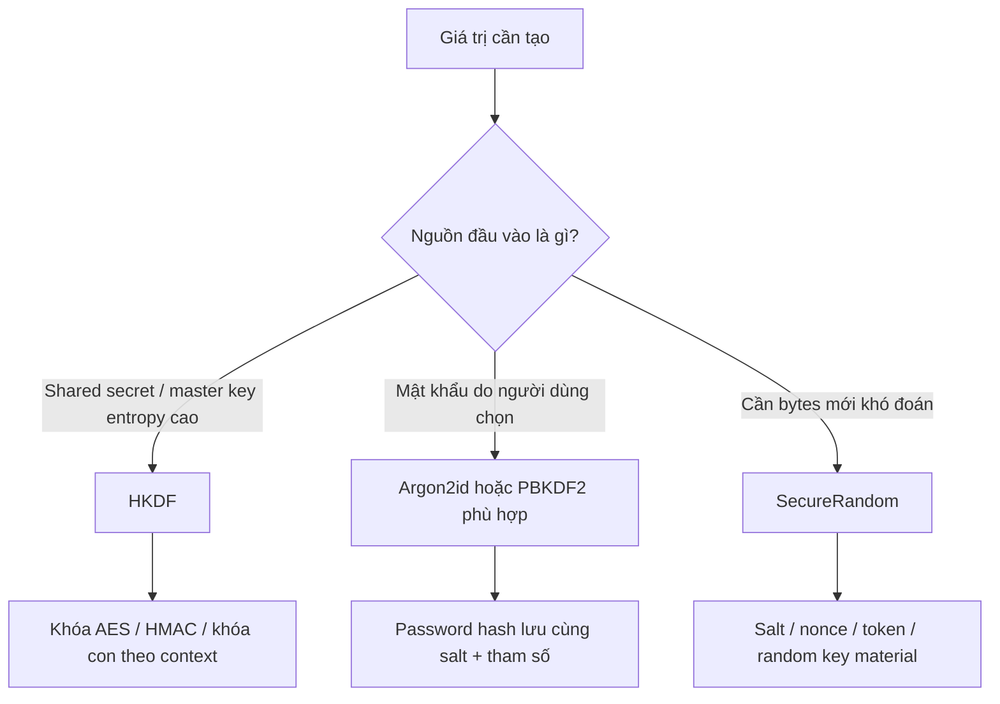
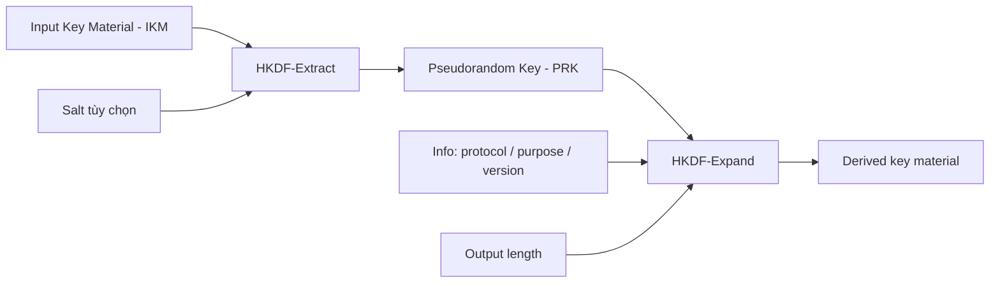

# Phân biệt dẫn xuất khóa bằng HKDF với băm mật khẩu và sinh số ngẫu nhiên

> **Chương:** API dẫn xuất khóa  
> **Phạm vi module:** `JAVA_VERSION_JAVA25` — khám phá các khả năng Java 25 còn áp dụng trong phát triển hiện đại, bao gồm API mật mã JCA mới, quản lý khóa, sinh dữ liệu ngẫu nhiên an toàn và đánh giá tính tương thích khi nâng cấp JDK.  
> **Mục tiêu:** Phân biệt đúng ba nhiệm vụ: **dẫn xuất khóa từ key material có entropy cao bằng HKDF**, **lưu mật khẩu bằng password hashing KDF**, và **tạo dữ liệu ngẫu nhiên bằng SecureRandom**; thực hành HKDF bằng API Java 25 và chọn đúng công cụ theo threat model.
>
> **Trạng thái phiên bản:** `javax.crypto.KDF` và `HKDFParameterSpec` đã **final trong JDK 25** theo JEP 510. Không cần `--enable-preview`. Nội dung đối chiếu cả tài liệu JDK 27 để bảo đảm API này vẫn đang được hỗ trợ ở thời điểm **27/11/2026**; không dùng các mẫu preview cũ từ JDK 24 như hướng dẫn hiện hành.

Một ứng dụng thường cần nhiều loại giá trị mật mã: khóa AES để mã hóa dữ liệu, khóa HMAC để xác thực thông điệp, salt để lưu password hash, nonce cho AES-GCM, token khó đoán cho một lần sử dụng. Các giá trị này đều có thể là mảng byte, nhưng **cách tạo và mục đích bảo mật khác nhau**.

- Khi đã có **shared secret/key material có entropy cao** (ví dụ bí mật chung từ ECDH hoặc KEM), dùng **HKDF** để tạo các khóa con theo mục đích và ngữ cảnh.
- Khi người dùng chọn một **mật khẩu có entropy thấp**, dùng password hashing KDF chậm và có chi phí cấu hình như **Argon2id**; trong môi trường cần FIPS, **PBKDF2-HMAC-SHA-256** có thể là lựa chọn phù hợp theo chính sách.
- Khi cần **một giá trị mới khó đoán**, dùng **`SecureRandom`** để sinh bytes; HKDF không phải bộ sinh entropy và không thay thế nguồn ngẫu nhiên an toàn.

## 1. Phân biệt ba bài toán

| Bài toán | Đầu vào | Mục tiêu | Công cụ phù hợp | Có thể tái tạo cùng output? |
|---|---|---|---|---|
| **Dẫn xuất khóa (HKDF)** | Input key material (IKM) có entropy cao, salt tùy chọn, context info | Tạo một hoặc nhiều khóa con có độ dài xác định, tách biệt theo mục đích | `javax.crypto.KDF` + `HKDFParameterSpec` | **Có**, nếu IKM, salt, info, thuật toán và độ dài giống nhau |
| **Lưu/kiểm tra mật khẩu** | Mật khẩu do con người chọn, salt riêng cho từng bản ghi, tham số cost | Làm cho mỗi lần đoán mật khẩu tốn CPU/bộ nhớ; so sánh khi đăng nhập | Argon2id; PBKDF2-HMAC-SHA-256 khi có yêu cầu tương thích/FIPS | Có, khi dùng đúng mật khẩu, salt và tham số đã lưu |
| **Sinh dữ liệu ngẫu nhiên** | Nguồn entropy của hệ điều hành/JVM | Sinh salt, nonce, token hoặc key ngẫu nhiên mới | `java.security.SecureRandom`; `KeyGenerator` khi cần sinh key theo thuật toán | **Không có tính tái tạo theo đầu vào ứng dụng**; mỗi lần sinh tạo bytes mới |

Ba khái niệm dễ bị nhầm vì đều có thể tạo ra bytes 16/32/64 byte:

1. **HKDF không tạo entropy mới.** Nó biến đổi key material đã có để sử dụng đúng mục đích. Nếu IKM yếu hoặc đoán được, output HKDF cũng không trở thành bí mật mạnh.
2. **Password hashing cố ý chậm/tốn bộ nhớ.** Nó làm giảm tốc độ thử hàng loạt mật khẩu khi cơ sở dữ liệu bị lộ. HKDF được thiết kế để dẫn xuất khóa hiệu quả, không có cost chống dò mật khẩu.
3. **SecureRandom sinh dữ liệu khó đoán.** Nó không biết bytes đó sẽ là salt, nonce hay token; ứng dụng phải dùng đúng quy tắc của giao thức.



## 2. KDF API của Java 25 là gì?

**Key Derivation Function (KDF)** là thuật toán dùng key material đầu vào và các tham số bổ sung để tạo key material mới. Java 25 chuẩn hóa API truy cập KDF thông qua package `javax.crypto`:

- `javax.crypto.KDF`: lấy instance của thuật toán và yêu cầu dẫn xuất key hoặc raw data.
- `javax.crypto.spec.HKDFParameterSpec`: mô tả tham số cho HKDF Extract, Expand hoặc Extract-then-Expand.
- `javax.crypto.SecretKey`: biểu diễn khóa đầu ra theo thuật toán đích, ví dụ `AES`.

JEP 510 đưa KDF API từ trạng thái preview ở JDK 24 thành **API final trong JDK 25**; thiết kế API không thay đổi giữa hai bản. Trong mã Java 25, không cần `--enable-preview`.

### Tên thuật toán HKDF chuẩn

Java Security Standard Algorithm Names của JDK 25 định nghĩa:

| Tên dùng trong `KDF.getInstance` | Hàm băm HMAC | Độ dài hash | Độ dài HKDF tối đa theo RFC 5869 |
|---|---|---:|---:|
| `HKDF-SHA256` | HMAC-SHA-256 | 32 byte | 8.160 byte |
| `HKDF-SHA384` | HMAC-SHA-384 | 48 byte | 12.240 byte |
| `HKDF-SHA512` | HMAC-SHA-512 | 64 byte | 16.320 byte |

JDK reference implementation cung cấp các thuật toán này qua provider **SunJCE**. Môi trường có provider khác cần kiểm tra provider hỗ trợ đúng thuật toán và parameter spec. Không tự giả định mọi JCA provider bên ngoài đều có cùng danh sách.

Ví dụ khởi tạo:

```java
KDF hkdf = KDF.getInstance("HKDF-SHA256");
```

`KDF` là API theo mô hình provider của JCA. Nếu không có provider hỗ trợ thuật toán yêu cầu, `getInstance` ném `NoSuchAlgorithmException`. Nếu thuật toán có nhưng provider không hỗ trợ tổ hợp tham số/key material, thao tác dẫn xuất có thể ném `InvalidAlgorithmParameterException`.

## 3. HKDF thực hiện Extract và Expand như thế nào?

HKDF theo **RFC 5869** có hai giai đoạn:



### 3.1. Extract: chuẩn hóa key material

`HKDF-Extract` nhận:

- **IKM (Input Key Material):** bí mật nguồn, thường là shared secret từ key agreement (ví dụ ECDH), KEM hoặc master secret được quản lý an toàn.
- **Salt:** giá trị tùy chọn dùng trong bước HMAC Extract. Salt không phải secret; có thể được tạo ngẫu nhiên hoặc theo quy tắc giao thức. Khi không cung cấp, RFC 5869 định nghĩa salt tương đương chuỗi zero có độ dài bằng hash output.

Kết quả là **PRK (Pseudorandom Key)**, một key trung gian có định dạng phù hợp cho bước Expand. Extract không “nâng cấp” một mật khẩu yếu thành key mạnh; nó giả định IKM đã có entropy đủ.

### 3.2. Expand: tạo key theo context

`HKDF-Expand` nhận:

- **PRK:** kết quả Extract.
- **Info:** dữ liệu ngữ cảnh của ứng dụng/protocol, chẳng hạn tên giao thức, version, chiều truyền hoặc mục đích khóa.
- **Length:** số byte output cần tạo.

`info` giúp **domain separation**: từ cùng một IKM/salt có thể tạo hai khóa độc lập cho hai mục đích bằng các nhãn khác nhau. Ví dụ:

- `acme:payments:v1:aes-gcm-encryption`
- `acme:payments:v1:hmac-authentication`
- `acme:payments:v1:client-to-server`

`info` thường không phải secret. Nó nên có định dạng ổn định, tránh nhập nhằng và có versioning. Không tái sử dụng cùng output key cho nhiều thuật toán/chức năng chỉ vì chúng cùng xuất phát từ một shared secret.

### 3.3. Vì sao HKDF là deterministic?

Nếu tất cả đầu vào giống nhau — IKM, salt, info, hash algorithm và output length — HKDF cho cùng output. Đây là tính chất cần thiết để hai bên có cùng shared secret và cùng tham số có thể dẫn xuất ra cùng khóa.

Muốn output khác cho mục đích khác, hãy thay `info` theo hợp đồng protocol hoặc dùng salt theo thiết kế. **Không thêm timestamp/UUID ngẫu nhiên tùy tiện vào info** nếu hai bên cần tính toán lại cùng khóa mà không có kênh truyền tham số tương ứng.

## 4. Thực hành Java 25: dẫn xuất khóa AES bằng HKDF

Ví dụ sau tạo một IKM ngẫu nhiên **chỉ để minh họa API**. Trong hệ thống thực, IKM thường đến từ shared secret của `KeyAgreement`/`KEM` hoặc một master key được cấp và quản lý bởi KMS/HSM; không tự phát minh protocol trao đổi bí mật.

File `HkdfAesDemo.java`:

```java
import java.nio.charset.StandardCharsets;
import java.security.GeneralSecurityException;
import java.security.SecureRandom;
import javax.crypto.KDF;
import javax.crypto.SecretKey;
import javax.crypto.spec.HKDFParameterSpec;

public class HkdfAesDemo {

    public static void main(String[] args)
            throws GeneralSecurityException {

        SecureRandom random = new SecureRandom();

        // IKM ngẫu nhiên có entropy cao, chỉ dùng làm dữ liệu lab.
        byte[] ikm = new byte[32];
        random.nextBytes(ikm);

        // Salt có thể công khai; dùng bytes mới cho lần dẫn xuất này.
        byte[] salt = new byte[32];
        random.nextBytes(salt);

        // Nhãn context xác định khóa dùng cho chức năng nào.
        byte[] info = "acme:orders:v1:aes-gcm-encryption"
                .getBytes(StandardCharsets.UTF_8);

        KDF hkdf = KDF.getInstance("HKDF-SHA256");

        var parameters = HKDFParameterSpec.ofExtract()
                .addIKM(ikm)
                .addSalt(salt)
                .thenExpand(info, 32);

        SecretKey aesKey = hkdf.deriveKey("AES", parameters);

        // Chỉ in metadata; tuyệt đối không in key bytes.
        System.out.println("Key algorithm: " + aesKey.getAlgorithm());
        System.out.println("Derived key object created.");
    }
}
```

Biên dịch và chạy với JDK 25:

```bash
javac --release 25 HkdfAesDemo.java
java HkdfAesDemo
```

Không cần `--enable-preview` và không cần thêm dependency ngoài JDK. Kết quả xác nhận loại khóa là `AES`; chương trình **không in nội dung khóa**.

### Đọc từng phần của ví dụ

| Lệnh | Vai trò | Lưu ý |
|---|---|---|
| `new SecureRandom()` | Lấy nguồn bytes ngẫu nhiên an toàn | Không thay bằng `Random` hoặc `ThreadLocalRandom` cho dữ liệu mật mã |
| `nextBytes(ikm)` | Sinh IKM ngẫu nhiên trong lab | Trong production nên dùng shared secret/master secret theo protocol |
| `nextBytes(salt)` | Sinh salt HKDF | Salt thường không bí mật; phải được lưu/truyền nếu bên khác cần dẫn xuất cùng khóa |
| `getInstance("HKDF-SHA256")` | Chọn HKDF với HMAC-SHA-256 | Tên thuật toán thuộc danh sách chuẩn của JDK |
| `ofExtract().addIKM(...).addSalt(...)` | Khai báo đầu vào Extract | Có thể thêm IKM/salt nhiều lần theo thứ tự nếu cần ghép các thành phần |
| `thenExpand(info, 32)` | Hoàn thiện Extract-then-Expand spec | `32` là 32 byte output, phù hợp khóa AES-256 |
| `deriveKey("AES", parameters)` | Dẫn xuất và trả về `SecretKey` | Ưu tiên giữ kiểu `SecretKey` thay vì trích bytes không cần thiết |

Trong giao thức thật, cả hai bên phải thống nhất **IKM, salt, info, HKDF hash và độ dài**. Nếu salt được sinh ngẫu nhiên, nó không cần bí mật nhưng cần được lưu/truyền đúng cách để phía còn lại tái tạo khóa. Không thể chỉ gửi mỗi khóa AES đã dẫn xuất nếu protocol yêu cầu phía nhận tự dẫn xuất lại.

## 5. Dẫn xuất nhiều khóa từ một shared secret

Một use case quan trọng của HKDF là tách khóa theo mục đích. Giả sử hai bên có cùng shared secret từ ECDH; thay vì dùng một khóa cho cả mã hóa và xác thực, hãy dẫn xuất riêng:

```java
byte[] encryptionInfo =
        "acme:chat:v1:aes-gcm".getBytes(StandardCharsets.UTF_8);

byte[] authenticationInfo =
        "acme:chat:v1:hmac-sha256".getBytes(StandardCharsets.UTF_8);

var encryptionSpec = HKDFParameterSpec.ofExtract()
        .addIKM(sharedSecret)
        .addSalt(sessionSalt)
        .thenExpand(encryptionInfo, 32);

var authenticationSpec = HKDFParameterSpec.ofExtract()
        .addIKM(sharedSecret)
        .addSalt(sessionSalt)
        .thenExpand(authenticationInfo, 32);

KDF hkdf = KDF.getInstance("HKDF-SHA256");

SecretKey encryptionKey =
        hkdf.deriveKey("AES", encryptionSpec);

SecretKey authenticationKey =
        hkdf.deriveKey("HmacSHA256", authenticationSpec);
```

Đây là **mảnh mã** bên trong method đã có `sharedSecret` và `sessionSalt`; hai biến phải là dữ liệu đã được trao đổi/thiết lập an toàn. Trong protocol dùng AEAD như AES-GCM, không cần thêm HMAC riêng lên cùng ciphertext nếu thiết kế đã dựa trên AEAD; ví dụ chỉ minh họa domain separation, không phải lời khuyên ghép tùy tiện nhiều cơ chế xác thực.

**Không dùng chung `info`** cho hai mục đích. Khác biệt nhãn khiến output được tách biệt theo context. Với protocol hai chiều, cũng nên tách nhãn theo hướng gửi/nhận để tránh dùng nhầm khóa ở hai chiều.

## 6. Khi nào dùng `deriveKey` và khi nào dùng `deriveData`?

`KDF` cung cấp hai cách nhận output:

| API | Trả về | Khi phù hợp |
|---|---|---|
| `deriveKey(String alg, AlgorithmParameterSpec spec)` | `SecretKey` | Khi kết quả là khóa cho AES, HMAC hoặc thuật toán đích |
| `deriveData(AlgorithmParameterSpec spec)` | `byte[]` | Khi protocol cần raw derived bytes hoặc material không đại diện một `SecretKey` cụ thể |

Ví dụ:

```java
SecretKey key = hkdf.deriveKey("AES", parameters);
```

Ưu tiên `deriveKey` cho key cryptographic. `SecretKey` giữ abstraction của JCA và có thể biểu diễn key không extractable. Không gọi `key.getEncoded()` chỉ để in log, serialize hay kiểm tra; nhiều provider có thể bảo vệ key material khỏi việc export.

`deriveData` có thể ném `UnsupportedOperationException` nếu derived keying material không extractable. Nếu thuật toán/provider dùng key lưu trong HSM, việc lấy raw byte array có thể không được hỗ trợ. Cũng không giữ bản sao byte array lâu hơn cần thiết.

## 7. HKDF khác password hashing như thế nào?

**Mật khẩu con người chọn thường có entropy thấp**: dễ đoán, có thể tái sử dụng và chịu tấn công dictionary. HKDF không được thiết kế để làm chậm từng lần đoán; kẻ tấn công có thể thử rất nhanh nếu biết salt và protocol.

Để lưu password hash, dùng thuật toán chuyên dụng có **cost** điều chỉnh được:

- **Argon2id:** lựa chọn ưu tiên cho hệ thống mới khi thư viện/runtime phù hợp; thiết kế memory-hard, làm tăng chi phí GPU/ASIC và brute force.
- **scrypt:** phương án phù hợp khi Argon2id không sẵn có.
- **PBKDF2-HMAC-SHA-256:** lựa chọn khi cần môi trường có FIPS-validated implementation hoặc tương thích chính sách; phải đặt iteration count theo chuẩn/chính sách hiện hành và benchmark.
- Không dùng fast hash như `SHA-256(password)`, `MD5` hoặc cấu trúc tự ghép hash để lưu mật khẩu. Không chọn `bcrypt` cho thiết kế mới khi có thuật toán hiện đại hơn; chỉ duy trì trong hệ thống cần migration có kế hoạch.

Theo OWASP Password Storage Cheat Sheet đang được duy trì, cấu hình tối thiểu khuyến nghị cho Argon2id gồm một số profile như `m=19 MiB, t=2, p=1`; với yêu cầu FIPS, PBKDF2-HMAC-SHA-256 được khuyến nghị từ `600.000` iterations. Đây là **mốc tham khảo cần benchmark và cập nhật theo policy**, không phải con số cố định cho mọi tải/thiết bị.

### 7.1. Salt trong password hashing

Mỗi password record cần **salt riêng, ngẫu nhiên và được lưu cùng hash**. Salt không cần bí mật. Nó làm cho hai người dùng có cùng password vẫn có hash khác nhau và ngăn tái sử dụng bảng tính trước.

Thông tin lưu cùng password hash thường bao gồm:

- Tên thuật toán và version.
- Salt.
- Các tham số cost (memory, iterations, parallelism hoặc work factor).
- Hash đầu ra.

Khi xác thực, đọc tham số đã lưu, dẫn xuất lại từ password nhập vào và so sánh an toàn. Khi policy nâng cấp, có thể rehash sau lần đăng nhập thành công.

### 7.2. Argon2id và Java 25

`javax.crypto.KDF` trong JDK 25 chuẩn hóa các thuật toán HKDF-SHA256/384/512; **không đồng nghĩa JDK 25 cung cấp sẵn Argon2id qua `KDF.getInstance("Argon2id")`**. Nếu chọn Argon2id, dùng thư viện mật mã đáng tin cậy, được duy trì và hỗ trợ đúng phiên bản; kiểm tra cách encode/verify, format hash và cập nhật tham số.

Nếu yêu cầu FIPS, không tự kết luận thư viện Argon2id đã đáp ứng. Phải dùng thuật toán/provider/module có chứng nhận phù hợp với yêu cầu triển khai.

### 7.3. PBKDF2 bằng API JDK khi có yêu cầu phù hợp

JDK cung cấp `SecretKeyFactory` với tên chuẩn `PBKDF2WithHmacSHA256` trong các provider phù hợp. Ví dụ sau chỉ minh họa **đường dẫn PBKDF2**, không thay thế khuyến nghị Argon2id cho ứng dụng mới không bị ràng buộc FIPS:

```java
import java.security.GeneralSecurityException;
import java.security.SecureRandom;
import java.util.Arrays;
import javax.crypto.SecretKeyFactory;
import javax.crypto.spec.PBEKeySpec;

static byte[] derivePasswordHash(
        char[] password,
        byte[] salt,
        int iterations
) throws GeneralSecurityException {

    PBEKeySpec spec = new PBEKeySpec(
            password,
            salt,
            iterations,
            256
    );

    try {
        SecretKeyFactory factory =
                SecretKeyFactory.getInstance("PBKDF2WithHmacSHA256");

        return factory.generateSecret(spec).getEncoded();
    } finally {
        spec.clearPassword();
    }
}
```

Cách gọi minh họa:

```java
SecureRandom random = new SecureRandom();
byte[] salt = new byte[16];
random.nextBytes(salt);

// Lấy giá trị iterations từ password-storage policy đã benchmark.
int iterations = configuredIterations;

byte[] passwordHash =
        derivePasswordHash(passwordChars, salt, iterations);
```

Lưu `passwordHash` cùng `salt`, thuật toán và `iterations`. Khi verify, dẫn xuất lại rồi so sánh bằng `MessageDigest.isEqual(expectedHash, candidateHash)` thay vì so sánh byte array bằng toán tử hoặc dừng ở byte khác đầu tiên. Gọi `PBEKeySpec.clearPassword()` xóa bản sao password trong spec; caller vẫn phải quản lý và xóa `char[]` của chính mình trong `finally` sau khi dùng. Không lưu password dạng `String` lâu dài hoặc ghi password/hash vào log.

## 8. SecureRandom dùng cho salt, nonce, token và key material

`SecureRandom` là CSPRNG của JCA, tạo bytes khó đoán dựa trên entropy an toàn của môi trường. Dùng `new SecureRandom()` cho nhu cầu phổ biến:

```java
import java.security.SecureRandom;
import java.util.Base64;

SecureRandom random = new SecureRandom();

byte[] passwordSalt = new byte[16];
random.nextBytes(passwordSalt);

byte[] tokenBytes = new byte[32];
random.nextBytes(tokenBytes);

String token = Base64.getUrlEncoder()
        .withoutPadding()
        .encodeToString(tokenBytes);
```

| Dữ liệu | Dùng SecureRandom? | Điều kiện quan trọng |
|---|---|---|
| Salt cho password hash | Có | Mỗi password record có salt riêng; lưu salt cùng hash |
| Salt cho HKDF | Thường có thể | Salt không bí mật; bên kia cần có cùng salt để tái tạo output |
| Token reset password/session | Có | Đủ độ dài, expiry, single-use, lưu/so sánh an toàn |
| Nonce/IV cho AES-GCM | Có thể | **Không được lặp nonce với cùng key**; thiết kế quản lý uniqueness, không chỉ dựa vào random |
| Khóa AES ngẫu nhiên độc lập | Có thể qua `KeyGenerator`/provider | Quản lý vòng đời, lưu trữ, rotation; không tự in key bytes |
| IKM dùng cho HKDF | Chỉ khi thiết kế cần master secret ngẫu nhiên | Thường đến từ key agreement/KEM hoặc secret manager |

### Không nhầm salt với nonce

- **Salt** giúp một phép dẫn xuất/hash có ngữ cảnh riêng; thường không bí mật và thường được lưu cùng kết quả.
- **Nonce/IV** là tham số của một phép mã hóa; với AES-GCM, phải bảo đảm **không lặp lại cùng nonce dưới cùng một key**. Salt không thay nonce.
- **Token** là giá trị bí mật/ngẫu nhiên để xác thực quyền sử dụng; cần entropy đủ, thời hạn và cơ chế single-use.
- **HKDF info** là nhãn ngữ cảnh công khai, không phải salt và cũng không phải entropy.

Không dùng `java.util.Random`, `Math.random()` hoặc `ThreadLocalRandom` cho password salt, token, nonce mật mã hay key material. Những bộ sinh đó không có hợp đồng CSPRNG cho mục đích bảo mật.

## 9. Bảng quyết định: chọn đúng công cụ

| Câu hỏi | Chọn | Không chọn |
|---|---|---|
| Đã có shared secret từ ECDH/KEM, cần khóa AES/HMAC theo protocol | **HKDF** | Hash mật khẩu hoặc random bytes không gắn với key agreement |
| Hai bên cần dẫn xuất cùng key từ cùng shared secret và context | **HKDF với salt/info thống nhất** | SecureRandom độc lập ở mỗi bên |
| Lưu password đăng nhập | **Argon2id**; PBKDF2 khi yêu cầu phù hợp | HKDF, SHA-256 đơn, encryption có thể giải mã |
| Cần password-derived encryption key | Password-based KDF được thiết kế cho password (Argon2id/PBKDF2 theo policy) | HKDF trực tiếp trên password |
| Cần nonce/IV/token mới | **SecureRandom** và quy tắc uniqueness/expiry | HKDF với IKM cố định hoặc Random không bảo mật |
| Cần master key ngẫu nhiên độc lập | KeyGenerator/KMS/HSM hoặc SecureRandom theo thiết kế | Dùng password làm key trực tiếp |
| Cần tách khóa encryption/authentication từ cùng IKM | **HKDF với info khác nhau** | Dùng cùng một key bytes cho nhiều chức năng |

### Quy tắc ghi nhớ

- **HKDF:** từ bí mật mạnh đã có, tạo khóa con đúng mục đích.
- **Password hashing:** từ mật khẩu yếu, làm cho việc đoán thử trở nên đắt đỏ.
- **SecureRandom:** tạo giá trị mới khó đoán từ nguồn entropy.

## 10. Các lỗi bảo mật thường gặp

| Lỗi | Vì sao sai | Cách thiết kế lại |
|---|---|---|
| Dùng `HKDF-SHA256` trực tiếp với password người dùng | HKDF nhanh, không chống dictionary/brute force | Dùng Argon2id hoặc password KDF phù hợp |
| Dùng `SHA-256(password)` để lưu mật khẩu | Hash nhanh, cho phép thử rất nhiều mật khẩu | Password hashing KDF có salt riêng và cost |
| Dùng HKDF để “tạo entropy” từ IKM yếu | KDF không bổ sung entropy không tồn tại | Thiết lập shared secret/master secret đúng protocol |
| Dùng cùng `info` cho encryption và authentication key | Không tách miền sử dụng | Dùng label riêng, có protocol/version/purpose |
| Coi salt phải giữ bí mật | Gây khó khăn lưu/truyền mà không tăng đúng thuộc tính cần bảo vệ | Salt thường công khai; giữ bí mật IKM/password/key |
| Dùng một password salt cho toàn hệ thống | Người dùng trùng password có thể có hash giống nhau; dễ precompute | Salt ngẫu nhiên riêng cho mỗi record |
| Dùng `Random` hoặc `ThreadLocalRandom` cho token | Không có đảm bảo CSPRNG | Dùng `SecureRandom` |
| Dùng random nonce mà không kiểm tra uniqueness trong AES-GCM | Nonce lặp dưới cùng key có thể phá bảo mật AEAD | Thiết kế bộ đếm/nonce allocation hoặc xác suất và giới hạn theo chuẩn |
| Gọi `getEncoded()` rồi log khóa | Làm lộ key material | Giữ `SecretKey`, không log key/IKM |
| Dùng lại `HKDFParameterSpec.Builder` ở nhiều thread | Builder không thread-safe | Tạo builder mới cho mỗi phép dẫn xuất |
| Dẫn xuất quá nhiều bytes không cần thiết | Tăng bề mặt xử lý/lưu trữ và dễ dùng nhầm | Chỉ yêu cầu độ dài khóa cần thiết |
| Hard-code số vòng PBKDF2 không theo policy | Tham số có thể lỗi thời hoặc quá đắt với tải hiện tại | Theo chính sách bảo mật, benchmark và lưu cost theo từng hash |
| Nhầm password hashing với encryption | Hash không thể giải mã; encryption cần key/nonce/tag | Xác định yêu cầu: verify password hay khôi phục plaintext |

## 11. Kiểm thử tính đúng đắn của HKDF

Các test nên xác nhận hợp đồng protocol chứ không in khóa:

1. **Tính tái tạo:** cùng IKM, salt, info, algorithm và length phải tạo cùng derived material.
2. **Tách context:** đổi `info` (ví dụ encryption sang authentication) phải cho output khác.
3. **Tách session:** thay IKM hoặc salt phải cho output khác với xác suất va chạm không đáng kể.
4. **Đúng loại khóa:** `deriveKey("AES", ...)` trả `SecretKey` có algorithm `AES`.
5. **Giới hạn length:** output length phải lớn hơn 0 và không vượt giới hạn HKDF là `255 × HashLen`.
6. **Provider compatibility:** kiểm tra provider/runtime mục tiêu có `HKDF-SHA256` hoặc thuật toán đã chọn.
7. **Không lộ dữ liệu:** log không chứa IKM, PRK, derived key hoặc password.

Ví dụ kiểm tra metadata:

```java
if (!"AES".equals(aesKey.getAlgorithm())) {
    throw new IllegalStateException("Unexpected key algorithm");
}
```

Không nên kiểm thử bằng cách in `aesKey.getEncoded()` ra console hoặc commit expected secret bytes vào repository. Nếu cần kiểm thử chuẩn mật mã, dùng **test vectors công khai của RFC 5869** trong test riêng và kiểm tra bytes trong bộ nhớ test, không dùng vector cố định làm salt/IKM của production.

### Kiểm tra provider/thuật toán

Nếu môi trường triển khai có provider tùy biến, kiểm tra khả năng lấy KDF:

```java
import javax.crypto.KDF;
import java.security.GeneralSecurityException;

static void verifyHkdfAvailable() throws GeneralSecurityException {
    KDF.getInstance("HKDF-SHA256");
}
```

Test trên **đúng JDK distribution, provider, container image và FIPS mode** của production. Một thuật toán có tên trong standard names không bảo đảm mọi provider cài ngoài đều cung cấp implementation giống nhau.

## 12. Tương thích khi nâng từ Java 24 lên Java 25 và các JDK mới

KDF API đã preview ở Java 24 (JEP 478) và **final trong Java 25** theo JEP 510; API được công bố không thay đổi. Java 25 trở đi có thể dùng API bình thường, không bật preview.

| Mốc | Trạng thái KDF API | Hành động |
|---|---|---|
| **JDK 24** | Preview | Code dùng API cần bật preview đúng release; đây không còn là cách hướng dẫn mới |
| **JDK 25** | Final, JEP 510 | Bỏ preview flag chỉ dùng cho KDF; dùng `KDF`/`HKDFParameterSpec` bình thường |
| **JDK 26/27** | API vẫn hiện diện từ JDK 25; HKDF algorithm names vẫn được tài liệu hóa | Giữ code final, kiểm tra provider/policy của runtime đích |

Kiểm tra toolchain:

```bash
java -version
javac -version
```

Biên dịch sample:

```bash
javac --release 25 HkdfAesDemo.java
java HkdfAesDemo
```

Nếu source còn `--enable-preview` chỉ vì KDF, hãy bỏ cờ đó khi target Java 25+. Nếu project vẫn có **một preview feature khác**, cờ preview có thể vẫn cần cho phần đó; không nhầm phạm vi tính năng.

### Khi dùng JDK provider hoặc HSM/KMS

- `KDF.getInstance` lựa chọn implementation theo provider JCA.
- JDK reference implementation có `HKDF-SHA256`, `HKDF-SHA384` và `HKDF-SHA512` trong SunJCE.
- HSM/KMS có thể quản lý IKM không extractable. API `HKDFParameterSpec.Builder.addIKM(SecretKey)` hỗ trợ đưa `SecretKey` vào builder mà không bắt buộc ứng dụng đọc raw bytes; provider phải hỗ trợ dạng key và thao tác đó.
- Không gọi `getProviderName()` trước khi dẫn xuất nếu đang trông chờ lựa chọn provider theo key material cụ thể; JDK tài liệu hóa cơ chế delayed provider selection. Kiểm thử trực tiếp phép dẫn xuất trên runtime thực.

## 13. Bài tập thực hành

### Bài A — Dẫn xuất khóa AES

1. Tạo `HkdfAesDemo.java` theo mục 4.
2. Sinh IKM ngẫu nhiên 32 byte và salt 32 byte trong lab.
3. Dùng `HKDF-SHA256`, `info=acme:orders:v1:aes-gcm-encryption` và output length 32.
4. Xác nhận `SecretKey.getAlgorithm()` trả `AES`.
5. Chạy lại chương trình và giải thích vì sao salt mới làm output thay đổi.
6. Không in key bytes.

### Bài B — Domain separation

1. Giữ nguyên IKM và salt trong một test fixture.
2. Dẫn xuất hai output với `info` encryption và authentication khác nhau.
3. So sánh output trong bộ nhớ test để xác nhận khác nhau.
4. Đổi info nhưng giữ mọi tham số khác; giải thích vì sao hai bên trong protocol phải thống nhất chính xác nhãn.

### Bài C — Password storage

1. Sinh salt mới cho mỗi password record bằng `SecureRandom`.
2. Thiết kế storage record gồm thuật toán, salt, tham số cost và hash.
3. Dùng Argon2id qua thư viện phù hợp; nếu bài lab cần API JDK sẵn có, thực hiện PBKDF2-HMAC-SHA-256 và benchmark.
4. Kiểm tra password đúng/sai bằng verify routine và so sánh an toàn.
5. Giải thích vì sao HKDF không phù hợp cho password storage.

### Bài D — Random token và nonce

1. Sinh token 32 byte bằng `SecureRandom`, encode Base64 URL-safe.
2. Sinh salt 16 byte cho password hashing.
3. Thiết kế quy tắc nonce AES-GCM đảm bảo không lặp dưới cùng key.
4. Giải thích vì sao salt, nonce, token và HKDF info không thể dùng thay nhau.

**Tiêu chí hoàn thành:** người học xác định đúng loại đầu vào và threat model trước khi chọn thuật toán; dùng HKDF chỉ với IKM có entropy phù hợp; dùng password KDF cho password; dùng SecureRandom cho giá trị mới; không để key/password xuất hiện trong log.

## 14. Nguồn đối chiếu

1. [JEP 510 — Key Derivation Function API](https://openjdk.org/jeps/510): trạng thái final trong Java 25 và thiết kế API.
2. [Java SE 25 — `javax.crypto.KDF`](https://docs.oracle.com/en/java/javase/25/docs/api/java.base/javax/crypto/KDF.html): `getInstance`, `deriveKey`, `deriveData`.
3. [Java SE 25 — `HKDFParameterSpec`](https://docs.oracle.com/en/java/javase/25/docs/api/java.base/javax/crypto/spec/HKDFParameterSpec.html) và [Builder](https://docs.oracle.com/en/java/javase/25/docs/api/java.base/javax/crypto/spec/HKDFParameterSpec.Builder.html): Extract, Expand, `addIKM`, `addSalt`, `thenExpand`.
4. [Java SE 25 — Security Standard Algorithm Names](https://docs.oracle.com/en/java/javase/25/docs/specs/security/standard-names.html): tên `HKDF-SHA256`, `HKDF-SHA384`, `HKDF-SHA512` và PBKDF2.
5. [Java Cryptography Architecture Reference Guide](https://docs.oracle.com/en/java/javase/25/security/java-cryptography-architecture-jca-reference-guide.html): cách dùng KDF, HKDF và provider.
6. [Oracle Providers Documentation](https://docs.oracle.com/en/java/javase/25/security/oracle-providers.html): các thuật toán HKDF do SunJCE cung cấp.
7. [RFC 5869 — HMAC-based Extract-and-Expand Key Derivation Function](https://www.rfc-editor.org/rfc/rfc5869): đặc tả HKDF Extract/Expand, salt, info và giới hạn output.
8. [OWASP Password Storage Cheat Sheet](https://cheatsheetseries.owasp.org/cheatsheets/Password_Storage_Cheat_Sheet.html): Argon2id, scrypt, PBKDF2 và tham số lưu mật khẩu được cập nhật.
9. [RFC 9106 — Argon2 Memory-Hard Function](https://www.rfc-editor.org/rfc/rfc9106): thiết kế và tham số Argon2.
10. [Java SE 27 — KDF API](https://docs.oracle.com/en/java/javase/27/docs/api/java.base/javax/crypto/KDF.html) và [JCA Reference Guide JDK 27](https://docs.oracle.com/en/java/javase/27/security/java-cryptography-architecture-jca-reference-guide.html): xác nhận API KDF tiếp tục có trong JDK hiện đại.

**Kết luận:** HKDF dùng để **dẫn xuất khóa con từ key material mạnh và ràng buộc khóa vào context**; password hashing dùng để **làm chậm việc đoán mật khẩu**; `SecureRandom` dùng để **tạo giá trị mới khó đoán**. Java 25 cung cấp API HKDF final qua `javax.crypto.KDF`, nhưng chọn đúng thuật toán vẫn bắt đầu từ loại dữ liệu đầu vào và mục tiêu bảo mật, không phải từ việc API nào mới xuất hiện trong JDK.
