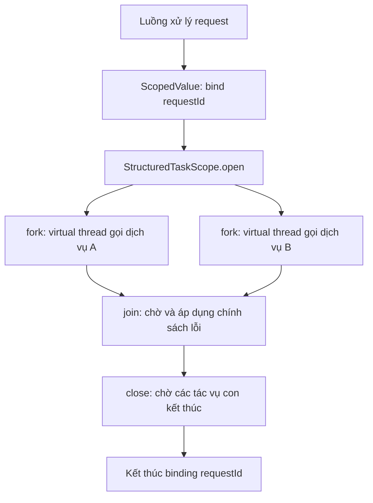

# Quan hệ giữa virtual thread, ScopedValue và tác vụ có cấu trúc

Ba cơ chế này giải quyết ba phần khác nhau của một bài toán đồng thời:

- **Virtual thread** cung cấp cách chạy nhiều tác vụ đồng thời với chi phí thấp, đặc biệt khi tác vụ thường chờ I/O.
- **Structured concurrency** tổ chức các tác vụ liên quan thành một nhóm có vòng đời rõ ràng, có điểm chờ, quy tắc xử lý lỗi và hủy tác vụ.
- **ScopedValue** truyền dữ liệu ngữ cảnh qua các lời gọi phương thức và sang các tác vụ con thuộc một cấu trúc đồng thời.

Khi kết hợp, chúng tạo thành mô hình phù hợp cho một request cần gọi nhiều dịch vụ: request mở một phạm vi ngữ cảnh, tạo các tác vụ I/O chạy trên virtual thread, chờ hoặc hủy chúng theo một chính sách xác định, rồi kết thúc khi các tác vụ con đã hoàn tất.

## 1. Mỗi cơ chế đảm nhiệm một vai trò

| Cơ chế | Câu hỏi được giải quyết | Trạng thái trên JDK 26 |
|---|---|---|
| Virtual thread | Tác vụ chạy trên luồng nào và làm sao phục vụ nhiều tác vụ chờ I/O? | Final từ JDK 21, JEP 444 |
| ScopedValue | Làm sao truyền ngữ cảnh chỉ đọc trong một khoảng thực thi có giới hạn? | Final từ JDK 25, JEP 506 |
| StructuredTaskScope | Các tác vụ con thuộc về ai, khi nào phải hoàn tất và xử lý lỗi/hủy ra sao? | Preview lần thứ sáu trên JDK 26, JEP 525 |

### Virtual thread: đơn vị thực thi nhẹ

Virtual thread vẫn là một đối tượng `Thread`, nhưng không bị gắn cố định với một OS thread trong suốt vòng đời. JVM lập lịch virtual thread trên một nhóm platform thread gọi là *carrier thread*. Khi virtual thread thực hiện một thao tác blocking I/O có thể tạm dừng, JVM thường có thể tháo nó khỏi carrier để carrier chạy virtual thread khác.

Điểm mạnh của virtual thread là tăng khả năng xử lý đồng thời và thông lượng cho ứng dụng có nhiều tác vụ chờ I/O, chẳng hạn gọi HTTP, truy vấn cơ sở dữ liệu hoặc chờ socket. Nó không làm một phép tính CPU-bound chạy nhanh hơn. Vì vậy, không nên tạo một virtual thread với kỳ vọng tự động tăng tốc thuật toán tính toán nặng.

Virtual thread cũng không tự quyết định những tác vụ nào thuộc cùng một request, không tự tổng hợp kết quả và không tự định nghĩa chính sách hủy khi một tác vụ thất bại. Đó là phần việc của structured concurrency.

### Structured concurrency: vòng đời của nhóm tác vụ

Structured concurrency xem các tác vụ con được tạo ra để phục vụ một tác vụ cha như một đơn vị công việc. Tác vụ cha mở một scope, gọi `fork` để khởi chạy tác vụ con, gọi `join` để chờ kết quả theo chính sách đã chọn, rồi đóng scope. Nhờ đó, các tác vụ con không bị tách rời khỏi vòng đời của tác vụ cha.

Trên JDK 26, `StructuredTaskScope.open()` mặc định tạo một virtual thread cho mỗi lần `fork`. Scope cũng có thể được cấu hình bằng `ThreadFactory` khác, vì vậy structured concurrency là mô hình quản lý vòng đời tác vụ, còn virtual thread là lựa chọn thực thi mặc định của API này.

Với `open()` mặc định, `join()` chờ tất cả tác vụ thành công; nếu một tác vụ thất bại, các tác vụ chưa hoàn tất sẽ bị yêu cầu hủy và `join()` ném `StructuredTaskScope.FailedException`. Có thể chọn `Joiner` khác, ví dụ `Joiner.anySuccessfulOrThrow()` để lấy kết quả đầu tiên thành công và hủy các tác vụ còn lại. Khi scope đóng, `close()` chờ các luồng con kết thúc. Vì việc hủy dựa trên interrupt, tác vụ con cần phản hồi interrupt và giải phóng tài nguyên đúng cách.

### ScopedValue: ngữ cảnh có phạm vi

`ScopedValue` cho phép một phương thức gắn một giá trị với một key trong khoảng thực thi có giới hạn. Các phương thức được gọi trực tiếp hoặc gián tiếp có thể đọc giá trị đó bằng `get()` mà không cần truyền thêm tham số qua mọi tầng gọi hàm.

Ví dụ, một request có thể gắn `requestId`, `tenantId` hoặc thông tin tracing. Khi phương thức kết thúc, binding trở về trạng thái trước đó. `ScopedValue` phù hợp với dữ liệu ngữ cảnh được truyền một chiều; nó thường dễ kiểm soát hơn `ThreadLocal` vì binding chỉ có thể được thay trong một phạm vi lồng nhau rõ ràng, rồi tự trở về giá trị trước đó khi phạm vi lồng nhau kết thúc. Binding cũng không tồn tại vô thời hạn sau khi phạm vi ban đầu kết thúc.

Binding của `ScopedValue` là theo từng thread. Điểm kết nối quan trọng là `StructuredTaskScope`: khi tạo scope, API chụp các binding đang có trên thread sở hữu scope. Các thread được tạo bởi `fork` kế thừa những binding đó. Nhờ vậy, mọi tác vụ con có thể đọc cùng `requestId` mà không cần thêm tham số vào từng hàm.

Giá trị được chia sẻ giữa nhiều thread nên là immutable; nếu giá trị có thể thay đổi, mọi truy cập cần được đồng bộ phù hợp. `ScopedValue` không tự động truyền binding sang mọi thread được tạo tùy ý hoặc mọi executor bên ngoài scope. Cơ chế kế thừa được mô tả ở đây gắn với các tác vụ con trong `StructuredTaskScope`.

## 2. Cách ba cơ chế phối hợp

Một luồng xử lý request có thể thực hiện chuỗi sau:

1. Gắn `requestId` bằng `ScopedValue.where(...).call(...)`.
2. Mở `StructuredTaskScope` bên trong binding đó.
3. Gọi `fork` để chạy từng lời gọi I/O trên virtual thread riêng. Mỗi tác vụ con kế thừa `requestId`.
4. Gọi `join` để chờ theo chính sách của scope; nếu có lỗi, các tác vụ còn lại được yêu cầu dừng.
5. Lấy kết quả sau khi `join` thành công. Khi thoát `try-with-resources`, `close` bảo đảm các tác vụ con đã kết thúc.
6. Khi `call` kết thúc, binding `requestId` tự hết hiệu lực.



## 3. Ví dụ kết hợp trên JDK 26

Ví dụ sau mô phỏng một request cần tải hồ sơ và danh sách đơn hàng từ hai endpoint. Cả hai lời gọi có thể chạy đồng thời; hàm `fetch` đọc cùng `requestId` từ `ScopedValue` mà không nhận nó như một tham số.

```java
import java.io.IOException;
import java.net.URI;
import java.net.http.HttpClient;
import java.net.http.HttpRequest;
import java.net.http.HttpResponse;
import java.util.concurrent.StructuredTaskScope;

public class RequestFanOut {
    private static final ScopedValue<String> REQUEST_ID =
            ScopedValue.newInstance();

    private static final HttpClient HTTP = HttpClient.newHttpClient();

    record PagePair(String profile, String orders) {}

    static PagePair load(URI profileUri, URI ordersUri, String requestId)
            throws InterruptedException {
        return ScopedValue.where(REQUEST_ID, requestId).call(() -> {
            try (var scope = StructuredTaskScope.open()) {
                var profile = scope.fork(() -> fetch(profileUri));
                var orders = scope.fork(() -> fetch(ordersUri));

                // Với open() mặc định, join thất bại nếu một tác vụ con thất bại.
                scope.join();

                // Chỉ đọc kết quả sau khi join thành công.
                return new PagePair(profile.get(), orders.get());
            }
        });
    }

    private static String fetch(URI uri)
            throws IOException, InterruptedException {
        String requestId = REQUEST_ID.get();
        System.out.printf("[%s] GET %s%n", requestId, uri);

        HttpRequest request = HttpRequest.newBuilder(uri).GET().build();
        return HTTP.send(request, HttpResponse.BodyHandlers.ofString()).body();
    }

    public static void main(String[] args) throws Exception {
        PagePair result = load(
                URI.create("https://example.com/profile"),
                URI.create("https://example.com/orders"),
                "req-42");
        System.out.println(result);
    }
}
```

Trong ví dụ này, thứ tự đặt binding rất quan trọng: `StructuredTaskScope.open()` phải được gọi khi `REQUEST_ID` đã được bind. Scope chụp binding tại thời điểm mở; khi `fork`, JDK kiểm tra binding hiện tại có khớp với binding đã chụp hay không. Nếu thay đổi binding giữa lúc mở scope và fork tác vụ, chương trình có thể gặp `StructureViolationException`.

`fetch` có thể ném `IOException` hoặc `InterruptedException`. Lỗi của tác vụ con được `join()` mặc định chuyển thành `StructuredTaskScope.FailedException`, với lỗi gốc làm cause. Khi một tác vụ thất bại, tác vụ còn lại được interrupt. Nếu một tác vụ không phản hồi interrupt hoặc bị kẹt trong thao tác không thể ngắt, `close()` vẫn phải chờ nó kết thúc; do đó cần thiết kế tác vụ con có khả năng dừng và đóng tài nguyên khi bị hủy.

## 4. Chọn chính sách join phù hợp

`StructuredTaskScope` không bắt buộc mọi nhóm tác vụ phải chờ tất cả kết quả. `Joiner` xác định điều kiện hoàn tất và giá trị trả về từ `join()`.

```java
try (var scope = StructuredTaskScope.open(
        StructuredTaskScope.Joiner.<String>anySuccessfulOrThrow())) {
    scope.fork(() -> queryPrimary());
    scope.fork(() -> queryReplica());

    // Trả về kết quả đầu tiên thành công; nếu cả hai thất bại thì ném lỗi.
    String value = scope.join();
}
```

Chính sách này hữu ích khi hai endpoint cung cấp cùng một loại dữ liệu và chỉ cần một kết quả. Nếu cần tổng hợp tất cả kết quả, dùng `open()` mặc định hoặc một `Joiner` phù hợp với yêu cầu. JDK 26 cũng cho phép cấu hình timeout khi mở scope bằng overload `open(joiner, configOperator)`; timeout hết hạn sẽ kích hoạt hủy scope và được xử lý qua chính sách `Joiner`.

## 5. Những điểm cần kiểm soát khi triển khai

- **Bind ngữ cảnh trước khi mở scope.** Scope chụp binding tại thời điểm tạo. Đặt `ScopedValue.where(...).call(...)` bên ngoài khối `try` của scope để các tác vụ con nhận đúng ngữ cảnh.
- **Chia sẻ dữ liệu bất biến.** `String`, record chỉ chứa các thành phần bất biến hoặc đối tượng chỉ đọc là lựa chọn tốt cho request context. Nếu chia sẻ đối tượng có trạng thái thay đổi, phải đồng bộ mọi truy cập.
- **Xử lý interrupt đúng cách.** Khi một nhánh thất bại hoặc timeout, các nhánh còn lại có thể bị interrupt. Không nuốt `InterruptedException`; hãy dọn dẹp tài nguyên và truyền tiếp hoặc khôi phục trạng thái interrupt theo hợp đồng của tầng gọi.
- **Giới hạn tài nguyên bên ngoài.** Virtual thread giúp tạo nhiều tác vụ chờ I/O, nhưng không làm cơ sở dữ liệu hay dịch vụ downstream chịu được số kết nối vô hạn. Dùng connection pool, semaphore hoặc cơ chế giới hạn lưu lượng phù hợp với giới hạn thật của tài nguyên.
- **Tách tải CPU khỏi tải I/O.** Virtual thread phù hợp với tác vụ thường chờ I/O. Với tính toán CPU-bound kéo dài, cần kiểm soát mức song song theo số lõi và tải máy.
- **Không coi `ScopedValue` là kho trạng thái dùng chung.** Nó truyền ngữ cảnh theo phạm vi; nó không cung cấp cơ chế cập nhật trạng thái an toàn giữa các thread.
- **Để ý trạng thái preview của structured concurrency.** API có thể tiếp tục thay đổi trước khi được chuẩn hóa. Tránh để kiểu preview trở thành hợp đồng công khai rộng khắp nếu ứng dụng cần tương thích dài hạn.

Nếu chưa thể bật preview trong sản phẩm, có thể dùng API ổn định `Executors.newVirtualThreadPerTaskExecutor()` cùng `Future` để chạy tác vụ trên virtual thread. Khi đó, phần chờ, tổng hợp lỗi và hủy các tác vụ liên quan cần được quản lý tường minh; cách dùng này không cung cấp cùng mô hình vòng đời cha-con của `StructuredTaskScope`.

## 6. Điều kiện sử dụng trên JDK 26

Virtual thread và `ScopedValue` là API ổn định trên JDK 26. `StructuredTaskScope` vẫn là preview trong JDK 26 (JEP 525, lần preview thứ sáu), nên cần bật preview ở cả bước biên dịch và chạy chương trình. Ví dụ với một JDK 26:

```bash
javac --release 26 --enable-preview RequestFanOut.java
java --enable-preview RequestFanOut
```

Hãy biên dịch và chạy bằng JDK 26 tương ứng. Khi nâng cấp JDK, cần kiểm tra lại JEP và Java API Specification của đúng phiên bản vì API preview có thể thay đổi, bị loại bỏ hoặc trở thành API chính thức.

## 7. Cách quyết định sử dụng

| Nhu cầu | Cơ chế nên xem xét |
|---|---|
| Phục vụ nhiều request hoặc lời gọi I/O đồng thời bằng lối viết blocking dễ đọc | Virtual thread |
| Một request chia thành nhiều nhánh và cần chờ, tổng hợp, hủy theo cùng vòng đời | Structured concurrency |
| Truyền request ID, trace ID hoặc tenant context qua nhiều tầng gọi và sang các nhánh con | ScopedValue |
| Một request vừa cần mở rộng đồng thời I/O, vừa cần truyền ngữ cảnh và quản lý lỗi/hủy có cấu trúc | Kết hợp cả ba |

Không cần áp dụng cả ba cho mọi đoạn code đồng thời. Chọn từng cơ chế theo vấn đề thực tế: virtual thread cho cách thực thi, structured concurrency cho quan hệ vòng đời giữa tác vụ, và ScopedValue cho ngữ cảnh chỉ đọc có phạm vi.

## Tài liệu tham khảo

- [JEP 444: Virtual Threads](https://openjdk.org/jeps/444)
- [JEP 506: Scoped Values](https://openjdk.org/jeps/506)
- [JEP 525: Structured Concurrency (Sixth Preview)](https://openjdk.org/jeps/525)
- [Java SE 26 API: ScopedValue](https://docs.oracle.com/en/java/javase/26/docs/api/java.base/java/lang/ScopedValue.html)
- [Java SE 26 API: StructuredTaskScope](https://docs.oracle.com/en/java/javase/26/docs/api/java.base/java/util/concurrent/StructuredTaskScope.html)
- [Java SE 26: Virtual Threads](https://docs.oracle.com/en/java/javase/26/core/virtual-threads.html)
