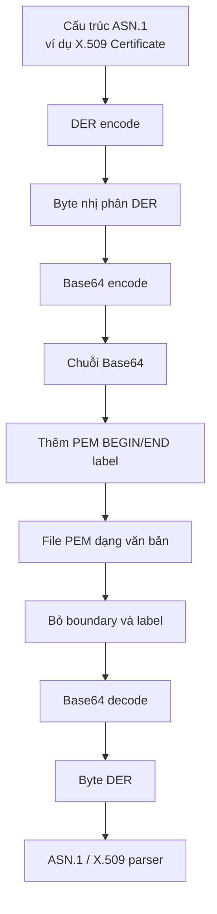

# Quan hệ giữa PEM, Base64 và biểu diễn nhị phân DER

> **Mốc cập nhật: 27-11-2026.** Bài này mô tả cách các cấu trúc PKIX hiện hành như X.509 certificate, SubjectPublicKeyInfo và PKCS#8 private key được biểu diễn bằng DER rồi đóng gói thành văn bản PEM. Phần minh họa Java dùng API ổn định như `Base64`, `CertificateFactory` và `KeyFactory`. API `PEMEncoder`/`PEMDecoder` mới trong JDK 27 vẫn là Preview, nên cần bật preview và kiểm tra đúng Javadoc của release đang dùng.

## 1. Mục tiêu

Khi trao đổi chứng thư số hoặc khóa mật mã, ta thường thấy các file như:

- `server-certificate.pem`
- `public-key.pem`
- `private-key.pem`
- `certificate.der`

Các file này có thể chứa cùng một loại dữ liệu mật mã nhưng dùng cách biểu diễn khác nhau. Cần phân biệt ba lớp:

1. **ASN.1** mô tả cấu trúc dữ liệu trừu tượng, ví dụ cấu trúc certificate hoặc private key.
2. **DER** mã hóa cấu trúc ASN.1 thành các byte nhị phân theo quy tắc xác định.
3. **Base64 và PEM armor** chuyển các byte DER thành văn bản có thể lưu trong file text hoặc truyền qua hệ thống chỉ xử lý văn bản.

Sau bài này, bạn có thể:

- Giải thích vì sao PEM thường chứa Base64 của dữ liệu DER.
- Phân biệt ASN.1, DER, Base64 và PEM.
- Đọc đúng nhãn PEM và xác định cấu trúc dữ liệu bên trong.
- Chuyển đổi certificate giữa PEM và DER.
- Giải mã một PEM certificate bằng Java và phân tích DER bằng API X.509.
- Nhận biết giới hạn của Base64, tránh coi nó là mã hóa bảo mật.
- Xử lý file chứa nhiều PEM block và bảo vệ private key.

## 2. Bốn khái niệm cần tách biệt

| Khái niệm | Bản chất | Ví dụ |
|---|---|---|
| ASN.1 | Ngôn ngữ mô tả cấu trúc dữ liệu. | X.509 Certificate, SubjectPublicKeyInfo, PKCS#8 PrivateKeyInfo. |
| DER | Quy tắc mã hóa nhị phân xác định cho dữ liệu ASN.1. | Dãy byte certificate DER. |
| Base64 | Cách biểu diễn byte thành ký tự ASCII. | Chuỗi `MIID...` được tạo từ byte DER. |
| PEM | Cách đóng gói văn bản với nhãn BEGIN/END và phần Base64. | `-----BEGIN CERTIFICATE-----`. |

Mối quan hệ thường gặp:



Nếu lấy phần Base64 của một PEM block certificate và giải mã đúng, ta thu được byte DER của certificate. Nhãn PEM cho biết người tạo file muốn người đọc hiểu block đó thuộc loại dữ liệu nào; nhãn không phải một phần của byte DER.

## 3. ASN.1 mô tả cấu trúc dữ liệu

ASN.1 (Abstract Syntax Notation One) là cách mô tả cấu trúc dữ liệu độc lập với ngôn ngữ lập trình và cách truyền tải. Trong lĩnh vực chứng thư và khóa công khai, ASN.1 được dùng để mô tả các cấu trúc như:

- X.509 Certificate: thông tin issuer, subject, serial number, validity, public key, extensions và chữ ký.
- SubjectPublicKeyInfo (SPKI): thuật toán khóa công khai và dữ liệu public key.
- PKCS#8 PrivateKeyInfo: thuật toán và dữ liệu private key.
- EncryptedPrivateKeyInfo: cấu trúc private key đã được mã hóa.
- PKCS#10 CertificationRequest: yêu cầu cấp certificate (CSR).

ASN.1 chỉ mô tả trường và kiểu dữ liệu. Để lưu hoặc truyền cấu trúc đó dưới dạng byte, cần một bộ quy tắc encoding như DER.

Không nên nhầm tên cấu trúc với encoding:

- X.509 mô tả cấu trúc certificate.
- DER mô tả cách mã hóa cấu trúc ASN.1 thành byte.
- PEM là một cách trình bày byte DER trong văn bản.

## 4. DER: biểu diễn nhị phân của ASN.1

DER (Distinguished Encoding Rules) là tập quy tắc mã hóa xác định thuộc họ ASN.1 BER. DER đưa ra cách biểu diễn canonical để cùng một giá trị ASN.1 có một cách mã hóa DER duy nhất.

DER thường dùng trong certificate, public key và private key vì chữ ký số cần dữ liệu được mã hóa nhất quán.

### 4.1. Cấu trúc TLV

Nhiều phần tử DER có thể được hiểu theo mô hình:

- **Tag:** cho biết loại phần tử hoặc kiểu ASN.1.
- **Length:** độ dài phần dữ liệu.
- **Value:** nội dung được mã hóa.

Ví dụ, một certificate DER thường bắt đầu bằng byte `0x30`, biểu thị ASN.1 SEQUENCE. Các trường con bên trong lần lượt mã hóa nội dung certificate theo schema X.509.

Đây chỉ là cách nhìn khái quát. Một certificate có nhiều lớp SEQUENCE, INTEGER, BIT STRING, OBJECT IDENTIFIER, OCTET STRING, context-specific tag và các kiểu ASN.1 khác. Không thể hiểu toàn bộ certificate chỉ bằng cách đọc vài byte đầu.

### 4.2. Vì sao dùng DER thay vì chỉ lưu ASN.1 trừu tượng?

DER mang lại:

- Cách mã hóa nhị phân xác định và canonical.
- Biểu diễn phù hợp cho ký số và kiểm tra chữ ký.
- Kích thước nhỏ hơn biểu diễn Base64 tương ứng.
- Khả năng phân tích bằng các parser ASN.1/X.509.

Một file `.der` không tự nói rõ nó chứa loại dữ liệu nào. Nó có thể là certificate, public key, private key hoặc một ASN.1 object khác. Phải biết schema hoặc ngữ cảnh để chọn parser phù hợp.

## 5. Base64: chuyển byte thành văn bản

Base64 chuyển một chuỗi byte thành các ký tự ASCII. Nó không thay đổi ý nghĩa của dữ liệu và không cung cấp tính bí mật.

Với Base64 chuẩn:

- Dùng bảng chữ cái gồm `A-Z`, `a-z`, `0-9`, `+` và `/`.
- Ký tự `=` có thể xuất hiện làm padding ở cuối.
- Mỗi 3 byte đầu vào thường tạo thành 4 ký tự Base64.
- Dữ liệu sau decode phải khớp byte đầu vào ban đầu.

Ví dụ minh họa:

```text
Byte ASCII:       Man
Hex:              4D 61 6E
Base64:           TWFu
```

Base64 không phải encryption:

- Ai có file PEM đều có thể bỏ nhãn và decode Base64.
- Không cần password để chuyển Base64 về byte.
- Base64 không xác thực nguồn gốc hoặc tính toàn vẹn của dữ liệu.
- Không được xem private key dạng PEM là an toàn chỉ vì phần thân đã được Base64.

Base64URL là biến thể khác, thường dùng `-` và `_` thay cho `+` và `/`. PEM dùng Base64 theo quy ước của textual encoding; không tự ý thay bằng Base64URL.

## 6. PEM: đóng gói DER thành văn bản

PEM là tên thường dùng cho kiểu textual encoding có boundary line, nhãn dữ liệu và phần Base64. Các textual encoding hiện đại cho cấu trúc PKIX, PKCS và CMS được mô tả trong RFC 7468.

Một PEM certificate thường có dạng:

```text
-----BEGIN CERTIFICATE-----
MIID...
...phần Base64...
-----END CERTIFICATE-----
```

Cấu trúc gồm:

1. **BEGIN boundary:** mở đầu block và mang nhãn, ở ví dụ này là `CERTIFICATE`.
2. **Base64 body:** byte DER được mã hóa Base64, thường chia thành nhiều dòng.
3. **END boundary:** kết thúc block, nhãn phải tương ứng với BEGIN.

Các boundary line và nhãn là phần bao ngoài. Chúng không được đưa vào Base64 decode.

### 6.1. Quy tắc trình bày

- Boundary có dạng `-----BEGIN LABEL-----` và `-----END LABEL-----`.
- Nội dung giữa hai boundary là Base64 của dữ liệu được mã hóa.
- PEM text thường dùng dòng Base64 tối đa 64 ký tự; parser nên chấp nhận cách xuống dòng hợp lệ khác nhau.
- File có thể dùng line ending LF hoặc CRLF.
- Một file có thể chứa nhiều block PEM nối tiếp, ví dụ nhiều certificate trong một chain file.
- Mỗi block có nhãn riêng; cần xử lý từng block và chọn parser phù hợp với nhãn.

Không đưa các dòng boundary vào `Base64.Decoder`. Nếu file có nhiều block, không nối toàn bộ Base64 body thành một object DER duy nhất.

### 6.2. Nhãn PEM thường gặp hiện nay

| Nhãn | Nội dung bên trong | Cấu trúc/encoding thường dùng |
|---|---|---|
| `CERTIFICATE` | X.509 certificate | DER-encoded X.509 Certificate. |
| `PUBLIC KEY` | Public key tổng quát | DER-encoded SubjectPublicKeyInfo (SPKI). |
| `PRIVATE KEY` | Private key không mã hóa | DER-encoded PKCS#8 key package (PrivateKeyInfo/OneAsymmetricKey). |
| `ENCRYPTED PRIVATE KEY` | Private key đã mã hóa | DER-encoded PKCS#8 EncryptedPrivateKeyInfo. |
| `CERTIFICATE REQUEST` | CSR | DER-encoded PKCS#10 CertificationRequest. |
| `X509 CRL` | Certificate Revocation List | DER-encoded X.509 CRL. |

Nhãn là gợi ý về kiểu dữ liệu và parser cần dùng; nó không thay thế việc kiểm tra nội dung. Một file có nhãn `CERTIFICATE` vẫn có thể bị hỏng hoặc chứa dữ liệu không hợp lệ. Các cấu trúc PKCS#8 hiện hành được mô tả trong RFC 5958; khi tích hợp, kiểm tra chính xác phiên bản key package và khả năng hỗ trợ của parser đang dùng.

Các định dạng PEM cũ theo từng thuật toán hoặc các header mã hóa truyền thống có thể xuất hiện trong hệ thống cũ. Với tích hợp mới, ưu tiên các cấu trúc chuẩn hóa hiện hành như SPKI cho public key và PKCS#8 cho private key; không mặc định rằng mọi nhãn lịch sử đều tương đương `PUBLIC KEY` hoặc `PRIVATE KEY`.

## 7. Từ PEM đến DER và ngược lại

### 7.1. PEM → DER

Quy trình:

1. Đọc file PEM dưới dạng văn bản.
2. Xác định đúng một block và nhãn.
3. Loại bỏ BEGIN/END boundary.
4. Ghép các dòng Base64 trong body, loại whitespace cho phép.
5. Decode bằng Base64 chuẩn.
6. Nhận byte DER.
7. Dùng parser đúng schema để kiểm tra dữ liệu.

### 7.2. DER → PEM

Quy trình ngược lại:

1. Xác định schema của DER object, ví dụ X.509 Certificate.
2. Encode byte DER bằng Base64 chuẩn.
3. Chia body thành các dòng theo quy tắc textual encoding.
4. Thêm BEGIN/END boundary với nhãn phù hợp.
5. Lưu văn bản PEM.

Chỉ đổi phần mở rộng từ `.der` sang `.pem` không thực hiện chuyển đổi. Ngược lại, đổi đuôi `.pem` thành `.der` cũng không decode Base64.

### 7.3. Ví dụ OpenSSL: chuyển certificate

Dùng OpenSSL 3.x trên một certificate thử nghiệm:

```text
openssl x509 -in certificate.pem -outform DER -out certificate.der
```

Lệnh trên đọc PEM certificate, decode Base64 và ghi certificate ở dạng DER.

Chuyển lại DER sang PEM:

```text
openssl x509 -inform DER -in certificate.der -outform PEM -out certificate-roundtrip.pem
```

Đọc thông tin certificate:

```text
openssl x509 -in certificate.pem -noout -subject -issuer -dates
```

Phân tích cấu trúc ASN.1 của DER:

```text
openssl asn1parse -inform DER -in certificate.der -i
```

`asn1parse` giúp quan sát các phần tử ASN.1 được mã hóa trong DER. Nó không tự xác minh certificate có được CA tin cậy ký hay certificate có phù hợp hostname hay không.

### 7.4. Chuyển private key PKCS#8

Với private key theo định dạng PKCS#8, OpenSSL `pkey` có thể chuyển giữa PEM và DER:

```text
openssl pkey -in private-key.pem -outform DER -out private-key.der
openssl pkey -inform DER -in private-key.der -outform PEM -out private-key-roundtrip.pem
```

Nếu input là encrypted private key, OpenSSL có thể yêu cầu passphrase. Hãy dùng cơ chế nhập passphrase an toàn của môi trường; tránh đặt passphrase trực tiếp trong command line hoặc ghi nó vào shell history.

Không dùng lệnh chuyển đổi private key trên file production nếu chưa xác định quyền truy cập, nơi lưu output và chính sách bảo vệ key. File DER private key vẫn là private key nhạy cảm; chuyển từ PEM sang DER không làm nó an toàn hơn.

## 8. Đọc PEM certificate bằng Java API ổn định

Có thể minh họa mối quan hệ PEM → Base64 → DER bằng `java.util.Base64`, rồi phân tích certificate bằng `CertificateFactory`. Các API này đã ổn định và không cần preview.

Ví dụ dưới đây đọc một PEM block `CERTIFICATE` duy nhất:

```java
import java.io.ByteArrayInputStream;
import java.nio.charset.StandardCharsets;
import java.nio.file.Files;
import java.nio.file.Path;
import java.security.cert.CertificateFactory;
import java.security.cert.X509Certificate;
import java.util.Base64;
import java.util.stream.Collectors;

public final class PemCertificateReader {
    private PemCertificateReader() {}

    public static X509Certificate read(Path path) throws Exception {
        String pem = Files.readString(path, StandardCharsets.US_ASCII);
        String[] lines = pem.strip().split("\\R");

        if (lines.length < 3
                || !lines[0].equals("-----BEGIN CERTIFICATE-----")
                || !lines[lines.length - 1].equals("-----END CERTIFICATE-----")) {
            throw new IllegalArgumentException(
                    "Expected exactly one CERTIFICATE PEM block"
            );
        }

        String base64Body = java.util.Arrays.stream(lines, 1, lines.length - 1)
                .collect(Collectors.joining())
                .replaceAll("\\s", "");

        byte[] der = Base64.getDecoder().decode(base64Body);

        try (var input = new ByteArrayInputStream(der)) {
            return (X509Certificate) CertificateFactory
                    .getInstance("X.509")
                    .generateCertificate(input);
        }
    }

    public static void main(String[] args) throws Exception {
        X509Certificate certificate =
                read(Path.of("certificate.pem"));

        System.out.println("Subject: " + certificate.getSubjectX500Principal());
        System.out.println("Issuer: " + certificate.getIssuerX500Principal());
        System.out.println("Serial: " + certificate.getSerialNumber());
        System.out.println("Not after: " + certificate.getNotAfter());
    }
}
```

Ví dụ cố ý chỉ xử lý một block certificate với boundary chuẩn. Nó không phải parser PEM tổng quát cho mọi loại label, nhiều block hoặc các định dạng lịch sử. Trong ứng dụng thực tế, dùng parser PEM chuyên dụng hoặc API bảo mật của JDK phù hợp với loại dữ liệu và phiên bản đang chạy.

### 8.1. Đọc public key DER

Nhãn `PUBLIC KEY` thường biểu diễn SubjectPublicKeyInfo (SPKI). Khi đã có byte DER, dùng `X509EncodedKeySpec` và `KeyFactory`:

```java
import java.security.KeyFactory;
import java.security.PublicKey;
import java.security.spec.X509EncodedKeySpec;

static PublicKey decodeRsaPublicKey(byte[] der) throws Exception {
    var spec = new X509EncodedKeySpec(der);
    return KeyFactory.getInstance("RSA").generatePublic(spec);
}
```

Tên `X509EncodedKeySpec` không có nghĩa byte đầu vào là một X.509 certificate. Nó là key specification cho public key theo cấu trúc SubjectPublicKeyInfo được định nghĩa trong hệ sinh thái X.509.

### 8.2. Đọc private key PKCS#8

Nhãn `PRIVATE KEY` biểu diễn key package PKCS#8 không mã hóa. Với byte DER tương thích `PKCS8EncodedKeySpec` và đã biết thuật toán:

```java
import java.security.KeyFactory;
import java.security.PrivateKey;
import java.security.spec.PKCS8EncodedKeySpec;

static PrivateKey decodeRsaPrivateKey(byte[] der) throws Exception {
    var spec = new PKCS8EncodedKeySpec(der);
    return KeyFactory.getInstance("RSA").generatePrivate(spec);
}
```

Đoạn code này chỉ minh họa cách parser nhận DER PKCS#8 không mã hóa. Nó không giải mã `ENCRYPTED PRIVATE KEY`; loại đó cần xử lý encryption parameters và passphrase theo định dạng PKCS#8 tương ứng. Không log hoặc in byte DER của private key.

## 9. PEM API trong JDK 27

JDK 27 có API `PEMEncoder` và `PEMDecoder` trong package `java.security`, được giới thiệu qua JEP 538 (PEM Encodings, Third Preview). Tại mốc bài học này, đây vẫn là Preview API, không phải API stable.

Nếu chọn sử dụng:

- Dùng đúng JDK 27 và bật `--enable-preview` khi compile lẫn runtime.
- Đọc Javadoc Java SE 27 cho đúng overload và loại object được hỗ trợ.
- Không chép nguyên code preview JDK 26: API đã thay đổi qua các lần preview; JDK 27 dùng hợp đồng dựa trên `BinaryEncodable`, thay cho thiết kế `DEREncodable` của preview trước.
- Kiểm tra trạng thái preview lại khi nâng cấp JDK; không để API preview trở thành hợp đồng công khai của thư viện nếu chưa chấp nhận rủi ro thay đổi.

Với code cần tương thích rộng hoặc không muốn phụ thuộc preview, có thể tiếp tục dùng API ổn định như `Base64`, `CertificateFactory`, `X509EncodedKeySpec` và `PKCS8EncodedKeySpec` cho đúng loại dữ liệu. Không tự viết một parser ASN.1 tổng quát bằng cách cắt byte thủ công.

## 10. File PEM chứa nhiều block

Một file PEM có thể chứa nhiều block liên tiếp. Ví dụ certificate chain file có thể có:

```text
-----BEGIN CERTIFICATE-----
...certificate của server...
-----END CERTIFICATE-----
-----BEGIN CERTIFICATE-----
...intermediate certificate...
-----END CERTIFICATE-----
```

Mỗi block là một object riêng. Ứng dụng cần:

1. Tách từng block theo boundary.
2. Kiểm tra label.
3. Decode Base64 riêng từng block.
4. Parse mỗi DER object bằng parser phù hợp.
5. Xác định thứ tự chain và kiểm tra quan hệ issuer/subject, chữ ký và trust anchor.

Không nối body Base64 của nhiều certificate trước khi decode, vì kết quả sẽ không phải một DER certificate duy nhất. Cũng không suy ra certificate đáng tin chỉ vì nó xuất hiện đầu tiên hoặc cuối cùng trong file. Trust phải được xác minh bằng trust store và certificate path validation.

## 11. Kiểm tra tính đúng của chuyển đổi

Sau khi chuyển PEM → DER → PEM, cần kiểm tra nội dung chứ không chỉ nhìn file có tồn tại.

### 11.1. Kiểm tra byte DER

Nếu cùng một DER object được chuyển sang PEM rồi decode lại, byte DER thu được phải giống byte ban đầu:

```text
DER_original == Base64Decode(PEM_body)
```

Có thể so sánh hash SHA-256 của hai file DER:

```text
openssl dgst -sha256 certificate.der
openssl x509 -in certificate-roundtrip.pem -outform DER -out roundtrip.der
openssl dgst -sha256 roundtrip.der
```

Nếu hai hash giống nhau, byte DER giống nhau. Nếu khác, hai file không giống nhau ở mức byte; hãy kiểm tra xem chúng có thực sự mã hóa cùng ASN.1 value theo DER hay không, có khác thuộc tính hoặc nội dung hay một bên không phải DER canonical.

### 11.2. Kiểm tra cấu trúc và mục đích

- Dùng parser X.509 để kiểm tra certificate.
- Dùng parser SPKI để kiểm tra public key.
- Dùng parser PKCS#8 để kiểm tra private key.
- Kiểm tra label có khớp với loại dữ liệu.
- Kiểm tra chữ ký certificate và certificate path bằng trust store.
- Kiểm tra hostname/SAN và thời hạn certificate trong ngữ cảnh TLS.

Decode Base64 thành công chỉ chứng minh body có cú pháp Base64 hợp lệ. Nó không chứng minh DER hợp lệ, label đúng, certificate có chữ ký hợp lệ hoặc public key đáng tin.

## 12. Bảo mật khi xử lý PEM

PEM chỉ là cách biểu diễn dữ liệu. Base64 không mã hóa bí mật và không thay thế chữ ký số hoặc kiểm tra tính toàn vẹn.

| Loại dữ liệu | Mức độ nhạy cảm | Cách bảo vệ |
|---|---|---|
| Certificate công khai | Thường không bí mật. | Kiểm tra nguồn cấp, chữ ký, hostname, thời hạn và trust chain. |
| Public key | Thường không bí mật. | Xác minh fingerprint và nguồn cung cấp. |
| Private key | Bí mật nghiêm trọng. | Giới hạn quyền file, secret manager/HSM, mã hóa khi lưu và kiểm soát passphrase. |
| Encrypted private key | Vẫn là dữ liệu nhạy cảm. | Bảo vệ file lẫn passphrase; không để passphrase cùng nơi với key. |

Các nguyên tắc:

- Không commit private key vào Git hoặc gửi qua chat/log.
- Không ghi nội dung private key vào exception, debug output hoặc telemetry.
- Giới hạn quyền đọc file và thư mục chứa key.
- Dùng encrypted PKCS#8 hoặc cơ chế quản lý khóa chuyên dụng khi phù hợp với threat model.
- Nếu private key bị lộ, phải xử lý như một sự cố credential: thu hồi/chuyển certificate hoặc key theo quy trình, không chỉ đổi tên file.
- Không coi file `PRIVATE KEY` là đã mã hóa; nhãn `ENCRYPTED PRIVATE KEY` mới biểu thị cấu trúc PKCS#8 encrypted.

## 13. Các lỗi thường gặp

| Lỗi | Nguyên nhân | Cách xử lý |
|---|---|---|
| Base64 decoder báo ký tự không hợp lệ | Đưa cả BEGIN/END boundary vào decoder hoặc dùng sai biến thể Base64. | Tách body và dùng Base64 chuẩn. |
| Decode thành công nhưng CertificateFactory lỗi | DER không phải X.509 certificate, byte bị hỏng hoặc label sai. | Kiểm tra loại object, DER parser và nguồn file. |
| Đổi đuôi file nhưng ứng dụng không đọc được | Chỉ đổi extension, chưa chuyển đổi encoding. | Thực hiện PEM decode hoặc DER encode đúng cách. |
| Dùng parser certificate cho public key | Nhầm X.509 Certificate với SubjectPublicKeyInfo. | Dùng `X509EncodedKeySpec` và `KeyFactory`. |
| Dùng `PKCS8EncodedKeySpec` cho encrypted key | Input là EncryptedPrivateKeyInfo, chưa giải mã. | Giải mã PKCS#8 trước khi tạo key spec. |
| File có nhiều certificate nhưng chỉ đọc được một | Parser ví dụ chỉ xử lý một PEM block. | Tách và parse từng block hoặc dùng API hỗ trợ collection. |
| Certificate parse được nhưng TLS vẫn thất bại | Parse không đồng nghĩa certificate path/hostname hợp lệ. | Kiểm tra trust chain, SAN, validity và cấu hình TLS. |
| Private key bị lộ dù PEM đã Base64 | Base64 không phải encryption. | Rotate/revoke key và bảo vệ secret storage. |

## 14. Bài tập thực hành

1. Lấy một certificate thử nghiệm và đọc nhãn PEM. Xác định đây có phải `CERTIFICATE` hay không.
2. Dùng OpenSSL chuyển certificate từ PEM sang DER; so sánh kích thước file.
3. Chuyển DER trở lại PEM rồi decode lại body; so sánh SHA-256 của hai file DER.
4. Dùng `openssl asn1parse` quan sát cấu trúc ASN.1 trong DER.
5. Dùng Java `Base64` giải mã body PEM và `CertificateFactory` parse certificate.
6. Dùng `X509EncodedKeySpec` để parse public key SPKI DER.
7. Phân biệt `PRIVATE KEY` và `ENCRYPTED PRIVATE KEY`; giải thích vì sao Base64 decode không giải mã passphrase-protected key.
8. Tạo file thử nghiệm có hai certificate block; tách và parse riêng từng block.
9. Thử đổi nhãn PEM nhưng giữ nguyên body; quan sát vì sao label không biến một loại DER object thành loại khác.
10. Kiểm tra certificate parse thành công nhưng không có trust anchor; phân biệt parse với xác minh trust.
11. Viết checklist lưu trữ private key, phân quyền file và quy trình xử lý khi key bị lộ.

Bảng ghi kết quả:

| Thử nghiệm | Dữ liệu cần ghi | Kết quả mong đợi |
|---|---|---|
| PEM inspection | Label, số block, Base64 body length | Nhận diện đúng từng object. |
| PEM → DER | Kích thước và SHA-256 | DER được tạo từ Base64 body. |
| DER → PEM → DER | SHA-256 trước/sau | Cùng DER object cho byte giống nhau. |
| ASN.1 parse | Các tag/sequence quan sát được | Xác định được cấu trúc DER. |
| Java certificate parser | Subject, issuer, serial, validity | Parser nhận đúng X.509 certificate. |
| Public key parser | Algorithm và format | SPKI được đọc bằng KeyFactory phù hợp. |
| Multi-block PEM | Số object parse được | Mỗi block được xử lý độc lập. |
| Trust validation | Chain, trust anchor, hostname | Parse thành công không thay thế kiểm tra trust. |

## 15. Checklist trước khi tích hợp

- [ ] Đã xác định rõ ASN.1 schema của object: certificate, SPKI, PKCS#8 hay CSR.
- [ ] Đã xác định file là PEM textual encoding hay DER binary encoding.
- [ ] Đã tách boundary và label trước khi decode Base64.
- [ ] Dùng Base64 chuẩn, không nhầm Base64URL.
- [ ] Xử lý line ending và whitespace đúng quy tắc.
- [ ] Xử lý riêng từng PEM block trong file nhiều block.
- [ ] Parse DER bằng parser đúng loại dữ liệu.
- [ ] Phân biệt parse thành công với chữ ký/trust/hostname validation.
- [ ] Không coi Base64 là encryption.
- [ ] Bảo vệ private key và passphrase như secret.
- [ ] Nếu dùng PEMEncoder/PEMDecoder, đã kiểm tra preview status và đúng API JDK hiện hành.
- [ ] Không đưa API preview vào hợp đồng công khai mà không có kế hoạch nâng cấp.

## Tài liệu tham khảo chính thức

- [RFC 7468: Textual Encodings of PKIX, PKCS, and CMS Structures](https://www.rfc-editor.org/rfc/rfc7468)
- [ITU-T X.690: ASN.1 BER, CER and DER encoding rules](https://www.itu.int/rec/T-REC-X.690)
- [RFC 5280: Internet X.509 Public Key Infrastructure Certificate and CRL Profile](https://www.rfc-editor.org/rfc/rfc5280)
- [RFC 5958: Asymmetric Key Packages](https://www.rfc-editor.org/rfc/rfc5958)
- [RFC 7468 — Public Key and Certificate Labels](https://www.rfc-editor.org/rfc/rfc7468#section-10)
- [JEP 538: PEM Encodings (Third Preview)](https://openjdk.org/jeps/538)
- [PEMEncoder API — Java SE 27](https://docs.oracle.com/en/java/javase/27/docs/api/java.base/java/security/PEMEncoder.html)
- [PEMDecoder API — Java SE 27](https://docs.oracle.com/en/java/javase/27/docs/api/java.base/java/security/PEMDecoder.html)
- [Base64 API — Java SE 27](https://docs.oracle.com/en/java/javase/27/docs/api/java.base/java/util/Base64.html)
- [CertificateFactory API — Java SE 27](https://docs.oracle.com/en/java/javase/27/docs/api/java.base/java/security/cert/CertificateFactory.html)
- [OpenSSL x509 command](https://docs.openssl.org/3.0/man1/openssl-x509/)
- [OpenSSL pkey command](https://docs.openssl.org/3.0/man1/openssl-pkey/)

