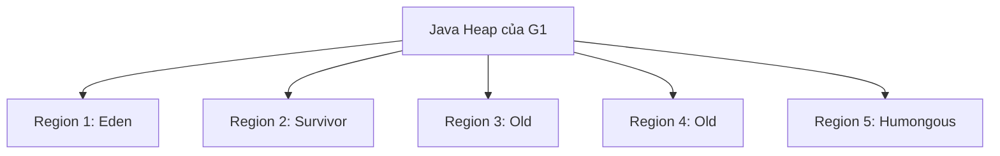
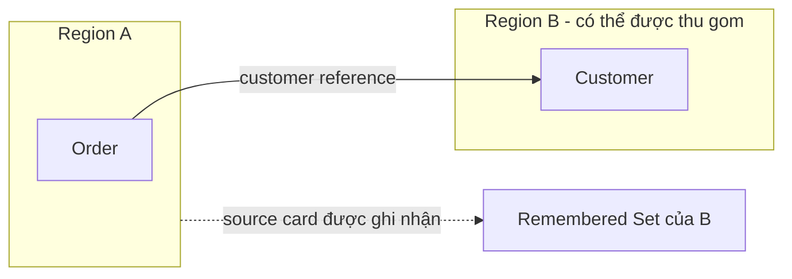
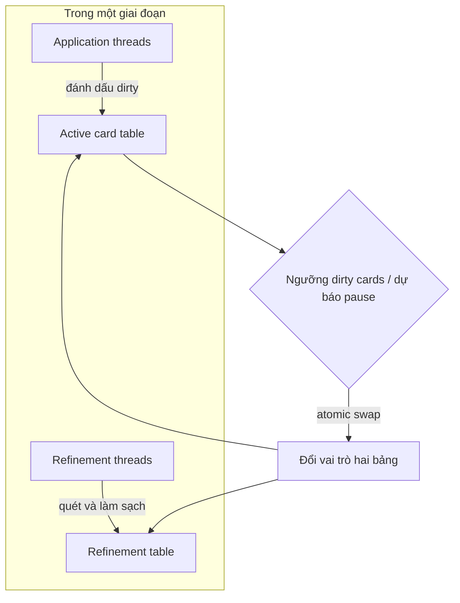

# Region, tham chiếu chéo vùng và vai trò card table

G1 chia Java heap thành các vùng nhớ có kích thước bằng nhau gọi là **region**. Khi thu gom rác, G1 có thể chọn một tập region để thu hồi thay vì phải xử lý toàn bộ heap. Tuy nhiên, object trong một region vẫn có thể giữ reference tới object ở region khác. Nếu G1 di chuyển object được giữ trong region đang thu gom, nó phải tìm và cập nhật mọi reference từ bên ngoài đang trỏ tới object đó.

Để tránh quét toàn bộ heap mỗi lần thu gom một nhóm region, G1 theo dõi các **tham chiếu chéo vùng** bằng write barrier, card table và remembered set. JDK 26 bổ sung JEP 522: G1 dùng hai card table để giảm đồng bộ giữa application thread và các thread refinement. Thay đổi này làm đường ghi reference nhẹ hơn, đồng thời giữ nguyên mô hình region và cách ứng dụng sử dụng G1.

## 1. Region là đơn vị tổ chức heap của G1

Khác với cách chia heap thành các vùng Eden, Survivor và Old liên tục như một số collector khác, G1 chia heap thành nhiều region có kích thước bằng nhau. Mỗi region tại một thời điểm được gán cho một vai trò như Eden, Survivor, Old hoặc Humongous. Region là đơn vị cấp phát và thu hồi bộ nhớ của G1.



Các region không cần nằm liền nhau trong địa chỉ bộ nhớ. Young generation được tạo từ một tập region Eden và Survivor; Old generation gồm các region Old. Object rất lớn, có kích thước từ một nửa region trở lên, được xem là humongous và cấp phát qua một dãy region liền nhau trong Old generation.

Kích thước region mặc định do JVM tự chọn dựa trên kích thước heap tối đa, với mục tiêu tạo khoảng 2.048 region; giá trị tối đa được chọn tự động là 32 MB. Có thể đặt bằng `-XX:G1HeapRegionSize`, nhưng không nên thay đổi chỉ vì muốn giảm số region. Region lớn hơn có thể giảm số tham chiếu đi qua ranh giới region và giảm công việc remembered set, nhưng cũng có thể làm tăng số object sống phải di chuyển trong một lần thu gom và kéo dài pause. Kích thước region cũng quyết định ngưỡng humongous object.

## 2. Tham chiếu chéo vùng là gì?

Một tham chiếu chéo vùng (*cross-region reference*) xuất hiện khi một object ở region nguồn giữ reference tới object ở region đích khác. Ví dụ:

```java
final class Order {
    Customer customer;
}

final class Customer {
    String name;
}

Order order = new Order();
Customer customer = new Customer();
order.customer = customer;
```

Giả sử `Order` nằm trong Region A còn `Customer` nằm trong Region B. Phép gán `order.customer = customer` tạo một reference từ A sang B. Nếu G1 chỉ thu gom Region B, object `Order` trong A có thể vẫn sống và tiếp tục giữ `Customer` sống. G1 phải biết vị trí của reference đó để cập nhật nó nếu `Customer` được di chuyển sang địa chỉ mới.



Reference bên trong cùng region không cần được ghi nhận như một tham chiếu chéo vùng. Điều G1 cần theo dõi là các vị trí nằm ngoài region hoặc nhóm region đang xét nhưng lại trỏ vào bên trong vùng đó.

## 3. Remembered Set ghi nhận vị trí tham chiếu đi vào vùng

**Remembered Set (RSet)** giúp G1 tìm các vị trí bên ngoài collection set có chứa reference đi vào collection set. Nhờ đó, khi G1 chọn một region để evacuation, nó không phải quét mọi object trong toàn bộ heap để tìm những reference trỏ vào region đó.

Một cách diễn đạt đơn giản là RSet trả lời câu hỏi: “Ở bên ngoài vùng sắp thu gom, những khu vực bộ nhớ nào có thể chứa reference đi vào vùng này?” RSet lưu thông tin vị trí nguồn theo dạng gần đúng để tiết kiệm bộ nhớ. Khi GC quét một vị trí được ghi nhận, nó vẫn phải kiểm tra reference thực tế trong card; một card có thể được ghi nhận dù không phải mọi reference trong đó đều trỏ vào region đích.

Ở mức khái niệm, có thể hình dung:

- Region đích cần thu gom có một tập thông tin về các vị trí nguồn bên ngoài đang trỏ vào nó.
- Các vị trí nguồn được biểu diễn bằng card thay vì lưu riêng từng reference.
- Trong quá trình GC, G1 kết hợp remembered set của các region trong collection set, loại bỏ trùng lặp rồi quét các vị trí cần thiết.

Trong triển khai hiện tại, G1 quản lý remembered set theo nhóm region khi điều đó có lợi cho việc thu gom đồng thời và giảm overhead bộ nhớ. Vì vậy, mô hình “mỗi region luôn có một RSet độc lập” chỉ là cách giải thích đơn giản, không mô tả đầy đủ cấu trúc quản lý hiện hành. G1 cũng duy trì thông tin remembered set cần thiết cho các region thuộc young generation.

## 4. Card table chia heap thành các card nhỏ

Một **card** là một đoạn địa chỉ nhỏ của heap. Trong G1, kích thước card mặc định là 512 byte. Card table là cấu trúc đánh dấu những card có thể chứa reference cần xử lý. Nó giúp G1 ghi nhận vùng bộ nhớ có thay đổi mà không phải ghi riêng từng reference vào một cấu trúc lớn.

Khi chương trình ghi một reference vào field object, JVM thực thi một phần mã phụ gọi là **write barrier**. Với post-write barrier của G1, nếu phép ghi có thể tạo tham chiếu chéo vùng, card chứa vị trí field được đánh dấu là dirty. Các thread refinement của G1 xử lý những card dirty, tìm reference thực tế và cập nhật remembered set tương ứng.

Ví dụ, khi chạy:

```java
order.customer = customer;
```

JVM không yêu cầu lập trình viên gọi một API GC. JIT/runtime tự chèn write barrier phù hợp. Nếu field `customer` nằm trong một card có khả năng chứa reference đi sang region khác, card đó được đánh dấu để G1 xử lý sau.

### Card table và remembered set không phải cùng một thứ

| Thành phần | Vai trò | Dữ liệu biểu diễn |
|---|---|---|
| Card table | Ghi nhận card nào đã bị ghi và cần refinement | Trạng thái dirty/clean của các card trên heap |
| Remembered set | Giúp tìm vị trí nguồn bên ngoài trỏ vào region/nhóm region đích | Các card nguồn có thể chứa reference đi vào vùng đích |
| Write barrier | Ghi nhận thay đổi reference khi ứng dụng chạy | Mã phụ được JVM thực thi quanh phép ghi reference |
| Refinement thread | Xử lý card dirty ngoài các pha pause chính | Quét card, tìm reference và cập nhật remembered set |

Card table là đầu mối theo dõi thay đổi; remembered set là thông tin được xây dựng từ các thay đổi đó để phục vụ thu gom. Không nên gọi card table là “bảng chứa toàn bộ reference chéo vùng”: nó chỉ đánh dấu card có thể cần kiểm tra.

## 5. Vì sao G1 cần write barrier và refinement?

G1 muốn thu gom một nhóm region trong khi các object ở những region khác vẫn tồn tại. Nếu không theo dõi thay đổi reference, một phép gán mới có thể tạo đường đi tới object trong region sắp thu gom mà GC chưa biết. Việc ghi nhận phải đủ nhanh để không làm chậm mọi phép ghi field trong ứng dụng.

Luồng xử lý khái quát:

1. Application thread ghi một reference vào field object.
2. Write barrier đánh dấu card tương ứng nếu phép ghi cần được theo dõi.
3. Card dirty được refinement thread xử lý đồng thời với ứng dụng.
4. Refinement đọc các reference thực tế trong card và cập nhật remembered set của vùng đích phù hợp.
5. Khi GC chọn collection set, G1 tạo tập heap roots hợp nhất từ remembered set để tìm các reference đi vào collection set.
6. Trong pha evacuation, G1 cập nhật các reference nguồn để chúng trỏ tới vị trí mới của object được di chuyển.

Ở các pha GC, có thể quan sát công việc liên quan qua các pha `Merge Heap Roots` và `Scan Heap Roots`. `Merge Heap Roots` tạo remembered set hợp nhất cho collection set; `Scan Heap Roots` quét các vị trí nguồn để tìm object cần di chuyển. Nếu hai pha này chiếm nhiều thời gian, số lượng card/quan hệ chéo vùng có thể là một phần nguyên nhân.

## 6. JDK 26 và JEP 522: hai card table giảm đồng bộ

Trước thay đổi của JEP 522, application thread và các thread refinement cùng tương tác với card table theo cách cần phối hợp đồng bộ. Khi ứng dụng ghi rất nhiều reference, write barrier và công việc tối ưu card table có thể tranh chấp. Chi phí này đặc biệt dễ thấy trong workload cập nhật cấu trúc object liên tục như cache trong bộ nhớ, message queue, graph hoặc hệ thống xử lý request có nhiều object liên kết.

JDK 26 bổ sung card table thứ hai để tách phần việc của ứng dụng khỏi phần việc refinement:

- **Active card table:** application thread đánh dấu card dirty ở bảng đang hoạt động.
- **Refinement table:** refinement thread xử lý card dirty ở bảng còn lại, cập nhật remembered set rồi làm sạch card đã xử lý.
- **Atomic swap:** khi số card dirty ở active table đạt ngưỡng hoặc G1 dự đoán việc quét bảng đó có thể vượt mục tiêu pause, G1 hoán đổi vai trò hai bảng. Ứng dụng tiếp tục ghi vào bảng mới đang rỗng; refinement xử lý bảng vừa được chuyển sang.



Sau khi hoán đổi, refinement thread xử lý bảng cũ trong khi application thread tiếp tục đánh dấu ở bảng mới. Hai nhóm thread làm việc trên các bảng khác nhau nên không cần fine-grained synchronization cho từng lần ghi card như trước. Khi GC pause cần quét card, G1 hợp nhất phần card còn chờ xử lý vào tập card được quét để không bỏ sót reference.

Điểm cần hiểu đúng: JEP 522 **không loại bỏ remembered set, write barrier hay việc quét card**. Nó thay đổi cách phối hợp giữa mutator và refinement bằng hai card table để làm đường ghi reference đơn giản hơn. G1 vẫn phải bảo đảm mọi reference chéo vùng cần thiết được tìm thấy trước khi di chuyển object.

## 7. Tác động hiệu năng của JEP 522

JEP 522 là cải tiến nội bộ của G1 trong JDK 26. Nó không bổ sung API Java, không yêu cầu `--enable-preview`, không phải incubator và không cần bật bằng một JVM flag riêng. Khi ứng dụng chạy G1 trên JDK 26, thay đổi đã được áp dụng.

Kết quả benchmark được công bố cho thấy workload cập nhật reference nhiều có thể tăng throughput khoảng 5–15%; workload ít cập nhật reference vẫn có thể đạt mức cải thiện nhỏ hơn, khoảng tối đa 5% trong các phép đo được nêu. Write barrier trên x64 cũng được đơn giản hóa đáng kể trong một số trường hợp. Đây là kết quả của workload và môi trường benchmark cụ thể, không phải cam kết mọi ứng dụng đều tăng đúng tỷ lệ đó.

Chi phí đổi lại là một card table bổ sung trong native memory. Tài liệu giới thiệu JDK 26 nêu mức overhead xấp xỉ 0,2% heap, khoảng 2 MB native memory trên mỗi 1 GB heap. Hãy tính cả native memory khi đánh giá footprint container, không chỉ nhìn `-Xmx`.

Ứng dụng thường hưởng lợi rõ hơn nếu:

- Có nhiều thread đồng thời ghi hoặc thay thế object references.
- Dùng cấu trúc dữ liệu nhiều liên kết như cache, object graph, queue hoặc bảng tra cứu trong bộ nhớ.
- G1 trước đó tiêu tốn đáng kể CPU cho write barrier/refinement.

Workload chủ yếu tính toán trên primitive, đọc dữ liệu hoặc ít thay đổi reference có thể không thấy khác biệt lớn. JEP 522 cũng không làm cho mọi GC pause ngắn hơn một cách bảo đảm; mục tiêu chính là giảm overhead đồng bộ và cải thiện throughput, đồng thời có thể cải thiện nhẹ latency trong các workload phù hợp.

## 8. Quan sát G1 và đánh giá trên ứng dụng thật

Không nên thay đổi kích thước region hoặc các cờ GC trước khi thu thập số liệu. Bắt đầu bằng unified logging:

```bash
java -Xlog:gc*=debug:file=gc.log:time,uptime,level,tags \
     -jar application.jar
```

Để tập trung vào các pha trong pause:

```bash
java -Xlog:gc+phases=debug,gc+heap=info \
     -jar application.jar
```

Trong log, xem các pha `Merge Heap Roots` và `Scan Heap Roots`, số region trước/sau collection và thông tin heap. `-Xlog:gc+cpu=info` giúp so sánh thời gian CPU với thời gian thực của pause. Log chi tiết có thể tạo nhiều dữ liệu; chỉ bật mức `debug` trong khoảng đo phù hợp.

Khi đánh giá JEP 522, hãy so sánh cùng một ứng dụng trên JDK 25 và JDK 26 với:

1. Cùng phần cứng, giới hạn CPU/memory, `-Xms`/`-Xmx` và cấu hình collector.
2. Cùng tập dữ liệu, số request, thời gian warmup và thời lượng đo.
3. Throughput, latency percentiles, CPU process, GC CPU, pause distribution và native memory.
4. Ít nhất một workload ghi reference nhiều và một workload đại diện production.

Đừng dùng một microbenchmark ghi mảng object để kết luận toàn bộ ứng dụng được cải thiện. Benchmark cần phản ánh allocation rate, tuổi thọ object, tỷ lệ ghi reference và mức đồng thời của workload thật.

## 9. Tuning region và remembered set khi có bằng chứng

Nếu log cho thấy `Merge Heap Roots` hoặc `Scan Heap Roots` chiếm tỷ lệ lớn trong pause, Oracle G1 tuning guide nêu một số hướng cần đánh giá:

- Region lớn hơn qua `-XX:G1HeapRegionSize` có thể giảm số quan hệ chéo vùng và số entry remembered set, nhưng có thể làm tăng lượng object sống phải evacuate trong một region.
- Card nhỏ hơn qua `-XX:GCCardSizeInBytes` làm vị trí ghi nhận chi tiết hơn và có thể giảm lượng công việc tìm reference, đổi lại cần thêm bộ nhớ cho card metadata.
- Workload tạo nhiều object lớn có thể làm tăng chi phí xử lý card ban đầu; chỉ cân nhắc các tùy chọn liên quan sau khi đã xác định đúng pha GC gây vấn đề.

Các lựa chọn này có trade-off và không phải khuyến nghị mặc định cho mọi ứng dụng. G1 đã tự điều chỉnh kích thước young generation và nhiều tham số khác theo pause-time goal; ép kích thước young generation cố định có thể vô hiệu hóa khả năng điều khiển pause của G1. Bắt đầu từ cấu hình mặc định, chỉ đổi một tham số mỗi lần và đo lại.

## 10. Những hiểu nhầm cần tránh

- **Region không phải một generation cố định.** Region có thể được gán vai trò Eden, Survivor, Old hoặc Humongous theo vòng đời của heap.
- **RSet không chứa trực tiếp toàn bộ object reference.** Nó ghi nhận các vị trí/card có thể chứa reference đi vào vùng đích; GC quét card để tìm reference thực tế.
- **Card table không phải remembered set.** Card table đánh dấu card dirty; remembered set dùng các vị trí đó để xác định heap roots cho vùng cần thu gom.
- **Không phải mọi phép ghi field đều cần cùng một loại xử lý.** G1 quan tâm các phép ghi reference có thể tạo quan hệ chéo vùng; phép ghi primitive không tạo reference.
- **JEP 522 không thay đổi cách viết Java.** Không có annotation, API hoặc cờ preview cho ứng dụng bật tính năng này.
- **Throughput gain không cố định.** Lợi ích phụ thuộc tỷ lệ cập nhật reference, mức đồng thời, CPU và đặc điểm heap.
- **Tăng region size không phải cách chữa mọi vấn đề.** Ít cross-region reference hơn có thể giảm RSet nhưng region lớn làm tăng lượng dữ liệu evacuation.

## Tài liệu tham khảo

- [JEP 522: G1 GC: Improve Throughput by Reducing Synchronization](https://openjdk.org/jeps/522)
- [Inside Java: Performance Improvements in JDK 26 – JEP 522](https://inside.java/2026/06/09/jdk-26-performance-improvements/)
- [Java SE 26: Garbage-First (G1) Garbage Collector](https://docs.oracle.com/en/java/javase/26/gctuning/garbage-first-g1-garbage-collector1.html)
- [Java SE 26: Garbage-First Garbage Collector Tuning](https://docs.oracle.com/en/java/javase/26/gctuning/garbage-first-garbage-collector-tuning.html)
- [OpenJDK: G1 New Write Barriers](https://tschatzl.github.io/2025/02/21/new-write-barriers.html)
