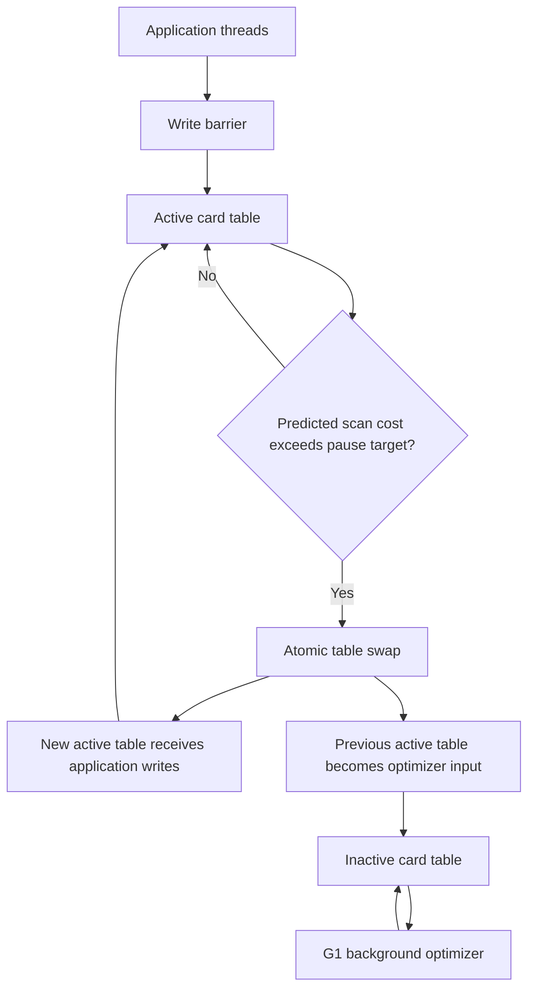

# Write barrier và chi phí cập nhật tham chiếu

*Tình trạng được đối chiếu đến ngày 27/11/2026.*

JDK 26 đưa vào **JEP 522 – G1 GC: Improve Throughput by Reducing Synchronization**. Thay đổi này cải thiện thông lượng của G1 bằng cách giảm đồng bộ giữa luồng ứng dụng và các luồng nền tối ưu card table. G1 thêm một card table thứ hai: luồng ứng dụng ghi vào bảng đang active mà không phải đồng bộ với luồng tối ưu đang xử lý bảng còn lại. Khi cần, JVM hoán đổi hai bảng một cách nguyên tử.

Điểm cần hiểu là chi phí của việc cập nhật **tham chiếu object**. Mỗi khi ứng dụng ghi một tham chiếu vào field hoặc phần tử mảng, JVM có thể phải thực hiện write barrier để G1 theo dõi những vùng heap có tham chiếu sang region khác. Việc theo dõi này giúp G1 thu gom một tập region mà không cần quét toàn bộ heap. JEP 522 giảm chi phí đồng bộ trong cơ chế ghi nhận đó; nó không loại bỏ write barrier, không thay đổi ngữ nghĩa Java và không yêu cầu sửa code ứng dụng.

## 1. Vì sao G1 cần theo dõi cập nhật tham chiếu?

G1 chia heap thành nhiều region. Khi thu gom một tập region, G1 cần tìm những tham chiếu từ bên ngoài tập đang thu gom trỏ vào các object bên trong tập đó. Những tham chiếu này phải được cập nhật nếu object được di chuyển trong quá trình evacuation.

Nếu mỗi lần GC đều quét toàn bộ heap để tìm mọi tham chiếu như vậy, chi phí có thể rất lớn. G1 dùng **remembered set** để lưu thông tin gần đúng về vị trí có tham chiếu liên vùng. Thông tin này được tổ chức dựa trên **card** và **card table**:

- Heap được chia thành các vùng nhỏ gọi là card. Kích thước card mặc định trong G1 là 512 byte.
- Card table ghi nhận card có thể chứa tham chiếu cần được xem xét.
- Remembered set tổng hợp thông tin card liên quan đến các region, giúp G1 tìm heap roots của collection set.
- Khi một object reference được ghi vào field hoặc array slot, write barrier do JVM/JIT chèn vào có thể đánh dấu card tương ứng.

Ví dụ, hai object có thể nằm ở hai region khác nhau:

```java
final class Node {
    Node next;
    Object payload;
}

Node source = ...;
Node target = ...;

// Nếu source và target nằm ở region khác nhau,
// G1 cần theo dõi vị trí chứa tham chiếu này.
source.next = target;
```

G1 không thể chỉ nhìn vào code Java để biết chắc object nằm ở region nào tại runtime. Write barrier thực hiện công việc ghi nhận cần thiết khi reference store xảy ra. Nhờ đó, khi một region được chọn để thu gom, G1 có thể dựa vào remembered set thay vì quét tất cả object trong mọi region còn lại.

**Card table không phải danh sách object sống.** Nó là cấu trúc ghi nhận vùng bộ nhớ có thể chứa tham chiếu cần quét. Trong một card có thể có nhiều field hoặc array slot; khi card bị đánh dấu, G1 sẽ quét vùng tương ứng để tìm tham chiếu thực tế.

## 2. Write barrier phát sinh chi phí ở đâu?

Write barrier là đoạn mã do JVM/JIT chèn quanh thao tác cập nhật tham chiếu. Ứng dụng không gọi một API Java riêng để kích hoạt nó. Các thao tác thường liên quan gồm:

```java
node.next = anotherNode;       // Ghi reference vào instance field
objects[index] = value;        // Ghi reference vào array slot
cache.put(key, newValue);      // Có thể cập nhật reference trong cấu trúc nội bộ
parent.child = child;          // Thay đổi object graph
```

Một số phân biệt quan trọng:

- Ghi một tham chiếu object có thể cần write barrier.
- Ghi primitive như `int`, `long`, `double` không tạo card mark cho tham chiếu object chỉ vì giá trị primitive thay đổi.
- Cấp phát object không đồng nghĩa với việc mọi field primitive đều cần card mark. Những lần khởi tạo reference có thể có đường tối ưu riêng của JVM.
- Thay thế một reference cũ bằng reference mới vẫn là thao tác cập nhật tham chiếu; trong lúc concurrent marking, G1 còn có các yêu cầu barrier liên quan đến SATB.
- Không phải mỗi reference store đều dẫn đến cùng một lượng công việc. JIT, trạng thái GC, vị trí object và card đã được đánh dấu hay chưa đều ảnh hưởng đường thực thi.

Trong ứng dụng có nhiều cập nhật object graph, chẳng hạn cache mutable, cấu trúc liên kết, hàng đợi, bảng tra cứu, ORM hoặc hệ thống xử lý nhiều entity, write barrier có thể nằm trên hot path. Chi phí nhỏ của một lần ghi được nhân lên bởi hàng triệu hoặc hàng tỷ lần cập nhật.

## 3. Trước JEP 522: card table dùng chung cần đồng bộ

G1 tối ưu card table trong nền để giảm lượng công việc phải thực hiện trong các GC pause. Khi ứng dụng ghi tham chiếu, write barrier cập nhật card table; đồng thời các luồng tối ưu của G1 có thể đang quét, làm sạch hoặc tổ chức lại thông tin trong bảng.

Nếu cả luồng ứng dụng và luồng tối ưu cùng thao tác trên cấu trúc dữ liệu dùng chung, chúng phải phối hợp để tránh mất cập nhật hoặc quan sát trạng thái không nhất quán. Cơ chế đồng bộ này làm write barrier phức tạp hơn và khiến ứng dụng phải trả chi phí phối hợp ngay trên đường ghi tham chiếu.

Khi card table có nhiều entry cần xử lý, việc tối ưu nền càng quan trọng để tránh quét quá nhiều card trong pause. Tuy nhiên, nếu quá trình tối ưu nền phải đồng bộ thường xuyên với mutator threads, nó cạnh tranh CPU và có thể làm tăng chi phí trên đường chạy của ứng dụng.

Đây là điểm JEP 522 nhắm tới: giảm tương tác đồng bộ giữa mutator threads và card-table optimizer threads, đồng thời giữ nguyên cách G1 theo dõi remembered set và thu gom region.

## 4. JEP 522: dùng hai card table

JDK 26 bổ sung card table thứ hai. Hai bảng cho phép tách đường ghi của ứng dụng khỏi công việc tối ưu nền:

1. **Bảng active:** application threads ghi nhận cập nhật tham chiếu vào bảng này. Write barrier không phải đồng bộ với các luồng đang tối ưu bảng còn lại.
2. **Bảng inactive:** ban đầu được làm rỗng và dành cho các luồng tối ưu nền xử lý thông tin card từ giai đoạn trước.
3. **Hoán đổi:** khi G1 dự đoán việc quét bảng active có thể vượt mục tiêu thời gian pause, JVM hoán đổi hai bảng một cách nguyên tử.
4. **Tiếp tục xử lý song song:** sau hoán đổi, ứng dụng ghi vào bảng active mới; các luồng nền có thể tối ưu bảng còn lại mà không tranh chấp cùng bảng với ứng dụng.

Sơ đồ khái quát:



Việc hoán đổi không làm thay đổi ngữ nghĩa của chương trình. G1 vẫn ghi nhận những card cần xem xét để xây dựng remembered set; khác biệt nằm ở cách tổ chức dữ liệu và đồng bộ giữa các luồng nội bộ.

Cơ chế hai bảng giúp write barrier trên đường ứng dụng đơn giản hơn. Theo số liệu được công bố cho JEP 522, trên x64 phần write barrier liên quan giảm từ khoảng 50 instruction xuống khoảng 12 instruction. Con số này mô tả implementation trên x64, không phải số instruction cố định cho mọi kiến trúc CPU.

## 5. Những workload được hưởng lợi nhiều nhất

JEP 522 tập trung vào workload thường xuyên thay đổi reference fields. Ví dụ:

| Kiểu workload | Mức liên quan đến write barrier | Khả năng hưởng lợi |
|---|---|---|
| Cập nhật liên tục object graph hoặc linked structure | Nhiều reference store | Có thể rõ rệt |
| Cache mutable, map hoặc queue có nhiều thay thế object | Nhiều cập nhật reference trong cấu trúc | Có thể rõ rệt |
| Hệ thống xử lý nhiều entity/object và thay liên kết giữa chúng | Tần suất reference update cao | Có thể rõ rệt |
| Tính toán số học chủ yếu trên primitive arrays | Ít reference store trong vòng lặp nóng | Thường ít hơn |
| Công việc chủ yếu chờ I/O | CPU dành cho reference update thấp | Có thể không đáng kể |
| Workload allocation-heavy nhưng ít thay đổi reference đã tồn tại | Barrier update có thể không phải nút thắt chính | Cần đo thực tế |

Điều này không có nghĩa mọi ứng dụng dùng nhiều object đều tự động tăng tốc. Cần phân biệt **tạo object mới** với **cập nhật tham chiếu tới object đã tồn tại**. Workload cấp phát nhiều object nhưng ít sửa các reference field có thể không nhận cùng mức cải thiện như workload liên tục thay đổi liên kết trong object graph.

Một ứng dụng có thể có nhiều reference store nhưng vẫn bị giới hạn bởi lock ứng dụng, I/O, memory bandwidth hoặc thuật toán. JEP 522 chỉ giảm một nguồn overhead thuộc G1; nó không loại bỏ các nút thắt khác.

## 6. Kết quả hiệu năng và chi phí bộ nhớ

Các kết quả được công bố cho JEP 522 cho thấy:

- Workload cập nhật tham chiếu nhiều có thể tăng throughput khoảng **5–15%** trong các thử nghiệm được báo cáo.
- Ngay cả workload cập nhật tham chiếu nhẹ cũng có trường hợp cải thiện tới khoảng **5%**.
- Thời gian pause có xu hướng giảm nhẹ.
- Card table bổ sung tiêu tốn khoảng **2 MB native memory cho mỗi 1 GB heap**, tương đương khoảng 0,2% dung lượng heap.

Các con số này là kết quả đo trên những workload và môi trường thử nghiệm cụ thể, không phải cam kết hiệu năng cho mọi ứng dụng. Không thể suy ra ứng dụng của mình chắc chắn tăng 15% chỉ vì đang dùng G1.

Chi phí card table bổ sung là native memory của JVM, không phải Java heap dành cho object. Khi sizing container, vẫn cần tính cả native memory ngoài `-Xmx`: metaspace, code cache, thread stacks, direct buffers, GC structures và các thành phần native khác.

## 7. JEP 522 có thay đổi hành vi GC hoặc API Java không?

JEP 522 là thay đổi implementation của G1 trong JDK 26:

- Không thêm API Java cho ứng dụng.
- Không yêu cầu sửa source code.
- Không phải preview feature.
- Không phải incubator module.
- Không cần `--enable-preview` hoặc `--add-modules`.
- Không thay đổi thuật toán tổng thể của G1 hoặc mô hình lập trình của ứng dụng.
- Không làm G1 trở thành collector không pause; G1 vẫn có các stop-the-world pauses.
- Không loại bỏ mọi write barrier hoặc mọi đồng bộ bên trong JVM.

JEP 522 chỉ áp dụng khi JVM thực sự sử dụng G1. Nếu ứng dụng dùng Parallel GC, ZGC hoặc Shenandoah thì thay đổi riêng của G1 này không phải nguyên nhân cải thiện hiệu năng. Đừng gộp JEP 522 với các cải tiến GC khác của JDK 26 như JEP 516 (AOT Object Caching với mọi GC); chúng giải quyết các vấn đề khác nhau.

## 8. Kiểm tra collector và cấu hình chạy

Có thể chọn G1 tường minh khi muốn đo hoặc so sánh:

```bash
java -XX:+UseG1GC -Xms4g -Xmx4g -jar application.jar
```

Nếu chỉ muốn kiểm tra collector đang được JVM chọn, bật logging khởi tạo GC:

```bash
java -Xlog:gc -version
```

Để quan sát các pause và phase của G1 trong ứng dụng:

```bash
java -XX:+UseG1GC \
     -Xlog:gc*,gc+phases=debug:file=gc.log:time,uptime,level,tags \
     -jar application.jar
```

GC log giúp xem tần suất pause, thời gian từng phase, heap trước/sau collection và các dấu hiệu áp lực GC. Tuy nhiên, log GC không trực tiếp cho biết số lần write barrier chạy hoặc tổng instruction mà write barrier tiêu thụ. Muốn xác định write-barrier overhead có phải bottleneck hay không, cần kết hợp profiling CPU, workload benchmark và so sánh JDK.

Không nên kết luận G1 chậm chỉ vì thấy nhiều GC pause. Cần phân biệt thời gian pause, thời gian concurrent GC, CPU của application threads và lượng công việc ứng dụng hoàn thành trong cùng khoảng thời gian.

## 9. Quy trình benchmark trước và sau JDK 26

Để kiểm tra lợi ích của JEP 522 trong hệ thống thật, hãy giữ workload và môi trường nhất quán:

1. **Chọn workload đại diện:** ưu tiên đường chạy có nhiều thao tác thay reference field hoặc cập nhật collection/object graph.
2. **Giữ cấu hình heap:** dùng cùng `-Xms`, `-Xmx`, container CPU/memory limit và cùng cấu hình G1.
3. **So sánh JDK:** chạy cùng binary hoặc cùng phiên bản ứng dụng trên JDK trước đó và JDK 26.
4. **Warm up:** loại trừ khác biệt do JIT compilation, cache lạnh và startup.
5. **Đo throughput:** số request, transaction hoặc batch item hoàn tất trên một đơn vị thời gian.
6. **Đo latency:** theo dõi p50, p95, p99 và thời gian pause GC; throughput tăng không đảm bảo mọi percentile latency đều cải thiện.
7. **Theo dõi CPU:** đo CPU của application threads và GC threads; kiểm tra có bottleneck khác che lấp lợi ích hay không.
8. **Kiểm tra bộ nhớ:** theo dõi heap và native memory, đặc biệt khi chạy container có giới hạn memory.
9. **Lặp lại:** chạy nhiều vòng, dùng dữ liệu và tải ổn định, báo cáo cả độ dao động.
10. **Quyết định:** chỉ thay đổi cấu hình production khi benchmark trên môi trường tương tự production xác nhận lợi ích.

Ví dụ một vòng benchmark tối giản:

```text
JDK 25 + G1
  Warmup -> Run workload -> Capture throughput/latency/GC/CPU

JDK 26 + G1
  Warmup -> Run same workload -> Capture same metrics

Compare
  Throughput
  p50 / p95 / p99 latency
  GC pause duration and frequency
  Application CPU vs GC CPU
  Heap and native memory
```

Nếu workload không thay đổi nhiều reference field, kết quả có thể gần như không khác biệt. Đó không phải bằng chứng JEP 522 không hoạt động; có thể workload không bị giới hạn bởi chi phí mà JEP này tối ưu.

## 10. Có cần chỉnh các cờ G1 sau khi nâng cấp?

Thông thường, không cần thêm cờ riêng để bật JEP 522. Thay đổi được tích hợp vào implementation G1 của JDK 26. Trước khi thay đổi các tham số G1 hiện có, hãy đo lại với cùng cấu hình để tách ảnh hưởng của phiên bản JDK khỏi ảnh hưởng của tuning.

Một số nguyên tắc:

- Không tự đặt các cờ nội bộ hoặc cờ thử nghiệm để cố điều khiển hai card table; JEP 522 không yêu cầu ứng dụng quản lý chúng.
- Không tăng heap chỉ vì write barrier đã rẻ hơn; heap sizing vẫn cần dựa trên allocation rate, live set, pause target và giới hạn container.
- Không hạ pause target để kỳ vọng throughput tự tăng; G1 phải cân bằng thời gian pause với lượng công việc GC và công việc ứng dụng.
- Không chuyển collector chỉ dựa trên benchmark tổng quát. G1, Parallel GC và ZGC có mục tiêu và trade-off khác nhau.
- Nếu đã dùng cờ G1 cũ, kiểm tra lại bằng tài liệu tuning của JDK 26; không mang các cờ internal/diagnostic từ JDK trước sang production mà chưa xác minh.

## 11. Những điểm cần ghi nhớ

- G1 dùng remembered set và card table để tìm tham chiếu từ ngoài collection set vào các region đang thu gom.
- Write barrier là mã do JVM/JIT chèn khi ứng dụng cập nhật reference; không phải API mà lập trình viên gọi trực tiếp.
- Chi phí barrier có thể đáng kể trong workload cập nhật reference fields thường xuyên.
- JEP 522 thêm card table thứ hai để giảm đồng bộ giữa application threads và background card-table optimizer threads.
- G1 có thể hoán đổi hai bảng nguyên tử khi dự đoán việc quét bảng active có thể vượt pause target.
- Write barrier được đơn giản hóa; JEP 522 không loại bỏ mọi barrier hoặc mọi pause.
- Mức tăng throughput 5–15% là kết quả thử nghiệm với workload tham chiếu nhiều, không phải bảo đảm cho mọi ứng dụng.
- JEP 522 là tính năng runtime ổn định trong JDK 26, không cần preview flag hay incubator module.
- Đo throughput, latency, GC, CPU và native memory trên workload thật trước khi thay đổi production.

## Tài liệu tham chiếu

1. [JEP 522 – G1 GC: Improve Throughput by Reducing Synchronization](https://openjdk.org/jeps/522)
2. [Oracle – Significant Changes in JDK 26](https://docs.oracle.com/en/java/javase/26/migrate/significant-changes-jdk-26-release.html)
3. [Oracle – G1 Garbage Collector](https://docs.oracle.com/en/java/javase/26/gctuning/garbage-first-g1-garbage-collector1.html)
4. [Oracle – G1 Garbage Collector Tuning](https://docs.oracle.com/en/java/javase/26/gctuning/garbage-first-garbage-collector-tuning.html)
5. [Inside.java – Performance Improvements in JDK 26](https://inside.java/2026/06/09/jdk-26-performance-improvements/)
6. [Oracle – JDK 26 Release Notes](https://www.oracle.com/java/technologies/javase/26all-relnotes.html)

