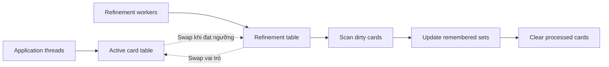
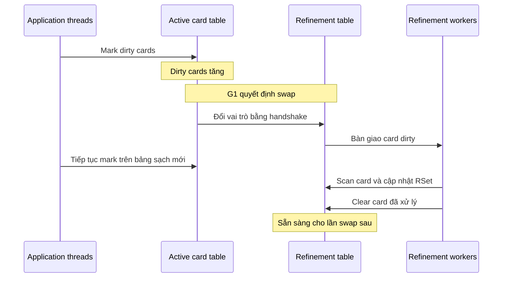

# Hai card table trong cải tiến JEP 522 của Java 26

> **Mốc cập nhật: 27-11-2026.** JEP 522 được tích hợp từ JDK 26 và tiếp tục là cải tiến của G1 trong JDK 27. Đây là thay đổi nội bộ của HotSpot, không phải API Java, Preview hay Incubator feature. Bài tập trung vào hai card table: bảng dành cho application threads (mutators) và bảng dành cho concurrent refinement/GC threads.

## 1. Mục tiêu và bối cảnh

G1 (Garbage-First) chia Java heap thành các region và thu gom theo collection set. Khi một object ở region này giữ reference tới object ở region khác, G1 cần biết các vùng nhớ chứa reference đó để có thể tìm và xử lý reference khi thu gom một region mà không phải quét toàn bộ heap.

G1 sử dụng **card table** để theo dõi các vùng heap đã bị thay đổi bởi thao tác ghi reference. Một write barrier được JVM chèn vào mã máy tại các điểm ghi reference phù hợp. Barrier đánh dấu card chứa field vừa được cập nhật là dirty. Các luồng concurrent refinement đọc các card dirty, tìm reference liên vùng và cập nhật remembered sets (RSet).

Trong workload có nhiều thao tác thay đổi object references, đường ghi reference này chạy rất thường xuyên. Trước JEP 522, việc phối hợp giữa application threads và refinement threads làm post-write barrier phức tạp, cần đồng bộ chi tiết và phải đưa địa chỉ card vào dirty-card queues. Chi phí đó có thể làm giảm throughput và cản trở một số tối ưu hóa của JIT.

JEP 522 đưa vào **card table thứ hai** để hai nhóm thread làm việc trên hai vùng dữ liệu tách biệt. Application threads tiếp tục đánh dấu card trên bảng đang hoạt động; refinement threads xử lý bảng còn lại. Khi cần chuyển giao công việc, G1 hoán đổi vai trò hai bảng ở một điểm đồng bộ thô hơn, thay vì phải phối hợp ở mỗi lần ghi reference.

Sau bài này, bạn có thể:

- Giải thích card table, dirty card, remembered set và write barrier.
- Phân biệt hai card table theo vai trò của mutator và refinement.
- Mô tả quy trình swap, refine, clear và merge khi GC pause xảy ra.
- Hiểu vì sao JEP 522 giảm đồng bộ trên đường ghi reference.
- Phân biệt post-write card-mark barrier với SATB pre-write barrier.
- Đánh giá mức cải thiện hiệu năng và chi phí native memory.
- Kiểm tra lợi ích trên ứng dụng thực tế khi nâng cấp từ JDK 25 lên JDK 26/27.

## 2. Card table và remembered set trong G1

### 2.1. Heap được chia thành region và card

G1 chia heap thành nhiều region có kích thước bằng nhau. Một region có thể chứa nhiều object. Card table chia địa chỉ heap thành những vùng nhỏ hơn gọi là **card** và lưu trạng thái của từng card.

Khi chương trình cập nhật một reference field, JVM có thể đánh dấu card chứa địa chỉ field đó là dirty. Card dirty cho biết vùng nhớ đó có thể chứa reference cần được xem xét khi GC xây dựng hoặc cập nhật thông tin liên vùng.

Card table không lưu toàn bộ danh sách object reference. Nó là cấu trúc đánh dấu thô theo vùng nhớ. Khi refinement xử lý một card dirty, G1 quét vùng heap tương ứng để tìm các reference thực sự có ý nghĩa.

### 2.2. Remembered set lưu thông tin reference liên vùng

Ví dụ:

- Object A nằm trong region R1.
- Object B nằm trong region R2.
- Field `A.next` trỏ tới B.

Khi G1 cần thu gom R2, nó cần biết có reference từ region khác trỏ vào R2. Remembered set của R2 giúp G1 tìm những vùng nguồn có thể chứa các reference đó mà không phải quét toàn bộ heap.

Card table và remembered set có nhiệm vụ khác nhau:

| Cấu trúc | Vai trò |
|---|---|
| Card table | Ghi nhận các card trong heap đã bị thay đổi và cần được xem xét. |
| Dirty card | Trạng thái của card cho biết cần refinement hoặc scan. |
| Remembered set (RSet) | Ghi nhận các reference từ region khác trỏ vào region đích. |
| Concurrent refinement | Xử lý card dirty và cập nhật remembered sets trước khi GC cần dùng chúng. |

Card table là tín hiệu thay đổi; remembered set là cấu trúc dữ liệu phục vụ việc tìm reference liên vùng. Không nên gọi hai cấu trúc này là cùng một thứ.

### 2.3. Write barrier được chạy khi ghi reference

Một phép gán như:

```java
order.customer = customer;
```

có thể cần post-write barrier của G1 nếu reference được ghi là reference liên vùng cần theo dõi. Barrier xác định card chứa field, áp dụng các bộ lọc cần thiết và đánh dấu card dirty.

Không phải mọi phép ghi đều phải thực hiện đầy đủ công việc refinement:

- Ghi `null` không tạo reference liên vùng mới.
- Reference trỏ tới object trong cùng region không cần cập nhật RSet liên vùng.
- Card đã ở trạng thái không-clean có thể không cần đánh dấu lại.
- Một số trường hợp ghi object mới cấp phát có thể được JIT loại bỏ barrier khi chứng minh được điều kiện an toàn.

JEP 522 giảm chi phí phối hợp khi đánh dấu card; nó không loại bỏ yêu cầu G1 phải theo dõi reference liên vùng.

## 3. Trước JEP 522: một đường phối hợp dùng chung

Trước cải tiến, G1 sử dụng dirty-card queues (DCQ) và dirty-card queue sets (DCQS) để chuyển các card cần refinement từ application threads sang refinement threads.

Ở mức khái niệm, một phép ghi reference cần thực hiện các bước:

1. Kiểm tra các trường hợp không cần đánh dấu card, chẳng hạn ghi `null` hoặc reference cùng region.
2. Kiểm tra trạng thái card và phối hợp đồng bộ với refinement threads để tránh mất cập nhật.
3. Đánh dấu card dirty.
4. Đưa địa chỉ card vào dirty-card queue cục bộ của thread.
5. Khi buffer đầy, chuyển buffer vào queue set để refinement threads xử lý.

Đường đi này tạo ra nhiều công việc trên hot path của ứng dụng. Barrier có thể cần các thao tác đồng bộ, kiểm tra queue, ghi buffer và gọi runtime khi buffer đầy. Khi ứng dụng có nhiều thread cập nhật reference, chi phí này cộng dồn trên số lượng phép ghi rất lớn.

| Vấn đề trước JEP 522 | Hệ quả |
|---|---|
| Mutator và refinement threads phải phối hợp khi cập nhật cùng card-tracking state. | Cần synchronization chi tiết để tránh mất thông tin. |
| Mỗi card cần được enqueue vào dirty-card queue. | Có thêm thao tác ghi buffer, kiểm tra buffer và xử lý khi đầy. |
| Post-write barrier có nhiều nhánh và slow path. | Tăng số instruction và code footprint. |
| Barrier xuất hiện trong nhiều đoạn mã ghi reference. | Có thể cản trở inlining, loop unrolling và các tối ưu JIT khác. |

Không phải bản thân card table là cấu trúc không hiệu quả. Nút thắt là cách nhiều nhóm thread cùng phối hợp trên dữ liệu card-tracking và chi phí đưa card vào queue trên đường ghi reference.

## 4. Thiết kế mới: hai card table, hai vai trò

JEP 522 duy trì hai card table có cùng cách ánh xạ địa chỉ heap:

| Card table | Thread sử dụng | Nhiệm vụ |
|---|---|---|
| Primary/active card table | Application threads (mutators) | Ghi nhận card dirty sau các phép ghi reference phù hợp. |
| Refinement table | Concurrent refinement threads và GC trong một số giai đoạn | Quét card dirty, cập nhật remembered sets rồi clear card đã xử lý. |

Hai nhóm thread làm việc trên hai bảng khác nhau. Khi mutator đánh dấu card trên active table, refinement threads không đồng thời sửa cùng bảng đó. Khi refinement threads quét refinement table, mutator tiếp tục đánh dấu trên active table.

Dirty-card queue cũ được thay thế bởi refinement table. Vì địa chỉ card không cần được enqueue theo từng lần ghi như trước, post-write barrier được rút gọn.

### 4.1. Sơ đồ hai bảng



Sơ đồ thể hiện vai trò logic. Sau mỗi lần swap, tên active/refinement gắn với bảng theo vai trò mới; không có một bảng cố định luôn thuộc về application threads.

### 4.2. Hai bảng không đại diện cho hai thế hệ heap

Đừng nhầm hai card table với:

- Một bảng dành riêng cho Young Generation và một bảng dành riêng cho Old Generation.
- Một bảng cho Eden và một bảng cho Survivor.
- Một bảng cho heap nguồn và một bảng cho heap đích.
- Hai remembered sets độc lập.

Cả hai bảng theo dõi các card của cùng heap. Khác biệt nằm ở **ai đang ghi nhận thay đổi và ai đang xử lý các thay đổi đã được bàn giao**.

## 5. Quy trình swap và refinement

### 5.1. Trạng thái ban đầu

Khi bắt đầu, cả active card table và refinement table đều có trạng thái clean. Application threads bắt đầu ghi reference và đánh dấu các card cần theo dõi trên active table.

Refinement threads chưa xử lý cùng các card đang được mutator ghi trên bảng này.

### 5.2. G1 quyết định swap

G1 theo dõi lượng card dirty, tốc độ mutator làm dirty card và tốc độ refinement xử lý card. Heuristic quyết định khi nào cần chuyển bảng để giữ khối lượng card còn phải scan trong GC pause ở mức phù hợp với pause-time goal.

Khi cần swap:

1. G1 hoán đổi global card-table references.
2. G1 cập nhật card-table base pointer trong thread-local storage của các Java threads bằng thread handshake.
3. Các GC/refinement threads được đồng bộ để dùng đúng bảng mới.
4. Bảng vừa chứa nhiều card dirty trở thành refinement table.
5. Bảng sạch trước đó trở thành active card table.

Đây là điểm đồng bộ theo đợt. Sau khi cập nhật xong, mutator có thể tiếp tục ghi trên bảng mới mà không phải đồng bộ chi tiết với refinement workers cho từng reference write.

### 5.3. Refinement xử lý bảng đã bàn giao

Refinement workers quét các card dirty trong refinement table:

1. Xác định vùng heap tương ứng với card.
2. Quét các reference trong vùng đó.
3. Tìm các reference liên vùng cần ghi nhận.
4. Cập nhật remembered set của region đích tương ứng.
5. Clear card đã xử lý để bảng sẵn sàng cho lần swap tiếp theo.

Trong khi đó, application threads tiếp tục đánh dấu card trên active table mới. Refinement có thể chạy đồng thời với ứng dụng mà không tranh chấp fine-grained trên cùng card table.

### 5.4. Swap lặp lại

Sau khi refinement table được xử lý xong và trở lại trạng thái clean, G1 có thể tiếp tục dùng nó ở lần swap sau. Hai bảng thay phiên nhau:



Điểm quan trọng là ứng dụng không phải đợi refinement xử lý xong toàn bộ bảng cũ mới được ghi reference. Nó tiếp tục trên bảng active mới.

## 6. Post-write barrier sau JEP 522

Sau cải tiến, post-write barrier có thể được hiểu ở mức khái niệm như sau:

```text
store reference x.field = y

if y == null:
    skip card mark

if region(x.field) == region(y):
    skip card mark

card = active_card_table[address(x.field)]

if card is not CLEAN:
    skip card mark

card = DIRTY
```

Đây là pseudocode giải thích ý tưởng, không phải mã nguồn assembly chính xác. Các filter cụ thể và cách sinh mã còn phụ thuộc JIT, CPU architecture và loại store.

Khác biệt quan trọng:

- Không còn phải enqueue địa chỉ card vào dirty-card queue cho mỗi lần ghi cần đánh dấu.
- Mutator đánh dấu trên active card table riêng.
- Refinement worker xử lý bảng khác.
- Không cần fine-grained synchronization giữa hai nhóm thread ở từng mutator write.
- Việc chuyển giao công việc được gom vào thao tác swap theo đợt.

Các filter vẫn cần thiết để hạn chế số card dirty. G1 không đánh dấu card một cách mù quáng cho mọi phép gán reference.

### 6.1. JEP 522 thay đổi post-write barrier, không loại bỏ mọi barrier

G1 có các cơ chế barrier khác nhau cho các mục đích khác nhau:

| Barrier | Mục đích | JEP 522 có loại bỏ không? |
|---|---|---|
| SATB pre-write barrier | Trong concurrent marking, ghi nhận giá trị reference cũ trước khi bị ghi đè để bảo đảm snapshot-at-the-beginning. | Không. |
| Post-write card-mark barrier | Ghi nhận card có thể chứa reference liên vùng mới và cần refinement. | Được đơn giản hóa. |
| Các barrier/kiểm tra khác của runtime | Bảo đảm các quy tắc GC và truy cập object tương ứng. | Không phải mục tiêu loại bỏ của JEP 522. |

Do đó, không nên diễn giải JEP 522 thành “G1 không còn write barrier” hoặc “mọi phép ghi reference đều miễn phí”. Cải tiến nhắm vào chi phí đồng bộ và queueing của post-write card-mark path.

## 7. Vì sao hai bảng giúp giảm synchronization?

Trước JEP 522, mutator và refinement threads cần phối hợp khi cùng tham gia quá trình theo dõi card. Việc này đòi hỏi kiểm tra và đồng bộ chi tiết để bảo đảm refinement không xóa hoặc bỏ sót một card vừa được mutator đánh dấu.

Sau JEP 522, hai nhóm làm việc trên hai bảng riêng:

- Mutator chỉ cập nhật active card table.
- Refinement workers chỉ xử lý refinement table.
- Một card table không bị hai nhóm thread cùng ghi theo đường thông thường.
- Bàn giao dữ liệu xảy ra tại thời điểm swap có handshake.
- Không cần queue card address cho từng mutator write.

Vì vậy, synchronization được chuyển từ đường nóng của từng phép ghi sang thao tác swap thưa hơn. Đây là thay đổi kiến trúc chính tạo ra lợi ích throughput.

Không có nghĩa toàn bộ G1 trở thành lock-free hoặc không cần safepoint. G1 vẫn có các điểm đồng bộ cho GC pause, thread lifecycle, heap management và các hoạt động runtime khác. JEP 522 giảm một loại synchronization cụ thể giữa mutator và concurrent refinement.

## 8. GC pause xảy ra khi refinement chưa hoàn tất

Concurrent refinement có thể bị GC pause ngắt giữa chừng. Nếu refinement table còn card dirty chưa xử lý, G1 phải bảo đảm card đó vẫn được xem xét trước khi GC scan các card liên quan.

Trong tình huống này, G1 merge phần refinement table còn lại trở lại active card table và clear trạng thái tương ứng trước khi scan dirty cards. GC pause vì vậy không bỏ qua những cập nhật reference chưa được refinement hoàn tất.

Trong một số tình huống, refinement workers cũng đánh dấu riêng card có reference vào collection set hiện tại. Nếu mutator ghi đè trạng thái đó trong lúc có race, điều này vẫn an toàn vì G1 sẽ scan toàn bộ card tương ứng trong GC pause. Cách đánh dấu đặc biệt giúp refinement không phải lặp lại công việc đã biết là không cần thiết.

Điểm cần ghi nhớ:

- Swap không được làm mất dirty card.
- Refinement chưa xong phải được merge hoặc tiếp tục xử lý theo protocol của G1.
- Remembered sets phải được cập nhật hoặc card phải còn được giữ để GC scan.
- Tính đúng đắn của GC được duy trì; JEP 522 thay đổi cách phối hợp và lưu trạng thái, không thay đổi hợp đồng thu gom rác đối với ứng dụng.

## 9. Lợi ích hiệu năng và chi phí bộ nhớ

### 9.1. Kết quả throughput được công bố

Theo bài tổng hợp hiệu năng JDK 26 của nhóm Java tại Oracle, các kết quả được quan sát gồm:

| Chỉ số | Kết quả được công bố |
|---|---:|
| Throughput trên workload cập nhật reference nhiều | Tăng khoảng 5–15% |
| Workload cập nhật reference nhẹ | Có trường hợp tăng đến khoảng 5% |
| Write-barrier instructions trên x64 | Giảm khoảng 50 xuống khoảng 12 instructions |
| Pause time | Không tăng; có thể giảm nhẹ |
| Native memory cho card table bổ sung | Khoảng 0,2% dung lượng Java heap, tương đương khoảng 2 MB/1 GB heap |

Các con số trên là kết quả từ những benchmark/workload được đo, không phải cam kết hiệu năng cho mọi ứng dụng. Mức cải thiện phụ thuộc tỷ lệ ghi reference, CPU, JIT, heap size, cấu hình G1, mức tải và hành vi cấp phát.

### 9.2. Vì sao workload ghi reference nhiều được lợi?

Các ứng dụng có nhiều thao tác như:

- Cập nhật field reference của object.
- Thay đổi liên kết trong cache hoặc object graph.
- Cập nhật cấu trúc dữ liệu trong bộ nhớ.
- Xử lý nhiều request đồng thời với object state thay đổi liên tục.
- Cập nhật collection hoặc graph dữ liệu trong các vòng lặp nóng.

có thể chạy post-write barrier rất thường xuyên. Khi barrier ít instruction hơn và không cần queue/synchronization ở mỗi lần ghi, CPU có thêm thời gian cho logic nghiệp vụ.

### 9.3. Chi phí native memory

Card table thứ hai cần thêm native memory. Mức tham khảo được công bố là khoảng 0,2% Java heap, tương đương khoảng 2 MB native memory cho mỗi 1 GB heap.

Tuy nhiên, JEP 522 đồng thời loại bỏ dirty-card queues và một số cấu trúc dữ liệu hỗ trợ trước đây. Do đó, chênh lệch native memory thực tế có thể thấp hơn con số thô của một card table bổ sung; ở một số workload, phần tiết kiệm từ cấu trúc cũ có thể bù một phần chi phí mới.

Không tính card table thứ hai như một mảng Java object trong heap. Đây là cấu trúc nội bộ của HotSpot được quản lý trong native memory.

## 10. JDK 26 và JDK 27: cải tiến còn áp dụng

JEP 522 được đưa vào JDK 26 và tiếp tục là implementation của G1 trong JDK 27. JDK 27 có thêm JEP 523, thay đổi lựa chọn garbage collector mặc định.

| Phiên bản | Hành vi G1 mặc định | Ý nghĩa |
|---|---|---|
| JDK 25 | G1 là mặc định trên server-class machine; môi trường giới hạn có thể chọn Serial GC theo ergonomics. | Không có kiến trúc hai card table của JEP 522. |
| JDK 26 | JEP 522 cải thiện G1; G1 tiếp tục là mặc định trong môi trường server-class. | Ứng dụng dùng G1 nhận cải tiến post-write barrier mà không cần sửa code. |
| JDK 27 | JEP 522 tiếp tục được giữ; JEP 523 làm G1 thành GC mặc định trong mọi môi trường. | G1 được chọn cả trong các môi trường trước đây có thể dùng Serial GC. |

JEP 523 thay đổi lựa chọn mặc định, không phải là một phiên bản khác của thiết kế hai card table. G1 vẫn có thể không phải lựa chọn tối ưu cho mọi workload; Serial GC vẫn có thể được chọn tường minh nếu benchmark chứng minh phù hợp hơn.

Không cần bật một preview flag hoặc incubator module để dùng cải tiến JEP 522. Đây là thay đổi trong HotSpot G1 được tích hợp sẵn trong JDK 26 trở đi. Nếu ứng dụng chạy G1, cải tiến được áp dụng tự động khi dùng bản JDK có implementation này.

## 11. Kiểm tra collector và cấu hình đang chạy

Có thể kiểm tra phiên bản runtime:

```text
java -version
```

Có thể xem các cờ GC đang được đặt:

```text
java -XX:+PrintCommandLineFlags -version
```

Nếu muốn chọn G1 tường minh trong môi trường có thể chọn collector khác:

```text
java -XX:+UseG1GC -jar application.jar
```

Trên JDK 27, G1 đã là collector mặc định trong mọi môi trường nếu không chọn collector khác. Nếu muốn kiểm tra lựa chọn thay thế trên môi trường giới hạn tài nguyên, có thể benchmark Serial GC:

```text
java -XX:+UseSerialGC -jar application.jar
```

Không nên đổi collector chỉ vì một benchmark micro. Cần đo với tải thực và các mục tiêu throughput, tail latency, memory footprint, startup và pause time.

## 12. Đo tác động của JEP 522 trong ứng dụng

Để xác định ứng dụng có được lợi hay không, so sánh JDK 25 với JDK 26/27 trên cùng môi trường.

### 12.1. Giữ điều kiện thử nghiệm nhất quán

- Dùng cùng máy, CPU, hệ điều hành và container limits.
- Giữ heap size, GC selection, GC tuning và workload giống nhau.
- Dùng cùng dữ liệu đầu vào, số request, concurrency và thời gian warm-up.
- Chạy nhiều lượt, luân phiên thứ tự phiên bản JDK.
- Không chạy benchmark cạnh tranh CPU hoặc memory trên cùng máy.
- Kiểm tra đúng vendor/build của JDK vì bản phân phối có thể chứa patch riêng.

### 12.2. Chọn workload đại diện

Nên có ít nhất hai nhóm workload:

| Workload | Đặc điểm | Mục tiêu |
|---|---|---|
| Reference-write-heavy | Nhiều object field/reference được cập nhật trong hot path. | Kiểm tra lợi ích chính của JEP 522. |
| Reference-write-light | Ít reference mutation, chủ yếu tính toán hoặc xử lý primitive. | Kiểm tra mức ảnh hưởng nền và overhead tổng thể. |

Một ví dụ đơn giản về workload thay đổi object graph:

```java
final class Node {
    Node next;
    Object value;
}

static void updateReferences(Node[] nodes, int rounds) {
    for (int round = 0; round < rounds; round++) {
        for (int i = 0; i < nodes.length - 1; i++) {
            nodes[i].next = nodes[i + 1];
        }
    }
}
```

Đây chỉ là đoạn minh họa thao tác ghi reference, không phải benchmark hoàn chỉnh. Một benchmark đáng tin cậy phải ngăn JIT loại bỏ công việc, dùng dữ liệu đại diện và đo bằng JMH hoặc workload của ứng dụng.

### 12.3. Các chỉ số nên thu thập

| Chỉ số | Ý nghĩa |
|---|---|
| Throughput (ops/s hoặc requests/s) | Số lượng công việc hoàn tất mỗi giây. |
| CPU utilization | Xác định barrier/refinement có tiêu thụ ít CPU hơn không. |
| p50/p95/p99 latency | Đánh giá cả độ trễ điển hình và tail latency. |
| GC pause duration | Xác định pause có thay đổi không. |
| Concurrent GC CPU time | Theo dõi chi phí refinement/GC chạy đồng thời. |
| Heap occupancy và allocation rate | Phân biệt tác động của GC với thay đổi workload. |
| Native memory | Theo dõi chi phí cấu trúc hỗ trợ G1. |

Có thể bật unified GC logging trong môi trường kiểm thử:

```text
-Xlog:gc*,gc+remset=debug
```

Log giúp quan sát các pha GC, remembered-set work và pause. Mức log cao có thể tạo nhiều output và ảnh hưởng phép đo; chỉ bật mức chi tiết cần thiết, sau đó chạy lại benchmark không bật log để lấy số liệu hiệu năng cuối cùng.

### 12.4. Đọc kết quả

- Nếu throughput tăng rõ trên workload reference-heavy nhưng gần như không đổi trên workload reference-light, đó là kết quả phù hợp với mục tiêu JEP 522.
- Nếu p99 cải thiện trong khi throughput tương đương, có thể lợi ích đến từ việc giảm contention hoặc giảm công việc GC đồng thời.
- Nếu throughput không đổi, có thể bottleneck nằm ở database, lock ứng dụng, allocation, I/O hoặc một phần khác của JVM.
- Nếu native memory tăng, so sánh tổng memory footprint và kiểm tra mức tiết kiệm từ các cấu trúc cũ đã được loại bỏ.
- Nếu G1 pause tăng mạnh, kiểm tra heap sizing, pause-time target, allocation rate và log refinement; không kết luận ngay là do card table thứ hai.

## 13. Các hiểu nhầm thường gặp

| Nhầm lẫn | Cách hiểu đúng |
|---|---|
| Hai card table tương ứng Young và Old Generation. | Cả hai theo dõi cùng heap; khác nhau ở vai trò mutator và refinement. |
| JEP 522 loại bỏ toàn bộ write barrier. | Chỉ đơn giản hóa post-write card-mark barrier; SATB pre-write barrier vẫn cần khi concurrent marking. |
| G1 không còn synchronization. | Synchronization chi tiết trên mỗi mutator write được giảm; swap, GC pause và các hoạt động runtime khác vẫn cần phối hợp. |
| Mỗi lần ghi reference đều cập nhật remembered set ngay lập tức. | Mutator đánh dấu card; refinement workers quét card và cập nhật RSet sau đó. |
| Refinement table có thể bỏ đi khi GC pause xảy ra. | Dirty cards chưa xử lý phải được merge/giữ lại để GC scan an toàn. |
| Throughput luôn tăng 5–15%. | Đây là kết quả benchmark ở workload được đo, đặc biệt reference-heavy; ứng dụng khác có thể khác. |
| Phải thêm một JVM flag để bật JEP 522. | Không có flag bật riêng; cải tiến được tích hợp trong G1 của JDK 26+. |
| JEP 523 và JEP 522 là cùng một thay đổi. | JEP 522 tối ưu card tracking; JEP 523 thay đổi G1 thành default collector trong mọi môi trường ở JDK 27. |

## 14. Bài tập thực hành

1. Vẽ sơ đồ heap gồm ba region và hai object có reference liên vùng. Xác định card nào cần dirty khi field reference thay đổi.
2. Mô tả vai trò của active card table và refinement table trong một phép gán reference.
3. Giải thích vì sao dirty-card queue không còn cần thiết trong thiết kế JEP 522.
4. Mô tả các bước global table swap và cập nhật thread-local card table pointer.
5. Giải thích refinement worker cập nhật remembered set và clear card như thế nào.
6. Xem xét trường hợp GC pause xảy ra khi refinement table còn dirty cards; mô tả cách merge để không mất thông tin.
7. Phân biệt SATB pre-write barrier và post-write card-mark barrier.
8. Thiết kế hai workload: một workload ghi reference nhiều và một workload ghi reference ít.
9. Đo throughput, p95/p99, GC pause và native memory trên JDK 25, 26 và 27.
10. Giải thích vì sao JDK 27 dùng G1 mặc định trong môi trường trước đây có thể dùng Serial GC và cách benchmark lựa chọn collector.
11. Đánh giá kết quả thực tế so với số liệu tham khảo 5–15% và giải thích nếu ứng dụng không có cải thiện rõ rệt.

Bảng ghi nhận:

| Thử nghiệm | JDK | GC | Throughput | p95/p99 | Pause time | Native memory |
|---|---|---|---:|---:|---:|---:|
| Baseline | 25 | G1 | | | | |
| Sau JEP 522 | 26 | G1 | | | | |
| Hiện hành | 27 | G1 | | | | |
| Đối chứng | 27 | Serial | | | | |

## 15. Checklist trước khi đánh giá nâng cấp

- [ ] Xác nhận ứng dụng thực sự đang dùng G1.
- [ ] Xác nhận JDK 26 hoặc mới hơn có implementation JEP 522.
- [ ] Hiểu card table, remembered set và concurrent refinement là các cấu trúc/quy trình khác nhau.
- [ ] Hiểu hai bảng thay đổi vai trò sau mỗi lần swap.
- [ ] Không nhầm cải tiến post-write barrier với việc loại bỏ SATB pre-write barrier.
- [ ] Không thêm flag không cần thiết để bật JEP 522.
- [ ] Đo workload có mức reference mutation tương tự production.
- [ ] So sánh throughput, tail latency, GC pause, CPU và native memory.
- [ ] Dùng cùng heap, CPU quota và dữ liệu khi so sánh các JDK.
- [ ] Kiểm tra JDK 27 default G1 trong mọi môi trường và benchmark Serial nếu có lý do.
- [ ] Không coi mức tăng throughput công bố là cam kết cho mọi ứng dụng.

## Tài liệu tham khảo chính thức

- [JEP 522: G1 GC: Improve Throughput by Reducing Synchronization](https://openjdk.org/jeps/522)
- [JDK 26 Release Notes — G1 throughput improvement](https://docs.oracle.com/en/java/javase/26/migrate/significant-changes-jdk-26-release.html)
- [Inside Java: Performance Improvements in JDK 26](https://inside.java/2026/06/09/jdk-26-performance-improvements/)
- [OpenJDK PR #23739 — Implement JEP 522](https://github.com/openjdk/jdk/pull/23739)
- [OpenJDK G1BarrierSet source](https://github.com/openjdk/jdk/blob/master/src/hotspot/share/gc/g1/g1BarrierSet.hpp)
- [JDK 27 Release Notes — G1 default in all environments](https://www.oracle.com/java/technologies/javase/27-relnote-issues.html)
- [JEP 523: Make G1 the Default Garbage Collector in All Environments](https://openjdk.org/jeps/523)

