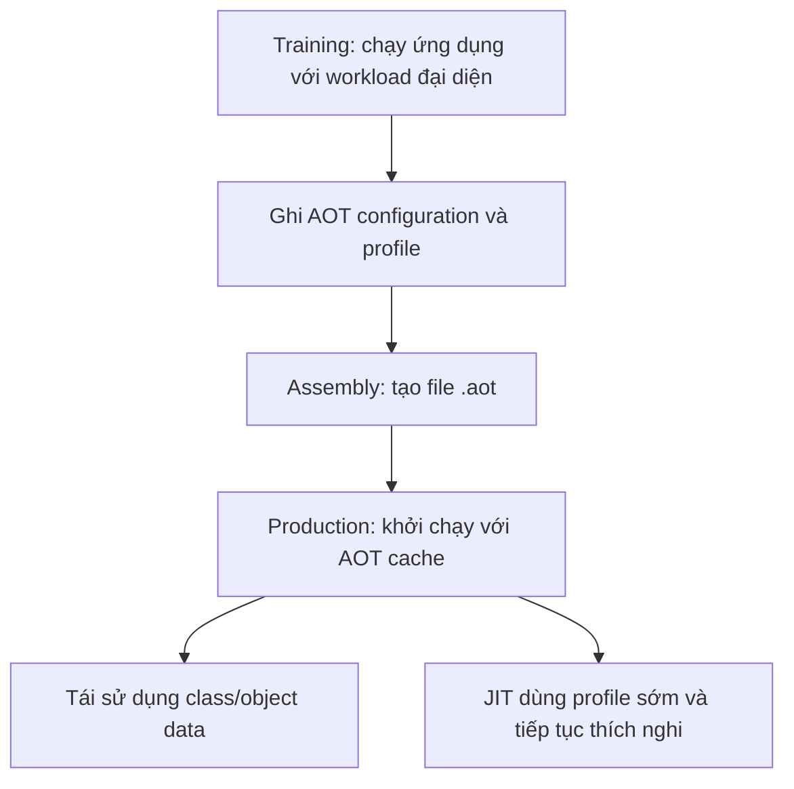

# AOT cache và bài toán thời gian khởi động, làm nóng

Một ứng dụng Java thường mất thời gian trước khi sẵn sàng phục vụ vì JVM phải nạp lớp, liên kết lớp, tạo một số đối tượng dùng chung và thu thập profile thực thi trước khi JIT có đủ dữ liệu để tối ưu các phương thức nóng. Với dịch vụ chạy lâu, chi phí này có thể được bù sau một thời gian. Với microservice, job ngắn hạn, CLI hoặc môi trường scale-out liên tục, thời gian khởi động và vài phút đầu sau khi khởi động có thể chiếm phần đáng kể trong thời gian phục vụ.

**Ahead-of-Time Cache (AOT cache)** của HotSpot chuyển một phần công việc có thể chuẩn bị trước sang giai đoạn training và build cache. Khi chạy production, JVM tái sử dụng thông tin lớp, một số đối tượng heap đã được chuẩn bị và method profile từ lần training. Nhờ vậy, JVM có thể khởi động nhanh hơn và bắt đầu tối ưu mã sớm hơn.

Trong JDK 26, điểm mới đáng chú ý là JEP 516: AOT object caching hoạt động với mọi garbage collector, bao gồm ZGC. AOT cache không biến ứng dụng thành native executable, không lưu toàn bộ trạng thái tiến trình và cũng không loại bỏ JIT. Đây là tối ưu khởi động/làm nóng của JVM, cần được huấn luyện bằng workload đại diện và đo trên chính ứng dụng.

## 1. Hai khoảng thời gian khác nhau: startup và warmup

Startup là khoảng thời gian từ lúc JVM bắt đầu chạy đến khi ứng dụng sẵn sàng nhận công việc. Warmup là giai đoạn sau đó, khi JVM tiếp tục nạp lớp còn thiếu, thực hiện liên kết/khởi tạo theo nhu cầu, thu thập profile và biên dịch các phương thức nóng bằng JIT.

Một ứng dụng có thể khởi động nhanh nhưng vẫn chậm ở những request đầu tiên. Ví dụ, endpoint đầu tiên mới kích hoạt một nhóm serializer, proxy, validator và đường xử lý dữ liệu; JIT cũng chưa có đủ profile để tối ưu đường chạy này. Vì vậy, đo riêng thời gian main hoặc thời gian tiến trình xuất hiện là chưa đủ.

| Giai đoạn | Công việc thường gặp | AOT cache có thể giúp gì? |
|---|---|---|
| JVM startup | Nạp runtime, đọc class metadata và khởi tạo các thành phần nền | Tái sử dụng class data đã chuẩn bị |
| Application startup | Nạp, liên kết và khởi tạo các lớp ứng dụng/thư viện thường dùng | Giảm phần việc load/link lặp lại; tái sử dụng một số đối tượng đã chuẩn bị |
| Warmup | Thu thập tần suất gọi, nhánh, kiểu receiver và profile phương thức | Cung cấp method profile từ training để JIT có thể tối ưu sớm hơn |
| Steady state | Chạy workload ổn định sau khi các đường nóng đã được tối ưu | Thường không phải lợi ích chính; cần đo xem có thay đổi throughput hay không |

Không nên gộp startup và warmup thành một chỉ số. Một cache có thể cải thiện thời gian đến request đầu tiên, nhưng không cải thiện nhiều thời gian đạt throughput ổn định; ngược lại, method profile có thể giúp warmup dù thời gian startup thay đổi ít.

## 2. AOT cache là gì và được hình thành ra sao?

AOT cache là một file archive, thường có phần mở rộng `.aot`, lưu các artifact mà HotSpot có thể tạo trước khi chạy production. Cơ chế được giới thiệu trong JDK 24 qua JEP 483 (Ahead-of-Time Class Loading and Linking), được đơn giản hóa cách sử dụng trong JDK 25 qua JEP 514, bổ sung method profiling qua JEP 515, và được mở rộng khả năng lưu object độc lập với GC trong JDK 26 qua JEP 516.

Những thành phần quan trọng trong phạm vi JDK 26:

- **Class data và trạng thái load/link:** JVM có thể tái sử dụng lớp đã được nạp và liên kết trong giai đoạn chuẩn bị thay vì lặp lại toàn bộ công việc khi chạy ứng dụng.
- **Các heap object được chọn:** chẳng hạn đối tượng `Class` cùng những `String`, mảng byte và object liên quan có thể được lưu trong cache. Đây là các đối tượng mà JVM xác định có thể tái sử dụng an toàn; cache không phải bản chụp tùy ý của toàn bộ heap.
- **Method execution profiles:** JEP 515 (JDK 25) đưa profile từ training vào AOT cache. JIT có thể dùng dữ liệu này sớm sau startup thay vì bắt đầu thu thập profile từ con số không.

JDK 26 không yêu cầu ứng dụng chuyển sang một runtime khác. Ứng dụng vẫn chạy trên HotSpot, vẫn có class loading động, reflection và JIT như bình thường. Nếu cache không dùng được, JVM có thể chạy mà không có cache AOT.

### AOT cache và CDS

Class Data Sharing (CDS) là nền tảng chia sẻ class metadata giữa các lần chạy JVM. AOT cache mở rộng hướng này bằng việc chuẩn bị thêm quá trình load/link, object và profile cho ứng dụng. CDS không phải công nghệ đã bị loại bỏ; các cơ chế chia sẻ lớp vẫn là một phần của nền tảng. Với ứng dụng trên JDK 25 trở lên, AOT cache là lựa chọn tích hợp thuận tiện hơn khi mục tiêu là tối ưu startup và warmup của chính ứng dụng.

## 3. Ba pha triển khai: training, assembly, production

Quy trình AOT cache có ba pha:



**Training** chạy ứng dụng trên JDK đích và đưa vào các luồng công việc đại diện. JVM ghi lại thông tin lớp, trạng thái khởi tạo có thể lưu, object và profile phù hợp. Workload training nên bao phủ các tính năng và đường xử lý thường dùng trong production.

**Assembly** dùng file AOT configuration tạo archive `.aot`. Với cách dùng đơn giản từ JDK 25, JVM có thể tự khởi chạy tiến trình thứ hai để thực hiện assembly sau khi training kết thúc.

**Production** chạy lại ứng dụng với file `.aot`. JVM nạp cache nếu tương thích; nếu không, chế độ `auto` có thể tiếp tục chạy bình thường mà không dùng cache.

Training không phải chạy một lần bất kỳ rồi có cache tốt. Nếu training chỉ gọi health check mà production xử lý giao dịch, truy vấn, JSON, TLS, template hoặc serializer phức tạp, cache có thể bỏ lỡ những lớp và profile quan trọng. Ngược lại, chạy cả test suite hoặc đường debug không dùng trong production có thể làm cache lớn và chứa dữ liệu không mang lại lợi ích.

## 4. Tạo và sử dụng AOT cache trên JDK 26

JEP 514 đơn giản hóa quy trình bằng các cờ launcher. Cách phổ biến nhất là để `AOTMode=auto` (mặc định) và chỉ định `AOTCacheOutput` trong lần training.

Ví dụ với ứng dụng chạy từ JAR:

**Pha training**

```bash
java -XX:AOTCacheOutput=app.aot -jar app.jar
```

Chạy ứng dụng và tạo workload đại diện. Với server không tự thoát, gửi traffic kiểm thử rồi dừng ứng dụng một cách graceful để JVM kết thúc pha record và hoàn tất assembly. Khi `AOTCacheOutput` được chỉ định, chế độ `auto` chuyển sang `record`; sau khi training kết thúc, JVM khởi chạy tiến trình thứ hai để tạo `app.aot`.

**Pha production**

```bash
java -XX:AOTCache=app.aot -jar app.jar
```

`AOTCache` chỉ định archive để JVM đọc. Ở chế độ `auto`, nếu archive tương thích thì JVM dùng nó; nếu không thể nạp cache, ứng dụng vẫn tiếp tục chạy mà không có cache. Đây là hành vi phù hợp cho production vì cache chỉ là tối ưu hiệu năng.

Ví dụ trên class path cũng tương tự:

```bash
# Training
java -XX:AOTCacheOutput=app.aot -cp app.jar com.example.Main

# Production
java -XX:AOTCache=app.aot -cp app.jar com.example.Main
```

Nếu cần tách rõ từng bước hoặc lưu file configuration để kiểm soát build pipeline, có thể dùng chế độ tường minh:

```bash
# Training: ghi dữ liệu thống kê vào app.aotconfig
java -XX:AOTMode=record -XX:AOTConfiguration=app.aotconfig -cp app.jar com.example.Main

# Assembly: không chạy ứng dụng; tạo app.aot từ configuration
java -XX:AOTMode=create -XX:AOTConfiguration=app.aotconfig -XX:AOTCache=app.aot -cp app.jar com.example.Main

# Production
java -XX:AOTMode=auto -XX:AOTCache=app.aot -cp app.jar com.example.Main
```

Trong JDK 26, `AOTCache` được đọc ở chế độ `on`/`auto`, và được dùng làm file đích ở chế độ `create`. `AOTCacheOutput` được dùng trong `record` hoặc `auto` để chỉ định archive cần tạo. Không truyền đồng thời `AOTCache` và `AOTCacheOutput` trong cùng một lệnh.

## 5. Hiểu các chế độ `AOTMode`

| Chế độ | Mục đích | Hành vi chính |
|---|---|---|
| `auto` | Mặc định; phù hợp production và cách dùng đơn giản | Có `AOTCacheOutput` thì record; nếu có cache đọc được thì dùng cache; nếu không thì chạy không cache |
| `off` | Tắt AOT cache | Bỏ qua các tùy chọn AOT liên quan |
| `record` | Training | Chạy ứng dụng và ghi AOT configuration; nếu chỉ định `AOTCacheOutput`, sau đó chạy assembly |
| `create` | Assembly | Đọc AOT configuration và ghi archive; không chạy ứng dụng |
| `on` | Production fail-fast | Yêu cầu nạp cache; lỗi tương thích làm JVM báo lỗi và thoát |

Trong production, ưu tiên `auto` để ứng dụng không phụ thuộc vào archive. Dùng `on` khi kiểm tra cache trong pipeline hoặc muốn phát hiện ngay cấu hình không tương thích. Khi chẩn đoán, có thể thêm `-Xlog:aot` để xem JVM có nạp được cache hay không.

## 6. JDK 26: AOT object caching với mọi garbage collector

Trước JDK 26, định dạng object trong AOT cache phụ thuộc vào cách GC biểu diễn heap và reference. Archive được ánh xạ trực tiếp vào heap theo định dạng cụ thể có thể không tương thích giữa các collector. Điều này hạn chế khả năng dùng AOT object caching với ZGC.

JEP 516 bổ sung định dạng object trung lập với GC. Thay vì yêu cầu object trong archive có bố cục bộ nhớ giống hệt heap đích, JVM có thể đọc object tuần tự, chuyển chúng sang biểu diễn phù hợp với collector đang chạy và nạp chúng nền song song với quá trình khởi động ứng dụng. Nhờ đó, AOT cache có thể dùng với mọi GC của HotSpot, bao gồm ZGC.

JDK 26 có hai hướng biểu diễn object:

| Dạng | Cách nạp | Đặc điểm |
|---|---|---|
| GC-specific / mappable | Ánh xạ object cache vào bộ nhớ theo định dạng tương thích GC | Có thể rất nhanh khi file đã nằm trong filesystem cache, phù hợp warm start |
| GC-agnostic / streamable | Đọc tuần tự và materialize object sang heap của GC hiện tại | Tương thích collector tốt hơn; có thể che độ trễ đọc đĩa khi cold start, nhưng cần CPU để chuyển đổi/nạp nền |

HotSpot có heuristic để chọn dạng phù hợp theo môi trường training và cấu hình runtime. Cờ `-XX:+AOTStreamableObjects` cho phép yêu cầu dạng streamable trong trường hợp cần kiểm tra hoặc điều khiển lựa chọn này:

```bash
java -XX:+AOTStreamableObjects -XX:AOTCacheOutput=app.aot -jar app.jar
```

Không nên bật cờ này mặc định chỉ vì ứng dụng dùng ZGC; JDK 26 đã hỗ trợ AOT object caching với ZGC. Hãy bắt đầu bằng mặc định, đo cold start và warm start, rồi chỉ ép dạng streamable nếu workload và giới hạn phần cứng cho thấy lợi ích.

## 7. AOT method profiling và vai trò của JIT

JIT thường cần quan sát ứng dụng chạy để biết phương thức nào nóng, call site thường nhận kiểu đối tượng nào, nhánh nào hay được đi qua và vòng lặp nào cần tối ưu. Việc thu thập profile làm tăng thời gian warmup.

JEP 515 (JDK 25) cho phép AOT cache lưu method execution profiles từ training. Khi production khởi chạy, JIT có thể sử dụng profile có sẵn để bắt đầu tối ưu sớm hơn. JVM vẫn tiếp tục quan sát và cập nhật profile trong runtime; dữ liệu training không phải lời khẳng định rằng mọi lần chạy production sẽ có hành vi giống hệt.

Điều này có hai hệ quả:

- Training phải đại diện cho workload production. Nếu training thiếu đường xử lý thực tế, profile có thể không hướng JIT tới những phương thức thật sự nóng.
- Nếu production có workload khác đáng kể, JIT vẫn phải thích nghi. AOT profile không thay thế profiling động và không bảo đảm hiệu năng tối ưu cho mọi input.

JDK 26 AOT cache không phải native image và không biến toàn bộ bytecode thành một executable độc lập. JIT vẫn là thành phần chính để tối ưu mã chạy trong tiến trình. Giá trị của method profile là rút ngắn thời gian để JIT có dữ liệu hữu ích.

## 8. Cache có ràng buộc tương thích

AOT cache không phải archive dùng chung tùy ý cho mọi phiên bản và môi trường. Nó gắn với:

- Ứng dụng cụ thể, được xác định bởi class path, `-jar` hoặc module path.
- Bản phát hành JDK.
- Hệ điều hành và kiến trúc CPU.

Khi thay đổi ứng dụng hoặc dependency JAR, thứ tự class path, JDK release, OS hoặc CPU architecture, cần tạo lại cache. Nên build cache cùng artifact và runtime image sẽ triển khai; không tái sử dụng cache của một bản ứng dụng khác chỉ vì tên JAR giống nhau.

Một số tùy chọn JVM cũng có thể làm cache không dùng được, đặc biệt tùy chọn hoặc agent can thiệp vào quá trình nạp/biến đổi class. Ví dụ, JVMTI class-file load hook hoặc agent biến đổi bytecode có thể làm dữ liệu training không còn tương ứng với production. `-XX:+AOTClassLinking` cho phép tối ưu sâu hơn, như resolve trước một số `invokedynamic`, nhưng archive được tạo với class linking nâng cao có thêm giới hạn tương thích ở production. Khi `AOTMode` được dùng, JDK 26 tự bật `AOTClassLinking`; có thể tắt bằng `-XX:-AOTClassLinking` nếu cần tương thích với cấu hình cụ thể.

Khi cache không nạp được:

- `AOTMode=auto`: JVM tiếp tục chạy mà không dùng cache. Có thể xem log bằng `-Xlog:aot`.
- `AOTMode=on`: JVM báo lỗi và thoát. Dùng chế độ này để kiểm tra fail-fast, không nên áp dụng tùy tiện cho production có command line do môi trường triển khai kiểm soát.

## 9. Thiết kế workload training có ích

Training tốt không cần chạy mọi chức năng của hệ thống; nó cần chạy các luồng có khả năng xuất hiện thường xuyên và có ý nghĩa đối với startup/warmup. Một quy trình thực tế:

1. Dùng đúng JDK, artifact, dependency và tham số JVM dự kiến cho production.
2. Khởi chạy ứng dụng ở môi trường training tách biệt, với dữ liệu thử nghiệm an toàn.
3. Chờ ứng dụng hoàn tất startup, sau đó gửi một tập request đại diện cho các endpoint và luồng nghiệp vụ thường dùng.
4. Bao phủ các thành phần quan trọng như serialization, validation, truy cập dữ liệu, security filter, template, HTTP client và xử lý lỗi thường gặp.
5. Không đưa vào các công cụ test, profiler, debug agent hoặc đường quản trị không có trong production nếu chúng làm thay đổi class loading hoặc workload.
6. Dừng ứng dụng graceful để hoàn tất ghi AOT configuration và assembly.
7. Đưa file `.aot` vào cùng gói triển khai với artifact và JDK tương thích.

Đối với server cần chạy liên tục, có thể dùng endpoint quản trị chỉ trong môi trường training hoặc cơ chế shutdown của framework để kết thúc training có kiểm soát. Không để tiến trình training bị dừng cưỡng bức trước khi hoàn tất ghi cache.

## 10. Đo lường trước và sau khi bật AOT cache

Không đánh giá AOT cache chỉ bằng một lần chạy trên máy developer. So sánh trong môi trường giống production và dùng nhiều lần lặp. Các chỉ số nên theo dõi:

| Chỉ số | Cách đo |
|---|---|
| Time to ready | Từ lúc tiến trình bắt đầu đến health/readiness probe thành công |
| First-request latency | Độ trễ request đầu tiên và các request đầu trong mỗi endpoint quan trọng |
| Warmup time | Thời gian để throughput/latency ổn định theo ngưỡng SLO |
| Steady-state throughput | Throughput sau khi đã warmup, để phát hiện regression |
| CPU và RSS | Chi phí CPU lúc startup, CPU phụ trợ khi streamable objects, resident memory |
| Heap và GC | Heap sau startup, allocation, tần suất và thời gian GC |
| Cache build | Thời gian training/assembly và dung lượng file `.aot` |

Chạy ít nhất các kịch bản:

- Không có application AOT cache.
- Có AOT cache ở cold start (filesystem cache chưa nóng).
- Có AOT cache ở warm start (archive đã nằm trong filesystem cache).
- Với GC đang dùng trong production; nếu chuyển giữa G1 và ZGC, kiểm tra lại cache và lựa chọn object format.

Giữ cùng phần cứng, JDK build, heap, GC, class path và workload. Tách thời gian training/assembly khỏi thời gian production startup. Một kết quả tốt ở lần đầu không bảo đảm cải thiện ở lần chạy lâu; cần kiểm tra cả warmup và steady state.

## 11. AOT cache khác CRaC và Native Image

| Công nghệ | Cách tiếp cận | Khi phù hợp |
|---|---|---|
| HotSpot AOT cache | Lưu class/link/object/profile để JVM tái sử dụng khi startup | Muốn cải thiện startup/warmup mà vẫn giữ runtime Java động |
| CRaC | Checkpoint và restore trạng thái tiến trình đã chạy | Có thể quản lý vòng đời tài nguyên và môi trường restore phù hợp |
| GraalVM Native Image | Biên dịch ứng dụng thành executable native với mô hình runtime khác | Muốn triển khai native binary và chấp nhận giới hạn tương thích/runtime tương ứng |

AOT cache ít thay đổi mô hình triển khai Java hiện tại hơn: vẫn dùng JVM và bytecode, không cần biên dịch ứng dụng thành native image. CRaC và Native Image giải quyết bài toán khác, với yêu cầu build và vận hành riêng. Không nên coi chúng là các cách bật/tắt của cùng một tính năng.

## 12. Các sai lầm thường gặp

- **Training không đại diện:** chỉ gọi health endpoint khiến cache bỏ lỡ các lớp và profile của nghiệp vụ thật.
- **Dùng cache sai phiên bản:** cập nhật JDK, dependency hoặc artifact mà vẫn mang cache cũ sang production.
- **Nhầm cache với snapshot process:** AOT cache không giữ socket đang mở, thread, request đang xử lý hoặc toàn bộ trạng thái ứng dụng.
- **Kỳ vọng loại bỏ JIT:** method profile giúp JIT tối ưu sớm; nó không thay thế JIT hoặc bảo đảm mọi phương thức đã được biên dịch.
- **Ép GC format khi chưa đo:** streamable và mappable có trade-off CPU, disk và warm/cold start. Để heuristic mặc định hoạt động trước khi tự điều chỉnh.
- **Đưa profiler/agent vào training:** agent biến đổi class có thể làm cache không tương thích hoặc tạo cache khác với production.
- **Bắt buộc cache phải nạp được trong production:** dùng `auto` để có đường chạy dự phòng; dùng `on` trong kiểm thử fail-fast.
- **Chỉ đo startup:** bỏ qua first-request latency, warmup, throughput và chi phí CPU/RSS sau khi khởi động.

## 13. Trạng thái và mốc phiên bản

Các phần AOT cache nêu trong bài là tính năng HotSpot/JDK, không phải Java language preview hay incubator API:

| JDK | JEP | Nội dung |
|---|---|---|
| JDK 24 | JEP 483 | AOT Class Loading and Linking; giới thiệu quy trình AOT cache với training, assembly và production |
| JDK 25 | JEP 514 | Đơn giản hóa command line và cách sử dụng AOT cache |
| JDK 25 | JEP 515 | Lưu method execution profiles trong AOT cache để JIT warmup sớm hơn |
| JDK 26 | JEP 516 | AOT object caching với mọi GC, gồm cả ZGC, bằng định dạng object GC-agnostic và nạp tuần tự |

JDK 26 không biến AOT cache thành API Java chuẩn có thể gọi từ mọi JVM. Đây là tính năng của HotSpot được điều khiển chủ yếu bằng cờ dòng lệnh. Các tùy chọn `-XX` là tùy chọn riêng của HotSpot; khi đổi sang một JVM implementation khác, cần kiểm tra hỗ trợ thay vì giả định tương thích.

## 14. Những điểm cần nhớ

- Startup và warmup là hai vấn đề khác nhau; đo cả readiness, first request và thời gian đạt steady state.
- AOT cache được giới thiệu ở JDK 24; JDK 25 thêm ergonomics và method profiles; JDK 26 bổ sung object caching độc lập với GC.
- Quy trình gồm training workload đại diện, assembly file `.aot` và production reuse.
- `-XX:AOTCacheOutput=app.aot` dùng cho training/build; `-XX:AOTCache=app.aot` dùng để nạp cache.
- `AOTMode=auto` phù hợp production vì cache không dùng được thì ứng dụng vẫn có thể chạy; `on` dùng để fail-fast khi kiểm tra.
- JEP 516 giúp AOT object caching hoạt động với mọi GC, bao gồm ZGC; streamable object format có trade-off CPU và disk.
- Method profile giúp JIT tối ưu sớm hơn nhưng không thay thế JIT và không bảo đảm mọi workload đều giống training.
- Tạo lại cache khi thay đổi artifact, dependency, JDK release, OS hoặc CPU architecture; xác nhận tương thích với VM options/agents.

## Tài liệu tham khảo

- [JDK 26 java command: Ahead-of-Time Cache options](https://docs.oracle.com/en/java/javase/26/docs/specs/man/java.html)
- [JDK 26 Migration Guide: Significant Changes](https://docs.oracle.com/en/java/javase/26/migrate/significant-changes-jdk-26-release.html)
- [JDK 26 Release Notes: Ahead-of-Time Object Caching with Any GC](https://www.oracle.com/java/technologies/javase/26-relnote-issues.html)
- [JEP 483: Ahead-of-Time Class Loading and Linking (JDK 24)](https://openjdk.org/jeps/483)
- [JEP 514: Ahead-of-Time Cache Command-Line Ergonomics (JDK 25)](https://openjdk.org/jeps/514)
- [JEP 515: Ahead-of-Time Method Profiling (JDK 25)](https://openjdk.org/jeps/515)
- [JEP 516: Ahead-of-Time Object Caching with Any GC (JDK 26)](https://openjdk.org/jeps/516)
- [Inside Java: Performance Improvements in JDK 26 — JEP 516](https://inside.java/2026/06/09/jdk-26-performance-improvements/)
- [Spring Boot Reference: AOT Cache](https://docs.spring.io/spring-boot/reference/packaging/aot-cache.html)
