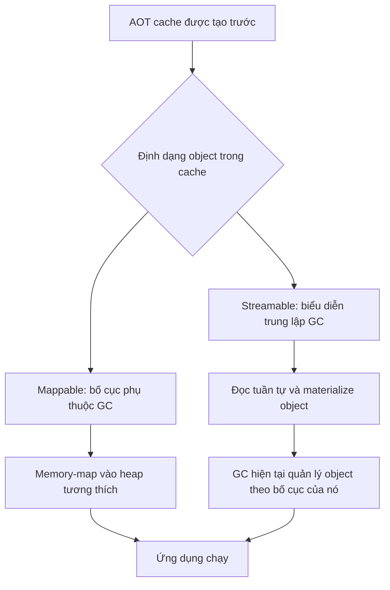

# Java 26 cho phép bộ đệm đối tượng AOT dùng với mọi GC

Ứng dụng Java thường mất thời gian ở hai giai đoạn khác nhau: **startup**, khi JVM nạp và liên kết lớp, tạo các object nền tảng; và **warmup**, khi ứng dụng chạy đủ lâu để JVM thu thập profile rồi tối ưu các đường code nóng. Project Leyden đưa các bước chuẩn bị có thể thực hiện trước lần chạy production vào **Ahead-of-Time (AOT) cache** để giảm một phần công việc lặp lại.

JDK 24 bắt đầu đưa AOT cache vào HotSpot với JEP 483 (*Ahead-of-Time Class Loading & Linking*). JDK 26 bổ sung JEP 516 (*Ahead-of-Time Object Caching with Any GC*): ngoài việc cache thông tin lớp, JVM có thể lưu trạng thái các object Java theo một định dạng trung lập với garbage collector. Nhờ vậy, AOT object caching có thể dùng với các GC của HotSpot, bao gồm ZGC, mà không cần chọn giữa cache AOT và collector có độ trễ thấp.

JEP 516 là cải tiến runtime của HotSpot đã được tích hợp trong JDK 26. Đây không phải API Java, không phải preview/incubator và không cần `--enable-preview` hay thêm module. Các tùy chọn AOT là tùy chọn JVM; ứng dụng không phải thay đổi mã nguồn để được hưởng lợi.

## 1. Vì sao AOT cache cần hỗ trợ nhiều garbage collector?

Một AOT cache có thể chứa thông tin về class đã nạp/liên kết và object trên Java heap đã được tạo trong quá trình chuẩn bị. Khi JVM khởi động lần sau, nó có thể tái sử dụng các dữ liệu này thay vì thực hiện lại toàn bộ công việc.

Trước JDK 26, object trong cache được lưu theo bố cục heap phụ thuộc vào GC. Cách triển khai có thể memory-map dữ liệu object từ file trực tiếp vào heap. Cách này nhanh, nhưng đòi hỏi định dạng object/reference trong cache phải tương thích với cách collector tổ chức heap. ZGC có cách quản lý địa chỉ và reference khác với bố cục đơn giản mà cơ chế cũ giả định, nên các tối ưu AOT cần archived heap objects không khả dụng với ZGC.

JEP 516 bổ sung định dạng object **GC-agnostic**, còn gọi là *streamable objects*. Thay vì ánh xạ nguyên trạng bố cục heap đã ghi trong file, JVM đọc biểu diễn trung lập rồi materialize object vào heap trong quá trình chạy. GC đang được chọn sẽ quản lý các object được tạo theo bố cục phù hợp với chính nó.



Nhờ cách này, cache object dạng streamable không chứa raw pointer gắn cứng với một collector. JVM có thể tái tạo object graph theo bố cục phù hợp với G1, ZGC hoặc collector khác được hỗ trợ trong bản HotSpot đang dùng.

## 2. Mappable và streamable: hai cách lưu object

JDK 26 có hai cách biểu diễn heap object trong AOT cache. Mỗi cách có đặc tính hiệu năng và khả năng tương thích khác nhau:

| Định dạng | Cách nạp | Ưu điểm | Chi phí/giới hạn |
|---|---|---|---|
| **Mappable (GC-specific)** | Memory-map nội dung cache vào vùng heap có bố cục tương thích | Có thể khởi động rất nhanh khi file đã nằm trong filesystem page cache; ít công việc materialize | Gắn với bố cục GC/heap cụ thể; không phải lựa chọn phù hợp khi muốn đổi collector như ZGC |
| **Streamable (GC-agnostic)** | Đọc biểu diễn trung lập, tạo object và liên kết reference trong heap | Dùng được với các GC khác nhau, gồm ZGC; có thể đọc/materialize đồng thời trong startup | Tốn thêm CPU và công việc tạo object; trên máy ít CPU có thể khó che giấu độ trễ đọc file |

Với mappable cache, filesystem có thể phục vụ các trang đã có trong page cache mà không cần JVM dựng lại từng object. Vì vậy, warm start có thể rất nhanh. Với streamable cache, JVM phải đọc dữ liệu và materialize object, nhưng có thể thực hiện công việc đó đồng thời với quá trình khởi động ứng dụng để che giấu một phần độ trễ I/O.

Không có một định dạng tốt nhất cho mọi môi trường. Mappable có thể phù hợp với hệ thống có cấu hình heap/GC cố định và cần giảm tối đa công việc lúc khởi động. Streamable phù hợp khi cần đổi collector, đặc biệt khi muốn dùng ZGC, hoặc cần một cache ít phụ thuộc bố cục heap hơn. Hãy đo cold start và warm start trên môi trường triển khai thật.

## 3. JVM chọn định dạng object như thế nào?

JDK 26 có thể chọn định dạng cache dựa trên môi trường và tùy chọn của **training run**. JVM xem xét GC, compressed ordinary object pointers (*compressed oops*) và kích thước heap để quyết định có nên dùng định dạng streamable. Ví dụ, training bằng ZGC hoặc cấu hình heap không dùng compressed oops thường dẫn tới lựa chọn streamable. Nếu hệ thống có cấu hình khác nhau giữa training và production, không nên dựa vào heuristic mà không kiểm tra cache thực tế.

Có thể chủ động ép định dạng streamable khi tạo cache bằng tùy chọn diagnostic:

```bash
-XX:+UnlockDiagnosticVMOptions -XX:+AOTStreamableObjects
```

Tùy chọn này điều khiển định dạng object được ghi trong giai đoạn tạo/assembly cache. Nó hữu ích khi muốn tạo cache trung lập với GC để triển khai trên nhiều cấu hình collector, hoặc khi benchmark hai định dạng. Đây là tùy chọn chẩn đoán của HotSpot, không phải API Java và không phải cờ preview. Không cần bật nó chỉ để chạy một streamable cache đã được tạo; JVM đọc định dạng từ cache.

Nên training với cấu hình GC và heap gần với production. Nếu production cần ZGC, hãy dùng ZGC trong training và tạo cache streamable. Nếu muốn một cache có thể chia sẻ giữa nhiều nhóm máy dùng collector khác nhau, hãy kiểm tra và tạo rõ định dạng streamable thay vì giả định cache mappable có thể dùng ở mọi nơi.

## 4. AOT cache hoạt động qua ba giai đoạn

AOT cache của HotSpot có quy trình triển khai gồm ba giai đoạn: **training**, **assembly** và **production**. Training chạy ứng dụng với workload đại diện để ghi nhận lớp và object phù hợp; assembly dùng dữ liệu đó để tạo file cache; production chạy ứng dụng và nạp cache.

### 4.1. Training: chạy workload đại diện

Training phải thực sự thực thi các luồng nghiệp vụ quan trọng. JVM thu thập dữ liệu về class loading/linking và trạng thái cần lưu vào file cấu hình AOT (`.aotconfig`). Ví dụ:

```bash
java \
  -XX:AOTMode=record \
  -XX:AOTConfiguration=app.aotconfig \
  -XX:+UseZGC \
  -Xms4g -Xmx4g \
  -jar app.jar
```

Khởi động ứng dụng training rồi chạy các thao tác đại diện như đăng nhập, truy vấn, tạo báo cáo, gọi các endpoint chính và các luồng xử lý nền cần thiết. Kết thúc training sau khi đã đi qua workload mục tiêu. Các tùy chọn GC, heap và classpath/module path nên phản ánh production vì chúng ảnh hưởng đến khả năng sử dụng cache và lựa chọn định dạng object.

Training không phải chỉ chạy lệnh `java -version` hoặc khởi động ứng dụng rồi dừng ngay. Nếu workload không đi qua một module hoặc chức năng, cache không thể biết trạng thái cần chuẩn bị cho phần đó.

### 4.2. Assembly: tạo file cache

Dùng file `.aotconfig` vừa ghi để tạo cache `.aot`:

```bash
java \
  -XX:AOTMode=create \
  -XX:AOTConfiguration=app.aotconfig \
  -XX:AOTCacheOutput=app.aot \
  -XX:+UseZGC \
  -Xms4g -Xmx4g \
  -jar app.jar
```

Giai đoạn `create` đọc dữ liệu training và ghi các artifact tối ưu vào cache. Bản thân ứng dụng không chạy workload nghiệp vụ trong giai đoạn này. Đối với cache streamable, có thể thêm cờ diagnostic vào lệnh assembly:

```bash
java \
  -XX:+UnlockDiagnosticVMOptions \
  -XX:+AOTStreamableObjects \
  -XX:AOTMode=create \
  -XX:AOTConfiguration=app.aotconfig \
  -XX:AOTCacheOutput=app-streamable.aot \
  -XX:+UseZGC \
  -Xms4g -Xmx4g \
  -jar app.jar
```

Ở đây `app-streamable.aot` được tạo với định dạng object trung lập GC. Khi triển khai, cache này có thể được dùng với collector khác trong JDK 26 tương thích. Nếu không ép định dạng, JVM áp dụng lựa chọn mặc định dựa trên cấu hình training và môi trường.

### 4.3. Production: chạy với cache

Khi triển khai, chỉ định cache đã tạo:

```bash
java \
  -XX:AOTMode=auto \
  -XX:AOTCache=app-streamable.aot \
  -XX:+UseZGC \
  -Xms4g -Xmx4g \
  -jar app.jar
```

`AOTMode=auto` là chế độ mặc định. JVM thử nạp cache nếu có và tương thích; nếu không thể dùng cache, ứng dụng tiếp tục chạy mà không có AOT cache. Đây là lựa chọn phù hợp cho production vì cache là tối ưu hiệu năng, không phải điều kiện để chương trình đúng.

Để kiểm tra tương thích theo kiểu fail-fast trong môi trường kiểm thử, có thể dùng:

```bash
java \
  -XX:AOTMode=on \
  -XX:AOTCache=app-streamable.aot \
  -Xlog:aot \
  -XX:+UseZGC \
  -jar app.jar
```

`AOTMode=on` yêu cầu JVM phải nạp được cache; nếu không, JVM báo lỗi và thoát. Chỉ dùng cách này để kiểm tra hoặc chẩn đoán. Trong production thông thường, ưu tiên `auto` để ứng dụng vẫn khởi chạy khi cache không tương thích hoặc không có sẵn.

## 5. Cache gắn với ứng dụng và môi trường triển khai

AOT cache không phải file dùng chung tùy ý cho mọi ứng dụng. Theo tài liệu launcher JDK 26, cache phụ thuộc ít nhất vào:

- **Ứng dụng:** được nhận diện qua `-classpath`, `-jar` hoặc `--module-path`.
- **JDK release:** cache phải tương thích với bản JDK đã tạo nó.
- **Hệ điều hành và kiến trúc CPU:** cache không phải artifact portable giữa các OS/architecture khác nhau.

Nếu một yếu tố trên thay đổi, cần tạo lại cache. Ngoài ra, JAR trong classpath/module path, tùy chọn module và một số JVM option có thể ảnh hưởng đến khả năng sử dụng cache. Ví dụ, thay dependency sau khi tạo cache có thể làm cache không còn hợp lệ. Không copy cache từ máy build Linux x64 sang Windows ARM64 hoặc dùng cache JDK 26 cho JDK 27 chỉ vì ứng dụng JAR không đổi.

Trong pipeline triển khai, nên gắn cache với đúng phiên bản ứng dụng, JDK runtime image, OS và architecture. Tạo cache sau khi dependency đã được cố định; phát hành cache cùng phiên bản ứng dụng. Khi nâng JDK, đổi dependency, đổi module path hoặc thay đổi cấu hình JVM ảnh hưởng đến AOT, hãy tạo và kiểm tra cache mới.

Nếu JVM không nạp được cache, bật `-Xlog:aot` để tìm nguyên nhân. Các tình huống thường gặp gồm:

- File cache không tồn tại, không đọc được hoặc bị hỏng.
- Ứng dụng/classpath/module path khác với lúc tạo cache.
- JDK release, OS hoặc CPU architecture không tương thích.
- Một số tùy chọn JVM hoặc JVMTI agent làm thay đổi class loading/linking so với training.

Tài liệu JDK 26 khuyến nghị `AOTMode=auto` cho production, đặc biệt khi script khởi chạy có thể nhận thêm tùy chọn từ môi trường. Nếu cache không dùng được, JVM vẫn chạy ứng dụng theo đường thông thường.

## 6. AOT cache, CDS, JIT và Native Image khác nhau thế nào?

| Công nghệ | Vai trò | Điều nó không làm |
|---|---|---|
| CDS (*Class Data Sharing*) | Chia sẻ dữ liệu class đã được xử lý để giảm công việc nạp lớp | Không tự biến ứng dụng thành native executable |
| AOT cache (Leyden/HotSpot) | Lưu artifact đã chuẩn bị trước, gồm class và heap object, để JVM tái sử dụng khi startup | Không đảm bảo mọi method đã được biên dịch thành mã máy tối ưu |
| JIT compiler | Biên dịch method khi ứng dụng chạy dựa trên profile thực tế | Không thay thế bước chuẩn bị class/object trong AOT cache |
| GraalVM Native Image | Biên dịch ứng dụng và dependency thành executable native trước khi triển khai | Không phải cùng định dạng hoặc quy trình với HotSpot AOT cache |

AOT cache tiếp nối CDS và các tối ưu AOT của Project Leyden. Nó giúp JVM tránh một phần công việc khởi tạo lặp lại; JIT vẫn có vai trò tối ưu code trong runtime. Không nên gọi AOT cache là “biên dịch toàn bộ ứng dụng thành native code”.

JDK 25 còn bổ sung các cải tiến AOT khác, như command-line ergonomics và AOT method profiling. JEP 516 tập trung vào việc lưu và nạp heap objects theo định dạng không phụ thuộc GC. Không trộn ba nội dung này thành một tính năng duy nhất hoặc giả định chỉ bật JEP 516 là đã cache toàn bộ method profile/native code.

## 7. Đo lường hiệu quả trước khi triển khai rộng

AOT cache hướng tới startup và warmup, nhưng mức cải thiện phụ thuộc ứng dụng, workload training, định dạng cache, tốc độ lưu trữ và CPU dành cho materialization. Cần đo tối thiểu:

- Thời gian từ lúc tiến trình bắt đầu đến khi ứng dụng sẵn sàng nhận request.
- Thời gian phản hồi của các request đầu tiên và thời gian đạt throughput ổn định.
- CPU usage trong startup, đặc biệt khi dùng streamable cache.
- Kích thước cache, thời gian tạo cache và thời gian triển khai artifact.
- RSS/native memory và heap sau startup.
- Cold start khi cache chưa nằm trong filesystem page cache và warm start khi cache đã được hệ điều hành cache.

So sánh baseline không dùng cache, mappable cache và streamable cache trên cùng workload. Dùng nhiều lần chạy và so sánh median/percentile thay vì chỉ nhìn một lần khởi động. Nếu môi trường container bị giới hạn CPU, materialization nền có thể cạnh tranh CPU với ứng dụng; hãy kiểm tra startup khi áp dụng CPU quota production.

Cache chỉ hữu ích nếu workload training đủ đại diện. Nếu ứng dụng có nhiều plugin hoặc module được nạp động theo cấu hình từng tenant, một lần training không thể bao phủ mọi đường chạy. Hãy huấn luyện bằng tập luồng nghiệp vụ quan trọng và xác minh ứng dụng vẫn hoạt động đúng khi một lớp hoặc object không có trong cache.

## 8. Cấu hình thực tế và các lưu ý vận hành

- **Giữ cache ngoài source code.** Cache là artifact sinh ra theo build/runtime cụ thể; lưu trong artifact repository hoặc pipeline output, không commit file nhị phân vào source repository trừ khi quy trình dự án yêu cầu rõ.
- **Tái tạo khi nâng JDK hoặc dependency.** Cache cũ không phải hợp đồng tương thích qua các release JDK.
- **Training gần production.** Giữ GC, heap, classpath/module path và các tùy chọn liên quan nhất quán.
- **Dùng streamable khi cần GC independence.** Nếu triển khai trên ZGC hoặc nhiều collector, kiểm tra định dạng cache; mappable cache vẫn gắn với bố cục GC.
- **Dùng `auto` trong production.** Không để ứng dụng dừng chỉ vì một tối ưu cache không nạp được.
- **Không nhầm cache với backup.** Cache có thể xóa và tạo lại; không chứa trạng thái nghiệp vụ duy nhất của ứng dụng.
- **Không giả định mọi startup đều nhanh hơn.** Streamable format cần CPU để materialize object; workload nhỏ hoặc chạy một lần có thể không thu được lợi ích đáng kể.
- **Không bật cờ diagnostic nếu chưa có lý do.** Đo heuristic mặc định trước, sau đó mới ép `AOTStreamableObjects` để so sánh hoặc đáp ứng yêu cầu triển khai.

## 9. Tính năng này có phải preview hoặc incubator không?

JEP 516 được tích hợp như một tính năng HotSpot chính thức của JDK 26. Không cần `--enable-preview`, không cần `--add-modules` và không có package Java mới để import. Các tùy chọn `-XX:AOTMode`, `-XX:AOTConfiguration`, `-XX:AOTCacheOutput`, `-XX:AOTCache` điều khiển quy trình AOT; `-XX:+AOTStreamableObjects` là tùy chọn diagnostic để chọn định dạng object khi tạo cache.

Đây là tính năng của HotSpot, không phải cam kết của Java SE rằng mọi JVM vendor đều phải có cùng cơ chế AOT cache hoặc cùng cờ `-XX`. Khi dùng một runtime khác Oracle HotSpot/OpenJDK HotSpot, hãy kiểm tra tài liệu và khả năng hỗ trợ của vendor đó. Không sao chép cờ JVM HotSpot sang runtime không hỗ trợ.

## Tài liệu tham khảo

- [JEP 516: Ahead-of-Time Object Caching with Any GC](https://openjdk.org/jeps/516)
- [JEP 483: Ahead-of-Time Class Loading & Linking](https://openjdk.org/jeps/483)
- [Oracle JDK 26 Release Notes: Ahead-of-Time Object Caching with Any GC](https://www.oracle.com/java/technologies/javase/26all-relnotes.html)
- [Java SE 26 `java` Launcher: Ahead-of-Time Cache](https://docs.oracle.com/en/java/javase/26/docs/specs/man/java.html)
- [Inside Java: Performance Improvements in JDK 26 – JEP 516](https://inside.java/2026/06/09/jdk-26-performance-improvements/)
