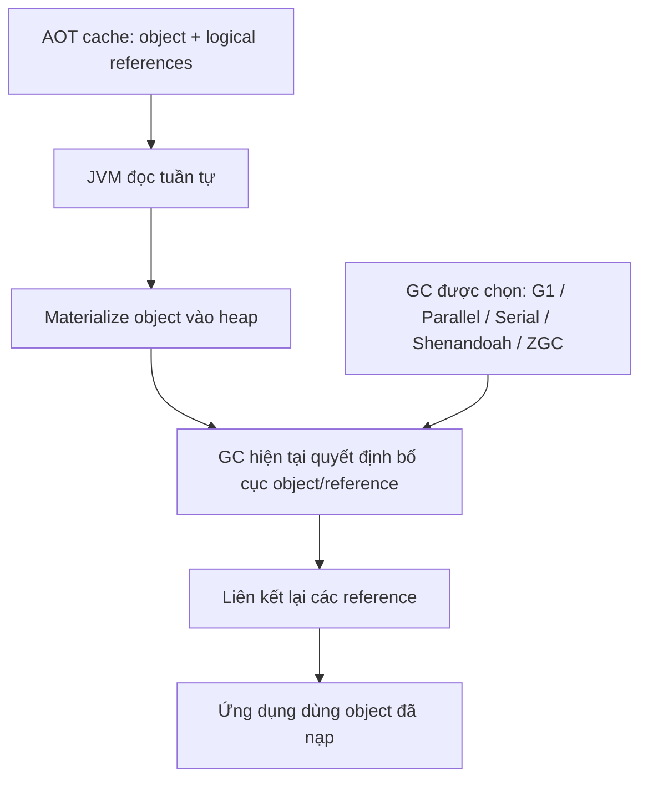

# Biểu diễn đối tượng trung lập với bộ thu gom rác

*Tình trạng được đối chiếu với JDK 26 tại ngày 27/11/2026.*

JDK 26 hoàn thiện **JEP 516 – Ahead-of-Time Object Caching with Any GC**. Cải tiến này mở rộng AOT cache của HotSpot để lưu và nạp các Java heap object theo định dạng không phụ thuộc cách một garbage collector (GC) bố trí object và tham chiếu trong bộ nhớ. Nhờ đó, AOT cache có thể dùng với mọi GC của HotSpot, bao gồm G1, Parallel, Serial, Shenandoah và ZGC.

Trước JDK 26, phần object trong AOT cache được lưu ở định dạng gắn với bố cục bộ nhớ của GC. Cách lưu đó cho phép JVM memory-map object trực tiếp vào heap, nhưng không tương thích với cách biểu diễn reference đặc thù của ZGC. JEP 516 bổ sung định dạng **streamable, GC-agnostic**: object được đọc tuần tự từ cache, materialize vào heap theo quy tắc của GC đang chạy, rồi các tham chiếu được liên kết trong tiến trình nạp.

Đây là tối ưu runtime ổn định trong JDK 26, không phải preview hay incubator. Ứng dụng không cần sửa source code, bật `--enable-preview` hoặc thêm module. Lợi ích chính là giảm công việc khởi động và warmup, đồng thời không buộc ứng dụng phải từ bỏ GC có độ trễ thấp để dùng AOT cache.

## 1. AOT cache lưu những gì?

AOT cache là một artifact do HotSpot tạo trước khi chạy production. Nó lưu những kết quả tối ưu có thể tái sử dụng ở lần khởi động sau. Nền tảng AOT cache được giới thiệu từ JDK 24 qua JEP 483 – Ahead-of-Time Class Loading and Linking; JDK 25 tiếp tục bổ sung profile phương thức và cải thiện cách tạo cache. JDK 26 mở rộng cơ chế lưu object để hỗ trợ mọi GC.

Cache có thể chứa:

- Thông tin lớp đã được đọc, phân tích, nạp và liên kết.
- Các object trên Java heap đủ điều kiện được archive trong quá trình training, chẳng hạn object `Class` và các object được tham chiếu từ chúng như `String` hoặc mảng byte.
- Những dữ liệu khởi tạo và metadata mà JVM xác định có thể tái sử dụng ở lần chạy tiếp theo.
- Các profile phương thức đã được AOT cache hỗ trợ từ những cải tiến trước đó, giúp JIT có thông tin sớm hơn trong warmup.

AOT cache **không phải ảnh chụp toàn bộ heap của một tiến trình đang chạy**. Nó không đóng băng trạng thái request, socket, thread, transaction, dữ liệu người dùng hay toàn bộ object được tạo tùy ý trong runtime. JVM chỉ archive những lớp và object đủ điều kiện theo cơ chế AOT.

Khi dùng cache, ứng dụng vẫn chạy trên HotSpot JVM, vẫn dùng JIT và GC bình thường. AOT cache không chuyển ứng dụng thành native executable như GraalVM Native Image.

## 2. Vì sao định dạng object cũ phụ thuộc GC?

Mỗi GC có thể có quy tắc riêng về vị trí object, cách biểu diễn reference và metadata liên quan đến quản lý bộ nhớ. Ví dụ, một số cấu hình dùng compressed ordinary object pointers (compressed oops), trong khi ZGC dùng cách biểu diễn reference có metadata riêng để hỗ trợ các thao tác GC đồng thời.

Định dạng AOT object cũ được tổ chức sao cho JVM có thể ánh xạ trực tiếp nội dung cache vào heap. Cách này rất nhanh khi cache đã nằm trong filesystem page cache, nhưng các byte trong cache phải phù hợp với cách GC hiện tại biểu diễn object và reference.

Vì vậy, cache được tạo theo một bố cục heap cụ thể không thể luôn được nạp trực tiếp vào heap của GC có bố cục khác. Trước JDK 26, hạn chế này khiến các tối ưu AOT cần archived heap object không khả dụng với ZGC.

Ví dụ khái niệm:

| Thành phần | Định dạng phụ thuộc GC | Định dạng trung lập GC |
|---|---|---|
| Tham chiếu object | Có thể gắn với địa chỉ hoặc cách mã hóa reference của heap cụ thể | Dùng định danh logic trong dữ liệu cache |
| Nạp object | Memory-map dữ liệu đã được bố trí theo định dạng tương thích | Đọc tuần tự và tạo lại object trong heap hiện tại |
| Phụ thuộc collector | Phụ thuộc cách GC bố trí object/reference | Không phụ thuộc bố cục object/reference của GC |
| Đặc tính chính | Rất nhanh khi dữ liệu cache đã nóng trong filesystem cache | Linh hoạt giữa các GC; dùng CPU để materialize object |

Điểm mấu chốt: AOT cache cần mô tả mối liên kết giữa các object mà không giả định địa chỉ bộ nhớ của lần chạy trước sẽ còn đúng ở lần chạy sau.

## 3. Định dạng streamable giải quyết vấn đề như thế nào?

JEP 516 bổ sung một định dạng object trung lập với GC. Thay vì lưu reference như địa chỉ bộ nhớ cố định của một heap cụ thể, định dạng này dùng các định danh logic để mô tả liên kết giữa object trong cache.

Khi JVM khởi động:

1. JVM đọc dữ liệu object từ AOT cache theo thứ tự tuần tự.
2. Object được materialize vào heap đang dùng, theo quy tắc bố trí của GC hiện tại.
3. Các định danh logic được giải quyết thành reference phù hợp với heap mới.
4. Các object được kết nối lại để ứng dụng sử dụng như những object Java bình thường.
5. Quá trình nạp có thể diễn ra ở background trong khi ứng dụng tiếp tục khởi động.

Sơ đồ khái quát:



Nhờ vậy, định dạng cache không phải chứa sẵn các địa chỉ heap cụ thể của collector. JVM có thể dựng lại object theo quy tắc của GC đang chạy. Đây là cơ sở để AOT object caching hoạt động với ZGC và các GC khác.

Định dạng trung lập không làm cho mọi phần của AOT cache trở nên portable. Nó chỉ loại bỏ phụ thuộc vào bố cục object/reference của GC. Cache vẫn phụ thuộc vào ứng dụng, phiên bản JDK, hệ điều hành, kiến trúc CPU và các điều kiện tương thích khác.

## 4. Hai cách lưu object: memory-mappable và streamable

JDK 26 có thể sử dụng hai dạng cache object:

| Dạng | Cách nạp | Ưu điểm | Trade-off |
|---|---|---|---|
| GC-specific / memory-mappable | Ánh xạ trực tiếp dữ liệu đã lưu vào heap tương thích | Rất nhanh khi file cache đã có trong filesystem page cache | Phụ thuộc bố cục GC; không dùng chung cho mọi collector |
| GC-agnostic / streamable | Đọc tuần tự, materialize object vào heap theo GC hiện tại | Hỗ trợ mọi GC, kể cả ZGC; không cần bố cục heap giống lúc training | Tốn CPU cho quá trình streaming/materialization |

Định dạng memory-mappable có thể cho warm start rất nhanh khi cache file đã nằm trong bộ nhớ đệm của hệ điều hành. Định dạng streamable có thêm công việc CPU để dựng object, nhưng có thể che giấu độ trễ đọc đĩa bằng cách nạp ở background. Trên workload cold start, việc nạp song song này có thể cạnh tranh thuận lợi với thời gian ứng dụng đang khởi động.

Không có một định dạng luôn nhanh hơn trong mọi tình huống. Lựa chọn phù hợp phụ thuộc vào GC, kích thước heap, trạng thái filesystem cache, số CPU có thể dùng khi startup và mục tiêu latency của dịch vụ.

JDK có heuristic chọn định dạng khi tạo cache dựa trên môi trường training. Khi cần buộc tạo dạng streamable để thử nghiệm hoặc cần cache trung lập GC, có thể dùng tùy chọn chẩn đoán `-XX:+AOTStreamableObjects`; tùy chọn này cần mở diagnostic options bằng `-XX:+UnlockDiagnosticVMOptions`. Hãy kiểm tra trên đúng bản JDK và benchmark trước khi cố định lựa chọn này trong production.

Ví dụ buộc tạo cache streamable bằng quy trình training kết hợp assembly:

```bash
java -XX:+UnlockDiagnosticVMOptions \
     -XX:+AOTStreamableObjects \
     -XX:AOTCacheOutput=app.aot \
     -cp app.jar com.example.App
```

Lệnh trên chạy ứng dụng để training và tạo cache khi kết thúc. Cần bảo đảm workload đã đi qua các đường khởi động mong muốn; đồng thời dành đủ CPU và bộ nhớ cho tiến trình assembly phụ mà JVM sử dụng trong workflow này. Nếu môi trường bị giới hạn bộ nhớ, dùng ba giai đoạn riêng để kiểm soát tài nguyên assembly.

## 5. Workflow tạo và sử dụng AOT cache

Quy trình chuẩn gồm ba giai đoạn: **training**, **assembly** và **production**.

### Giai đoạn 1: Training

Chạy ứng dụng với workload đại diện để JVM ghi nhận những lớp được nạp, khởi tạo và hoạt động trong quá trình chạy. Kết quả quan sát được ghi vào file cấu hình AOT.

```bash
java -XX:AOTMode=record \
     -XX:AOTConfiguration=app.aotconf \
     -cp app.jar com.example.App
```

Training phải đi qua các đường khởi động và chức năng mà production thực sự sử dụng. Nếu chỉ chạy một đường code rất nhỏ, cache có thể bỏ sót lớp hoặc object cần thiết cho workload thật.

### Giai đoạn 2: Assembly

Dùng file cấu hình training để tạo AOT cache. Ở bước này JVM đọc dữ liệu quan sát được và tạo file cache; ứng dụng không chạy workload production trong giai đoạn assembly.

```bash
java -XX:AOTMode=create \
     -XX:AOTConfiguration=app.aotconf \
     -XX:AOTCache=app.aot \
     -cp app.jar
```

### Giai đoạn 3: Production

Khởi chạy ứng dụng với AOT cache đã tạo:

```bash
java -XX:AOTCache=app.aot \
     -cp app.jar com.example.App
```

JVM nạp những thành phần tương thích từ cache để giảm công việc phải thực hiện lại lúc startup và warmup. Nếu muốn kiểm tra nghiêm ngặt cache có nạp được hay không trong môi trường thử nghiệm, có thể dùng `-XX:AOTMode=on`; chế độ này báo lỗi và dừng nếu cache không thể được sử dụng. Chế độ `auto` là lựa chọn an toàn hơn cho production khi cache có thể không tương thích: JVM tiếp tục chạy mà không dùng cache.

JDK 25 trở lên còn hỗ trợ cách tạo cache gọn hơn bằng `-XX:AOTCacheOutput=app.aot` trong một lần training kết hợp assembly. Tuy nhiên, quy trình ba pha dễ kiểm soát tài nguyên hơn trong môi trường giới hạn bộ nhớ vì assembly có thể chạy ở một bước riêng.

## 6. Dùng GC khác với lúc training

Định dạng streamable được thiết kế để object có thể được dựng lại theo GC hiện tại. Vì vậy, có thể training trong môi trường dùng một GC rồi triển khai với GC khác khi cache được tạo theo định dạng trung lập và các điều kiện tương thích khác được đáp ứng.

Ví dụ, training và tạo cache với G1:

```bash
java -XX:+UseG1GC \
     -XX:-UseCompressedOops \
     -XX:AOTCacheOutput=app.aot \
     -cp app.jar com.example.App
```

Sau đó chạy ứng dụng với ZGC:

```bash
java -XX:+UseZGC \
     -XX:AOTCache=app.aot \
     -cp app.jar com.example.App
```

Ví dụ này minh họa khả năng dùng định dạng GC-agnostic. Tùy chọn `-XX:-UseCompressedOops` trong training là một cách để JVM chọn định dạng streamable theo heuristic; không nên thêm cờ này vào production chỉ để ép GC. Nếu muốn điều khiển định dạng trực tiếp, dùng tùy chọn AOT streamable trong bước tạo cache và xác nhận nó trên JDK đích.

JEP 516 không có nghĩa một cache bất kỳ có thể được dùng trên mọi máy. Cache vẫn cần đúng ứng dụng, JDK release, hệ điều hành và kiến trúc CPU. Khi nâng cấp JDK hoặc thay đổi binary/dependency, phải tạo lại cache.

## 7. Điều kiện để cache có thể được tái sử dụng

AOT cache là artifact gắn với một ứng dụng cụ thể. Training và production cần nhất quán ở các khía cạnh sau:

- **JDK:** dùng cùng release JDK khi tạo và khi chạy cache. Nâng cấp JDK cần tạo lại cache.
- **Ứng dụng:** classpath hoặc module path phải tương thích với lúc training. Thay JAR, thêm hoặc cập nhật thư viện thường yêu cầu tạo cache mới.
- **Nền tảng:** cache gắn với hệ điều hành và kiến trúc CPU của môi trường tạo cache.
- **Classpath:** ưu tiên truyền danh sách JAR cụ thể; tránh directory, wildcard hoặc nested JAR trong classpath training.
- **Hành vi:** workload training cần gần với hành vi startup và các đường chạy quan trọng của production.
- **JVMTI agent:** một số agent thay đổi class loading hoặc gọi các API thêm class vào bootstrap/system class loader có thể làm cache không tương thích.
- **JVM options:** các tùy chọn runtime làm thay đổi class loading, module graph hoặc nội dung lớp có thể ngăn cache được nạp.

Production classpath cần bao phủ classpath đã dùng khi training. Giữ nguyên timestamp JAR giữa training và production nếu quy trình build/deploy của bạn dựa vào fingerprint đó. Không sửa file JAR sau khi tạo cache.

Nếu cache không hợp lệ hoặc không tương thích, JVM có thể bỏ qua cache ở chế độ `auto` và khởi động theo cách thông thường. Trong kiểm thử, dùng `-XX:AOTMode=on` để phát hiện sớm tình trạng cache không được sử dụng; trong production, cân nhắc chế độ tự động để ứng dụng vẫn khởi động khi cache không dùng được.

## 8. Quan sát việc sử dụng cache

Có thể bật unified logging để biết JVM có nạp AOT cache và thành phần nào được lấy từ cache:

```bash
java -XX:AOTCache=app.aot \
     -Xlog:aot,class+path=info \
     -cp app.jar com.example.App
```

Khi kiểm tra nghiêm ngặt:

```bash
java -XX:AOTMode=on \
     -XX:AOTCache=app.aot \
     -Xlog:aot \
     -cp app.jar com.example.App
```

Nếu cache không được dùng, xem log để tìm nguyên nhân như cache không tồn tại, sai fingerprint, JDK không khớp, classpath thay đổi hoặc tùy chọn JVM không tương thích. Không kết luận cache đã có hiệu quả chỉ vì JVM không báo lỗi; hãy xác nhận qua log và đo thời gian thực tế.

Các chỉ số nên theo dõi:

- Thời gian từ lúc tiến trình bắt đầu đến khi ứng dụng sẵn sàng nhận công việc.
- Thời gian đến request hoặc transaction đầu tiên hoàn tất.
- Thời gian warmup đến khi throughput đạt mức ổn định.
- CPU sử dụng trong giai đoạn startup, đặc biệt khi dùng streamable cache.
- Heap, native memory và mức sử dụng CPU của background loading.
- Tỷ lệ startup thực sự nạp được cache qua các lần triển khai.

## 9. Đánh giá hiệu năng và trade-off

AOT cache nhằm chuyển một phần công việc từ runtime startup sang giai đoạn training/assembly. Điều này thường giúp giảm thời gian nạp và liên kết lớp, khởi tạo metadata và tạo lại các object đã được archive.

Định dạng GC-agnostic có thêm công việc CPU để materialize object. Do đó, khi benchmark cần phân biệt:

- **Warm start:** cache file đã ở trong filesystem page cache; memory-mappable format có thể có lợi thế lớn.
- **Cold start:** dữ liệu cache chưa nằm trong page cache; streamable format có thể nạp tuần tự ở background và che giấu độ trễ I/O.
- **CPU hạn chế:** streaming/materialization có thể cạnh tranh CPU với ứng dụng khi khởi động.
- **CPU dư:** background loading có thể tận dụng tài nguyên còn trống để hoàn tất sớm hơn.
- **GC mục tiêu:** ZGC có thể được dùng cùng AOT cache từ JDK 26 mà không phải từ bỏ tối ưu object caching.

Không dùng một con số benchmark của ứng dụng khác làm cam kết cho hệ thống của mình. Hãy đo trên cùng máy, cùng giới hạn CPU/memory, cùng dữ liệu, cùng phiên bản ứng dụng và cùng cách khởi chạy. So sánh cả cache GC-specific và GC-agnostic nếu workload cho phép.

## 10. Phân biệt AOT cache với các kỹ thuật khác

| Kỹ thuật | Phần được chuẩn bị trước | Khi chạy ứng dụng |
|---|---|---|
| CDS / class data sharing | Metadata lớp và dữ liệu liên quan đến class loading | JVM nạp lại dữ liệu lớp đã chia sẻ |
| AOT cache | Lớp đã nạp/liên kết, object đủ điều kiện và profile liên quan | HotSpot tái sử dụng dữ liệu để giảm startup/warmup |
| JIT compilation | Không phải artifact native được tạo đầy đủ trước production trong workflow AOT cache này | JVM tiếp tục profiling và biên dịch hot method trong runtime |
| GraalVM Native Image | Native executable được tạo ở build time theo mô hình closed-world | Chạy native executable, không khởi động HotSpot JVM theo cách thông thường |

AOT cache không thay thế JIT. Các profile có thể giúp JIT nhận diện hot method sớm hơn, nhưng JVM vẫn có thể tiếp tục profiling, biên dịch và tối ưu trong quá trình chạy. AOT cache cũng không phải snapshot trạng thái ứng dụng và không đóng băng dữ liệu runtime.

## 11. Khi nào nên áp dụng?

Nên đánh giá AOT cache khi ứng dụng:

- Có startup tốn thời gian do nạp và liên kết nhiều lớp.
- Dùng framework lớn với nhiều metadata, reflection hoặc class initialization.
- Thường xuyên khởi động JVM mới, ví dụ microservice autoscaling, rolling deployment hoặc tác vụ CLI.
- Cần kết hợp startup nhanh với ZGC hoặc collector khác.
- Có thể xây dựng workload training gần với production và duy trì quy trình tạo lại cache sau mỗi lần thay đổi ứng dụng.

Lợi ích có thể thấp nếu ứng dụng rất nhỏ, startup chủ yếu chờ I/O bên ngoài, training không bao phủ đường chạy thực tế hoặc cache thường xuyên bị invalidated. Không nên áp dụng chỉ vì ứng dụng chạy trên JDK 26; cần đo trước và sau.

## 12. Checklist triển khai

1. Chọn JDK 26 update phù hợp và ghi nhận OS, CPU, GC, heap, JVM options.
2. Xác định startup path và workload thực tế cần được training.
3. Chạy training với đúng binary và dependency dự kiến triển khai.
4. Tạo AOT cache từ training configuration.
5. Chọn định dạng GC-specific hoặc streamable dựa trên collector và kết quả benchmark.
6. Kiểm tra cache bằng `-XX:AOTMode=on` trong môi trường test.
7. Đo cold start, warm start, time-to-first-request, warmup, CPU và memory.
8. Triển khai cache cùng đúng binary/JDK/platform tương ứng.
9. Tạo lại cache khi nâng JDK, đổi binary, dependency, classpath hoặc nền tảng.
10. Theo dõi log AOT sau mỗi lần deploy để phát hiện cache bị bỏ qua.

AOT object caching với định dạng trung lập GC giúp JDK 26 sử dụng AOT cache cùng các collector khác nhau, kể cả ZGC. Điều quan trọng là hiểu đây là lựa chọn định dạng và cách nạp object trong JVM; ứng dụng vẫn phải tuân thủ yêu cầu tương thích cache, training đại diện và đo hiệu năng trên môi trường thật.

## Tài liệu tham chiếu

1. [JEP 516 – Ahead-of-Time Object Caching with Any GC](https://openjdk.org/jeps/516)
2. [Oracle – Significant Changes in JDK 26](https://docs.oracle.com/en/java/javase/26/migrate/significant-changes-jdk-26-release.html)
3. [Oracle – Consolidated JDK 26 Release Notes](https://www.oracle.com/java/technologies/javase/26all-relnotes.html)
4. [Oracle – The java Command: Ahead-of-Time Cache](https://docs.oracle.com/en/java/javase/26/docs/specs/man/java.html)
5. [Inside.java – JDK 26 GC Changes](https://inside.java/2026/02/28/jdk26-gc-changes/)
6. [Inside.java – Run Into the New Year with Java's Ahead-of-Time Cache Optimizations](https://inside.java/2026/01/09/run-aot-cache/)
7. [JEP 483 – Ahead-of-Time Class Loading and Linking](https://openjdk.org/jeps/483)
8. [JEP 515 – Ahead-of-Time Method Profiling](https://openjdk.org/jeps/515)

