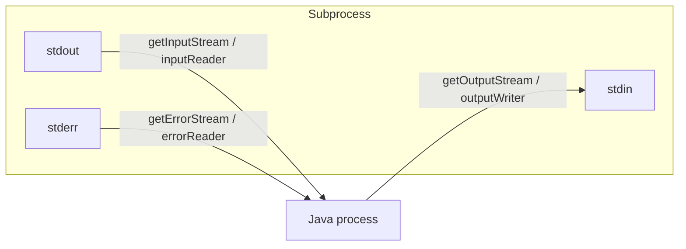
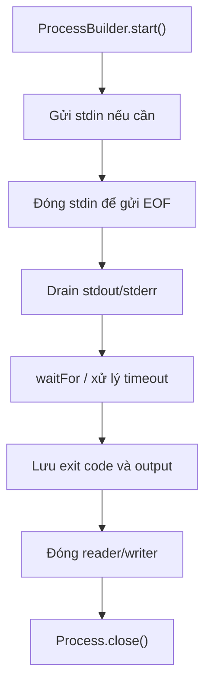

# Đọc dữ liệu cần giữ trước khi đóng

Khi chạy tiến trình con bằng `ProcessBuilder`, Java cung cấp các luồng để gửi dữ liệu vào tiến trình và đọc kết quả từ nó. Từ JDK 26, `Process` triển khai `Closeable`/`AutoCloseable`, nên có thể quản lý bằng `try`-with-resources. Tuy nhiên, `Process.close()` đóng toàn bộ reader/writer của tiến trình và chờ tiến trình kết thúc. Mọi dữ liệu còn chưa đọc hết từ standard output hoặc standard error sẽ bị loại bỏ.

Vì vậy, thứ tự xử lý rất quan trọng: **đọc và lưu stdout/stderr cần giữ, lấy exit code bằng `waitFor()`, rồi mới để `close()` giải phóng tài nguyên**. Nếu gọi `close()` quá sớm, bạn có thể mất output hoặc không còn lấy được trạng thái kết thúc theo cách đã định.

## 1. Ba luồng I/O của một Process

Khi `ProcessBuilder.start()` tạo tiến trình con, mặc định stdin, stdout và stderr của tiến trình con được nối với các pipe mà tiến trình Java cha có thể truy cập:

| Phía tiến trình con | API ở tiến trình Java cha | Hướng dữ liệu |
|---|---|---|
| Standard input (stdin) | `process.getOutputStream()` hoặc `process.outputWriter()` | Java cha ghi, tiến trình con đọc |
| Standard output (stdout) | `process.getInputStream()` hoặc `process.inputReader()` | Tiến trình con ghi, Java cha đọc |
| Standard error (stderr) | `process.getErrorStream()` hoặc `process.errorReader()` | Tiến trình con ghi, Java cha đọc |

Tên các phương thức dễ gây nhầm: `getOutputStream()` là luồng Java cha dùng để ghi vào stdin của tiến trình con; `getInputStream()` là luồng Java cha dùng để đọc stdout của tiến trình con.



Mỗi pipe có bộ đệm hữu hạn do nền tảng hệ điều hành quy định. Nếu tiến trình con ghi nhiều dữ liệu nhưng Java cha không đọc kịp, bộ đệm có thể đầy và tiến trình con bị chặn. Nếu Java cha đồng thời chờ `waitFor()` thay vì đọc output, cả hai phía có thể chờ nhau và tạo deadlock.

## 2. `Process.close()` trong JDK 26 làm gì?

Từ JDK 26, lớp `java.lang.Process` triển khai `Closeable` và `AutoCloseable`. Đây là API chính thức, không phải preview feature. Có thể viết:

```java
try (Process process = new ProcessBuilder("some-command").start()) {
    // Làm việc với tiến trình và các luồng I/O.
}
// Process.close() được gọi tự động khi rời khối.
```

Hợp đồng của `Process.close()`:

1. Đóng tất cả reader và writer stream gắn với tiến trình.
2. Chờ tiến trình kết thúc.
3. Nếu thread đang chờ trong `close()` bị interrupt, tiến trình bị hủy cưỡng bức; `close()` tiếp tục chờ đến khi tiến trình kết thúc và khôi phục trạng thái interrupt trước khi trả về hoặc ném `IOException`.
4. Gọi `close()` nhiều lần là an toàn theo hợp đồng idempotent; các lần gọi sau khi đã đóng không làm gì thêm.
5. Nếu đóng một hoặc nhiều stream gặp `IOException`, ngoại lệ được ném sau khi tiến trình đã kết thúc; các lỗi đóng stream tiếp theo được thêm dưới dạng suppressed exception.

Điểm quan trọng nhất trong Javadoc: nếu cần dữ liệu từ stdin/stdout/stderr của tiến trình, phải đọc dữ liệu đó trước khi gọi `close()`. Nội dung của stream chưa được đọc đến hết sẽ bị discard hoặc ignored. Nếu cần exit value, phải gọi `waitFor()` trước `close()`.

`close()` không trả về output và cũng không trả về exit code. Nó là bước đóng tài nguyên. Việc thu thập kết quả vẫn thuộc về ứng dụng.

### `close()` không đồng nghĩa với `destroy()`

`close()` đóng các stream rồi chờ tiến trình kết thúc. Việc đóng stdin thường làm tiến trình con nhận EOF và có thể kết thúc nếu nó đã đọc hết đầu vào. Nhưng không phải chương trình nào cũng thoát khi nhận EOF; tiến trình có thể tiếp tục chạy, chờ tài nguyên khác hoặc chạy vòng lặp nền. Trong trường hợp đó, `close()` có thể chờ rất lâu.

`destroy()` gửi yêu cầu kết thúc theo cách phụ thuộc nền tảng. `destroyForcibly()` yêu cầu kết thúc cưỡng bức, nhưng tiến trình có thể chưa biến mất ngay tức khắc. Khi cần deadline, hãy chờ có giới hạn, thử kết thúc bình thường, rồi mới dùng `destroyForcibly()` và `waitFor()` để xác nhận kết thúc.

Không nên trông chờ việc bỏ tham chiếu đến `Process` sẽ tự kết thúc tiến trình con. Tiến trình vẫn có thể tiếp tục chạy bất đồng bộ; hãy đóng rõ ràng các tài nguyên khi hoàn tất.

## 3. Đọc output và lấy exit code trước khi đóng

Với một chương trình đơn giản chỉ tạo output hữu hạn trên một luồng, có thể đọc đến EOF, chờ kết thúc và lưu exit code:

```java
import java.io.BufferedReader;
import java.io.IOException;
import java.nio.charset.StandardCharsets;
import java.util.List;

record ProcessResult(List<String> output, int exitCode) {}

static ProcessResult capture(List<String> command)
        throws IOException, InterruptedException {
    ProcessBuilder builder = new ProcessBuilder(command)
            .redirectErrorStream(true);

    try (Process process = builder.start();
         BufferedReader output =
                 process.inputReader(StandardCharsets.UTF_8)) {

        // Chỉ dùng cách đọc tuần tự này khi tiến trình không cần stdin
        // và stdout/stderr đã được gộp vào một pipe.
        process.getOutputStream().close();

        List<String> lines = output.readAllLines();
        int exitCode = process.waitFor();

        return new ProcessResult(lines, exitCode);
    }
}
```

`redirectErrorStream(true)` gộp stderr vào stdout, nên chỉ cần đọc một reader. Đóng `getOutputStream()` gửi EOF cho stdin; thao tác này phù hợp khi tiến trình không cần nhận thêm input. Nếu chương trình cần dữ liệu đầu vào, phải ghi và flush dữ liệu trước, sau đó đóng writer khi đã gửi xong để báo rằng không còn input.

Ở cuối khối `try`, `output` được đóng trước, sau đó `process.close()` được gọi. Lúc này output đã được đọc đến EOF và exit code đã được lưu. Vì vậy, việc đóng tài nguyên không làm mất dữ liệu đã thu thập.

Nếu cần giữ riêng stdout và stderr, không đọc hết stdout rồi mới đọc stderr một cách tuần tự khi tiến trình có thể ghi nhiều dữ liệu lên cả hai luồng. Hãy đọc hai luồng đồng thời.

## 4. Đọc stdout và stderr đồng thời để tránh deadlock

Ví dụ sau dùng virtual thread để drain cả hai pipe song song. Virtual thread đã là tính năng chính thức từ JDK 21; không cần preview flag trên JDK 26.

```java
import java.io.BufferedReader;
import java.io.IOException;
import java.nio.charset.StandardCharsets;
import java.util.List;
import java.util.concurrent.ExecutionException;
import java.util.concurrent.ExecutorService;
import java.util.concurrent.Executors;
import java.util.concurrent.Future;

record CapturedProcess(
        List<String> stdout,
        List<String> stderr,
        int exitCode) {}

static CapturedProcess captureBoth(List<String> command)
        throws IOException, InterruptedException, ExecutionException {

    try (Process process = new ProcessBuilder(command).start();
         BufferedReader stdout =
                 process.inputReader(StandardCharsets.UTF_8);
         BufferedReader stderr =
                 process.errorReader(StandardCharsets.UTF_8);
         ExecutorService readers =
                 Executors.newVirtualThreadPerTaskExecutor()) {

        // Ví dụ này chạy command không cần stdin.
        process.getOutputStream().close();

        Future<List<String>> stdoutResult =
                readers.submit(stdout::readAllLines);
        Future<List<String>> stderrResult =
                readers.submit(stderr::readAllLines);

        int exitCode;
        try {
            // Hai reader đang drain pipe trong khi tiến trình chạy.
            exitCode = process.waitFor();
        } catch (InterruptedException e) {
            process.destroyForcibly();
            Thread.currentThread().interrupt();
            throw e;
        }

        List<String> out = stdoutResult.get();
        List<String> err = stderrResult.get();
        return new CapturedProcess(out, err, exitCode);
    }
}
```

Hai tác vụ đọc bắt đầu trước `waitFor()`, do đó tiến trình con có thể tiếp tục ghi mà không bị kẹt vì một pipe đầy. Khi tiến trình kết thúc, các reader đọc nốt dữ liệu đến EOF; `Future.get()` lấy dữ liệu đã thu thập. Sau khi rời khối, executor, reader và cuối cùng `Process` được đóng theo thứ tự ngược với thứ tự khai báo tài nguyên.

Ví dụ dùng `readAllLines()` để dễ quan sát, nên toàn bộ output được giữ trong heap. Với output lớn hoặc không giới hạn, hãy xử lý từng dòng trong tác vụ reader, ghi ra file/consumer hoặc dùng `ProcessBuilder.redirectOutput(...)` và `redirectError(...)` để không giữ toàn bộ dữ liệu trong bộ nhớ.

## 5. Gửi stdin và báo EOF đúng lúc

Một số tiến trình chỉ trả kết quả sau khi đọc hết stdin. Nếu Java cha ghi dữ liệu nhưng không đóng writer, tiến trình con có thể tiếp tục chờ thêm input. Hãy ghi, flush nếu cần và đóng writer khi đã gửi xong:

```java
import java.io.BufferedReader;
import java.io.BufferedWriter;
import java.nio.charset.StandardCharsets;
import java.util.List;

static List<String> askProcess(List<String> command, String request)
        throws Exception {
    try (Process process = new ProcessBuilder(command).start();
         BufferedWriter input =
                 process.outputWriter(StandardCharsets.UTF_8);
         BufferedReader output =
                 process.inputReader(StandardCharsets.UTF_8)) {

        input.write(request);
        input.newLine();
        input.close(); // Gửi EOF; không ghi thêm dữ liệu sau điểm này.

        List<String> response = output.readAllLines();
        int exitCode = process.waitFor();
        if (exitCode != 0) {
            throw new IllegalStateException(
                    "Subprocess failed with exit code " + exitCode);
        }
        return response;
    }
}
```

Trong ví dụ, `input.close()` được gọi sớm để tiến trình con biết input đã hoàn tất. Khi khối `try` kết thúc, writer được đóng lần nữa theo cơ chế try-with-resources; việc đóng lại một stream thường không gây tác dụng phụ, nhưng hành vi cụ thể của stream vẫn là điều cần tuân theo.

Nếu vừa dùng `outputWriter()` vừa dùng `getOutputStream()` trên cùng tiến trình, cần gọi `flush()` trên writer trước khi ghi trực tiếp vào byte stream. Tốt hơn là chọn một API ghi duy nhất để tránh dữ liệu bị buffer và thứ tự ghi khó đoán.

## 6. Chọn reader, stream và charset

Java cung cấp hai cách đọc cho mỗi output:

| Dữ liệu | API byte | API ký tự |
|---|---|---|
| stdout | `getInputStream()` | `inputReader(Charset)` |
| stderr | `getErrorStream()` | `errorReader(Charset)` |
| stdin | `getOutputStream()` | `outputWriter(Charset)` |

Chỉ dùng một cách đọc cho mỗi luồng. Ví dụ, không dùng đồng thời `getInputStream()` và `inputReader()` trên cùng stdout. Reader có buffer riêng; nếu hai API cùng tiêu thụ một stream, byte đã đọc bởi API này không còn sẵn cho API kia và nội dung buffer có thể không dự đoán được. Quy tắc tương tự áp dụng cho stderr.

Các phương thức không nhận charset dùng `native.encoding` nếu hợp lệ, nếu không thì dùng charset mặc định của JVM. Với lệnh con có hợp đồng output UTF-8, hãy chỉ định `StandardCharsets.UTF_8` để tránh phụ thuộc locale của máy chạy. Nếu chương trình con phát output theo encoding hệ thống khác, chọn đúng charset mà chương trình đó sử dụng.

Reader được tạo lần đầu với một charset; gọi lại cùng phương thức với charset khác trên cùng `Process` sẽ gây `IllegalStateException`. Hãy thống nhất charset ngay khi mở reader.

## 7. Redirect output khi dữ liệu lớn hoặc không cần đọc trong Java

Nếu mục tiêu là lưu log hoặc artifact, có thể redirect trực tiếp sang file thay vì truyền qua pipe:

```java
import java.nio.file.Path;
import java.util.List;

static int runToFiles(List<String> command, Path stdoutFile, Path stderrFile)
        throws Exception {
    ProcessBuilder builder = new ProcessBuilder(command)
            .redirectOutput(stdoutFile.toFile())
            .redirectError(stderrFile.toFile());

    try (Process process = builder.start()) {
        int exitCode = process.waitFor();
        return exitCode;
    }
}
```

Khi stdout hoặc stderr được redirect ra file, `getInputStream()` hoặc `getErrorStream()` tương ứng trả về null input stream: đọc sẽ nhận EOF ngay. Dữ liệu nằm trong file do `ProcessBuilder` quản lý redirect. Chờ tiến trình kết thúc trước khi đọc file để bảo đảm tiến trình con đã hoàn tất ghi.

Nếu cần gộp hai luồng vào cùng một file hoặc pipe:

```java
ProcessBuilder builder = new ProcessBuilder(command)
        .redirectErrorStream(true)
        .redirectOutput(Path.of("process.log").toFile());
```

Khi `redirectErrorStream(true)`, stderr được nhập vào stdout; `getErrorStream()`/`errorReader()` trả về stream rỗng. Cách này đơn giản hóa việc thu thập, nhưng không còn phân biệt dòng nào đến từ stdout và dòng nào đến từ stderr. Thứ tự quan sát được là thứ tự ghi vào luồng hợp nhất, không phải một cấu trúc log có timestamp đáng tin cậy.

`inheritIO()` chuyển stdin/stdout/stderr của tiến trình con sang các luồng của tiến trình Java hiện tại. Đây là lựa chọn phù hợp khi muốn hiển thị trực tiếp ra console và không cần thu thập output trong code.

## 8. Lấy exit code trước khi đóng

`waitFor()` chờ tiến trình kết thúc và trả về exit code. Theo quy ước, `0` thường biểu thị thành công; giá trị khác `0` là trạng thái lỗi theo hợp đồng của chương trình con. `exitValue()` chỉ đọc trạng thái đã có; nếu tiến trình còn chạy, nó ném `IllegalThreadStateException`.

Để giới hạn thời gian chờ, dùng `waitFor(timeout, unit)` hoặc overload nhận `Duration`. Kết quả `true` nghĩa là tiến trình đã kết thúc trong thời hạn; `false` nghĩa là hết thời gian chờ. Khi `false`, không gọi `exitValue()` ngay vì tiến trình có thể vẫn đang chạy.

Một luồng xử lý timeout phổ biến:

```java
import java.util.concurrent.TimeUnit;

static int waitWithTimeout(Process process) throws InterruptedException {
    if (!process.waitFor(20, TimeUnit.SECONDS)) {
        process.destroy();
        if (!process.waitFor(2, TimeUnit.SECONDS)) {
            process.destroyForcibly();
        }
        process.waitFor();
    }
    return process.exitValue();
}
```

Hành vi `destroy()` phụ thuộc nền tảng và implementation; kiểm tra `supportsNormalTermination()` nếu chính sách ứng dụng phụ thuộc vào khả năng kết thúc bình thường. `destroyForcibly()` cũng có thể cần thời gian để hoàn tất, vì vậy vẫn gọi `waitFor()` sau đó. Chỉ khi tiến trình đã kết thúc mới đọc exit code và để `Process.close()` đóng tài nguyên còn lại.

`onExit()` cung cấp `CompletableFuture<Process>` hoàn tất khi tiến trình kết thúc, bất kể exit code. Có thể dùng để nối callback bất đồng bộ, sau đó đọc `exitValue()` hoặc gọi `waitFor()` để lấy mã thoát. Hủy `CompletableFuture` trả về từ `onExit()` không hủy tiến trình hệ điều hành.

## 9. Trình tự an toàn trước khi gọi close

Với một tiến trình có stdin/stdout/stderr được nối qua pipe, hãy dùng trình tự sau:

1. Khởi chạy bằng `ProcessBuilder.start()`.
2. Nếu cần gửi dữ liệu, ghi stdin, flush khi cần và đóng writer khi đã gửi xong để báo EOF.
3. Đọc stdout và stderr trong khi tiến trình chạy. Nếu giữ riêng hai luồng, drain đồng thời; nếu gộp, chỉ đọc luồng hợp nhất.
4. Nếu có deadline, chờ bằng `waitFor(timeout, unit)`; nếu hết hạn, áp dụng chính sách `destroy()`/`destroyForcibly()`.
5. Chờ tiến trình kết thúc và lưu exit code từ `waitFor()` hoặc `exitValue()`.
6. Hoàn tất việc đọc và lưu output/error cần giữ.
7. Đóng reader/writer và `Process`; `Process.close()` sẽ đóng các stream còn lại và chờ tiến trình kết thúc.

Không gọi `process.close()` trước bước 3 và 5 nếu dữ liệu output hoặc exit code cần được giữ. Nếu output được redirect ra file, đọc file sau khi tiến trình đã kết thúc và hoàn tất ghi.



## 10. Các trường hợp dễ mất dữ liệu hoặc treo

| Sai lầm | Hậu quả | Cách xử lý |
|---|---|---|
| Gọi `close()` trước khi đọc stdout/stderr | Phần output chưa đọc bị discard/ignored | Drain và lưu dữ liệu trước |
| Cần exit code nhưng chỉ gọi `close()` | `close()` không trả exit code | Gọi `waitFor()` trước close |
| Chờ `waitFor()` trong khi không đọc pipe | Pipe đầy, subprocess bị block; cha và con có thể deadlock | Drain đồng thời hoặc redirect |
| Đọc stdout hết rồi mới đọc stderr | Subprocess có thể bị kẹt vì stderr buffer đầy | Dùng hai reader đồng thời hoặc merge |
| Ghi stdin nhưng không đóng khi đã gửi xong | Tiến trình con tiếp tục chờ EOF | Đóng writer sau khi gửi input |
| Gọi `exitValue()` khi tiến trình còn chạy | `IllegalThreadStateException` | Chờ `waitFor()` hoặc `onExit()` |
| Giả định bỏ tham chiếu sẽ kill tiến trình | Process vẫn có thể chạy nền | Đóng hoặc hủy rõ ràng |
| Dùng `readAllLines()` cho output vô hạn | Heap tăng liên tục | Stream từng dòng hoặc redirect ra file |

Nếu tiến trình con tạo thêm tiến trình con khác, việc chấm dứt tiến trình cha không đồng nghĩa toàn bộ cây tiến trình đã kết thúc. `ProcessHandle.descendants()` trả về snapshot các hậu duệ tại thời điểm truy vấn; tiến trình có thể xuất hiện hoặc kết thúc đồng thời, vì vậy cần chính sách quản lý cây tiến trình rõ ràng nếu ứng dụng sở hữu các tiến trình con lồng nhau.

## 11. Khác biệt phiên bản và tính ổn định

| Phiên bản | Khả năng liên quan | Trạng thái |
|---|---|---|
| JDK 9 | `ProcessHandle`, `onExit()`, `children()`, `descendants()`, timeout overload của `waitFor` theo `TimeUnit`, `ProcessBuilder.startPipeline()` | API chính thức |
| JDK 17 | `inputReader`, `errorReader`, `outputWriter` và overload nhận `Charset` | API chính thức |
| JDK 21 | Virtual threads, có thể dùng để drain stdout/stderr đồng thời với chi phí thấp | API chính thức |
| JDK 24 | `waitFor(Duration)` | API chính thức |
| JDK 26 | `Process` triển khai `Closeable`/`AutoCloseable`; `Process.close()` đóng streams và chờ process exit | API chính thức, `Since: 26` |

Trên JDK 26, dùng trực tiếp `try (Process process = builder.start())`. Khi cần tương thích với JDK 25 hoặc cũ hơn, không thể dùng `Process` trong try-with-resources vì API `close()` chưa có ở các phiên bản đó; cần quản lý stream và vòng đời tiến trình bằng API của phiên bản đích. Không bật `--enable-preview` cho các API Process nêu trong bài vì chúng không phải preview feature.

## 12. Những điểm cần nhớ

- `getOutputStream()` ghi vào stdin của tiến trình con; `getInputStream()` đọc stdout; `getErrorStream()` đọc stderr.
- JDK 26 bổ sung `Process.close()` và khả năng dùng `Process` với try-with-resources.
- `close()` đóng reader/writer và chờ tiến trình kết thúc; dữ liệu chưa đọc hết từ stdout/stderr bị loại bỏ.
- Nếu cần exit code, gọi `waitFor()` trước `close()`; `exitValue()` chỉ dùng khi tiến trình đã kết thúc.
- Drain stdout/stderr trong lúc process chạy để tránh pipe đầy và deadlock; dùng hai reader đồng thời nếu cần tách hai luồng.
- Đóng stdin khi đã gửi đủ input để tiến trình con nhận EOF.
- Chọn rõ charset; không đọc cùng một pipe bằng cả stream và reader.
- Dùng redirect ra file hoặc xử lý streaming khi output lớn; không giữ output không giới hạn bằng `readAllLines()`.
- Nếu `close()` bị interrupt khi đang chờ, tiến trình bị hủy cưỡng bức và `close()` vẫn chờ hoàn tất.

## Tài liệu tham khảo

- [Java SE 26 API: `Process` — close, streams, waitFor, exitValue](https://docs.oracle.com/en/java/javase/26/docs/api/java.base/java/lang/Process.html)
- [Java SE 26 API: `ProcessBuilder` — redirects and merged output](https://docs.oracle.com/en/java/javase/26/docs/api/java.base/java/lang/ProcessBuilder.html)
- [Java SE 26 API: `ProcessHandle` — process tree and onExit](https://docs.oracle.com/en/java/javase/26/docs/api/java.base/java/lang/ProcessHandle.html)
- [Java SE 25 API: `Process` — comparison before AutoCloseable support](https://docs.oracle.com/en/java/javase/25/docs/api/java.base/java/lang/Process.html)
- [Java SE 26 Core Libraries Developer Guide: Redirecting Output from a Process](https://docs.oracle.com/en/java/javase/26/core/java-core-libraries-developer-guide.pdf)
