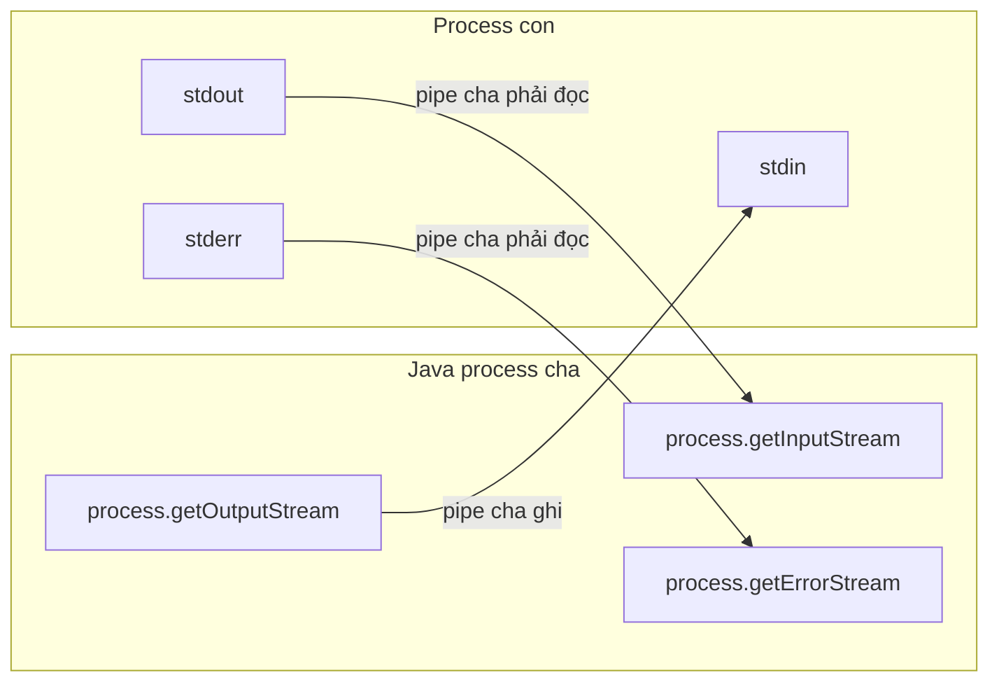
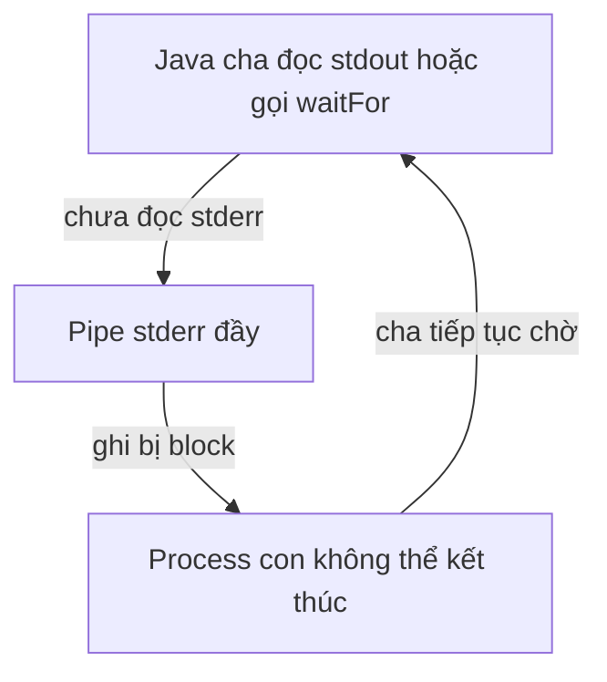

# Tránh đầy bộ đệm stdout, stderr gây chặn lẫn nhau

Khi Java khởi chạy tiến trình con bằng `ProcessBuilder`, JVM thường nối ba luồng chuẩn của tiến trình con với ba stream trong `Process`: stdin, stdout và stderr. Nếu chương trình con ghi nhiều dữ liệu hơn dung lượng pipe của hệ điều hành, thao tác ghi có thể bị chặn cho đến khi tiến trình cha đọc bớt dữ liệu. Nếu tiến trình cha lại đang chờ tiến trình con kết thúc hoặc đang đọc stream còn lại, cả hai có thể chờ nhau vô hạn.

Đây là một lỗi deadlock phổ biến khi gọi compiler, command-line tool, script, chương trình xử lý dữ liệu hoặc tiến trình con phát nhiều log. Cách giải quyết là **tiêu thụ stdout và stderr đồng thời trong suốt thời gian tiến trình chạy**, hoặc cấu hình redirect để không tạo pipe mà cha phải tự đọc. Không chờ `waitFor()` trước khi xử lý output.

## 1. Ba stream của Process được nhìn từ phía Java

Tên các phương thức dễ gây nhầm vì chúng được đặt theo góc nhìn của tiến trình Java đang quản lý `Process`:

| Phương thức | Dữ liệu thực tế | Hướng dữ liệu |
|---|---|---|
| `process.getOutputStream()` | stdin của tiến trình con | Java cha ghi → tiến trình con đọc |
| `process.getInputStream()` | stdout của tiến trình con | Tiến trình con ghi → Java cha đọc |
| `process.getErrorStream()` | stderr của tiến trình con | Tiến trình con ghi → Java cha đọc |

Khi dùng cấu hình mặc định của `ProcessBuilder`, stdout và stderr được nối với hai pipe riêng. Pipe có dung lượng hữu hạn do hệ điều hành quản lý; dung lượng chính xác phụ thuộc nền tảng và cấu hình, không nên giả định một con số cố định.



Khi một pipe đầy, tiến trình ghi vào pipe sẽ bị block cho tới khi có reader giải phóng chỗ trống. Java không tự động đọc stdout hoặc stderr thay ứng dụng khi các stream đang được nối vào pipe.

## 2. Vì sao waitFor() có thể gây deadlock?

### 2.1. Chờ tiến trình trước khi đọc output

Đoạn code sau có vẻ hợp lý nhưng không an toàn:

```java
Process process = new ProcessBuilder("some-command", "--verbose").start();

int exitCode = process.waitFor();
String output = new String(
        process.getInputStream().readAllBytes(),
        StandardCharsets.UTF_8);
```

Nếu chương trình con ghi đủ nhiều stdout, pipe stdout đầy. Chương trình con bị block trong thao tác ghi nên không thể kết thúc. Thread Java cha đang ở `waitFor()` nên không đọc pipe; nó tiếp tục chờ tiến trình con kết thúc. Hai bên chờ nhau và không có bên nào tiến triển.

### 2.2. Đọc stdout hết rồi mới đọc stderr

Chỉ đọc một stream trước cũng chưa đủ:

```java
String stdout = new String(
        process.getInputStream().readAllBytes(),
        StandardCharsets.UTF_8);

String stderr = new String(
        process.getErrorStream().readAllBytes(),
        StandardCharsets.UTF_8);

int exitCode = process.waitFor();
```

Giả sử tiến trình con ghi nhiều stderr trước khi đóng stdout. Pipe stderr đầy khiến tiến trình con dừng ghi. Thread cha đang đợi EOF của stdout nên chưa đọc stderr. Tiến trình con không thể tiếp tục tới lúc đóng stdout; thread cha không thể thấy EOF stdout; deadlock lại xảy ra.

### 2.3. Chu trình chờ lẫn nhau



Vấn đề không nằm ở `waitFor()` tự thân. Vấn đề là cha không tiêu thụ các pipe trong khi con vẫn có thể ghi vào chúng. `waitFor()` chỉ an toàn khi output đã được drain đồng thời hoặc đã redirect khỏi các pipe do cha quản lý.

## 3. Cách cơ bản: đọc stdout và stderr đồng thời

Tạo hai tác vụ đọc riêng, một tác vụ cho mỗi stream. Sau đó thread cha chờ tiến trình kết thúc và thu kết quả từ hai tác vụ đọc.

Trên JDK 21 trở lên, có thể dùng virtual thread executor. Virtual thread là API chính thức từ JDK 21 và không cần preview trên JDK 26:

```java
import java.io.IOException;
import java.nio.charset.StandardCharsets;
import java.util.concurrent.ExecutionException;
import java.util.concurrent.Executors;
import java.util.concurrent.Future;

Process process = new ProcessBuilder("some-command", "--verbose").start();

try (var readers = Executors.newVirtualThreadPerTaskExecutor()) {
    Future<byte[]> stdoutFuture = readers.submit(
            () -> process.getInputStream().readAllBytes());
    Future<byte[]> stderrFuture = readers.submit(
            () -> process.getErrorStream().readAllBytes());

    int exitCode = process.waitFor();
    byte[] stdoutBytes = stdoutFuture.get();
    byte[] stderrBytes = stderrFuture.get();

    String stdout = new String(stdoutBytes, StandardCharsets.UTF_8);
    String stderr = new String(stderrBytes, StandardCharsets.UTF_8);

    System.out.println("exit=" + exitCode);
    System.out.println("stdout=" + stdout);
    System.err.println("stderr=" + stderr);
}
```

Hai reader bắt đầu chạy ngay sau `start()`, nên cả hai pipe được tiêu thụ đồng thời trong khi tiến trình con đang hoạt động. Khi tiến trình con kết thúc, hai reader đọc đến EOF rồi `Future.get()` trả kết quả.

`Executors.newVirtualThreadPerTaskExecutor()` phù hợp khi có hai tác vụ I/O blocking nhỏ. Nếu ứng dụng cần hỗ trợ JDK cũ hơn JDK 21, có thể dùng `Executors.newFixedThreadPool(2)` với hai reader thread; nguyên tắc quan trọng là phải có ít nhất một reader độc lập cho mỗi pipe có thể được tiến trình con ghi đồng thời.

## 4. Ví dụ có timeout và kiểm tra exit code

Trong ứng dụng thật, không nên chờ tiến trình con vô hạn. Ví dụ sau đọc hai stream song song, đặt timeout cho tiến trình và chỉ lấy kết quả sau khi các reader đã nhận EOF:

```java
import java.io.IOException;
import java.time.Duration;
import java.util.List;
import java.util.concurrent.ExecutionException;
import java.util.concurrent.Executors;
import java.util.concurrent.Future;
import java.util.concurrent.TimeUnit;

record ProcessResult(int exitCode, byte[] stdout, byte[] stderr, boolean timedOut) {}

static ProcessResult runCommand(List<String> command, Duration timeout)
        throws IOException, InterruptedException, ExecutionException {

    Process process = new ProcessBuilder(command).start();

    try (var readers = Executors.newVirtualThreadPerTaskExecutor()) {
        Future<byte[]> stdoutFuture = readers.submit(
                () -> process.getInputStream().readAllBytes());
        Future<byte[]> stderrFuture = readers.submit(
                () -> process.getErrorStream().readAllBytes());

        try {
            boolean finished = process.waitFor(
                    timeout.toMillis(), TimeUnit.MILLISECONDS);

            if (!finished) {
                process.destroy();
                if (!process.waitFor(500, TimeUnit.MILLISECONDS)) {
                    process.destroyForcibly();
                    process.waitFor();
                }
            }

            byte[] stdout = stdoutFuture.get();
            byte[] stderr = stderrFuture.get();

            return new ProcessResult(
                    process.exitValue(), stdout, stderr, !finished);
        } catch (InterruptedException ex) {
            process.destroyForcibly();
            throw ex;
        } catch (ExecutionException ex) {
            process.destroyForcibly();
            throw ex;
        }
    }
}
```

Ví dụ giả định command chạy một tiến trình đơn, không để tiến trình cháu tiếp tục giữ stdout/stderr mở. Nếu command sinh process descendants, cần quản lý cả cây tiến trình; `Process.destroyForcibly()` chỉ nhắm tiến trình được đại diện bởi `Process`, không bảo đảm tự kết thúc mọi tiến trình con/cháu. Một descendant còn giữ đầu ghi của pipe có thể khiến reader không nhận EOF dù process cha đã thoát.

`waitFor(timeout, unit)` trả `false` khi hết thời gian mà process chưa kết thúc. Mẫu trên yêu cầu dừng process, chờ một khoảng ngắn rồi dùng `destroyForcibly()` nếu cần. Khi thread quản lý bị interrupt, nó yêu cầu dừng process và truyền tiếp `InterruptedException` để caller quyết định chính sách hủy.

Nếu cần bảo đảm dừng toàn bộ process tree, có thể lấy snapshot từ `process.descendants()` và yêu cầu dừng các `ProcessHandle` đó trước khi kết thúc process gốc. Trên Linux/macOS, với command phức tạp có thể cần quản lý process group; trên Windows có thể cần Job Object hoặc cơ chế quản lý process tree của môi trường triển khai. Không giả định `destroyForcibly()` trên process gốc tự động dọn sạch mọi descendant.

## 5. Không giữ toàn bộ output trong heap

`readAllBytes()` giải quyết deadlock do pipe đầy, nhưng lưu toàn bộ dữ liệu vào một `byte[]`. Nếu command tạo log không giới hạn hoặc xuất file lớn, cách này có thể làm heap tăng mạnh hoặc gây `OutOfMemoryError`.

Với output lớn, drain trực tiếp ra file bằng hai tác vụ đồng thời:

```java
import java.io.InputStream;
import java.io.OutputStream;
import java.nio.file.Files;
import java.nio.file.Path;
import java.util.concurrent.Executors;
import java.util.concurrent.Future;

Process process = new ProcessBuilder("data-export", "--all").start();
Path stdoutFile = Path.of("logs", "export.stdout.log");
Path stderrFile = Path.of("logs", "export.stderr.log");
Files.createDirectories(stdoutFile.getParent());

try (var readers = Executors.newVirtualThreadPerTaskExecutor()) {
    Future<?> stdoutCopy = readers.submit(() -> {
        try (InputStream in = process.getInputStream();
             OutputStream out = Files.newOutputStream(stdoutFile)) {
            in.transferTo(out);
        }
        return null;
    });

    Future<?> stderrCopy = readers.submit(() -> {
        try (InputStream in = process.getErrorStream();
             OutputStream out = Files.newOutputStream(stderrFile)) {
            in.transferTo(out);
        }
        return null;
    });

    int exitCode = process.waitFor();
    stdoutCopy.get();
    stderrCopy.get();
    System.out.println("exit=" + exitCode);
}
```

Reader vẫn tiêu thụ pipe liên tục, nhưng dữ liệu được ghi ra đĩa thay vì giữ trong heap. Cần kiểm soát dung lượng đĩa, quyền ghi và chính sách xoay vòng/xóa log. Nếu file output có thể tăng vô hạn, redirect ra file không giải quyết được vấn đề dung lượng; cần quota, giới hạn output ở phía child hoặc cơ chế lưu trữ có giới hạn.

Nếu chỉ cần giữ một phần đầu output để hiển thị lỗi, có thể lưu tối đa N byte đầu nhưng **vẫn phải tiếp tục đọc và bỏ phần dư cho tới EOF**. Dừng đọc ngay khi buffer đạt giới hạn sẽ khiến pipe đầy trở lại và tái tạo deadlock.

## 6. Khi không cần tách stdout và stderr

Nếu ứng dụng chỉ cần một luồng log chung, bật `redirectErrorStream(true)`:

```java
ProcessBuilder builder = new ProcessBuilder("some-command", "--verbose");
builder.redirectErrorStream(true);

Process process = builder.start();
try (var readers = Executors.newVirtualThreadPerTaskExecutor()) {
    Future<byte[]> outputFuture = readers.submit(
            () -> process.getInputStream().readAllBytes());

    int exitCode = process.waitFor();
    byte[] output = outputFuture.get();
}
```

stderr của tiến trình con được gộp vào stdout trước khi truyền về Java. Khi đó chỉ còn một pipe cần drain; `getErrorStream()` trả stream rỗng vì stderr đã được gộp. Cách này giảm số reader và giữ các dòng lỗi trong cùng output, nhưng không còn phân biệt được dữ liệu stdout với stderr sau khi gộp.

Không gộp nếu ứng dụng cần phân loại output để parse dữ liệu và log lỗi riêng, hoặc cần xử lý stdout theo giao thức máy đọc còn stderr dành cho thông báo chẩn đoán.

## 7. Redirect output để không tạo pipe trong Java cha

Nếu không cần đọc output trực tiếp trong chương trình, có thể giao việc chuyển hướng cho `ProcessBuilder`:

```java
Process process = new ProcessBuilder("some-command", "--verbose")
        .redirectOutput(ProcessBuilder.Redirect.to(Path.of("stdout.log").toFile()))
        .redirectError(ProcessBuilder.Redirect.to(Path.of("stderr.log").toFile()))
        .start();

int exitCode = process.waitFor();
```

Hoặc để tiến trình con dùng trực tiếp stdin/stdout/stderr của tiến trình Java cha:

```java
Process process = new ProcessBuilder("some-command", "--verbose")
        .inheritIO()
        .start();

int exitCode = process.waitFor();
```

Nếu output không cần giữ lại, có thể dùng `ProcessBuilder.Redirect.DISCARD` cho stdout và stderr trên các JDK hiện đại. Khi output đã được redirect ra file, inherit hoặc discard, Java cha không còn phải drain pipe tương ứng; `waitFor()` không bị deadlock do pipe stdout/stderr của `Process` đầy.

Lưu ý: redirect ra file có thể ghi đè file cũ nếu dùng `Redirect.to()`. Dùng `Redirect.appendTo()` khi cần nối tiếp log. `inheritIO()` đưa output vào console/log của tiến trình cha; hệ thống giám sát bên ngoài vẫn phải có khả năng tiêu thụ output đó.

## 8. Đừng quên stdin của tiến trình con

Deadlock hoặc chờ vô hạn cũng có thể xuất hiện ở chiều input. Nếu tiến trình con đọc stdin đến EOF nhưng Java cha không đóng `process.getOutputStream()`, child có thể chờ mãi dù cha đã ghi xong dữ liệu.

```java
Process process = new ProcessBuilder("some-command", "--read-stdin").start();

try (var childStdin = process.getOutputStream()) {
    childStdin.write("input data\n".getBytes(StandardCharsets.UTF_8));
    // Đóng stream phát EOF để child biết đã gửi xong input.
}

// Nếu child có thể ghi output, vẫn phải drain stdout và stderr đồng thời.
```

Đóng stdin chỉ gửi EOF cho child; nó không xử lý stdout/stderr. Nếu child vừa đọc stdin vừa ghi nhiều output, ứng dụng vẫn cần tổ chức writer và hai reader đồng thời để tránh tạo vòng chờ khác.

## 9. Chọn chiến lược theo nhu cầu

| Nhu cầu | Cách nên dùng | Đánh đổi |
|---|---|---|
| Cần parse stdout và giữ stderr riêng | Hai reader chạy đồng thời | Tốn hai tác vụ đọc, cần phối hợp vòng đời |
| Cần lưu output lớn | Hai reader stream ra hai file | Cần quản lý dung lượng đĩa và quyền file |
| Chỉ cần log chung | `redirectErrorStream(true)` và drain một stream | Mất phân biệt stdout/stderr |
| Không cần đọc output trong Java | `redirectOutput`, `redirectError`, `inheritIO` hoặc `DISCARD` | Không có dữ liệu trực tiếp trong `Process` để parse |
| Command có thời gian chạy không chắc chắn | `waitFor(timeout, unit)` và chính sách dừng process | Cần xử lý timeout và descendants |
| Child đọc input đến EOF | Đóng `process.getOutputStream()` sau khi ghi xong | Không thay thế việc drain output |

## 10. Checklist khi gọi tiến trình ngoài

- [ ] Xác định stdout/stderr đang là pipe, file, inherit hay discard.
- [ ] Nếu stdout và stderr là pipe, khởi động reader cho cả hai ngay sau `start()`.
- [ ] Không gọi `waitFor()` trước khi reader bắt đầu tiêu thụ dữ liệu.
- [ ] Không đọc tuần tự stdout rồi stderr nếu child có thể ghi cả hai stream.
- [ ] Với output lớn, stream ra file hoặc buffer giới hạn; nếu bỏ phần dư vẫn phải đọc tới EOF.
- [ ] Đặt timeout cho tiến trình có thể treo; dừng process và kiểm tra trạng thái sau timeout.
- [ ] Nếu command tạo process descendants, quản lý cả cây tiến trình vì descendants có thể giữ pipe mở.
- [ ] Đóng stdin của child sau khi gửi xong dữ liệu để truyền EOF nếu giao thức yêu cầu.
- [ ] Kiểm tra exit code và xử lý lỗi đọc stream qua `Future.get()`.
- [ ] Khi gộp stderr vào stdout, chắc chắn ứng dụng không cần phân biệt hai loại dữ liệu.

Virtual thread từ JDK 21 giúp tạo reader cho stdout và stderr với chi phí thấp, nhưng không tự động giải quyết pipe deadlock. Điều quyết định vẫn là phải tiêu thụ mọi pipe mà tiến trình con có thể ghi, trong suốt thời gian tiến trình chạy, và quản lý đúng vòng đời của process cùng các reader.

## Tài liệu tham khảo

- [Java SE 26 API: Process](https://docs.oracle.com/en/java/javase/26/docs/api/java.base/java/lang/Process.html)
- [Java SE 26 API: ProcessBuilder](https://docs.oracle.com/en/java/javase/26/docs/api/java.base/java/lang/ProcessBuilder.html)
- [Java SE 26 API: ProcessHandle](https://docs.oracle.com/en/java/javase/26/docs/api/java.base/java/lang/ProcessHandle.html)
- [Java SE 26 API: ExecutorService](https://docs.oracle.com/en/java/javase/26/docs/api/java.base/java/util/concurrent/ExecutorService.html)
- [JEP 444: Virtual Threads](https://openjdk.org/jeps/444)
