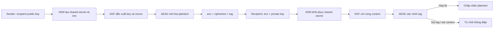

# Phát hiện bản mã bị thay đổi hoặc tham số không khớp

HPKE (*Hybrid Public Key Encryption*) không chỉ mã hóa dữ liệu. Nó kết hợp KEM, KDF và AEAD để người nhận vừa khôi phục được khóa phiên, vừa kiểm tra tính toàn vẹn và tính xác thực của từng thông điệp. Nếu byte của ciphertext, thẻ xác thực hoặc dữ liệu xác thực liên kết bị thay đổi, thao tác giải mã phải thất bại và ứng dụng không được sử dụng plaintext.

Khi tích hợp HPKE, một lỗi khó chẩn đoán thường xuất hiện dù hai bên đều dùng đúng private/public key: sender và recipient đã cấu hình khác `info`, ciphersuite, PSK, PSK ID, authentication key hoặc key encapsulation message. Một số sai lệch bị phát hiện ngay khi khởi tạo `Cipher`; một số khác chỉ biểu hiện ở bước xác thực AEAD khi gọi `doFinal()`.

Bài này dùng API HPKE chuẩn trong Java 26 để phân biệt hai giai đoạn lỗi, kiểm tra ciphertext bị sửa, kiểm tra tham số không khớp và thiết kế cách báo lỗi an toàn.

## 1. HPKE phát hiện thay đổi dữ liệu như thế nào?

HPKE theo RFC 9180 kết hợp ba thành phần:

1. **KEM (Key Encapsulation Mechanism):** sender dùng public key của recipient để tạo shared secret và thông điệp encapsulation `enc`; recipient dùng private key tương ứng cùng `enc` để khôi phục shared secret.
2. **KDF (Key Derivation Function):** hai bên dẫn xuất khóa AEAD, nonce cơ sở và exporter secret từ shared secret cùng context của HPKE.
3. **AEAD (Authenticated Encryption with Associated Data):** mã hóa plaintext và tạo thẻ xác thực. Khi giải mã, recipient kiểm tra thẻ trước khi chấp nhận plaintext.



Nếu ciphertext hoặc tag bị sửa, AEAD không xác minh được tag và `doFinal()` ném exception. Nếu dữ liệu tạo khóa khác nhau, hai bên có key/nonce khác nhau; tag cũng không hợp lệ. Ứng dụng không nên tự giải mã một phần, bỏ qua lỗi tag hoặc cố “cứu” plaintext bằng cách thử nhiều cấu hình.

HPKE dùng AEAD nên có cả tính bí mật và kiểm tra tính toàn vẹn của thông điệp. Tuy nhiên, chế độ `mode_base` không xác thực danh tính sender: bất kỳ ai có public key của recipient đều có thể tạo một HPKE ciphertext hợp lệ gửi cho recipient. Nếu cần xác thực nguồn gửi, phải dùng chế độ Auth/PSK/AuthPSK và quản lý khóa xác thực tương ứng.

## 2. Những thành phần phải khớp giữa sender và recipient

Hai bên phải tái tạo cùng HPKE context. Các tham số quan trọng gồm:

| Thành phần | Sender | Recipient | Nếu không khớp |
|---|---|---|---|
| KEM ID | Chọn KEM và public key recipient | Chọn cùng KEM và private key tương ứng | Có thể lỗi ngay ở `init()` nếu key không phù hợp; nếu decapsulation vẫn tạo output khác thì AEAD thất bại |
| KDF ID | Chọn cùng KDF | Chọn cùng KDF | Dẫn xuất key khác, thường thất bại ở `doFinal()` nếu cấu hình được chấp nhận |
| AEAD ID | Chọn cùng AEAD | Chọn cùng AEAD | Không giải mã được/tag không hợp lệ hoặc suite bị từ chối khi init |
| `enc` | Lấy từ `senderCipher.getIV()` sau khi init | Đưa vào `withEncapsulation(enc)` | Decapsulation có thể lỗi ở init hoặc chỉ tạo secret không khớp để AEAD phát hiện sau đó, tùy KEM |
| `info` | Dùng byte array theo giao thức ứng dụng | Dùng đúng byte array đó | Key schedule khác nhau; thường thất bại khi xác minh AEAD |
| PSK và `psk_id` | Cung cấp nếu dùng PSK/AuthPSK | Cùng PSK và cùng ID | Key schedule khác nhau; AEAD thất bại |
| Authentication key | Private key sender trong Auth mode | Public key sender tương ứng | Có thể bị phát hiện ở decapsulation hoặc khi AEAD xác minh |
| Per-message AAD | Gửi đúng dữ liệu AAD | Cung cấp đúng AAD trước ciphertext | AEAD xác minh thất bại |
| Thứ tự thông điệp | Gọi `doFinal()` theo thứ tự | Gọi `doFinal()` cùng thứ tự | Sequence number khác nhau, AEAD xác minh thất bại |

Các tham số cần khớp theo byte, không chỉ theo nội dung nhìn giống nhau. Ví dụ, chuỗi `"tenant-7"` mã hóa UTF-8 và một chuỗi cùng ký tự được mã hóa bằng charset khác không phải cùng byte array. Với `info`, PSK ID và AAD, hãy thống nhất encoding và serialization ở cả hai phía.

### 2.1. `enc` không phải ciphertext và không phải nonce AEAD

HPKE có hai dữ liệu thường được truyền riêng trong envelope:

- `enc`: thông điệp encapsulation do KEM tạo. Java cho phép lấy nó từ `senderCipher.getIV()` sau khi `init(ENCRYPT_MODE, ...)`.
- `ciphertext`: kết quả của `senderCipher.doFinal(plaintext)`, bao gồm dữ liệu mã hóa và phần tag xác thực AEAD.

Tên `getIV()` là API dùng chung của `Cipher`, nhưng với HPKE, giá trị này là KEM encapsulation message theo hợp đồng của `HPKEParameterSpec`; không nên tự xử lý nó như một IV AES-GCM thông thường. HPKE tự quản lý nonce theo sequence number nội bộ của context.

Nếu `enc` bị thay đổi, recipient có thể không decapsulate được hoặc tạo shared secret khác. Nếu ciphertext bị thay đổi, recipient không xác minh được tag. Cả hai trường hợp đều phải dẫn tới từ chối dữ liệu.

## 3. API HPKE trên Java 26

Java 26 bổ sung `javax.crypto.spec.HPKEParameterSpec` và chuẩn hóa tên cipher là `"HPKE"` trong JCA. API này là API Java SE 26 chính thức, không phải preview hoặc incubator; không cần `--enable-preview` hay `--add-modules`.

```java
Cipher sender = Cipher.getInstance("HPKE");
Cipher recipient = Cipher.getInstance("HPKE");
```

Không dùng tên transformation kiểu `"HPKE/GCM/NoPadding"`. HPKE tự xác định KEM, KDF và AEAD qua `HPKEParameterSpec`.

Tạo bộ tham số bằng `HPKEParameterSpec.of(kemId, kdfId, aeadId)`, rồi bổ sung các giá trị nếu cần:

- `withInfo(byte[])` cho application-supplied information.
- `withEncapsulation(byte[])` để cung cấp `enc` ở phía recipient.
- `withPsk(SecretKey, byte[])` cho PSK và PSK ID.
- `withAuthKey(AsymmetricKey)` cho khóa xác thực sender.

`HPKEParameterSpec` là immutable; các phương thức `with...` trả về một instance mới. `info`, `encapsulation` và `psk_id` được sao chép để tránh caller sửa mảng sau khi tạo spec.

Lưu ý khả năng provider: API định nghĩa các ID chuẩn, nhưng một HPKE implementation có thể hỗ trợ tất cả, một phần hoặc không hỗ trợ các ID đó. JDK 26 có HPKE trong SunJCE; khi dùng provider khác, hãy xác minh ciphersuite thực tế bằng integration test. Không giả định mọi provider đều hỗ trợ cùng KEM, KDF, AEAD hoặc các mode Auth.

## 4. Tạo một cặp thông điệp hợp lệ

Ví dụ sau dùng X25519, HKDF-SHA256 và AES-128-GCM theo ví dụ trong Java SE 26 Security Guide:

```java
import java.nio.charset.StandardCharsets;
import java.security.KeyPair;
import java.security.KeyPairGenerator;
import java.util.Arrays;
import javax.crypto.Cipher;
import javax.crypto.spec.HPKEParameterSpec;

KeyPairGenerator generator = KeyPairGenerator.getInstance("X25519");
KeyPair recipientKeys = generator.generateKeyPair();

byte[] info = "billing-service:invoice:v1"
        .getBytes(StandardCharsets.UTF_8);
byte[] plaintext = "Invoice 2026-0042"
        .getBytes(StandardCharsets.UTF_8);

HPKEParameterSpec senderParams = HPKEParameterSpec.of(
        HPKEParameterSpec.KEM_DHKEM_X25519_HKDF_SHA256,
        HPKEParameterSpec.KDF_HKDF_SHA256,
        HPKEParameterSpec.AEAD_AES_128_GCM)
    .withInfo(info);

Cipher sender = Cipher.getInstance("HPKE");
sender.init(Cipher.ENCRYPT_MODE, recipientKeys.getPublic(), senderParams);

// KEM encapsulation message: gửi cùng envelope với ciphertext.
byte[] enc = sender.getIV();
byte[] ciphertext = sender.doFinal(plaintext);

HPKEParameterSpec recipientParams = HPKEParameterSpec.of(
        HPKEParameterSpec.KEM_DHKEM_X25519_HKDF_SHA256,
        HPKEParameterSpec.KDF_HKDF_SHA256,
        HPKEParameterSpec.AEAD_AES_128_GCM)
    .withInfo(info)
    .withEncapsulation(enc);

Cipher recipient = Cipher.getInstance("HPKE");
recipient.init(Cipher.DECRYPT_MODE, recipientKeys.getPrivate(), recipientParams);

byte[] recovered = recipient.doFinal(ciphertext);
assert Arrays.equals(plaintext, recovered);
```

Trong ứng dụng, `enc`, ciphertext và metadata cần thiết phải được đóng gói thành một envelope có định dạng xác định. Ví dụ chỉ minh họa luồng API; không hard-code private key, PSK hoặc dữ liệu nhạy cảm vào source code.

## 5. Phát hiện ciphertext bị thay đổi

Thử thay đổi một byte trong ciphertext. Ví dụ dưới đây lật một bit ở byte cuối cùng; với ciphersuite AES-GCM, byte cuối thuộc vùng xác thực tag:

```java
import java.security.GeneralSecurityException;
import java.security.PrivateKey;
import javax.crypto.BadPaddingException;
import javax.crypto.Cipher;
import javax.crypto.spec.HPKEParameterSpec;

static byte[] decryptOnce(
        PrivateKey recipientPrivateKey,
        byte[] enc,
        byte[] info,
        byte[] ciphertext) throws GeneralSecurityException {

    HPKEParameterSpec params = HPKEParameterSpec.of(
            HPKEParameterSpec.KEM_DHKEM_X25519_HKDF_SHA256,
            HPKEParameterSpec.KDF_HKDF_SHA256,
            HPKEParameterSpec.AEAD_AES_128_GCM)
        .withInfo(info)
        .withEncapsulation(enc);

    Cipher recipient = Cipher.getInstance("HPKE");
    recipient.init(Cipher.DECRYPT_MODE, recipientPrivateKey, params);
    return recipient.doFinal(ciphertext);
}

byte[] tampered = ciphertext.clone();
tampered[tampered.length - 1] ^= 0x01;

try {
    byte[] unexpected = decryptOnce(
            recipientKeys.getPrivate(), enc, info, tampered);
    throw new AssertionError("Ciphertext was unexpectedly accepted");
} catch (BadPaddingException expected) {
    // AEAD authentication failed. Do not use any plaintext.
}
```

`BadPaddingException` là kiểu exception cha được khai báo bởi `Cipher.doFinal()` cho lỗi giải mã; một implementation AEAD có thể ném subtype `AEADBadTagException`. Bắt `BadPaddingException` giúp code xử lý được cả subtype đó mà không phụ thuộc provider cụ thể.

Không chỉ thay tag mới gây lỗi. Sửa bất kỳ byte nào trong ciphertext được xác thực đều phải khiến tag không khớp, trừ xác suất giả mạo không đáng kể theo bảo đảm mật mã của AEAD. Nếu ciphertext bị cắt ngắn hoặc sai định dạng, implementation cũng có thể báo `BadPaddingException`, `IllegalBlockSizeException` hoặc lỗi giải mã phù hợp khác. Không dựa vào đúng một exception subtype để phân loại chính xác nguyên nhân do attacker gây ra.

## 6. Phát hiện `info` không khớp

`info` tham gia vào HPKE key schedule để tách biệt mục đích sử dụng hoặc context của khóa. Hai bên phải dùng đúng cùng byte array. `info` không được gửi tự động trong ciphertext và không phải bí mật; ứng dụng phải tạo hoặc lấy giá trị này từ hợp đồng giao thức.

Ví dụ sender dùng `billing-service:invoice:v1`, nhưng recipient lại dùng `billing-service:invoice:v2`:

```java
byte[] wrongInfo = "billing-service:invoice:v2"
        .getBytes(StandardCharsets.UTF_8);

try {
    decryptOnce(recipientKeys.getPrivate(), enc, wrongInfo, ciphertext);
    throw new AssertionError("Mismatched info was unexpectedly accepted");
} catch (BadPaddingException expected) {
    // Hai bên dẫn xuất context/key khác nhau; AEAD không xác minh được tag.
}
```

Đây thường không phải lỗi cấu trúc `HPKEParameterSpec`, nên `Cipher.init()` vẫn có thể thành công. Sai lệch được phát hiện khi recipient kiểm tra ciphertext trong `doFinal()`.

Nên dùng `info` để gắn mục đích và context cấp phiên, ví dụ tên giao thức, phiên bản giao thức, tenant hoặc loại dữ liệu. Hãy serialize theo định dạng xác định, có version và encoding thống nhất; không nối các trường tùy ý mà không có phân cách/length prefix vì có thể tạo ra cùng một chuỗi byte cho hai bộ trường khác nhau.

RFC 9180 khuyến nghị giới hạn `info` tối đa 64 byte để bảo đảm khả năng tương thích. Hãy dùng cấu trúc ngắn, ổn định và có version; không đưa toàn bộ payload hoặc dữ liệu không giới hạn vào `info`.

## 7. Những sai lệch tham số khác

Không phải mọi sai lệch đều được phát hiện ở cùng thời điểm:

| Sai lệch | Thời điểm có thể phát hiện | Hành vi thường gặp |
|---|---|---|
| Thiếu `HPKEParameterSpec` | `Cipher.init()` | `InvalidKeyException` theo hợp đồng `HPKEParameterSpec` |
| Dùng sai loại key cho KEM hoặc key không phù hợp | `Cipher.init()` | `InvalidKeyException` |
| KEM/KDF/AEAD ID không được provider hỗ trợ | `Cipher.init()` | `InvalidAlgorithmParameterException` |
| Đưa `enc` vào phía sender hoặc thiếu `enc` phía recipient | `Cipher.init()` | `InvalidAlgorithmParameterException` |
| Gọi Auth mode với key không tương thích hoặc KEM không hỗ trợ mode đó | `Cipher.init()` | `InvalidAlgorithmParameterException` |
| `enc` bị sửa hoặc không hợp lệ | Decapsulation trong `init()` hoặc AEAD ở `doFinal()` | Tùy KEM/provider; không giả định luôn cùng một exception |
| `info` khác nhau | Thường ở `doFinal()` | `BadPaddingException`/lỗi xác thực AEAD |
| PSK hoặc `psk_id` khác nhau | Thường ở `doFinal()` | Context/key khác nhau, AEAD thất bại |
| Auth sender key không khớp | Có thể ở decapsulation hoặc `doFinal()` | Context không khớp, AEAD thất bại |
| Ciphertext/tag bị sửa | `doFinal()` | Lỗi xác thực AEAD |
| AAD khác nhau | `doFinal()` | Lỗi xác thực AEAD |
| Sai thứ tự hoặc bỏ mất message trong cùng context | `doFinal()` | Sequence number khác nhau, AEAD thất bại |

JDK 26 quy định `Cipher.init()` có thể ném `InvalidKeyException` nếu không có HPKE implementation hỗ trợ key type; `InvalidAlgorithmParameterException` nếu parameter spec không được chấp nhận, ví dụ ID không hỗ trợ, sai vai trò của encapsulation hoặc Auth mode không được KEM hỗ trợ.

RFC 9180 cũng lưu ý rằng không phải KEM nào cũng có thể kiểm tra một public key hoặc encapsulation không hợp lệ trước khi chạy AEAD. Một số lỗi decapsulation có thể biểu hiện thành lỗi xác thực ở bước `Open()`. Vì thế, ứng dụng nên xử lý mọi thất bại của quá trình HPKE như một kết quả từ chối thông điệp, thay vì cố suy ra chắc chắn attacker đã sửa byte nào.

## 8. Kiểm tra PSK và PSK ID

Khi dùng PSK mode, cả hai phía phải có cùng PSK và `psk_id`. PSK phải được tạo từ nguồn ngẫu nhiên an toàn và có ít nhất 32 byte entropy theo RFC 9180; `psk_id` là định danh công khai nhưng phải giống nhau ở cả hai phía. Java API kiểm tra một số điều kiện hình dạng như PSK không ngắn hơn 32 byte và PSK ID không rỗng; API không thể chứng minh entropy của khóa. RFC 9180 khuyến nghị giới hạn kích thước PSK và độ dài `psk_id` tối đa 64 byte để tương thích.

```java
HPKEParameterSpec senderParams = HPKEParameterSpec.of(
        HPKEParameterSpec.KEM_DHKEM_X25519_HKDF_SHA256,
        HPKEParameterSpec.KDF_HKDF_SHA256,
        HPKEParameterSpec.AEAD_AES_128_GCM)
    .withInfo(info)
    .withPsk(psk, pskId);

HPKEParameterSpec recipientParams = HPKEParameterSpec.of(
        HPKEParameterSpec.KEM_DHKEM_X25519_HKDF_SHA256,
        HPKEParameterSpec.KDF_HKDF_SHA256,
        HPKEParameterSpec.AEAD_AES_128_GCM)
    .withInfo(info)
    .withPsk(psk, pskId)
    .withEncapsulation(enc);
```

Nếu recipient dùng PSK khác hoặc `psk_id` khác, KDF context khác và AEAD không xác minh được ciphertext. Không ghi PSK hoặc nội dung bí mật của khóa vào log. PSK ID có thể dùng để tra cứu key trong kho bí mật, nhưng phải được xác thực trong context của HPKE.

## 9. Kiểm tra ciphersuite và key role

Một ciphersuite HPKE gồm ba ID: KEM, KDF và AEAD. Java 26 cung cấp hằng số để tránh ghi số ID trực tiếp:

```java
HPKEParameterSpec.KEM_DHKEM_X25519_HKDF_SHA256
HPKEParameterSpec.KDF_HKDF_SHA256
HPKEParameterSpec.AEAD_AES_128_GCM
```

Nếu sender dùng một suite khác recipient, provider có thể từ chối cấu hình ngay ở `init()`. Nếu cả hai suite đều được provider chấp nhận nhưng không giống nhau, recipient có thể dẫn xuất key khác và thất bại ở AEAD verification. Hãy lưu suite ID trong metadata envelope để recipient biết phải chọn suite nào, đồng thời áp dụng allowlist suite ở tầng giao thức.

Đừng dùng thử lần lượt nhiều suite cho cùng ciphertext cho tới khi một suite giải mã được. Việc fallback như vậy có thể tạo downgrade path và khiến protocol khó kiểm soát. Nếu cần thay đổi suite, hãy thương lượng/định nghĩa phiên bản giao thức rõ ràng và bind thông tin suite vào context đã xác thực.

Trong Auth mode, sender phải cấu hình private key xác thực của chính mình bằng `withAuthKey(senderPrivateKey)`; recipient phải dùng public key sender tương ứng. Nếu dùng nhầm public key của recipient hoặc một key khác, hai bên không tạo cùng context. RFC 9180 lưu ý một số sai lệch sender public key trong DHKEM Auth có thể chỉ được phát hiện khi AEAD decryption. Ứng dụng vẫn phải xác minh public key đó thuộc đúng danh tính sender qua PKI, pinning hoặc kho khóa tin cậy; HPKE không tự ánh xạ public key thành danh tính người dùng.

## 10. Dùng AAD để xác thực metadata của từng message

`info` phù hợp với context dùng chung cho một HPKE context. Với dữ liệu thay đổi theo từng message, có thể dùng Additional Authenticated Data (AAD) qua `Cipher.updateAAD()` trước khi đưa ciphertext vào `doFinal()`.

Ví dụ metadata như message type, record ID hoặc sequence number cần được bảo vệ nhưng không cần mã hóa:

```java
byte[] aad = "invoice:42:message:1"
        .getBytes(StandardCharsets.UTF_8);

sender.updateAAD(aad);
byte[] ciphertext = sender.doFinal(plaintext);

recipient.updateAAD(aad);
byte[] plaintextAgain = recipient.doFinal(ciphertext);
```

Hai bên phải cung cấp đúng cùng AAD. Gọi `updateAAD()` trước `update()` hoặc `doFinal()` của message tương ứng. Nếu AAD khác, tag không hợp lệ dù ciphertext không bị sửa.

AAD không được mã hóa, nên không đặt bí mật vào đó. Nó phù hợp cho metadata mà bên nhận cần đọc trước khi giải mã, nhưng muốn chắc chắn metadata không bị thay đổi. `info` và AAD không thay thế chữ ký số hoặc cơ chế xác thực danh tính sender trong Base mode.

## 11. Sequence number, thứ tự message và replay

Sau khi `Cipher` được khởi tạo, HPKE có thể xử lý nhiều message bằng các lần `doFinal()` liên tiếp. Mỗi lần gọi tạo hoặc sử dụng một nonce khác nhau từ sequence counter nội bộ. Recipient phải gọi `doFinal()` cho đúng một ciphertext hoàn chỉnh ở mỗi lần; số lượng và thứ tự lời gọi phải khớp với sender.

Điều đó có nghĩa:

- Không ghép ciphertext của nhiều message thành một lần `doFinal()`.
- Không đổi thứ tự ciphertext khi dùng cùng context.
- Không bỏ một message rồi tiếp tục giải mã message sau bằng cùng context như thể không có gì xảy ra.
- Không tạo một recipient context mới cho từng message nếu sender đang dùng một context duy nhất với sequence counter tăng dần.
- Nếu cần thử lại sau lỗi xác thực, tạo context/cipher mới và xử lý lại theo đúng sequence của giao thức; không giả định state của cipher sau exception vẫn có thể tiếp tục an toàn.

HPKE không tự cung cấp chống replay, chống mất message hoặc chống reorder ở tầng ứng dụng. Nếu hệ thống cần chống replay, hãy dùng message ID hoặc sequence number do ứng dụng quản lý, đưa giá trị đó vào AAD, rồi duy trì trạng thái đã xử lý một cách bền vững sau khi xác thực thành công. RFC 9180 cũng không tự ngăn downgrade; giao thức phải quy định chính sách suite và phiên bản.

## 12. Xử lý lỗi an toàn, tránh tạo oracle

Không phân biệt công khai lỗi “sai private key”, “ciphertext bị sửa”, “sai PSK” hoặc “sai info” cho một client không đáng tin cậy. Các tình huống đó có thể đều là một thông điệp không thể xác thực. Nếu API trả thông báo khác nhau hoặc thời gian xử lý khác biệt rõ rệt, attacker có thể thu thập thông tin về cấu hình hoặc trạng thái khóa.

Ở ranh giới giao thức, trả một kết quả chung như `invalid encrypted message`. Bên trong hệ thống, có thể ghi nhận nhóm lỗi kỹ thuật để vận hành, nhưng không log:

- Private key, PSK hoặc key material dẫn xuất.
- Plaintext trước khi tag được xác minh.
- Toàn bộ ciphertext hoặc encapsulation nếu chúng có thể chứa dữ liệu nhạy cảm của giao thức.
- Thông tin chi tiết giúp attacker phân biệt khóa, tenant hoặc ciphersuite bí mật.

Các exception thường cần xử lý:

| Exception | Ý nghĩa thực tế | Xử lý |
|---|---|---|
| `NoSuchAlgorithmException` | Provider không có cipher `HPKE` hoặc thuật toán được yêu cầu | Kiểm tra JDK/provider và cấu hình triển khai |
| `InvalidKeyException` | Key không phù hợp với KEM hoặc role | Kiểm tra key type, cặp public/private và hướng encrypt/decrypt |
| `InvalidAlgorithmParameterException` | HPKEParameterSpec không được chấp nhận | Kiểm tra ID, `enc`, PSK/Auth mode và khả năng provider |
| `BadPaddingException` | AEAD verification/decryption thất bại; có thể là tag mismatch | Từ chối toàn bộ message, không dùng plaintext |
| `AEADBadTagException` | Subtype cụ thể khi AEAD tag không hợp lệ | Xử lý như lỗi xác thực chung; không bắt buộc mọi provider phải ném subtype này |
| `IllegalBlockSizeException` | Dữ liệu không thể xử lý theo kích thước/format yêu cầu | Từ chối message, kiểm tra framing và độ dài |

Không bắt `GeneralSecurityException` rồi trả `null` hoặc chuỗi rỗng như thể giải mã thành công. Phân biệt rõ kết quả hợp lệ và lỗi xác thực. Nếu một message không được xác minh, mọi byte output liên quan phải bị bỏ và không được ghi vào database, gửi email hoặc thực hiện side effect.

## 13. Kiểm thử phát hiện tampering và mismatch

Một bộ integration test nên tạo context mới cho từng tình huống để không bị ảnh hưởng bởi sequence counter của lần giải mã trước. Các trường hợp cần có:

| Test case | Thao tác | Kết quả mong đợi |
|---|---|---|
| Round trip | Sender encrypt, recipient dùng đúng key/enc/suite/info | Plaintext khớp chính xác |
| Sửa byte ciphertext | Lật một bit trong body hoặc tag | `doFinal()` từ chối |
| Cắt ngắn ciphertext | Bỏ một phần byte/tag | Từ chối, không trả plaintext |
| Sửa `enc` | Thay một byte trong encapsulation | Decapsulation hoặc AEAD thất bại |
| Sai `info` | Recipient dùng byte array khác | AEAD thất bại |
| Sai PSK/PSK ID | Dùng PSK hoặc ID không khớp | AEAD thất bại |
| Sai recipient private key | Dùng key pair khác | Decapsulation hoặc AEAD thất bại |
| Sai suite | Thay KEM/KDF/AEAD ID | Init bị từ chối hoặc AEAD thất bại |
| Sai AAD | Hai phía dùng metadata khác nhau | AEAD thất bại |
| Đảo thứ tự message | Giải mã message thứ hai trước message thứ nhất trong cùng context | AEAD thất bại |
| Replay | Gửi lại một envelope đã xử lý | Ứng dụng từ chối bằng message ID/sequence store |

Test tampering không nên chỉ kiểm tra rằng “có exception bất kỳ” trong mọi trường hợp; hãy tách lỗi cấu hình provider ở `init()` khỏi lỗi xác thực message ở `doFinal()`. Tuy nhiên, không khẳng định mọi KEM/provider đều phát hiện malformed `enc` ở cùng giai đoạn.

Một kiểm thử tối thiểu cho `info` mismatch và ciphertext tamper nên tạo recipient `Cipher` mới mỗi lần:

```java
assertThrows(BadPaddingException.class, () ->
        decryptOnce(recipientKeys.getPrivate(), enc, wrongInfo, ciphertext));

assertThrows(BadPaddingException.class, () ->
        decryptOnce(recipientKeys.getPrivate(), enc, info, tampered));
```

`assertThrows` ở đây là JUnit assertion. Nếu provider trả về một lỗi khác theo hợp đồng cho một dạng encapsulation sai, hãy kiểm tra exception phù hợp với API của provider và vẫn yêu cầu không có plaintext được chấp nhận.

## 14. Checklist triển khai

- [ ] Dùng `Cipher.getInstance("HPKE")` và `HPKEParameterSpec` theo Java SE 26.
- [ ] Chọn KEM, KDF và AEAD ID rõ ràng; kiểm tra provider hỗ trợ ciphersuite đó.
- [ ] Sender dùng recipient public key; recipient dùng private key tương ứng.
- [ ] Truyền `enc` từ `senderCipher.getIV()` cùng envelope và đặt vào `withEncapsulation()` phía recipient.
- [ ] Đồng bộ `info`, PSK, PSK ID và authentication key đúng mode.
- [ ] Bind protocol version, message type, tenant/resource context vào `info` hoặc AAD theo thiết kế giao thức.
- [ ] Gọi `updateAAD()` trước dữ liệu ciphertext nếu dùng AAD.
- [ ] Chỉ chấp nhận plaintext sau khi `doFinal()` hoàn tất không có exception.
- [ ] Khi tag không hợp lệ hoặc tham số không khớp, từ chối toàn bộ message; không dùng plaintext một phần.
- [ ] Dùng thông báo lỗi bên ngoài thống nhất để tránh oracle.
- [ ] Dùng message ID/sequence bền vững nếu cần chống replay; HPKE không tự cung cấp replay protection.
- [ ] Giữ đúng số lượng và thứ tự `doFinal()` của hai phía trong cùng HPKE context.
- [ ] Kiểm thử tamper ciphertext, tag, `enc`, `info`, PSK, AAD, suite và sai thứ tự message.

## 15. Trạng thái API và điều kiện sử dụng trên JDK 26

`HPKEParameterSpec` có `Since: 26` trong Java SE API. Đây là API final của JDK 26, không cần preview hoặc incubator flag. Các ví dụ trong bài dùng `Cipher`, `KeyPairGenerator`, `HPKEParameterSpec` và các exception JCA chuẩn.

Khả năng thực thi ciphersuite vẫn phụ thuộc provider. `HPKEParameterSpec` định nghĩa các ID theo RFC 9180/IANA, nhưng API cho phép provider hỗ trợ tất cả, một phần hoặc không hỗ trợ các ID. Khi triển khai production, hãy xác minh JDK vendor, provider và ciphersuite trên đúng runtime image; không suy luận rằng code compile thành công đồng nghĩa suite đã được provider hỗ trợ.

HPKE là cơ chế mã hóa dữ liệu ở tầng ứng dụng, không thay thế TLS cho bảo vệ kênh truyền. Nếu cần xác thực peer, quản lý danh tính, chống replay, chống downgrade, phân quyền và xoay vòng khóa, các phần đó vẫn cần được thiết kế ở tầng giao thức/ứng dụng.

## Tài liệu tham khảo

- [Java SE 26 API: HPKEParameterSpec](https://docs.oracle.com/en/java/javase/26/docs/api/java.base/javax/crypto/spec/HPKEParameterSpec.html)
- [Java SE 26 API: Cipher](https://docs.oracle.com/en/java/javase/26/docs/api/java.base/javax/crypto/Cipher.html)
- [Java SE 26 API: AEADBadTagException](https://docs.oracle.com/en/java/javase/26/docs/api/java.base/javax/crypto/AEADBadTagException.html)
- [Java SE 26 Security Developer's Guide: Securely Exchanging Messages with HPKE](https://docs.oracle.com/en/java/javase/26/security/security-developer-guide.pdf)
- [Java SE 26 JDK Providers Documentation: SunJCE](https://docs.oracle.com/en/java/javase/26/security/oracle-providers.html)
- [RFC 9180: Hybrid Public Key Encryption, Sections 5, 8.2 and 9](https://www.rfc-editor.org/rfc/rfc9180.html)
