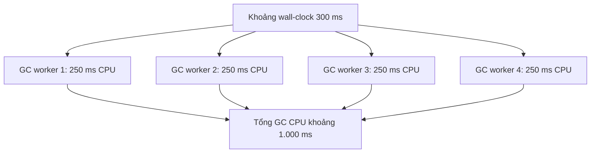

# MemoryMXBean.getTotalGcCpuTime và thời gian CPU dành cho GC

Garbage collection (GC) tiêu thụ CPU để tìm object không còn được tham chiếu, di chuyển object còn sống, xử lý reference và thực hiện các công việc nền của collector. Trong ứng dụng nhiều luồng, nhiều GC worker có thể chạy song song. Vì vậy, thời gian CPU GC không giống thời gian ứng dụng bị dừng để GC.

Java 26 bổ sung `MemoryMXBean.getTotalGcCpuTime()`, trả về tổng thời gian CPU ước lượng đã dành cho hoạt động GC, tính bằng nano giây. API này giúp theo dõi chi phí CPU của GC trên toàn JVM và có thể kết hợp với `com.sun.management.OperatingSystemMXBean.getProcessCpuTime()` để ước tính phần CPU của tiến trình Java được GC sử dụng.

`getTotalGcCpuTime()` là API chuẩn, final từ Java SE 26; không phải preview hoặc incubator. Cần phân biệt nó với `GarbageCollectorMXBean.getCollectionTime()`, vốn đo thời gian elapsed tích lũy theo từng collector.

## 1. CPU time của GC là gì?

CPU time đo lượng thời gian bộ xử lý thực sự chạy các thread, cộng dồn qua các thread liên quan. Wall-clock time đo thời gian thực trôi qua trên đồng hồ. Hai giá trị có thể khác nhau đáng kể khi GC chạy song song hoặc chạy đồng thời với application thread.

Ví dụ một GC cycle dùng bốn worker, mỗi worker tiêu thụ khoảng 250 ms CPU trong một khoảng wall-clock 300 ms. Tổng CPU time của các worker xấp xỉ 1 giây, dù người quan sát chỉ thấy khoảng 300 ms trôi qua. Tổng CPU time có thể lớn hơn wall-clock time vì nhiều lõi xử lý đồng thời.



Đây là ví dụ minh họa, không phải cách tính chính xác số worker hoặc thời gian của một collector cụ thể. Nó cho thấy vì sao tổng CPU time không thể được hiểu là thời gian pause của JVM.

## 2. API getTotalGcCpuTime trong Java 26

Lấy `MemoryMXBean` bằng `ManagementFactory.getMemoryMXBean()` và đọc giá trị:

```java
import java.lang.management.ManagementFactory;
import java.lang.management.MemoryMXBean;

MemoryMXBean memory = ManagementFactory.getMemoryMXBean();
long gcCpuNanos = memory.getTotalGcCpuTime();

if (gcCpuNanos >= 0) {
    double gcCpuMillis = gcCpuNanos / 1_000_000.0;
    System.out.printf("Accumulated GC CPU: %.3f ms%n", gcCpuMillis);
} else {
    System.out.println("GC CPU time is unavailable on this JVM");
}
```

`getTotalGcCpuTime()` có các đặc điểm quan trọng:

- Trả về tổng thời gian CPU tích lũy của hoạt động GC, đơn vị nano giây.
- Giá trị là ước lượng; độ chính xác thực tế phụ thuộc JVM và hệ điều hành.
- Trả về `-1` nếu nền tảng không hỗ trợ hoặc dữ liệu không khả dụng.
- Đây là default method của `MemoryMXBean`; implementation mặc định trả `-1`.
- Giá trị có thể khác 0 ngay cả khi chưa có một GC collection hoàn chỉnh, vì hoạt động nền và overhead liên quan GC cũng có thể tiêu thụ CPU.
- Trong HotSpot, cách tính bao gồm các chi tiết triển khai như driver threads, GC workers, VM Operations và string deduplication nếu tính năng đó được bật.
- Giá trị có thể trở thành `-1` khi phép đo không còn khả dụng, chẳng hạn trong giai đoạn JVM shutdown.

Không chuyển `-1` thành `0`. `0` có nghĩa bộ đếm đo được không tăng trong phạm vi quan sát; `-1` có nghĩa không có số liệu đáng tin cậy để sử dụng.

## 3. Lấy CPU time của toàn tiến trình Java

API `MemoryMXBean` cho biết CPU time dành cho GC. Để ước tính tỷ lệ GC trong tổng CPU mà tiến trình JVM sử dụng, có thể lấy thêm process CPU time từ `com.sun.management.OperatingSystemMXBean`:

```java
import java.lang.management.ManagementFactory;

var operatingSystem = ManagementFactory.getOperatingSystemMXBean();

long processCpuNanos =
        operatingSystem instanceof com.sun.management.OperatingSystemMXBean extended
                ? extended.getProcessCpuTime()
                : -1L;

if (processCpuNanos >= 0) {
    System.out.println("Process CPU ns: " + processCpuNanos);
} else {
    System.out.println("Process CPU time is unavailable");
}
```

`getProcessCpuTime()` trả về CPU time mà tiến trình chứa JVM đã sử dụng, tính bằng nano giây; trả `-1` nếu hệ điều hành không hỗ trợ. Giá trị có độ phân giải nano giây nhưng không nhất thiết đạt độ chính xác nano giây.

`com.sun.management.OperatingSystemMXBean` là extension của JDK trong module `jdk.management`, không phải interface Java SE portable. Phần `MemoryMXBean` nằm trong module `java.management`. Với ứng dụng modular chỉ dùng cả hai API, khai báo:

```java
module com.example.monitoring {
    requires java.management;
    requires jdk.management;
}
```

Nếu ứng dụng cần chạy trên runtime không có extension này, vẫn có thể đọc `getTotalGcCpuTime()`; chỉ phần tính tỷ lệ trên tổng process CPU cần bỏ qua khi `OperatingSystemMXBean` không hỗ trợ.

## 4. Tính phần trăm CPU của tiến trình dành cho GC

Hai giá trị `getTotalGcCpuTime()` và `getProcessCpuTime()` là bộ đếm tích lũy. Để đo một khoảng thời gian, lấy hai snapshot rồi tính hiệu số:

\[
\text{GC CPU share (\%)} =
\frac{\Delta \text{GC CPU time}}{\Delta \text{Process CPU time}} \times 100
\]

Không chia tổng GC CPU time từ lúc JVM khởi động cho process CPU time của một khoảng ngắn. Cả tử số và mẫu số phải là delta trong cùng cửa sổ đo.

Ví dụ triển khai snapshot và tính delta:

```java
import java.lang.management.ManagementFactory;
import java.lang.management.MemoryMXBean;

record CpuSnapshot(
        long wallNanos,
        long gcCpuNanos,
        long processCpuNanos) {}

final class GcCpuMonitor {
    private final MemoryMXBean memory = ManagementFactory.getMemoryMXBean();
    private final com.sun.management.OperatingSystemMXBean os;

    GcCpuMonitor() {
        var candidate = ManagementFactory.getOperatingSystemMXBean();
        this.os = candidate instanceof com.sun.management.OperatingSystemMXBean extended
                ? extended
                : null;
    }

    CpuSnapshot snapshot() {
        long wall = System.nanoTime();
        long gc = memory.getTotalGcCpuTime();
        long process = os == null ? -1L : os.getProcessCpuTime();
        return new CpuSnapshot(wall, gc, process);
    }

    static void report(CpuSnapshot before, CpuSnapshot after) {
        if (before.gcCpuNanos() < 0 || after.gcCpuNanos() < 0
                || before.processCpuNanos() < 0 || after.processCpuNanos() < 0) {
            System.out.println("CPU metrics are unsupported or unavailable");
            return;
        }

        if (after.gcCpuNanos() < before.gcCpuNanos()
                || after.processCpuNanos() < before.processCpuNanos()
                || after.wallNanos() <= before.wallNanos()) {
            System.out.println("Invalid sample window or counter reset");
            return;
        }

        long gcDelta = after.gcCpuNanos() - before.gcCpuNanos();
        long processDelta = after.processCpuNanos() - before.processCpuNanos();
        long wallDelta = after.wallNanos() - before.wallNanos();

        if (processDelta == 0) {
            System.out.println("Process CPU delta is too small to calculate a ratio");
            return;
        }

        double gcShare = 100.0 * gcDelta / processDelta;
        double gcCores = (double) gcDelta / wallDelta;

        System.out.printf("GC share of process CPU: %.2f%%%n", gcShare);
        System.out.printf("Average CPU cores used by GC: %.3f%n", gcCores);
    }
}
```

Sử dụng bằng cách gọi `snapshot()` ở hai thời điểm khác nhau trong cùng một JVM:

```java
GcCpuMonitor monitor = new GcCpuMonitor();

CpuSnapshot before = monitor.snapshot();
// Ứng dụng tiếp tục xử lý workload bình thường trong cửa sổ đo.
CpuSnapshot after = monitor.snapshot();

GcCpuMonitor.report(before, after);
```

Trong production, lấy snapshot theo chu kỳ bằng scheduler hoặc metrics collector. Không cần gọi `System.gc()` để tạo dữ liệu đo; thao tác đó làm thay đổi workload và có thể khiến kết quả không còn đại diện cho ứng dụng thật.

### 4.1. Hai tỷ lệ có ý nghĩa khác nhau

Trong code trên có hai chỉ số:

- `GC share of process CPU`: phần trăm CPU time của tiến trình Java được tính cho GC trong cửa sổ đo.
- `Average CPU cores used by GC`: tổng GC CPU time chia cho wall-clock elapsed time, biểu diễn số lõi CPU trung bình mà hoạt động GC tiêu thụ.

Ví dụ trong 10 giây wall-clock, GC dùng tổng cộng 2 giây CPU và tiến trình Java dùng tổng cộng 8 giây CPU:

| Chỉ số | Cách tính | Kết quả |
|---|---|---:|
| GC share của process | 2 / 8 × 100 | 25% |
| GC CPU cores trung bình | 2 / 10 | 0,2 core |

Không nhầm 25% process CPU với 25% tổng công suất máy. Process có thể chỉ được cấp một phần CPU của máy; container CPU quota cũng ảnh hưởng cách diễn giải. Nếu GC chạy song song trên nhiều core, `GC CPU / wall time` có thể lớn hơn 1, tức lớn hơn một core trung bình. Điều đó không có nghĩa thời gian pause vượt thời gian thực.

Các giá trị là số đo xấp xỉ và phụ thuộc implementation. Không nên clamp tỷ lệ về 0–100% hoặc coi một tỷ lệ vượt 100% là bằng chứng chắc chắn API sai; trước hết hãy kiểm tra cửa sổ lấy mẫu, runtime và cách implementation tính GC CPU.

## 5. Phân biệt GC CPU time với collection elapsed time

`GarbageCollectorMXBean` cung cấp hai phương thức lâu đời:

- `getCollectionCount()`: số lần collection tích lũy của collector đó.
- `getCollectionTime()`: thời gian elapsed tích lũy trong collection, đơn vị mili giây.

JDK 26 bổ sung `MemoryMXBean.getTotalGcCpuTime()` với một góc nhìn khác:

| Metric | API | Đơn vị | Phạm vi và ý nghĩa |
|---|---|---|---|
| GC CPU time | `MemoryMXBean.getTotalGcCpuTime()` | Nanosecond | CPU tích lũy cho mọi hoạt động GC theo implementation của JVM |
| Collection elapsed time | `GarbageCollectorMXBean.getCollectionTime()` | Millisecond | Thời gian elapsed tích lũy của từng collector MXBean |
| Collection count | `GarbageCollectorMXBean.getCollectionCount()` | Lần | Số collection của từng collector |
| Process CPU time | `com.sun.management.OperatingSystemMXBean.getProcessCpuTime()` | Nanosecond | CPU tích lũy của toàn tiến trình JVM |
| GC pause duration | GC log/JFR | Thường nanosecond hoặc millisecond tùy nguồn | Thời gian ứng dụng bị dừng ở các pha pause cụ thể |

`getCollectionTime()` không phải tổng CPU time của các GC worker. Nó cũng không phải chỉ số đầy đủ cho thời gian application bị dừng (*stop-the-world pause*), nhất là với collector có công việc concurrent. Khi cần phân tích latency và pause, dùng Unified Logging hoặc Java Flight Recorder; không suy ra pause trực tiếp từ `getTotalGcCpuTime()`.

Ví dụ đọc các collector riêng lẻ:

```java
import java.lang.management.GarbageCollectorMXBean;
import java.lang.management.ManagementFactory;

for (GarbageCollectorMXBean gc : ManagementFactory.getGarbageCollectorMXBeans()) {
    System.out.printf(
            "%s: count=%d, elapsed=%d ms%n",
            gc.getName(),
            gc.getCollectionCount(),
            gc.getCollectionTime());
}
```

Giá trị `-1` từ `getCollectionCount()` hoặc `getCollectionTime()` cũng biểu thị collector không cung cấp thông tin tương ứng. Không cộng thời gian của nhiều MXBean rồi xem kết quả là GC CPU time; dùng đúng metric theo mục tiêu đo.

## 6. HotSpot tính GC CPU time gồm những gì?

Java SE chỉ cam kết đây là ước lượng CPU time của hoạt động GC; chi tiết được để cho implementation quyết định. Với HotSpot, tài liệu JDK 26 nêu các thành phần có thể được tính gồm:

- Driver threads được GC dùng để điều phối công việc.
- Các GC worker thực hiện marking, copying, evacuation, compaction hoặc công việc liên quan collector.
- VM Operations liên quan đến hoạt động GC.
- String deduplication khi tính năng này được bật.
- Các overhead triển khai khác liên quan GC.

Vì metric bao gồm overhead, nó có thể tăng trong khi không có một collection event hoàn chỉnh. Một collector có công việc concurrent có thể tiêu thụ CPU nền mà không tạo ra một pause dài tương ứng. Do đó, metric phù hợp để theo dõi chi phí CPU tổng thể của GC hơn là chẩn đoán một pause cụ thể.

Các JVM vendor khác có thể định nghĩa phạm vi hoạt động được tính khác nhau. Nếu so sánh giữa HotSpot, OpenJ9 hoặc một runtime tùy biến, hãy kiểm tra tài liệu implementation và không mặc định các số đo có cùng semantics tuyệt đối.

## 7. Theo dõi qua JMX

`MemoryMXBean` là MXBean chuẩn của JVM, có ObjectName:

```text
java.lang:type=Memory
```

Trong JMX, getter `getTotalGcCpuTime()` được biểu diễn thành thuộc tính `TotalGcCpuTime`. Một client quản lý từ xa có thể đọc attribute này qua `MBeanServerConnection`:

```java
import java.lang.management.ManagementFactory;
import javax.management.MBeanServerConnection;
import javax.management.ObjectName;

ObjectName memoryName = new ObjectName(ManagementFactory.MEMORY_MXBEAN_NAME);
long gcCpuNanos = (Long) connection.getAttribute(
        memoryName,
        "TotalGcCpuTime");
```

`connection` ở đây là `MBeanServerConnection` đã được ứng dụng tạo sau khi kết nối tới MBeanServer cục bộ hoặc remote JMX. Cần kiểm tra `gcCpuNanos >= 0` như khi gọi API trực tiếp. Remote monitoring cũng phải lấy delta giữa các lần đọc; attribute không phải giá trị của riêng khoảng scrape gần nhất.

Nếu bật remote JMX trong production, cấu hình xác thực và mã hóa kết nối theo chính sách vận hành. Không mở cổng JMX không xác thực ra mạng công cộng chỉ để đọc một metric.

## 8. Tích hợp với metrics và dashboard

Một collector metrics có thể xuất các giá trị sau:

| Metric đề xuất | Loại | Ghi chú |
|---|---|---|
| `jvm_gc_cpu_time_seconds_total` | Counter | `getTotalGcCpuTime() / 1e9`; không xuất giá trị âm |
| `process_cpu_time_seconds_total` | Counter | `getProcessCpuTime() / 1e9`, nếu extension hỗ trợ |
| `jvm_gc_cpu_share` | Gauge | Tính từ delta GC CPU / delta process CPU trong một cửa sổ |
| `jvm_gc_cpu_cores` | Gauge | Delta GC CPU / delta wall time |
| `jvm_gc_collection_time_seconds_total` | Counter theo collector | Lấy từ `getCollectionTime()` và đổi ms sang giây |
| `jvm_gc_collection_count_total` | Counter theo collector | Lấy từ `getCollectionCount()` |

Nếu dùng Prometheus, giữ counter tích lũy làm nguồn dữ liệu và tính rate/delta ở hệ thống metrics. Không phát `-1` như một giá trị counter hợp lệ; đánh dấu metric unsupported/absent hoặc phát trạng thái availability riêng. Khi JVM restart, counter reset; backend cần xử lý reset theo semantics của counter.

Không gắn label có cardinality cao như request ID, user ID hoặc object name tùy ý vào metric GC. Dùng label ổn định như tên collector, service và instance theo quy ước giám sát của hệ thống.

## 9. Diễn giải số liệu khi tối ưu ứng dụng

GC CPU cao có thể xuất hiện do allocation rate cao, nhiều object ngắn hạn, live set lớn, heap quá nhỏ hoặc collector phải làm nhiều công việc concurrent. Chỉ số này không tự chứng minh memory leak. Một ứng dụng có throughput cao và allocation lớn có thể dùng nhiều CPU cho GC nhưng vẫn đáp ứng latency objective.

Đánh giá cùng các số liệu khác:

- **GC CPU share tăng, throughput giảm:** xem allocation rate, heap sizing, collector configuration và CPU quota.
- **GC CPU tăng nhưng pause thấp:** có thể collector đang làm nhiều công việc concurrent; xem thêm GC phase và CPU headroom.
- **GC CPU thấp nhưng pause dài:** có thể có một số pause hiếm nhưng nặng; xem pause distribution, không chỉ trung bình CPU.
- **Collection count tăng nhanh:** kiểm tra tần suất collection, kích thước heap và allocation pressure.
- **Heap sau GC tăng liên tục:** kiểm tra live set và khả năng giữ tham chiếu; GC CPU time riêng lẻ không xác định nguyên nhân giữ object.

Trước khi đổi collector hoặc tăng heap, đo baseline bằng workload đại diện, giữ nguyên CPU/memory limit và so sánh throughput, latency percentile, GC CPU share, pause time, allocation rate và heap after GC. Thay đổi một yếu tố mỗi lần để xác định tác động.

## 10. Khi cần thời gian pause, dùng GC log và JFR

Để đo thời gian thực mà application bị dừng, bật Unified Logging trong một lần chạy chẩn đoán:

```bash
java -Xlog:gc*,safepoint:file=gc.log:time,uptime,level,tags -jar app.jar
```

GC log cung cấp các sự kiện collection, phase và pause; safepoint log giúp thấy thời gian dừng tại safepoint. Có thể dùng JFR để ghi sự kiện GC và phân tích trong JDK Mission Control. Đây là các nguồn phù hợp khi điều tra tail latency, pause dài hoặc pha GC cụ thể.

Không thay thế GC log bằng `getTotalGcCpuTime()`: metric mới trả lời “GC tiêu thụ bao nhiêu CPU tích lũy?”, còn GC log/JFR trả lời “collection và pause diễn ra khi nào, kéo dài bao lâu và ở pha nào?”. Hai loại dữ liệu bổ sung cho nhau.

## 11. Giới hạn và lỗi triển khai thường gặp

| Lỗi | Vì sao sai | Cách xử lý |
|---|---|---|
| Xem `-1` là 0 | Không phân biệt unsupported với không tiêu thụ CPU | Kiểm tra `>= 0` và theo dõi trạng thái availability |
| Chia tổng GC CPU time cho process CPU time của một khoảng | Hai giá trị không cùng cửa sổ đo | Lấy hai snapshot và tính delta cho cả hai |
| Gọi metric là GC pause time | CPU time có thể cộng nhiều thread chạy song song | Dùng GC log/JFR để đo pause |
| So sánh trực tiếp với `getCollectionTime()` | Một bên là CPU time, bên kia là elapsed time theo collector | Giữ đơn vị và semantics riêng |
| Cho rằng GC CPU phải nhỏ hơn wall time | GC worker có thể chạy trên nhiều core | Tính average GC cores bằng delta GC CPU / delta wall |
| Coi số đo giống nhau trên mọi JVM | Phạm vi GC activity phụ thuộc implementation | Ghi nhận vendor, phiên bản và collector khi phân tích |
| Dùng số liệu trong lúc shutdown | Measurement có thể unavailable và trả `-1` | Bỏ mẫu không hợp lệ, không biến thành zero |
| Dùng một giá trị tuyệt đối để kết luận GC đang gây vấn đề | Không có cửa sổ thời gian hoặc workload đối chứng | Theo dõi rate/delta và kết hợp latency, throughput, heap |

## 12. Tương thích và trạng thái API

`MemoryMXBean.getTotalGcCpuTime()` có `Since: 26` trong Java SE API. Source code gọi trực tiếp phương thức cần biên dịch với JDK 26 trở lên. Đây là default method nên implementation MXBean không hỗ trợ có thể tiếp tục tương thích ở mức interface nhưng trả về `-1`.

Phần lấy process CPU time bằng `com.sun.management.OperatingSystemMXBean` là extension JDK trong module `jdk.management`. Nếu ứng dụng cần tính tỷ lệ GC/process CPU, hãy kiểm tra interface và giá trị trả về trước khi tính. Phần API chuẩn `MemoryMXBean` thuộc `java.management` và có thể được dùng độc lập.

Không cần `--enable-preview`, `--enable-native-access` hoặc incubator module để gọi `getTotalGcCpuTime()`. Khi dùng runtime không phải HotSpot, hãy kiểm tra implementation có hỗ trợ đo GC CPU và phạm vi được tính trước khi so sánh với số liệu HotSpot.

## 13. Checklist giám sát GC CPU

- [ ] Lấy `MemoryMXBean` qua `ManagementFactory.getMemoryMXBean()`.
- [ ] Kiểm tra `getTotalGcCpuTime()` không trả `-1` trước khi dùng.
- [ ] Ghi nhận giá trị tích lũy và tính delta giữa hai snapshot.
- [ ] Dùng `System.nanoTime()` để đo độ dài cửa sổ lấy mẫu.
- [ ] Nếu cần tỷ lệ process CPU, kiểm tra `com.sun.management.OperatingSystemMXBean` và `getProcessCpuTime()`.
- [ ] Tính GC share bằng delta GC CPU / delta process CPU; không trộn counter với giá trị cửa sổ.
- [ ] Tính average GC cores bằng delta GC CPU / delta wall time nếu cần hiểu mức song song.
- [ ] Theo dõi riêng `GarbageCollectorMXBean.getCollectionTime()` và `getCollectionCount()`.
- [ ] Dùng GC log/JFR khi cần phân tích pause, phase hoặc latency.
- [ ] So sánh trên cùng workload, JDK vendor/version, collector và CPU quota.
- [ ] Không xem metric này là bằng chứng memory leak hoặc nguyên nhân duy nhất của latency.

## Tài liệu tham khảo

- [Java SE 26 API: MemoryMXBean.getTotalGcCpuTime](https://docs.oracle.com/en/java/javase/26/docs/api/java.management/java/lang/management/MemoryMXBean.html#getTotalGcCpuTime())
- [Java SE 26 API: GarbageCollectorMXBean](https://docs.oracle.com/en/java/javase/26/docs/api/java.management/java/lang/management/GarbageCollectorMXBean.html)
- [Java SE 26 API: com.sun.management.OperatingSystemMXBean](https://docs.oracle.com/en/java/javase/26/docs/api/jdk.management/com/sun/management/OperatingSystemMXBean.html)
- [JDK 26 Release Notes: JDK-8368527 – Add an MXBeans method to query GC CPU time](https://www.oracle.com/java/technologies/javase/26-relnote-issues.html)
- [Java SE 26 Monitoring and Management Guide](https://docs.oracle.com/en/java/javase/26/management/java-se-monitoring-and-management-guide.pdf)
