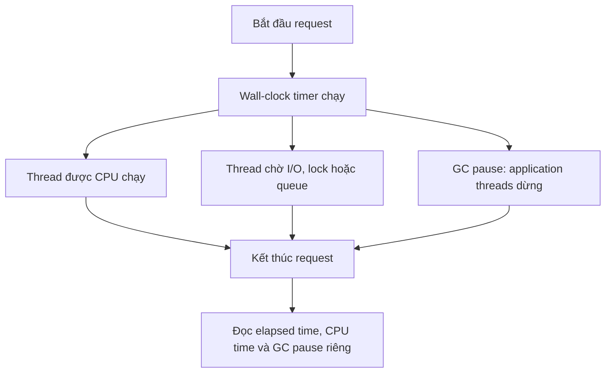

# Phân biệt CPU tích lũy, độ trễ GC và thời gian thực

Khi một dịch vụ Java phản hồi chậm, ba con số thường bị nhầm lẫn là CPU time, thời gian GC và thời gian thực (wall-clock elapsed time). Chúng đo ba khía cạnh khác nhau:

- **CPU time tích lũy** đo lượng thời gian CPU thực sự chạy các thread của tiến trình hoặc một thread cụ thể.
- **GC pause time** đo khoảng thời gian ứng dụng bị dừng để garbage collector thực hiện các pha cần stop-the-world.
- **Wall-clock elapsed time** đo khoảng thời gian trôi qua từ lúc bắt đầu đến lúc kết thúc một thao tác, chẳng hạn một request.

Không thể cộng hoặc thay thế ba số đo này cho nhau. Một request có thể mất 500 ms theo wall clock, chỉ tiêu thụ 40 ms CPU, và chịu 20 ms GC pause; phần thời gian còn lại có thể là chờ mạng, chờ database, chờ lock, xếp hàng hoặc bị hệ điều hành trì hoãn. Trong một JVM nhiều luồng, tổng CPU time còn có thể lớn hơn wall-clock elapsed time vì nhiều thread chạy đồng thời trên nhiều core.

Các API và công cụ trong bài là những khả năng ổn định có sẵn trên JDK 26; đây không phải các API preview/incubator mới của riêng JDK 26. Mục tiêu là đọc đúng số đo và chọn công cụ chẩn đoán phù hợp.

## 1. Ba loại thời gian trả lời ba câu hỏi khác nhau

| Số đo | Câu hỏi cần trả lời | Đơn vị thường dùng | Bao gồm |
|---|---|---|---|
| Process/thread CPU time | CPU đã thực thi bao nhiêu thời gian? | ns, ms, CPU-seconds | Thời gian thread thực sự được CPU chạy |
| GC pause time | Ứng dụng bị dừng vì GC trong bao lâu? | ms, phần trăm thời gian | Các pha GC làm application threads dừng |
| Wall-clock elapsed | Người dùng phải chờ bao lâu? | ms, s | CPU, I/O, lock, queue, scheduler delay, GC pause và các khoảng chờ khác |

Ví dụ, một request mất 400 ms từ lúc nhận đến lúc trả response. Thread xử lý request tiêu thụ 55 ms CPU. Trong cùng khoảng thời gian, JVM có một GC cycle kéo dài 900 ms nhưng tổng các pause của cycle đó chỉ là 18 ms. Ba con số này không mâu thuẫn:

- Request mất 400 ms theo thời gian trôi qua.
- Thread xử lý request chỉ chạy trên CPU 55 ms; phần còn lại có thể chờ I/O, lock hoặc scheduler.
- GC làm ứng dụng dừng tổng cộng 18 ms trong khoảng đo có liên quan. Phần lớn 900 ms của GC cycle có thể là công việc concurrent diễn ra khi ứng dụng vẫn tiếp tục chạy.



Wall-clock là thời gian trôi qua bên ngoài tiến trình. CPU time chỉ tăng khi thread thực sự được CPU chạy. GC pause là một phần của khoảng wall-clock mà ứng dụng bị dừng; nó không phải một lượng CPU time tương đương.

## 2. CPU time tích lũy của process và thread

CPU time thường là bộ đếm tích lũy kể từ khi process hoặc thread bắt đầu được đo. Để biết CPU tiêu thụ trong một khoảng, lấy hiệu giữa hai lần đọc:

\[
\Delta CPU = CPU_{sau} - CPU_{trước}
\]

Ví dụ, process có CPU time từ 12,4 giây tăng lên 15,1 giây trong một khoảng wall-clock 2 giây. Process đã tiêu thụ 2,7 CPU-seconds trong 2 giây thực. Điều đó tương đương trung bình 1,35 core chạy liên tục trong khoảng đó.

Với process nhiều luồng, tổng CPU time có thể tăng nhanh hơn đồng hồ wall-clock vì nhiều thread có thể chạy song song. CPU time không phải thời gian request và cũng không phải phần trăm CPU tức thời.

### Process CPU time với OperatingSystemMXBean

JDK cung cấp phần mở rộng `com.sun.management.OperatingSystemMXBean` trong module `jdk.management`. `getProcessCpuTime()` trả về CPU time tích lũy của tiến trình JVM theo nanosecond; trả `-1` nếu nền tảng không hỗ trợ. `getProcessCpuLoad()` trả về mức sử dụng CPU gần đây của tiến trình trong khoảng 0.0 đến 1.0; giá trị âm có nghĩa là không có số đo.

Ứng dụng dùng module explicit cần khai báo `requires jdk.management;` trong `module-info.java` để truy cập phần mở rộng này. Đây là API quản lý riêng của JDK; nếu cần tính di động giữa các implementation JVM, phải kiểm tra khả năng hỗ trợ lúc chạy.

```java
import java.lang.management.ManagementFactory;

static void measureProcessCpu(Runnable operation) {
    var os = ManagementFactory.getOperatingSystemMXBean();

    if (!(os instanceof com.sun.management.OperatingSystemMXBean bean)) {
        System.out.println("Process CPU time is not available");
        return;
    }

    long wallStart = System.nanoTime();
    long cpuStart = bean.getProcessCpuTime();

    operation.run();

    long cpuEnd = bean.getProcessCpuTime();
    long wallEnd = System.nanoTime();

    if (cpuStart < 0 || cpuEnd < 0 || wallEnd <= wallStart) {
        System.out.println("CPU measurement is unavailable");
        return;
    }

    long cpuDelta = cpuEnd - cpuStart;
    long wallDelta = wallEnd - wallStart;
    double coresUsed = (double) cpuDelta / wallDelta;
    double normalizedPercent =
            100.0 * coresUsed / os.getAvailableProcessors();

    System.out.printf(
            "elapsed=%.2f ms, process CPU=%.2f ms, cores=%.2f, normalized=%.1f%%%n",
            wallDelta / 1_000_000.0,
            cpuDelta / 1_000_000.0,
            coresUsed,
            normalizedPercent);
}
```

`coresUsed` là số core trung bình mà process tiêu thụ trong khoảng đo. `normalizedPercent` chuẩn hóa theo số processor JVM nhìn thấy. Ví dụ, 1,5 core trên môi trường có 4 processor tương đương khoảng 37,5% tổng năng lực CPU mà JVM nhìn thấy. Nếu cần đối chiếu với giới hạn CPU quota của container, hãy kiểm tra thêm quota thực tế của môi trường triển khai.

`getProcessCpuLoad()` là số đo gần đây, không phải bộ đếm tích lũy. Khoảng quan sát do implementation quyết định và lần gọi đầu tiên chưa có khoảng tham chiếu xác định. Không nên diễn giải một lần gọi đơn lẻ thành CPU load ổn định. `getCpuLoad()` mô tả mức sử dụng CPU của toàn bộ môi trường; `getProcessCpuLoad()` chỉ mô tả process JVM, bao gồm cả application threads lẫn các thread nội bộ của JVM như GC và JIT.

### Thread CPU time với ThreadMXBean

`java.lang.management.ThreadMXBean` có thể đo CPU time của platform thread. `getCurrentThreadCpuTime()` trả về CPU time tích lũy của platform thread hiện tại; `getThreadCpuTime(threadId)` đọc một platform thread khác nếu JVM hỗ trợ. Các giá trị có độ chính xác biểu diễn nanosecond nhưng không bảo đảm độ chính xác thực tế đến từng nanosecond.

```java
import java.lang.management.ManagementFactory;
import java.lang.management.ThreadMXBean;

static void measureCurrentPlatformThread(Runnable operation) {
    if (Thread.currentThread().isVirtual()) {
        System.out.println("ThreadMXBean does not measure virtual threads");
        return;
    }

    ThreadMXBean threads = ManagementFactory.getThreadMXBean();

    if (!threads.isCurrentThreadCpuTimeSupported()) {
        System.out.println("Current-thread CPU time is not supported");
        return;
    }

    if (!threads.isThreadCpuTimeEnabled()) {
        threads.setThreadCpuTimeEnabled(true);
    }

    long cpuStart = threads.getCurrentThreadCpuTime();
    long wallStart = System.nanoTime();

    operation.run();

    long wallEnd = System.nanoTime();
    long cpuEnd = threads.getCurrentThreadCpuTime();

    if (cpuStart < 0 || cpuEnd < 0) {
        System.out.println("Thread CPU time is unavailable");
        return;
    }

    System.out.printf(
            "thread elapsed=%.2f ms, thread CPU=%.2f ms%n",
            (wallEnd - wallStart) / 1_000_000.0,
            (cpuEnd - cpuStart) / 1_000_000.0);
}
```

Có một giới hạn quan trọng: `ThreadMXBean` không đo virtual threads. Nếu request bắt đầu trên virtual thread, tạm dừng ở I/O và tiếp tục trên carrier thread, số đo thread CPU của API này không đại diện cho toàn bộ công việc request. Với ứng dụng dùng virtual threads hoặc xử lý bất đồng bộ qua nhiều thread, hãy đo elapsed time ở ranh giới request và dùng JFR để phân tích CPU ở cấp JVM.

Việc bật thread CPU-time measurement có thể tốn chi phí trên một số JVM. Kiểm tra `isThreadCpuTimeSupported()` và `isThreadCpuTimeEnabled()` trước khi sử dụng; không bật rồi lấy mẫu dày đặc trong mọi request nếu chưa đo overhead.

## 3. Wall-clock elapsed time và thời gian phản hồi

Wall-clock elapsed time là thời gian trôi qua giữa hai mốc của một thao tác. Đối với request HTTP, nên đo từ lúc server nhận request đến lúc response hoàn tất hoặc được gửi đi theo định nghĩa metric của hệ thống. Đối với một đoạn code đồng bộ, đo từ trước đến sau khi gọi.

Dùng `System.nanoTime()` để đo khoảng thời gian:

```java
long start = System.nanoTime();
try {
    performOperation();
} finally {
    long elapsedNanos = System.nanoTime() - start;
    System.out.printf("elapsed=%.2f ms%n",
            elapsedNanos / 1_000_000.0);
}
```

`System.nanoTime()` là nguồn thời gian độ phân giải cao với mốc gốc tùy ý. Giá trị của nó chỉ có ý nghĩa khi lấy hiệu giữa hai lần gọi trong cùng JVM. Không dùng giá trị tuyệt đối của `nanoTime()` làm timestamp hoặc gửi sang máy khác để so sánh.

`System.currentTimeMillis()` và `Instant.now()` phù hợp để ghi timestamp cho log, audit hoặc sự kiện trên dòng thời gian. Chúng biểu diễn thời điểm theo đồng hồ hệ thống; đồng hồ có thể được điều chỉnh. Vì vậy, không dùng phép trừ `currentTimeMillis()` để đo thời lượng chính xác hoặc timeout.

Một request có thể trải qua nhiều thread, queue và lời gọi dịch vụ bên ngoài. Khi đó, đo CPU time của một thread không đại diện cho toàn bộ request. Dùng distributed tracing hoặc span metrics để đo end-to-end latency và từng đoạn chờ; dùng CPU time/JFR để tìm nơi process hoặc JVM đang tiêu thụ tài nguyên.

## 4. GC cycle duration khác GC pause time

Garbage collector có thể thực hiện một phần công việc trong khi application threads vẫn chạy. Vì vậy, thời gian từ lúc bắt đầu một GC cycle đến lúc kết thúc cycle không đồng nghĩa với thời gian ứng dụng bị dừng.

| Số đo GC | Ý nghĩa | Dùng để đánh giá |
|---|---|---|
| GC cycle duration | Thời gian toàn bộ một chu kỳ GC, có thể gồm pha concurrent | GC đang hoạt động trong bao lâu |
| GC pause duration | Thời gian một pha stop-the-world làm application threads dừng | Tác động trực tiếp lên latency |
| Sum of pauses | Tổng thời gian pause trong một GC hoặc một cửa sổ đo | Tỷ lệ thời gian ứng dụng bị dừng |
| Maximum/p99 pause | Pause lớn nhất hoặc phân vị cao của các pause | Các đợt latency spike |
| GC CPU consumption | CPU mà GC threads tiêu thụ | Ảnh hưởng throughput và cạnh tranh CPU |

Ví dụ một concurrent GC cycle kéo dài 2,8 giây nhưng tổng các pha pause chỉ là 65 ms. Không được kết luận ứng dụng bị dừng 2,8 giây. Nếu cửa sổ đo là 10 giây, tỷ lệ pause của GC trong cửa sổ đó là:

\[
\text{GC pause ratio} =
\frac{65\text{ ms}}{10\,000\text{ ms}}\times100
=0.65\%
\]

Tuy nhiên, một pause đơn lẻ 45 ms vẫn có thể ảnh hưởng đáng kể đến request có latency budget 30 ms. Vì vậy, cần xem cả tổng pause, phân phối pause và tương quan thời điểm với request latency.

Trong Java Flight Recorder, sự kiện `jdk.GCPhasePause` ghi nhận thời lượng của pha pause. Có thể nhóm các sự kiện theo `gcId` để tính tổng pause của từng GC, sau đó tính tổng, trung bình, maximum và phân vị trên cửa sổ quan sát. Sự kiện `jdk.GarbageCollection` mô tả GC event/cycle; không lấy toàn bộ duration của cycle làm pause duration.

## 5. Đọc User, Sys và Real trong GC log

GC log có thể cung cấp thông tin CPU và elapsed time cho từng pause. Khi dùng `gc+cpu=info`, log có thể hiển thị:

```text
User=0.19s Sys=0.00s Real=0.01s
```

- `User`: CPU time chạy mã ở user mode.
- `Sys`: CPU time chạy mã trong kernel/OS.
- `Real`: thời gian thực trôi qua của khoảng pause.

`User + Sys` có thể lớn hơn `Real` khi GC chạy song song trên nhiều core. Ví dụ 0,19 giây CPU time trong 0,01 giây real time không có nghĩa pause kéo dài 190 ms; nó có thể phản ánh nhiều GC worker cùng tiêu thụ CPU trong 10 ms.

Nếu `Real` lớn hơn nhiều so với `User + Sys`, JVM có thể đã không được cấp đủ CPU trong khoảng đó hoặc môi trường gặp stall. Cần kiểm tra CPU contention, container quota, tải hệ điều hành, memory pressure và I/O thay vì chỉ tăng heap hoặc đổi collector.

Có thể bật unified logging hiện hành bằng:

```bash
java \
  -Xlog:gc*,gc+cpu=info,safepoint:file=gc.log:time,uptime,level,tags:filecount=5,filesize=20M \
  -jar application.jar
```

Unified Logging cho phép lọc tag, mức log, output và rotation. Cấu hình trên ghi GC, thông tin CPU của GC và safepoint ra file có rotation. Mức log chi tiết hơn có thể tăng lượng I/O và dung lượng log; chọn mức cần thiết cho môi trường đo.

## 6. Dùng JFR để xem CPU, GC và các khoảng chờ

Java Flight Recorder (JFR) là framework ghi sự kiện và profiling được tích hợp trong HotSpot. Dùng JFR để đối chiếu CPU load, thread activity, GC pauses và các sự kiện làm thread phải chờ.

Các sự kiện hữu ích:

| JFR event | Nội dung |
|---|---|
| `jdk.CPULoad` | CPU load của JVM process và toàn bộ máy theo thời gian |
| `jdk.ThreadCPULoad` | Mẫu CPU/method activity theo thread |
| `jdk.GarbageCollection` | Thông tin GC event/cycle |
| `jdk.GCPhasePause` | Các pha GC làm ứng dụng dừng |
| `jdk.JavaMonitorEnter`, `jdk.JavaMonitorWait` | Chờ monitor và tranh chấp đồng bộ |
| `jdk.ThreadPark`, `jdk.ThreadSleep` | Thread bị park hoặc sleep |
| `jdk.SocketRead`, `jdk.SocketWrite` | Thời gian đọc/ghi socket |
| `jdk.FileRead`, `jdk.FileWrite` | Thời gian đọc/ghi file |

Với JVM đang chạy, có thể tạo recording có thời hạn bằng `jcmd`:

```bash
jcmd <pid> JFR.start name=performance settings=profile duration=120s filename=performance.jfr
```

Sau khi recording hoàn tất, in các event cần phân tích:

```bash
jfr print --events jdk.CPULoad,jdk.ThreadCPULoad,jdk.GarbageCollection,jdk.GCPhasePause performance.jfr
```

Mở file `.jfr` bằng JDK Mission Control (JMC) để xem CPU, GC pauses, hot methods, thread, lock và I/O theo dòng thời gian. JMC được phân phối riêng, không nằm trong cài đặt JDK thông thường; `jcmd`, `jfr` và JFR runtime được cung cấp cùng JDK.

`jdk.ThreadCPULoad` dựa trên method sampling, không phải bộ đếm CPU time chính xác cho từng thread. Thread đang chờ I/O, ngủ hoặc chờ lock không được lấy mẫu như thread đang chạy code. Khi số mẫu thấp, kết luận về hot method hoặc thread tiêu thụ CPU có thể chưa đáng tin. Dùng sampling để tìm khu vực cần điều tra, sau đó xác nhận bằng số đo và workload phù hợp.

JFR recording liên tục với template `default` có overhead thấp và hữu ích cho điều tra sau sự cố. Template `profile` thu thập nhiều dữ liệu hơn, phù hợp một đợt profiling có thời hạn nhưng có thể tạo overhead cao hơn. Đo overhead trong môi trường gần production trước khi dùng lâu dài. Không bật Heap Statistics khi đang đo latency thông thường vì tùy chọn này có thể kích hoạt old GC ở đầu và cuối recording, làm thay đổi chính số đo cần quan sát.

## 7. Đọc các mẫu số đo để tìm bottleneck

| Quan sát | Diễn giải có thể | Bước điều tra tiếp theo |
|---|---|---|
| Wall latency cao, process CPU cao | Có thể CPU-bound hoặc GC/JIT đang cạnh tranh CPU | Xem `jdk.CPULoad`, `jdk.ThreadCPULoad`, hot methods và GC CPU |
| Wall latency cao, process CPU thấp | Thread có thể đang chờ I/O, lock, queue hoặc scheduler | Xem socket/file events, monitor wait, park và trace spans |
| GC cycle dài, tổng pause thấp | Collector đang làm nhiều việc concurrent | Xem allocation rate, GC CPU và throughput |
| GC pause lớn trùng request p99 spike | GC pause có thể là nguyên nhân trực tiếp | Đối chiếu timestamp, `gcId`, `jdk.GCPhasePause` và request trace |
| GC pause thấp nhưng process CPU cao | Có thể allocation rate cao hoặc concurrent GC tiêu thụ CPU | Xem allocation events, GC worker CPU và hot methods |
| CPU process thấp, CPU máy cao | Process khác đang cạnh tranh tài nguyên máy | Kiểm tra process khác và giới hạn tài nguyên của container/host |
| Average latency ổn nhưng p99 tăng | Một số request bị pause, chờ lock/I/O hoặc queue lâu | Phân tích histogram, trace và event theo đúng cửa sổ spike |

Không kết luận GC là nguyên nhân chỉ vì GC cycle dài xuất hiện gần một request chậm. Hãy kiểm tra pause có thực sự chồng lên khoảng request bị chậm không. Với concurrent collector, cycle có thể chạy nền trong lúc request chậm do database hoặc lock.

Tương tự, process CPU thấp không đồng nghĩa ứng dụng khỏe. Một thread bị kẹt chờ lock có thể làm request latency tăng mạnh trong khi CPU gần như nhàn rỗi. CPU cao cũng không tự chứng minh GC gây chậm; code nghiệp vụ, serialization, regex, crypto hoặc JIT có thể đang dùng CPU.

## 8. Quy trình đo và so sánh trước/sau khi tối ưu

Để kết quả có thể so sánh:

1. Xác định đúng cửa sổ đo, endpoint, workload, số request và mức concurrency.
2. Ghi nhận wall-clock latency theo histogram: p50, p95, p99 và maximum; không chỉ lấy trung bình.
3. Lấy process CPU time ở đầu và cuối cửa sổ để tính CPU-seconds và số core trung bình.
4. Nếu cần phân tích thread, kiểm tra hỗ trợ của `ThreadMXBean`; nhớ rằng API này chỉ đo platform threads.
5. Thu JFR recording để phân tích CPU sampling, GC pause, lock, park và I/O.
6. Thu GC unified log với rotation để đối chiếu pause, safepoint và `User/Sys/Real`.
7. Đối chiếu các mốc timestamp trên cùng timeline; chỉ quy nguyên nhân khi có tương quan và bằng chứng hỗ trợ.
8. Thay đổi một yếu tố mỗi lần, chạy lại cùng workload và so sánh cùng loại số đo.

Khi benchmark, giữ cùng JDK build, GC, heap, container CPU/memory limit, dữ liệu và tải. Tách startup/warmup khỏi steady state nếu ứng dụng có JIT warmup. Không so sánh CPU percentage từ hai môi trường có số core hoặc quota khác nhau mà không chuẩn hóa.

## 9. Những lỗi đo lường thường gặp

- Dùng `System.currentTimeMillis()` để benchmark một đoạn code ngắn; độ phân giải đồng hồ và việc điều chỉnh system clock có thể làm sai kết quả elapsed time.
- Đọc `getProcessCpuTime()` một lần rồi gọi đó là CPU load; đây là bộ đếm tích lũy, cần lấy hiệu giữa hai mẫu.
- Coi `getProcessCpuLoad()` là CPU load của toàn bộ máy; nó chỉ đo process JVM.
- Cộng CPU time của nhiều thread rồi so trực tiếp với request elapsed như thể chúng phải bằng nhau; thread có thể chạy song song và CPU time có thể lớn hơn elapsed.
- Dùng `ThreadMXBean` để kết luận CPU của virtual threads; API này không đo virtual threads.
- Dùng toàn bộ GC cycle duration làm GC pause; cần đo các pha pause, ví dụ `jdk.GCPhasePause`.
- Chỉ nhìn average GC pause; một pause maximum hoặc p99 có thể gây latency spike dù tổng pause thấp.
- Bật JFR Heap Statistics trong lúc đo latency; các old GC được kích hoạt có thể làm nhiễu kết quả.
- Bật sampling/GC log chi tiết mà không đo overhead; chính công cụ có thể làm thay đổi tải CPU và I/O.
- Kết luận request chậm vì GC chỉ dựa vào hai biểu đồ cùng tăng; cần đối chiếu timestamp và khoảng pause thật.

## 10. Trạng thái API và công cụ trên JDK 26

| API/công cụ | Phạm vi | Trạng thái |
|---|---|---|
| `System.nanoTime()` | Đo elapsed time trong cùng JVM | API chính thức |
| `System.currentTimeMillis()` / `Instant` | Timestamp và thời điểm lịch | API chính thức |
| `ThreadMXBean` | CPU time và trạng thái platform threads | API chính thức; không hỗ trợ virtual threads |
| `com.sun.management.OperatingSystemMXBean` | Process CPU time/load và thông tin OS | Public JDK management extension; kiểm tra hỗ trợ ở runtime |
| JFR / `jfr` / `jcmd` | Recording và phân tích runtime events | Công cụ chính thức trong JDK |
| JDK Mission Control | Phân tích recording bằng giao diện | Công cụ phân phối riêng |
| Unified Logging `-Xlog` | GC, safepoint và các log JVM | Cơ chế logging hiện hành của HotSpot |

Các số đo này không cung cấp bảo đảm hard real-time. `Wall-clock elapsed` chỉ là thời gian trôi qua mà ứng dụng quan sát được; JVM chạy trên hệ điều hành thông thường vẫn chịu ảnh hưởng của scheduler, CPU quota, I/O và các tiến trình khác.

## 11. Những điểm cần nhớ

- CPU time là lượng CPU đã dùng; wall-clock là thời gian người dùng chờ; GC pause là phần ứng dụng bị dừng do GC.
- Lấy hiệu hai mẫu CPU time để tính mức tiêu thụ trong một cửa sổ; process CPU time có thể vượt elapsed time khi nhiều core chạy song song.
- Dùng `System.nanoTime()` cho duration và timeout; dùng `Instant`/`currentTimeMillis()` cho timestamp.
- `ThreadMXBean` chỉ đo platform threads; không dùng nó để đo CPU của virtual threads hoặc request chạy qua nhiều thread.
- GC cycle duration có thể bao gồm công việc concurrent; dùng `jdk.GCPhasePause` và tổng pause để đánh giá tác động trực tiếp lên latency.
- Trong GC log, `User + Sys` có thể lớn hơn `Real` vì GC chạy song song; `Real` là elapsed time của khoảng pause.
- Dùng JFR để kết hợp CPU load, thread sampling, GC pause, lock và I/O trên cùng timeline.
- Đối chiếu p95/p99 request latency với pause events và các sự kiện chờ; không kết luận nguyên nhân chỉ từ một metric.
- Các API/công cụ trong bài là khả năng ổn định trên JDK 26, không cần preview flag.

## Tài liệu tham khảo

- [Java SE 26 API: System.nanoTime()](https://docs.oracle.com/en/java/javase/26/docs/api/java.base/java/lang/System.html#nanoTime())
- [Java SE 26 API: ThreadMXBean](https://docs.oracle.com/en/java/javase/26/docs/api/java.management/java/lang/management/ThreadMXBean.html)
- [Java SE 26 API: com.sun.management.OperatingSystemMXBean](https://docs.oracle.com/en/java/javase/26/docs/api/jdk.management/com/sun/management/OperatingSystemMXBean.html)
- [Java SE 26 Troubleshooting Guide: Troubleshoot Performance Issues Using Flight Recorder](https://docs.oracle.com/en/java/javase/26/troubleshoot/troubleshoot-performance-issues-using-jfr.html)
- [Java SE 26 Troubleshooting Guide: Diagnostic Tools](https://docs.oracle.com/en/java/javase/26/troubleshoot/diagnostic-tools.html)
- [Java SE 26 Garbage Collection Tuning Guide: G1 Unusual System or Real-Time Usage](https://docs.oracle.com/en/java/javase/26/gctuning/garbage-first-garbage-collector-tuning.html)
- [Java SE 26 java command: Unified Logging and GC logging options](https://docs.oracle.com/en/java/javase/26/docs/specs/man/java.html)
