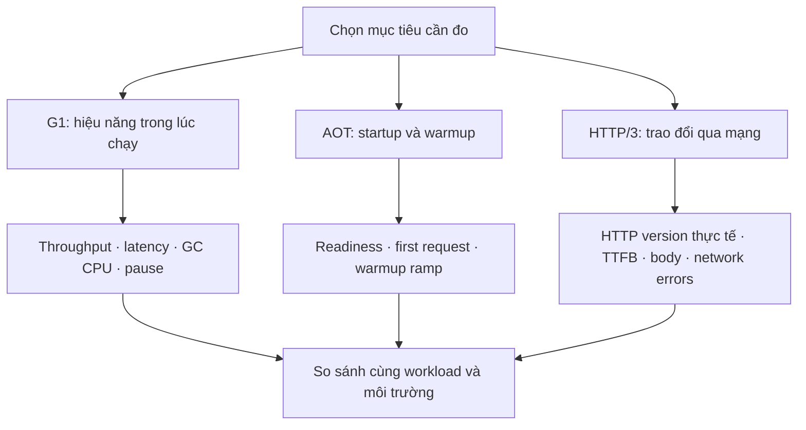

# Đo G1, AOT và HTTP/3 theo các mục tiêu riêng

Java 26 có ba cải tiến thường được nhắc cùng nhau khi tối ưu ứng dụng: G1 giảm đồng bộ để tăng throughput, AOT cache hỗ trợ mọi garbage collector để cải thiện startup/warmup, và `HttpClient` bổ sung HTTP/3 để giao tiếp qua QUIC. Ba thay đổi này tác động lên ba phần khác nhau của hệ thống. Nếu chỉ nhìn một con số “ứng dụng nhanh hơn”, rất khó biết cải tiến nào tạo ra kết quả và có đáng giữ trong production hay không.

Hãy đo từng mục tiêu riêng:

- **G1:** ứng dụng xử lý được bao nhiêu công việc, latency và pause GC thay đổi ra sao, GC tiêu thụ bao nhiêu CPU.
- **AOT:** tiến trình sẵn sàng phục vụ nhanh hơn bao nhiêu, request đầu tiên và giai đoạn warmup cải thiện thế nào.
- **HTTP/3:** request thực sự dùng phiên bản HTTP nào, thời gian nhận response và truyền body thay đổi ra sao trên cùng điều kiện mạng.

JEP 522, JEP 516 và JEP 517 đã được tích hợp trong JDK 26. HTTP/3 và hai cải tiến runtime này không yêu cầu preview flag. AOT cache và G1 là tính năng HotSpot; HTTP/3 được cung cấp qua API chuẩn `java.net.http` của Java SE 26.

## 1. Không dùng một phép đo cho cả ba mục tiêu

Mỗi cải tiến có một câu hỏi hiệu năng khác nhau. Chọn sai metric có thể dẫn tới kết luận sai, ví dụ dùng thời gian pause để kết luận G1 throughput, dùng throughput steady-state để kết luận AOT startup, hoặc chỉ nhìn `HttpClient.version()` để khẳng định request đã đi qua HTTP/3.

| Thành phần | Mục tiêu chính | Metric cần ưu tiên | Không thể kết luận chỉ từ |
|---|---|---|---|
| G1 – JEP 522 | Giảm overhead đồng bộ, tăng throughput | Operations/second, latency p50/p95/p99, GC CPU, pause distribution, allocation rate | Một GC pause đơn lẻ hoặc heap usage hiện tại |
| AOT – JEP 516 | Giảm thời gian khởi động và warmup | Process start → readiness, first-request latency, thời gian đạt throughput ổn định, cache load/fallback | Thời gian chạy một request sau khi ứng dụng đã warm |
| HTTP/3 – JEP 517 | Đánh giá hiệu quả HTTP qua QUIC/UDP | Protocol thực tế, time-to-headers, time-to-first-body-byte, full-body time, throughput, lỗi và latency theo mạng | Phiên bản được yêu cầu ở client hoặc thời gian một lần gọi trên mạng khác |



## 2. Chuẩn bị baseline có thể lặp lại

Trước khi đo, cố định những yếu tố có thể làm thay đổi kết quả:

- Cùng artifact ứng dụng, dependency, dữ liệu đầu vào và workload.
- Cùng phần cứng, hệ điều hành, CPU quota, memory limit và cấu hình container.
- Cùng JDK vendor/build khi so sánh hai cấu hình của cùng một release; ghi rõ phiên bản khi so sánh JDK 25 với JDK 26.
- Cùng `-Xms`, `-Xmx`, collector và các JVM options không thuộc biến đang thử nghiệm.
- Cùng số request, payload, concurrency, thời gian warmup và khoảng thời gian đo.
- Chạy đủ nhiều lần để giảm ảnh hưởng của JIT warmup, filesystem page cache, DNS cache và biến động mạng.

Mỗi lần thử chỉ nên thay đổi một nhóm cấu hình. Ví dụ khi đo JEP 522, giữ nguyên workload và heap rồi so sánh G1 trên JDK 25 với G1 trên JDK 26. Khi đo AOT, giữ nguyên JDK, GC và ứng dụng rồi so sánh cache tắt với cache bật. Khi đo HTTP/3, giữ nguyên server, endpoint, payload và mạng rồi so sánh response thực sự dùng HTTP/2 với response thực sự dùng HTTP/3.

Không chạy cả ba thay đổi cùng lúc trong lần benchmark đầu tiên. Nếu đồng thời đổi collector, bật AOT và chuyển giao thức HTTP, kết quả tổng hợp không chỉ ra được yếu tố nào tạo lợi ích hoặc gây regression.

## 3. Đo G1: throughput, latency và chi phí GC

JEP 522 cải thiện G1 bằng cách giảm đồng bộ giữa application thread và các thread tối ưu card table. G1 dùng hai card table: application thread ghi vào bảng active, còn refinement thread xử lý bảng còn lại; khi cần, JVM hoán đổi vai trò hai bảng. Mục tiêu là giảm chi phí write barrier và tăng throughput, đặc biệt ở workload cập nhật nhiều object reference.

Đây là thay đổi nội bộ của G1 trong JDK 26. Ứng dụng không cần API hoặc JVM flag riêng để bật JEP 522. Khi đo, hãy dùng cùng collector G1 và cùng workload reference-heavy trên JDK so sánh.

### 3.1. Chọn metric G1

| Metric | Câu hỏi cần trả lời | Nguồn đo |
|---|---|---|
| Throughput ứng dụng | Mỗi giây xử lý được bao nhiêu request/job? | Application metrics hoặc load test |
| Latency p50/p95/p99 | Người dùng chịu độ trễ trung vị và tail latency nào? | Histogram ở client hoặc server |
| GC pause distribution | Pause thường và pause dài diễn ra bao lâu? | GC Unified Logging hoặc JFR |
| GC CPU time | GC tiêu thụ bao nhiêu CPU tích lũy? | `MemoryMXBean.getTotalGcCpuTime()` trên JDK 26; process CPU metrics |
| Allocation rate | Ứng dụng tạo object nhanh đến mức nào? | JFR hoặc profiler |
| Heap after GC/live set | Bao nhiêu dữ liệu còn sống sau collection? | GC log, JFR và heap metrics |
| CPU process | Phần CPU tổng thể thay đổi thế nào? | OS/process metrics |

Throughput cần đo ở tầng ứng dụng. Một GC pause ngắn hơn không tự động có nghĩa throughput cao hơn; ngược lại, throughput có thể tăng trong khi pause distribution gần như không đổi. Luôn xem cả latency percentile để phát hiện trường hợp throughput tăng nhưng tail latency xấu đi.

`MemoryMXBean.getTotalGcCpuTime()` đo CPU time tích lũy cho hoạt động GC theo implementation. Nó không phải pause duration. `GarbageCollectorMXBean.getCollectionTime()` là elapsed time tích lũy theo collector, cũng không phải tổng CPU của các GC worker. Dùng GC log/JFR khi cần thời gian pause cụ thể.

### 3.2. Bật log và JFR khi đo G1

Chạy ứng dụng với G1 rõ ràng và bật log GC/safepoint:

```bash
java \
  -Xms4g -Xmx4g \
  -XX:+UseG1GC \
  -Xlog:gc*,safepoint:file=gc.log:time,uptime,level,tags \
  -jar app.jar
```

Để ghi thêm JFR:

```bash
java \
  -Xms4g -Xmx4g \
  -XX:+UseG1GC \
  -XX:StartFlightRecording=filename=g1.jfr,settings=profile,dumponexit=true \
  -Xlog:gc*,safepoint:file=gc.log:time,uptime,level,tags \
  -jar app.jar
```

Trên Windows PowerShell, có thể giữ các JVM options trên cùng một dòng hoặc dùng dấu backtick để xuống dòng. Chỉ bật mức log chi tiết trong khoảng đo cần thiết vì log và JFR cũng tiêu thụ CPU, I/O và dung lượng lưu trữ.

Khi phân tích, xem pause distribution, các pha GC, số lượng collection, heap trước/sau GC, allocation và CPU. Nếu `Merge Heap Roots` hoặc `Scan Heap Roots` chiếm nhiều thời gian, hãy kiểm tra quan hệ cross-region và remembered set; đừng tự động tăng heap hoặc region size khi chưa có bằng chứng.

### 3.3. Benchmark JEP 522

Tạo ít nhất hai workload:

1. **Reference-heavy:** cập nhật nhiều field tham chiếu, ví dụ cache, object graph, queue hoặc cấu trúc dữ liệu liên kết.
2. **Reference-light:** workload đại diện production có ít thay đổi reference hoặc chủ yếu xử lý primitive.

Đo cùng số request và thời gian ở JDK 25/G1 và JDK 26/G1. Ghi throughput, p95/p99 latency, GC CPU share, pause distribution, allocation rate và CPU tổng. Kết quả benchmark được công bố cho JEP 522 cho thấy workload reference-heavy có thể tăng throughput khoảng 5–15%; đó là kết quả theo workload và môi trường đo cụ thể, không phải cam kết cho mọi ứng dụng.

Nếu throughput tăng nhưng p99 latency không cải thiện, điều đó vẫn có thể là kết quả tốt khi mục tiêu là xử lý nhiều công việc hơn. Nếu throughput tăng nhưng p99 xấu đi, kiểm tra CPU contention, pause dài, queueing và mức đồng thời trước khi kết luận.

## 4. Đo AOT: startup và warmup

JEP 516 mở rộng AOT cache của HotSpot để lưu object theo định dạng GC-agnostic, giúp cache dùng được với các collector như G1 và ZGC. AOT cache hướng tới giảm công việc chuẩn bị class/object lúc khởi động và giúp ứng dụng đạt trạng thái hoạt động ổn định sớm hơn.

Đừng dùng throughput steady-state làm metric chính cho AOT. Khi JIT đã warm và ứng dụng chạy lâu, lợi ích AOT có thể ít rõ hơn. Hãy đo từ lúc tạo process đến khi sẵn sàng nhận traffic, request đầu tiên và tốc độ tăng throughput trong giai đoạn warmup.

### 4.1. Phân biệt các mốc thời gian

| Mốc | Định nghĩa thực tế | Ý nghĩa |
|---|---|---|
| Process start | Hệ điều hành tạo tiến trình Java | Bao gồm khởi tạo JVM và startup ứng dụng |
| Main entered | Ứng dụng bắt đầu thực thi `main()` | Không bao gồm phần JVM khởi động trước `main()` |
| Ready | Health/readiness endpoint báo ứng dụng nhận traffic được | Mốc phù hợp cho startup trong triển khai |
| First request | Request nghiệp vụ đầu tiên hoàn tất | Phản ánh đường xử lý đầu tiên sau readiness |
| Warmup complete | Throughput/latency đạt vùng ổn định theo ngưỡng đã định | Phản ánh tốc độ đạt hiệu năng ổn định |
| Steady state | Ứng dụng chạy ổn định sau warmup | Dùng để kiểm tra AOT không gây regression dài hạn |

Để đo startup thật, ghi timestamp khi process được tạo ở bên ngoài JVM và timestamp khi readiness endpoint sẵn sàng. Log ngay đầu `main()` không đo được thời gian JVM nạp class trước khi gọi `main()`. Đối với ứng dụng server chạy lâu dài, không dùng thời gian từ lúc chạy command đến khi command thoát; hãy đo tới readiness.

### 4.2. Tạo các cấu hình AOT để so sánh

Đầu tiên, đo baseline không dùng cache:

```bash
java -XX:AOTMode=off -jar app.jar
```

Tạo file cấu hình bằng workload training đại diện:

```bash
java \
  -XX:AOTMode=record \
  -XX:AOTConfiguration=app.aotconfig \
  -jar app.jar
```

Trong lần chạy training, gửi các request và thao tác nghiệp vụ thường gặp. Sau đó assembly cache:

```bash
java \
  -XX:AOTMode=create \
  -XX:AOTConfiguration=app.aotconfig \
  -XX:AOTCacheOutput=app.aot \
  -jar app.jar
```

Đo trong staging với cache được yêu cầu phải nạp:

```bash
java \
  -XX:AOTMode=on \
  -XX:AOTCache=app.aot \
  -Xlog:aot \
  -jar app.jar
```

`AOTMode=on` hữu ích cho kiểm thử fail-fast: nếu cache không thể nạp, JVM báo lỗi thay vì âm thầm chạy không cache. Khi triển khai production, `AOTMode=auto` cho phép JVM fallback nếu cache không hợp lệ hoặc không có sẵn:

```bash
java \
  -XX:AOTMode=auto \
  -XX:AOTCache=app.aot \
  -Xlog:aot \
  -jar app.jar
```

`-Xlog:aot` là log chẩn đoán, không phải bằng chứng duy nhất về mức cải thiện. Dùng `AOTMode=on` trong staging/CI để xác nhận cache thực sự nạp được; sau đó đo startup/readiness và warmup bằng cùng workload.

### 4.3. Mappable và streamable ảnh hưởng phép đo ra sao?

JDK 26 có hai cách lưu object trong AOT cache:

| Định dạng | Đặc điểm | Phép đo cần tách riêng |
|---|---|---|
| Mappable (GC-specific) | Có thể memory-map object cache vào heap tương thích; warm start nhanh khi file đã ở filesystem page cache | Cold start và warm start, đặc biệt khi cache nằm/không nằm trong page cache |
| Streamable (GC-agnostic) | JVM đọc biểu diễn trung lập GC và materialize object vào heap; hỗ trợ các GC khác nhau | CPU materialization, cold start, khả năng che giấu I/O và CPU headroom |

JDK 26 có thể chọn định dạng theo heuristic dựa trên training và cấu hình heap/GC. Có thể ép streamable khi tạo cache bằng `-XX:+UnlockDiagnosticVMOptions -XX:+AOTStreamableObjects`. Đừng so sánh một cache mappable warm với một cache streamable cold rồi kết luận định dạng nào nhanh hơn. Phải ghi lại trạng thái filesystem cache và dùng cùng điều kiện.

Cache AOT phụ thuộc ứng dụng, JDK release, hệ điều hành và kiến trúc CPU. Khi thay JDK, dependency, classpath/module path hoặc nền tảng triển khai, cần tạo cache phù hợp và kiểm tra lại bằng `AOTMode=on`.

### 4.4. Đo warmup theo request

Trong một lần chạy, gửi cùng workload theo các cửa sổ thời gian liên tiếp, ví dụ mỗi 10 giây. Ghi throughput và p95/p99 latency theo từng cửa sổ cho đến khi đạt ngưỡng ổn định. Đặt định nghĩa warmup complete trước khi chạy, ví dụ throughput dao động dưới 5% qua ba cửa sổ liên tiếp và p95 không còn giảm đáng kể.

Đo cả first-request latency sau readiness. Nếu AOT giảm thời gian readiness nhưng request đầu tiên vẫn chậm, có thể workload training chưa bao phủ đường code đó hoặc JIT vẫn cần thời gian biên dịch các method nóng. AOT cache không có nghĩa toàn bộ method đã được biên dịch thành native code; JIT vẫn hoạt động khi ứng dụng chạy.

## 5. Đo HTTP/3: xác nhận protocol thực tế trước khi so sánh

JEP 517 bổ sung HTTP/3 cho `java.net.http.HttpClient` trong Java 26. HTTP/3 chạy trên QUIC/UDP, trong khi HTTP/1.1 và HTTP/2 thường chạy trên TCP. `HttpClient` vẫn ưu tiên HTTP/2 theo mặc định; HTTP/3 chỉ được chọn khi ứng dụng đặt preferred version là `HttpClient.Version.HTTP_3`.

Đặt HTTP/3 làm preferred version không bảo đảm response sẽ dùng HTTP/3. Built-in `HttpClient` có thể chọn HTTP/2 hoặc HTTP/1.1 tùy server, khả năng kết nối, discovery mode và môi trường mạng. Vì vậy, phải kiểm tra `HttpResponse.version()` trên từng response.

```java
import java.net.URI;
import java.net.http.HttpClient;
import java.net.http.HttpRequest;
import java.net.http.HttpResponse;
import java.time.Duration;

HttpClient client = HttpClient.newBuilder()
        .version(HttpClient.Version.HTTP_3)
        .connectTimeout(Duration.ofSeconds(5))
        .build();

HttpRequest request = HttpRequest.newBuilder()
        .uri(URI.create("https://example.com/health"))
        .version(HttpClient.Version.HTTP_3)
        .timeout(Duration.ofSeconds(15))
        .GET()
        .build();

HttpResponse<String> response = client.send(
        request,
        HttpResponse.BodyHandlers.ofString());

System.out.println("Requested: HTTP_3");
System.out.println("Actually used: " + response.version());
System.out.println("Status: " + response.statusCode());
```

`client.version()` và `request.version()` là phiên bản được yêu cầu; `response.version()` mới là phiên bản được dùng cho response đó. Nếu benchmark yêu cầu HTTP/3, chỉ tính mẫu có `response.version() == HttpClient.Version.HTTP_3` vào nhóm HTTP/3. Ghi riêng số mẫu fallback để hiểu khả năng triển khai thực tế.

## 6. Chọn HTTP/3 discovery mode phù hợp

JDK 26 cung cấp `HttpOption.H3_DISCOVERY` và ba mode:

| Mode | Cách tìm HTTP/3 | Phù hợp khi |
|---|---|---|
| `ANY` | Thuật toán implementation-specific; thường có thể thử QUIC và TLS/TCP rồi dùng kết nối thành công trước | Muốn ưu tiên kết nối hoạt động và chấp nhận HTTP/2 hoặc HTTP/1.1 fallback |
| `ALT_SVC` | Chỉ tìm endpoint HTTP/3 qua header HTTP Alternative Services | Muốn dùng HTTP/2/HTTP/1.1 trước, sau khi server quảng bá `h3` thì các request tiếp theo mới thử HTTP/3 |
| `HTTP_3_URI_ONLY` | Chỉ thử HTTP/3 tại đúng host/port trong URI; không dùng Alt-Svc | Benchmark bắt buộc HTTP/3 hoặc kiểm tra endpoint QUIC trực tiếp |

Ví dụ yêu cầu chỉ HTTP/3:

```java
import java.net.http.HttpOption;
import java.net.http.HttpOption.Http3DiscoveryMode;

HttpRequest request = HttpRequest.newBuilder()
        .uri(URI.create("https://example.com/api"))
        .version(HttpClient.Version.HTTP_3)
        .setOption(HttpOption.H3_DISCOVERY,
                Http3DiscoveryMode.HTTP_3_URI_ONLY)
        .GET()
        .build();
```

Nếu endpoint không lắng nghe HTTP/3/QUIC tại authority trong URI, request sẽ thất bại. Mode này hữu ích cho benchmark nghiêm ngặt vì không âm thầm đo HTTP/2 thay cho HTTP/3. Với ứng dụng production cần khả năng tương thích rộng, `ANY` hoặc `ALT_SVC` có thể phù hợp hơn.

Một số điều kiện cần kiểm tra trên built-in `HttpClient` của JDK 26:

- Request phải dùng URI scheme `https`; HTTP/3 không được dùng cho URI `http`.
- HTTP/3 không được dùng khi một proxy được chọn trong implementation này. Với `HTTP_3_URI_ONLY`, cấu hình proxy có thể làm request thất bại.
- Firewall, NAT hoặc network policy phải cho phép UDP tới endpoint QUIC. Nếu UDP bị chặn, mode có fallback có thể dùng TCP; mode URI-only sẽ không thành công.
- `SSLContext` hoặc `SSLParameters` tùy chỉnh không tương thích có thể làm client ném `UnsupportedProtocolVersionException`.
- `Http3DiscoveryMode` bị bỏ qua nếu cả client và request đều không đặt preferred version là HTTP/3.

## 7. Đo thời gian response HTTP/3

Một phép đo hữu ích cần tách thời gian nhận response headers, byte đầu tiên của body và thời gian đọc hết body. `BodyHandlers.ofInputStream()` cho phép đo riêng phần đọc body thay vì chỉ đo tổng thời gian đến khi toàn bộ `String` hoặc `byte[]` đã được tạo.

```java
import java.io.InputStream;
import java.io.OutputStream;
import java.net.URI;
import java.net.http.HttpClient;
import java.net.http.HttpRequest;
import java.net.http.HttpResponse;
import java.time.Duration;

static void measure(HttpClient client, URI uri) throws Exception {
    HttpRequest request = HttpRequest.newBuilder(uri)
            .version(HttpClient.Version.HTTP_3)
            .timeout(Duration.ofSeconds(30))
            .GET()
            .build();

    long start = System.nanoTime();
    HttpResponse<InputStream> response = client.send(
            request,
            HttpResponse.BodyHandlers.ofInputStream());
    long headersReady = System.nanoTime();

    long firstByteNanos = -1;
    long bodyBytes = 0;
    try (InputStream body = response.body()) {
        int first = body.read();
        if (first >= 0) {
            firstByteNanos = System.nanoTime();
            bodyBytes = 1L + body.transferTo(OutputStream.nullOutputStream());
        }
    }
    long completed = System.nanoTime();

    System.out.println("protocol=" + response.version());
    System.out.println("status=" + response.statusCode());
    System.out.println("headers_ms=" + (headersReady - start) / 1_000_000.0);
    System.out.println("first_body_byte_ms=" +
            (firstByteNanos < 0 ? -1 : (firstByteNanos - start) / 1_000_000.0));
    System.out.println("full_body_ms=" + (completed - start) / 1_000_000.0);
    System.out.println("body_bytes=" + bodyBytes);
}
```

Các mốc trên dùng `System.nanoTime()` vì đây là đồng hồ monotonic phù hợp đo khoảng thời gian. `headers_ms` là thời gian đến lúc response headers và stream body sẵn sàng; `first_body_byte_ms` là thời gian đến byte body đầu tiên được đọc; `full_body_ms` là thời gian hoàn tất đọc body. Với body rỗng, first byte được ghi là `-1`.

Đóng hoặc đọc stream tới EOF sau khi nhận response. Không bỏ quên response body stream vì request có thể chưa hoàn tất và connection không được tái sử dụng đúng cách. Với benchmark tải lớn, không in từng sample ra console; ghi vào histogram hoặc metrics collector để tránh I/O log làm sai số đo.

## 8. So sánh HTTP/2 và HTTP/3 công bằng

Một thử nghiệm tối thiểu nên có hai nhóm client với cùng cấu hình timeout và cùng endpoint:

```java
HttpClient http2 = HttpClient.newBuilder()
        .version(HttpClient.Version.HTTP_2)
        .connectTimeout(Duration.ofSeconds(5))
        .build();

HttpClient http3 = HttpClient.newBuilder()
        .version(HttpClient.Version.HTTP_3)
        .connectTimeout(Duration.ofSeconds(5))
        .build();
```

Với nhóm HTTP/3 cần xác nhận giao thức, đặt `HTTP_3_URI_ONLY` trên request. Với nhóm HTTP/2, kiểm tra `response.version()` để chắc rằng response không bị downgrade về HTTP/1.1. Nếu server không hỗ trợ HTTP/2 hoặc HTTP/3, ghi nhận là không đủ điều kiện so sánh thay vì gộp vào số liệu của protocol khác.

Để tránh sai lệch:

- Dùng cùng server, region, URI, response body, request headers và TLS certificate.
- Dùng cùng client host, CPU quota, DNS resolver và firewall/network route.
- Tách cold connection khỏi warm persistent connection; connection reuse có thể thay đổi kết quả lớn hơn protocol.
- Warmup mỗi client theo cùng số request trước khi đo steady state.
- Chạy cùng concurrency và cùng tốc độ phát request; không để một nhóm bị giới hạn bởi client generator.
- Đổi thứ tự các lượt chạy hoặc xen kẽ hai protocol để giảm ảnh hưởng thời gian/ngẫu nhiên mạng.
- Ghi số request fallback, timeout, connection error và retry; không chỉ tính những request thành công.
- Đo p50/p95/p99, throughput, time-to-headers, first-byte, full-body và CPU client/server.

HTTP/3 không bảo đảm luôn nhanh hơn HTTP/2. QUIC có thể cải thiện một số tình huống mạng có packet loss hoặc nhiều stream, nhưng lợi ích phụ thuộc RTT, mất gói, server, thiết bị trung gian, congestion control và workload. Một mạng LAN ổn định với payload nhỏ có thể không cho thấy chênh lệch đáng kể.

## 9. Ma trận phép đo đề xuất

| Lần đo | Cấu hình | Workload | Metric kết luận |
|---|---|---|---|
| G1 baseline | JDK 25 + G1, heap cố định | Reference-heavy và workload production | Throughput, p95/p99, pause, GC CPU |
| G1 JDK 26 | JDK 26 + G1, cùng heap/options | Cùng workload baseline | Chênh lệch throughput, latency, GC CPU và pause |
| AOT off | JDK 26, `AOTMode=off` | Khởi động mới, readiness, first request và warmup | Startup, first-request latency, warmup ramp |
| AOT on | JDK 26, cache hợp lệ và `AOTMode=on` | Cùng workload, cùng môi trường | Chênh lệch startup/warmup; xác nhận cache load |
| AOT auto | JDK 26, `AOTMode=auto` | Cấu hình production | Tính ổn định khi cache thiếu/mismatch và fallback |
| HTTP/2 | `HttpClient.Version.HTTP_2` | Cùng endpoint/payload/concurrency | Actual version, TTFB, full body, throughput, p99 |
| HTTP/3 | `HTTP_3` + `HTTP_3_URI_ONLY` cho phép đo strict | Cùng endpoint/payload/concurrency | Actual version, TTFB, full body, throughput, p99 và lỗi QUIC |

Đo cold start và warm start riêng. Đo AOT với cache mappable/streamable riêng nếu ứng dụng có lý do dùng cả hai. Đo HTTP/3 trên mạng có điều kiện khác nhau nếu sản phẩm phục vụ người dùng qua nhiều loại mạng; không khái quát từ một mạng nội bộ.

## 10. Cách đọc kết quả và quyết định triển khai

### G1

- Throughput tăng, p95/p99 giữ ổn định hoặc giảm: cải tiến phù hợp workload.
- Throughput tăng nhưng p99 tăng mạnh: xem queueing, CPU contention và pause dài.
- GC CPU giảm nhưng throughput không đổi: GC có thể không phải nút thắt chính.
- Pause giảm nhưng GC CPU tăng: collector có thể đang làm nhiều công việc concurrent; kiểm tra CPU headroom.

### AOT

- Readiness nhanh hơn nhưng first request chậm: workload training có thể chưa bao phủ code path đầu tiên.
- Startup nhanh hơn, warmup không đổi: cache giúp khởi động nhưng JIT vẫn cần thời gian tối ưu method nóng.
- Cache không được nạp ở `auto`: xem `-Xlog:aot`, xác minh JDK/app/OS/CPU và tạo lại cache; không tính lần chạy fallback là lần đo AOT thành công.
- Streamable cold start dùng nhiều CPU: kiểm tra CPU quota và chi phí materialization; đo thêm mappable warm start nếu phù hợp.

### HTTP/3

- Request đặt HTTP/3 nhưng `response.version()` là HTTP/2: đó là fallback hoặc kết quả discovery, không phải sample HTTP/3.
- HTTP/3 giảm first-byte nhưng full-body không đổi: lợi ích nằm ở thiết lập kết nối/response start, không nhất thiết tăng throughput body.
- HTTP/3 chậm hơn trong mạng ít mất gói: kiểm tra RTT, QUIC path, CPU và connection reuse; không mặc định protocol mới luôn nhanh hơn.
- Strict HTTP/3 lỗi: kiểm tra UDP, HTTPS, authority/port, proxy và SSL configuration trước khi quy kết cho server.

## 11. Các sai lầm thường gặp

| Sai lầm | Hệ quả | Cách sửa |
|---|---|---|
| Dùng GC pause để kết luận throughput G1 | Bỏ qua chi phí CPU và application work | Đo throughput, latency, GC CPU và pause cùng lúc |
| Dùng `getCollectionTime()` làm tổng GC CPU | Nhầm elapsed time với CPU cộng dồn của nhiều thread | Dùng `getTotalGcCpuTime()` và GC log theo mục tiêu |
| Đo AOT bằng một request sau warmup | Không đo startup/warmup | Đo process start, readiness, first request và warmup ramp |
| Đo AOT khi cache không được nạp | Kết quả bị nhầm với baseline | Xác nhận bằng `AOTMode=on` và `-Xlog:aot` trong staging |
| So sánh cold cache với warm cache | Filesystem page cache làm sai lệch kết quả | Tách cold/warm run và ghi rõ điều kiện |
| Cho rằng preferred HTTP/3 đồng nghĩa actual HTTP/3 | Fallback HTTP/2/1.1 bị tính nhầm | Kiểm tra `HttpResponse.version()` |
| Dùng proxy khi benchmark HTTP/3 với built-in client | HTTP/3 không được dùng hoặc strict mode thất bại | Kiểm tra direct route hoặc ghi nhận proxy là giới hạn triển khai |
| Gộp handshake và connection reuse trong một số đo | Không biết lợi ích đến từ protocol hay connection | Tách cold connection và warm persistent connection |
| Chỉ báo cáo trung bình | Che mất tail latency và lỗi hiếm | Báo p50/p95/p99, error rate và fallback rate |
| Thay nhiều cấu hình cùng lúc | Không quy được nguyên nhân | Thay một biến mỗi lượt và giữ baseline |

## 12. Trạng thái tính năng trên JDK 26

| Cải tiến | JEP | Trạng thái trên JDK 26 | Điều kiện sử dụng |
|---|---|---|---|
| G1 giảm đồng bộ | JEP 522 | Tích hợp chính thức trong HotSpot | Dùng G1; không cần preview flag |
| AOT object caching với mọi GC | JEP 516 | Tích hợp chính thức trong HotSpot | Tạo/triển khai cache phù hợp JDK, ứng dụng, OS và CPU; không cần preview flag |
| HTTP/3 cho HttpClient | JEP 517 | API Java SE 26 chính thức | `HttpClient.Version.HTTP_3`, HTTPS và đường mạng QUIC phù hợp; không cần preview flag |

JEP 522 và JEP 516 là cải tiến HotSpot; runtime vendor khác có thể có hành vi hoặc tùy chọn riêng. HTTP/3 là phần mở rộng của API chuẩn `java.net.http`; `HttpClient.Version.HTTP_3`, `HttpOption.H3_DISCOVERY` và `Http3DiscoveryMode` có từ JDK 26. Không cần `--enable-preview` hoặc incubator module cho ba nội dung này.

## 13. Checklist trước khi chốt một kết quả benchmark

- [ ] Xác định rõ đang đo throughput GC, startup AOT hay hiệu năng HTTP/3.
- [ ] Có baseline và thay đổi một nhóm cấu hình mỗi lần.
- [ ] Cố định JDK build, phần cứng, CPU/memory quota, workload và dữ liệu.
- [ ] G1: thu throughput, latency percentile, GC CPU, pause distribution và allocation rate.
- [ ] AOT: xác nhận cache load, đo process start → readiness, first request và warmup ramp.
- [ ] AOT: tách cold/warm filesystem cache và ghi lại mappable/streamable format.
- [ ] HTTP/3: kiểm tra `HttpResponse.version()` cho từng sample.
- [ ] HTTP/3: đo HTTPS, QUIC/UDP, cùng endpoint, cùng payload và cùng concurrency.
- [ ] HTTP/3: tách time-to-headers, first body byte, full-body time và fallback/error rate.
- [ ] Báo p50/p95/p99, throughput, error rate và số lần chạy; không chỉ báo một trung bình.
- [ ] Lưu command line, log, JFR, cache artifact và metadata môi trường để tái lập.

## Tài liệu tham khảo

- [JEP 522: G1 GC – Improve Throughput by Reducing Synchronization](https://openjdk.org/jeps/522)
- [JEP 516: Ahead-of-Time Object Caching with Any GC](https://openjdk.org/jeps/516)
- [JEP 517: HTTP/3 for the HTTP Client API](https://openjdk.org/jeps/517)
- [Java SE 26 API: HttpClient](https://docs.oracle.com/en/java/javase/26/docs/api/java.net.http/java/net/http/HttpClient.html)
- [Java SE 26 API: HttpResponse.version()](https://docs.oracle.com/en/java/javase/26/docs/api/java.net.http/java/net/http/HttpResponse.html#version())
- [Java SE 26 API: HttpOption.H3_DISCOVERY](https://docs.oracle.com/en/java/javase/26/docs/api/java.net.http/java/net/http/HttpOption.html)
- [Java SE 26 API: Http3DiscoveryMode](https://docs.oracle.com/en/java/javase/26/docs/api/java.net.http/java/net/http/HttpOption.Http3DiscoveryMode.html)
- [Inside Java: HTTP Client Updates in Java 26](https://inside.java/2026/03/04/jdk-26-http-client/)
- [Inside Java: Performance Improvements in JDK 26](https://inside.java/2026/06/09/jdk-26-performance-improvements/)
- [Oracle JDK 26 Release Notes](https://www.oracle.com/java/technologies/javase/26-relnote-issues.html)
