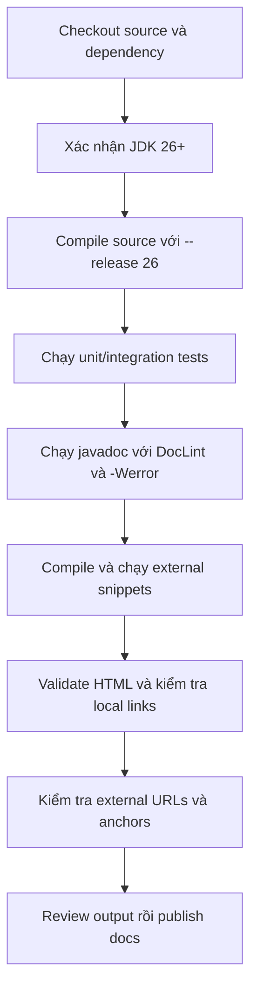

# Kiểm tra Javadoc, mã ví dụ và tính đúng của liên kết

Javadoc có thể sinh ra một bộ tài liệu HTML hoàn chỉnh dù một số ví dụ không biên dịch được, liên kết trỏ sai API hoặc URL bên ngoài đã ngừng hoạt động. Vì vậy, một lần chạy `javadoc` thành công chưa đủ để khẳng định tài liệu chính xác. Cần kiểm tra riêng cú pháp và tham chiếu Javadoc, biên dịch/chạy các ví dụ, xác minh liên kết trong API và kiểm tra URL trong HTML được tạo ra.

Với JDK 26, quy trình nên dựa trên `javadoc`, DocLint, `javac --release 26`, external snippets và một link checker độc lập. Các công cụ này đều là công cụ phát triển ổn định; `{@snippet}` đã có từ JDK 18, không phải tính năng preview riêng của Java 26.

## 1. Bốn lớp kiểm tra tài liệu

| Lớp kiểm tra | Câu hỏi | Công cụ chính |
|---|---|---|
| Documentation comments | Comment đặt đúng vị trí, tag đúng cú pháp, HTML hợp lệ và có đủ mô tả không? | `javadoc`, DocLint, `javac -Xlint:dangling-doc-comments` |
| API references | `{@link}`, `@see`, `@param`, `@throws` trỏ đúng khai báo không? | DocLint `reference`, Javadoc `-link`/`-linkoffline` |
| Code examples | Ví dụ có biên dịch và cho kết quả đúng trên JDK mục tiêu không? | `javac --release 26`, test framework, chạy ví dụ |
| Generated links | File đích, URL, redirect và anchor có hoạt động không? | Link checker, HTTP client/crawler, HTML validator |

Mỗi lớp phát hiện một nhóm lỗi khác nhau. DocLint không chạy code trong ví dụ; compiler không kiểm tra URL HTTP; `-link` không xác nhận máy chủ bên ngoài còn phục vụ trang HTML; link checker cũng không thể chứng minh một ví dụ Java có hành vi đúng. CI nên chạy các bước này độc lập rồi tổng hợp kết quả.

## 2. Viết documentation comment để công cụ kiểm tra được

Javadoc nhận comment tài liệu đặt ngay trước khai báo mà comment mô tả. Nếu comment nằm sau annotation/modifier hoặc cách khai báo bởi một khai báo khác, nó có thể không được gắn với phần tử dự kiến. Khi có nhiều comment liên tiếp, comment gần khai báo nhất được dùng.

Ví dụ comment cho một phương thức:

```java
import java.util.Collection;
import java.util.List;

/**
 * Returns an immutable copy of the supplied names.
 *
 * @param names source names; must not be {@code null}
 * @return an immutable list containing the same names
 * @throws NullPointerException if {@code names} is {@code null}
 * @see java.util.List#copyOf(java.util.Collection)
 */
public final class Names {
    public static List<String> immutableNames(Collection<String> names) {
        return List.copyOf(names);
    }
}
```

Một comment tốt có các đặc điểm:

- Câu đầu mô tả ngắn gọn hành vi và được dùng làm summary trong trang API, index và bảng phương thức.
- Mỗi tham số có `@param` đúng tên; tham số kiểu generic dùng dạng `@param <T>`.
- Phương thức có giá trị trả về dùng `@return` mô tả điều kiện và ý nghĩa của kết quả.
- Các exception quan trọng được mô tả bằng `@throws` hoặc `@exception` với đúng kiểu và điều kiện phát sinh.
- Dùng `{@link ...}` khi muốn người đọc mở khai báo liên quan, `{@code ...}` khi chỉ muốn hiển thị code literal.
- `@since` ghi phiên bản API thực sự được thêm vào thư viện; không ghi phiên bản JDK hiện tại chỉ vì tài liệu được tạo bằng JDK đó.

Đối với package, dùng `package-info.java`; đối với module, dùng comment ngay trước khai báo trong `module-info.java`. Không bắt đầu cấu trúc tài liệu mới bằng `package.html`, vì đây là cơ chế tương thích cũ; `package-info.java` là cách hiện hành.

## 3. DocLint trong JDK 26

DocLint phát hiện các lỗi thường gặp trong documentation comment trước khi tài liệu được phát hành. Với `javadoc`, DocLint được bật mặc định. Có thể yêu cầu rõ tất cả nhóm kiểm tra và biến warning thành lỗi:

```bash
javadoc --release 26 -encoding UTF-8 -docencoding UTF-8 -charset UTF-8 -Xdoclint:all -Werror -d build/javadoc -sourcepath src/main/java -subpackages com.example
```

Lệnh trên dùng JDK 26 trở lên để chạy `javadoc`; `--release 26` đặt API/source baseline cho tài liệu. `-Werror` làm cho mọi warning khiến tiến trình trả lỗi, phù hợp với CI khi nhóm đã xử lý các warning hiện có. Nếu dự án có dependencies ngoài, thêm `--class-path` hoặc `--module-path` phù hợp.

DocLint chia kiểm tra thành năm nhóm:

| Nhóm | Kiểm tra | Ví dụ lỗi |
|---|---|---|
| `accessibility` | Các vấn đề accessibility phổ biến | Ảnh thiếu `alt`, bảng thiếu caption |
| `html` | Cấu trúc HTML thông dụng | Đặt block element bên trong inline element, thiếu thẻ đóng bắt buộc |
| `missing` | Thiếu comment hoặc block tag | Thiếu mô tả lớp, thiếu `@param` hoặc `@return` |
| `reference` | Tham chiếu tới phần tử Java | `{@link}`/`@see` không tìm thấy lớp hoặc method, tên `@param` sai |
| `syntax` | Cú pháp documentation comment | `<`, `>` hoặc `&` chưa escape, tag Javadoc không hợp lệ |

Có thể bật riêng nhóm cần điều tra, ví dụ:

```bash
javadoc -Xdoclint:html,syntax,accessibility -d build/javadoc -sourcepath src/main/java com.example
```

`-Xdoclint:all` là lựa chọn phù hợp cho kiểm tra đầy đủ. `-Xdoclint:none` tắt toàn bộ kiểm tra và không nên dùng làm cấu hình CI lâu dài. Nếu đang chuyển đổi một codebase cũ có nhiều warning, có thể xử lý theo từng nhóm trong một giai đoạn ngắn, nhưng cần theo dõi số warning còn lại và kế hoạch loại bỏ.

### 3.1. DocLint không phải bộ kiểm tra HTML toàn diện

DocLint phát hiện các lỗi HTML thường gặp, không sửa comment và không bảo đảm toàn bộ HTML sinh ra tuân thủ mọi yêu cầu HTML5. Standard Doclet cũng không tự xác thực hoặc sửa HTML đầu vào. Sau khi sinh tài liệu, nên chạy HTML conformance checker và kiểm tra accessibility khi tài liệu là sản phẩm công khai.

Ví dụ viết HTML trong comment:

```java
/**
 * Returns a value less than {@code limit} when the input is valid.
 * <p>
 * The comparison is {@code value &lt; limit}.
 *
 * <table>
 *   <caption>Accepted ranges</caption>
 *   <thead>
 *     <tr><th scope="col">Name</th><th scope="col">Range</th></tr>
 *   </thead>
 *   <tbody>
 *     <tr><td>small</td><td>0 to 9</td></tr>
 *   </tbody>
 * </table>
 */
```

Khi muốn hiển thị dấu `<` hoặc `&` theo nghĩa văn bản, dùng `{@code ...}`, `{@literal ...}` hoặc HTML entity như `&lt;`, `&amp;`. Dùng HTML5 hợp lệ; cung cấp `alt` có ý nghĩa cho ảnh và caption cho bảng. Tránh chèn JavaScript hoặc HTML không tin cậy vào comment tài liệu.

### 3.2. Phát hiện comment đặt sai vị trí

`javadoc` chỉ đọc comment gắn với khai báo theo quy tắc của nó. Để phát hiện documentation comment bị treo hoặc đặt sai vị trí, biên dịch source với:

```bash
javac --release 26 -Xlint:all,dangling-doc-comments -Werror -d build/classes @sources.txt
```

`javac` không bật DocLint mặc định. Nếu muốn kiểm tra comment ngay ở bước compile, có thể thêm `-Xdoclint:all`; bước chạy `javadoc` vẫn cần thiết để xác nhận tài liệu được tạo đúng và các tham chiếu được phân giải trong ngữ cảnh doclet.

## 4. Kiểm tra các tag liên kết trong Javadoc

Javadoc có tag tham chiếu phần tử Java và tag liên kết tới tài liệu bên ngoài. Dùng đúng loại tag giúp DocLint phân giải được tên và tạo HTML link chính xác.

| Tag | Công dụng | Ví dụ |
|---|---|---|
| `{@link ...}` | Liên kết inline tới type/member | `{@link java.util.List#copyOf(java.util.Collection)}` |
| `{@linkplain ...}` | Như `{@link}` nhưng hiển thị văn bản thường | `{@linkplain java.time.Instant Instant}` |
| `@see` | Thêm mục tham khảo ở cuối comment | `@see java.util.List` |
| `{@docRoot}` | Đường dẫn tương đối tới root của tài liệu sinh ra | `{@docRoot}/resources/example.json` |
| `{@code ...}` | Hiển thị code literal, không tạo link | `{@code List.copyOf(input)}` |
| `{@value ...}` | Hiển thị giá trị hằng compile-time | `{@value #DEFAULT_LIMIT}` |

Ví dụ tham chiếu method trong cùng lớp:

```java
/**
 * Validates a name before storing it.
 * See {@link #normalize(String)} for the normalization rules.
 *
 * @param name input name
 * @return {@code true} when the name is accepted
 */
public boolean isAccepted(String name) {
    return !normalize(name).isBlank();
}

/**
 * Removes surrounding whitespace and normalizes the value.
 *
 * @param value value to normalize
 * @return normalized value
 */
public String normalize(String value) {
    return value.strip();
}
```

Khi method overload, phải ghi đúng signature cần link, gồm kiểu tham số và generic nếu cần. Ưu tiên dùng type đã import hoặc tên fully qualified rõ ràng; tránh viết một tên method trần khiến Javadoc không biết overload nào được nhắc tới. DocLint nhóm `reference` sẽ báo khi type/member không được tìm thấy.

### 4.1. Link tới Javadoc của dependency

Nếu type nằm ngoài tập package đang tạo tài liệu, dùng `-link` để Javadoc tạo hyperlink tới tài liệu API bên ngoài. URL phải trỏ tới thư mục gốc của Javadoc có file `element-list` hoặc `package-list`:

```bash
javadoc --release 26 -Xdoclint:all -Werror -d build/javadoc -sourcepath src/main/java -link https://docs.example.org/library/apidocs/ com.example
```

Javadoc đọc `element-list` cho tài liệu dạng module hoặc `package-list` cho tài liệu dạng package để biết package/type nào có thể liên kết. URL phải là thư mục gốc, không phải đường dẫn tới file `element-list`.

Nếu máy build không truy cập được file danh sách từ server nhưng đã tải file về trước, dùng `-linkoffline`:

```bash
javadoc --release 26 -Xdoclint:all -Werror -d build/javadoc -sourcepath src/main/java -linkoffline https://docs.example.org/library/apidocs/ tools/javadoc-index/library/ com.example
```

Thư mục `tools/javadoc-index/library/` cần chứa `element-list` hoặc `package-list` tương ứng với bộ tài liệu bên ngoài. Không tự sửa nội dung các file danh sách do Javadoc tạo ra.

Tài liệu Java SE có platform links được Standard Doclet hỗ trợ sẵn. Với dependency bên thứ ba, dùng `-link` hoặc `-linkoffline` theo cấu hình phiên bản API mà thư viện thực sự phát hành. Nếu tài liệu dependency không có element list phù hợp, kiểm tra cách phát hành Javadoc của vendor và cân nhắc link URL tường minh trong comment.

### 4.2. Những gì -link không kiểm tra

`-link` xác định tên package/module dựa trên `element-list` hoặc `package-list` và tạo URL trong HTML. Nó không phải crawler để xác nhận từng trang đích, fragment/anchor hoặc server HTTP vẫn hoạt động. Vì vậy có thể tạo thành công Javadoc nhưng hyperlink vẫn trả về 404, redirect sai hoặc trỏ tới anchor không tồn tại.

`-linksource` tạo trang HTML hiển thị source code và link từ API tới source. Cần cân nhắc trước khi dùng cho tài liệu công khai: tùy chọn này có thể làm lộ implementation details, gồm private classes, fields và method bodies trong source được đưa vào tài liệu.

## 5. Dùng @snippet để quản lý ví dụ code

`{@snippet ...}` được giới thiệu từ JDK 18 qua JEP 413. Nó cho phép nhúng code inline hoặc lấy nội dung từ file bên ngoài; Standard Doclet hỗ trợ syntax highlighting và markup để highlight, thay thế hoặc chọn region. Snippet cải thiện cách trình bày ví dụ nhưng **không tự biên dịch hoặc chạy code**.

Ví dụ inline:

```java
/**
 * Creates an immutable list.
 *
 * {@snippet lang="java" :
 *     List<String> names = List.of("Ada", "Linus");
 *     System.out.println(names);
 * }
 */
```

Inline snippet phù hợp với đoạn ngắn. Vì nội dung nằm bên trong documentation comment, không được chứa chuỗi `*/` làm kết thúc comment; dấu ngoặc nhọn phải cân bằng; Unicode escape được xử lý khi source parse. Nếu ví dụ cần block comment, regex có chuỗi `*/` hoặc code dài, dùng external snippet.

### 5.1. External snippet để có thể biên dịch và chạy

Đặt file ví dụ trong thư mục `snippet-files` bên cạnh package source. Ví dụ cấu trúc:

```text
src/main/java/
  com/example/api/
    NameFormatter.java
    snippet-files/
      NameFormatterExample.java
```

Trong Javadoc của `NameFormatter.java`:

```java
/**
 * Formats a name for display.
 *
 * Example:
 * {@snippet class=NameFormatterExample region=basic}
 */
public final class NameFormatter {
    // API implementation
}
```

File `snippet-files/NameFormatterExample.java`:

```java
import java.util.List;

public class NameFormatterExample {
    public static void main(String[] args) {
        // @start region=basic
        List<String> names = List.of("Ada", "Linus");
        System.out.println(String.join(", ", names));
        // @end region=basic
    }
}
```

Javadoc lấy region `basic` để hiển thị. File external là source code thật, có thể đưa vào bước biên dịch và chạy kiểm thử độc lập. Nếu lưu snippets ở một cây thư mục riêng, truyền đường dẫn bằng `--snippet-path`; trên Windows, nhiều đường dẫn phân tách bằng dấu `;`, trên Linux/macOS bằng dấu `:`.

```bash
javadoc --release 26 -Xdoclint:all -Werror -d build/javadoc -sourcepath src/main/java -subpackages com.example
```

Lệnh trên dùng thư mục `snippet-files` nằm cạnh package. Nếu snippets được lưu ở cây riêng `docs/snippets`, thêm `--snippet-path docs/snippets` vào lệnh.

Với snippet Java, có thể biên dịch file external như source bình thường:

```bash
javac --release 26 -Xlint:all -Werror -d build/snippets src/main/java/com/example/api/snippet-files/NameFormatterExample.java
java -cp build/snippets NameFormatterExample
```

Nếu snippet phụ thuộc class của ứng dụng hoặc thư viện ngoài, thêm classpath/module path tương ứng. Khi ví dụ là một đoạn code fragment không tự tạo thành compilation unit, hãy đặt nó trong external example class có import, method và context cần thiết rồi chọn region để Javadoc hiển thị đúng phần muốn dạy.

### 5.2. Kiểm thử ví dụ, không chỉ biên dịch

Một ví dụ biên dịch được vẫn có thể minh họa sai hành vi hoặc cho kết quả không như mô tả. Với ví dụ có output hoặc điều kiện biên, nên có test tự động:

```java
import static org.junit.jupiter.api.Assertions.assertEquals;

import java.util.List;
import org.junit.jupiter.api.Test;

class NameFormatterExampleTest {
    @Test
    void joinsNamesInInputOrder() {
        List<String> names = List.of("Ada", "Linus");

        String result = String.join(", ", names);

        assertEquals("Ada, Linus", result);
    }
}
```

Đặt test cạnh module/test source phù hợp và chạy bằng build tool của dự án. Nếu ví dụ có thao tác file, mạng hoặc thời gian, dùng temporary directory, fake server hoặc `Clock` cố định để test lặp lại được. Không dựa vào một lần copy code từ trang HTML rồi chạy thủ công.

### 5.3. Khi nào dùng hybrid snippet?

Hybrid snippet chứa cả phần inline để trình bày và tham chiếu tới external file/region để kiểm chứng nội dung. Standard Doclet so sánh kết quả xử lý hai phần và báo nếu chúng không khớp. Cách này phù hợp khi ví dụ đã ổn định và nhóm muốn đảm bảo đoạn hiển thị không bị lệch khỏi code được biên dịch.

Trong giai đoạn viết ban đầu, nên dùng inline hoặc external riêng để giảm công việc đồng bộ. Khi ví dụ đã ổn định, chuyển thành hybrid nếu cần giữ một bản minh họa được kiểm tra theo source.

## 6. Biên dịch code ví dụ theo đúng Java release

Khi module học Java 26, mọi ví dụ dùng API hoặc syntax của Java 26 phải được kiểm tra bằng JDK 26 trở lên. Kiểm tra phiên bản của cả `java`, `javac` và `javadoc`; `--release 26` trên một JDK cũ không làm cho tool đó có thêm API hoặc doclet mới của JDK 26.

```bash
java --version
javac --version
javadoc --version
```

Biên dịch source của ứng dụng với API baseline Java 26:

```bash
javac --release 26 -Xlint:all -Werror -d build/classes @sources.txt
```

`--release 26` giới hạn language rules, class-file target và Java SE/JDK API có sẵn theo release 26. Nếu source sử dụng API mới hơn Java 26, compiler sẽ báo lỗi thay vì vô tình biên dịch theo JDK đang cài. Khi tài liệu dành cho một baseline thấp hơn, dùng đúng `--release` mà sản phẩm hỗ trợ và không đưa API mới hơn vào ví dụ.

Nếu ví dụ sử dụng preview feature, phải ghi rõ feature đang ở trạng thái preview của release nào và biên dịch/chạy bằng cùng JDK release với `--enable-preview --release 26`. Không trình bày preview API như API final; bài học này ưu tiên ví dụ dùng API ổn định đang áp dụng.

Với project modular, cung cấp `--module-path` và module source path tương ứng. Với project có annotation processor hoặc generated source, chạy bước generate/compile trước khi tạo Javadoc để các khai báo và type cần liên kết đều có trong classpath/module path.

## 7. Kiểm tra link trong HTML được tạo ra

Sau khi `javadoc` sinh xong, cần kiểm tra HTML output như một website tĩnh. Có ba nhóm link:

| Nhóm | Ví dụ | Cách kiểm tra |
|---|---|---|
| Link nội bộ | Trang lớp, method, package, index, fragment | Kiểm tra file đích tồn tại và anchor `id` có trong file |
| Link tới Javadoc dependency | `{@link ExternalType}` được tạo qua `-link` | Kiểm tra `element-list`/`package-list`, URL cuối cùng và trang API đích |
| URL bên ngoài trong nội dung | Link RFC, hướng dẫn vendor, website | Dùng link checker/crawler HTTP riêng, theo redirect và kiểm tra status |

Một công cụ kiểm tra link có thể quét toàn bộ thư mục `build/javadoc` và các file Markdown chứa nguồn liên kết. Ví dụ có thể dùng Lychee hoặc Linkinator; cấu hình để kiểm tra cả link tương đối và URL HTTP/HTTPS. Khi CI chạy trong môi trường không có Internet, tách kiểm tra link ngoài thành job riêng hoặc dùng allowlist/cache phù hợp.

Khi xác minh URL HTTP, cần lưu ý:

- Theo redirect tới URL cuối cùng và xác minh response cuối có nội dung mong đợi.
- Không mặc định `HEAD` luôn được server hỗ trợ; một số server chỉ xử lý `GET` hoặc trả 405 cho `HEAD`.
- Dùng timeout, retry có giới hạn và concurrency hợp lý để tránh bị rate limit.
- Phân biệt 401/403 do chính sách truy cập với 404 thực sự không tồn tại; đánh dấu các link cần xác thực thay vì bỏ qua tất cả lỗi.
- Kiểm tra fragment/anchor sau khi tải HTML nếu checker hỗ trợ; HTTP 200 không bảo đảm `#method-name` có tồn tại.
- Kiểm tra link tương đối và ảnh trong `doc-files` có file tương ứng sau khi Javadoc copy chúng vào output.
- Pin link tài liệu theo release khi nội dung cần đúng Java 26, ví dụ API Java SE 26, thay vì luôn trỏ tới trang `latest` có thể thay đổi.

Không dùng `javadoc -link` thay cho link checker. `-link` chỉ xây dựng liên kết từ danh sách API bên ngoài; nó không xác nhận trang đích hoặc anchor còn sống.

## 8. Kiểm tra nội dung HTML và accessibility

Sau khi kiểm tra link, mở một số trang đại diện trong browser để kiểm tra phần render thực tế:

- Trang package/module overview và trang lớp có summary dễ hiểu.
- Link method overload dẫn tới đúng phần tử.
- Code snippet giữ indentation, syntax highlighting và region như mong muốn.
- Bảng, ảnh, heading và danh sách hiển thị đúng trên màn hình nhỏ.
- Nội dung có dấu tiếng Việt hiển thị đúng UTF-8.
- Không có link trỏ tới file source hoặc tài nguyên nội bộ ngoài ý muốn.

DocLint kiểm tra một số vấn đề accessibility phổ biến như ảnh thiếu `alt` và bảng thiếu caption, nhưng không thay thế kiểm tra accessibility chuyên sâu. Nếu Javadoc là tài liệu công khai, có thể chạy HTML validator và accessibility checker trên output để phát hiện lỗi cấu trúc, contrast, thứ tự heading và khả năng điều hướng bằng bàn phím.

## 9. Tích hợp vào CI

Một pipeline kiểm tra tài liệu cho Java 26 có thể tổ chức như sau:



Ví dụ lệnh trong một job CI:

```bash
javac --release 26 -Xlint:all -Werror -d build/classes @sources.txt
java -jar test-runner.jar
javadoc --release 26 -Xdoclint:all -Werror -encoding UTF-8 -docencoding UTF-8 -charset UTF-8 -d build/javadoc -sourcepath src/main/java -subpackages com.example
javac --release 26 -Xlint:all -Werror -d build/snippets src/main/java/com/example/api/snippet-files/NameFormatterExample.java
java -cp build/snippets NameFormatterExample
```

Các lệnh trên minh họa thứ tự và mức kiểm tra; thay `sources.txt`, test runner, package name và snippet paths bằng cấu trúc thực tế của dự án. Nếu dùng Maven hoặc Gradle, cấu hình task Javadoc để truyền `--release`, `-Xdoclint:all` và `-Werror`, đồng thời giữ cùng JDK toolchain cho compile, Javadoc và test. Không để build tool âm thầm dùng một JDK khác với JDK đang compile source.

Nên lưu artifact HTML của mỗi lần build để reviewer có thể xem output đúng với commit. Chỉ publish sau khi Javadoc, compile examples, tests và link checks đều đạt.

## 10. Những lỗi thường gặp và cách xử lý

| Lỗi | Nguyên nhân | Cách xử lý |
|---|---|---|
| `reference not found` | Sai tên type/member, sai overload hoặc thiếu dependency trên classpath/module path | Sửa `{@link}`/`@see`, thêm dependency phù hợp và kiểm tra signature |
| `@param` không khớp | Tên parameter trong comment khác source hoặc thiếu type parameter tag | Đồng bộ tên, dùng `@param <T>` cho generic |
| HTML warning/error | Tag đóng sai, block/inline nesting không hợp lệ, ký tự đặc biệt chưa escape | Sửa HTML5 và dùng `{@code}`/entity cho ký tự literal |
| Thiếu comment/tag | Public API thiếu summary, `@param`, `@return` | Viết mô tả có ý nghĩa; không tắt `missing` để che lỗi |
| Snippet hiển thị nhưng không compile | Standard Doclet chỉ render snippet | Dùng external snippet và compile bằng `javac` |
| Snippet khác code chạy thật | Ví dụ được copy riêng, không đồng bộ source | Dùng external/hybrid snippet và test output |
| External API link không được tạo | Thiếu `element-list`/`package-list`, sai root URL hoặc sai modularity | Sửa `-link`/`-linkoffline` và kiểm tra file danh sách |
| Javadoc chạy thành công nhưng URL trả 404 | `-link` không kiểm tra trang/anchor HTTP | Chạy link checker trên output |
| Link trả 403/429 | Server yêu cầu quyền hoặc rate limit crawler | Xác minh thủ công, giới hạn concurrency, cấu hình allowlist có lý do |
| Tài liệu compile trên máy dev nhưng lỗi CI | JDK/toolchain hoặc dependency khác nhau | Pin JDK toolchain và version dependency trong CI |
| Output không giống source mong đợi | Comment đặt sai vị trí hoặc Javadoc chọn comment gần khai báo hơn | Dùng `-Xlint:dangling-doc-comments` và kiểm tra vị trí comment |

Không tắt DocLint toàn cục chỉ để build xanh. Nếu cần suppress một warning cụ thể, dùng `@SuppressWarnings("doclint:...")` trên khai báo liên quan, ghi rõ lý do và chỉ suppress đúng nhóm cần thiết. Suppress có thể bỏ qua cả warning lẫn error trong nhóm đó, vì vậy nên giới hạn phạm vi.

## 11. Checklist trước khi phát hành Javadoc

- [ ] `java`, `javac` và `javadoc` chạy bằng JDK 26 trở lên.
- [ ] Source được biên dịch với `--release 26` và warning quan trọng được xử lý.
- [ ] Documentation comment đặt ngay trước khai báo đúng; package/module dùng `package-info.java`/`module-info.java`.
- [ ] Summary, `@param`, `@return`, `@throws` và `@since` phản ánh đúng hợp đồng API.
- [ ] `javadoc -Xdoclint:all -Werror` chạy thành công.
- [ ] `{@link}`, `{@linkplain}`, `@see` và `{@docRoot}` trỏ đúng phần tử/tài nguyên.
- [ ] External Javadoc links dùng đúng `element-list`/`package-list` hoặc `-linkoffline`.
- [ ] External snippets được biên dịch và kiểm thử; inline snippets được review theo source.
- [ ] Ví dụ có output hoặc logic quan trọng có unit/integration test.
- [ ] HTML output được kiểm tra link nội bộ, URL ngoài, redirect và anchor.
- [ ] HTML/accessibility được kiểm tra bổ sung khi tài liệu công khai.
- [ ] Output được mở kiểm tra trực quan trước khi publish.
- [ ] Link tài liệu API được pin đúng release Java mà bài học nhắm tới.

## 12. Phân biệt API ổn định và công cụ theo JDK

Javadoc, DocLint, `javac --release`, `-link`, `-linkoffline` và `{@snippet}` là công cụ/tính năng hiện hành trên JDK 26; không cần `--enable-preview` hoặc incubator module. `{@snippet}` có từ JDK 18, vì vậy nên xem đây là công cụ chuẩn để trình bày code examples trên Java 26 chứ không phải một cải tiến mới chỉ xuất hiện trong release này.

Điều cần pin theo release là JDK toolchain và API baseline của ví dụ. `--release 26` kiểm tra source/API theo Java 26; `javadoc` chạy bằng JDK 26+ tạo tài liệu phù hợp với doclet hiện hành. Khi nâng lên JDK khác, hãy chạy lại compile, DocLint, snippet tests và link checks để phát hiện API hoặc URL đã thay đổi.

## Tài liệu tham khảo

- [Java SE 26 Javadoc Guide](https://docs.oracle.com/en/java/javase/26/javadoc/index.html)
- [Java SE 26 `javadoc` Command](https://docs.oracle.com/en/java/javase/26/docs/specs/man/javadoc.html)
- [Java SE 26 Documentation Comment Specification for the Standard Doclet](https://docs.oracle.com/en/java/javase/26/docs/specs/javadoc/doc-comment-spec.html)
- [Java SE 26 Snippets Guide](https://docs.oracle.com/en/java/javase/26/javadoc/snippets.html)
- [Java SE 26 `javac` Command](https://docs.oracle.com/en/java/javase/26/docs/specs/man/javac.html)
- [JEP 413: Code Snippets in Java API Documentation](https://openjdk.org/jeps/413)
- [W3C Nu Html Checker](https://validator.w3.org/nu/)
