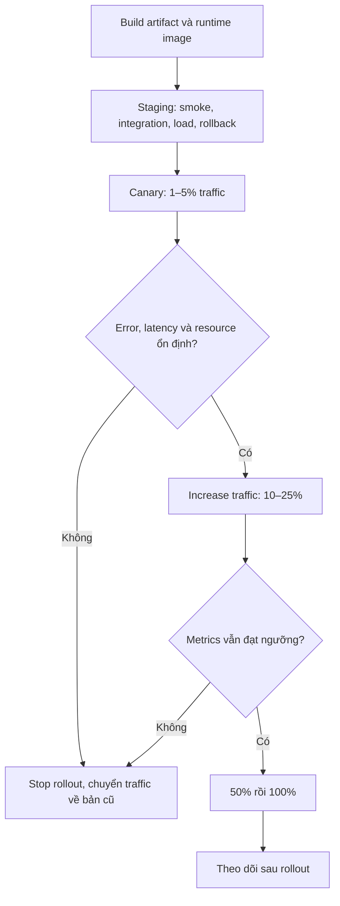

# Đóng gói runtime, triển khai từng bước và theo dõi kết quả

Triển khai ứng dụng Java 26 cần quản lý cả ứng dụng lẫn runtime đang chạy nó. Một file JAR mới không đủ nếu production vẫn dùng JDK cũ, thiếu module, thiếu provider được nạp qua `ServiceLoader` hoặc giữ một custom runtime chưa nhận bản vá bảo mật. Quy trình tốt tạo ra artifact có thể tái lập, kiểm thử đúng runtime đích, đưa phiên bản mới tới một phần traffic trước, theo dõi số liệu và có cách quay lại bản ổn định.

JDK 26 cung cấp `jlink` để tạo runtime image chỉ gồm các module cần thiết và `jpackage` để đóng gói ứng dụng cùng runtime thành application image hoặc installer theo nền tảng. Đây là công cụ phát hành ổn định, không phải preview/incubator. Với triển khai server, có thể đưa custom runtime vào container; với desktop app, có thể tạo gói cài đặt native cho Windows, macOS hoặc Linux.

## 1. Chọn hình thức đóng gói phù hợp

Trước khi tạo artifact, xác định ứng dụng được phân phối và vận hành ở đâu:

| Hình thức | Nội dung phát hành | Trường hợp phù hợp | Trách nhiệm cập nhật runtime |
|---|---|---|---|
| Executable JAR | Ứng dụng và dependency; máy đích tự cài JRE/JDK tương thích | Server đã có runtime chuẩn hóa, triển khai bằng container/runtime platform | Đội vận hành cập nhật runtime nền |
| `jlink` runtime image | Custom Java runtime chứa các module được chọn | Muốn runtime gọn, cố định module và kiểm soát phiên bản Java | Đội phát triển/đội phát hành phải rebuild image khi JDK có bản vá |
| `jpackage` application image | Launcher, ứng dụng, dependency và runtime | Kiểm thử bundle tự chứa hoặc phân phối nội bộ | Đội phát hành cập nhật bundle cùng runtime |
| `jpackage` native installer | Application image trong gói cài đặt như MSI, EXE, DEB, RPM, PKG hoặc DMG | Phần mềm desktop hoặc ứng dụng cài trên máy người dùng | Đội phát hành xây dựng và phát hành installer mới |
| Container image | Ứng dụng, runtime và các file hệ thống cần thiết trong image | Dịch vụ server, orchestrator và môi trường cloud | Đội vận hành rebuild/publish image khi runtime hoặc base image cần vá |

`jpackage` có thể đóng gói ứng dụng modular và non-modular. Nếu không truyền runtime image có sẵn, công cụ dùng `jlink` để tạo runtime dựa trên module cần thiết. Gói tạo ra có thể chứa launcher, JAR/module, runtime và cấu hình JVM; người dùng không cần cài Java riêng. Xem [Packaging Overview](https://docs.oracle.com/en/java/javase/26/jpackage/packaging-overview.html) và [jpackage Command](https://docs.oracle.com/en/java/javase/26/docs/specs/man/jpackage.html).

## 2. Chốt JDK và môi trường build

Runtime image phải được tạo từ JDK có phiên bản và vendor đã chọn cho sản phẩm. Lưu lại tối thiểu:

- JDK vendor, full version string và build number.
- Hệ điều hành, CPU architecture và loại libc/base image nếu triển khai Linux container.
- Phiên bản compiler target (`--release`) và phiên bản dependency.
- JVM options, module list, locale, timezone data và các provider cần thiết.
- Mã commit, build ID, checksum artifact và SBOM nếu pipeline cung cấp.

Không dùng `java --version` của máy developer làm bằng chứng rằng CI hoặc production đang chạy cùng runtime. Kiểm tra phiên bản trong từng môi trường và lưu nó cùng release metadata.

JDK 26 là một feature release; chính sách hỗ trợ và thời gian nhận bản vá phụ thuộc nhà cung cấp JDK. Chọn vendor/distribution có lịch cập nhật phù hợp với yêu cầu vận hành, sau đó pin một build đã được phê duyệt. Trước mỗi lần phát hành, kiểm tra security release notes của vendor và cập nhật lên bản vá còn được hỗ trợ.

### 2.1. Build theo đúng nền tảng đích

`jpackage` tạo native package cho nền tảng đang chạy công cụ. Gói Windows, macOS và Linux cần được build trên hệ điều hành tương ứng; các định dạng như MSI, DMG, DEB và RPM không được tạo cross-platform từ một host duy nhất. Hãy cấu hình build matrix theo OS và kiến trúc CPU mà sản phẩm hỗ trợ. Chi tiết xem [Packaging Overview](https://docs.oracle.com/en/java/javase/26/jpackage/packaging-overview.html).

JDK 26 cũng siết kiểm tra khi `jlink` cross-link runtime image: các standard/JDK modules của runtime đích phải khớp chính xác version/update và vendor với JDK chạy `jlink`. Không ghép `jlink` của vendor/build này với JMODs của vendor/build khác. Cách an toàn là build runtime trên đúng nền tảng đích bằng cùng JDK distribution đã được pin. Chi tiết nằm trong [JDK 26 Release Notes](https://www.oracle.com/java/technologies/javase/26-relnote-issues.html).

## 3. Xác định module cần có trong runtime

`jlink` tạo runtime image từ các module và toàn bộ dependency bắc cầu của chúng. Với ứng dụng modular, module chính thường là root module. Với ứng dụng non-modular, cần phân tích các thư viện và chọn module phù hợp nếu muốn tạo runtime nhỏ hơn.

`jdeps` giúp phân tích dependency tĩnh:

```bash
jdeps --multi-release 26 --print-module-deps \
  --class-path "build/lib/*" \
  build/app.jar
```

Kết quả là danh sách module JDK được phát hiện qua dependency mà công cụ phân tích được. Đây là điểm bắt đầu, không phải danh sách đầy đủ trong mọi ứng dụng. Reflection, class name được tạo lúc chạy, JDBC driver, logging provider, service loading, native library và cấu hình plugin có thể yêu cầu module hoặc file bổ sung mà static analysis không suy ra được. Hãy kiểm tra integration test và các đường chạy production trước khi loại module.

### 3.1. Tạo custom runtime bằng jlink

Ví dụ cho ứng dụng modular có module chính `com.example.inventory`:

```bash
jlink \
  --module-path "$JAVA_HOME/jmods:build/mods" \
  --add-modules com.example.inventory \
  --bind-services \
  --strip-debug \
  --no-header-files \
  --no-man-pages \
  --compress=zip-6 \
  --output build/runtime
```

Giải thích các tùy chọn:

- `--module-path` chỉ nơi tìm JMOD và modular JAR. Trong ví dụ Linux/macOS, dấu `:` phân tách path; trên Windows dùng dấu `;`.
- `--add-modules` chỉ định root module. `jlink` tự thêm các dependency bắc cầu.
- `--bind-services` thêm service provider modules và dependency của chúng khi ứng dụng dùng `ServiceLoader`.
- `--strip-debug`, `--no-header-files`, `--no-man-pages` giảm nội dung không cần trong runtime production.
- `--compress=zip-6` nén resource trong image; hãy đo thời gian khởi động và kích thước trước khi thay đổi mức nén.
- `--output` là thư mục runtime image đầu ra.

Không thêm hàng loạt module bằng `ALL-MODULE-PATH` chỉ để tránh lỗi thiếu module. Hãy xác định module cần thiết và kiểm tra ứng dụng trên runtime đã thu gọn. Nếu runtime thiếu provider hoặc locale data, thêm module tương ứng có chủ đích.

### 3.2. Kiểm tra service binding

Từ JDK 25, runtime image do `jpackage` tạo không còn bao gồm service bindings theo mặc định. Nếu ứng dụng dùng `ServiceLoader` hoặc cần các provider được tìm qua service binding, hãy truyền `--bind-services` vào tùy chọn `jlink` mà `jpackage` gọi. Khi tự chạy `jlink`, dùng trực tiếp `--bind-services`. Thay đổi này được mô tả trong [JDK 26 Packaging Overview](https://docs.oracle.com/en/java/javase/26/jpackage/packaging-overview.html) và [jlink Command](https://docs.oracle.com/en/java/javase/26/docs/specs/man/jlink.html).

Ví dụ giữ các tùy chọn strip mặc định của `jpackage` và thêm service binding:

```bash
jpackage \
  --type app-image \
  --name Inventory \
  --module-path build/mods \
  --module com.example.inventory/com.example.Main \
  --jlink-options "--strip-native-commands --strip-debug --no-man-pages --no-header-files --bind-services" \
  --dest build/package
```

Không giả định runtime image mới có cùng tập module như image được tạo bằng JDK cũ. Kiểm thử các tính năng nạp driver, logging backend, charset provider, locale và plugin trên đúng image mới.

## 4. Đóng gói ứng dụng bằng jpackage

`jpackage` có thể tạo `app-image` để thử trước khi tạo installer. `app-image` chứa launcher và runtime; đây là artifact hữu ích để kiểm tra trực tiếp trên máy sạch mà chưa cần cài đặt. Khi ứng dụng chạy đúng, dùng application image đó làm đầu vào để tạo installer native.

### 4.1. Ứng dụng non-modular

Ví dụ ứng dụng có `inventory.jar` và các dependency nằm trong `build/dist`:

```text
build/dist/
  inventory.jar
  database-driver.jar
  logging-provider.jar
```

Tạo application image:

```bash
jpackage \
  --type app-image \
  --name Inventory \
  --input build/dist \
  --main-jar inventory.jar \
  --main-class com.example.Main \
  --app-version 2.4.0 \
  --vendor "Example Engineering" \
  --java-options "-Xms256m" \
  --java-options "-Xmx1g" \
  --dest build/package
```

Mọi file trong `--input` được đưa vào application image; classpath mặc định của launcher chứa các JAR được đưa trực tiếp trong thư mục input. `--main-jar` là đường dẫn tương đối với thư mục input. Nếu tự đặt `-cp` hoặc `-classpath` qua `--java-options`, cấu hình đó thay thế classpath mặc định, nên phải liệt kê đủ tất cả JAR cần thiết. Với ứng dụng classpath, `jpackage` tạo runtime chứa tập module JDK mà launcher thông thường cung cấp cho ứng dụng trong unnamed module; nếu cần module bổ sung, khai báo `--add-modules` và kiểm thử lại. Xem [Packaging Overview](https://docs.oracle.com/en/java/javase/26/jpackage/packaging-overview.html) và [Packaging Tool User's Guide](https://docs.oracle.com/en/java/javase/26/jpackage/packaging-tool-user-guide.pdf).

### 4.2. Ứng dụng modular

Với modular JAR đã đặt trong `build/mods`, có thể tạo application image như sau:

```bash
jpackage \
  --type app-image \
  --name Inventory \
  --module-path build/mods \
  --module com.example.inventory/com.example.Main \
  --app-version 2.4.0 \
  --vendor "Example Engineering" \
  --dest build/package
```

Nếu ứng dụng cần service binding, thêm `--jlink-options` như phần trước. Với runtime image đã được tạo và kiểm thử riêng bằng `jlink`, truyền nó qua `--runtime-image` để `jpackage` sử dụng đúng runtime đã phê duyệt:

```bash
jpackage \
  --type app-image \
  --name Inventory \
  --module-path build/mods \
  --module com.example.inventory/com.example.Main \
  --runtime-image build/runtime \
  --app-version 2.4.0 \
  --dest build/package
```

### 4.3. Tạo installer native

Sau khi kiểm thử `app-image`, có thể tạo gói theo hệ điều hành:

```bash
# Windows: chạy trên Windows và cài công cụ đóng gói cần thiết.
jpackage --type msi --name Inventory --app-image build/package/Inventory --dest build/installers

# macOS: chạy trên macOS.
jpackage --type dmg --name Inventory --app-image build/package/Inventory --dest build/installers

# Linux: chạy trên Linux.
jpackage --type deb --name Inventory --app-image build/package/Inventory --dest build/installers
```

Định dạng được hỗ trợ phụ thuộc nền tảng và phần mềm đi kèm. Ví dụ Windows cần WiX cho MSI/EXE theo hướng dẫn JDK; macOS cần công cụ Xcode khi ký gói hoặc tùy chỉnh một số tài nguyên; Linux cần công cụ đóng gói phù hợp với DEB/RPM. Không coi việc lệnh `jpackage` chạy thành công trên máy build là bằng chứng installer sẽ cài được trên mọi bản phân phối OS. Tham khảo [Packaging Prerequisites](https://docs.oracle.com/en/java/javase/26/jpackage/packaging-overview.html).

## 5. Kiểm thử runtime image trước khi phát hành

Một runtime image nhỏ có thể thiếu module mà ứng dụng chỉ dùng trong một chức năng ít được gọi. Kiểm thử phải chạy trên artifact đóng gói, không chỉ chạy classpath trên JDK đầy đủ của máy developer.

Các bước kiểm tra tối thiểu:

1. Kiểm tra launcher khởi động được và in đúng phiên bản runtime.
2. Chạy smoke test cho chức năng chính và endpoint readiness/health.
3. Mở kết nối database, message broker, HTTP client và các external service cần thiết.
4. Kiểm tra `ServiceLoader`, JDBC driver, logging provider, charset, locale, timezone và TLS certificate.
5. Kiểm tra đọc/ghi file, quyền thư mục, đường dẫn tương đối và cấu hình JVM.
6. Kiểm tra shutdown, signal, graceful drain và xử lý restart.
7. Thử trên máy/VM/container sạch không cài JDK đầy đủ.

Với modular runtime image, có thể kiểm tra danh sách module khi image vẫn giữ công cụ tương ứng. Nếu runtime đã strip native commands, hãy thực hiện phân tích module trong bước build trước khi strip và xác minh bằng integration test trên image cuối.

### 5.1. Kiểm thử launcher và phiên bản

Với application image, chạy launcher do `jpackage` tạo thay vì chạy `java -jar` từ JDK của máy:

```bash
# Tên và đường dẫn launcher phụ thuộc nền tảng.
build/package/Inventory/bin/Inventory --version
```

Nếu ứng dụng chưa có option `--version`, cung cấp một lệnh chẩn đoán hoặc log startup ghi lại `Runtime.version()`, `java.vendor`, `java.home` và application build ID. Không log secret hoặc giá trị cấu hình nhạy cảm.

### 5.2. Kiểm tra tương thích cấu hình

Tách cấu hình ra khỏi artifact. Cùng một image có thể chạy ở staging và production với cấu hình khác nhau, nhưng cần quản lý schema cấu hình và default rõ ràng. Secrets phải lấy từ secret manager hoặc cơ chế bảo mật của môi trường, không đóng gói vào JAR, runtime image, Docker layer hoặc file launcher properties.

Ghi lại các JVM options quan trọng và kiểm tra chúng trên JDK 26. Tránh truyền các option nội bộ/unsupported chỉ để làm build chạy; option đó có thể đổi hoặc bị loại bỏ giữa các bản cập nhật. Dùng `java -X`/`java --help` của runtime mục tiêu để xác nhận option được hỗ trợ.

## 6. Đóng gói trong container

Với dịch vụ server, container image thường là artifact triển khai. Có thể tạo custom runtime bằng `jlink` ở build stage, rồi chỉ copy runtime và ứng dụng cần thiết sang final image. Chọn builder và final base image tương thích về OS, kiến trúc, libc và thư viện native; không copy runtime được build cho glibc sang một image musl rồi mặc định nó sẽ chạy.

Dockerfile dưới đây là khung minh họa; thay image, lệnh build và đường dẫn theo dự án:

```dockerfile
FROM <jdk-26-builder-image> AS build
WORKDIR /workspace
COPY . .
RUN ./mvnw -B package

# Với ứng dụng modular, build custom runtime bằng đúng JDK đã pin.
RUN jlink \
    --module-path "$JAVA_HOME/jmods:build/mods" \
    --add-modules com.example.inventory \
    --bind-services \
    --strip-debug \
    --no-header-files \
    --no-man-pages \
    --output /opt/runtime

FROM <compatible-minimal-linux-base>
WORKDIR /app
COPY --from=build /opt/runtime /opt/java
COPY --from=build /workspace/build/app.jar /app/app.jar
RUN groupadd --system app && useradd --system --gid app --create-home app
USER app
ENV PATH="/opt/java/bin:${PATH}"
ENTRYPOINT ["/opt/java/bin/java", "-jar", "/app/app.jar"]
```

Nếu ứng dụng không modular, thay bước `jlink` bằng cách tạo runtime phù hợp qua `jpackage` hoặc sử dụng một JRE image đã được phê duyệt. Dockerfile chỉ là ví dụ cấu trúc; các lệnh `groupadd`/`useradd` và thư viện hệ thống phụ thuộc final base image.

Các nguyên tắc vận hành container:

- Pin image theo digest trong release build; tag có thể thay đổi theo thời gian.
- Dùng user không phải root, filesystem read-only nếu ứng dụng cho phép, và cấp quyền ghi riêng cho thư mục cần thiết.
- Đặt memory/CPU requests và limits phù hợp; kiểm tra JVM nhận biết container resource limits đúng như dự kiến.
- Gửi log ra stdout/stderr theo chuẩn nền tảng; không ghi log nhạy cảm vào layer hoặc volume dùng chung thiếu kiểm soát.
- Đảm bảo process Java nhận SIGTERM và có thời gian graceful shutdown trước khi orchestrator gửi SIGKILL.
- Dùng readiness probe để điều khiển traffic; liveness probe chỉ kiểm tra tiến trình còn hoạt động, tránh restart liên tục khi dependency tạm thời chậm.
- Không tải JDK hoặc dependency động từ Internet lúc container khởi động production.

## 7. Chuẩn hóa artifact và metadata phát hành

Mỗi release nên tạo một bộ artifact bất biến. Không rebuild cùng một version tag với nội dung khác nhau sau khi đã triển khai.

Một bộ release metadata nên gồm:

| Trường | Ví dụ | Mục đích |
|---|---|---|
| Application version | `2.4.0` | Xác định phiên bản logic |
| Build ID/commit | SHA commit | Truy ngược source |
| JDK | Vendor, full version, build | Xác định runtime được đóng gói |
| OS/architecture | Linux x86_64, Windows x64 | Xác định nền tảng artifact |
| Artifact digest | SHA-256 | Kiểm tra tính toàn vẹn |
| Dependency manifest/SBOM | Danh sách thư viện và version | Kiểm tra rủi ro dependency |
| Configuration schema | `config-v7` | Kiểm tra tương thích cấu hình |
| Database migration | `V42` | Xác định trạng thái schema |

Ký artifact hoặc container image theo quy trình của tổ chức. Kiểm tra chữ ký và digest ở bước phát hành/triển khai. Không đưa private signing key vào build log hoặc image. Nếu nền tảng hỗ trợ provenance/attestation, gắn thông tin nguồn build với digest artifact để điều tra sau này.

## 8. Triển khai từng bước

Không chuyển toàn bộ traffic sang phiên bản mới ngay khi artifact vừa build xong. Chọn chiến lược phù hợp với khả năng chạy song song, trạng thái dữ liệu và thời gian khởi động.

### 8.1. Các chiến lược phổ biến

| Chiến lược | Cách triển khai | Ưu điểm | Điều cần kiểm soát |
|---|---|---|---|
| Rolling update | Thay từng instance, giữ một phần phiên bản cũ trong lúc cập nhật | Dễ tích hợp với orchestrator | Hai phiên bản phải tương thích đồng thời với API và database |
| Canary | Đưa bản mới tới một tỷ lệ traffic nhỏ rồi tăng dần | Phát hiện lỗi dưới tải thật với phạm vi ảnh hưởng nhỏ | Phân phối traffic đúng, đo đủ mẫu và có ngưỡng dừng |
| Blue-green | Chạy hai môi trường độc lập, chuyển traffic từ blue sang green | Rollback nhanh bằng cách chuyển traffic về blue | Tài nguyên chạy song song, session, background job và migration |
| Shadow traffic | Gửi bản sao request tới phiên bản mới nhưng không cho phép side effect | Đánh giá hành vi mà không ảnh hưởng kết quả người dùng | Loại bỏ side effect, che dữ liệu nhạy cảm và kiểm soát tải |

Không phải hệ thống nào cũng cần cả bốn chiến lược. Với dịch vụ stateless, canary hoặc blue-green thường dễ áp dụng. Với ứng dụng stateful hoặc desktop installer, cần kế hoạch riêng cho session, dữ liệu cục bộ, cập nhật file và khả năng quay lại phiên bản cũ.

### 8.2. Ví dụ canary theo từng đợt

Một lộ trình minh họa cho service có thể là:

1. **Staging:** chạy artifact cuối cùng với cấu hình gần production, kiểm thử migration, tải, shutdown và rollback.
2. **Canary nhỏ:** chuyển khoảng 1–5% traffic hoặc một nhóm instance sang version mới.
3. **Tăng tải:** nếu số liệu ổn định, tăng lên 10–25%, sau đó 50% và 100% theo các cửa sổ quan sát đã định.
4. **Theo dõi sau rollout:** tiếp tục quan sát lỗi, latency, CPU, memory, GC, queue và business metrics sau khi đạt 100%.
5. **Kết thúc rollback window:** chỉ gỡ bản cũ khi đã xác nhận bản mới ổn định và dữ liệu có thể phục hồi theo chính sách.

Các tỷ lệ và khoảng thời gian trên chỉ là ví dụ; chọn theo lưu lượng, mức độ rủi ro và khả năng chạy song song của hệ thống. Không tăng tỷ lệ chỉ vì đã hết một khoảng thời gian nếu số lượng request còn quá ít để có kết luận.



### 8.3. Blue-green và rollback

Với blue-green, blue là phiên bản đang phục vụ, green là phiên bản mới. Triển khai green song song, chạy smoke test qua endpoint nội bộ, sau đó chuyển load balancer/service routing sang green. Giữ blue sẵn sàng trong thời gian rollback window.

Rollback không chỉ là đổi image tag. Cần xác nhận:

- Database schema mới vẫn tương thích với code blue.
- Message/event được phát ra bởi green có thể được code blue đọc.
- Background job không chạy trùng khi hai môi trường cùng hoạt động.
- Session/cache không chứa format chỉ code green hiểu.
- Traffic đã drain khỏi instance cần dừng và request đang chạy được xử lý theo timeout.

Với database, ưu tiên migration theo mô hình expand-contract: thêm schema tương thích trước, deploy code có thể đọc cả schema cũ/mới, chuyển dữ liệu, rồi chỉ xóa cột hoặc constraint cũ sau khi không còn phiên bản cũ sử dụng. Không thực hiện migration phá hủy dữ liệu trước khi rollback window kết thúc.

## 9. Theo dõi kết quả sau triển khai

Theo dõi cả chỉ số kỹ thuật và kết quả nghiệp vụ. Một bản deploy có thể khỏe về CPU nhưng lỗi ở chức năng thanh toán, đồng bộ hoặc xử lý message; vì vậy health check phải được bổ sung bằng business metrics.

### 9.1. Nhóm metric cần quan sát

| Nhóm | Metric gợi ý | Dấu hiệu cần điều tra |
|---|---|---|
| Availability | Readiness, success rate, HTTP 5xx, restart count | Instance không sẵn sàng, lỗi tăng sau chuyển traffic |
| Latency | p50, p95, p99, timeout, queue wait | Tail latency tăng dù trung bình ổn định |
| Throughput | Request/s, job/s, message/s | Throughput giảm hoặc queue backlog tăng |
| JVM memory | Heap used/after GC, metaspace, direct memory, RSS | OOM, memory growth hoặc native memory tăng |
| GC | Collection count/time, pause distribution, GC CPU | Pause dài, CPU GC tăng, allocation pressure |
| CPU | Process CPU, throttling, load, thread count | Container bị throttle hoặc contention |
| Dependency | DB pool, connection error, retry, broker lag | Bản mới tạo tải bất thường lên dependency |
| Business | Orders completed, payment success, event processing delay | Ứng dụng chạy nhưng nghiệp vụ sai hoặc thất thoát |
| Deployment | Version/build ID, artifact digest, config version | Instance chạy nhầm artifact hoặc cấu hình |

Gắn application version và build ID vào log/metrics/traces để so sánh bản cũ và bản mới trong cùng cửa sổ thời gian. Không dùng label cardinality cao như request ID hoặc user ID làm metric label; đặt chúng trong trace/log có kiểm soát.

### 9.2. Đặt ngưỡng dừng rollout trước khi bắt đầu

Ngưỡng dừng phải dựa trên SLO và baseline của hệ thống. Ví dụ minh họa:

- Error rate của canary vượt baseline một ngưỡng đã thống nhất trong nhiều cửa sổ liên tiếp.
- p95 hoặc p99 vượt SLO hoặc tăng đáng kể so với nhóm control.
- Readiness fail, restart/OOM tăng hoặc queue backlog không giảm.
- DB connection pool cạn, retry tăng hoặc dependency bị quá tải.
- Business success rate giảm dù HTTP status vẫn là 2xx.

Khi một ngưỡng nghiêm trọng bị vi phạm, dừng tăng traffic và thực hiện rollback theo playbook. Không chờ đủ tất cả metric cùng xấu; một lỗi dữ liệu hoặc bảo mật có thể yêu cầu dừng ngay lập tức.

### 9.3. Phân biệt readiness và liveness

- **Readiness:** instance có đủ điều kiện nhận traffic hay chưa. Khi startup còn warmup, đang drain hoặc dependency bắt buộc chưa sẵn sàng, readiness có thể false.
- **Liveness:** tiến trình có còn hoạt động và có khả năng tự phục hồi hay không. Không nên đánh dấu liveness fail chỉ vì database tạm thời chậm, nếu việc restart liên tục sẽ làm tình hình tệ hơn.
- **Startup probe:** cho phép ứng dụng có thời gian khởi động dài mà không bị liveness probe kết luận quá sớm.

Health endpoint nên nhanh, có timeout ngắn và không tạo tải lớn lên dependency. Tách endpoint kiểm tra tiến trình khỏi endpoint kiểm tra toàn bộ dependency nếu hệ thống orchestrator cần hai quyết định khác nhau.

## 10. Quản lý cấu hình, secrets và dữ liệu

Giữ artifact bất biến giữa staging và production; thay đổi môi trường thông qua cấu hình được quản lý riêng. Không build một JAR khác chỉ để thay URL database hoặc API key.

Các quy tắc quan trọng:

- Không lưu password, token, private key hoặc certificate bí mật trong JAR, `jpackage` image, Dockerfile, image layer hoặc command line có thể bị ghi vào process listing.
- Dùng secret manager, mounted secret hoặc cơ chế credential của nền tảng; cấp quyền tối thiểu và có lịch xoay vòng.
- Validate cấu hình ngay lúc startup; lỗi cấu hình phải hiển thị rõ trong log an toàn và khiến readiness fail.
- Version hóa schema cấu hình; nếu đổi tên hoặc kiểu biến môi trường, triển khai tương thích trong giai đoạn chuyển tiếp.
- Kiểm tra quyền ghi của thư mục log, temp, cache và file upload khi chạy dưới user không phải root.
- Không ghi toàn bộ environment variables vào log để chẩn đoán; chúng có thể chứa secrets.

## 11. Cập nhật và vá custom runtime

Runtime do `jlink` tạo là một bản runtime riêng. Nó không tự động thay thế các module hoặc thư viện khi vendor phát hành CPU/security update. Đội phát triển chịu trách nhiệm tạo lại runtime image, chạy test và phát hành artifact mới. Tài liệu `jlink` nêu rõ trách nhiệm cập nhật custom runtime thuộc về nhà phát triển: [The jlink Command](https://docs.oracle.com/en/java/javase/26/docs/specs/man/jlink.html).

Quy trình cập nhật nên gồm:

1. Theo dõi security advisories và release notes của vendor JDK, base OS và dependency.
2. Chọn JDK patch build còn được hỗ trợ, cùng vendor/version cho cả JDK và JMODs dùng để `jlink`.
3. Rebuild custom runtime hoặc container image từ base image đã vá.
4. Chạy regression, integration, startup, load và security tests trên artifact mới.
5. Phát hành theo canary/blue-green, quan sát metrics và giữ phương án rollback.
6. Xác nhận tất cả instance đã chạy build mới; gỡ image cũ theo retention policy sau rollback window.

Đừng chỉ cập nhật JDK trên máy build rồi tiếp tục phát hành runtime image cũ. Cũng không trộn runtime image tạo từ một vendor/update với JDK tools hoặc JMODs từ vendor/update khác.

## 12. Lỗi triển khai thường gặp

| Vấn đề | Nguyên nhân thường gặp | Hướng xử lý |
|---|---|---|
| Ứng dụng thiếu module khi chạy custom runtime | `jdeps` không thấy reflection hoặc service loading | Xem stack trace, phân tích service provider và thêm module cần thiết |
| JDBC/logging provider không được tìm thấy | Runtime từ JDK 25+ không bind service provider mặc định qua `jpackage` | Thêm `--bind-services` hoặc khai báo provider module tường minh |
| Runtime image không chạy trên host đích | Khác OS, CPU architecture, libc hoặc native library | Build trên target platform/base image tương thích và test trên máy sạch |
| `jlink` từ chối module path | Vendor hoặc version/update của JMOD không khớp JDK chạy `jlink` | Đồng bộ full version và vendor của bộ JDK/module |
| Installer chạy trên máy build nhưng lỗi máy người dùng | Thiếu OS dependency, permission, certificate hoặc native library | Test installer trên VM sạch của từng OS/architecture |
| Bản mới khởi động nhưng readiness fail | Cấu hình sai, migration chưa chạy, dependency chưa sẵn sàng | Kiểm tra startup log, config schema và migration status |
| Rollback gây lỗi dữ liệu | Migration phá hủy hoặc message format không tương thích | Dùng expand-contract và giữ backward compatibility |
| CPU/memory tăng sau rollout | JVM options, heap sizing, GC hoặc workload khác baseline | So sánh cùng cửa sổ tải, JFR/GC logs và container throttling |
| Canary xanh nhưng nghiệp vụ lỗi | Chỉ theo dõi HTTP/health, thiếu business metric | Bổ sung success rate và invariant nghiệp vụ |
| Runtime chứa lỗ hổng dù JAR mới | Custom runtime không được rebuild sau JDK patch | Rebuild runtime/image và triển khai lại toàn bộ instance |

## 13. Checklist phát hành Java 26

### Trước build

- [ ] Chọn JDK vendor/build và pin version cho compile, `jlink`, `jpackage`.
- [ ] Xác định OS/CPU architecture đích và chuẩn bị build runner tương ứng.
- [ ] Phân tích module bằng `jdeps`, rà soát reflection, service loading và native dependencies.
- [ ] Xác định cấu hình, secrets, database migration và rollback compatibility.

### Khi đóng gói

- [ ] Tạo runtime image bằng `jlink` hoặc để `jpackage` tạo runtime phù hợp.
- [ ] Kiểm tra `--bind-services` nếu ứng dụng cần service provider modules.
- [ ] Tạo `app-image` và kiểm thử trước khi tạo installer.
- [ ] Đóng gói từng native installer trên target OS.
- [ ] Lưu JDK version, build ID, digest, SBOM và metadata cấu hình.

### Trước rollout

- [ ] Test application image/container trên môi trường sạch.
- [ ] Chạy smoke, integration, load, security và graceful shutdown tests.
- [ ] Kiểm tra readiness/liveness/startup probe và log/metrics/traces.
- [ ] Xác nhận database/message format tương thích với phiên bản cũ trong rollback window.
- [ ] Đặt trước ngưỡng dừng rollout và người chịu trách nhiệm rollback.

### Trong và sau rollout

- [ ] Bắt đầu từ staging/canary hoặc green environment.
- [ ] So sánh error rate, latency percentile, throughput, CPU, memory, GC và business metrics.
- [ ] Dừng tăng traffic khi vượt ngưỡng; rollback khi có lỗi nghiêm trọng.
- [ ] Xác nhận mọi instance đang chạy đúng application version và JDK build.
- [ ] Lập lịch rebuild custom runtime khi có security update.

## 14. Trạng thái công cụ trên JDK 26

| Công cụ | Vai trò | Trạng thái |
|---|---|---|
| `jdeps` | Phân tích dependency của JAR/module | Công cụ JDK ổn định |
| `jlink` | Tạo custom runtime image từ module | Công cụ JDK ổn định |
| `jpackage` | Tạo application image và native installer | Công cụ JDK ổn định |
| `jlink --bind-services` | Liên kết service provider modules | Tùy chọn chính thức của jlink |
| Container image | Đóng gói ứng dụng/runtime theo nền tảng container | Cách triển khai ngoài JDK; phụ thuộc công cụ container |
| Canary/blue-green | Chiến lược phát hành và điều phối traffic | Quy trình vận hành, không phải API Java |

Các công cụ đóng gói không yêu cầu `--enable-preview` hoặc incubator module. Tuy nhiên, runtime image là artifact phụ thuộc JDK vendor/build, OS và kiến trúc; hãy build lại và kiểm thử khi nâng cấp patch JDK hoặc nền tảng.

## Tài liệu tham khảo

- [Java SE 26: Packaging Overview](https://docs.oracle.com/en/java/javase/26/jpackage/packaging-overview.html)
- [Java SE 26: The jpackage Command](https://docs.oracle.com/en/java/javase/26/docs/specs/man/jpackage.html)
- [Java SE 26: The jlink Command](https://docs.oracle.com/en/java/javase/26/docs/specs/man/jlink.html)
- [Java SE 26: The jdeps Command](https://docs.oracle.com/en/java/javase/26/docs/specs/man/jdeps.html)
- [Java SE 26: JDK 26 Release Notes – jlink cross-linking](https://www.oracle.com/java/technologies/javase/26-relnote-issues.html)
- [Java SE 26: Packaging Tool User's Guide](https://docs.oracle.com/en/java/javase/26/jpackage/index.html)
