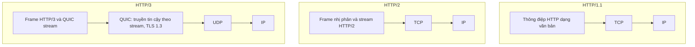
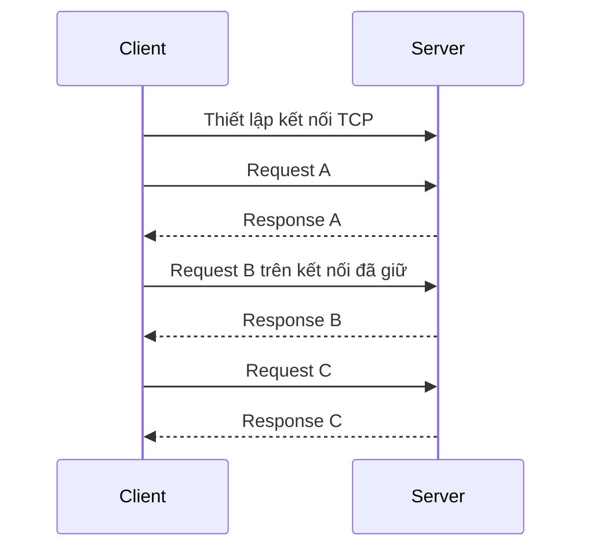
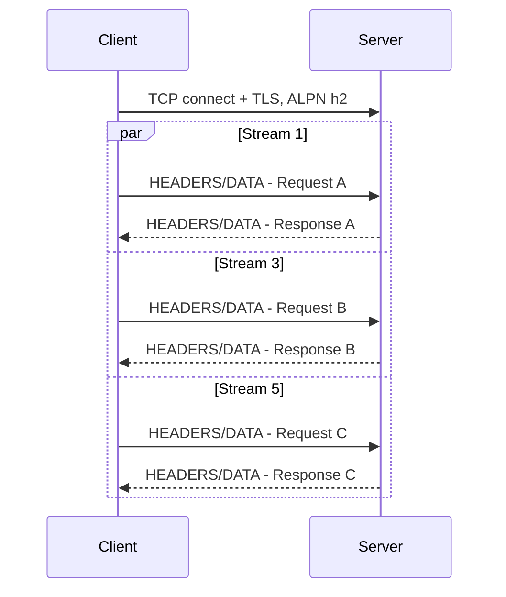
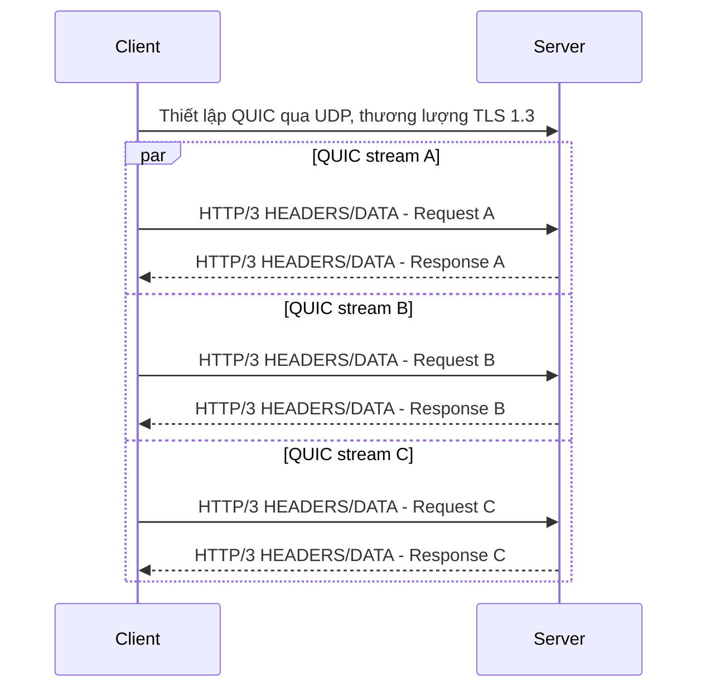

# So sánh luồng truyền HTTP/1.1, HTTP/2 và HTTP/3

HTTP/1.1, HTTP/2 và HTTP/3 cùng truyền những thông tin HTTP quen thuộc như method, URI, header, status code và body. Điểm khác biệt lớn nằm ở cách mã hóa thông điệp, tổ chức các luồng request/response và giao thức vận chuyển bên dưới. HTTP/1.1 và HTTP/2 chạy trên TCP; HTTP/3 chạy trên QUIC, một giao thức vận chuyển hoạt động trên UDP.

Java 26 bổ sung HTTP/3 cho `java.net.http.HttpClient` qua JEP 517. Nhờ đó, ứng dụng Java có thể chọn HTTP/3 bằng API chuẩn mà không phải tự triển khai QUIC. Hiểu rõ luồng truyền của ba phiên bản giúp chọn đúng giao thức, thiết kế fallback và xác minh phiên bản thực sự được sử dụng.

## 1. Nhìn từ các tầng giao thức

Có thể hình dung đường đi từ HTTP xuống tầng vận chuyển như sau:



HTTP định nghĩa ngữ nghĩa của request và response. TCP cung cấp một luồng byte tin cậy, có thứ tự. UDP chỉ cung cấp datagram; QUIC xây dựng trên UDP các chức năng cần cho một kết nối truyền dữ liệu tin cậy, gồm xác nhận, truyền lại, kiểm soát tắc nghẽn, stream và mã hóa TLS 1.3. Vì vậy, không nên hiểu HTTP/3 là gửi dữ liệu HTTP bằng UDP thô rồi chấp nhận mất gói.

## 2. HTTP/1.1: thông điệp văn bản trên một kết nối TCP

Một thông điệp HTTP/1.1 gồm dòng bắt đầu, các dòng header, một dòng trống và phần body nếu có. Request bắt đầu bằng request-line; response bắt đầu bằng status-line. Client và server đọc thông điệp theo cấu trúc này trên kết nối TCP.

HTTP/1.1 mặc định hỗ trợ kết nối lâu dài (*persistent connection*). Sau khi nhận xong response, hai bên có thể tái sử dụng kết nối cho request tiếp theo. Tuy nhiên, giao thức không có lớp multiplexing với các stream độc lập. Khi một kết nối có nhiều request đang chờ, response được ghép với request theo thứ tự gửi. Vì thế, ứng dụng thường mở nhiều kết nối TCP để xử lý nhiều request song song.

Luồng trao đổi điển hình:



Ưu điểm của HTTP/1.1 là tương thích rộng, dễ quan sát khi gỡ lỗi và có mô hình triển khai đơn giản. Hạn chế xuất hiện khi một trang hoặc ứng dụng cần tải nhiều tài nguyên: nhiều kết nối làm tăng chi phí socket, bắt tay TCP/TLS và cạnh tranh băng thông. Trên cùng một kết nối, các byte được TCP chuyển giao theo thứ tự; mất một đoạn TCP có thể làm dữ liệu phía sau phải chờ được truyền lại.

## 3. HTTP/2: nhiều stream trên một kết nối TCP

HTTP/2 thay cách biểu diễn thông điệp bằng frame nhị phân. Một request/response được gắn với một stream có mã định danh. Các frame của nhiều stream có thể xen kẽ trên cùng một kết nối TCP, nhờ đó nhiều request có thể tiến triển đồng thời mà không cần mở một kết nối TCP riêng cho từng request.

Khi dùng HTTPS, client và server thường thương lượng HTTP/2 bằng TLS ALPN với mã giao thức `h2`. HTTP/2 dùng frame `HEADERS` và `DATA` để truyền header và nội dung. HPACK nén các trường header để giảm dữ liệu lặp lại. Giao thức có flow control ở cả cấp stream và cấp connection để giới hạn lượng dữ liệu đang được gửi.



Multiplexing giải quyết tình trạng phải xếp hàng request ở tầng HTTP/1.1, nhưng không loại bỏ mọi kiểu chặn. Tất cả frame HTTP/2 vẫn đi trong một luồng byte TCP có thứ tự. Nếu một gói TCP bị mất, TCP phải phục hồi phần byte bị thiếu trước khi giao tiếp phần byte phía sau cho tầng HTTP/2. Trong thời gian đó, nhiều stream đang dùng chung kết nối có thể cùng bị đình trệ. Đây là *transport-level head-of-line blocking*.

HTTP/2 vẫn là lựa chọn phù hợp khi server, client, proxy và hạ tầng mạng hỗ trợ tốt TCP nhưng chưa cho phép QUIC/UDP. Việc dùng HTTP/2 không có nghĩa là ứng dụng đã chạy trên nhiều kết nối: lợi ích multiplexing thường đến từ nhiều stream dùng chung một kết nối.

## 4. HTTP/3: multiplexing trên các QUIC stream

HTTP/3 giữ lại nhiều ý tưởng của HTTP/2 như frame nhị phân, stream, header nén và request/response đồng thời. Khác biệt cốt lõi là HTTP/3 ánh xạ các request lên QUIC stream thay vì tạo lớp stream bên trên TCP.

QUIC hoạt động trên UDP và cung cấp truyền tin cậy, có thứ tự bên trong từng stream. Dữ liệu của các stream khác nhau không phải chờ nhau theo thứ tự byte chung của một kết nối TCP. Nếu một gói chứa dữ liệu của stream A bị mất, QUIC cần phục hồi dữ liệu bị thiếu cho stream A; stream B vẫn có thể tiếp tục nhận dữ liệu đã đến đầy đủ. Thứ tự vẫn được bảo đảm bên trong mỗi stream, nên HTTP/3 không xóa head-of-line blocking bên trong một request/response.

QUIC tích hợp TLS 1.3 vào quá trình thiết lập kết nối. HTTP/3 dùng QPACK thay cho HPACK vì cơ chế nén header phải hoạt động trong môi trường các stream có thể tiến triển độc lập. Các stream điều khiển một chiều của QUIC được dùng cho thông tin điều khiển kết nối và trạng thái QPACK.



QUIC dùng connection ID để nhận diện kết nối, nhờ đó có thể hỗ trợ duy trì kết nối khi địa chỉ IP hoặc cổng mạng của thiết bị thay đổi, chẳng hạn khi chuyển từ Wi-Fi sang mạng di động. Việc tiếp tục trên đường mạng mới vẫn cần kiểm tra đường truyền (*path validation*) và phụ thuộc chính sách của hai đầu kết nối; không nên xem đây là bảo đảm rằng mọi lần chuyển mạng đều không gián đoạn.

HTTP/3 có thể giảm ảnh hưởng của mất gói đến các request song song và rút ngắn thời gian thiết lập trong những điều kiện phù hợp. Điều đó không có nghĩa HTTP/3 luôn nhanh hơn. Hiệu quả còn phụ thuộc độ trễ, tỷ lệ mất gói, thiết bị, server, đường truyền UDP và cách cấu hình kết nối.

## 5. So sánh ba luồng truyền

| Tiêu chí | HTTP/1.1 | HTTP/2 | HTTP/3 |
|---|---|---|---|
| Tầng vận chuyển | TCP | TCP | QUIC trên UDP |
| Cách biểu diễn | Dòng bắt đầu, header dạng văn bản, body | Frame nhị phân | Frame nhị phân |
| Song song trên một kết nối | Không có multiplexing stream | Nhiều HTTP stream | Nhiều QUIC stream |
| Nén header | Không có cơ chế nén header chuẩn của phiên bản | HPACK | QPACK |
| Kiểm soát luồng | TCP điều khiển luồng ở cấp kết nối | Flow control ở cấp stream và connection; TCP vẫn điều khiển luồng kết nối | QUIC flow control theo stream và connection |
| Ảnh hưởng khi mất gói | TCP phải khôi phục byte theo thứ tự | TCP có thể làm đình trệ mọi stream trên kết nối | Chủ yếu làm chậm stream có dữ liệu bị thiếu; stream khác có thể tiếp tục |
| Bảo mật thường dùng | HTTPS dùng TLS | HTTPS dùng TLS và ALPN `h2` | QUIC tích hợp TLS 1.3; HTTP/3 dùng HTTPS |
| Thay đổi đường mạng | Kết nối TCP thường cần thiết lập lại | Kết nối TCP thường cần thiết lập lại | QUIC có thể hỗ trợ migration bằng connection ID và path validation |

Điểm quan trọng là HTTP/2 và HTTP/3 đều multiplexing, nhưng tầng vận chuyển xử lý mất gói khác nhau. HTTP/2 có nhiều stream ở tầng HTTP cùng chia sẻ một luồng byte TCP; HTTP/3 có các stream độc lập ngay trong QUIC. HTTP/3 vẫn chia sẻ kiểm soát tắc nghẽn của kết nối và vẫn phải truyền lại dữ liệu bị mất.

## 6. Dùng HTTP/3 trong Java 26

JEP 517 bổ sung hỗ trợ HTTP/3 cho `java.net.http.HttpClient` từ JDK 26. Đây là API chính thức của Java SE, không phải preview hay incubator, vì vậy không cần bật `--enable-preview`. Hằng `HttpClient.Version.HTTP_3` có từ JDK 26.

Ứng dụng vẫn dùng các lớp `HttpClient`, `HttpRequest` và `HttpResponse` quen thuộc. Chỉ cần chọn phiên bản HTTP mong muốn:

```java
import java.net.URI;
import java.net.http.HttpClient;
import java.net.http.HttpRequest;
import java.net.http.HttpResponse;
import java.nio.charset.StandardCharsets;
import java.time.Duration;

public class Http3ClientExample {
    public static void main(String[] args) throws Exception {
        URI uri = URI.create("https://example.com/");

        try (HttpClient client = HttpClient.newBuilder()
                .version(HttpClient.Version.HTTP_3)
                .connectTimeout(Duration.ofSeconds(10))
                .build()) {

            HttpRequest request = HttpRequest.newBuilder(uri)
                    .timeout(Duration.ofSeconds(20))
                    .GET()
                    .build();

            HttpResponse<String> response = client.send(
                    request,
                    HttpResponse.BodyHandlers.ofString(StandardCharsets.UTF_8));

            System.out.printf(
                    "status=%d, HTTP version=%s%n",
                    response.statusCode(),
                    response.version());
        }
    }
}
```

Trong ví dụ, `HTTP_3` là phiên bản ưu tiên. Nó không bảo đảm response chắc chắn dùng HTTP/3. Với cấu hình mặc định của JDK, chế độ khám phá `ANY` có thể thử thiết lập kết nối QUIC và kết nối TLS/TCP rồi dùng kết nối phù hợp được thiết lập trước. Nếu HTTP/3 không khả dụng, request có thể được thực hiện bằng HTTP/2 hoặc HTTP/1.1.

Hãy kiểm tra `response.version()` để biết giao thức thực sự được dùng. `client.version()` chỉ trả về phiên bản ưu tiên được cấu hình cho client, không phải phiên bản đã thương lượng cho một response cụ thể.

### Điều khiển cách tìm endpoint HTTP/3

JDK 26 cung cấp `HttpOption.H3_DISCOVERY` để hướng dẫn cách `HttpClient` tìm hoặc thiết lập kết nối HTTP/3. Chỉ đặt option này khi phiên bản ưu tiên ở client hoặc request là `HTTP_3`; nếu không, option bị bỏ qua.

| Chế độ | Hành vi |
|---|---|
| `Http3DiscoveryMode.ANY` | Dùng thuật toán của implementation. Thông thường có thể thử QUIC và TLS/TCP, sau đó chọn kết nối thiết lập thành công trước |
| `Http3DiscoveryMode.ALT_SVC` | Chỉ dùng thông tin HTTP Alternative Services do server quảng bá để tìm endpoint HTTP/3. Trước khi nhận được thông tin `h3`, request có thể dùng HTTP/1.1 hoặc HTTP/2 |
| `Http3DiscoveryMode.HTTP_3_URI_ONLY` | Chỉ thử HTTP/3 tại host và port của URI. Nếu endpoint không nhận HTTP/3, request thất bại thay vì fallback |

Ví dụ yêu cầu chỉ sử dụng HTTP/3:

```java
import java.net.URI;
import java.net.http.HttpClient;
import java.net.http.HttpOption;
import java.net.http.HttpRequest;
import java.net.http.HttpResponse;

public class Http3OnlyExample {
    public static void main(String[] args) throws Exception {
        try (HttpClient client = HttpClient.newBuilder()
                .version(HttpClient.Version.HTTP_3)
                .build()) {

            HttpRequest request = HttpRequest.newBuilder()
                    .uri(URI.create("https://example.com/"))
                    .setOption(
                            HttpOption.H3_DISCOVERY,
                            HttpOption.Http3DiscoveryMode.HTTP_3_URI_ONLY)
                    .GET()
                    .build();

            HttpResponse<String> response = client.send(
                    request,
                    HttpResponse.BodyHandlers.ofString());

            System.out.println(response.version());
        }
    }
}
```

Chế độ chỉ HTTP/3 phù hợp cho kiểm thử hoặc hệ thống có hợp đồng rõ ràng rằng endpoint phải hỗ trợ QUIC tại đúng host và port. Với ứng dụng thông thường, nên cho phép fallback để không biến việc UDP bị chặn hoặc server chưa hỗ trợ HTTP/3 thành lỗi toàn bộ request.

### Điều kiện và giới hạn cần kiểm tra

- HTTP/3 trong implementation mặc định của JDK chỉ được dùng cho URI có scheme `https`. URI `http` sẽ không được gửi qua HTTP/3.
- Implementation mặc định của JDK không hỗ trợ HTTP/3 qua proxy. Khi proxy được chọn, request có thể hạ xuống HTTP/2 hoặc HTTP/1.1; với `HTTP_3_URI_ONLY`, request sẽ thất bại.
- `SSLContext` hoặc `SSLParameters` tùy chỉnh có thể không tương thích với QUIC của implementation. Khi client không thể dùng HTTP/3, có thể nhận `UnsupportedProtocolVersionException`.
- Mạng có thể chặn UDP hoặc giới hạn lưu lượng QUIC. Kiểm tra firewall, load balancer, NAT, proxy và cấu hình server trước khi kết luận lỗi nằm ở Java.
- Server phải thực sự hỗ trợ HTTP/3 và quảng bá hoặc chấp nhận kết nối tại endpoint phù hợp. Chỉ đặt `HTTP_3` ở phía client không thể tự bật HTTP/3 cho server.

`HttpClient.newHttpClient()` vẫn mặc định ưu tiên HTTP/2. Hãy cấu hình HTTP/3 có chủ đích và tái sử dụng cùng một `HttpClient` cho nhiều request để tận dụng connection pool và thông tin endpoint đã khám phá. Việc gọi `sendAsync()` làm request bất đồng bộ ở API Java; bản thân nó không quyết định request dùng HTTP/1.1, HTTP/2 hay HTTP/3.

## 7. Chọn giao thức và kiểm chứng trong hệ thống thực tế

- Chọn HTTP/1.1 khi phải tương thích với endpoint hoặc intermediary chỉ hỗ trợ HTTP/1.1, hoặc khi cần kiểm tra một luồng truyền đơn giản.
- Chọn HTTP/2 khi server và hạ tầng hỗ trợ multiplexing trên TCP, đặc biệt khi UDP bị chặn hoặc đường đi bắt buộc qua proxy không hỗ trợ QUIC.
- Thử HTTP/3 khi cả client, server và đường mạng cho phép QUIC. HTTP/3 đáng quan tâm với nhiều request đồng thời, mạng di động hoặc đường truyền có mất gói, nhưng cần đo hiệu năng trên đúng môi trường triển khai.

Khi nâng cấp ứng dụng lên JDK 26, kiểm tra theo trình tự:

1. Xác nhận JDK dùng để biên dịch và chạy là JDK 26 trở lên nếu mã nguồn tham chiếu `HttpClient.Version.HTTP_3` hoặc `HttpOption.H3_DISCOVERY`.
2. Xác nhận HTTP/3 được bật ở server và endpoint hỗ trợ HTTPS qua QUIC.
3. Kiểm tra UDP, firewall, NAT, load balancer, proxy và TLS configuration trên toàn đường đi.
4. Gửi request với `HTTP_3` ở chế độ cho phép fallback; ghi lại `HttpResponse.version()` để quan sát phiên bản thực tế.
5. Chỉ chuyển sang `HTTP_3_URI_ONLY` khi cần kiểm thử hoặc bắt buộc giao thức và đã xác minh endpoint hỗ trợ HTTP/3.
6. Đo độ trễ, thông lượng, tỷ lệ fallback, lỗi timeout và mức sử dụng CPU trên workload thực tế trước khi thay đổi cấu hình production.

Không suy ra hiệu năng chỉ từ số phiên bản HTTP. Một kết nối HTTP/3 có thể không đem lại lợi ích nếu đường mạng xử lý UDP kém; HTTP/2 có thể là lựa chọn tốt hơn trên một mạng TCP ổn định. Cần đo cả lần kết nối đầu tiên lẫn các request sau khi connection đã được tái sử dụng.

## 8. Những điểm cần nhớ

- HTTP/1.1 truyền thông điệp văn bản trên TCP và không có multiplexing stream độc lập.
- HTTP/2 đóng gói dữ liệu thành frame nhị phân, multiplex nhiều stream trên một TCP connection, nhưng mất gói TCP có thể làm đình trệ tất cả stream trên kết nối đó.
- HTTP/3 dùng QUIC trên UDP. QUIC cung cấp độ tin cậy theo từng stream, TLS 1.3 và flow control; mất gói ở một stream không nhất thiết chặn các stream còn lại.
- HTTP/3 thay HPACK bằng QPACK và có thể hỗ trợ migration nhờ connection ID cùng path validation.
- JDK 26 bổ sung HTTP/3 cho `java.net.http.HttpClient` qua API chính thức, không phải preview/incubator. HTTP/3 không phải phiên bản mặc định; cần bật ưu tiên và kiểm tra `HttpResponse.version()`.
- Fallback, HTTPS, UDP, proxy, SSLContext và khả năng hỗ trợ của server đều ảnh hưởng đến việc HTTP/3 có thực sự được sử dụng hay không.

## Tài liệu tham khảo

- [JEP 517: HTTP/3 for the HTTP Client API](https://openjdk.org/jeps/517)
- [Java SE 26 API: HttpClient](https://docs.oracle.com/en/java/javase/26/docs/api/java.net.http/java/net/http/HttpClient.html)
- [Java SE 26 API: HttpClient.Version](https://docs.oracle.com/en/java/javase/26/docs/api/java.net.http/java/net/http/HttpClient.Version.html)
- [Java SE 26 API: HttpOption và H3_DISCOVERY](https://docs.oracle.com/en/java/javase/26/docs/api/java.net.http/java/net/http/HttpOption.html)
- [Java SE 26 API: Http3DiscoveryMode](https://docs.oracle.com/en/java/javase/26/docs/api/java.net.http/java/net/http/HttpOption.Http3DiscoveryMode.html)
- [Inside Java: HTTP Client Updates in Java 26](https://inside.java/2026/03/04/jdk-26-http-client/)
- [RFC 9112: HTTP/1.1](https://www.rfc-editor.org/rfc/rfc9112.html)
- [RFC 9113: HTTP/2](https://www.rfc-editor.org/rfc/rfc9113.html)
- [RFC 9114: HTTP/3](https://www.rfc-editor.org/rfc/rfc9114.html)
- [RFC 9000: QUIC — A UDP-Based Multiplexed and Secure Transport](https://www.rfc-editor.org/rfc/rfc9000.html)
