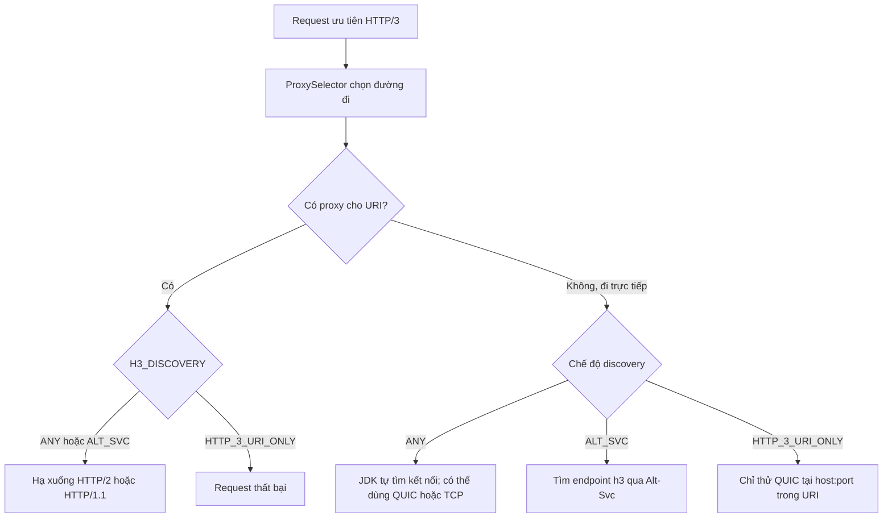

# Giới hạn HTTP/3 qua proxy của triển khai JDK

## 1. Phạm vi và trạng thái API

JDK 26 đưa HTTP/3 vào `java.net.http.HttpClient` qua JEP 517. Đây là API chính thức, không phải preview hay incubator; JDK 27 tiếp tục cung cấp `HttpClient.Version.HTTP_3`, `HttpOption.H3_DISCOVERY` và `HttpOption.Http3DiscoveryMode`.

Bài này tập trung vào **HttpClient tích hợp trong JDK**. Javadoc của JDK mô tả rõ giới hạn triển khai: HTTP/3 qua proxy chưa được hỗ trợ. Hành vi này là ghi chú triển khai của HttpClient JDK, không nên suy rộng thành kết luận rằng mọi HTTP client của bên thứ ba đều có cùng giới hạn.

Cần phân biệt ba điều:

- `version(HttpClient.Version.HTTP_3)` đặt **phiên bản ưu tiên**, không bảo đảm request thực tế luôn dùng HTTP/3.
- Proxy được chọn cho URI có thể khiến HttpClient JDK chuyển request sang HTTP/2 hoặc HTTP/1.1.
- Muốn biết giao thức đã thực sự dùng, hãy kiểm tra `HttpResponse.version()`, không chỉ kiểm tra mã trạng thái HTTP.

Tài liệu API JDK 27: [HttpClient](https://docs.oracle.com/en/java/javase/27/docs/api/java.net.http/java/net/http/HttpClient.html), [HttpOption](https://docs.oracle.com/en/java/javase/27/docs/api/java.net.http/java/net/http/HttpOption.html), [Http3DiscoveryMode](https://docs.oracle.com/en/java/javase/27/docs/api/java.net.http/java/net/http/HttpOption.Http3DiscoveryMode.html).

## 2. Vì sao proxy làm HTTP/3 không được sử dụng?

HTTP/3 chạy trên QUIC; QUIC dùng UDP để truyền dữ liệu và tích hợp TLS 1.3 trong quá trình bắt tay. Trong khi đó, proxy HTTP truyền thống thường xử lý HTTP trực tiếp hoặc tạo đường hầm TCP bằng phương thức CONNECT cho HTTPS. Đường hầm TCP kiểu này không chuyển tiếp luồng QUIC/UDP.

Một số giao thức proxy hiện đại có thể hỗ trợ chuyển tiếp UDP, nhưng điều đó không có nghĩa HttpClient tích hợp trong JDK tự động sử dụng được chúng. Theo Javadoc hiện hành, **implementation built-in của JDK không hỗ trợ HTTP/3 qua proxy**. Khi một proxy được chọn cho request URI, JDK không gửi HTTP/3 xuyên qua proxy đó.

Giới hạn này liên quan đến quyết định định tuyến của `ProxySelector`, không chỉ đến việc ứng dụng có gọi `builder.proxy(...)` hay không. HttpClient có thể dùng proxy mặc định của hệ thống ngay cả khi mã nguồn không cấu hình proxy trực tiếp.

## 3. Proxy được chọn từ đâu?

Có hai nguồn cấu hình thường gặp:

1. **ProxySelector gắn trực tiếp vào HttpClient.** Ứng dụng gọi `HttpClient.newBuilder().proxy(selector)`. Selector quyết định dùng proxy nào cho từng URI.
2. **ProxySelector mặc định của JVM.** Nếu không gọi `builder.proxy(...)`, HttpClient mới dùng proxy selector mặc định. Selector mặc định của JDK có thể đọc các system properties như `https.proxyHost`, `https.proxyPort`, `http.proxyHost`, `http.proxyPort` và `http.nonProxyHosts`.

Ví dụ cấu hình proxy tường minh:

```java
import java.net.InetSocketAddress;
import java.net.ProxySelector;
import java.net.http.HttpClient;

var proxy = ProxySelector.of(
        new InetSocketAddress("proxy.example.net", 8080)
);

HttpClient client = HttpClient.newBuilder()
        .proxy(proxy)
        .version(HttpClient.Version.HTTP_3)
        .build();
```

Đoạn mã vẫn tạo được client có phiên bản ưu tiên HTTP/3. Tuy nhiên, nếu selector chọn proxy cho URI HTTPS, request sẽ không được gửi qua HTTP/3 trong implementation JDK.

Một trường hợp dễ gây nhầm lẫn là:

```java
System.out.println(client.proxy());
```

Kết quả `Optional.empty()` chỉ cho biết ứng dụng không đặt một ProxySelector tường minh trên builder. Theo Javadoc, HttpClient vẫn có thể dùng một proxy selector mặc định không được expose qua getter này. Vì vậy, **không dùng `client.proxy().isEmpty()` làm bằng chứng rằng request đi trực tiếp**.

Để kiểm tra selector mặc định của JVM cho một URI:

```java
import java.net.ProxySelector;
import java.net.URI;

URI uri = URI.create("https://api.example.com/data");
ProxySelector selector = ProxySelector.getDefault();

if (selector == null) {
    System.out.println("Không có system-wide ProxySelector");
} else {
    System.out.println("Các lựa chọn định tuyến: " + selector.select(uri));
}
```

Nếu ứng dụng cấu hình selector riêng cho client, hãy kiểm tra chính selector đó. Kết quả `Proxy.NO_PROXY` biểu thị kết nối trực tiếp; một proxy được trả về có nghĩa là request đang được định tuyến qua proxy. Với selector trả về nhiều lựa chọn, cần xem thứ tự và hành vi thực tế của selector khi kết nối thất bại.

JDK lấy các giá trị mặc định toàn hệ thống tại thời điểm tạo `HttpClient`. Nếu ứng dụng gọi `ProxySelector.setDefault(...)` hoặc thay đổi cấu hình proxy sau khi client đã được build, client cũ không tự nhận cấu hình mới. Hãy cấu hình trước khi tạo client hoặc build lại client sau khi thay đổi selector.

Tài liệu liên quan: [HttpClient.Builder.proxy](https://docs.oracle.com/en/java/javase/27/docs/api/java.net.http/java/net/http/HttpClient.Builder.html), [ProxySelector](https://docs.oracle.com/en/java/javase/27/docs/api/java.base/java/net/ProxySelector.html), [System Properties của JDK 27](https://docs.oracle.com/en/java/javase/27/docs/api/system-properties.html).

## 4. Hành vi theo H3_DISCOVERY

JDK cung cấp tùy chọn request `HttpOption.H3_DISCOVERY` để hướng dẫn cách tìm hoặc thiết lập kết nối HTTP/3. Nếu không đặt tùy chọn này và phiên bản ưu tiên là HTTP/3, implementation JDK dùng chế độ `ANY`.

| Chế độ | Khi không có proxy được chọn | Khi proxy được chọn |
|---|---|---|
| `ANY` | JDK tự chọn cách thiết lập kết nối. Có thể thử QUIC/HTTP/3 và TLS qua TCP; giao thức thực tế phụ thuộc kết nối thành công. | HTTP/3 không được dùng; JDK hạ xuống HTTP/2 hoặc HTTP/1.1. Gợi ý `H3_DISCOVERY` bị bỏ qua. |
| `ALT_SVC` | Chỉ dùng thông tin HTTP Alternative Services để tìm HTTP/3. Trước khi server quảng bá endpoint `h3`, request có thể dùng HTTP/1.1 hoặc HTTP/2. | HTTP/3 không được dùng qua proxy; request đi theo HTTP/2 hoặc HTTP/1.1 nếu kết nối thay thế thành công. |
| `HTTP_3_URI_ONLY` | Chỉ thử HTTP/3 tại đúng host và port của URI; không dùng thông tin Alternative Services. | Request thất bại. JDK không hạ xuống HTTP/2 hoặc HTTP/1.1. |

Có thể hình dung luồng xử lý như sau:



Ví dụ đặt chế độ `ANY`:

```java
import java.net.URI;
import java.net.http.HttpClient;
import java.net.http.HttpOption;
import java.net.http.HttpRequest;
import java.net.http.HttpResponse;

URI uri = URI.create("https://api.example.com/data");

HttpClient client = HttpClient.newBuilder()
        .version(HttpClient.Version.HTTP_3)
        .build();

HttpRequest request = HttpRequest.newBuilder(uri)
        .setOption(
                HttpOption.H3_DISCOVERY,
                HttpOption.Http3DiscoveryMode.ANY
        )
        .GET()
        .build();

HttpResponse<String> response = client.send(
        request,
        HttpResponse.BodyHandlers.ofString()
);

System.out.println("HTTP status: " + response.statusCode());
System.out.println("Protocol actually used: " + response.version());
```

Nếu JVM hoặc ứng dụng chọn proxy cho `api.example.com`, request trong ví dụ vẫn có thể nhận được phản hồi thành công qua HTTP/2 hoặc HTTP/1.1. Điều đó không chứng minh HTTP/3 đã hoạt động.

Muốn yêu cầu HTTP/3 nghiêm ngặt, có thể đặt `HTTP_3_URI_ONLY`:

```java
HttpRequest request = HttpRequest.newBuilder(uri)
        .setOption(
                HttpOption.H3_DISCOVERY,
                HttpOption.Http3DiscoveryMode.HTTP_3_URI_ONLY
        )
        .GET()
        .build();

try {
    HttpResponse<String> response = client.send(
            request,
            HttpResponse.BodyHandlers.ofString()
    );
    System.out.println(response.version());
} catch (java.net.http.UnsupportedProtocolVersionException e) {
    System.err.println("Không thể thực hiện request bằng HTTP/3: " + e.getMessage());
}
```

Khi proxy được chọn, chế độ nghiêm ngặt này làm request thất bại thay vì âm thầm dùng HTTP/2 hoặc HTTP/1.1. `UnsupportedProtocolVersionException` cũng có thể xuất hiện khi cấu hình `SSLContext` hoặc `SSLParameters` không đáp ứng yêu cầu của HTTP/3. Với `sendAsync`, lỗi sẽ được thể hiện qua completion stage, thường cần xử lý ngoại lệ hoàn tất bất đồng bộ.

## 5. Cách tổ chức client khi hệ thống bắt buộc dùng proxy

Không có cờ cấu hình nào khiến implementation HttpClient JDK tự truyền HTTP/3 qua proxy. Có ba cách tổ chức tùy chính sách mạng:

### 5.1. Dùng kết nối trực tiếp cho endpoint được phép

`HttpClient.Builder.NO_PROXY` là ProxySelector luôn trả về `Proxy.NO_PROXY`. Có thể tạo một client riêng cho endpoint mà chính sách mạng cho phép truy cập trực tiếp:

```java
HttpClient directHttp3Client = HttpClient.newBuilder()
        .version(HttpClient.Version.HTTP_3)
        .proxy(HttpClient.Builder.NO_PROXY)
        .build();
```

Cấu hình này loại bỏ proxy selector mặc định cho client đó. Nó **không** bảo đảm kết nối QUIC thành công: firewall, VPN, gateway, NAT hoặc chính sách egress vẫn có thể chặn UDP. Chỉ dùng kết nối trực tiếp khi mạng và chính sách của tổ chức cho phép.

### 5.2. Định tuyến theo host bằng ProxySelector riêng

Nếu chỉ một số host được phép đi trực tiếp, tạo ProxySelector có quy tắc rõ ràng: trả về `Proxy.NO_PROXY` cho các host được phê duyệt và trả về proxy cho những host còn lại. Cách này giữ được đường đi qua proxy cho các đích khác.

Không nên tắt proxy toàn JVM chỉ để thử HTTP/3. Việc thay đổi `ProxySelector.setDefault(...)` hoặc các system properties có thể ảnh hưởng các thành phần mạng khác trong cùng tiến trình.

### 5.3. Giữ proxy và chấp nhận HTTP/2 hoặc HTTP/1.1

Nếu hạ tầng bắt buộc mọi kết nối ra ngoài đi qua proxy HTTP hiện có, hãy dùng HTTP/2 hoặc HTTP/1.1 qua proxy với HttpClient JDK. Có thể tiếp tục đặt HTTP/3 làm phiên bản ưu tiên ở client, nhưng cần hiểu rằng request có proxy được chọn sẽ không chạy bằng HTTP/3. Nếu giao thức là yêu cầu bắt buộc, phải thay đổi kiến trúc mạng hoặc chọn client/proxy có hỗ trợ cơ chế chuyển tiếp UDP phù hợp; không thể giải quyết chỉ bằng cách đổi `H3_DISCOVERY`.

## 6. Các giới hạn khác có thể bị nhầm với giới hạn proxy

Ngay cả khi không có proxy, HTTP/3 vẫn phụ thuộc vào các điều kiện sau:

- URI phải dùng scheme `https`. Request tới `http://...` không được gửi bằng HTTP/3.
- Máy chủ phải hỗ trợ HTTP/3 và có thể nhận QUIC tại endpoint được chọn. Với `HTTP_3_URI_ONLY`, host và port phải đúng như authority của URI.
- Đường mạng phải cho phép QUIC/UDP tới endpoint. Mạng chỉ cho TCP/443 có thể khiến HTTP/3 không thiết lập được.
- `SSLContext` và `SSLParameters` tùy chỉnh phải tương thích với HTTP/3 và TLS 1.3. Cấu hình TLS chỉ cho phép TLS 1.2 có thể làm HTTP/3 không khả dụng.
- Ở chế độ `ANY`, JDK có thể chọn giao thức TCP thay thế nếu HTTP/3 không thiết lập được. Ở chế độ `HTTP_3_URI_ONLY`, ứng dụng phải xử lý lỗi thay vì trông đợi fallback.
- Redirect có thể chuyển request sang host khác. ProxySelector cần được đánh giá cho URI đích mới; do đó một request ban đầu đi trực tiếp vẫn có thể bị chuyển sang proxy sau redirect và không còn dùng HTTP/3.

Không nên gộp mọi lỗi kết nối thành lỗi proxy. Hãy phân biệt proxy được chọn, UDP bị chặn, server không hỗ trợ QUIC, URI không phải HTTPS và TLS configuration không tương thích.

## 7. Checklist kiểm chứng trong môi trường thật

1. **Xác nhận runtime.** Kiểm tra `java -version` và phiên bản JDK thực sự chạy ứng dụng. HTTP/3 trong HttpClient có từ JDK 26.
2. **Kiểm tra proxy selector.** Xem cấu hình `builder.proxy(...)`, `ProxySelector.getDefault()` và các system properties proxy. Đừng kết luận từ `client.proxy().isEmpty()`.
3. **Kiểm tra định tuyến cho đúng URI.** Gọi `ProxySelector.select(uri)` trên selector mà client sử dụng. Đặc biệt kiểm tra các URI sau redirect.
4. **Ghi nhận giao thức thực tế.** Log `response.version()` cùng host đích và kết quả request; tránh chỉ ghi status code.
5. **Thử hai chế độ discovery.** Dùng `ANY` để kiểm tra hành vi fallback; dùng `HTTP_3_URI_ONLY` trong bài test riêng để phát hiện cấu hình không đáp ứng HTTP/3.
6. **Kiểm tra đường UDP/QUIC.** Chạy thử từ đúng container, máy ảo hoặc subnet production. Một máy developer kết nối được không chứng minh môi trường production có cùng quyền truy cập.
7. **Kiểm tra TLS tùy chỉnh.** Nếu dùng SSLContext/SSLParameters riêng, thử trên đúng JDK và xử lý `UnsupportedProtocolVersionException`.
8. **Kiểm tra chính sách mạng.** Chỉ cấu hình direct route cho host được phép; ghi lại lý do và chủ sở hữu ngoại lệ mạng.

| Triệu chứng | Khả năng cần kiểm tra |
|---|---|
| HTTP status 200 nhưng `response.version()` là HTTP_2 | Proxy đã được chọn hoặc HTTP/3 không thắng quá trình discovery. |
| Request dùng `ANY` qua proxy vẫn thành công | Thành công có thể là HTTP/2 hoặc HTTP/1.1; xem `response.version()`. |
| `HTTP_3_URI_ONLY` thất bại ngay trong môi trường có proxy | Hành vi phù hợp với giới hạn proxy của HttpClient JDK. |
| Không proxy nhưng `HTTP_3_URI_ONLY` vẫn thất bại | Kiểm tra HTTPS, host/port, QUIC/UDP, server và TLS context. |
| `client.proxy()` trả về Optional rỗng nhưng request vẫn không dùng HTTP/3 | Kiểm tra default ProxySelector và system properties; Optional rỗng không loại trừ proxy mặc định. |

## 8. Kết luận kỹ thuật

Đối với HttpClient tích hợp trong JDK 26/27, HTTP/3 qua proxy chưa được hỗ trợ. Nếu ProxySelector chọn proxy, chế độ discovery thông thường hạ xuống HTTP/2 hoặc HTTP/1.1; `HTTP_3_URI_ONLY` làm request thất bại. Muốn dùng HTTP/3, cần có đường kết nối trực tiếp được chính sách mạng cho phép, server hỗ trợ QUIC và ứng dụng phải xác minh giao thức thực tế bằng `response.version()`.

Giới hạn này được ghi trong **Implementation Note** của Javadoc JDK, nên khi chuyển sang một HTTP client khác cần kiểm tra tài liệu của implementation đó thay vì mặc định rằng hành vi giống HttpClient JDK.

## Tài liệu tham khảo chính thức

- [JEP 517: HTTP/3 for the HTTP Client API](https://openjdk.org/jeps/517)
- [HttpClient — Java SE 27](https://docs.oracle.com/en/java/javase/27/docs/api/java.net.http/java/net/http/HttpClient.html)
- [HttpClient.Builder — Java SE 27](https://docs.oracle.com/en/java/javase/27/docs/api/java.net.http/java/net/http/HttpClient.Builder.html)
- [HttpOption — Java SE 27](https://docs.oracle.com/en/java/javase/27/docs/api/java.net.http/java/net/http/HttpOption.html)
- [HttpOption.Http3DiscoveryMode — Java SE 27](https://docs.oracle.com/en/java/javase/27/docs/api/java.net.http/java/net/http/HttpOption.Http3DiscoveryMode.html)
- [UnsupportedProtocolVersionException — Java SE 27](https://docs.oracle.com/en/java/javase/27/docs/api/java.net.http/java/net/http/UnsupportedProtocolVersionException.html)
- [ProxySelector — Java SE 27](https://docs.oracle.com/en/java/javase/27/docs/api/java.base/java/net/ProxySelector.html)
- [System Properties — Java SE 27](https://docs.oracle.com/en/java/javase/27/docs/api/system-properties.html)
- [RFC 9114: HTTP/3](https://www.rfc-editor.org/rfc/rfc9114)

