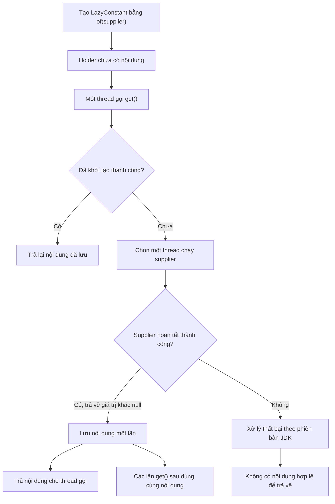

# Hàm cung cấp giá trị và luồng thực hiện khởi tạo

*Tình trạng API được đối chiếu đến ngày 27/11/2026.*

Java 26 giới thiệu `java.lang.LazyConstant<T>` qua **JEP 526 – Lazy Constants (Second Preview)**. Đây là một API preview cho phép trì hoãn việc tạo một giá trị cho đến lần đầu có mã gọi `get()`, sau đó giữ nguyên giá trị đó. Hàm cung cấp giá trị được truyền vào dưới dạng `Supplier<? extends T>`.

Điểm quan trọng của bài này là hiểu đúng thời điểm hàm được chạy và thread nào thực thi nó: tạo `LazyConstant` chưa chạy supplier; lần đầu gọi `get()` mới kích hoạt việc tính toán. Với nhiều thread cùng truy cập một lazy constant chưa khởi tạo, chỉ một thread được chọn chạy supplier; các thread còn lại đợi kết quả khởi tạo. Khi thành công, những lần `get()` sau trả lại cùng nội dung đã được lưu.

Tính năng vẫn là preview trên Java 26 và tiếp tục preview lần thứ ba trên Java 27 (JEP 531). Vì Java 27 đã thay đổi một số API và hành vi khi supplier thất bại, ví dụ phải được biên dịch, chạy và giải thích theo đúng phiên bản JDK.

## 1. Supplier là hàm cung cấp giá trị

`Supplier<T>` là functional interface trong `java.util.function`. Nó mô tả một hàm không nhận tham số và trả về một giá trị kiểu `T` thông qua phương thức `get()`.

Ví dụ supplier đơn giản:

```java
import java.util.function.Supplier;

Supplier<String> messageSupplier = () -> "Hello Java";
String message = messageSupplier.get();

System.out.println(message);
```

Khai báo supplier chưa tự chạy lambda. Hàm chỉ chạy khi chương trình gọi `messageSupplier.get()`. Có thể truyền method reference thay cho lambda nếu đã có hàm phù hợp:

```java
Supplier<Settings> settingsSupplier = SettingsLoader::load;
```

Với `LazyConstant`, supplier chính là hàm tính nội dung sẽ được lưu. `LazyConstant.of(supplier)` giữ hàm đó để gọi về sau; `lazy.get()` yêu cầu nội dung và kích hoạt tính toán nếu chưa có kết quả thành công.

| Thành phần | Vai trò |
|---|---|
| `Supplier<T>` | Mô tả cách tạo ra giá trị kiểu `T` khi được gọi |
| `LazyConstant.of(supplier)` | Tạo holder chưa có nội dung và giữ supplier để khởi tạo sau |
| `LazyConstant.get()` | Lấy nội dung; nếu chưa khởi tạo thì chạy supplier |
| Lần gọi `get()` tiếp theo | Trả lại nội dung đã khởi tạo, không tính lại sau khi thành công |

Không nhầm `Supplier.get()` với `LazyConstant.get()`: lời gọi thứ hai là yêu cầu lấy giá trị từ holder; trong lần đầu, holder sẽ gọi supplier bên trong.

## 2. Tạo lazy constant chưa đồng nghĩa với khởi tạo nội dung

Ví dụ dưới đây mô tả một cấu hình chỉ được tải khi thành phần thật sự cần dùng:

```java
import java.lang.LazyConstant;
import java.util.concurrent.atomic.AtomicInteger;

record Settings(String endpoint, int timeoutSeconds) {}

class SettingsLoader {
    static Settings load() {
        System.out.println("Loading settings...");
        return new Settings("https://api.example.com", 10);
    }
}

public class SettingsExample {
    private static final AtomicInteger LOAD_COUNT = new AtomicInteger();

    private static final LazyConstant<Settings> SETTINGS =
            LazyConstant.of(() -> {
                LOAD_COUNT.incrementAndGet();
                return SettingsLoader.load();
            });

    static Settings settings() {
        return SETTINGS.get();
    }

    public static void main(String[] args) {
        System.out.println("Application started");

        Settings first = settings();
        Settings second = settings();

        System.out.println(first.endpoint());
        System.out.println("Same object: " + (first == second));
        System.out.println("Load count: " + LOAD_COUNT.get());
    }
}
```

Kết quả minh họa:

```text
Application started
Loading settings...
https://api.example.com
Same object: true
Load count: 1
```

Khi lớp `SettingsExample` được khởi tạo, biểu thức `LazyConstant.of(...)` tạo holder và lưu supplier. Dòng `"Loading settings..."` chưa được in vì supplier chưa chạy. Lần gọi `settings()` đầu tiên đi vào `SETTINGS.get()`, supplier được gọi, cấu hình được tạo và lưu. Lần gọi thứ hai nhận lại chính object đó.

Đây là khác biệt với khởi tạo eager thông thường:

```java
private static final Settings SETTINGS = SettingsLoader.load();
```

Trong cách eager, `SettingsLoader.load()` chạy khi lớp được khởi tạo. Với lazy constant, việc tạo holder diễn ra sớm nhưng nội dung chỉ được tính khi có lần gọi `get()` đầu tiên.

## 3. Luồng thực hiện khi gọi get()

Luồng khởi tạo có thể diễn tả như sau:



Các bước cần nhớ:

1. `of(supplier)` tạo lazy constant nhưng chưa gọi supplier.
2. Thread đầu tiên gọi `get()` khi holder chưa khởi tạo sẽ được chọn để thực hiện supplier trên chính thread gọi đó.
3. Nếu supplier trả về một giá trị hợp lệ, holder lưu nội dung và `get()` trả về giá trị đó.
4. Những thread đang chờ được tiếp tục và nhìn thấy nội dung đã khởi tạo.
5. Những lần `get()` tiếp theo trả lại nội dung đã lưu; supplier không chạy lại sau khi khởi tạo thành công.

Việc chạy supplier đồng bộ trên thread gọi `get()` là điểm quan trọng khi thiết kế. Lazy constant không tự gửi supplier sang executor, không tạo background thread và không biến một thao tác chậm thành bất đồng bộ. Nếu supplier tải cấu hình từ xa hoặc đọc file lớn, thread đầu tiên gọi `get()` sẽ phải chờ công việc đó.

## 4. Nhiều thread cùng gọi get()

Java bảo đảm lazy constant được khởi tạo nguyên tử và tối đa một lần khi khởi tạo thành công. Nếu nhiều thread đồng thời gọi `get()` trên cùng một holder chưa khởi tạo:

- Chỉ một thread được chọn chạy supplier.
- Các thread còn lại bị chặn trong lúc chờ kết quả.
- Sau khi khởi tạo thành công, các thread tiếp tục và nhận cùng nội dung.
- Supplier không bị chạy đồng thời nhiều lần cho cùng một lần khởi tạo thành công.

Ví dụ:

```java
import java.lang.LazyConstant;
import java.util.concurrent.CountDownLatch;
import java.util.concurrent.atomic.AtomicInteger;

public class ConcurrentLazyExample {
    private static final AtomicInteger COMPUTE_COUNT = new AtomicInteger();

    private static final LazyConstant<String> VALUE =
            LazyConstant.of(() -> {
                COMPUTE_COUNT.incrementAndGet();
                System.out.println(
                        "Computing on " + Thread.currentThread().getName()
                );
                return "initialized";
            });

    public static void main(String[] args) throws InterruptedException {
        int threadCount = 8;
        var ready = new CountDownLatch(threadCount);
        var start = new CountDownLatch(1);
        var done = new CountDownLatch(threadCount);

        for (int i = 0; i < threadCount; i++) {
            Thread.ofPlatform().start(() -> {
                ready.countDown();
                try {
                    start.await();
                    System.out.println(VALUE.get());
                } catch (InterruptedException e) {
                    Thread.currentThread().interrupt();
                } finally {
                    done.countDown();
                }
            });
        }

        ready.await();
        start.countDown();
        done.await();

        System.out.println("Compute count: " + COMPUTE_COUNT.get());
    }
}
```

Sau khi tất cả thread cùng được giải phóng, chỉ một thread chạy supplier. Dòng `Compute count: 1` là kết quả mong đợi khi supplier hoàn tất thành công. Thứ tự các dòng `initialized` và tên thread phụ thuộc lịch lập lịch của JVM, nên không nên dựa vào thứ tự log để xác định thread nào thắng.

Tính nguyên tử và quan hệ happens-before bảo đảm nội dung đã khởi tạo được công bố an toàn cho các thread khác. Nếu supplier tạo một object có các field `final`, các thread nhận object sau khi `get()` thành công sẽ nhìn thấy trạng thái đã được khởi tạo an toàn.

## 5. Supplier chạy trên thread gọi và giới hạn khi chờ

Thread thực hiện supplier chính là thread được chọn trong số các thread gọi `get()`. Các thread cạnh tranh khác chờ holder được khởi tạo hoặc thất bại.

Điều này dẫn đến một số giới hạn:

- Nếu supplier chạy lâu, lần gọi `get()` đầu tiên cũng chạy lâu.
- Nếu supplier bị block vô thời hạn, các thread khác đang chờ cùng lazy constant có thể bị block vô thời hạn.
- Ngắt thread tính toán không hủy quá trình khởi tạo. `LazyConstant.get()` không xóa interrupt status và không ném `InterruptedException` chỉ vì thread bị interrupt.
- API không cung cấp timeout hoặc cancellation cho supplier.
- Không gọi ngược vào chính lazy constant từ supplier theo cách tạo vòng đệ quy.

Do đó, supplier phù hợp với việc tạo object hoặc tải dữ liệu có chi phí xác định, có thể hoàn thành trong thời gian hợp lý. Với tác vụ cần timeout, hủy, retry theo chính sách nghiệp vụ hoặc điều phối bất đồng bộ, hãy thiết kế cơ chế đó ở lớp dịch vụ trước khi đưa kết quả vào holder. Đừng dùng lazy constant như một thay thế cho executor hoặc API async.

## 6. Giá trị trả về, null và lỗi khi khởi tạo

Lazy constant không thể chứa `null`. Nếu supplier trả về `null`, Java 26 ném `NullPointerException`. Nếu ứng dụng cần biểu diễn kết quả có thể vắng mặt, hãy lưu một `Optional<T>` thay vì để supplier trả về null:

```java
import java.lang.LazyConstant;
import java.util.Optional;

record User(String id, String name) {}

static Optional<User> loadOptionalUser() {
    return Optional.ofNullable(findUser());
}

static final LazyConstant<Optional<User>> USER =
        LazyConstant.of(MyService::loadOptionalUser);
```

Với Java 26 (JEP 526), nếu supplier ném exception, throwable được truyền lại cho thread gọi `get()` và lazy constant vẫn chưa được khởi tạo. Một lần gọi `get()` sau đó có thể thử chạy supplier lại. Vì vậy, supplier có side effect cần được thiết kế cẩn thận: lần chạy đầu có thể đã tạo một phần tài nguyên rồi thất bại, và lần thử tiếp theo có thể lặp lại side effect đó.

Nếu supplier gọi trực tiếp hoặc gián tiếp `get()` trên chính lazy constant đang được khởi tạo, Java 26 ném `IllegalStateException` và holder không được khởi tạo. Hãy tránh dependency cycle; nếu có nhiều lazy constant phụ thuộc lẫn nhau, vẽ rõ đồ thị phụ thuộc và bảo đảm không tạo chu trình.

### Khác biệt quan trọng khi nâng cấp lên Java 27

Java 27 tiếp tục tính năng này dưới **JEP 531 – Lazy Constants (Third Preview)**. API vẫn là preview và có thay đổi so với JDK 26:

| Hành vi | Java 26 – JEP 526 | Java 27 – JEP 531 |
|---|---|---|
| Supplier trả về giá trị hợp lệ | Lưu giá trị; lần gọi sau dùng lại | Lưu giá trị; lần gọi sau dùng lại |
| Supplier trả về `null` | Ném `NullPointerException`; không có nội dung | Chuyển sang error state; `get()` ném `NoSuchElementException` với `NullPointerException` làm cause |
| Supplier ném unchecked exception hoặc Error | Throwable được truyền lại; holder chưa khởi tạo và lần `get()` sau có thể thử lại | Holder chuyển sang error state; lần `get()` lỗi đầu ném `NoSuchElementException` có cause; lần sau tiếp tục ném `NoSuchElementException` và không chạy supplier lại |
| Supplier tự gọi lại chính lazy constant | Ném `IllegalStateException`; holder chưa khởi tạo | Chuyển sang error state; `get()` ném `NoSuchElementException` với `IllegalStateException` làm cause |
| API kiểm tra trạng thái | Có `isInitialized()` và `orElse(T)` | Hai phương thức này đã bị loại khỏi API preview |

Vì vậy, không mang code xử lý exception hoặc kiểm tra trạng thái của Java 26 sang Java 27 mà không đọc lại API specification. Để ví dụ dễ nâng cấp, ưu tiên đường đi cốt lõi `of(Supplier)` và `get()`; tránh phụ thuộc vào `isInitialized()` và `orElse()` vì chúng không còn trong API Java 27.

## 7. Kết hợp các lazy constant theo quan hệ phụ thuộc

Một lazy constant có thể lấy dữ liệu từ lazy constant khác. Khi yêu cầu giá trị ở node phụ thuộc, các giá trị nền tảng sẽ được khởi tạo trước nếu chúng chưa có.

```java
import java.lang.LazyConstant;

record DatabaseConfig(String url) {}
record Repository(DatabaseConfig config) {}
record Service(Repository repository) {}

public class ComponentGraph {
    private static final LazyConstant<DatabaseConfig> DATABASE =
            LazyConstant.of(() ->
                    new DatabaseConfig("jdbc:example:inventory")
            );

    private static final LazyConstant<Repository> REPOSITORY =
            LazyConstant.of(() ->
                    new Repository(DATABASE.get())
            );

    private static final LazyConstant<Service> SERVICE =
            LazyConstant.of(() ->
                    new Service(REPOSITORY.get())
            );

    public static Service service() {
        return SERVICE.get();
    }
}
```

Khi gọi `service()` lần đầu, chuỗi khởi tạo đi theo thứ tự:

1. `SERVICE.get()` gọi supplier tạo `Service`.
2. Supplier của `Service` gọi `REPOSITORY.get()`.
3. Supplier của `Repository` gọi `DATABASE.get()`.
4. `DatabaseConfig` được tạo trước, sau đó đến `Repository` và cuối cùng là `Service`.

Những lần gọi tiếp theo dùng lại các giá trị đã lưu. Cấu trúc này giúp khởi tạo các thành phần theo nhu cầu, nhưng dependency graph phải không có chu trình. Chu trình phụ thuộc có thể gây lỗi khởi tạo hoặc lỗi khởi tạo lớp, nhất là khi các holder được khai báo trong static initializer.

## 8. Tính bất biến và tối ưu hóa của JVM

Lazy constant cho phép JVM xem nội dung đã khởi tạo như một hằng số. Vì giá trị không thể thay đổi sau khi khởi tạo thành công, JVM có thể áp dụng constant folding và tối ưu hóa tương tự một số tối ưu dành cho field `final`.

Để JVM có thể áp dụng tối ưu này, tài liệu API mô tả một đường tham chiếu đáng tin cậy: từ một field `static final` trực tiếp đến lazy constant, hoặc từ field `static final` qua các trusted field (ví dụ field `static final`, field của record hoặc final instance field trong hidden class) đến lazy constant. Việc dùng API không đảm bảo mọi JVM hoặc mọi chương trình đều được constant-fold; đây là khả năng tối ưu của implementation.

Cần phân biệt hai khái niệm:

- **Holder không đổi nội dung:** sau khi được khởi tạo, lazy constant không thể thay object đang giữ bằng object khác.
- **Object được giữ có thể mutable:** nếu nội dung là `ArrayList`, `Map` hoặc object có setter, trạng thái bên trong object vẫn có thể thay đổi. Lazy constant không tự biến object đó thành immutable.

Nếu muốn chia sẻ giá trị an toàn giữa các thread và hưởng lợi từ tối ưu, nên lưu object immutable, chẳng hạn record chỉ chứa giá trị bất biến hoặc collection không thể sửa đổi. Không dùng lazy constant để che giấu một object mutable đang bị nhiều thread cập nhật.

Không nên khẳng định lazy constant luôn nhanh hơn field `final` hoặc luôn làm startup nhanh hơn. Lợi ích phụ thuộc chi phí tạo giá trị, tỷ lệ thực sự được truy cập, đường tham chiếu và khả năng tối ưu của JVM. Hãy benchmark trên JDK, workload và kiến trúc triển khai thực tế.

## 9. Quản lý bộ nhớ và các giới hạn thiết kế

Lazy constant giữ tham chiếu mạnh đến nội dung sau khi khởi tạo. Nội dung không thể bị xóa hoặc reset; nếu holder còn reachable thì object được giữ cũng còn reachable. Điều này có thể giữ lại bộ nhớ lớn lâu hơn dự kiến.

Ngoài ra:

- Factory giữ tham chiếu đến supplier ít nhất cho đến khi khởi tạo thành công; nếu lambda capture một object lớn, object đó cũng có thể được giữ lại trong thời gian chờ khởi tạo.
- Sau khi khởi tạo thành công, supplier không còn được giữ mạnh theo implementation note của Java 26 và có thể đủ điều kiện garbage collection.
- `LazyConstant` không triển khai `Serializable`.
- Không dùng lazy constant cho cache cần eviction, giá trị cần refresh, dữ liệu phụ thuộc user/request hoặc tài nguyên cần đóng/mở theo chu kỳ.
- Sử dụng trong static initializer có thể tương tác với thứ tự khởi tạo lớp. Dependency cycle có thể gây lỗi khởi tạo.
- Implementation được phép synchronize trên chính lazy constant; tránh tự khóa trực tiếp hoặc gián tiếp trên object holder.

Lazy constant phù hợp với dữ liệu có vòng đời dài, chỉ tạo một lần và giữ đến khi holder không còn được sử dụng, chẳng hạn parser dùng chung, metadata, cấu hình immutable hoặc một thành phần dịch vụ dùng chung.

## 10. Biên dịch và chạy đúng phiên bản JDK

`LazyConstant` là preview API trong cả Java 26 và Java 27. Phải bật preview khi biên dịch và khi chạy. Không cần thêm module incubator vì API nằm trong module chuẩn `java.base`.

Với JDK 26:

```bash
javac --enable-preview --release 26 -d out26 LazyConfigDemo.java
java --enable-preview -cp out26 LazyConfigDemo
```

Với JDK 27:

```bash
javac --enable-preview --release 27 -d out27 LazyConfigDemo.java
java --enable-preview -cp out27 LazyConfigDemo
```

Hai lần biên dịch phải dùng JDK tương ứng. Class file được biên dịch với preview của Java 26 không thể chạy như một class file preview hợp lệ trên Java 27, hoặc ngược lại. Không dùng `--release 26` với mục tiêu bật preview của JDK 27; preview gắn với đúng release.

Trước khi chẩn đoán lỗi, kiểm tra toolchain thực tế:

```bash
java -version
javac -version
```

Nếu một thư viện hoặc module khác sử dụng Lazy Constants preview, toàn bộ đường biên dịch và runtime của ứng dụng cần thống nhất phiên bản JDK và cờ preview. Với sản phẩm production, chỉ đưa API preview vào khi tổ chức chấp nhận rủi ro thay đổi source/binary behavior giữa các release và có kế hoạch nâng cấp.

## 11. Khi nào nên dùng LazyConstant?

Nên cân nhắc khi giá trị có chi phí tạo đáng kể, không cần thiết ở thời điểm khởi động, và sau khi tạo thì có thể giữ nguyên trong suốt vòng đời của holder. Ví dụ: parser cấu hình, metadata đọc từ file, bộ phân tích biểu thức hoặc một thành phần immutable được dùng chung.

Không phù hợp khi:

- Giá trị phải được làm mới theo thời gian hoặc theo request.
- Supplier cần timeout, cancellation hoặc chạy bất đồng bộ.
- Kết quả có thể thay đổi sau khi khởi tạo.
- Object cần giải phóng tài nguyên theo chu kỳ hoặc có lifecycle riêng như connection, stream, transaction.
- Việc giữ object mạnh đến hết vòng đời holder có thể gây memory retention.
- API preview chưa được chấp nhận trong chính sách tương thích của sản phẩm.

Khi chỉ cần khởi tạo một lần và không cần trì hoãn, field `final` thông thường đơn giản hơn. Khi cần trì hoãn nhưng phải hỗ trợ retry, timeout hoặc refresh, hãy thiết kế một abstraction phù hợp với semantics đó thay vì cố ép các yêu cầu này vào `LazyConstant`.

## Tài liệu tham chiếu

1. [JEP 526 – Lazy Constants (Second Preview, Java 26)](https://openjdk.org/jeps/526)
2. [Oracle Java SE 26 API – LazyConstant](https://docs.oracle.com/en/java/javase/26/docs/api/java.base/java/lang/LazyConstant.html)
3. [Oracle Java SE 26 – Lazy Constants](https://docs.oracle.com/en/java/javase/26/core/lazy-constants.html)
4. [Oracle – Significant Changes in JDK 26](https://docs.oracle.com/en/java/javase/26/migrate/significant-changes-jdk-26-release.html)
5. [JEP 531 – Lazy Constants (Third Preview, Java 27)](https://openjdk.org/jeps/531)
6. [Oracle Java SE 27 API – LazyConstant](https://docs.oracle.com/en/java/javase/27/docs/api/java.base/java/lang/LazyConstant.html)
7. [Oracle Java SE 27 – Lazy Constants](https://docs.oracle.com/en/java/javase/27/core/lazy-constants.html)
8. [Oracle – JDK 27 Release Notes](https://www.oracle.com/java/technologies/javase/27-relnote-issues.html)

