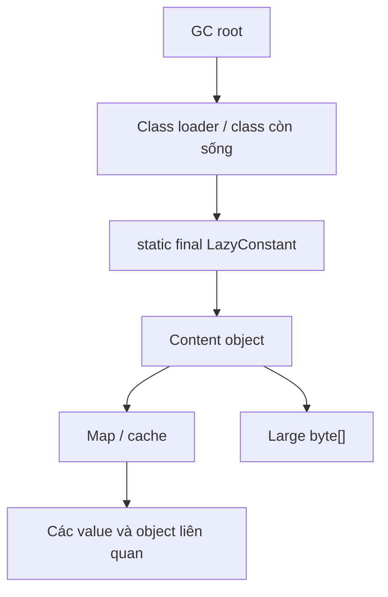

# Giữ tham chiếu mạnh và giới hạn vòng đời dữ liệu

`LazyConstant<T>` trì hoãn việc tạo một giá trị đến lần gọi `get()` đầu tiên, sau đó giữ nội dung đó cố định. Một hệ quả quan trọng khi thiết kế vòng đời là **lazy constant giữ tham chiếu mạnh đến nội dung**. Khi holder còn reachable, đối tượng nội dung và những đối tượng còn reachable từ nó cũng có thể tiếp tục tồn tại. Lazy constant không có thao tác xóa, thay thế, đặt lại hoặc hết hạn nội dung.

Vì vậy, `LazyConstant` phù hợp với giá trị đắt để tạo nhưng có vòng đời ổn định, chẳng hạn metadata, bộ phân tích cú pháp hoặc cấu trúc quy tắc dùng chung trong suốt vòng đời một component. Nó không phải cache có eviction, không phải cơ chế làm mới cấu hình và không tự quản lý việc đóng tài nguyên. Những khác biệt này đặc biệt quan trọng khi giữ dữ liệu lớn, dữ liệu theo tenant/session hoặc đối tượng sở hữu thread, socket, file và native resource.

## 1. Tham chiếu mạnh có nghĩa gì?

Sau khi khởi tạo thành công, holder giữ nội dung bằng tham chiếu mạnh. Garbage collector không thể thu gom nội dung chỉ vì ứng dụng không còn gọi `get()` hoặc không còn giữ một biến cục bộ trỏ trực tiếp đến nội dung đó. Nội dung còn reachable thông qua holder thì vẫn còn reachable.

Nếu nội dung là một đối tượng chứa những đối tượng khác, toàn bộ đồ thị đối tượng có thể được giữ lại theo các tham chiếu mạnh từ nội dung:



Ví dụ, một `LazyConstant<RuleCatalog>` có thể giữ `RuleCatalog`, catalog giữ một `Map`, map giữ hàng nghìn rule và mỗi rule giữ thêm metadata. Dù ứng dụng chỉ thường xuyên dùng một vài rule, tất cả dữ liệu reachable từ catalog vẫn có thể được giữ trong bộ nhớ.

Điều này không tự động là memory leak. Nếu catalog được chủ ý dùng trong toàn bộ thời gian ứng dụng chạy, việc giữ nó là đúng thiết kế. Vấn đề xuất hiện khi vòng đời của holder dài hơn vòng đời dữ liệu mà ứng dụng mong muốn.

## 2. Vòng đời phụ thuộc vào nơi đặt holder

Với một trường `static final`, vòng đời của nội dung thường gần với vòng đời của lớp và class loader chứa trường đó:

```java
public final class GlobalCatalog {
    private static final LazyConstant<RuleCatalog> CATALOG =
            LazyConstant.of(RuleCatalog::loadFromDisk);

    private GlobalCatalog() {
    }

    public static RuleCatalog get() {
        return CATALOG.get();
    }
}
```

Sau lần gọi `GlobalCatalog.get()` đầu tiên, `CATALOG` giữ catalog. Nếu lớp được nạp bởi class loader của ứng dụng và class loader đó vẫn còn sống, nội dung cũng còn reachable. Trong ứng dụng server có triển khai nhiều lần, một static holder trong class loader sống lâu hơn module hoặc web application có thể giữ dữ liệu của lần triển khai cũ. Muốn class loader cũ được thu gom, cần bảo đảm không còn tham chiếu bên ngoài giữ class loader, lớp hoặc đối tượng thuộc lớp đó.

Nếu holder là trường instance, vòng đời của nó có thể gắn với đối tượng sở hữu:

```java
public final class TenantContext {
    private final String tenantId;
    private final LazyConstant<TenantRules> rules;

    public TenantContext(String tenantId) {
        this.tenantId = tenantId;
        this.rules = LazyConstant.of(() -> TenantRules.load(tenantId));
    }

    public TenantRules rules() {
        return rules.get();
    }
}
```

Khi `TenantContext` và mọi tham chiếu khác đến holder không còn reachable, holder cùng `TenantRules` có thể trở thành đối tượng đủ điều kiện thu gom. Garbage collector không bảo đảm thu gom ngay lập tức. Nếu một registry, callback, thread hoặc đối tượng dùng chung khác vẫn giữ `TenantContext`, dữ liệu theo tenant cũng tiếp tục được giữ.

Do đó, hãy chọn phạm vi holder trùng với phạm vi dữ liệu: static cho dữ liệu thực sự dùng chung toàn ứng dụng; instance cho dữ liệu thuộc component hoặc tenant; tránh đặt dữ liệu ngắn hạn của request/session vào static holder.

## 3. Supplier cũng có thể giữ một đồ thị đối tượng

`LazyConstant.of(Supplier)` giữ computing function trước khi nội dung được khởi tạo thành công. Lambda có thể capture biến hoặc `this`; các đối tượng được capture vì thế có thể bị giữ thông qua supplier trong thời gian holder còn chưa khởi tạo.

Ví dụ sau tạo lambda capture `this`:

```java
public final class ReportService {
    private final LargeConfiguration configuration;

    private final LazyConstant<ReportRules> rules =
            LazyConstant.of(() -> ReportRules.from(configuration));

    public ReportService(LargeConfiguration configuration) {
        this.configuration = configuration;
    }

    public ReportRules rules() {
        return rules.get();
    }
}
```

Lambda truy cập `configuration` là lambda instance-bound và có thể giữ `ReportService` cùng đồ thị đối tượng mà service tham chiếu. Trong JDK 26, API quy định holder giữ computing function ít nhất cho đến khi khởi tạo hoàn tất thành công; implementation note nêu rằng sau khi thành công, computing function không còn được giữ mạnh và có thể đủ điều kiện thu gom. Nếu việc tính toán thất bại, holder vẫn chưa khởi tạo và lần `get()` tiếp theo có thể thử lại, nên không nên giả định supplier và các đối tượng capture đã được giải phóng.

Khi phù hợp, ưu tiên supplier không capture một đối tượng lớn hoặc một context có vòng đời dài hơn giá trị cần tạo:

```java
private static final LazyConstant<RuleCatalog> CATALOG =
        LazyConstant.of(RuleCatalog::loadDefault);
```

Nếu cần truyền cấu hình, chỉ capture dữ liệu nhỏ, bất biến và cần thiết cho phép tính. Không capture cả request context, session, class loader hoặc service container chỉ để lấy một vài giá trị từ chúng.

## 4. Nội dung cố định không đồng nghĩa đối tượng bất biến sâu

Lazy constant không cho thay thế tham chiếu nội dung sau khi khởi tạo. Tuy nhiên, bản thân đối tượng được giữ có thể mutable. Ví dụ:

```java
private static final LazyConstant<List<String>> ALLOWED =
        LazyConstant.of(() -> new ArrayList<>(List.of("read", "write")));

static void addPermission(String permission) {
    ALLOWED.get().add(permission);
}
```

Holder vẫn chứa cùng một `List`, nhưng các phần tử bên trong có thể thay đổi. `LazyConstant` không tự làm cho `ArrayList` bất biến và không tự đồng bộ các thao tác sửa đổi sau khi khởi tạo. Việc công bố an toàn ban đầu không thay thế các quy tắc đồng bộ hóa cần thiết cho những lần đọc/ghi mutable state về sau.

Nếu dữ liệu phải là snapshot cố định, hãy tạo bản sao bất biến trước khi trả về từ supplier, ví dụ `List.copyOf(...)`, `Map.copyOf(...)` hoặc một kiểu domain bất biến. Nếu dữ liệu phải thay đổi theo thời gian, hãy dùng một cơ chế có chính sách cập nhật và đồng bộ rõ ràng thay vì cố biến `LazyConstant` thành một ô cache có thể thay đổi.

Một mảng cũng có thể được giữ làm nội dung, nhưng lazy constant chỉ giữ tham chiếu đến mảng; điều này không khiến từng phần tử mảng được constant-fold. Nếu mục tiêu là truy cập các phần tử được tính lười và có thể tối ưu theo từng chỉ số, hãy đánh giá các cấu trúc lazy collection phù hợp của JDK thay vì dùng một mảng lớn trong `LazyConstant`.

## 5. Không dùng LazyConstant làm cache có thể làm mới hoặc eviction

Sau khi nội dung được thiết lập, không có API để xóa, đặt lại, thay thế hoặc đặt thời hạn cho nó. Vì vậy, các trường hợp sau thường không phù hợp:

| Dữ liệu | Vì sao không phù hợp | Cơ chế nên cân nhắc |
|---|---|---|
| Cấu hình cần reload khi file thay đổi | Holder không thể nhận snapshot mới | `AtomicReference`, `volatile` hoặc cơ chế reload có phiên bản |
| Token, credential hoặc khóa cần rotate | Nội dung cũ không thể được thay thế trong holder | Secret provider hoặc cơ chế cập nhật có vòng đời rõ ràng |
| Cache có TTL, giới hạn kích thước hoặc eviction | Holder không có expiry/eviction | Cache có chính sách TTL và giới hạn dung lượng |
| Dữ liệu theo request/session | Static holder có thể giữ dữ liệu lâu hơn request/session | Biến cục bộ, request scope hoặc session scope |
| Đối tượng chỉ nên tồn tại khi còn người dùng tham chiếu | Strong reference của holder ngăn thu gom khi holder còn sống | Weak-reference cache nếu chấp nhận việc giá trị có thể biến mất |

Không nên bọc `WeakReference<T>` trong `LazyConstant<WeakReference<T>>` rồi xem đó là cache có thể tự tính lại. Holder chỉ giữ cố định đối tượng `WeakReference`; khi referent bị thu gom, `get()` của weak reference có thể trả về `null`, nhưng `LazyConstant` không chạy supplier lần nữa để tạo referent mới. Nếu cần cache tự nạp lại, dùng cấu trúc cache được thiết kế cho mục đích đó.

## 6. Đối tượng sở hữu tài nguyên cần có quy trình đóng rõ ràng

Một lazy constant có thể giữ `ExecutorService`, `HttpClient`, pool kết nối, file handle hoặc đối tượng quản lý native resource. Holder không tự gọi `close()`, `shutdown()` hay giải phóng tài nguyên khi nội dung không còn được sử dụng. Nó cũng không có thao tác xóa tham chiếu sau khi tài nguyên được đóng.

Nếu vòng đời tài nguyên đúng bằng vòng đời của một component, component đó phải sở hữu quy trình shutdown và đóng tài nguyên một cách tường minh:

```java
public final class ExportComponent implements AutoCloseable {
    private final LazyConstant<ExportEngine> engine =
            LazyConstant.of(ExportEngine::open);

    public void export() {
        engine.get().export();
    }

    @Override
    public void close() {
        if (engine.isInitialized()) {
            engine.get().close();
        }
    }
}
```

Ví dụ trên minh họa ý tưởng với API preview JDK 26: chỉ đóng engine nếu nó đã được khởi tạo, tránh gọi `get()` trong `close()` rồi vô tình tạo engine mới khi component chưa từng dùng. Phương thức `isInitialized()` có trong API preview JDK 26; API Lazy Constants đã thay đổi ở preview JDK 27 và không còn phương thức này. Vì vậy, đoạn code minh họa này chỉ dành cho JDK 26 preview, không phải mẫu mã tương thích xuyên phiên bản.

Khi `close()` chạy, engine đã đóng nhưng vẫn được holder giữ nếu `ExportComponent` còn reachable. Nếu component cần được tái sử dụng sau khi đóng, `LazyConstant` không phù hợp vì nó không thể tạo engine mới. Nếu component không còn được dùng, bỏ mọi tham chiếu đến component để holder và engine có thể đủ điều kiện thu gom.

Trong thực tế, có thể đơn giản hơn nếu tạo tài nguyên tại tầng quản lý vòng đời (dependency injection container, application lifecycle hoặc component owner) và chỉ dùng lazy constant cho dữ liệu không cần đóng. Đừng chọn lazy initialization chỉ vì constructor của tài nguyên đắt; hãy xét cả cách đóng, retry, thay thế và shutdown.

## 7. Đồ thị phụ thuộc và vòng đời của các lazy constant

Một lazy constant có thể phụ thuộc vào lazy constant khác. Khi holder A tạo đối tượng cần giá trị từ holder B, việc gọi `A.get()` có thể kích hoạt `B.get()` trước. Đồ thị phụ thuộc này có thể giữ toàn bộ các đối tượng được tạo từ các holder có vòng đời dài.

```java
private static final LazyConstant<Schema> SCHEMA =
        LazyConstant.of(Schema::load);

private static final LazyConstant<Validator> VALIDATOR =
        LazyConstant.of(() -> new Validator(SCHEMA.get()));
```

Sau khi cả hai được khởi tạo, `VALIDATOR` giữ `Validator`, còn `Validator` có thể giữ `Schema`; `SCHEMA` cũng giữ chính `Schema`. Dù `VALIDATOR` không được gọi lại, các tham chiếu mạnh vẫn tồn tại theo đồ thị. Nếu không còn nhu cầu giữ validator hoặc schema, không có thao tác nào trên `LazyConstant` để tháo cạnh tham chiếu.

Tránh chu trình phụ thuộc trực tiếp hoặc gián tiếp. Nếu computing function gọi lại chính holder đang khởi tạo, JDK 26 ném `IllegalStateException` và holder không được khởi tạo. Khi dùng các static initializer, hãy xem xét thứ tự khởi tạo lớp và phụ thuộc giữa các lớp để tránh lỗi khởi tạo vòng.

## 8. Kiểm tra trạng thái và memory retention

Khi điều tra việc bộ nhớ không giảm sau khi một component ngừng sử dụng, hãy lần theo đường tham chiếu từ GC root:

1. Xác định holder là static field hay instance field; kiểm tra class loader hoặc owner còn sống không.
2. Xác định holder đã được khởi tạo chưa. Với JDK 26 preview, `isInitialized()` cho phép kiểm tra mà không kích hoạt tính toán.
3. Nếu chưa khởi tạo, xem computing function có capture `this`, service container, request/session context hoặc dữ liệu lớn không.
4. Nếu đã khởi tạo, kiểm tra object graph từ nội dung: collection, mảng, map, callback, listener, thread, class loader và resource wrapper.
5. Kiểm tra có cache, registry, thread hoặc static field khác vẫn giữ owner/holder hay không.
6. Xác nhận resource được đóng theo lifecycle; nhớ rằng đóng resource không xóa nội dung khỏi holder.

Heap dump và công cụ phân tích dominator tree giúp xác định holder nào đang giữ phần lớn retained heap. Hãy tìm đường tham chiếu mạnh từ GC root đến holder rồi đến content, thay vì chỉ dựa vào việc một biến cục bộ đã ra khỏi scope.

## 9. Khác biệt preview giữa JDK 26 và JDK 27

`LazyConstant` vẫn là preview API ở cả JDK 26 và JDK 27: JDK 26 dùng JEP 526 (preview lần thứ hai), JDK 27 dùng JEP 531 (preview lần thứ ba). Không xem đây là API ổn định để đưa vào hợp đồng thư viện dài hạn.

Vòng đời của computing function cũng có thay đổi:

- **JDK 26:** holder giữ mạnh computing function ít nhất đến khi khởi tạo thành công. Nếu supplier ném ngoại lệ, holder vẫn chưa khởi tạo và lần `get()` sau có thể thử lại; supplier có thể tiếp tục giữ các đối tượng đã capture.
- **JDK 27:** computing function được giữ đến khi quá trình tính toán kết thúc, kể cả khi thất bại; sau đó implementation note cho biết supplier không còn được giữ mạnh. Lỗi unchecked chuyển holder sang error state; những lần `get()` tiếp theo ném `NoSuchElementException` thay vì chạy supplier lại.
- **API cũng thay đổi:** `isInitialized()` và `orElse()` có ở preview JDK 26 nhưng đã bị loại khỏi preview JDK 27. Không dùng chúng trong mã muốn biên dịch trên cả hai bản.

Để thử nghiệm với JDK 26, bật preview ở cả bước biên dịch và chạy bằng đúng JDK 26:

```bash
javac --release 26 --enable-preview -d out src/LifecycleExample.java
java --enable-preview -cp out LifecycleExample
```

Với JDK 27, dùng JDK 27 ở cả hai bước và mức phát hành 27:

```bash
javac --release 27 --enable-preview -d out src/LifecycleExample.java
java --enable-preview -cp out LifecycleExample
```

Lớp được biên dịch với preview của một bản JDK không phải artifact tương thích preview cho bản JDK khác. Khi nâng cấp, biên dịch lại, đọc API đúng phiên bản và kiểm tra hành vi supplier khi có lỗi. Nếu hệ thống production cần API ổn định, ưu tiên holder idiom hoặc một cơ chế cache/lifecycle ổn định cho đến khi Lazy Constants được chuẩn hóa.

## 10. Những điểm cần nhớ

- Lazy constant giữ tham chiếu mạnh đến nội dung; nội dung còn reachable miễn holder còn reachable.
- Static holder thường giữ dữ liệu theo vòng đời class/class loader; instance holder có thể gắn với owner, nếu không còn tham chiếu nào khác giữ owner.
- Nội dung có thể kéo theo cả đồ thị đối tượng lớn. Việc không gọi `get()` nữa không làm nội dung được giải phóng.
- Supplier cũng có thể giữ các đối tượng capture trước khi khởi tạo; tránh capture context hoặc owner lớn không cần thiết.
- Nội dung chỉ bất biến ở mức tham chiếu. Một `ArrayList` hay đối tượng mutable bên trong vẫn có thể thay đổi và cần đồng bộ riêng.
- Không có reset, eviction, TTL hay tự đóng tài nguyên. Dùng cache hoặc cơ chế quản lý vòng đời khác cho dữ liệu cần làm mới hoặc giải phóng.
- `LazyConstant` là preview ở JDK 26 và JDK 27; API và hành vi lỗi/supplier retention thay đổi giữa các preview.

## Tài liệu tham khảo

- [Java SE 26 API: `LazyConstant` — strong references, content lifetime, supplier](https://docs.oracle.com/en/java/javase/26/docs/api/java.base/java/lang/LazyConstant.html)
- [Java SE 26 Core Libraries: Lazy Constants](https://docs.oracle.com/en/java/javase/26/core/lazy-constants.html)
- [JEP 526: Lazy Constants (Second Preview), JDK 26](https://openjdk.org/jeps/526)
- [Java SE 27 API: `LazyConstant` — third preview and supplier behavior](https://docs.oracle.com/en/java/javase/27/docs/api/java.base/java/lang/LazyConstant.html)
- [JEP 531: Lazy Constants (Third Preview), JDK 27](https://openjdk.org/jeps/531)
- [JDK 27 Release Notes: Lazy Constants (Third Preview)](https://www.oracle.com/java/technologies/javase/27-relnote-issues.html)
- [Java Language Specification: Initialization of Classes and Interfaces](https://docs.oracle.com/javase/specs/jls/se26/html/jls-12.html)
- [Java Language Specification: Happens-before Order](https://docs.oracle.com/javase/specs/jls/se26/html/jls-17.html)
