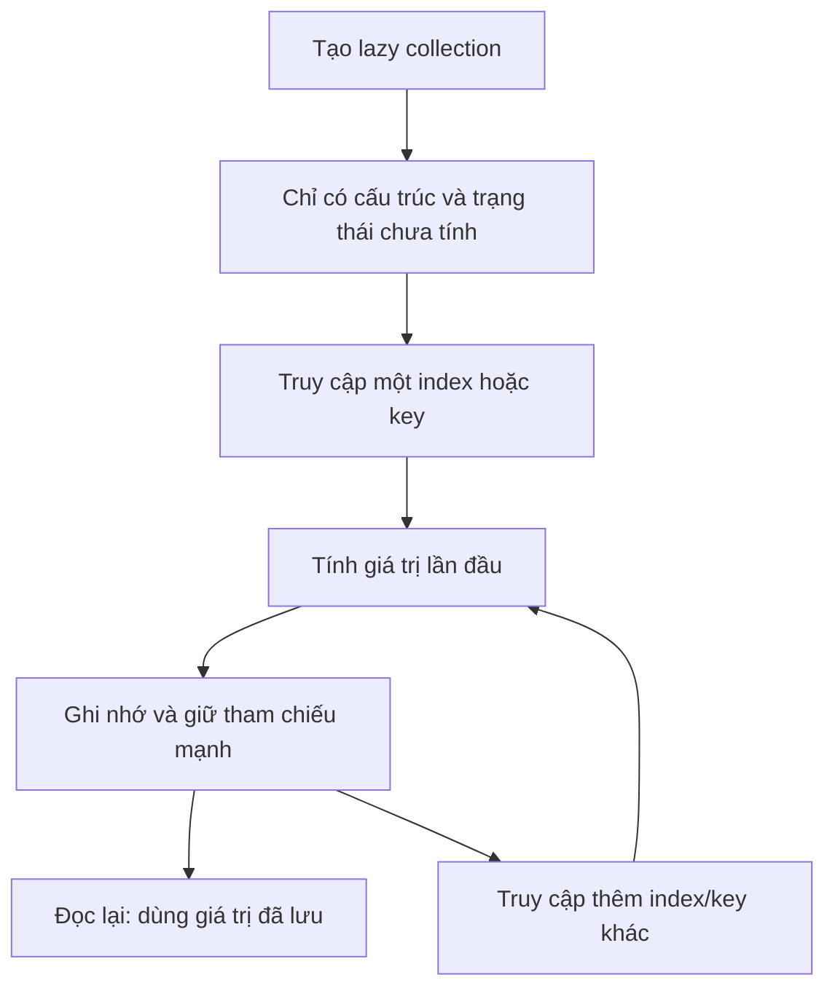

# Chi phí giữ dữ liệu sau khi giá trị đã được tính

Lazy collection trì hoãn việc tính phần tử cho đến khi phần tử đó được truy cập. Khi đã tính thành công, giá trị được ghi nhớ để những lần đọc sau không phải tính lại. Vì vậy, **lazy không có nghĩa là dữ liệu sẽ tự biến mất sau khi dùng**: giá trị đã tính vẫn được collection giữ lại bằng tham chiếu mạnh trong suốt vòng đời của collection.

Java 26 giới thiệu hai factory preview là `List.ofLazy(size, function)` và `Map.ofLazy(keys, function)`. JDK 27 tiếp tục giữ hai API này ở trạng thái preview và bổ sung `Set.ofLazy(candidates, predicate)`. Các API này hữu ích khi chỉ một phần nhỏ của một tập hữu hạn được truy cập, nhưng cần tính cả chi phí giữ những giá trị đã materialize, cấu trúc trạng thái cho các phần tử chưa tính và thời gian sống của hàm tính.

## 1. Lazy collection ghi nhớ kết quả

`List.ofLazy` tạo một danh sách có kích thước cố định. Hàm `IntFunction` nhận chỉ số và được gọi khi phần tử ở chỉ số đó được truy cập lần đầu, thường qua `get(index)`. `Map.ofLazy` tạo một map có tập khóa đã biết từ đầu; hàm `Function` nhận khóa và chỉ tính giá trị khi giá trị của khóa đó được truy cập.

Ví dụ:

```java
private static final int CHUNK_COUNT = 12;

private static final List<byte[]> CHUNKS =
        List.ofLazy(CHUNK_COUNT, Archive::loadChunk);

static byte[] chunk(int index) {
    return CHUNKS.get(index);
}
```

Lần đầu gọi `chunk(3)`, `Archive.loadChunk(3)` tạo mảng byte và danh sách ghi nhớ kết quả tại vị trí 3. Những lần gọi tiếp theo trả lại cùng giá trị đã tính. Truy cập vị trí 8 sẽ tính một giá trị khác; những vị trí chưa truy cập vẫn chưa cần tạo mảng byte.

Với map:

```java
private static final Set<String> LANGUAGES =
        Set.of("vi", "en", "ja");

private static final Map<String, MessageBundle> BUNDLES =
        Map.ofLazy(LANGUAGES, MessageBundle::load);

static MessageBundle bundle(String language) {
    return BUNDLES.get(language);
}
```

`MessageBundle.load` chỉ được gọi khi giá trị của khóa tương ứng được yêu cầu. Tập khóa được xác định lúc tạo map; thêm hoặc xóa phần tử trong tập đầu vào sau đó không làm thay đổi map lazy. Truy vấn một khóa không có trong tập khóa trả về `null` theo hợp đồng của `Map.get`.

Các factory trả về collection không sửa đổi được. Điều đó ngăn thêm, xóa hoặc thay thế phần tử qua collection, nhưng không làm cho đối tượng phần tử trở nên bất biến sâu. Ví dụ, một phần tử là `byte[]` hoặc `ArrayList` vẫn có thể bị sửa nội dung sau khi lấy ra.

## 2. Giá trị đã tính vẫn được giữ trong bộ nhớ

Lazy collection tối ưu thời điểm tạo đối tượng. Khi một phần tử được tính thành công, nó trở thành giá trị đã ghi nhớ và tiếp tục được giữ bởi collection. Collection không có thao tác reset, TTL, eviction hay giới hạn dung lượng tự động.

Với ví dụ `CHUNKS`:

- Chưa truy cập phần tử nào: chưa có mảng chunk nào được tạo, nhưng danh sách vẫn có kích thước 12 và phải theo dõi trạng thái từng vị trí.
- Chỉ truy cập vị trí 3: mảng của chunk 3 được tạo và giữ lại; các vị trí khác chưa được tính.
- Truy cập thêm nhiều vị trí: mỗi mảng mới được tạo sẽ được giữ lại sau khi tính.
- Truy cập toàn bộ danh sách: cuối cùng mọi chunk đều được tạo và giữ lại. Mức tiêu thụ bộ nhớ khi đó có thể gần với việc tạo eager toàn bộ dữ liệu, cộng thêm chi phí cấu trúc và trạng thái của lazy collection.

Không nên nhầm việc trì hoãn khởi tạo với việc chỉ giữ một phần dữ liệu trong bộ nhớ mãi mãi. Nếu ứng dụng cuối cùng duyệt toàn bộ danh sách, lazy collection chỉ dời thời điểm cấp phát; nó không giảm tổng số đối tượng phải tồn tại sau khi duyệt.



Về mặt khái niệm, tài liệu API mô tả lazy list như một danh sách các `LazyConstant` theo index và lazy map như map các `LazyConstant` theo key. Implementation thực tế có thể tối ưu bộ nhớ và hiệu năng tốt hơn mô hình minh họa đó; không nên lấy số lượng object của mô hình khái niệm để tính chính xác byte heap. Dù vậy, vẫn phải dự trù bộ nhớ cho trạng thái các phần tử và cho những giá trị đã được materialize.

## 3. Có nhiều loại chi phí vòng đời

| Giai đoạn | Chi phí có thể phát sinh | Điều cần kiểm soát |
|---|---|---|
| Tạo collection | Cấu trúc lưu index/key, trạng thái khởi tạo và tham chiếu đến hàm tính | Không tạo collection với kích thước hoặc tập khóa lớn hơn nhu cầu |
| Trước khi truy cập | Hàm tính và những đối tượng mà lambda capture có thể còn reachable | Tránh capture service, session hoặc object graph lớn |
| Lần truy cập đầu | CPU, I/O, cấp phát object graph và độ trễ của hàm tính | Đo latency lần đầu; tránh công việc không giới hạn trong supplier |
| Sau khi tính thành công | Giá trị và toàn bộ object graph reachable từ giá trị được giữ lại | Ước lượng retained heap khi nhiều phần tử đã được truy cập |
| Khi tất cả phần tử đã xử lý | Hàm tính có thể được giải phóng; các giá trị đã tính vẫn được giữ | Phân biệt việc giải phóng supplier với việc giải phóng cached values |

Nếu hàm tính capture một đối tượng lớn, collection có thể giữ đối tượng capture đó trong khi vẫn còn phần tử chưa tính. Ví dụ lambda truy cập một field của service có thể kéo theo service, cấu hình, client hoặc registry. Tài liệu API ghi rõ computing function được giữ mạnh ít nhất trong thời gian còn phần tử chưa khởi tạo. Theo implementation note của JDK 26, hàm tính có thể được giải phóng sau khi mọi phần tử đã khởi tạo thành công; JDK 27 cũng cho phép giải phóng khi mọi phần tử đã khởi tạo thành công hoặc chuyển sang trạng thái lỗi.

Vì vậy, một danh sách có một phần tử chưa truy cập có thể tiếp tục giữ computing function và các đối tượng capture, ngay cả khi gần như mọi phần tử khác đã được tính. Hãy dùng method reference hoặc supplier nhỏ khi có thể; chỉ capture những dữ liệu nhỏ, bất biến và thực sự cần cho phép tính.

## 4. Những thao tác tưởng như chỉ đọc có thể tính toàn bộ dữ liệu

Không phải chỉ gọi `get(index)` hoặc `Map.get(key)` mới kích hoạt phép tính. Những thao tác duyệt hoặc cần so sánh nội dung có thể truy cập nhiều phần tử:

- Duyệt toàn bộ list bằng vòng lặp, iterator hoặc stream sẽ truy cập từng phần tử; nếu duyệt hết thì cuối cùng có thể materialize toàn bộ list.
- `toArray()` cần tạo mảng kết quả chứa các phần tử, do đó sẽ truy cập các phần tử được chuyển vào mảng.
- `toString()` và `hashCode()` có thể kích hoạt khởi tạo một hoặc nhiều phần tử; `equals()` cũng có thể cần truy cập các phần tử để so sánh.
- Duyệt `Map.values()` hoặc `Map.entrySet()` sẽ truy cập các giá trị tương ứng. Các view này vẫn lazy khi truy cập từng phần tử, nhưng duyệt hết view có thể tính hết giá trị.

Ví dụ, log toàn bộ danh sách để debug:

```java
System.out.println(CHUNKS);
```

có thể khiến nhiều hoặc tất cả chunk được tính chỉ để tạo chuỗi log. Tương tự, gọi `hashCode()` để dùng list làm khóa hoặc so sánh hai list có thể kích hoạt việc đọc các phần tử mà nghiệp vụ trước đó chưa cần.

Hãy tránh log, so sánh hoặc chuyển đổi toàn bộ collection trong đường chạy nóng nếu mục tiêu là chỉ khởi tạo phần được sử dụng. Khi cần kiểm tra, log kích thước, số phần tử đã truy cập do ứng dụng tự theo dõi, hoặc một số phần tử đại diện thay vì in cả collection.

## 5. View có thể giữ collection gốc

`List.subList(...)` và `List.reversed()` trên lazy list vẫn giữ hành vi tính lười. Chúng là view của danh sách gốc, không phải bản sao độc lập của các phần tử. Do đó, giữ một view nhỏ có thể tiếp tục giữ danh sách gốc và toàn bộ cấu trúc trạng thái của danh sách đó.

Ví dụ:

```java
List<byte[]> firstTwoChunks = CHUNKS.subList(0, 2);
```

`firstTwoChunks` chỉ biểu diễn hai vị trí đầu, nhưng view vẫn dựa trên `CHUNKS`. Nếu danh sách gốc có hàng triệu vị trí, việc chỉ giữ view nhỏ không có nghĩa cấu trúc gốc được giải phóng. Nếu cần tách riêng một tập con có vòng đời độc lập, hãy tạo bản sao tường minh của phần tử thực sự cần dùng; thao tác sao chép sẽ kích hoạt tính các phần tử được sao chép và tạo thêm vùng lưu trữ.

## 6. Chi phí đồng thời và lỗi tính toán

`List.ofLazy` bảo đảm hàm tính cho một index được gọi tối đa một lần khi khởi tạo thành công; `Map.ofLazy` có bảo đảm tương tự theo key. Khi nhiều thread cùng truy cập một index hoặc key đang được tính, các thread cạnh tranh phải chờ kết quả hoặc chờ quá trình tính toán kết thúc bất thường.

Điều này tránh tạo nhiều bản sao của cùng một giá trị, nhưng có thể khiến nhiều thread cùng chờ nếu phép tính đầu tiên chậm. Không nên đặt công việc chờ I/O vô hạn hoặc một tác vụ phụ thuộc ngược vào chính phần tử đang khởi tạo trong computing function. Nếu hàm tính gọi lại chính collection để lấy cùng index/key, quá trình khởi tạo đệ quy sẽ thất bại.

Hành vi lỗi thay đổi giữa các bản JDK:

- **JDK 26:** nếu computing function ném ngoại lệ, ngoại lệ được chuyển cho caller và phần tử không được ghi nhận là đã khởi tạo. Lần truy cập tiếp theo có thể chạy hàm tính lại. Nếu function trả về `null`, `NullPointerException` được ném.
- **JDK 27:** lỗi unchecked chuyển phần tử sang trạng thái lỗi. Lần truy cập đầu nhận `NoSuchElementException` với nguyên nhân gốc; các lần truy cập sau tiếp tục nhận `NoSuchElementException` và không gọi lại computing function. Giá trị `null` cũng dẫn đến trạng thái lỗi, với `NullPointerException` là nguyên nhân.

Sự khác biệt này ảnh hưởng đến cả độ trễ lẫn khả năng phục hồi. Với JDK 26, một phép tính lỗi có thể được thử lại ở lần đọc sau và tiếp tục giữ supplier. Với JDK 27, phần tử lỗi không tự retry; cần thiết kế cách báo lỗi và tạo collection mới nếu muốn thử lại. Không dựa vào retry ngầm của JDK 26 khi nâng cấp.

## 7. Lazy list, lazy map và lazy set giữ những gì?

| API | Được xác định từ lúc tạo | Được tính khi truy cập | Trạng thái được giữ lại |
|---|---|---|---|
| `List.ofLazy(size, function)` — JDK 26 | Kích thước và các vị trí index | Giá trị ứng với index qua `get(index)` | Giá trị đã tính theo từng index |
| `Map.ofLazy(keys, function)` — JDK 26 | Tập khóa | Giá trị ứng với key qua `get(key)` | Tập khóa và giá trị đã tính theo từng key |
| `Set.ofLazy(candidates, predicate)` — JDK 27 | Tập candidate | Trạng thái thuộc/không thuộc set qua `contains(candidate)` | Candidate và trạng thái membership đã tính |

`Set.ofLazy` là bổ sung từ JDK 27, không có trong JDK 26. Nó phù hợp khi danh sách candidate hữu hạn đã biết nhưng việc xác định membership tốn chi phí. Cả trạng thái `true` lẫn `false` đều được ghi nhớ. Vì vậy, set lazy không phải một danh sách tự động thêm/xóa phần tử và cũng không phải cache có eviction.

Các lazy collections không cho phép giá trị `null`; nếu cần biểu diễn kết quả có thể vắng mặt, có thể dùng `Optional<T>` làm giá trị không-null. Các collection này không hỗ trợ serialization theo hợp đồng API. Hãy kiểm tra yêu cầu lưu trữ/truyền dữ liệu trước khi chọn chúng.

## 8. Khi nào nên dùng lazy collection?

Lazy collection phù hợp khi tập index/key/candidate hữu hạn và ổn định, phép tính một phần tử tương đối đắt, nhưng mỗi lần chạy thường chỉ truy cập một phần nhỏ. Ví dụ là một pool nhỏ các controller được khởi tạo theo nhu cầu, một tập bundle ngôn ngữ mà mỗi tiến trình chỉ dùng một vài ngôn ngữ, hoặc trạng thái của một số tùy chọn cấu hình.

Nên cân nhắc cách khác khi:

- Phần lớn phần tử luôn được duyệt: tạo eager bằng `List.of(...)`, `List.copyOf(...)` hoặc collection phù hợp có thể đơn giản và dễ dự đoán hơn.
- Chỉ cần xử lý tuần tự một lần và không cần truy cập lại theo index/key: dùng `Stream` hoặc iterator để xử lý từng phần tử mà không giữ toàn bộ kết quả trong collection.
- Dữ liệu có số lượng lớn, không biết trước hoặc cần thay đổi liên tục: dùng paging, truy vấn theo trang hoặc cache có giới hạn dung lượng.
- Kết quả cần hết hạn, làm mới, xóa hoặc giải phóng theo thời gian: dùng cache có TTL/eviction và lifecycle rõ ràng.
- Giá trị được truy cập rất ít nhưng object graph quá lớn để giữ lâu: tính lại theo yêu cầu hoặc giữ trong cache yếu/có giới hạn, tùy yêu cầu về tính nhất quán.

Lazy collection không tự giới hạn số giá trị đã tính. Nếu một map có 100.000 khóa và ứng dụng cuối cùng truy cập cả 100.000 khóa, map sẽ giữ các giá trị đã tính cho toàn bộ tập khóa. Trong trường hợp này, lazy map không thay thế được cache có giới hạn dung lượng.

## 9. Preview và cách bật theo phiên bản

`List.ofLazy` và `Map.ofLazy` được thêm trong JDK 26 dưới dạng preview và vẫn là preview trong JDK 27. `Set.ofLazy` được thêm từ JDK 27 dưới dạng preview. Vì vậy, đây chưa phải API ổn định để đưa vào hợp đồng công khai của thư viện cần tương thích lâu dài.

Thử nghiệm `List.ofLazy` hoặc `Map.ofLazy` trên JDK 26 cần bật preview ở cả lúc biên dịch và chạy:

```bash
javac --release 26 --enable-preview -d out src/LazyCollectionExample.java
java --enable-preview -cp out LazyCollectionExample
```

Trên JDK 27, dùng đúng JDK 27 cho cả hai bước:

```bash
javac --release 27 --enable-preview -d out src/LazyCollectionExample.java
java --enable-preview -cp out LazyCollectionExample
```

Không dùng class file được biên dịch với preview JDK 26 như một artifact tương thích với preview JDK 27. Khi nâng JDK, cần biên dịch lại và kiểm tra hành vi lỗi của từng phần tử. Nếu hệ thống production cần API ổn định, dùng collection eager hoặc cơ chế lazy/cache do ứng dụng quản lý cho đến khi các API này được chuẩn hóa.

## 10. Đo và kiểm soát retained heap

Khi đánh giá lazy collection, đừng chỉ đo thời gian tạo collection hoặc thời gian truy cập lần đầu. Hãy đo ít nhất ba trạng thái:

1. Sau khi tạo collection nhưng chưa truy cập phần tử nào.
2. Sau khi truy cập một tỷ lệ nhỏ phần tử, chẳng hạn 1%, 10%.
3. Sau khi duyệt toàn bộ collection hoặc sau một chu kỳ tải thực tế.

Theo dõi heap sau GC, số lượng phần tử đã materialize do ứng dụng ghi nhận, retained size của giá trị lớn và object graph mà supplier capture. Heap dump cùng dominator tree giúp tìm đường tham chiếu từ collection đến các giá trị đã tính. Nếu collection nằm trong static field, kiểm tra cả vòng đời class loader; nếu collection là instance field, kiểm tra owner và các registry/callback vẫn giữ owner.

Hãy đưa cả lần tính đầu tiên và các lần đọc cache vào benchmark. Khi collection được giữ trong trường phù hợp như `static final`, JVM có thể tối ưu việc truy cập giá trị đã tính, chẳng hạn constant folding; đây là khả năng tối ưu, không phải cam kết cho mọi đường chạy. Tối ưu truy cập không giải phóng bộ nhớ: lazy collection có thể giảm chi phí khởi tạo khi ít phần tử được dùng, nhưng các lần đọc đầu tiên vẫn trả chi phí tính toán và cấp phát; khi phần tử đã được tính, giá trị vẫn chiếm heap cho đến khi collection và các tham chiếu liên quan không còn reachable.

## 11. Những điểm cần nhớ

- Lazy collection trì hoãn khởi tạo và ghi nhớ kết quả; giá trị đã tính không tự bị xóa hoặc thu gom khi không còn được đọc.
- `List.ofLazy` giữ giá trị đã tính theo index; `Map.ofLazy` giữ tập khóa cố định và giá trị đã tính theo key.
- JDK 27 bổ sung `Set.ofLazy`, ghi nhớ trạng thái membership cho từng candidate.
- Computing function được giữ khi còn phần tử chưa xử lý; JDK 26 giải phóng sau khi mọi phần tử đã tính thành công, còn JDK 27 cũng giải phóng khi tất cả phần tử đã chuyển sang trạng thái lỗi. Các giá trị đã tính vẫn được collection giữ lại.
- Duyệt hết collection, chuyển sang array, so sánh, tính hash hoặc tạo chuỗi có thể kích hoạt nhiều phép tính ngoài dự kiến.
- View như `subList` hoặc `reversed` vẫn dựa trên list gốc và có thể kéo dài vòng đời của cấu trúc gốc.
- JDK 26 có thể thử lại sau lỗi tính; JDK 27 chuyển lỗi unchecked thành trạng thái lỗi không tự retry.
- Các lazy collection trong JDK 26/27 vẫn là preview. Dùng cache có TTL/eviction, paging hoặc stream nếu cần giới hạn bộ nhớ hay vòng đời dữ liệu.

## Tài liệu tham khảo

- [Java SE 26 API: `List.ofLazy`](https://docs.oracle.com/en/java/javase/26/docs/api/java.base/java/util/List.html)
- [Java SE 26 API: `Map.ofLazy`](https://docs.oracle.com/en/java/javase/26/docs/api/java.base/java/util/Map.html)
- [Java SE 27 API: `List.ofLazy` — failure state and retained computing function](https://docs.oracle.com/en/java/javase/27/docs/api/java.base/java/util/List.html)
- [Java SE 27 API: `Map.ofLazy` — fixed keys and lazy values](https://docs.oracle.com/en/java/javase/27/docs/api/java.base/java/util/Map.html)
- [Java SE 27 API: `Set.ofLazy`](https://docs.oracle.com/en/java/javase/27/docs/api/java.base/java/util/Set.html)
- [JEP 526: Lazy Constants (Second Preview), JDK 26](https://openjdk.org/jeps/526)
- [JEP 531: Lazy Constants (Third Preview), JDK 27](https://openjdk.org/jeps/531)
- [Inside Java: Performance Improvements in JDK 26](https://inside.java/2026/06/09/jdk-26-performance-improvements/)
