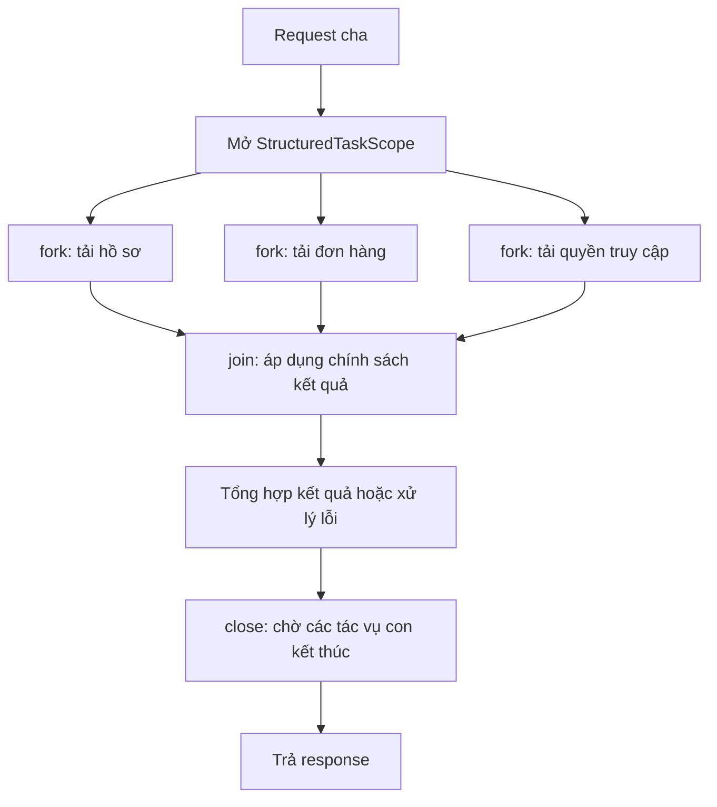

# Structured Concurrency preview lần 6 ở Java 26, lần 7 ở Java 27

Một request thường cần gọi nhiều dịch vụ hoặc thực hiện nhiều bước độc lập cùng lúc. Cách dùng thread và `Future` rời rạc có thể khiến tác vụ con tiếp tục chạy sau khi phương thức cha đã trả về, lỗi chỉ được phát hiện khi ai đó đọc `Future`, hoặc một nhánh vẫn giữ tài nguyên dù kết quả của nó không còn cần thiết.

**Structured concurrency** tổ chức các tác vụ con thành một nhóm có vòng đời nằm trong phạm vi của tác vụ cha. Tác vụ cha tạo scope, fork các tác vụ con, chờ kết quả theo một chính sách xác định, rồi đóng scope. Scope quản lý việc tổng hợp kết quả, truyền lỗi và hủy những tác vụ không còn cần thiết. API này bổ sung cho virtual thread: virtual thread là cách thực thi nhẹ, còn structured concurrency xác định quan hệ và vòng đời giữa các tác vụ.

## 1. Trạng thái theo phiên bản JDK

| Phiên bản | JEP | Trạng thái | Điểm cần nhớ |
|---|---|---|---|
| JDK 26 | JEP 525 | Preview lần thứ sáu | `StructuredTaskScope<T,R>`; `join()` dùng `FailedException` khi joiner báo lỗi; có `Joiner.onTimeout()` |
| JDK 27 | JEP 533 | Preview lần thứ bảy | Thêm tham số kiểu exception `R_X`; mặc định dùng `ExecutionException`; `Joiner.timeout()` thay `onTimeout()` |
| JDK 28 | JEP 543 | Final, API chính thức | Giữ thiết kế của preview lần thứ bảy; code JDK 27 có thể bỏ cờ preview và biên dịch lại |

Structured concurrency không còn là incubator API trong các phiên bản được đề cập ở bảng trên. JDK 26 và JDK 27 vẫn yêu cầu bật preview; JDK 28 đã chuẩn hóa API. Khi dự án dùng JDK 26, phải viết theo chữ ký JDK 26. Khi nâng lên JDK 27, cần sửa các điểm không tương thích được trình bày ở phần sau.

## 2. Mô hình cha-con của một nhóm tác vụ

Một `StructuredTaskScope` biểu diễn một thao tác cấp cao, chẳng hạn xử lý một request HTTP. Mỗi lần gọi `fork()` tạo một subtask chạy đồng thời trong scope. Tác vụ cha gọi `join()` để chờ kết quả hoặc một điều kiện kết thúc khác. Scope thường được dùng trong `try-with-resources`; khi thoát khối, `close()` bảo đảm các thread thực thi subtask đã kết thúc.



Điểm quan trọng là phạm vi sống của tác vụ con bị giới hạn bởi scope. Code cha không thể thoát khỏi `close()` trong khi thread của tác vụ con vẫn chạy. Điều này giúp tránh để tác vụ con vô tình tiếp tục sau khi thao tác cha đã hoàn tất.

## 3. API JDK 26: preview lần thứ sáu

Trong JDK 26, `StructuredTaskScope` có hai tham số kiểu:

```java
StructuredTaskScope<T, R>
```

- `T`: kiểu kết quả của các subtask được fork trong scope.
- `R`: kiểu kết quả mà `join()` trả về.

`StructuredTaskScope.open()` mặc định tạo scope có thể nhận các subtask trả về những kiểu khác nhau. Joiner mặc định đợi mọi subtask thành công; nếu một subtask thất bại, scope yêu cầu hủy các subtask chưa hoàn tất và `join()` ném `StructuredTaskScope.FailedException` với exception gốc làm cause.

### 3.1. Ví dụ fan-out/fan-in trên JDK 26

Ví dụ dưới đây tải hồ sơ người dùng và danh sách đơn hàng đồng thời. Hai tác vụ trả về hai kiểu khác nhau, vì vậy giữ `Subtask` để đọc kết quả sau khi `join()` thành công:

```java
import java.util.List;
import java.util.concurrent.StructuredTaskScope;

record User(String name) {}
record Order(String id) {}
record Profile(User user, List<Order> orders) {}

final class ProfileService {
    static Profile loadProfile(String userId) throws InterruptedException {
        try (var scope = StructuredTaskScope.open()) {
            StructuredTaskScope.Subtask<User> user =
                    scope.fork(() -> fetchUser(userId));
            StructuredTaskScope.Subtask<List<Order>> orders =
                    scope.fork(() -> fetchOrders(userId));

            // Joiner mặc định: đợi tất cả thành công, lỗi thì hủy nhánh còn lại.
            scope.join();

            return new Profile(user.get(), orders.get());
        } catch (StructuredTaskScope.FailedException ex) {
            throw new ProfileLoadException(ex.getCause());
        }
    }

    private static User fetchUser(String userId) {
        return new User("User " + userId);
    }

    private static List<Order> fetchOrders(String userId) {
        return List.of(new Order("order-1"), new Order("order-2"));
    }

    static final class ProfileLoadException extends RuntimeException {
        ProfileLoadException(Throwable cause) {
            super("Cannot load profile", cause);
        }
    }
}
```

Đây là ví dụ theo đúng API JDK 26. `join()` phải hoàn tất thành công trước khi gọi `Subtask.get()`. Nếu một nhánh lỗi, `FailedException` mang exception gốc trong `getCause()`; nhánh còn lại bị interrupt để có cơ hội dừng sớm.

### 3.2. Chính sách Joiner trong JDK 26

`Joiner` quyết định khi nào scope kết thúc và kết quả nào được trả về từ `join()`. Các factory thường dùng:

| Joiner JDK 26 | Hành vi |
|---|---|
| `Joiner.allSuccessfulOrThrow()` | Đợi tất cả thành công và trả `List<T>` theo thứ tự fork; lỗi ở một nhánh làm hủy scope và `join()` ném `FailedException` |
| `Joiner.awaitAllSuccessfulOrThrow()` | Đợi tất cả thành công, không tự tổng hợp kết quả; sau `join()` đọc từng `Subtask.get()`; lỗi làm hủy scope và ném `FailedException` |
| `Joiner.anySuccessfulOrThrow()` | Trả kết quả của nhánh đầu tiên thành công, rồi hủy các nhánh còn lại; nếu tất cả thất bại thì ném `FailedException` |
| `Joiner.awaitAll()` | Đợi mọi nhánh kết thúc, kể cả khi có nhánh thất bại; không tự hủy scope khi một nhánh lỗi |
| `Joiner.allUntil(predicate)` | Cho phép predicate quyết định khi nào dừng sớm; kết quả là danh sách `Subtask` để kiểm tra trạng thái |

Ví dụ chọn kết quả đầu tiên thành công, phù hợp khi gọi hai replica hoặc hai endpoint có thể thay thế nhau:

```java
import java.util.concurrent.StructuredTaskScope;

static String fetchFromAnyReplica() throws InterruptedException {
    try (var scope = StructuredTaskScope.open(
            StructuredTaskScope.Joiner.<String>anySuccessfulOrThrow())) {
        scope.fork(() -> queryReplica("replica-a"));
        scope.fork(() -> queryReplica("replica-b"));

        // Trả kết quả đầu tiên thành công; nhánh còn lại bị hủy.
        return scope.join();
    } catch (StructuredTaskScope.FailedException ex) {
        throw new ReplicaUnavailableException(ex.getCause());
    }
}
```

Không chọn `awaitAll()` chỉ vì muốn chờ tất cả. Joiner này không hủy scope khi một nhánh lỗi và chỉ trả `null`; code phải tự giữ các handle `Subtask` và kiểm tra trạng thái từng nhánh. API này đã không còn trong JDK 27. Với code mới hướng tới JDK 27/28, hãy chọn một Joiner hiện hành có chính sách phù hợp, ví dụ `allUntil(_ -> false)` nếu thực sự cần chờ tất cả và tự kiểm tra từng `Subtask`.

### 3.3. Timeout trong JDK 26

JDK 26 cho phép cấu hình timeout khi mở scope bằng overload có `Joiner` và hàm cấu hình:

```java
import java.time.Duration;
import java.util.concurrent.StructuredTaskScope;

try (var scope = StructuredTaskScope.open(
        StructuredTaskScope.Joiner.<String>allSuccessfulOrThrow(),
        config -> config.withTimeout(Duration.ofSeconds(2)))) {

    scope.fork(() -> queryServiceA());
    scope.fork(() -> queryServiceB());
    var results = scope.join();
}
```

Timeout bắt đầu tính từ lúc mở scope. Nếu hết thời gian trước hoặc trong lúc `join()` chờ, scope bị hủy. Trong JDK 26, `Joiner.onTimeout()` được gọi; triển khai mặc định ném `StructuredTaskScope.TimeoutException`. Joiner tùy chỉnh có thể xử lý timeout theo chính sách riêng.

## 4. Những bảo đảm vòng đời và đồng thời

### 4.1. Owner thread

Thread mở scope là *owner thread*. Chỉ owner thread được gọi `fork()`, `join()` và `close()`. Không chuyển scope cho thread khác để fork hoặc đóng thay. Sau khi đã gọi `join()`, không được gọi `fork()` thêm.

Nếu đã fork ít nhất một subtask thì phải gọi `join()` để lấy outcome trước khi đóng scope. Dùng `try-with-resources` để bảo đảm `close()` được gọi cả khi có exception.

### 4.2. Hủy bằng interrupt

Khi Joiner quyết định dừng sớm, scope không khởi chạy thêm thread mới và gửi interrupt đến các subtask chưa hoàn tất. Interrupt là yêu cầu dừng, không phải cưỡng chế dừng thread. Mã tác vụ con phải:

- Dùng API blocking có thể phản hồi interrupt khi có thể.
- Không nuốt `InterruptedException`; dọn dẹp tài nguyên rồi truyền tiếp hoặc khôi phục trạng thái interrupt theo hợp đồng của phương thức.
- Đóng socket, stream, file hoặc tài nguyên đang sử dụng khi bị hủy.
- Tránh vòng lặp CPU vô hạn không kiểm tra trạng thái interrupt.

`close()` vẫn chờ các thread con kết thúc, kể cả khi scope đã bị hủy. Nếu tác vụ con bỏ qua interrupt hoặc bị kẹt trong API không thể ngắt, `close()` có thể chờ vô thời hạn. Vì vậy, thiết kế khả năng dừng của subtask là điều kiện quan trọng để cancellation có hiệu quả.

### 4.3. Memory consistency

Các thao tác của owner thread trước khi fork có quan hệ *happens-before* với các thao tác của thread thực thi subtask. Kết quả subtask được công bố cho owner thread khi `join()` hoàn tất hoặc khi owner đọc `Subtask.get()` hợp lệ sau khi join. Không cần tự dựng cơ chế visibility chỉ để truyền dữ liệu bất biến đã chuẩn bị trước khi fork; dữ liệu có thể thay đổi giữa nhiều thread vẫn cần đồng bộ đúng cách.

## 5. Kết hợp với ScopedValue và virtual thread

Scope mặc định dùng một virtual thread cho mỗi subtask. Có thể cấu hình `ThreadFactory` khác, đặt tên scope hoặc đặt timeout qua `Configuration`. Vì vậy, virtual thread là mặc định tiện dụng của API, còn mô hình structured concurrency vẫn là quan hệ cha-con và chính sách hoàn tất.

Khi mở scope, API chụp các binding `ScopedValue` hiện tại của owner thread. Những thread được tạo khi gọi `fork()` kế thừa các binding đó. Do đó, hãy bind request ID hoặc trace context **trước khi mở scope**:

```java
import java.lang.ScopedValue;
import java.util.concurrent.StructuredTaskScope;

private static final ScopedValue<String> REQUEST_ID = ScopedValue.newInstance();

static void handleRequest(String requestId) throws InterruptedException {
    ScopedValue.where(REQUEST_ID, requestId).run(() -> {
        try (var scope = StructuredTaskScope.open()) {
            scope.fork(() -> {
                audit(REQUEST_ID.get());
                return null;
            });
            scope.fork(() -> {
                loadData(REQUEST_ID.get());
                return null;
            });
            scope.join();
        } catch (InterruptedException ex) {
            Thread.currentThread().interrupt();
            throw new RequestInterruptedException(ex);
        } catch (StructuredTaskScope.FailedException ex) {
            throw new RequestFailedException(ex.getCause());
        }
    });
}
```

Ví dụ minh họa cách kế thừa context theo JDK 26; các phương thức `audit`, `loadData` và exception của ứng dụng cần được định nghĩa trong dự án. Scope chụp binding lúc mở; nếu binding thay đổi giữa lúc mở scope và fork, JDK có thể ném `StructureViolationException`. Giá trị chia sẻ qua `ScopedValue` nên bất biến hoặc mọi truy cập phải được đồng bộ.

## 6. JDK 27: preview lần thứ bảy và thay đổi API

JEP 533 tiếp tục mô hình của JDK 26 nhưng cải thiện việc khai báo kiểu exception của `join()`. Đây là thay đổi cần chú ý khi nâng cấp vì code xử lý lỗi ở JDK 26 không còn biên dịch nguyên trạng.

### 6.1. Thêm tham số kiểu R_X

Trong JDK 26, hai tham số kiểu của scope là:

```java
StructuredTaskScope<T, R>
StructuredTaskScope.Joiner<T, R>
```

Trong JDK 27, cả hai có thêm `R_X`, là kiểu exception mà `join()` có thể ném:

```java
StructuredTaskScope<T, R, R_X extends Throwable>
StructuredTaskScope.Joiner<T, R, R_X extends Throwable>
```

`Joiner.result()` trong JDK 27 khai báo `throws R_X`. Điều này cho phép compiler biết chính xác exception có thể thoát ra từ `join()` và buộc code xử lý exception checked khi chính sách mặc định sử dụng `ExecutionException`.

### 6.2. FailedException được thay bằng ExecutionException mặc định

| Nội dung | JDK 26, preview 6 | JDK 27, preview 7 |
|---|---|---|
| Kiểu scope | `StructuredTaskScope<T,R>` | `StructuredTaskScope<T,R,R_X>` |
| Kiểu Joiner | `Joiner<T,R>` | `Joiner<T,R,R_X>` |
| Exception mặc định từ join khi subtask lỗi | `StructuredTaskScope.FailedException` | `ExecutionException` |
| Cause | Exception của subtask lỗi | Exception của subtask lỗi |
| `join()` bị interrupt | `InterruptedException` | `InterruptedException` |
| Timeout với Joiner chuẩn | `TimeoutException` từ `onTimeout()` mặc định | `ExecutionException` với `CancelledByTimeoutException` làm cause |

Ví dụ JDK 27 cho cùng bài toán tải hồ sơ:

```java
import java.util.List;
import java.util.concurrent.ExecutionException;
import java.util.concurrent.StructuredTaskScope;

record User(String name) {}
record Order(String id) {}
record Profile(User user, List<Order> orders) {}

final class ProfileService27 {
    static Profile loadProfile(String userId)
            throws InterruptedException, ExecutionException {
        try (var scope = StructuredTaskScope.open()) {
            StructuredTaskScope.Subtask<User> user =
                    scope.fork(() -> fetchUser(userId));
            StructuredTaskScope.Subtask<List<Order>> orders =
                    scope.fork(() -> fetchOrders(userId));

            scope.join();
            return new Profile(user.get(), orders.get());
        }
    }

    private static User fetchUser(String userId) {
        return new User("User " + userId);
    }

    private static List<Order> fetchOrders(String userId) {
        return List.of(new Order("order-1"), new Order("order-2"));
    }
}
```

Khác biệt quan trọng trong ví dụ là `ExecutionException` là checked exception nên chữ ký phương thức phải khai báo hoặc xử lý nó. Nếu muốn chuyển lỗi sang exception riêng của ứng dụng, bắt `ExecutionException` và đọc `getCause()`.

### 6.3. Joiner có kiểu exception tường minh

Các factory Joiner chuẩn của JDK 27 có overload nhận `Function<Throwable, R_X>` để chuyển exception gốc thành kiểu exception mà ứng dụng muốn:

```java
import java.util.concurrent.CompletionException;
import java.util.concurrent.StructuredTaskScope;

try (var scope = StructuredTaskScope.open(
        StructuredTaskScope.Joiner
                .<String, CompletionException>anySuccessfulOrThrow(CompletionException::new))) {

    scope.fork(() -> queryReplica("replica-a"));
    scope.fork(() -> queryReplica("replica-b"));

    String result = scope.join();
}
```

Nếu tất cả subtask thất bại, Joiner áp dụng exception supplying function cho exception gốc và `join()` ném exception được tạo ra. Với Joiner không truyền function, các factory chuẩn dùng `ExecutionException` làm exception mặc định. `InterruptedException` do thread owner bị interrupt vẫn cần được xử lý riêng.

### 6.4. timeout() thay onTimeout()

JDK 26 có `Joiner.onTimeout()` kiểu `void`, được gọi khi timeout hết hạn. JDK 27 thay bằng `Joiner.timeout()`, trả về `R` hoặc ném `R_X`. Nhờ đó kết quả khi timeout tuân theo cùng hệ thống kiểu với kết quả bình thường.

Với Joiner chuẩn, timeout dẫn đến `ExecutionException` có cause là `StructuredTaskScope.CancelledByTimeoutException`. Joiner tùy chỉnh có thể trả về kết quả fallback hoặc ném kiểu exception đã khai báo. Khi viết Joiner riêng, cần triển khai cả `result()` và `timeout()`, bảo đảm thread-safe vì `onComplete()` có thể được gọi đồng thời từ nhiều subtask.

### 6.5. open(configOperator) và thay đổi khác

JDK 26 đã có `open(joiner, configOperator)` để kết hợp Joiner với cấu hình timeout, tên scope hoặc `ThreadFactory`. JDK 27 bổ sung `open(configOperator)`, cho phép cấu hình scope mặc định mà không cần truyền Joiner tường minh:

```java
import java.time.Duration;
import java.util.concurrent.ExecutionException;
import java.util.concurrent.StructuredTaskScope;

try (var scope = StructuredTaskScope.open(
        config -> config.withName("profile-request")
                        .withTimeout(Duration.ofSeconds(2)))) {
    scope.fork(() -> fetchUser("u-42"));
    scope.fork(() -> fetchOrders("u-42"));
    scope.join();
} catch (ExecutionException ex) {
    // Có thể là lỗi từ subtask hoặc timeout; kiểm tra getCause().
}
```

Trong JDK 27, `Joiner.awaitAll()` của JDK 26 không còn. `Joiner.allUntil(predicate)` vẫn hỗ trợ chính sách chờ đến khi predicate yêu cầu hủy scope; nếu predicate luôn trả `false`, scope chờ các nhánh kết thúc và `join()` trả danh sách `Subtask` để caller tự xem trạng thái. Chỉ dùng mẫu này khi thật sự cần thu thập cả kết quả thành công lẫn thất bại.

## 7. JDK 28: API chính thức

JEP 543 đưa Structured Concurrency thành API chính thức trong JDK 28 sau bảy lần preview. API giữ thiết kế của JDK 27, gồm ba tham số kiểu `T`, `R`, `R_X`, `ExecutionException` mặc định và `Joiner.timeout()`. Với code đã viết theo JDK 27 preview 7, thay đổi phát hành chủ yếu là bỏ `--enable-preview` rồi biên dịch lại bằng JDK 28.

Không nên lấy mã JDK 26 rồi chỉ bỏ cờ preview để dùng trên JDK 28. Cần chuyển các điểm thay đổi từ JDK 26 sang API JDK 27 trước: kiểu exception, tham số kiểu thứ ba, Joiner timeout và các factory `open`/Joiner. JDK 28 chuẩn hóa API JDK 27; nó không làm API JDK 26 trở lại tương thích nguyên trạng.

## 8. Biên dịch và chạy theo từng JDK

### JDK 26

Structured Concurrency là preview lần thứ sáu. Biên dịch và chạy bằng JDK 26, bật preview ở cả hai bước:

```bash
javac --release 26 --enable-preview ProfileService.java
java --enable-preview ProfileService
```

### JDK 27

Structured Concurrency là preview lần thứ bảy. Cũng cần bật preview ở compiler và runtime, nhưng mã nguồn phải dùng API JDK 27:

```bash
javac --release 27 --enable-preview ProfileService27.java
java --enable-preview ProfileService27
```

### JDK 28

Structured Concurrency đã final. Biên dịch và chạy bằng JDK 28 không cần `--enable-preview`:

```bash
javac --release 28 ProfileService27.java
java ProfileService27
```

Không dùng bytecode preview của JDK 26 để chạy trên JDK 27 hoặc 28. Hãy nâng mã nguồn theo API đích, biên dịch lại bằng JDK đích và chạy kiểm thử tích hợp. Nếu dùng Maven hoặc Gradle, phải bật preview cho cả compile task và JVM chạy test/app khi đang dùng JDK 26/27.

## 9. Khi nào nên sử dụng?

| Tình huống | Chính sách phù hợp |
|---|---|
| Một request cần tất cả nhánh dữ liệu thành công | Joiner mặc định hoặc `allSuccessfulOrThrow()` |
| Các nhánh trả về các kiểu khác nhau | `awaitAllSuccessfulOrThrow()` rồi đọc từng `Subtask.get()` |
| Có nhiều replica và chỉ cần kết quả thành công đầu tiên | `anySuccessfulOrThrow()` |
| Cần timeout cho toàn bộ nhóm tác vụ | `Configuration.withTimeout(Duration)` |
| Cần request ID hoặc trace context ở mọi nhánh | Bind `ScopedValue` trước khi mở scope |
| Nhánh có side effect và cần biết tất cả nhánh đã kết thúc | Joiner chờ tất cả phù hợp, sau đó kiểm tra trạng thái subtask |

Structured concurrency phù hợp với nhóm tác vụ có quan hệ cùng phục vụ một thao tác cha. Với công việc nền độc lập cần tồn tại sau khi request kết thúc, hãy chọn cơ chế thực thi có vòng đời riêng. Đừng dùng scope để tạo tác vụ fire-and-forget rồi mong nó tiếp tục sau khi scope đóng.

## 10. Checklist khi triển khai

- [ ] Dùng đúng chữ ký và exception của JDK mục tiêu: JDK 26, 27 hay 28.
- [ ] Scope được mở và đóng bởi cùng owner thread.
- [ ] Mọi scope đã fork đều gọi `join()` trước khi đóng.
- [ ] Không fork thêm sau khi đã gọi `join()`.
- [ ] Chọn Joiner theo yêu cầu thực tế: tất cả thành công, một kết quả thành công, hay thu thập trạng thái tất cả.
- [ ] Tác vụ con phản hồi interrupt và giải phóng tài nguyên khi bị hủy.
- [ ] Đặt timeout khi có giới hạn thời gian cho toàn bộ thao tác; xử lý đúng cause timeout theo JDK đang chạy.
- [ ] Bind `ScopedValue` trước khi mở scope; dùng giá trị immutable hoặc đồng bộ khi chia sẻ.
- [ ] Trên JDK 26/27 bật preview ở compile và runtime; trên JDK 28 dùng API final không cần cờ preview.
- [ ] Đo tải và kiểm tra giới hạn dịch vụ downstream; virtual thread không làm tài nguyên bên ngoài trở nên vô hạn.

## Tài liệu tham khảo

- [JEP 525: Structured Concurrency (Sixth Preview, JDK 26)](https://openjdk.org/jeps/525)
- [JEP 533: Structured Concurrency (Seventh Preview, JDK 27)](https://openjdk.org/jeps/533)
- [JEP 543: Structured Concurrency (JDK 28)](https://openjdk.org/jeps/543)
- [Java SE 26 API: StructuredTaskScope](https://docs.oracle.com/en/java/javase/26/docs/api/java.base/java/util/concurrent/StructuredTaskScope.html)
- [Java SE 26 API: StructuredTaskScope.Joiner](https://docs.oracle.com/en/java/javase/26/docs/api/java.base/java/util/concurrent/StructuredTaskScope.Joiner.html)
- [Java SE 26 Core Libraries Guide: Structured Concurrency](https://docs.oracle.com/en/java/javase/26/core/structured-concurrency.html)
- [Java SE 27 API: StructuredTaskScope](https://docs.oracle.com/en/java/javase/27/docs/api/java.base/java/util/concurrent/StructuredTaskScope.html)
- [Java SE 27 API: StructuredTaskScope.Joiner](https://docs.oracle.com/en/java/javase/27/docs/api/java.base/java/util/concurrent/StructuredTaskScope.Joiner.html)
