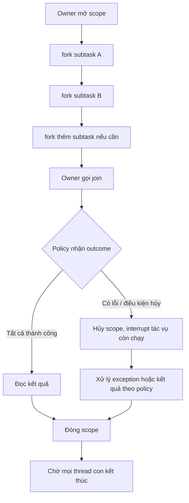

# fork tác vụ, join và đọc kết quả theo chính sách

> **Mốc cập nhật: 27-11-2026.** Structured Concurrency trong JDK 27 là **Preview lần thứ bảy**, theo JEP 533. API hiện hành là `java.util.concurrent.StructuredTaskScope` cùng `Joiner`. Đây chưa phải API ổn định của Java SE. Bài thực hành dùng đúng hợp đồng JDK 27, đặc biệt cách `join()` trả kết quả hoặc ném exception theo policy đã chọn.

## 1. Mục tiêu thực hành

Một request của ứng dụng có thể cần lấy hồ sơ người dùng, danh sách đơn hàng và hạn mức thanh toán từ ba dịch vụ độc lập. Nếu gọi lần lượt, thời gian chờ gần bằng tổng thời gian của ba lời gọi. Nếu tự tạo các thread hoặc Future rời rạc, ứng dụng phải tự quản lý lỗi, hủy tác vụ và bảo đảm các tác vụ con không chạy quá vòng đời của request cha.

Structured Concurrency gom nhóm tác vụ liên quan vào một **scope**. Luồng sở hữu scope mở phạm vi, fork các tác vụ con, join để nhận outcome theo một chính sách, đọc kết quả và đóng scope. Scope kiểm soát vòng đời của các thread con và kết nối việc hủy tác vụ với lỗi hoặc điều kiện hoàn tất.

Sau bài này, bạn có thể:

- Fork nhiều tác vụ bằng `StructuredTaskScope.fork(...)`.
- Join các tác vụ như một đơn vị công việc.
- Chọn policy để yêu cầu tất cả thành công, lấy kết quả thành công đầu tiên hoặc thu thập trạng thái từng subtask.
- Đọc kết quả qua `Subtask.get()` và lỗi qua `Subtask.exception()` đúng thời điểm.
- Ánh xạ lỗi sang exception riêng và cấu hình timeout.
- Xử lý cancellation, interruption và các ràng buộc vòng đời của scope.
- Biên dịch và chạy đúng Preview API JDK 27.

## 2. Trạng thái API và hợp đồng JDK 27

JDK 27 tiếp tục Structured Concurrency dưới dạng preview theo **JEP 533 — Structured Concurrency (Seventh Preview)**. API nằm trong module `java.base`, package `java.util.concurrent`; không cần thêm module incubator. Tuy nhiên, phải bật preview ở cả compiler và runtime.

Virtual threads đã là tính năng ổn định từ Java 21. `StructuredTaskScope` vẫn là preview. Không được suy luận rằng API quản lý scope cũng đã stable chỉ vì thread được tạo mặc định là virtual thread.

Hợp đồng chính:

```java
StructuredTaskScope<T, R, R_X extends Throwable>
StructuredTaskScope.Joiner<T, R, R_X extends Throwable>
```

Ba tham số kiểu của scope:

| Tham số | Ý nghĩa |
|---|---|
| `T` | Kiểu kết quả của từng subtask được fork. |
| `R` | Kiểu kết quả mà `join()` trả về. |
| `R_X` | Kiểu exception mà `join()` có thể ném ra theo policy. |

Điểm quan trọng của JDK 27 là kiểu exception từ `join()` trở thành một phần của hợp đồng kiểu. Với policy dựng sẵn, `join()` ném checked `ExecutionException` khi subtask thất bại; với custom Joiner, `R_X` có thể là kiểu exception do ứng dụng chọn.

Các method chính:

| API | Vai trò |
|---|---|
| `StructuredTaskScope.open()` | Mở scope dùng policy mặc định: chờ tất cả thành công, hủy khi có subtask thất bại. |
| `StructuredTaskScope.open(Joiner)` | Mở scope với policy cụ thể. |
| `StructuredTaskScope.open(UnaryOperator<Configuration>)` | Mở scope với policy mặc định và cấu hình như timeout, tên hoặc ThreadFactory. |
| `scope.fork(Callable)` | Khởi chạy subtask có kết quả và trả về `Subtask` handle. |
| `scope.fork(Runnable)` | Khởi chạy subtask không có kết quả. |
| `scope.join()` | Chờ và trả outcome theo policy. |
| `scope.isCancelled()` | Kiểm tra scope đã hoặc đang bị hủy. |
| `scope.close()` | Hủy các subtask còn chạy, interrupt thread và chờ chúng kết thúc. |

Nếu không cấu hình ThreadFactory riêng, mỗi lần fork tạo một virtual thread cho subtask.

## 3. Vòng đời của scope

Một scope có một owner thread — thread gọi `open()`. Chỉ owner được gọi `fork()`, `join()` và `close()`. Các subtask chạy đồng thời trên các thread riêng, thường là virtual threads.



Dùng `try-with-resources` để scope luôn được đóng:

```java
try (var scope = StructuredTaskScope.open()) {
    // fork tasks
    scope.join();
    // đọc kết quả
}
```

Các quy tắc vòng đời cần nhớ:

- Phải fork trước khi gọi `join()`; không được fork thêm sau khi đã join.
- `join()` chỉ được gọi một lần để nhận outcome, trừ trường hợp lần trước ném `InterruptedException`.
- Sau khi fork, owner phải gọi `join()` để lấy outcome trước khi scope đóng bình thường.
- Nếu khối `try` rời đi sau khi fork nhưng chưa gọi `join()`, `close()` sẽ hủy scope, chờ các thread con kết thúc rồi ném `IllegalStateException`.
- Các scope lồng nhau phải được đóng theo thứ tự cấu trúc; scope cha không nên thoát trước scope con.
- Các binding của `ScopedValue` tại thời điểm mở scope được capture và kế thừa bởi thread con. Binding hiện hành khi fork phải phù hợp với binding khi scope được mở.

## 4. Bài tập 1 — Fork tác vụ khác kiểu và đọc kết quả sau join

Đây là trường hợp phổ biến: một request cần hai dịch vụ độc lập, mỗi dịch vụ trả về một kiểu dữ liệu khác nhau. Dùng `open()` mặc định để fork các tác vụ, join, rồi đọc kết quả từ từng handle.

```java
import java.util.List;
import java.util.concurrent.ExecutionException;
import java.util.concurrent.StructuredTaskScope;

record User(String id, String name) {}
record OrderSummary(int orderCount, long totalCents) {}
record Dashboard(User user, OrderSummary orders) {}

class DashboardException extends RuntimeException {
    DashboardException(Throwable cause) {
        super("Cannot load dashboard", cause);
    }
}

public class DashboardService {
    static User fetchUser(String id) throws InterruptedException {
        // Đại diện cho lời gọi dịch vụ hồ sơ.
        Thread.sleep(150);
        return new User(id, "An");
    }

    static OrderSummary fetchOrders(String id)
            throws InterruptedException {
        // Đại diện cho lời gọi dịch vụ đơn hàng.
        Thread.sleep(220);
        return new OrderSummary(4, 125_000);
    }

    static Dashboard loadDashboard(String userId)
            throws InterruptedException {
        try (var scope = StructuredTaskScope.open()) {
            var userTask = scope.fork(() -> fetchUser(userId));
            var ordersTask = scope.fork(() -> fetchOrders(userId));

            // Mặc định: đợi cả hai thành công; lỗi đầu tiên hủy sibling.
            scope.join();

            // Chỉ đọc Subtask sau khi join và khi subtask thành công.
            return new Dashboard(userTask.get(), ordersTask.get());
        } catch (ExecutionException e) {
            throw new DashboardException(e.getCause());
        }
    }
}
```

Ở ví dụ này:

1. `fork()` bắt đầu hai subtask đồng thời.
2. Owner gọi `join()`; owner không tự lấy kết quả bằng cách chờ từng Future riêng.
3. Nếu cả hai thành công, `join()` mặc định trả `null`; kết quả cụ thể được lấy qua từng `Subtask.get()`.
4. Nếu một subtask thất bại, scope bị hủy, subtask chưa hoàn tất bị interrupt và `join()` ném `ExecutionException`.
5. `ExecutionException.getCause()` chứa lỗi gốc của subtask thất bại.

Không gọi `get()` trước `join()`. `Subtask.get()` ném `IllegalStateException` nếu subtask chưa hoàn tất, thất bại hoặc được gọi sai thời điểm. Với subtask thất bại, dùng `exception()` sau khi join và chỉ khi state là `FAILED`.

## 5. Chọn policy cho join()

`Joiner` xác định khi nào scope cần dừng chờ, có hủy các subtask khác hay không và kiểu outcome mà `join()` trả về. Chọn policy theo yêu cầu nghiệp vụ, vì cùng một nhóm subtask có thể cần các cách đọc kết quả khác nhau.

| Policy | Khi nào `join()` hoàn tất | Kết quả | Khi có lỗi |
|---|---|---|---|
| `open()` mặc định | Tất cả thành công hoặc một subtask thất bại. | `null` khi tất cả thành công. | Hủy scope, ném `ExecutionException`. |
| `allSuccessfulOrThrow()` | Tất cả thành công hoặc một subtask thất bại. | List kết quả theo thứ tự fork. | Hủy scope, ném `ExecutionException`. |
| `awaitAllSuccessfulOrThrow()` | Tất cả thành công hoặc một subtask thất bại. | `null` khi tất cả thành công. | Hủy scope, ném `ExecutionException`. |
| `anySuccessfulOrThrow()` | Có subtask đầu tiên thành công hoặc tất cả thất bại. | Kết quả của một subtask thành công. | Nếu tất cả thất bại, ném `ExecutionException`. |
| `allUntil(predicate)` | Tất cả hoàn tất hoặc predicate yêu cầu hủy scope. | List các `Subtask` handle. | Không tự ném lỗi subtask; owner đọc state và exception từng handle. |

### 5.1. Tất cả subtask cùng kiểu — allSuccessfulOrThrow

Khi mọi subtask trả về cùng một kiểu, có thể để Joiner gom kết quả thành List. List được trả về theo **thứ tự fork**, không phải thứ tự hoàn thành.

```java
import java.util.List;
import java.util.concurrent.StructuredTaskScope;
import java.util.concurrent.StructuredTaskScope.Joiner;

static List<String> loadDocuments() throws InterruptedException,
        java.util.concurrent.ExecutionException {

    try (var scope = StructuredTaskScope.open(
            Joiner.<String>allSuccessfulOrThrow())) {

        scope.fork(() -> "document-A");
        scope.fork(() -> "document-B");
        scope.fork(() -> "document-C");

        List<String> documents = scope.join();
        return documents;
    }
}
```

Kết quả List có thứ tự `document-A`, `document-B`, `document-C`, miễn là cả ba subtask đều thành công. Nếu một subtask thất bại, scope hủy các subtask còn chạy và `join()` ném `ExecutionException`.

Với policy này, không cần giữ từng `Subtask` handle nếu chỉ cần danh sách kết quả.

### 5.2. Lấy kết quả thành công đầu tiên — anySuccessfulOrThrow

Khi có nhiều nguồn cung cấp cùng một loại dữ liệu và chỉ cần một nguồn trả lời thành công, dùng `anySuccessfulOrThrow()`.

```java
import java.util.concurrent.ExecutionException;
import java.util.concurrent.StructuredTaskScope;
import java.util.concurrent.StructuredTaskScope.Joiner;

static String findFromAnyReplica(String key)
        throws InterruptedException, ExecutionException {

    try (var scope = StructuredTaskScope.open(
            Joiner.<String>anySuccessfulOrThrow())) {

        scope.fork(() -> readReplica("replica-A", key));
        scope.fork(() -> readReplica("replica-B", key));
        scope.fork(() -> readReplica("replica-C", key));

        // Kết quả của subtask thành công đầu tiên.
        return scope.join();
    }
}
```

Ngay khi có một subtask thành công, Joiner hủy scope và interrupt các subtask còn lại. Nếu tất cả subtask thất bại, `join()` ném `ExecutionException` với lỗi từ một subtask làm cause.

Không dùng policy này nếu nghiệp vụ cần tất cả kết quả hoặc cần xác nhận quorum cụ thể. “Một kết quả thành công đầu tiên” khác với “đa số kết quả đồng thuận”.

### 5.3. Các kiểu kết quả khác nhau — awaitAllSuccessfulOrThrow

`awaitAllSuccessfulOrThrow()` phù hợp khi các subtask có kiểu trả về khác nhau và owner cần giữ handle để đọc từng kết quả sau join. Nó trả `null` khi tất cả thành công; nếu có lỗi thì hủy scope và ném `ExecutionException`.

```java
import java.util.concurrent.StructuredTaskScope;
import java.util.concurrent.StructuredTaskScope.Joiner;

try (var scope = StructuredTaskScope.open(
        Joiner.<Object>awaitAllSuccessfulOrThrow())) {

    var user = scope.fork(() -> fetchUser("u-42"));
    var permissions = scope.fork(() -> fetchPermissions("u-42"));
    var preferences = scope.fork(() -> fetchPreferences("u-42"));

    scope.join();

    return new UserContext(
            user.get(),
            permissions.get(),
            preferences.get()
    );
}
```

`open()` không tham số chính là policy mặc định tương đương `awaitAllSuccessfulOrThrow()`, nhưng có thể fork các kiểu kết quả khác nhau và trả `null` khi tất cả thành công. Vì vậy, ví dụ ở phần 4 có thể dùng `open()` trực tiếp mà không cần tạo Joiner tường minh.

### 5.4. Thu thập cả kết quả và lỗi — allUntil

Có trường hợp muốn đợi mọi subtask hoàn tất, kể cả khi một số subtask thất bại, để báo cáo từng kết quả. Dùng `allUntil(subtask -> false)`: predicate luôn false nên scope không bị short-circuit bởi Joiner và `join()` trả về danh sách handle sau khi tất cả hoàn tất.

```java
import java.util.List;
import java.util.concurrent.StructuredTaskScope;
import java.util.concurrent.StructuredTaskScope.Joiner;

static void inspectAllSources() throws InterruptedException {
    try (var scope = StructuredTaskScope.open(
            Joiner.<String>allUntil(subtask -> false))) {

        scope.fork(() -> readSource("source-A"));
        scope.fork(() -> readSource("source-B"));
        scope.fork(() -> readSource("source-C"));

        List<StructuredTaskScope.Subtask<String>> subtasks =
                scope.join();

        for (var subtask : subtasks) {
            switch (subtask.state()) {
                case SUCCESS ->
                        System.out.println("Value: " + subtask.get());
                case FAILED ->
                        System.out.println("Failure: " + subtask.exception());
                case UNAVAILABLE ->
                        System.out.println("No outcome available");
            }
        }
    }
}
```

Ba state của `Subtask`:

| State | Ý nghĩa | API đọc |
|---|---|---|
| `SUCCESS` | Subtask hoàn tất thành công. | `get()` |
| `FAILED` | Subtask kết thúc bằng exception hoặc error. | `exception()` |
| `UNAVAILABLE` | Chưa có outcome, bị fork sau khi scope đã hủy hoặc hoàn tất sau khi scope bị hủy. | Không gọi `get()` hay `exception()`. |

`allUntil` còn có thể dùng predicate để hủy scope khi một điều kiện hoàn tất cụ thể xuất hiện. Khi đó danh sách trả về có thể chứa state `UNAVAILABLE` cho các subtask chưa có outcome. Hãy kiểm tra state trước khi đọc dữ liệu.

## 6. Ánh xạ lỗi sang exception của ứng dụng

Trong JDK 27, `StructuredTaskScope` và `Joiner` có tham số kiểu thứ ba `R_X`, thể hiện exception mà `join()` có thể ném. Các Joiner dựng sẵn có overload nhận `Function<Throwable, R_X>` để chuyển lỗi subtask sang exception riêng.

```java
import java.util.List;
import java.util.concurrent.StructuredTaskScope;
import java.util.concurrent.StructuredTaskScope.Joiner;

final class CatalogUnavailableException extends Exception {
    CatalogUnavailableException(Throwable cause) {
        super("One or more catalog tasks failed", cause);
    }
}

static List<String> loadCatalog()
        throws InterruptedException, CatalogUnavailableException {

    try (var scope = StructuredTaskScope.open(
            Joiner.<String, CatalogUnavailableException>
                    allSuccessfulOrThrow(CatalogUnavailableException::new))) {

        scope.fork(() -> loadCategory("books"));
        scope.fork(() -> loadCategory("music"));

        return scope.join();
    }
}
```

Ở ví dụ này, `join()` khai báo exception kiểu `CatalogUnavailableException` thay vì `ExecutionException`. Exception gốc của subtask được giữ làm cause. Đây là lợi ích của tham số kiểu `R_X`: compiler có thể kiểm tra exception mà policy sẽ ném.

Có thể dùng overload tương tự với `anySuccessfulOrThrow(Function)` hoặc `awaitAllSuccessfulOrThrow(Function)`. Không tạo exception mới mà bỏ mất cause, vì cause giúp truy ngược lỗi thực tế của subtask.

## 7. Đặt timeout và đọc lỗi timeout

Có thể cấu hình timeout trong lúc mở scope:

```java
import java.time.Duration;
import java.util.concurrent.ExecutionException;
import java.util.concurrent.StructuredTaskScope;

static void loadWithinDeadline()
        throws InterruptedException {

    try (var scope = StructuredTaskScope.open(
            config -> config
                    .withName("load-dashboard")
                    .withTimeout(Duration.ofSeconds(2)))) {

        scope.fork(() -> fetchUser("u-42"));
        scope.fork(() -> fetchOrders("u-42"));

        scope.join();

    } catch (ExecutionException e) {
        Throwable cause = e.getCause();

        if (cause instanceof StructuredTaskScope.CancelledByTimeoutException) {
            System.err.println("Scope deadline expired");
        } else {
            System.err.println("Subtask failed: " + cause);
        }
    }
}
```

Các điểm quan trọng:

- Timeout bắt đầu từ lúc `open(...)` tạo scope, không phải lúc owner gọi `join()`.
- Nếu hết hạn trước hoặc trong khi join chờ, scope bị hủy và các thread đang chạy bị interrupt.
- Với policy mặc định của `open(UnaryOperator)`, `join()` ném `ExecutionException` có cause là `CancelledByTimeoutException`.
- Với Joiner tùy chỉnh, cách tạo outcome trong trường hợp timeout phụ thuộc method `timeout()` của Joiner.
- Timeout không giết cưỡng bức thread. `close()` vẫn chờ mọi thread con kết thúc.

Nếu cần giới hạn tổng thời gian của một nhóm thao tác, hãy đặt timeout ở scope. Nếu từng lời gọi I/O có timeout riêng, vẫn nên cấu hình timeout tại client tương ứng để các subtask phản hồi interruption và deadline nhanh hơn.

## 8. Cancellation và interruption

Cancellation của StructuredTaskScope là cơ chế hợp tác. Khi scope bị hủy, JDK ngăn việc fork thêm thread và gửi interrupt đến các thread thực thi subtask chưa hoàn tất. Task phải phản hồi interruption để kết thúc nhanh.

Ví dụ subtask dùng thao tác interruptible:

```java
static String fetchRemoteValue(String key)
        throws InterruptedException {
    // Đại diện cho một thao tác chờ có thể bị interrupt.
    Thread.sleep(500);
    return "value-" + key;
}
```

Nếu task bắt `InterruptedException` để cleanup rồi tiếp tục chạy như chưa có gì xảy ra, scope có thể không kết thúc đúng lúc. Khi không thể ném tiếp exception, hãy khôi phục interrupt status:

```java
try {
    performInterruptibleWork();
} catch (InterruptedException e) {
    cleanup();
    Thread.currentThread().interrupt();
    return;
}
```

`close()` thực hiện ba việc:

1. Hủy scope nếu scope chưa bị hủy.
2. Interrupt các subtask chưa hoàn tất.
3. Chờ tất cả thread con kết thúc.

Nếu task chặn trên API không interruptible hoặc bỏ qua interrupt, `close()` có thể chờ rất lâu, thậm chí vô hạn. Vì vậy, tác vụ con cần có timeout I/O, vòng lặp kiểm tra interruption và cleanup an toàn.

Nếu owner bị interrupt trong `join()`, method ném `InterruptedException` và cleared interrupt status của owner. Khi method đang xử lý muốn truyền interruption lên caller, có thể khai báo `throws InterruptedException` và ném tiếp. Nếu bắt rồi không truyền tiếp, phải quyết định rõ cách khôi phục interrupt status.

## 9. Quy tắc đọc kết quả và ownership

`Subtask` là handle cho một tác vụ đã fork. Có ba method thường dùng:

| Method | Dùng khi nào |
|---|---|
| `state()` | Kiểm tra `SUCCESS`, `FAILED` hay `UNAVAILABLE`. |
| `get()` | Lấy kết quả sau join khi state là `SUCCESS`. |
| `exception()` | Lấy exception/error sau join khi state là `FAILED`. |

Không gọi `get()` để chờ task hoàn tất; đó là vai trò của `join()`. Không gọi `exception()` khi task chưa thất bại. Nếu task ở state `UNAVAILABLE`, không có kết quả hoặc exception để đọc.

Các method `fork()`, `join()` và `close()` thuộc quyền của owner thread. Chuyển scope sang thread khác để fork hoặc join sẽ vi phạm ownership và có thể ném `WrongThreadException`. Việc xử lý kết quả sau join có thể được thực hiện theo quy tắc API của `Subtask`, nhưng thông thường nên để owner đọc kết quả và tổng hợp outcome ngay trong lexical scope.

## 10. Khác biệt preview JDK 26 và JDK 27 cần sửa khi nâng cấp

Structured Concurrency đã thay đổi API qua từng lần preview. Mã biên dịch được với JDK 26 không đồng nghĩa còn biên dịch với JDK 27.

| Nội dung | JDK 26 — JEP 525, preview lần 6 | JDK 27 — JEP 533, preview lần 7 |
|---|---|---|
| Kiểu `StructuredTaskScope` | Hai tham số kiểu `T, R`. | Ba tham số `T, R, R_X`; exception của `join()` được biểu diễn trong type. |
| Kiểu `Joiner` | Hai tham số kiểu `T, R`. | Ba tham số kiểu `T, R, R_X`. |
| Lỗi từ policy dựng sẵn | `StructuredTaskScope.FailedException`. | Checked `ExecutionException`. |
| Timeout exception | Có `StructuredTaskScope.TimeoutException`. | Dùng `CancelledByTimeoutException` làm cause của exception outcome. |
| Callback timeout của Joiner | `onTimeout()`. | `timeout()`. |
| Mở scope với policy mặc định và config | Dùng overload kết hợp Joiner với config operator. | Có thêm `open(UnaryOperator<Configuration>)`. |

Khi nâng từ JDK 26 preview sang JDK 27 preview:

- Đổi catch `StructuredTaskScope.FailedException` sang `ExecutionException` với các Joiner chuẩn.
- Cập nhật khai báo custom `StructuredTaskScope` và `Joiner` theo ba tham số kiểu.
- Nếu tự triển khai Joiner, cập nhật method `onTimeout()` thành `timeout()` và thêm kiểu exception `R_X`.
- Kiểm tra xử lý timeout: JDK 27 dùng `CancelledByTimeoutException` làm cause theo hợp đồng mới.
- Biên dịch lại và chạy test với đúng JDK 27; không dùng class file preview JDK 26.

Không sao chép các ví dụ dùng `FailedException` hoặc `TimeoutException` từ tài liệu preview JDK 26 vào dự án JDK 27.

## 11. Structured Concurrency khác gì với Virtual Threads và ExecutorService?

| Công cụ | Giải quyết vấn đề | Trạng thái |
|---|---|---|
| Virtual Threads | Tạo nhiều thread nhẹ cho tác vụ chờ I/O; mô hình lập trình vẫn là thread-per-task. | Stable từ Java 21. |
| ExecutorService | Quản lý và thực thi các task thông qua executor; phù hợp với công việc độc lập, dài hạn hoặc có vòng đời không gắn với một request. | API stable. |
| StructuredTaskScope | Gom nhóm task con có liên hệ thành một đơn vị; liên kết vòng đời, lỗi và cancellation với scope cha. | Preview trong JDK 27. |

Dùng Structured Concurrency khi các tác vụ con phục vụ cùng một thao tác cha và phải kết thúc trước khi thao tác cha hoàn tất. Ví dụ: tải hồ sơ, quyền và dữ liệu đơn hàng để dựng một response.

Dùng executor hoặc cơ chế job riêng khi công việc phải sống lâu hơn request hoặc scope cha, ví dụ gửi email nền, xử lý hàng đợi hoặc chạy tác vụ định kỳ. Không giữ một scope mở để biến nó thành hệ thống background job.

## 12. Bài tập tổng hợp

Thực hiện trên JDK 27:

1. Fork hai subtask khác kiểu trả về bằng `open()`; join và đọc từng kết quả bằng `Subtask.get()`.
2. Thử để một subtask ném exception; xác minh `join()` ném `ExecutionException`, cause là lỗi gốc và sibling bị interrupt.
3. Dùng `allSuccessfulOrThrow()` với ba subtask cùng kiểu; xác nhận List kết quả theo thứ tự fork.
4. Dùng `anySuccessfulOrThrow()`; làm một subtask hoàn tất nhanh và thành công, quan sát các subtask còn lại bị hủy.
5. Dùng `allUntil(subtask -> false)`; cho một subtask thành công, một subtask thất bại và đọc cả hai state.
6. Dùng `allSuccessfulOrThrow(MyException::new)`; xác minh kiểu exception của `join()` là exception ứng dụng.
7. Đặt timeout 100 ms cho scope nhưng cho subtask chạy 500 ms; xác minh cause của `ExecutionException` là `CancelledByTimeoutException`.
8. Tạo một subtask bỏ qua interruption trong môi trường test; quan sát thời gian `close()` chờ task kết thúc. Sau đó sửa task để phản hồi interruption.
9. Thử gọi `fork()` sau `join()` và thử đóng scope sau fork nhưng không join; ghi nhận lỗi vi phạm vòng đời.
10. So sánh source JDK 26 và JDK 27: sửa generic parameters, exception type và timeout callback.

Bảng ghi nhận:

| Thử nghiệm | Điều cần quan sát | Kết quả mong đợi |
|---|---|---|
| Fork + join khác kiểu | Số task, thời điểm join, cách lấy kết quả | Cả hai hoàn tất thành công rồi owner đọc handle. |
| Một subtask thất bại | Cause của ExecutionException, sibling cancellation | Lỗi được truyền về owner; task còn lại nhận interrupt. |
| allSuccessfulOrThrow | Thứ tự List | Theo thứ tự fork. |
| anySuccessfulOrThrow | Thời điểm join trả kết quả | Khi có một subtask thành công. |
| allUntil(false) | SUCCESS/FAILED/UNAVAILABLE | Có thể đọc outcome từng subtask sau join. |
| Timeout | Thời điểm mở scope và cause | Timeout bắt đầu khi open; cause là CancelledByTimeoutException. |
| Task không phản hồi interrupt | Thời gian close | close phải đợi task kết thúc. |
| Vi phạm owner/lifecycle | Exception được ném | WrongThreadException hoặc IllegalStateException phù hợp. |

## 13. Cấu hình Preview API

Structured Concurrency là preview trong JDK 27. Dùng đúng JDK 27 cho cả compile và runtime:

```text
javac --release 27 --enable-preview -Xlint:preview StructuredConcurrencyDemo.java
java --enable-preview StructuredConcurrencyDemo
```

Nếu dùng build tool, bật preview cho cả compile task và test/runtime task. `--release 27` giúp compiler chỉ sử dụng API của release 27. Khi đổi JDK, cần biên dịch lại và kiểm tra Preview API List tương ứng.

Không cần `--add-modules` vì `StructuredTaskScope` nằm trong module `java.base`. Không nhầm preview flag với incubator module flag.

## 14. Checklist trước khi áp dụng

- [ ] Đã xác định các task thực sự thuộc cùng một request hoặc đơn vị công việc.
- [ ] Đã chọn đúng policy: tất cả thành công, thành công đầu tiên hay thu thập từng outcome.
- [ ] Chỉ owner thread gọi `fork()`, `join()` và `close()`.
- [ ] Đọc `Subtask.get()` hoặc `exception()` sau join và đúng state.
- [ ] Các task con phản hồi interruption và có timeout cho I/O có thể block.
- [ ] Scope được dùng bằng try-with-resources và mọi đường đi sau fork đều join.
- [ ] Timeout được tính từ thời điểm mở scope.
- [ ] Exception cause được giữ lại để chẩn đoán.
- [ ] Không dùng API preview JDK 26 trong mã JDK 27.
- [ ] Compiler và runtime cùng JDK 27, bật preview nhất quán.
- [ ] Đã đánh giá vòng đời task; background job dài hạn không nằm trong scope request.

## Tài liệu tham khảo chính thức

- [JEP 533: Structured Concurrency (Seventh Preview)](https://openjdk.org/jeps/533)
- [StructuredTaskScope API — Java SE 27](https://docs.oracle.com/en/java/javase/27/docs/api/java.base/java/util/concurrent/StructuredTaskScope.html)
- [StructuredTaskScope.Joiner API — Java SE 27](https://docs.oracle.com/en/java/javase/27/docs/api/java.base/java/util/concurrent/StructuredTaskScope.Joiner.html)
- [StructuredTaskScope.Subtask API — Java SE 27](https://docs.oracle.com/en/java/javase/27/docs/api/java.base/java/util/concurrent/StructuredTaskScope.Subtask.html)
- [StructuredTaskScope.Subtask.State — Java SE 27](https://docs.oracle.com/en/java/javase/27/docs/api/java.base/java/util/concurrent/StructuredTaskScope.Subtask.State.html)
- [Structured Concurrency — Java Platform Documentation 27](https://docs.oracle.com/en/java/javase/27/core/structured-concurrency.html)
- [Preview Features — Java SE 27](https://docs.oracle.com/en/java/javase/27/language/preview-language-vm-features.html)
- [StructuredTaskScope API — Java SE 26](https://docs.oracle.com/en/java/javase/26/docs/api/java.base/java/util/concurrent/StructuredTaskScope.html)
- [StructuredTaskScope.Joiner API — Java SE 26](https://docs.oracle.com/en/java/javase/26/docs/api/java.base/java/util/concurrent/StructuredTaskScope.Joiner.html)

