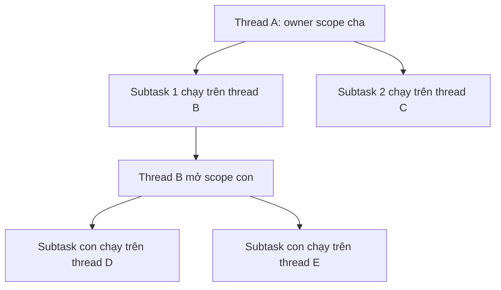

# Chủ sở hữu scope và giới hạn thao tác từ luồng khác

*Tình trạng API được đối chiếu đến ngày 27/11/2026.*

Structured Concurrency gom các tác vụ con có liên quan vào một phạm vi thực thi có vòng đời rõ ràng. Trong Java 26, API `StructuredTaskScope` tiếp tục ở **preview lần thứ sáu** theo JEP 525; trong Java 27, API tiếp tục ở **preview lần thứ bảy** theo JEP 533. Cả hai phiên bản đều yêu cầu một thread sở hữu scope. Chỉ thread đã mở scope mới được gọi các thao tác điều khiển vòng đời như `fork()`, `join()` và `close()`.

Các thread chạy subtask không trở thành chủ sở hữu scope cha. Chúng thực thi công việc được giao, trả kết quả qua `Subtask`, và kết thúc trong vòng đời của scope. Chủ sở hữu đợi kết quả bằng `join()`, đọc kết quả bằng `Subtask.get()` sau khi join, rồi đóng scope. Quy tắc này giúp việc tạo, chờ, hủy và kết thúc nhóm tác vụ diễn ra trong cùng một luồng điều phối.

## 1. Scope owner là ai?

Scope owner là thread gọi một trong các factory `StructuredTaskScope.open(...)` để mở scope. Quyền sở hữu gắn với thread đó trong suốt vòng đời scope.

Ví dụ:

```java
try (var scope = StructuredTaskScope.open()) {
    var user = scope.fork(() -> loadUser("42"));
    var orders = scope.fork(() -> loadOrders("42"));

    scope.join();

    return new Dashboard(user.get(), orders.get());
}
```

Thread chạy đoạn code trên là owner. Hai lời gọi `fork()` tạo hai subtask chạy đồng thời trong các thread riêng (mặc định là virtual thread). Thread owner tiếp tục điều phối, gọi `join()` để đợi, đọc kết quả và rời khỏi khối `try` để đóng scope.

Việc subtask chạy trong thread khác không chuyển quyền sở hữu scope. Owner vẫn là thread đã gọi `open()`, kể cả khi owner tạm thời chờ trong `join()`.

Một scope thường nên được mở, dùng và đóng trong cùng một phương thức hoặc khối `try-with-resources`. Cách tổ chức này làm rõ ai chịu trách nhiệm đợi tác vụ con và bảo đảm các tác vụ không sống vượt ra ngoài công việc cha.

## 2. Những thao tác chỉ owner được gọi

API quy định các thao tác điều khiển sau chỉ được gọi từ thread sở hữu scope:

| Thao tác | Ai được gọi? | Mục đích |
|---|---|---|
| `open(...)` | Thread tạo scope | Mở scope và xác lập owner |
| `fork(task)` | Owner | Đăng ký và khởi chạy một subtask trong scope |
| `join()` | Owner | Đợi kết quả theo chính sách của scope |
| `close()` | Owner | Đóng scope, hủy phần việc còn lại nếu cần và đợi các thread con kết thúc |
| `Subtask.get()` | Owner sau khi join và subtask thành công | Đọc kết quả của subtask |
| `Subtask.exception()` | Owner sau khi join và subtask thất bại | Đọc exception của subtask |

Nếu thread khác gọi `fork()`, `join()` hoặc `close()`, API ném `WrongThreadException`. Các thao tác đọc kết quả qua `Subtask.get()` hoặc `exception()` cũng bị giới hạn theo owner và trạng thái hoàn tất.

Không được hiểu rằng chỉ cần có tham chiếu đến scope là thread nào cũng có quyền điều khiển nó. Scope là tài nguyên có quyền sở hữu theo thread; truyền tham chiếu scope qua executor hoặc callback không chuyển giao quyền này.

## 3. Vì sao subtask không thể điều khiển scope cha?

Một scope biểu diễn một công việc cha và các công việc con. Thread owner chịu trách nhiệm về toàn bộ vòng đời của nhóm. Nếu một subtask có thể tự ý gọi `fork()`, `join()` hoặc `close()` trên scope cha, cấu trúc này sẽ mất ranh giới rõ ràng:

- Một subtask có thể tạo thêm công việc sau khi owner đã bắt đầu đợi kết quả.
- Một subtask có thể đóng scope trong khi owner vẫn đang xử lý các kết quả khác.
- Nhiều thread có thể đồng thời quyết định kết thúc hoặc chờ cùng một nhóm công việc.
- Luồng điều khiển và thời điểm kết thúc của tác vụ cha sẽ khó xác định.

Vì vậy, subtask chỉ thực hiện Callable/Runnable mà owner đã giao. Nếu subtask cần chia nhỏ công việc của chính nó, nó có thể mở một scope con. Khi đó thread thực thi subtask trở thành owner của scope con đó, chứ không phải owner của scope cha.

Cấu trúc lồng nhau tạo thành cây công việc:



Thread B có thể mở và quản lý scope con N. Tuy nhiên, thread B không thể gọi `fork()`, `join()` hoặc `close()` trên scope cha do thread A sở hữu.

## 4. Ví dụ đúng: owner điều phối, subtask chỉ làm việc

Ví dụ sau tải thông tin người dùng và số lượng đơn hàng đồng thời. Đây là cú pháp theo API Java 27:

```java
import java.util.concurrent.ExecutionException;
import java.util.concurrent.StructuredTaskScope;

record User(String id, String name) {}
record OrderSummary(String userId, int count) {}
record Dashboard(User user, OrderSummary orders) {}

public class DashboardService {
    static User loadUser(String id) throws InterruptedException {
        Thread.sleep(100);
        return new User(id, "An");
    }

    static OrderSummary loadOrders(String id) throws InterruptedException {
        Thread.sleep(150);
        return new OrderSummary(id, 3);
    }

    static Dashboard loadDashboard(String id)
            throws InterruptedException, ExecutionException {

        try (var scope = StructuredTaskScope.open()) {
            var userTask = scope.fork(() -> loadUser(id));
            var ordersTask = scope.fork(() -> loadOrders(id));

            // Chỉ owner gọi join().
            scope.join();

            // Chỉ owner đọc kết quả sau khi join thành công.
            return new Dashboard(userTask.get(), ordersTask.get());
        }
    }

    public static void main(String[] args) throws Exception {
        System.out.println(loadDashboard("42"));
    }
}
```

Diễn tiến:

1. Thread gọi `loadDashboard()` mở scope và trở thành owner.
2. Owner gọi `fork()` hai lần. Mỗi lời gọi khởi chạy một subtask trên virtual thread mặc định.
3. Hai subtask thực hiện `loadUser()` và `loadOrders()`; chúng không điều khiển scope cha.
4. Owner gọi `join()` để đợi chính sách mặc định: tất cả subtask phải thành công hoặc một subtask thất bại.
5. Khi join thành công, owner gọi `get()` trên từng `Subtask` để lấy kết quả.
6. Khối `try` kết thúc; owner đóng scope. Tất cả thread con đã kết thúc trước khi luồng thực thi đi ra ngoài khối này.

Ở đây `join()` trả về `null` khi tất cả subtask thành công theo chính sách mặc định. Nếu có subtask thất bại, `join()` ném `ExecutionException` trong JDK 27 và scope hủy các subtask còn đang chạy.

## 5. Ví dụ sai: gọi fork từ thread khác

Đoạn sau có thể biên dịch, nhưng sẽ vi phạm quy tắc sở hữu khi chạy:

```java
try (var scope = StructuredTaskScope.open()) {
    Thread.ofVirtual().start(() ->
            scope.fork(() -> loadUser("42"))
    );

    scope.join();
}
```

Thread mở scope là thread chạy khối `try`. Lambda truyền cho `Thread.ofVirtual().start()` chạy trên một virtual thread khác. Khi virtual thread đó gọi `scope.fork()`, lời gọi không xuất phát từ owner và bị từ chối bằng `WrongThreadException`.

Cách sửa là để owner gọi `fork()` trực tiếp:

```java
try (var scope = StructuredTaskScope.open()) {
    var user = scope.fork(() -> loadUser("42"));
    var orders = scope.fork(() -> loadOrders("42"));

    scope.join();
    return new Dashboard(user.get(), orders.get());
}
```

Không cần tự tạo thread bên ngoài để gọi `fork()`; chính `fork()` đã tạo thread chạy subtask. Nếu cần dùng một executor hoặc thread pool khác, đó là một mô hình thực thi khác và không làm cho thread bên ngoài trở thành owner của scope.

## 6. Không đọc Subtask trước khi owner join

Đối tượng trả về từ `fork()` là handle để owner theo dõi một subtask. Kết quả không được đọc tùy ý khi task còn chạy.

Quy trình hợp lệ:

```java
try (var scope = StructuredTaskScope.open()) {
    var user = scope.fork(() -> loadUser("42"));

    scope.join();

    User result = user.get();
    System.out.println(result);
}
```

Gọi `get()` trước khi owner join hoặc từ một thread không phải owner là sử dụng sai hợp đồng API. Sau khi join, `get()` chỉ hợp lệ nếu subtask đã hoàn tất thành công. Nếu subtask thất bại, owner có thể đọc exception qua `exception()` sau join, theo trạng thái được API cho phép.

Không dùng `Thread.sleep()` hoặc polling để đoán subtask đã xong. `join()` là điểm đồng bộ được thiết kế để owner nhận outcome của nhóm công việc.

## 7. join, lỗi và hủy các subtask còn lại

Với scope mặc định, chính sách join chờ tất cả subtask thành công hoặc một subtask thất bại. Khi một subtask thất bại, scope bị hủy và các subtask chưa hoàn tất được yêu cầu dừng bằng interrupt.

Hủy bằng interrupt là cơ chế hợp tác. JVM không cưỡng bức dừng thread ngay lập tức. Subtask phải sử dụng các thao tác có thể phản hồi interrupt và kết thúc sớm khi nhận tín hiệu.

Ví dụ một subtask cần giữ nguyên trạng thái interrupt khi bắt `InterruptedException`:

```java
static User loadUser(String id) throws InterruptedException {
    try {
        return callRemoteService(id);
    } catch (InterruptedException e) {
        // Giữ tín hiệu interrupt và kết thúc tác vụ.
        Thread.currentThread().interrupt();
        throw e;
    }
}
```

Nếu thư viện được gọi không phản hồi interrupt hoặc subtask nuốt tín hiệu rồi tiếp tục chạy, việc đóng scope có thể bị trì hoãn. `close()` luôn đợi các thread chạy subtask kết thúc; nó không cho phép công việc con tiếp tục sống sau khi owner đã đi qua điểm đóng scope.

Nếu owner đã gọi `fork()` nhưng rời khối `try` mà chưa thử gọi `join()`, `close()` vẫn hủy các subtask chưa hoàn tất và đợi chúng kết thúc, sau đó ném `IllegalStateException` để báo rằng owner đã bỏ qua bước lấy outcome. Vì thế, `try-with-resources` bảo đảm cleanup nhưng không thay thế lời gọi `join()` bắt buộc sau khi fork.

Không bắt `InterruptedException` rồi bỏ qua. Nếu có thể khôi phục hoạt động, phải xác định rõ chính sách; nếu không, kết thúc subtask và giữ interrupt status phù hợp.

## 8. Timeout là chính sách của scope, không phải quyền đóng từ thread khác

API Java 27 cho phép cấu hình timeout khi mở scope. Timeout bắt đầu khi scope được mở. Nếu hết thời hạn trước hoặc trong khi `join()` chờ, scope bị hủy và `join()` kết thúc theo chính sách Joiner. Với Joiner mặc định, `join()` ném `ExecutionException` có cause là `CancelledByTimeoutException`.

```java
import java.time.Duration;
import java.util.concurrent.ExecutionException;
import java.util.concurrent.StructuredTaskScope;

static String fetchWithTimeout()
        throws InterruptedException, ExecutionException {

    try (var scope = StructuredTaskScope.open(
            config -> config.withTimeout(Duration.ofSeconds(2)))) {

        var first = scope.fork(() -> fetchPrimary());
        var second = scope.fork(() -> fetchReplica());

        scope.join();

        return first.get() + " / " + second.get();
    }
}
```

Timeout giúp scope có giới hạn thời gian chờ theo chính sách, nhưng không biến việc hủy thành cưỡng bức. Các subtask vẫn phải phản hồi interrupt; owner khi rời khỏi scope vẫn phải đợi chúng kết thúc trong `close()`.

Nếu cần một chính sách kết quả khác, Java 27 cung cấp `StructuredTaskScope.Joiner`. Ví dụ `Joiner.anySuccessfulOrThrow()` cho phép owner nhận kết quả đầu tiên thành công và hủy các subtask còn lại. Joiner được cấu hình khi mở scope; subtask không tự chọn hoặc thay đổi chính sách join của scope cha.

## 9. Lồng scope đúng cách

Một subtask có thể mở scope riêng để chia nhỏ phần việc mà nó sở hữu. Thread chạy subtask đó trở thành owner của scope con:

```java
static Dashboard loadDashboard(String id)
        throws InterruptedException, ExecutionException {

    try (var parent = StructuredTaskScope.open()) {
        var dashboard = parent.fork(() -> {
            try (var child = StructuredTaskScope.open()) {
                var user = child.fork(() -> loadUser(id));
                var orders = child.fork(() -> loadOrders(id));

                child.join();
                return new Dashboard(user.get(), orders.get());
            }
        });

        parent.join();
        return dashboard.get();
    }
}
```

Trong ví dụ:

- Thread gọi `loadDashboard()` sở hữu `parent`.
- Subtask `dashboard` chạy trên thread riêng và sở hữu `child`.
- Thread con chỉ gọi `fork()`, `join()`, `close()` trên scope con.
- Owner cha chỉ đọc kết quả của subtask `dashboard` sau khi `parent.join()` thành công.

Khi scope con đóng, mọi subtask của nó phải kết thúc trước khi subtask cha tiếp tục. Khi scope cha đóng, subtask cha phải kết thúc trước khi owner cha tiếp tục. Quy tắc này giữ cấu trúc cây và vòng đời lồng nhau.

## 10. Chia sẻ dữ liệu giữa owner và subtask

Các hành động của owner trước khi fork có quan hệ happens-before với hành động trong subtask. Kết quả và hành động của subtask cũng được công bố an toàn cho owner khi owner nhận outcome qua `join()` hoặc `Subtask.get()`.

Dù vậy, không nên dùng một object mutable chung làm vùng trao đổi dữ liệu không kiểm soát. Hãy ưu tiên:

- Truyền dữ liệu đầu vào qua biến được capture và không thay đổi trong lúc subtask chạy.
- Trả kết quả qua giá trị của `Callable` và handle `Subtask`.
- Dùng record hoặc object immutable để biểu diễn dữ liệu dùng chung.
- Nếu bắt buộc chia sẻ trạng thái mutable, dùng cơ chế đồng bộ phù hợp và xác định rõ thread nào sở hữu từng phần trạng thái.

Scope owner quản lý vòng đời, không có nghĩa owner được phép đọc hoặc sửa đồng thời mọi object của subtask mà không cần đồng bộ.

## 11. Khác biệt API giữa Java 26 và Java 27

Structured Concurrency vẫn là preview ở cả hai phiên bản. Java 27 đã thay đổi kiểu API và ngoại lệ mặc định, vì vậy không nên sao chép nguyên ví dụ của Java 26 sang JDK 27 mà không kiểm tra.

| Nội dung | Java 26 – JEP 525, Preview 6 | Java 27 – JEP 533, Preview 7 |
|---|---|---|
| Kiểu scope | `StructuredTaskScope<T, R>` | `StructuredTaskScope<T, R, R_X extends Throwable>` |
| Mở scope mặc định | `StructuredTaskScope.open()` | `StructuredTaskScope.open()` |
| Kết quả khi tất cả thành công | `join()` trả về `null` theo chính sách mặc định | `join()` trả về `null` theo chính sách mặc định |
| Một subtask thất bại | `join()` ném `StructuredTaskScope.FailedException` | `join()` ném `ExecutionException` |
| Owner của scope | Thread gọi `open()` | Thread gọi `open()` |
| Quyền gọi `fork/join/close` | Chỉ owner | Chỉ owner |
| Thread mặc định chạy subtask | Virtual thread | Virtual thread |

Java 26 có hai tham số kiểu cho scope và dùng `FailedException` trong chính sách mặc định. Java 27 có thêm tham số kiểu mô tả loại exception mà `join()` có thể ném; factory mặc định dùng `ExecutionException`. Dùng `var` khi mở scope giúp tránh gắn code ứng dụng với số tham số kiểu của API preview.

Không dùng các constructor hoặc lớp con kiểu cũ như `ShutdownOnFailure` hay `ShutdownOnSuccess` trong ví dụ của các vòng preview trước. API hiện hành mở scope bằng `open()` và cấu hình chính sách bằng `Joiner`.

## 12. Biên dịch và chạy đúng JDK

Structured Concurrency nằm trong module chuẩn `java.base`, nhưng API vẫn là preview. Không cần `--add-modules`; cần bật preview cho cả compiler và runtime.

Với JDK 26:

```bash
javac --enable-preview --release 26 -d out26 StructuredConcurrencyDemo.java
java --enable-preview -cp out26 StructuredConcurrencyDemo
```

Với JDK 27:

```bash
javac --enable-preview --release 27 -d out27 StructuredConcurrencyDemo.java
java --enable-preview -cp out27 StructuredConcurrencyDemo
```

Không dùng class file preview của Java 26 trên runtime Java 27 hoặc ngược lại. Preview gắn với đúng release; `--enable-preview` không phải cơ chế tương thích ngược.

Trước khi kiểm tra lỗi, xác nhận cả hai công cụ dùng đúng JDK:

```bash
javac -version
java -version
```

Nếu một module hoặc thư viện sử dụng API này, toàn bộ đường build và test cần thống nhất JDK và cờ preview. Không bật preview trên toàn bộ sản phẩm chỉ để thử một ví dụ; hãy cô lập phần thử nghiệm và chuẩn bị cách thay thế khi API thay đổi hoặc bị loại bỏ.

## 13. Quy tắc thiết kế nên giữ

- Mở scope ở đúng thread sẽ chịu trách nhiệm điều phối và đóng nó.
- Gọi `fork()` từ owner; giao Callable/Runnable để subtask làm phần việc.
- Chỉ owner gọi `join()` và xử lý kết quả sau khi join.
- Không truyền scope cha cho subtask với mục đích để subtask gọi các phương thức điều khiển.
- Không đọc `Subtask.get()` trước khi join thành công.
- Để subtask phản hồi interrupt và giải phóng tài nguyên khi bị hủy.
- Dùng `try-with-resources` để đóng scope theo đúng lexical lifetime.
- Dùng scope con nếu một subtask cần chia nhỏ công việc của chính nó.
- Chia sẻ dữ liệu bất biến; đồng bộ nếu phải dùng trạng thái mutable.
- Gắn nhãn ví dụ rõ JDK 26 preview 6 hay JDK 27 preview 7, đặc biệt với kiểu generic và exception của `join()`.

Structured Concurrency giúp biểu diễn quan hệ cha-con giữa các tác vụ và làm cho vòng đời thread có thể quan sát, chờ và hủy theo một đơn vị. Quy tắc owner là nền tảng của mô hình: một thread điều phối scope, các thread khác thực thi subtask và trả kết quả về cho owner.

## Tài liệu tham chiếu

1. [JEP 525 – Structured Concurrency (Sixth Preview, Java 26)](https://openjdk.org/jeps/525)
2. [Oracle Java SE 26 API – StructuredTaskScope](https://docs.oracle.com/en/java/javase/26/docs/api/java.base/java/util/concurrent/StructuredTaskScope.html)
3. [Oracle Java SE 26 – Structured Concurrency](https://docs.oracle.com/en/java/javase/26/core/structured-concurrency.html)
4. [JEP 533 – Structured Concurrency (Seventh Preview, Java 27)](https://openjdk.org/jeps/533)
5. [Oracle Java SE 27 API – StructuredTaskScope](https://docs.oracle.com/en/java/javase/27/docs/api/java.base/java/util/concurrent/StructuredTaskScope.html)
6. [Oracle Java SE 27 – Structured Concurrency](https://docs.oracle.com/en/java/javase/27/core/structured-concurrency.html)
7. [Oracle – Preview Features, Java 27](https://docs.oracle.com/en/java/javase/27/language/preview-language-vm-features.html)

