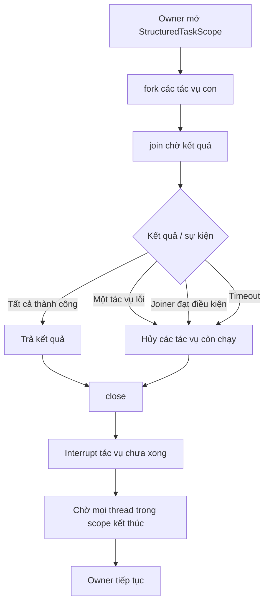

# Kiểm thử hủy, tác vụ không phản hồi và rò rỉ công việc

Structured concurrency gom các tác vụ con vào một phạm vi có vòng đời rõ ràng. Với Java 26, `StructuredTaskScope` có thể hủy các tác vụ còn chạy khi một tác vụ thất bại, khi chính sách `Joiner` đã có đủ kết quả, khi timeout hết hạn hoặc khi scope được đóng. Việc hủy được truyền đến thread của tác vụ bằng interrupt.

Điểm cần kiểm thử kỹ là **interrupt chỉ là yêu cầu hợp tác dừng**. `StructuredTaskScope.close()` luôn chờ các tác vụ con kết thúc, kể cả khi scope đã bị hủy. Một tác vụ bỏ qua interrupt hoặc mắc kẹt trong thao tác không thể ngắt có thể làm `close()` chờ vô thời hạn. Structured concurrency ngăn tác vụ được fork trong scope âm thầm sống lâu hơn scope, nhưng không thể tự quản lý thread hay công việc mà tác vụ tạo ra bên ngoài scope.

Bài này dùng API của JDK 26, nơi Structured Concurrency vẫn là preview lần thứ sáu (JEP 525). Phần cuối ghi rõ thay đổi trong JDK 27 và trạng thái chuẩn hóa của JDK 28 để tránh mang mã thử nghiệm cũ sang phiên bản mới.

## 1. Vòng đời cần được kiểm thử

Một scope được mở bởi một owner thread, thường trong `try`-with-resources. Owner gọi `fork()` để chạy tác vụ con, gọi `join()` để nhận kết quả hoặc lỗi, rồi đóng scope. Các thao tác `fork`, `join` và `close` thuộc về owner; tác vụ con không được tự điều khiển scope của cha.



Với `StructuredTaskScope.open()` mặc định, scope dùng chính sách `awaitAllSuccessfulOrThrow`: chờ mọi tác vụ thành công; nếu một tác vụ thất bại thì hủy các tác vụ còn lại và `join()` ném `StructuredTaskScope.FailedException`. Một số chính sách thường dùng:

| Joiner trong JDK 26 | Điều kiện kết thúc | Kết quả |
|---|---|---|
| `awaitAllSuccessfulOrThrow()` | Tất cả thành công hoặc một tác vụ lỗi | `null` nếu tất cả thành công; hủy scope và ném `FailedException` nếu có lỗi |
| `allSuccessfulOrThrow()` | Tất cả thành công hoặc một tác vụ lỗi | `List<T>` kết quả theo thứ tự fork; hủy scope và ném `FailedException` nếu có lỗi |
| `anySuccessfulOrThrow()` | Có tác vụ đầu tiên thành công hoặc tất cả đều lỗi | Trả kết quả đầu tiên thành công và hủy tác vụ còn lại; ném `FailedException` nếu tất cả lỗi |
| `awaitAll()` | Tất cả tác vụ kết thúc | Không tự hủy scope và không ném lỗi tác vụ qua `join()` |

Chọn Joiner theo điều kiện hoàn tất của nghiệp vụ. Không dùng `awaitAll()` nếu yêu cầu là hủy ngay các tác vụ còn lại khi có một tác vụ lỗi.

## 2. Kiểm thử khi một tác vụ thất bại làm hủy tác vụ khác

Một kiểm thử tốt cần xác nhận ba điều: tác vụ chậm đã thực sự bắt đầu, nó nhận interrupt khi tác vụ khác thất bại, và nó đã kết thúc trước khi scope đóng xong. Dùng `CountDownLatch` để điều phối thay vì dựa vào `Thread.sleep()` và thời gian chạy ngẫu nhiên.

Ví dụ sau dùng API JDK 26:

```java
import java.io.IOException;
import java.util.concurrent.CountDownLatch;
import java.util.concurrent.StructuredTaskScope;
import java.util.concurrent.TimeUnit;
import java.util.concurrent.atomic.AtomicBoolean;

static void failureCancelsSibling() throws InterruptedException {
    var siblingStarted = new CountDownLatch(1);
    var siblingInterrupted = new AtomicBoolean();
    var siblingFinished = new AtomicBoolean();

    try (var scope = StructuredTaskScope.open()) {
        scope.fork(() -> {
            siblingStarted.countDown();
            try {
                // Mô phỏng một tác vụ đang chờ I/O có thể bị interrupt.
                new CountDownLatch(1).await();
                return "unexpected";
            } catch (InterruptedException e) {
                siblingInterrupted.set(true);
                throw e;
            } finally {
                siblingFinished.set(true);
            }
        });

        scope.fork(() -> {
            if (!siblingStarted.await(2, TimeUnit.SECONDS)) {
                throw new IllegalStateException("Tác vụ chậm chưa bắt đầu");
            }
            throw new IOException("Lỗi được tạo có chủ đích để kiểm thử");
        });

        scope.join();
        throw new AssertionError("join() phải báo lỗi của tác vụ con");
    } catch (StructuredTaskScope.FailedException e) {
        if (!(e.getCause() instanceof IOException)) {
            throw e;
        }
    }

    // close() đã đợi các tác vụ trong scope kết thúc trước khi đến đây.
    if (!siblingInterrupted.get() || !siblingFinished.get()) {
        throw new AssertionError("Tác vụ anh em chưa dừng đúng cách");
    }
}
```

Tác vụ thứ hai chỉ ném `IOException` sau khi latch xác nhận tác vụ thứ nhất đã bắt đầu. Joiner mặc định hủy scope khi phát hiện lỗi; thread đang chờ ở `await()` nhận `InterruptedException`, chạy `finally` và kết thúc. `join()` ném `FailedException` với lỗi gốc trong `getCause()`. Sau đó `close()` đợi thread kết thúc trước khi owner tiếp tục.

Không chỉ kiểm tra `scope.isCancelled()`. Phương thức này có thể trả về `true` khi scope đang trong quá trình hủy, trước khi mọi thread nhận interrupt hoặc kết thúc. Kiểm thử phải xác nhận tác vụ đã chạy phần cleanup và đã thoát.

## 3. Kiểm thử timeout của cả scope

JDK 26 cho phép đặt timeout trong cấu hình scope bằng `withTimeout(Duration)`. Đồng hồ bắt đầu khi scope được mở, không phải lúc `join()` bắt đầu. Do đó, thời gian tạo scope và giai đoạn fork cũng tiêu thụ deadline.

```java
import java.time.Duration;
import java.util.concurrent.CountDownLatch;
import java.util.concurrent.StructuredTaskScope;
import java.util.concurrent.TimeUnit;
import java.util.concurrent.atomic.AtomicBoolean;

static void timeoutCancelsTasks() throws InterruptedException {
    var started = new CountDownLatch(1);
    var interrupted = new AtomicBoolean();
    var finished = new AtomicBoolean();
    boolean taskStarted = false;

    try (var scope = StructuredTaskScope.open(
            StructuredTaskScope.Joiner.<String>allSuccessfulOrThrow(),
            config -> config.withTimeout(Duration.ofSeconds(2)))) {

        scope.fork(() -> {
            started.countDown();
            try {
                new CountDownLatch(1).await();
                return "too late";
            } catch (InterruptedException e) {
                interrupted.set(true);
                throw e;
            } finally {
                finished.set(true);
            }
        });

        taskStarted = started.await(1, TimeUnit.SECONDS);
        scope.join();
        throw new AssertionError("join() phải hết thời gian");
    } catch (StructuredTaskScope.TimeoutException expected) {
        // Timeout mặc định hủy scope và interrupt tác vụ chưa hoàn tất.
    }

    if (!taskStarted || !interrupted.get() || !finished.get()) {
        throw new AssertionError("Tác vụ không hoàn tất cleanup sau timeout");
    }
}
```

Trong ví dụ, `allSuccessfulOrThrow()` dùng hành vi `onTimeout()` mặc định: ném `StructuredTaskScope.TimeoutException`. JDK 26 cũng cho phép một Joiner tùy chỉnh xử lý timeout mà không ném ngoại lệ để trả về kết quả một phần từ các tác vụ đã hoàn tất. Chỉ dùng kết quả một phần khi nghiệp vụ xác định rõ dữ liệu thiếu có thể chấp nhận được.

Timeout của scope không phải timeout cưỡng bức cho từng thao tác I/O. Nó kích hoạt hủy và gửi interrupt. Nếu một tác vụ không phản hồi interrupt, `join()` có thể báo timeout nhưng `close()` vẫn phải đợi tác vụ đó kết thúc.

## 4. Viết tác vụ có thể dừng an toàn

Tác vụ con nên dùng các API chờ có thể ngắt, kiểm tra tín hiệu dừng trong vòng lặp dài, và đóng tài nguyên trong `finally` hoặc `try`-with-resources. Khi bắt `InterruptedException`, có hai cách xử lý phổ biến:

- Dọn dẹp rồi ném lại ngoại lệ để thread kết thúc. Đây là cách phù hợp với `Callable` của subtask vì `call()` cho phép ném ngoại lệ.
- Nếu tầng hiện tại không thể ném `InterruptedException`, khôi phục trạng thái interrupt bằng `Thread.currentThread().interrupt()` trước khi trả về hoặc ném ngoại lệ khác.

Ví dụ:

```java
import java.io.IOException;
import java.net.http.HttpClient;
import java.net.http.HttpRequest;
import java.net.http.HttpResponse;

static String fetchReport(HttpClient client, HttpRequest request)
        throws IOException, InterruptedException {
    // send() có thể bị interrupt; InterruptedException được truyền lên subtask.
    HttpResponse<String> response = client.send(
            request,
            HttpResponse.BodyHandlers.ofString());
    return response.body();
}
```

Nếu dùng API I/O hoặc thư viện bên thứ ba không phản hồi interrupt, cần dùng timeout riêng của API đó, cancellation token nếu thư viện hỗ trợ, hoặc đóng tài nguyên đang chặn từ cơ chế quản lý được thiết kế rõ ràng. Không giả định rằng mọi phương thức blocking đều tự dừng khi thread bị interrupt.

Khi bắt interrupt mà phải chuyển thành unchecked exception:

```java
try {
    performInterruptibleOperation();
} catch (InterruptedException e) {
    Thread.currentThread().interrupt();
    throw new IllegalStateException("Tác vụ bị yêu cầu dừng", e);
}
```

Không nuốt `InterruptedException` rồi tiếp tục chạy như chưa có yêu cầu hủy. Việc này khiến Joiner và `close()` phải chờ một tác vụ vốn đã được yêu cầu kết thúc.

## 5. Kiểm thử tác vụ không phản hồi interrupt

Đây là trường hợp cần kiểm tra riêng vì nó làm lộ giới hạn quan trọng của structured concurrency. Một tác vụ không hợp tác có thể bỏ qua interrupt:

```java
static void nonCooperativeTask() {
    while (true) {
        try {
            Thread.sleep(1_000);
        } catch (InterruptedException ignored) {
            // Anti-pattern: nuốt interrupt và tiếp tục vòng lặp.
        }
    }
}
```

Đoạn mã này cố ý sai và không được chạy trong JVM của bộ test thông thường. Khi scope timeout hoặc bị hủy, thread nhận interrupt nhưng tiếp tục vòng lặp. `close()` chờ thread đó kết thúc nên có thể không bao giờ trả về.

Để kiểm thử tình huống này, chạy kịch bản trong **một tiến trình JVM con** có watchdog ở tiến trình cha. Đặt thời hạn chờ cho tiến trình con; nếu hết hạn, tiến trình cha kết thúc tiến trình con bằng cơ chế của hệ điều hành. Không chạy tác vụ vô hạn trong cùng JVM test rồi hy vọng `close()` hoặc một timeout của scope có thể cưỡng bức dừng nó. Java không có cơ chế an toàn để cưỡng bức dừng tùy ý một thread đang chạy.

Ngoài trường hợp cố ý bỏ qua interrupt, cần kiểm thử các điểm có thể làm tác vụ chậm kết thúc:

- Chờ lấy monitor của `synchronized`, vì việc chờ vào monitor không phản hồi interrupt như `wait()` hoặc `sleep()`.
- Thư viện native hoặc thư viện bên thứ ba có lời gọi blocking không có timeout/cancellation.
- Vòng lặp CPU dài không kiểm tra trạng thái interrupt hoặc điều kiện dừng.
- Cleanup chờ một tài nguyên khác nhưng chính tài nguyên đó không được giải phóng khi hủy.
- Tác vụ giữ lock trong lúc thực hiện I/O dài, khiến các tác vụ cleanup khác không tiến triển.

Không dùng `Thread.stop()` để giải quyết các trường hợp này. Hãy sửa giao thức dừng của tác vụ, giới hạn thời gian cho thao tác blocking, và bảo đảm tài nguyên có thể được giải phóng theo một đường điều khiển xác định.

## 6. Phát hiện công việc thoát khỏi scope

Scope chỉ quản lý các thread được tạo bởi `scope.fork(...)`. Nếu một subtask tạo thread khác hoặc gửi việc vào executor dùng chung rồi trả về, công việc đó không tự động trở thành subtask của scope:

```java
scope.fork(() -> {
    Thread.startVirtualThread(this::rebuildSearchIndex);
    return "đã gửi việc rebuild";
});
```

Subtask được fork đã kết thúc sau khi trả về chuỗi, nên scope có thể đóng thành công trong khi `rebuildSearchIndex()` vẫn chạy. Tác vụ mới không nằm trong cây scope và không được tự động interrupt khi scope cha bị hủy. Cùng vấn đề xảy ra với `executor.submit(...)`, callback bất đồng bộ hoặc một hệ thống hàng đợi bên ngoài.

Nếu công việc con phải hoàn tất cùng request cha, mở scope con bên trong subtask và join nó trước khi subtask cha trả về:

```java
static String buildResponse() throws InterruptedException {
    try (var scope = StructuredTaskScope.<String>open()) {
        var user = scope.fork(MyService::loadUser);
        var orders = scope.fork(MyService::loadOrders);

        scope.join();
        return user.get() + " | " + orders.get();
    }
}

static String handleRequest() throws InterruptedException {
    try (var scope = StructuredTaskScope.<String>open()) {
        var response = scope.fork(() -> buildResponse());
        scope.join();
        return response.get();
    }
}
```

Scope bên trong được đóng trước khi subtask cha kết thúc. Nhờ vậy, các tác vụ của `buildResponse()` nằm trong nhánh con của scope xử lý request và không thoát ra ngoài vòng đời của request.

Không phải mọi công việc đều phải sống cùng request. Nếu một tác vụ được chủ ý chuyển sang chạy nền sau khi request kết thúc, hãy chuyển quyền sở hữu sang một thành phần dài hạn có trách nhiệm quản lý queue, retry, cancellation, shutdown và quan sát trạng thái. Đừng để một subtask âm thầm tạo công việc nền mà không có owner.

## 7. Kiểm tra scope đóng đúng cách

`close()` có ba hành vi cần được kiểm thử:

1. Nếu scope chưa bị hủy, `close()` hủy scope và interrupt các tác vụ chưa hoàn tất.
2. `close()` chờ tất cả thread trong scope kết thúc trước khi owner tiếp tục.
3. Nếu đã fork tác vụ nhưng owner chưa gọi `join()`, `close()` vẫn đóng scope và sau đó ném `IllegalStateException`.

Vì vậy, hãy luôn gọi `join()` sau giai đoạn fork trong luồng điều khiển thông thường, kể cả khi kết quả không cần thiết. Nếu body của `try` gặp ngoại lệ trước khi gọi `join()`, `close()` sẽ cố gắng hủy và chờ tác vụ; ngoại lệ từ `close()` cũng có thể xuất hiện trong quá trình thoát khối. Thiết kế luồng điều khiển để kết quả của scope được quan sát và lỗi được xử lý rõ ràng.

Các kiểm thử vòng đời nên xác nhận:

- Mỗi tác vụ đã được fork đều kết thúc trước khi phương thức sở hữu scope trả về.
- Khi một tác vụ lỗi hoặc timeout, các tác vụ còn lại nhận được yêu cầu dừng.
- `finally` và `AutoCloseable.close()` của tài nguyên trong subtask được thực thi.
- Không có thread, callback hoặc future không được quản lý tiếp tục chạy sau khi scope cha đóng.
- Owner chỉ gọi `fork`, `join`, `close` và đọc `Subtask.get()` theo đúng thứ tự, trên đúng thread.

## 8. Quan sát tác vụ còn chạy bằng thread dump

Structured concurrency cung cấp cây scope và thread con để hỗ trợ quan sát. Đặt tên scope và thread factory khi cần truy vết:

```java
var factory = Thread.ofVirtual().name("checkout-", 0).factory();

try (var scope = StructuredTaskScope.open(
        StructuredTaskScope.Joiner.awaitAllSuccessfulOrThrow(),
        config -> config.withName("checkout").withThreadFactory(factory))) {
    scope.fork(this::loadCart);
    scope.fork(this::loadProfile);
    scope.join();
}
```

Trong khi ứng dụng đang chạy, tạo JSON thread dump:

```bash
jcmd <PID> Thread.dump_to_file -format=json threads.json
```

JSON thread dump thể hiện các thread container, quan hệ cha/con và những thread được fork trong scope. Khi điều tra công việc bị treo, hãy tìm scope còn tồn tại, owner đang chờ ở đâu, tác vụ con đang ở trạng thái nào và stack trace của chúng. Nếu công việc còn chạy nhưng nằm ngoài container scope dự kiến, kiểm tra thread được tạo trực tiếp hoặc executor bên ngoài.

Thread dump là ảnh chụp trạng thái tại một thời điểm, không tự chứng minh có rò rỉ. Hãy lấy nhiều dump cách nhau một khoảng thời gian, đối chiếu thread/container còn tồn tại, và kết hợp log thời điểm fork, cancel, cleanup và completion.

## 9. Phiên bản API và thay đổi cần biết

Structured concurrency vẫn là preview trong JDK 26 và JDK 27. Các API cũ đã thay đổi qua nhiều preview; không dùng ví dụ từ JDK 21–25 mà chưa đối chiếu với JDK đang biên dịch.

| Phiên bản | Trạng thái | API và xử lý lỗi |
|---|---|---|
| JDK 26 | JEP 525, preview lần thứ sáu | `StructuredTaskScope<T,R>`; `join()` có thể ném `FailedException` hoặc `StructuredTaskScope.TimeoutException`; `Joiner.onTimeout()` xử lý timeout; `allSuccessfulOrThrow()` trả `List<T>` |
| JDK 27 | JEP 533, preview lần thứ bảy | `StructuredTaskScope<T,R,R_X>`; lỗi `join()` mặc định được bọc trong `ExecutionException`; timeout có `CancelledByTimeoutException` làm cause; `Joiner.timeout()` thay `onTimeout()` |
| JDK 28 | JEP 543, API chính thức đã tích hợp vào mainline | API giữ hình dạng của JDK 27; bỏ yêu cầu `--enable-preview` khi dùng bản JDK 28 có JEP 543 |

Một số thay đổi khi chuyển từ JDK 26 lên JDK 27:

- `StructuredTaskScope` và `Joiner` có thêm tham số kiểu `R_X`, biểu diễn kiểu ngoại lệ mà `join()` có thể ném.
- `FailedException` không còn là kiểu ngoại lệ chuẩn của scope; các Joiner mặc định dùng `ExecutionException`, và nguyên nhân gốc nằm trong `getCause()`.
- `StructuredTaskScope.TimeoutException` được thay bằng `CancelledByTimeoutException` làm nguyên nhân của ngoại lệ `join()`.
- Callback `Joiner.onTimeout()` được thay bằng phương thức `Joiner.timeout()` để tạo kết quả hoặc ngoại lệ khi hết hạn.
- JDK 27 bổ sung overload `StructuredTaskScope.open(configOperator)` để dùng chính sách mặc định cùng cấu hình timeout/name/thread factory.

Tại ngày 27/11/2026, JDK 28 chưa phát hành GA. JEP 543 đã tích hợp API chính thức vào nhánh phát triển JDK 28 và không thay đổi API so với JDK 27. Vì vậy, có thể thử API ổn định trên JDK 28 early-access build đã chứa JEP 543; với JDK 27 GA, vẫn phải bật preview. Mã biên dịch với preview của JDK 26 hoặc JDK 27 cần được biên dịch lại trên JDK đích.

Để thử nghiệm đúng JDK 26, bật preview ở cả bước biên dịch và chạy:

```bash
javac --release 26 --enable-preview -d out src/StructuredCancellationCheck.java
java --enable-preview -cp out StructuredCancellationCheck
```

Trên JDK 27, thay mức phát hành bằng `27` và tiếp tục bật preview:

```bash
javac --release 27 --enable-preview -d out src/StructuredCancellationCheck.java
java --enable-preview -cp out StructuredCancellationCheck
```

Với JDK 28 early-access build đã tích hợp JEP 543, biên dịch và chạy theo API chính thức, không bật preview:

```bash
javac -d out src/StructuredCancellationCheck.java
java -cp out StructuredCancellationCheck
```

Không trộn ví dụ JDK 26 dùng `FailedException`/`TimeoutException` với ví dụ JDK 27/28 dùng `ExecutionException`/`CancelledByTimeoutException`. Hãy chọn đúng tài liệu API của JDK dùng để biên dịch và chạy.

## 10. Checklist kiểm thử trước khi đưa vào hệ thống

1. Kiểm tra đường chạy thành công: mọi subtask hoàn tất và owner đọc kết quả sau `join()`.
2. Ép một subtask thất bại bằng lỗi có kiểm soát; xác nhận Joiner hủy các tác vụ còn lại.
3. Dùng latch để xác nhận tác vụ chậm đã bắt đầu trước khi kích hoạt lỗi hoặc timeout.
4. Kiểm tra tác vụ phản hồi interrupt, chạy cleanup và kết thúc trước khi scope đóng xong.
5. Kiểm thử timeout với thời gian hữu hạn; xác nhận `join()` báo đúng loại lỗi của JDK đang dùng.
6. Chạy riêng một tiến trình con để kiểm tra tác vụ cố ý bỏ qua interrupt; đặt watchdog ở tiến trình cha.
7. Tìm công việc thoát scope do `Thread.startVirtualThread`, callback hoặc executor bên ngoài.
8. Kiểm tra mọi tài nguyên được đóng khi tác vụ thành công, thất bại, bị hủy hoặc timeout.
9. Lấy JSON thread dump khi scope bị treo; kiểm tra quan hệ container và stack trace.
10. Biên dịch lại trên JDK đích và xác nhận code dùng đúng preview/API status.

## 11. Những điểm cần nhớ

- Joiner, lỗi hoặc timeout có thể hủy scope; hủy gửi interrupt đến các tác vụ chưa hoàn tất.
- `close()` luôn đợi thread trong scope kết thúc. Một tác vụ bỏ qua interrupt có thể làm `close()` chờ vô hạn.
- `isCancelled()` chỉ cho biết scope đang hoặc đã bị hủy, không chứng minh mọi tác vụ đã dừng.
- Dùng latch/barrier để kiểm thử thứ tự và trạng thái; tránh dùng `sleep()` làm cơ chế đồng bộ.
- Không tạo thread hoặc gửi công việc ra executor bên ngoài nếu công việc đó phải kết thúc cùng scope.
- Dùng scope lồng nhau cho công việc con cần chia sẻ cùng vòng đời; chuyển công việc nền sang một owner dài hạn khi nghiệp vụ yêu cầu.
- Quan sát cây scope bằng JSON thread dump và đối chiếu nhiều lần chụp khi điều tra tác vụ còn chạy.
- JDK 26 là preview thứ sáu; JDK 27 là preview thứ bảy với thay đổi exception/API; JDK 28 đã tích hợp API chính thức nhưng chưa GA tại ngày 27/11/2026.

## Tài liệu tham khảo

- [Java SE 26 API: `StructuredTaskScope`](https://docs.oracle.com/en/java/javase/26/docs/api/java.base/java/util/concurrent/StructuredTaskScope.html)
- [Java SE 26 API: `StructuredTaskScope.Joiner`](https://docs.oracle.com/en/java/javase/26/docs/api/java.base/java/util/concurrent/StructuredTaskScope.Joiner.html)
- [Java SE 26 Core Libraries: Structured Concurrency](https://docs.oracle.com/en/java/javase/26/core/structured-concurrency.html)
- [JEP 525: Structured Concurrency (Sixth Preview), JDK 26](https://openjdk.org/jeps/525)
- [Java SE 27 API: `StructuredTaskScope`](https://docs.oracle.com/en/java/javase/27/docs/api/java.base/java/util/concurrent/StructuredTaskScope.html)
- [JEP 533: Structured Concurrency (Seventh Preview), JDK 27](https://openjdk.org/jeps/533)
- [JDK 27 Release Notes: Structured Concurrency (Seventh Preview)](https://www.oracle.com/java/technologies/javase/27-relnote-issues.html)
- [JEP 543: Structured Concurrency, JDK 28](https://openjdk.org/jeps/543)
- [OpenJDK: JEP 543 implementation — permanent API in JDK 28](https://www.mail-archive.com/core-libs-dev%40openjdk.org/msg75715.html)
- [JDK 26 jcmd documentation: `Thread.dump_to_file`](https://docs.oracle.com/en/java/javase/26/docs/specs/man/jcmd.html)
