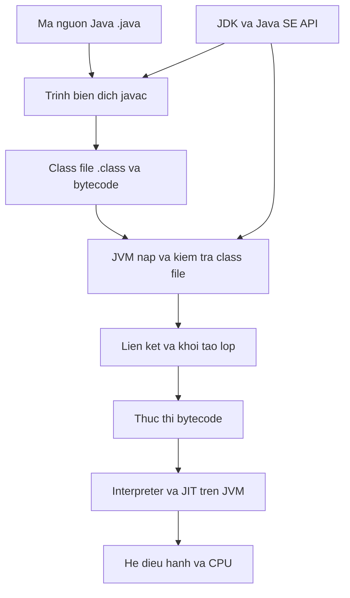

# Java SE, JDK, JVM và hệ sinh thái Java

Java là một ngôn ngữ lập trình và một nền tảng thực thi phần mềm. Khi học hoặc triển khai Java, cần phân biệt bốn khái niệm thường được dùng cùng nhau: **ngôn ngữ Java**, **Java SE**, **JDK** và **JVM**. Chúng có quan hệ chặt chẽ nhưng không đồng nghĩa. Hiểu đúng vai trò của từng thành phần giúp chọn đúng bộ công cụ, biên dịch đúng phiên bản, chẩn đoán lỗi khi chạy và xây dựng ứng dụng có khả năng vận hành lâu dài.

Tài liệu này tập trung vào những thành phần còn được sử dụng trong Java 27. Các thông tin về phiên bản được đối chiếu theo tài liệu công bố đến ngày 27/11/2026.

## 1. Java là ngôn ngữ và nền tảng

Java là ngôn ngữ lập trình có kiểu tĩnh, hướng đối tượng, hỗ trợ lập trình tổng quát, xử lý đồng thời và nhiều phong cách lập trình khác. Mã nguồn Java thường được biên dịch thành **bytecode** trong tệp `.class`. Bytecode được thực thi bởi một máy ảo Java tương thích, vì vậy cùng một chương trình có thể chạy trên nhiều hệ điều hành và kiến trúc phần cứng nếu môi trường đích cung cấp phiên bản Java phù hợp.

Khả năng chạy trên nhiều nền tảng không có nghĩa mọi chương trình Java tự động tương thích với mọi phiên bản runtime. Ứng dụng vẫn phụ thuộc vào phiên bản bytecode, API được sử dụng, thư viện bên thứ ba, cấu hình runtime và các thư viện native nếu có.

Java cũng không chỉ giới hạn ở mã nguồn viết bằng ngôn ngữ Java. JVM thực thi định dạng class file và bytecode được quy định bởi đặc tả JVM. Vì vậy, các ngôn ngữ như Kotlin, Scala và Groovy có thể biên dịch mã nguồn của chúng thành class file để chạy trên JVM.

## 2. Phân biệt Java SE, JDK và JVM

| Thành phần | Vai trò | Nội dung chính |
|---|---|---|
| Java Language | Ngôn ngữ dùng để viết chương trình | Cú pháp, kiểu dữ liệu, biểu thức, lớp, interface, generic, exception, concurrency và quy tắc ngôn ngữ |
| Java SE (Java Platform, Standard Edition) | Nền tảng Java tiêu chuẩn | Đặc tả ngôn ngữ, đặc tả JVM và các API tiêu chuẩn như collections, I/O, networking, date-time, concurrency, security và JDBC |
| JDK (Java Development Kit) | Bộ công cụ phát triển và triển khai Java | Trình biên dịch, bộ chạy, thư viện, công cụ đóng gói, tài liệu và công cụ chẩn đoán |
| JVM (Java Virtual Machine) | Máy ảo thực thi class file | Nạp, kiểm tra, liên kết, khởi tạo và thực thi bytecode; quản lý bộ nhớ và phối hợp với hệ điều hành, phần cứng |

### 2.1. Java SE: nền tảng tiêu chuẩn

Java SE quy định những thành phần cốt lõi mà các bản triển khai Java SE phải cung cấp. Phạm vi này gồm:

- **Java Language Specification (JLS):** định nghĩa cú pháp và ngữ nghĩa của ngôn ngữ Java, chẳng hạn cách khai báo kiểu, kiểm tra kiểu, kế thừa, generic, exception và biểu thức.
- **Java Virtual Machine Specification (JVMS):** định nghĩa cách biểu diễn class file, bytecode, các vùng dữ liệu khi chạy, quá trình nạp và liên kết lớp, cùng tập lệnh JVM.
- **Java SE API:** tập hợp API chuẩn để ứng dụng sử dụng các chức năng phổ biến như collections, I/O, networking, xử lý thời gian, bảo mật, xử lý dữ liệu và truy cập cơ sở dữ liệu qua JDBC.

Java SE là đặc tả nền tảng, không phải tên của một trình biên dịch hay một JVM cụ thể. Các nhà cung cấp xây dựng JDK dựa trên đặc tả và có thể bổ sung công cụ hoặc dịch vụ riêng.

### 2.2. JDK: bộ công cụ phát triển

JDK cung cấp môi trường cần thiết để biên dịch, chạy, kiểm tra, đóng gói và chẩn đoán ứng dụng Java. Một bản JDK hiện đại thường có các nhóm thành phần sau:

| Công cụ hoặc thành phần | Công dụng |
|---|---|
| `javac` | Biên dịch mã nguồn Java thành class file |
| `java` | Khởi chạy ứng dụng và JVM |
| Java SE API và các module chuẩn | Cung cấp các lớp, interface và dịch vụ tiêu chuẩn cho ứng dụng |
| `jar` | Tạo và kiểm tra tệp JAR |
| `javadoc` | Sinh tài liệu API từ mã nguồn và chú thích |
| `jshell` | Thử nghiệm biểu thức và đoạn mã Java trong môi trường tương tác |
| `jlink` | Tạo runtime image tùy chỉnh từ các module cần thiết |
| `jpackage` | Đóng gói ứng dụng thành gói cài đặt phù hợp với nền tảng đích |
| `jcmd`, `jfr` và các công cụ chẩn đoán | Quan sát, ghi nhận và phân tích hoạt động của JVM |
| `jdeps` | Phân tích phụ thuộc giữa các package và module |

JDK bao gồm các thành phần runtime cần thiết để chạy chương trình. Khi triển khai, đội ngũ có thể dùng một bản JDK đầy đủ hoặc tạo runtime image nhỏ hơn bằng `jlink`, tùy nhu cầu vận hành và đóng gói. Không nên mặc định rằng máy chủ sản xuất phải cài toàn bộ công cụ phát triển.

JDK còn hỗ trợ hệ thống module của Java. Một ứng dụng có thể khai báo module và phụ thuộc bằng `module-info.java`; công cụ `jlink` có thể dựa trên đồ thị module để tạo runtime image chỉ chứa những module cần thiết.

### 2.3. JVM: môi trường thực thi bytecode

JVM là một máy trừu tượng được mô tả bằng đặc tả. Một bản triển khai JVM phải tuân theo định dạng class file và hành vi thực thi được quy định, nhưng đặc tả không bắt buộc mọi nhà cung cấp phải dùng cùng thuật toán thu gom rác, cách bố trí bộ nhớ hay kỹ thuật tối ưu hóa.

Trong các JDK phổ biến, **HotSpot** là một triển khai JVM quan trọng. Khi chạy chương trình, JVM thường thực hiện các công việc sau:

1. **Nạp lớp (loading):** class loader tìm và nạp định nghĩa lớp từ class path, module path hoặc nguồn phù hợp.
2. **Kiểm tra và liên kết (verification and linking):** kiểm tra cấu trúc class file và bytecode, chuẩn bị dữ liệu cần thiết, rồi phân giải các tham chiếu lớp, trường và phương thức.
3. **Khởi tạo (initialization):** thực hiện các bước khởi tạo lớp theo quy tắc của Java trước khi lớp được sử dụng.
4. **Thực thi:** thực hiện bytecode. HotSpot có thể diễn giải bytecode và biên dịch các đoạn mã được thực thi thường xuyên thành mã máy bằng JIT compiler để tăng hiệu năng.
5. **Quản lý tài nguyên runtime:** quản lý vùng nhớ, luồng, đồng bộ hóa, ngoại lệ, kết nối với thư viện native và thu gom các đối tượng không còn được tham chiếu.

JVM không bắt buộc phải dùng interpreter hay JIT theo một cách cụ thể. Đây là lựa chọn triển khai. Vì thế, hiệu năng và các tùy chọn runtime có thể khác nhau giữa các JVM, dù chúng cùng thực thi một định dạng bytecode.

Một số vùng dữ liệu runtime quan trọng gồm:

- **Heap:** vùng nhớ dùng chung, nơi phần lớn đối tượng và mảng được cấp phát; garbage collector quản lý việc thu hồi bộ nhớ của các đối tượng không còn sống.
- **Java Virtual Machine Stack:** mỗi luồng có stack riêng để lưu frame của các lần gọi phương thức, biến cục bộ và operand stack.
- **Program Counter (PC) Register:** mỗi luồng có bộ đếm lệnh để theo dõi vị trí bytecode đang thực thi.
- **Method Area và Runtime Constant Pool:** lưu thông tin cấu trúc lớp, phương thức, hằng số và dữ liệu phục vụ liên kết, phân giải tham chiếu.
- **Native Method Stack và bộ nhớ native:** hỗ trợ các hoạt động thực thi mã native và các thành phần runtime ngoài heap Java.

Đặc tả JVM quy định mô hình và hành vi quan sát được; cách hiện thực chi tiết các vùng nhớ là tùy thuộc từng JVM. Ví dụ, không nên coi một cách bố trí bộ nhớ nội bộ của HotSpot là yêu cầu bắt buộc đối với mọi JVM.

## 3. Từ mã nguồn đến chương trình đang chạy

Quy trình thông thường có thể mô tả như sau:



Ví dụ một chương trình tối giản:

```java
public class HelloJava {
    public static void main(String[] args) {
        System.out.println("Hello, Java 27!");
    }
}
```

Với JDK 27 đã được cài đặt và cấu hình trong `PATH`, có thể kiểm tra phiên bản, biên dịch và chạy chương trình:

```bash
java --version
javac --version

javac --release 27 -d out HelloJava.java
java -cp out HelloJava
```

Trong ví dụ này:

- `javac` đọc mã nguồn và kiểm tra cú pháp, kiểu dữ liệu, các quy tắc của ngôn ngữ.
- `--release 27` yêu cầu trình biên dịch tạo class file và chỉ cho phép sử dụng API thuộc Java SE 27.
- `-d out` chỉ định thư mục chứa class file được tạo ra.
- `java -cp out HelloJava` yêu cầu launcher tìm lớp `HelloJava` trong thư mục `out`, khởi động JVM và gọi phương thức `main`.

Class file có định dạng độc lập với hệ điều hành, nhưng vẫn có phiên bản. Java SE 27 hỗ trợ class file có major version **71**. Runtime cũ hơn có thể không hiểu class file được biên dịch cho một phiên bản mới hơn; ngoài ra, ứng dụng còn có thể cần API không tồn tại trong runtime cũ. Khi phân phối ứng dụng, cần xác định rõ phiên bản Java tối thiểu mà ứng dụng hỗ trợ.

## 4. Hệ sinh thái Java hiện nay

Java SE cung cấp nền tảng cốt lõi. Các công cụ và dự án khác bổ sung quy trình phát triển, framework ứng dụng, kiểm thử và vận hành.

### 4.1. Các bản phân phối JDK

OpenJDK là dự án phát triển mã nguồn mở của nền tảng JDK. Nhiều nhà cung cấp xây dựng và phân phối JDK dựa trên mã nguồn OpenJDK, ví dụ Oracle JDK, Eclipse Temurin, Amazon Corretto, Azul Zulu, Microsoft Build of OpenJDK và BellSoft Liberica.

Khi chọn một bản phân phối, cần xem xét:

- Chính sách cập nhật bảo mật và thời gian hỗ trợ của nhà cung cấp.
- Điều khoản giấy phép và điều kiện sử dụng trong môi trường sản xuất.
- Hệ điều hành, kiến trúc CPU và môi trường triển khai được hỗ trợ.
- Cam kết tương thích, chứng nhận và dịch vụ hỗ trợ doanh nghiệp nếu dự án yêu cầu.
- Quy trình phát hành bản vá và khả năng đồng bộ phiên bản giữa máy phát triển, CI và production.

Các bản phân phối tuân thủ cùng đặc tả Java SE hướng tới khả năng tương thích ở cấp nền tảng. Tuy vậy, chính sách cấp phép, thời gian hỗ trợ, công cụ bổ sung và lịch phát hành bản cập nhật có thể khác nhau. Vì vậy, nên chốt một nhà cung cấp và phiên bản JDK rõ ràng cho từng môi trường của dự án.

### 4.2. Công cụ phát triển và quản lý phụ thuộc

- **IDE và editor:** IntelliJ IDEA, Eclipse và Visual Studio Code hỗ trợ viết mã, điều hướng, refactor, debug và tích hợp công cụ build.
- **Build tool:** Maven và Gradle tự động hóa biên dịch, kiểm thử, quản lý phụ thuộc, đóng gói và các bước CI. Maven Wrapper hoặc Gradle Wrapper giúp dự án cố định phiên bản build tool.
- **Quản lý phụ thuộc:** thư viện thường được khai báo theo tọa độ artifact và phiên bản; cần kiểm tra nguồn phát hành, giấy phép, lỗ hổng và tính tương thích trước khi nâng cấp.
- **Quản lý mã nguồn và CI:** Git cùng các hệ thống CI giúp kiểm soát thay đổi, chạy build và kiểm thử trên JDK mục tiêu.

### 4.3. API, thư viện và framework

Ứng dụng Java thường kết hợp Java SE API với thư viện và framework phù hợp bài toán:

| Nhóm | Ví dụ | Vai trò |
|---|---|---|
| Web và backend | Spring Boot, Quarkus, Micronaut, Helidon | Xây dựng API, dịch vụ web và ứng dụng backend |
| Tiêu chuẩn ứng dụng doanh nghiệp | Jakarta EE, MicroProfile | Định nghĩa API và mô hình triển khai cho ứng dụng doanh nghiệp, dịch vụ phân tán và microservice |
| Truy cập dữ liệu | JDBC, Jakarta Persistence, Hibernate | Kết nối cơ sở dữ liệu, truy vấn và ánh xạ dữ liệu quan hệ |
| Kiểm thử | JUnit, Mockito, Testcontainers | Kiểm thử đơn vị, kiểm thử thành phần và kiểm thử tích hợp với dịch vụ phụ trợ |
| Quan sát hệ thống | JDK Flight Recorder, JDK Mission Control, JMX, OpenTelemetry và Micrometer | Thu thập dữ liệu hiệu năng, log, metrics và trace để vận hành, điều tra sự cố |

Các framework và thư viện trong bảng là thành phần của hệ sinh thái bên ngoài Java SE. Chúng có vòng đời phát hành, yêu cầu phiên bản JDK và chính sách tương thích riêng; không nên giả định rằng cài JDK là đã có sẵn các framework này.

### 4.4. Đóng gói và triển khai

Một ứng dụng Java có thể được đóng gói thành JAR, phân phối cùng các thư viện phụ thuộc hoặc đóng gói thành runtime image riêng. `jlink` tạo runtime image từ các module cần thiết; `jpackage` hỗ trợ tạo gói cài đặt cho nền tảng đích. Trong môi trường cloud, ứng dụng Java cũng thường được đóng gói trong container và triển khai trên hệ thống điều phối như Kubernetes.

Lựa chọn cách đóng gói phụ thuộc vào yêu cầu kích thước image, khả năng cập nhật, kiểm soát runtime, nền tảng triển khai và quy trình vận hành. Dù chọn cách nào, cần ghi nhận phiên bản JDK, cấu hình JVM và các phụ thuộc đi kèm để có thể tái tạo bản build.

## 5. Những điểm cần biết về Java 27

Java 27 được phát hành chính thức ngày **15/09/2026**. Theo trang tải xuống Oracle tại thời điểm 27/11/2026, JDK 27 là bản phát hành Java SE mới nhất và JDK 25 là bản LTS mới nhất trong danh mục của Oracle. Bản Oracle JDK 27 mới nhất được công bố là **27.0.1.1**, phát hành ngày **17/11/2026**. Oracle nêu lịch cập nhật theo điều khoản NFTC cho JDK 27 đến tháng 03/2027; lịch hỗ trợ và điều khoản của các nhà cung cấp JDK khác có thể khác nhau.

Java 27 có chín JEP nổi bật. Cần phân biệt tính năng đã hoàn tất với tính năng preview hoặc incubator:

| JEP | Nội dung | Trạng thái trong JDK 27 | Ý nghĩa |
|---|---|---|---|
| [JEP 527](https://openjdk.org/jeps/527) | Post-Quantum Hybrid Key Exchange for TLS 1.3 | Hoàn tất | Bổ sung trao đổi khóa lai hậu lượng tử cho TLS 1.3, kết hợp thuật toán kháng lượng tử với thuật toán truyền thống |
| [JEP 523](https://openjdk.org/jeps/523) | Make G1 the Default Garbage Collector in All Environments | Hoàn tất | Đặt G1 làm garbage collector mặc định trong các môi trường HotSpot |
| [JEP 534](https://openjdk.org/jeps/534) | Compact Object Headers by Default | Hoàn tất | Dùng object header gọn làm bố cục mặc định; trên kiến trúc 64-bit, kích thước header giảm từ 96 bit xuống 64 bit |
| [JEP 536](https://openjdk.org/jeps/536) | JFR In-Process Data Redaction | Hoàn tất | Che dữ liệu nhạy cảm trong bản ghi JDK Flight Recorder trước khi dữ liệu rời khỏi tiến trình |
| [JEP 532](https://openjdk.org/jeps/532) | Primitive Types in Patterns, `instanceof`, and `switch` | Preview lần thứ năm | Mở rộng pattern matching, `instanceof` và `switch` để làm việc với kiểu nguyên thủy |
| [JEP 531](https://openjdk.org/jeps/531) | Lazy Constants | Preview lần thứ ba | Cung cấp API cho hằng số khởi tạo trì hoãn, giữ dữ liệu không thể thay đổi và cho JVM thêm cơ hội tối ưu hóa |
| [JEP 533](https://openjdk.org/jeps/533) | Structured Concurrency | Preview lần thứ bảy | Gom nhóm các tác vụ đồng thời liên quan thành một đơn vị để quản lý lỗi, hủy tác vụ và vòng đời rõ ràng hơn |
| [JEP 538](https://openjdk.org/jeps/538) | PEM Encodings of Cryptographic Objects | Preview lần thứ ba | Cung cấp API mã hóa và giải mã khóa, chứng chỉ và danh sách thu hồi chứng chỉ theo định dạng PEM |
| [JEP 537](https://openjdk.org/jeps/537) | Vector API | Incubator lần thứ mười hai | Biểu diễn phép tính vector để JVM có thể ánh xạ sang lệnh vector phù hợp của CPU được hỗ trợ |

Bốn JEP đầu tiên là các thay đổi đã hoàn tất trong bản phát hành. Bốn tính năng preview vẫn có thể thay đổi trước khi trở thành tính năng chính thức; mã sử dụng preview cần được biên dịch và chạy với tùy chọn `--enable-preview` tương ứng. Vector API vẫn ở trạng thái incubator và cần được bật theo hướng dẫn của module incubator. Không nên mặc định các API preview hoặc incubator đã ổn định cho mọi ứng dụng sản xuất.

Ngoài các JEP, JDK 27 còn có cập nhật về mật mã, tối ưu hóa JVM và I/O, công cụ chẩn đoán, dữ liệu múi giờ và thư viện chuẩn. Khi nâng cấp môi trường, cần đọc release notes của đúng bản phân phối và bản cập nhật đang sử dụng, đặc biệt nếu ứng dụng phụ thuộc vào cấu hình bảo mật, thư viện native hoặc hành vi runtime cụ thể.

## 6. Chọn phiên bản Java cho dự án

Java phát hành phiên bản tính năng theo chu kỳ sáu tháng. Bản phát hành mới có thể mang đến API và cải tiến mới, nhưng thời gian cập nhật của một bản feature release thường ngắn hơn các bản LTS. Nhãn LTS và thời hạn hỗ trợ thực tế cần được xác nhận theo chính sách của nhà cung cấp JDK.

Một số nguyên tắc lựa chọn:

1. **Ưu tiên LTS khi cần thời gian vận hành dài:** kiểm tra phiên bản LTS mà nhà cung cấp đang hỗ trợ, thời hạn cập nhật bảo mật và điều khoản sử dụng.
2. **Chọn feature release khi có lý do kỹ thuật rõ ràng:** xác định tính năng cần dùng, thời gian hỗ trợ và kế hoạch nâng cấp tiếp theo.
3. **Đồng bộ JDK giữa các môi trường:** quy định phiên bản cho máy phát triển, CI, môi trường kiểm thử và production; tránh build bằng một JDK rồi chạy trên runtime không tương thích.
4. **Khai báo mức tương thích khi biên dịch:** dùng `javac --release` hoặc cấu hình toolchain tương ứng trong Maven/Gradle để kiểm soát API và bytecode mục tiêu.
5. **Cập nhật bản vá thường xuyên:** theo dõi thông báo bảo mật và lịch cập nhật của nhà cung cấp; không chỉ dựa vào số phiên bản major.
6. **Đánh giá tính năng chưa hoàn tất:** chỉ bật preview hoặc incubator khi nhóm phát triển chấp nhận rủi ro thay đổi API, giới hạn tương thích và chi phí nâng cấp.
7. **Đo lường trước khi tinh chỉnh JVM:** thu thập dữ liệu bằng JFR và các công cụ chẩn đoán trước khi thay đổi garbage collector, heap hoặc tham số runtime.

## 7. Tài liệu tham khảo chính thức

- [Java SE 27 - JDK Downloads](https://www.oracle.com/java/technologies/downloads/) — phiên bản JDK, bản cập nhật và thông tin LTS theo danh mục Oracle.
- [JDK 27 Release Notes](https://www.oracle.com/java/technologies/javase/27-relnote-issues.html) — thay đổi, tính năng, API, vấn đề tương thích và ghi chú phát hành.
- [Consolidated JDK 27 Release Notes](https://www.oracle.com/java/technologies/javase/27all-relnotes.html) — lịch sử các bản cập nhật JDK 27.
- [The Java Virtual Machine Specification, Java SE 27 Edition](https://docs.oracle.com/en/java/javase/27/docs/specs/jvms/index.html) — đặc tả class file, bytecode, vùng dữ liệu runtime, nạp lớp và thực thi.
- [The Java Language Specification, Java SE 27 Edition](https://docs.oracle.com/en/java/javase/27/docs/specs/jls/index.html) — đặc tả ngôn ngữ Java.
- [The Arrival of Java 27](https://blogs.oracle.com/java/the-arrival-of-java-27) — tổng quan các JEP và cải tiến trong Java 27.
- [Dev.java: Getting to know the JVM](https://dev.java/learn/jvm/) — tài liệu học về công cụ JDK, JVM, giám sát, bảo mật và garbage collection.
