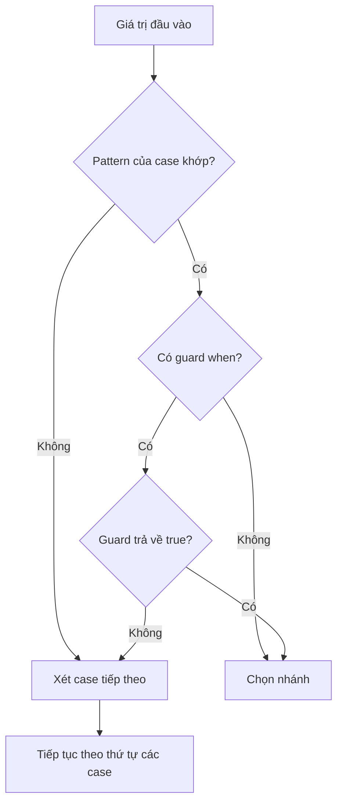

# Guard với `when` và thứ tự ưu tiên các nhánh mẫu

Trong Java 27, **pattern matching for `switch`** cho phép lựa chọn nhánh theo kiểu và cấu trúc dữ liệu của một giá trị. Từ khóa `when` bổ sung điều kiện **guard** để một mẫu chỉ được chọn khi vừa khớp cấu trúc, vừa thỏa một quy tắc nghiệp vụ. Khi nhiều mẫu có thể khớp cùng một giá trị, **thứ tự nhánh** quyết định kết quả; trình biên dịch còn kiểm tra các trường hợp một nhánh bị nhánh trước bao phủ (*dominance*).

Bài học thuộc chương **Pattern matching** của module **JAVA_VERSION_JAVA27 — Java 27 và các kiến thức liên quan**. Phần cốt lõi sử dụng **pattern matching for switch** (hoàn tất trong Java 21, JEP 441) và **record patterns** (hoàn tất trong Java 21, JEP 440), đều còn áp dụng trong Java 27. Các ví dụ dưới đây không cần `--enable-preview`. Không sử dụng các phần mở rộng pattern matching cho kiểu nguyên thủy vẫn ở trạng thái preview của Java 27.

## 1. Từ kiểm tra kiểu đến nhánh có điều kiện

Giả sử một hàm nhận `Object` và cần phân biệt chuỗi trống, chuỗi ngắn, chuỗi dài, số nguyên hoặc giá trị khác. Một biểu thức `switch` có thể giải quyết theo thứ tự:

```java
static String describe(Object value) {
    return switch (value) {
        case null -> "Thiếu dữ liệu";
        case String s when s.isBlank() -> "Chuỗi trống";
        case String s when s.length() <= 5 -> "Chuỗi ngắn: " + s;
        case String s -> "Chuỗi dài: " + s;
        case Integer n when n < 0 -> "Số âm";
        case Integer n -> "Số nguyên: " + n;
        default -> "Loại dữ liệu khác";
    };
}
```

Đầu vào là `"   "` sẽ vào nhánh “Chuỗi trống”. Đầu vào `"Java"` vào nhánh “Chuỗi ngắn”. `"Java 27"` sẽ vào nhánh “Chuỗi dài”. Với `Integer.valueOf(-2)`, kết quả là “Số âm”. Các nhánh `String s` và `Integer n` không có guard đóng vai trò **trường hợp còn lại** của từng kiểu.

Cần phân biệt:

- **Pattern** (mẫu) `String s` kiểm tra giá trị là một `String` không `null` và gán giá trị đó vào biến `s`.
- **Guard** `when s.isBlank()` là điều kiện bổ sung, được xét **sau khi** mẫu `String s` khớp.
- **Switch rule** `-> ...` là phần kết quả/hành động được chọn khi cả mẫu và guard cùng thành công.

`when` gắn với một nhãn `case` chứa **pattern**. Nó không phải cách viết thay thế cho `if` ở mọi vị trí và không đặt sau `case` chỉ chứa một hằng đơn lẻ.

## 2. Cú pháp `when` và điều kiện guard

Cú pháp thường gặp:

```java
return switch (value) {
    case SomeType item when someBooleanExpression(item) -> resultA;
    case SomeType item -> resultB;
    default -> otherResult;
};
```

Ở đây, `someBooleanExpression(item)` phải trả về `boolean` hoặc `Boolean`. Nếu là `Boolean` và bằng `null`, phép unboxing sẽ ném `NullPointerException`. Vì vậy, nên thiết kế guard trả về `boolean` rõ ràng và xử lý dữ liệu có thể `null` ngay trong điều kiện.

Quy trình đối với mỗi `case` có guard:

1. Thử khớp **pattern** với giá trị selector.
2. Nếu pattern không khớp, **không đánh giá guard**; xét nhãn kế tiếp.
3. Nếu pattern khớp, khởi tạo các biến pattern, rồi đánh giá guard.
4. Nếu guard là `true`, chọn nhánh; nếu là `false`, tiếp tục tìm nhánh khác.
5. Nếu việc khớp pattern hoặc đánh giá guard ném ngoại lệ, `switch` kết thúc bất thường bằng ngoại lệ đó; Java **không** xem ngoại lệ như `false` để tự chuyển sang nhánh sau.



Ví dụ guard chứa nhiều điều kiện:

```java
static String check(Object value) {
    return switch (value) {
        case String s when !s.isBlank() && s.length() <= 20 ->
            "Nhãn hợp lệ: " + s.strip();
        case String s -> "Nhãn trống hoặc quá dài";
        case null -> "Chưa có nhãn";
        default -> "Không phải chuỗi";
    };
}
```

Toán tử `&&` thực hiện short-circuit; vế phải chỉ được đánh giá khi vế trái đúng. Biến `s` đã được kiểm tra là `String` không `null` trước khi guard chạy. Đối với đầu vào có thể chứa khoảng trắng ở hai đầu, cần quyết định rõ yêu cầu nghiệp vụ: ví dụ này đo độ dài **trước** khi `strip()`, vì thế khoảng trắng vẫn tính vào giới hạn 20 ký tự.

## 3. Thứ tự `case` là thứ tự ưu tiên thực thi

Đối với giá trị không `null`, Java tìm **nhãn `case` đầu tiên áp dụng được** trong khối `switch`. Khi một nhánh được chọn, các nhánh sau không tiếp tục được xét để chọn kết quả khác. Do đó thứ tự các guard chồng lấn nhau là một phần của quy tắc nghiệp vụ.

```java
static String discount(int amount) {
    return switch (Integer.valueOf(amount)) {
        case Integer n when n >= 2_000_000 -> "Giảm 15%";
        case Integer n when n >= 500_000 -> "Giảm 5%";
        case Integer n when n >= 0 -> "Không giảm";
        case Integer n -> "Số tiền không hợp lệ";
    };
}
```

Với `amount = 2_500_000`, cả hai guard đầu đều có thể đúng, nhưng Java chọn **nhánh đầu tiên**, kết quả “Giảm 15%”. Nếu đổi thứ tự và đặt ngưỡng 500.000 trước, kết quả trở thành “Giảm 5%”. Trình biên dịch thường không phát hiện ý nghĩa sai này: cả hai guard đều hợp lệ về kiểu và thứ tự.

Khi sắp xếp guard cho các mức độ ưu tiên, hãy:

- Xử lý **trường hợp đặc biệt hoặc ưu tiên cao** trước.
- Đặt điều kiện **hẹp** (như ngưỡng cao) trước điều kiện **rộng** (như ngưỡng thấp).
- Đặt mẫu **không có guard** làm phương án dự phòng cho cùng một kiểu ở phía sau các mẫu có guard.
- Dùng một nhánh `default` phù hợp khi cần xử lý các kiểu chưa liệt kê, nhưng nhớ rằng `default` đơn lẻ không xử lý `null`.

## 4. Dominance: nhánh bị bao phủ bị từ chối khi biên dịch

**Dominance** là quy tắc tĩnh xác định một nhãn `case` có bị nhãn đứng trước bao phủ toàn bộ những giá trị nó có thể nhận hay không. Nếu có, nhãn sau là *dominated case label* và trình biên dịch báo lỗi.

### 4.1. Mẫu kiểu rộng không được đặt trước mẫu kiểu hẹp

Đoạn mã sau **không hợp lệ**:

```java
// Ví dụ có chủ ý gây lỗi biên dịch:
// static String bad(Object input) {
//     return switch (input) {
//         case CharSequence cs -> "Chuỗi ký tự";
//         case String s -> "String"; // Bị CharSequence bao phủ.
//         default -> "Khác";
//     };
// }
```

Vì `String` triển khai `CharSequence`, mọi `String` đều đã khớp `case CharSequence cs`. Nhánh `case String s` không bao giờ được chọn. Sửa bằng cách đưa kiểu cụ thể trước:

```java
static String textKind(Object input) {
    return switch (input) {
        case String s -> "String dài " + s.length();
        case CharSequence cs -> "CharSequence dài " + cs.length();
        case null -> "Thiếu dữ liệu";
        default -> "Kiểu khác";
    };
}
```

Đây là lý do nên dùng **mẫu con trước, mẫu cha sau** khi những mẫu kiểu có quan hệ kế thừa và không bị guard giới hạn.

### 4.2. Nhánh không guard phải nằm sau nhánh cùng mẫu có guard

Trình biên dịch cũng từ chối đoạn mã sau:

```java
// Không hợp lệ:
// static String bad(Object input) {
//     return switch (input) {
//         case String s -> "Chuỗi";
//         case String s when s.isBlank() -> "Chuỗi trống"; // Dominated.
//         default -> "Khác";
//     };
// }
```

`case String s` không có guard nhận mọi chuỗi, nên nhánh kiểm tra chuỗi trống sau nó bị bao phủ hoàn toàn. Cách đúng:

```java
static String label(Object input) {
    return switch (input) {
        case String s when s.isBlank() -> "Chuỗi trống";
        case String s -> "Chuỗi có nội dung";
        case null -> "Thiếu";
        default -> "Giá trị khác";
    };
}
```

**Ngoại lệ cần biết:** `case String s when true` có guard là hằng `true`, được xem như **không có guard** khi xét dominance. Nó có thể bao phủ các nhãn sau giống như `case String s`. Ngược lại, một guard thông thường như `s.isBlank()` **không** được trình biên dịch coi là bao phủ mọi giá trị của mẫu.

### 4.3. Guard trước không đảm bảo compiler sẽ nhận ra mọi quan hệ logic

Ví dụ:

```java
static String classifyNumber(Integer value) {
    return switch (value) {
        case null -> "Không có số";
        case Integer n when n > 0 -> "Số dương";
        case Integer n when n > 10 -> "Lớn hơn mười";
        case Integer n -> "Không dương";
    };
}
```

Chương trình có thể **biên dịch**, nhưng nhánh “Lớn hơn mười” không bao giờ được chọn: mọi giá trị lớn hơn 10 đã đi vào nhánh `n > 0`. Java không chứng minh mọi quan hệ kéo theo giữa các biểu thức guard tùy ý. Phân tích dominance theo kiểu và mẫu khác với chứng minh tất cả quy tắc nghiệp vụ.

Thứ tự đúng nếu cần tách giá trị lớn hơn 10:

```java
static String classifyNumberBetter(Integer value) {
    return switch (value) {
        case null -> "Không có số";
        case Integer n when n > 10 -> "Lớn hơn mười";
        case Integer n when n > 0 -> "Số dương từ 1 đến 10";
        case Integer n -> "Không dương";
    };
}
```

## 5. Hằng số, guard và mẫu bao quát

Khi selector có kiểu hỗ trợ các nhãn hằng số, nên đặt **hằng số cụ thể trước, guard tiếp theo, mẫu không guard sau cùng**. Ví dụ với `Integer`:

```java
static String priority(Integer value) {
    return switch (value) {
        case null -> "Không có giá trị";
        case 42 -> "Giá trị đặc biệt";
        case 0 -> "Bằng không";
        case Integer n when n > 0 -> "Số dương khác 42";
        case Integer n -> "Số âm";
    };
}
```

Nếu chuyển `case Integer n when n > 0` lên trước `case 42`, nhãn hằng `42` vẫn có thể hợp lệ theo quy tắc dominance đối với guarded pattern, nhưng khi chạy giá trị 42 sẽ bị nhánh “Số dương khác 42” bắt trước. Mã hợp lệ về cú pháp **không đồng nghĩa** với ưu tiên nghiệp vụ đúng.

Ngược lại, nếu đặt `case Integer n` không guard **trước** `case 42`, nhãn hằng phía sau bị bao phủ và dẫn đến lỗi biên dịch.

Lưu ý phạm vi: với selector `Object`, không tùy tiện thêm `case 42` như cách dành cho selector `Integer`. Tính hợp lệ của nhãn hằng số phụ thuộc kiểu selector và các quy tắc tương thích của `switch`. Ví dụ `priority` chủ ý nhận `Integer`.

## 6. `case null`, `default` và tính đầy đủ

Với pattern matching `switch`, xử lý `null` cần được quyết định rõ. `case null` bắt giá trị `null`. **`default` không tự động bắt `null`**: nếu selector có giá trị `null` và khối không có nhãn `case null`, chương trình ném `NullPointerException`.

```java
static String render(Object input) {
    return switch (input) {
        case null -> "Chưa có dữ liệu";
        case String s when s.isBlank() -> "Chuỗi rỗng";
        case String s -> s;
        default -> "Đối tượng khác";
    };
}
```

Ví dụ trên cho kết quả “Chưa có dữ liệu” khi `input == null`. Nhãn `case String s` không khớp `null`, kể cả khi `String` là kiểu được kiểm tra.

Khi muốn gộp hành vi cho `null` và các giá trị còn lại, có thể dùng cú pháp:

```java
static String renderTogether(Object input) {
    return switch (input) {
        case String s when !s.isBlank() -> "Chuỗi: " + s;
        case null, default -> "Không có chuỗi hợp lệ";
    };
}
```

`case null, default` là cách kết hợp hợp lệ; không dùng `case null, String s`. Nếu chọn gộp `null` với nhánh còn lại, hãy chắc rằng nghiệp vụ thật sự xem hai tình huống này tương đương.

### 6.1. Switch expression phải bao phủ mọi giá trị hợp lệ

`switch` **expression** phải có nhãn bảo đảm tính đầy đủ (*exhaustiveness*) theo kiểm tra tĩnh của Java. Thông thường, với selector `Object` và một số mẫu kiểu cụ thể, dùng `default` để xử lý các kiểu khác.

Đối với selector thuộc **sealed hierarchy**, các mẫu có thể bao phủ toàn bộ những kiểu con được cho phép, vì vậy không nhất thiết cần `default`:

```java
sealed interface Decision permits Approved, Rejected {}
record Approved(String id) implements Decision {}
record Rejected(String reason) implements Decision {}

static String summary(Decision decision) {
    return switch (decision) {
        case Approved a -> "Đã duyệt " + a.id();
        case Rejected r -> "Từ chối: " + r.reason();
    };
}
```

Với `decision == null`, ví dụ trên vẫn ném `NullPointerException`. Tính đầy đủ theo các lớp con **khác** với việc xử lý `null`. Nếu thêm một subtype vào sealed hierarchy và biên dịch lại mã nguồn, trình biên dịch có thể yêu cầu cập nhật switch expression; vì vậy không nên dùng `default` chỉ để che đi những trường hợp nghiệp vụ lẽ ra phải được xử lý tường minh.

## 7. Guard với record pattern

**Record pattern** cho phép giải cấu trúc một record ngay trong nhãn `case`. Các biến thành phần được dùng trong `when` để diễn đạt ràng buộc chi tiết hơn.

```java
record Point(int x, int y) {}

static String position(Object value) {
    return switch (value) {
        case Point(int x, int y) when x == 0 && y == 0 ->
            "Gốc tọa độ";
        case Point(int x, int y) when x == 0 ->
            "Nằm trên trục tung";
        case Point(int x, int y) when y == 0 ->
            "Nằm trên trục hoành";
        case Point(int x, int y) ->
            "Điểm ở vị trí khác";
        case null -> "Không có điểm";
        default -> "Không phải Point";
    };
}
```

`Point(0, 0)` khớp cả điều kiện “trục tung” lẫn “trục hoành”, nhưng nhánh **gốc tọa độ** đứng đầu nên được chọn. Với `Point(0, 7)`, nhánh đầu tiên sai và nhánh “trục tung” đúng. Với `Point(3, 0)`, nhánh “trục hoành” được chọn.

Các mẫu `Point(int x, int y)` trong từng nhãn độc lập: biến `x` và `y` tồn tại trong phạm vi guard và thân nhánh tương ứng. Nếu một record pattern không khớp, guard của nhánh đó không chạy. Trong trường hợp mẫu lồng nhau, cần phân biệt việc không khớp với lỗi phát sinh khi thực hiện deconstruction; một exception khi khớp pattern không làm Java tự thử nhánh tiếp theo.

## 8. Ví dụ chạy hoàn chỉnh trên Java 27

Tạo một tệp tên `GuardPriorityDemo.java`:

```java
public class GuardPriorityDemo {
    record Point(int x, int y) {}

    static String describe(Object value) {
        return switch (value) {
            case null -> "Thiếu dữ liệu";
            case Point(int x, int y) when x == 0 && y == 0 ->
                "Gốc tọa độ";
            case Point(int x, int y) when x == 0 ->
                "Trục tung";
            case Point(int x, int y) when y == 0 ->
                "Trục hoành";
            case Point(int x, int y) ->
                "Điểm khác";
            case String s when s.isBlank() ->
                "Chuỗi trống";
            case String s when s.length() <= 5 ->
                "Chuỗi ngắn";
            case String s ->
                "Chuỗi dài";
            default -> "Không hỗ trợ";
        };
    }

    public static void main(String[] args) {
        Object[] samples = {
            new Point(0, 0),
            new Point(0, 5),
            new Point(4, 0),
            new Point(4, 5),
            "   ",
            "Java",
            "Java 27",
            null,
            10
        };

        for (Object sample : samples) {
            System.out.println(describe(sample));
        }
    }
}
```

Chạy:

```bash
java --version
java GuardPriorityDemo.java
```

Kết quả dự kiến:

```text
Gốc tọa độ
Trục tung
Trục hoành
Điểm khác
Chuỗi trống
Chuỗi ngắn
Chuỗi dài
Thiếu dữ liệu
Không hỗ trợ
```

Ví dụ chỉ dùng record pattern, `when` và switch expression đã chính thức trong Java 27. Người học có thể hoán đổi hai guard `Point` để quan sát sự thay đổi thứ tự ưu tiên trong những trường hợp điều kiện giao nhau.

## 9. Phân biệt `when` với `instanceof` và `if`

Guard `when` dành cho nhãn `case` có pattern. Khi chỉ cần kiểm tra một đối tượng, pattern matching với `instanceof` kết hợp `&&` thường đơn giản hơn:

```java
static boolean validName(Object value) {
    return value instanceof String s && !s.isBlank();
}
```

Không viết `value instanceof String s when !s.isBlank()`: cú pháp `when` đó không hợp lệ sau `instanceof`. Khi có nhiều kiểu hoặc nhiều quy tắc kết quả khác nhau, `switch` với guarded cases giúp thể hiện cả thứ tự lẫn các trường hợp dự phòng trên cùng một cấu trúc.

Với `if / else if`, bạn có thể biểu diễn những điều kiện tương tự, nhưng phải lặp lại kiểm tra kiểu và chú ý phạm vi biến. Chọn `switch` khi các nhánh cùng phân loại **một selector**, cần danh sách kết quả rõ ràng và muốn trình biên dịch kiểm tra dominance/exhaustiveness theo quy tắc `switch`.

## 10. Lỗi thường gặp và cách sửa

| Tình huống | Hậu quả | Cách xử lý |
|---|---|---|
| Đặt `case String s` trước `case String s when ...` | Lỗi dominance: nhánh guard bị bao phủ | Đặt guarded case trước unguarded fallback |
| Đặt `CharSequence` trước `String` không guard | Lỗi dominance: kiểu rộng che kiểu hẹp | Sắp xếp kiểu cụ thể trước |
| Đặt guard rộng `n > 0` trước guard hẹp `n > 10` | Mã có thể biên dịch nhưng nhánh hẹp không bao giờ chạy | Xếp điều kiện có ưu tiên cao trước |
| Đặt hằng `42` sau guard `n > 0` | Có thể vào nhánh dương trước nhánh đặc biệt | Ưu tiên hằng cụ thể trước |
| Trông đợi `default` bắt `null` | Có thể ném `NullPointerException` | Thêm `case null` hoặc `case null, default` |
| Dùng `when` sau `instanceof` | Không hợp lệ về cú pháp | Dùng `instanceof Type x && condition(x)` |
| Guard trả về `Boolean` bằng `null` | Unboxing gây `NullPointerException` | Trả về `boolean` hoặc xử lý `null` an toàn |
| Guard có tác dụng phụ như ghi dữ liệu, thay đổi trạng thái | Kết quả phụ thuộc thứ tự thử nhánh và khó kiểm thử | Giữ guard thuần kiểm tra, đặt tác vụ trong nhánh được chọn |
| Dùng pattern dành cho primitive selector chưa ổn định | Cần bật preview; API/cú pháp có thể thay đổi | Dùng các kiểu selector và pattern đã chính thức trong Java 27 |
| Tưởng rằng `switch` expression bao phủ subtype là đã xử lý `null` | Nhầm exhaustiveness với null handling | Quy định `null` riêng theo hợp đồng của phương thức |

## 11. Kiểm thử thứ tự nhánh và giá trị biên

Khi kiểm thử hàm có guard, hãy chọn cả giá trị khớp **nhiều guard** và giá trị không khớp guard nào của một kiểu.

| Đầu vào | Kết quả dự kiến trong `GuardPriorityDemo.describe` | Quy tắc được kiểm tra |
|---|---|---|
| `new Point(0, 0)` | `Gốc tọa độ` | Giao nhau giữa guard trục tung và trục hoành |
| `new Point(0, 1)` | `Trục tung` | Guard đầu sai, guard thứ hai đúng |
| `new Point(1, 0)` | `Trục hoành` | Guard thứ ba đúng |
| `new Point(1, 1)` | `Điểm khác` | Fallback unguarded cùng kiểu |
| `"  "` | `Chuỗi trống` | Chuỗi trắng được bắt trước kiểm tra độ dài |
| `""` | `Chuỗi trống` | Chuỗi rỗng |
| `"Java"` | `Chuỗi ngắn` | Độ dài dưới hoặc bằng 5 |
| `"Java 27"` | `Chuỗi dài` | Độ dài lớn hơn 5 |
| `null` | `Thiếu dữ liệu` | Nhãn null tường minh |
| `Integer.valueOf(10)` | `Không hỗ trợ` | Kiểu không có mẫu riêng |

Một bài kiểm tra hữu ích khác là hoán đổi thứ tự các nhánh guarded cùng kiểu rồi xác nhận kết quả thay đổi đúng như dự đoán. Các kiểm thử giá trị biên như độ dài 5/6 hoặc ngưỡng 10/11 cũng giúp phát hiện lỗi dùng `<` thay vì `<=`.

## 12. Checklist thiết kế nhánh `when` rõ ràng

1. Xác định rõ **selector** thuộc kiểu nào và có thể là `null` không.
2. Liệt kê các trường hợp đặc biệt, mức ưu tiên và những điều kiện có thể chồng lấn.
3. Đặt **hằng cụ thể và mẫu con** trước các mẫu tổng quát.
4. Với một kiểu, đặt **guarded cases** trước **unguarded fallback**.
5. Bảo đảm guard chỉ đọc và kiểm tra dữ liệu; không dựa vào tác dụng phụ giữa những nhánh.
6. Xem xét `case null` và `default` theo đúng hợp đồng, không đồng nhất chúng.
7. Kiểm tra tình huống bị trình biên dịch báo **dominance**, đồng thời tự kiểm thử những ưu tiên logic mà compiler không thể chứng minh.
8. Với switch expression, bảo đảm các kiểu/giá trị hợp lệ được xử lý đầy đủ; cân nhắc sealed hierarchy để phát hiện thiếu nhánh khi mô hình dữ liệu thay đổi.

Quy tắc thực hành có thể ghi nhớ: **mẫu cụ thể → guard ưu tiên cao → guard rộng hơn → mẫu không guard → trường hợp còn lại**, với nhánh `null` được xử lý rõ ràng nếu đầu vào có thể thiếu. Thứ tự thực tế phải phản ánh ý nghĩa nghiệp vụ; bộ kiểm tra dominance của Java chỉ hỗ trợ phát hiện một phần lỗi thứ tự.

## 13. Tài liệu tham khảo chính thức

- [Java SE 27 — Pattern Matching with switch](https://docs.oracle.com/en/java/javase/27/language/pattern-matching-switch.html): hướng dẫn `when`, dominance, phạm vi biến mẫu và `case null`.
- [Java Language Specification, Java SE 27 — §14.11: The switch Statement](https://docs.oracle.com/en/java/javase/27/docs/specs/jls/jls-14.html#jls-14.11): khối switch, tính đầy đủ và chọn nhãn tại runtime.
- [Java Language Specification, Java SE 27 — §14.30: Patterns](https://docs.oracle.com/en/java/javase/27/docs/specs/jls/jls-14.html#jls-14.30): cách khớp mẫu, tính áp dụng và quan hệ dominance.
- [Java Language Specification, Java SE 27 — §6.3.3: Scope for Pattern Variables in case Labels](https://docs.oracle.com/en/java/javase/27/docs/specs/jls/jls-6.html#jls-6.3.3): phạm vi của biến pattern trong guard và thân case.
- [JEP 441 — Pattern Matching for switch](https://openjdk.org/jeps/441): tính năng chính thức từ JDK 21.
- [JEP 440 — Record Patterns](https://openjdk.org/jeps/440): record deconstruction patterns, chính thức từ JDK 21.
