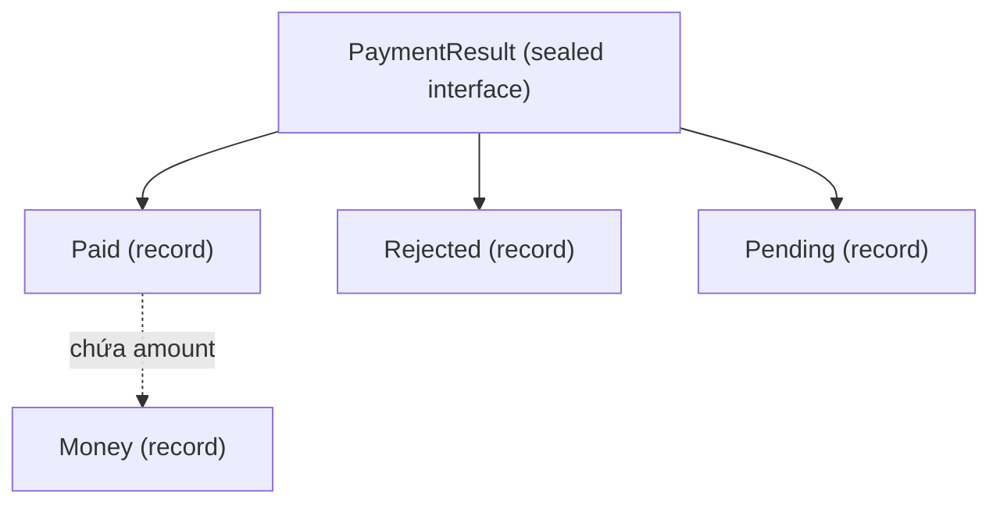
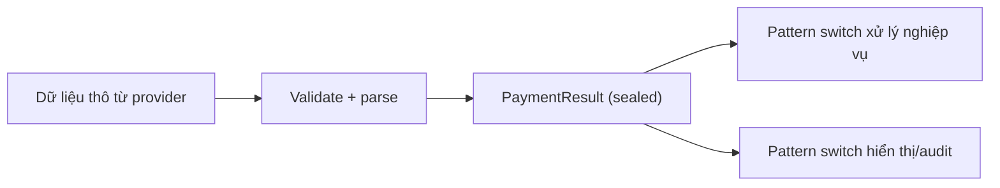

# Kết hợp sealed type với pattern để xử lý miền dữ liệu

Trong Java 27, một miền dữ liệu thường chứa **một tập biến thể có ý nghĩa rõ ràng**. Ví dụ, kết quả thanh toán có thể là *đã thanh toán*, *bị từ chối* hoặc *đang chờ*. Nếu biểu diễn tất cả bằng một lớp có nhiều trường có thể null và một chuỗi `status`, lập trình viên phải nhớ tổ hợp trường nào hợp lệ cho từng trạng thái. Kết hợp **sealed type**, **record** và **pattern matching** giúp diễn đạt mô hình trực tiếp bằng hệ kiểu của Java.

Ba thành phần đảm nhận ba vai trò khác nhau:

- **Sealed class/interface**: giới hạn những kiểu được phép trực tiếp kế thừa hoặc triển khai một kiểu miền.
- **Record**: biểu diễn một biến thể dữ liệu bằng các component có tên, cùng constructor và các phương thức giá trị thích hợp.
- **Pattern matching**: xác định biến thể thực tế và trích xuất dữ liệu để xử lý; khi dùng `switch` trên một sealed hierarchy đóng, compiler có thể kiểm tra tính **bao phủ đầy đủ** (*exhaustiveness*).

Đây là một cách triển khai **Data-Oriented Programming (DOP)** bằng các tính năng Java đã ổn định: sealed classes từ Java 17, record patterns và pattern matching for `switch` từ Java 21. Các ví dụ trong bài áp dụng được với Java 27 và **không cần** bật `--enable-preview`.

## 1. Vấn đề: mô hình miền có nhiều trạng thái

Giả sử hệ thống thanh toán cần xử lý ba kết quả:

| Biến thể | Dữ liệu riêng | Hành động |
|---|---|---|
| Đã thanh toán | Mã giao dịch và số tiền | Xác nhận, ghi nhận giao dịch |
| Bị từ chối | Mã lý do và diễn giải | Hiển thị lỗi phù hợp |
| Đang chờ | Mã đơn hàng | Tiếp tục theo dõi |

Một cách biểu diễn kém an toàn là dùng một lớp có các field `status`, `transactionId`, `reason`, `orderId` và cho phép phần lớn field null. Khi đó có thể xuất hiện những tổ hợp vô nghĩa, chẳng hạn `status = PAID` nhưng `transactionId = null`. Đoạn mã xử lý phải kiểm tra chuỗi trạng thái, ép kiểu hoặc suy luận trường nào hiện diện.

Với Java hiện đại, ta có thể đưa quy tắc này vào **kiểu dữ liệu**: một kết quả được tạo thành từ đúng một trong các biến thể hợp lệ, mỗi biến thể mang chính những dữ liệu mà nó cần.

## 2. Mô hình hóa biến thể bằng sealed interface và record

Định nghĩa một interface niêm phong và ba record:

```java
sealed interface PaymentResult permits Paid, Rejected, Pending { }

record Paid(String transactionId, Money amount)
        implements PaymentResult { }

record Rejected(String code, String reason)
        implements PaymentResult { }

record Pending(String orderId)
        implements PaymentResult { }

record Money(String currency, long minorUnits) { }
```

Quan hệ kiểu có thể hình dung như sau:



`PaymentResult` là **kiểu cha về mặt hợp đồng**. Vì nó được khai báo `sealed`, chỉ các kiểu được liệt kê trong `permits` mới có thể trực tiếp `implements` nó. `Paid`, `Rejected` và `Pending` là các record, nên đều ngầm định là `final`: không thể có lớp con tiếp tục mở rộng ba record này.

Khác với thiết kế dùng `status` dạng chuỗi, không có cách tạo một `PaymentResult` thuộc một trạng thái thứ tư tùy ý nếu kiểu đó không được cho phép trong hệ phân cấp.

**Lưu ý về phạm vi:** Các kiểu được một sealed type cho phép phải thỏa các quy tắc của Java về cùng named module hoặc, khi ở unnamed module, cùng package. Kiểu được liệt kê trong `permits` phải là subtype **trực tiếp**, không phải một lớp cháu bất kỳ. Các ví dụ đặt chung trong một tệp và cùng package nên thỏa quy tắc này.

### Vì sao dùng interface thay cho sealed class?

Một sealed interface phù hợp khi các biến thể chỉ cần **cùng một danh tính miền**, không cần kế thừa trường hay constructor chung. Mỗi record có thể khai báo component riêng và tự sinh `equals`, `hashCode`, `toString` và accessor.

Nếu các biến thể thật sự cần chia sẻ trạng thái hoặc một phần implementation, `sealed abstract class` có thể phù hợp hơn. Tuy nhiên, record **không thể `extends` một lớp tùy chọn**: mỗi record trực tiếp kế thừa `java.lang.Record`, nhưng có thể triển khai interface. Vì vậy mô hình `sealed interface` + `record` đặc biệt tiện cho dữ liệu miền.

## 3. Ví dụ hoàn chỉnh, biên dịch và chạy với Java 27

Ví dụ dưới đây có constructor kiểm tra dữ liệu để ngăn tạo trạng thái không hợp lệ, và dùng pattern `switch` để xử lý các biến thể. Lưu toàn bộ vào file `PaymentResultDemo.java`:

```java
import java.util.List;
import java.util.Objects;

public class PaymentResultDemo {
    public static void main(String[] args) {
        List<PaymentResult> results = List.of(
                new Paid("TX-100", new Money("VND", 150_000)),
                new Paid("TX-101", new Money("VND", 50_000)),
                new Rejected("LIMIT", "Vượt hạn mức"),
                new Pending("ORD-11")
        );

        for (PaymentResult result : results) {
            System.out.println(describe(result));
        }
    }

    static String describe(PaymentResult result) {
        Objects.requireNonNull(result, "result");

        return switch (result) {
            case Paid paid when paid.amount().minorUnits() >= 100_000 ->
                    "Giao dịch lớn: " + paid.transactionId();
            case Paid paid ->
                    "Đã thanh toán: " + paid.transactionId();
            case Rejected rejected ->
                    "Từ chối [" + rejected.code() + "]: "
                            + rejected.reason();
            case Pending pending ->
                    "Đang chờ: " + pending.orderId();
        };
    }
}

sealed interface PaymentResult permits Paid, Rejected, Pending { }

record Money(String currency, long minorUnits) {
    Money {
        Objects.requireNonNull(currency, "currency");
        if (currency.isBlank()) {
            throw new IllegalArgumentException("Đơn vị tiền không được rỗng");
        }
        if (minorUnits < 0) {
            throw new IllegalArgumentException("Số tiền không được âm");
        }
    }
}

record Paid(String transactionId, Money amount)
        implements PaymentResult {
    Paid {
        Objects.requireNonNull(transactionId, "transactionId");
        Objects.requireNonNull(amount, "amount");
        if (transactionId.isBlank()) {
            throw new IllegalArgumentException("Mã giao dịch không được rỗng");
        }
    }
}

record Rejected(String code, String reason)
        implements PaymentResult {
    Rejected {
        Objects.requireNonNull(code, "code");
        Objects.requireNonNull(reason, "reason");
        if (code.isBlank()) {
            throw new IllegalArgumentException("Mã lỗi không được rỗng");
        }
    }
}

record Pending(String orderId)
        implements PaymentResult {
    Pending {
        Objects.requireNonNull(orderId, "orderId");
        if (orderId.isBlank()) {
            throw new IllegalArgumentException("Mã đơn hàng không được rỗng");
        }
    }
}
```

Thực thi trong môi trường có JDK 27:

```bash
javac --release 27 PaymentResultDemo.java
java PaymentResultDemo
```

Kết quả dự kiến:

```text
Giao dịch lớn: TX-100
Đã thanh toán: TX-101
Từ chối [LIMIT]: Vượt hạn mức
Đang chờ: ORD-11
```

Đây là ví dụ đơn giản hóa để minh họa **xử lý miền dữ liệu**, chưa phải quy trình thanh toán hoàn chỉnh. `minorUnits` là số đơn vị tiền nhỏ theo quy ước của hệ thống, giúp tránh dùng `double` cho số tiền. Trong ứng dụng thực tế, loại tiền và đơn vị nhỏ cần được mô hình hóa nhất quán với quy tắc tiền tệ.

## 4. Hiểu cách pattern switch hoạt động

Ở phương thức `describe`, biến `result` có kiểu tĩnh `PaymentResult`, nhưng khi chạy nó chứa một instance của `Paid`, `Rejected` hoặc `Pending`.

```java
return switch (result) {
    case Paid paid when paid.amount().minorUnits() >= 100_000 ->
            "Giao dịch lớn: " + paid.transactionId();
    case Paid paid -> "Đã thanh toán: " + paid.transactionId();
    case Rejected rejected -> "Từ chối: " + rejected.reason();
    case Pending pending -> "Đang chờ: " + pending.orderId();
};
```

Các nhánh có nhiệm vụ:

1. `case Paid paid when ...`: kiểm tra đối tượng là `Paid`, gắn biến `paid` và kiểm tra thêm điều kiện về số tiền.
2. `case Paid paid`: nhận những trường hợp `Paid` còn lại, không phụ thuộc vào điều kiện số tiền.
3. `case Rejected rejected`: lấy thông tin từ biến thể `Rejected`.
4. `case Pending pending`: lấy mã đơn từ biến thể `Pending`.

Pattern `case Paid paid` thực hiện **kiểm tra kiểu và gắn biến** trong cùng một biểu thức. Không cần `(Paid) result` hoặc đọc một trường `status` rồi tự downcast. Trong nhánh đó, compiler biết `paid` là một `Paid` nên có thể gọi `paid.transactionId()` và `paid.amount()` an toàn về kiểu.

Vì `switch` là **biểu thức**, mỗi nhánh phải cung cấp một giá trị (hoặc kết thúc đột ngột bằng exception). Kiểu kết quả của biểu thức `switch` được xác định từ các nhánh; ở đây tất cả nhánh trả `String`.

### Guard `when` không thay thế một nhánh tổng quát

Guard `when` chỉ cho phép chọn nhánh khi cả pattern và điều kiện bổ sung phù hợp. Vì `case Paid paid when ...` không bao phủ mọi giá trị `Paid`, ta vẫn cần `case Paid paid` để xử lý những trường hợp còn lại.

Thứ tự nhánh có ý nghĩa. Nếu đặt:

```java
case Paid paid -> "Đã thanh toán";
case Paid paid when paid.amount().minorUnits() >= 100_000 ->
        "Giao dịch lớn";
```

thì nhánh tổng quát `case Paid paid` đã bao phủ toàn bộ giá trị `Paid` trước nhánh có guard. Trình biên dịch phát hiện nhánh phía sau bị **dominated** (bị nhánh trước che phủ) và báo lỗi. Hãy đặt trường hợp cụ thể có guard trước, rồi đến trường hợp rộng hơn.

## 5. Exhaustiveness: compiler kiểm tra việc xử lý đủ mọi biến thể

Đây là lợi ích nổi bật của việc kết hợp sealed type và pattern matching.

Ở ví dụ thanh toán, `PaymentResult` chỉ cho phép ba subtype trực tiếp, và cả ba đều là `record` (`final`). Trình biên dịch biết những biến thể nào có thể xuất hiện và có thể xác nhận biểu thức `switch` là **exhaustive** khi có các nhánh:

```java
static String summarize(PaymentResult result) {
    return switch (result) {
        case Paid paid -> "Thành công";
        case Rejected rejected -> "Thất bại";
        case Pending pending -> "Đang chờ";
    };
}
```

Không có `default` nhưng biểu thức vẫn hợp lệ: ba kiểu đã bao phủ mọi biến thể không-null mà sealed hierarchy hiện cho phép. Nếu bỏ nhánh `Pending`, compiler báo biểu thức `switch` không bao phủ đầy đủ các trường hợp.

### Thêm một biến thể mới: lỗi biên dịch trở thành lời nhắc cập nhật

Giả sử hệ thống bổ sung trạng thái hoàn tiền:

```java
sealed interface PaymentResult
        permits Paid, Rejected, Pending, Refunded { }

record Refunded(String originalTransactionId)
        implements PaymentResult { }
```

Đây là ví dụ **thay thế** cho khai báo sealed type trước đó, không phải đoạn mã bổ sung độc lập vào cùng file. Khi biên dịch lại mã ứng dụng, các biểu thức `switch` trước đây chỉ xử lý `Paid`, `Rejected`, `Pending` sẽ không còn exhaustive. Compiler yêu cầu xử lý thêm `Refunded`, chẳng hạn:

```java
case Refunded refunded ->
        "Đã hoàn tiền cho " + refunded.originalTransactionId();
```

Điều này giúp phát hiện những nơi cần cập nhật khi miền dữ liệu thay đổi. Lợi ích không phải ở việc loại bỏ hoàn toàn lỗi nghiệp vụ, mà là **đưa một số lỗi bỏ sót nhánh từ runtime về compile time**.

### Vì sao không nên thêm `default` một cách máy móc?

Ví dụ sau biên dịch được:

```java
return switch (result) {
    case Paid paid -> "Thành công";
    case Rejected rejected -> "Thất bại";
    default -> "Trạng thái khác";
};
```

Nhưng `default` sẽ nhận cả `Pending` và mọi biến thể được bổ sung sau này. Nếu yêu cầu nghiệp vụ là **xử lý riêng từng trạng thái**, nhánh `default` có thể che việc bỏ quên một loại mới. Với một sealed hierarchy đóng có tập biến thể rõ ràng, thường nên khai báo đầy đủ các `case` thay vì `default` chung chung.

`default` vẫn có chỗ dùng, chẳng hạn khi nhiều loại không quan trọng thực sự chia sẻ một hành vi dự phòng. Hãy chọn theo hợp đồng của API, không áp dụng quy tắc cứng nhắc.

### Cần phân biệt compile time và runtime

Java kiểm tra tính exhaustive dựa trên các kiểu mà compiler thấy khi biên dịch. Trong triển khai nhiều module hoặc thư viện được phát hành riêng, thay đổi các kiểu sealed mà không biên dịch lại code phụ thuộc có thể gây lỗi tương thích nhị phân; ví dụ một `switch` vốn exhaustive khi biên dịch có thể không khớp một subtype mới ở runtime và ném `MatchException`. Vì vậy, khi thay đổi sealed hierarchy, hãy **biên dịch lại và kiểm thử toàn bộ phần phụ thuộc**, không xem exhaustive checking là giải pháp thay thế quản lý phiên bản.

## 6. Xử lý `null` một cách có chủ đích

Với một `switch` pattern, **null không tự động khớp `default`**. Nếu selector là `null` và không có nhánh `case null`, `switch` sẽ ném `NullPointerException`. Việc `switch` exhaustive với các kiểu sealed **không** có nghĩa là nó tự xử lý null.

Có hai hợp đồng thường gặp.

### Cách A: `null` là lỗi ở ranh giới phương thức

Đây là cách mà ví dụ `PaymentResultDemo` lựa chọn:

```java
static String describe(PaymentResult result) {
    Objects.requireNonNull(result, "result");
    return switch (result) {
        case Paid paid -> "Đã thanh toán";
        case Rejected rejected -> "Bị từ chối";
        case Pending pending -> "Đang chờ";
    };
}
```

Kiểm tra tại ranh giới cho thông điệp lỗi rõ ràng. Trong miền dữ liệu, `null` không phải là một trạng thái thanh toán hợp lệ, nên không cần biểu diễn nó như một kết quả bình thường.

### Cách B: `null` là một đầu vào được quy ước trước

Nếu API thật sự cho phép `null`, hãy viết nhánh rõ ràng:

```java
static String safeLabel(PaymentResult result) {
    return switch (result) {
        case null -> "Chưa có kết quả";
        case Paid paid -> "Đã thanh toán";
        case Rejected rejected -> "Bị từ chối";
        case Pending pending -> "Đang chờ";
    };
}
```

Cách này khác với việc tự động xem `null` là một `Pending`: hai trường hợp có ý nghĩa nghiệp vụ khác nhau. Nếu "chưa có kết quả" là một trạng thái miền độc lập, có thể cân nhắc tạo một biến thể `NoResult` cụ thể, thay vì sử dụng null làm tín hiệu.

## 7. Record patterns: trích xuất dữ liệu mà không phải gọi nhiều accessor

**Record pattern** cho phép mô tả cả cấu trúc record và các component cần lấy ra. Khi có một `Paid`, bạn có thể trích xuất `transactionId` và `amount`:

```java
static String transactionDetails(PaymentResult result) {
    if (result instanceof Paid(var transactionId, var amount)) {
        return transactionId + ": "
                + amount.minorUnits() + " " + amount.currency();
    }
    return "Không phải giao dịch đã thanh toán";
}
```

Ở đây `Paid(var transactionId, var amount)` là một **record pattern**:

- `Paid(...)` yêu cầu giá trị phù hợp với record `Paid`.
- `var transactionId` trích component thứ nhất, kiểu được suy luận là `String`.
- `var amount` trích component thứ hai, kiểu được suy luận là `Money`.
- Các biến pattern chỉ được dùng trong phạm vi mà compiler biết kết quả match đúng.

Từ khóa `var` trong pattern không biến Java thành ngôn ngữ có kiểu động. Các kiểu vẫn được compiler suy luận và kiểm tra tĩnh.

### Nested record patterns

Record pattern còn có thể lồng nhau để lấy từng trường của `Money`:

```java
static String paidDetails(PaymentResult result) {
    if (result instanceof Paid(
            var transactionId,
            Money(var currency, var minorUnits))) {
        return transactionId + " = " + minorUnits + " " + currency;
    }
    return "Không phải giao dịch Paid có dữ liệu Money phù hợp";
}
```

Mẫu `Money(var currency, var minorUnits)` lấy tiếp hai component của record `Money`. Không cần kiểm tra kiểu bằng `instanceof` rồi ép kiểu và gọi accessor thủ công ở nhiều tầng.

Một record pattern **không giống** lời gọi constructor; đây là cú pháp *kiểm tra và phân rã* (*deconstruction*) giá trị. Record pattern chỉ áp dụng cho record (kể cả lồng record), không phải cho một lớp thường tùy ý.

Trong ví dụ này, constructor của `Paid` đã từ chối `amount == null`, giúp duy trì bất biến miền. Tuy vậy, khi viết pattern lồng nhau ở nơi có thể nhận dữ liệu không được kiểm soát, hãy nhớ một pattern có thể **không match** nếu cấu trúc bên trong không phù hợp; đừng mặc định mọi pattern lồng nhau sẽ bao phủ toàn bộ một kiểu.

### Khi nào dùng record pattern và khi nào dùng type pattern?

| Tình huống | Lựa chọn dễ đọc |
|---|---|
Chỉ cần biết biến thể và gọi một hoặc hai accessor | `case Paid paid -> ...` |
Muốn lấy nhiều component theo thứ tự định nghĩa của record | `case Paid(var id, var amount) -> ...` |
Muốn xử lý cấu trúc lồng sâu và vẫn nhìn rõ hình dạng dữ liệu | Nested record pattern |
Chỉ quan tâm có phải một kiểu hay không, không phân loại toàn bộ miền | `if (value instanceof Paid paid)` |

Không bắt buộc phải phân rã mọi record. Nếu record có nhiều component hoặc việc phân rã làm lộ chi tiết cấu trúc, một biến kiểu như `case Paid paid` có thể rõ ràng và dễ bảo trì hơn.

## 8. Sealed hierarchy mở một phần: `sealed`, `final` và `non-sealed`

Một sealed type chỉ giới hạn **subtype trực tiếp** được khai báo trong `permits`; nó không tự động bảo đảm mọi nhánh con đều đóng hoàn toàn.

Mỗi lớp trực tiếp kế thừa sealed class phải chọn cách tiếp tục giới hạn kế thừa bằng `final`, `sealed` hoặc `non-sealed` theo luật ngôn ngữ. Interface được cho phép cũng phải theo những quy tắc tương ứng; record ngầm định `final`.

Ví dụ một hệ kết quả tác vụ:

```java
sealed interface JobResult permits Completed, Failed, ExternalResult { }

record Completed(String id) implements JobResult { }
record Failed(String message) implements JobResult { }

non-sealed interface ExternalResult extends JobResult { }

record VendorResult(String provider)
        implements ExternalResult { }
```

Ở đây:

- `Completed` và `Failed` là hai record đóng, không có lớp con.
- `ExternalResult` là một interface được phép trực tiếp triển khai `JobResult`.
- Vì `ExternalResult` được khai báo `non-sealed`, các lớp khác có thể triển khai nó theo luật truy cập thông thường; `VendorResult` chỉ là một ví dụ.

Một biểu thức `switch` exhaustive vẫn có thể xử lý toàn bộ hierarchy bằng pattern **rộng trên nhánh mở**:

```java
static String describe(JobResult result) {
    return switch (result) {
        case Completed completed ->
                "Hoàn thành: " + completed.id();
        case Failed failed ->
                "Thất bại: " + failed.message();
        case ExternalResult external ->
                "Kết quả từ hệ thống bên ngoài: "
                        + external.getClass().getSimpleName();
    };
}
```

`case ExternalResult external` bao phủ mọi implementation của nhánh này, kể cả những kiểu mới xuất hiện sau đó. Nếu cần các quy tắc cụ thể theo từng implementation, hãy tổ chức pattern chuyên biệt trước pattern `ExternalResult` tổng quát, hoặc cân nhắc lại việc dùng `non-sealed` khi miền thực tế cần đóng.

**Hệ quả thiết kế:** Nếu muốn compiler yêu cầu xử lý tường minh mọi biến thể cuối cùng, hãy dùng những nhánh `final` hoặc tiếp tục `sealed` sao cho toàn bộ biến thể cần phân biệt được kiểm soát. Một nhánh `non-sealed` có chủ đích là điểm mở rộng của API, không phải một tập đầy đủ các biến thể cuối cùng.

## 9. Guard `when`, quy tắc miền và giới hạn của pattern

Pattern quyết định **hình dạng dữ liệu**, còn guard `when` có thể thêm một điều kiện nghiệp vụ:

```java
static String riskLabel(PaymentResult result) {
    return switch (result) {
        case Paid paid when paid.amount().minorUnits() >= 1_000_000 ->
                "Giao dịch cần kiểm tra theo chính sách rủi ro";
        case Paid paid -> "Giao dịch thông thường";
        case Rejected rejected -> "Không được chấp nhận";
        case Pending pending -> "Chưa có quyết định cuối";
    };
}
```

Trong ví dụ, ngưỡng `1_000_000` chỉ dùng để minh họa một chính sách giả định, không phải một ngưỡng thanh toán phổ quát.

### Những nguyên tắc viết guard dễ bảo trì

1. Đặt `case` có `when` cụ thể **trước** `case` tổng quát cùng kiểu.
2. Sau những guard chỉ bao phủ một phần biến thể, giữ nhánh tổng quát để xử lý mọi giá trị còn lại.
3. Ưu tiên guard là phép kiểm tra thuần, không làm thay đổi trạng thái hay gọi dịch vụ có side effect.
4. Tách điều kiện nghiệp vụ dài thành method có tên thể hiện mục đích.
5. Không dùng pattern matching để thay thế validation ở thời điểm tạo đối tượng.

Ví dụ với helper method:

```java
static boolean needsManualReview(Paid paid) {
    return paid.amount().minorUnits() >= 1_000_000;
}

static String reviewLabel(PaymentResult result) {
    return switch (result) {
        case Paid paid when needsManualReview(paid) ->
                "Chuyển kiểm tra thủ công";
        case Paid paid -> "Xử lý tự động";
        case Rejected rejected -> "Từ chối";
        case Pending pending -> "Đang chờ";
    };
}
```

Các biến pattern chỉ tồn tại trong phạm vi thích hợp của nhánh. Chẳng hạn, không thể dùng biến `paid` của một nhánh `case Paid paid` ở nhánh `case Rejected rejected` hay sau khi `switch` đã kết thúc.

**Điểm cần nhớ:** Dù bạn viết hai điều kiện `when` có vẻ bao phủ cả miền số học (ví dụ `x > 0` và `x <= 0`), không nên giả định compiler suy luận toàn bộ logic kinh doanh trong guard để chứng minh exhaustive. Cách ổn định là có một pattern không kèm guard cho các giá trị còn lại của kiểu đó.

## 10. Kiểm tra bất biến trước khi đưa dữ liệu vào hệ phân cấp

Sealed type bảo đảm **những kiểu nào được phép tham gia**, nhưng không tự bảo đảm **dữ liệu bên trong mỗi kiểu là hợp lệ**.

Ví dụ:

```java
new Paid("TX-200", null);
```

Nếu `Paid` không kiểm tra dữ liệu, đối tượng có thể được tạo ra với `amount == null`; khi đó `paid.amount().minorUnits()` trong guard sẽ ném `NullPointerException`.

Trong ví dụ đầy đủ ở phần 3, **compact constructor** của record kiểm tra các tham số trước khi chúng được gán cho component:

```java
record Paid(String transactionId, Money amount)
        implements PaymentResult {
    Paid {
        Objects.requireNonNull(transactionId, "transactionId");
        Objects.requireNonNull(amount, "amount");
        if (transactionId.isBlank()) {
            throw new IllegalArgumentException("Mã giao dịch không được rỗng");
        }
    }
}
```

Định nghĩa này giúp mọi `Paid` được tạo ra qua constructor thông thường đều có `transactionId` khác null/không blank và `amount` khác null. Từ đó, các nhánh pattern có thể tập trung xử lý nghiệp vụ hơn là liên tục phòng vệ trước dữ liệu không hợp lệ.

Tuy nhiên, **record chỉ bất biến nông** (*shallowly immutable*). Nếu component là `List`, mảng hoặc một đối tượng mutable, có thể cần defensive copy khi tạo record và khi công bố dữ liệu. Ví dụ record chứa danh sách có thể chuẩn hóa bằng `List.copyOf(items)`; cách này tạo danh sách không thể sửa qua API `List`, nhưng không sao chép sâu những phần tử mutable.

Mỗi biến thể cũng cần cân nhắc những trạng thái có ý nghĩa. Chẳng hạn, `Pending` có thể không cần `transactionId` vì giao dịch chưa hoàn tất, còn `Rejected` nên mang mã lý do. Tách thành record khác nhau giúp biểu diễn quy tắc đó ở cấp kiểu.

## 11. Tách dữ liệu miền khỏi thao tác xử lý

Một ưu điểm của hướng thiết kế dữ liệu là **tập trung mô hình biến thể trong kiểu, tập trung hành vi tiêu thụ dữ liệu ở nơi phù hợp**. Ví dụ, cùng một `PaymentResult` có thể được diễn giải theo các mục đích khác nhau:

```java
static boolean isFinal(PaymentResult result) {
    Objects.requireNonNull(result, "result");
    return switch (result) {
        case Paid paid -> true;
        case Rejected rejected -> true;
        case Pending pending -> false;
    };
}

static String auditCode(PaymentResult result) {
    Objects.requireNonNull(result, "result");
    return switch (result) {
        case Paid paid -> "PAYMENT_OK";
        case Rejected rejected -> "PAYMENT_REJECTED";
        case Pending pending -> "PAYMENT_PENDING";
    };
}
```

Đây là hai cách **diễn giải cùng tập biến thể**: một dành cho quyết định hoàn tất, một dành cho mã ghi nhận audit. Khi bổ sung một biến thể mới vào hierarchy, cả hai `switch` sẽ được kiểm tra lại khi biên dịch.

Không phải mọi hành vi đều nên đưa vào các hàm `switch` ở bên ngoài; các phương thức chung ổn định có thể nằm ở interface hoặc trong từng record nếu việc đó giúp diễn đạt miền tốt hơn. Cách tổ chức thích hợp tùy thuộc tính chất của dự án:

| Mô hình | Điểm mạnh | Cần chú ý |
|---|---|---|
Sealed types + `switch` patterns | Dễ bổ sung các thao tác xử lý tập biến thể đóng; compiler kiểm tra đủ nhánh | Thêm một biến thể mới có thể yêu cầu sửa nhiều `switch` |
Interface + đa hình (method ở từng implementation) | Dễ thêm loại implementation mới khi cùng hợp đồng hành vi | Thêm thao tác mới có thể yêu cầu sửa nhiều lớp |
Visitor hoặc cơ chế dispatch tự xây dựng | Có thể hữu ích cho hệ thống có ràng buộc API đặc thù | Tăng số lượng loại và boilerplate; thường không cần nếu `switch` pattern đã đáp ứng |

Hãy tránh thiết kế mọi đối tượng thành sealed type chỉ vì Java hỗ trợ pattern matching. Nếu miền là một tập loại mở, ví dụ provider bên thứ ba có thể bổ sung vô hạn, một interface mở và đa hình có thể phù hợp hơn.

## 12. Chuyển dữ liệu bên ngoài thành sealed domain model tại ranh giới

API bên ngoài hoặc hệ thống cũ đôi khi trả trạng thái dưới dạng chuỗi. Ta không phải giữ cách biểu diễn thiếu an toàn này trong phần xử lý miền. Hãy **chuyển đổi và kiểm tra một lần tại ranh giới**, rồi truyền kiểu `PaymentResult` có ý nghĩa vào ứng dụng.

Ví dụ:

```java
static PaymentResult parseProviderResult(
        String status,
        String id,
        Money amount,
        String reason) {
    Objects.requireNonNull(status, "status");

    return switch (status) {
        case "PAID" -> new Paid(id, amount);
        case "REJECTED" -> new Rejected("PROVIDER", reason);
        case "PENDING" -> new Pending(id);
        default -> throw new IllegalArgumentException(
                "Trạng thái thanh toán không được hỗ trợ: " + status
        );
    };
}
```

Hàm này giả định `id` là mã giao dịch ở trạng thái `PAID`, mã đơn hàng ở trạng thái `PENDING`; hợp đồng tích hợp thực tế cần đặt tên và ánh xạ từng trường rõ ràng hơn. Record constructor chịu trách nhiệm từ chối dữ liệu null hoặc không hợp lệ theo từng biến thể. Nếu tích hợp yêu cầu xử lý lỗi khác nhau, hãy quy định cách báo lỗi và ghi nhận theo chuẩn hệ thống.

**Vì sao ở đây có `default`?** Kiểu `String` có thể chứa vô số giá trị không phải ba trạng thái đã biết. Compiler không thể chứng minh `switch` trên ba string literal bao phủ mọi chuỗi. `default` giúp **từ chối trạng thái lạ tại ranh giới**. Sau khi chuyển thành sealed `PaymentResult`, xử lý miền có thể dùng `switch` exhaustive không cần `default`.

Luồng dữ liệu có thể mô tả như sau:



Thiết kế này không làm biến mất nhu cầu validate; nó **tập trung validation vào ranh giới** và dùng hệ kiểu để tránh phải kiểm tra cùng một tổ hợp trạng thái ở nhiều chỗ.

## 13. Kiểm thử từng biến thể, ranh giới guard và thay đổi hierarchy

Với ví dụ `PaymentResultDemo`, một bộ kiểm thử nên bao phủ cả **nhánh theo kiểu**, **nhánh theo guard**, **giá trị biên** và **dữ liệu sai**:

| Dữ liệu đầu vào | Nhánh mong đợi | Ý nghĩa |
|---|---|---|
| `Paid("TX-1", Money("VND", 150_000))` | `Paid` và `when >= 100_000` | Trường hợp guard đúng |
| `Paid("TX-2", Money("VND", 100_000))` | `Paid` và `when >= 100_000` | Giá trị đúng ranh giới |
| `Paid("TX-3", Money("VND", 99_999))` | `Paid` không guard | Giá trị ngay dưới ranh giới |
| `Rejected("LIMIT", "Vượt hạn mức")` | `Rejected` | Biến thể bị từ chối |
| `Pending("ORD-1")` | `Pending` | Biến thể đang chờ |
| `result == null` | `NullPointerException` do `requireNonNull` | Hợp đồng đầu vào không cho phép null |
| `Paid("TX-4", null)` | Constructor ném `NullPointerException` | Bất biến của record |
| `Money("VND", -1)` | Constructor ném `IllegalArgumentException` | Không nhận số tiền âm |
| Bổ sung `Refunded` vào `permits` | Các `switch` thiếu `Refunded` bị báo lỗi khi biên dịch lại | Tính exhaustive khi mở rộng mô hình |

Trong kiểm thử tự động, hãy kiểm tra **giá trị trả về hoặc exception thực tế**, không chỉ việc chạy qua nhánh. Các thao tác có side effect (ghi audit, thông báo khách hàng, trừ tiền) cũng cần kiểm tra số lần gọi và việc không thực hiện sai nhánh.

Ví dụ một phép kiểm tra đơn giản bằng Java, dùng ngay các kiểu trong file ví dụ:

```java
static void testBoundary() {
    String exact = PaymentResultDemo.describe(
            new Paid("TX-BORDER", new Money("VND", 100_000))
    );
    if (!exact.equals("Giao dịch lớn: TX-BORDER")) {
        throw new AssertionError("Sai nhánh tại ranh giới");
    }

    String below = PaymentResultDemo.describe(
            new Paid("TX-BELOW", new Money("VND", 99_999))
    );
    if (!below.equals("Đã thanh toán: TX-BELOW")) {
        throw new AssertionError("Sai nhánh dưới ranh giới");
    }
}
```

Đây chỉ là minh họa logic kiểm thử; ở dự án thực tế, nên sử dụng framework kiểm thử được dự án chuẩn hóa để có báo cáo và quản lý test case tốt hơn. Không nên dùng Java `assert` thay thế việc kiểm tra bất biến trong code nghiệp vụ, vì assertion có thể không được bật khi chạy.

### Kiểm thử khi thay đổi tập biến thể

Khi thêm một subtype được phép:

1. Cập nhật khai báo sealed hierarchy và định nghĩa dữ liệu của biến thể.
2. Biên dịch lại code phụ thuộc để compiler chỉ ra `switch` còn thiếu nhánh.
3. Bổ sung các nhánh có ý nghĩa nghiệp vụ, tránh dùng `default` chỉ để làm mất lỗi biên dịch.
4. Thêm test cho biến thể mới và các luồng tương tác với biến thể cũ.
5. Kiểm tra tương thích với các module/thư viện được phát hành riêng và dữ liệu đã lưu.

## 14. Những lỗi thường gặp và cách tránh

### 14.1. Nghĩ rằng `sealed` tự kiểm tra giá trị component

`sealed` chỉ ràng buộc loại subtype được phép. Nó không tự kiểm tra `String` blank, số tiền âm, object null hoặc các quy tắc liên trường. Dùng constructor/compact constructor và các kiểu miền thích hợp để duy trì bất biến.

### 14.2. Viết `when` nhưng quên `case` còn lại

Một nhánh `case Paid paid when ...` chỉ xử lý **một phần** giá trị `Paid`. Cần một nhánh tổng quát để xử lý các giá trị không thỏa guard, trừ khi một cấu trúc đầy đủ khác đã bảo đảm bao phủ.

### 14.3. Đặt `case` rộng trước `case` hẹp

Ví dụ `case PaymentResult result` trước `case Paid paid` sẽ che phủ nhánh `Paid`. Tương tự, `case Paid paid` trước một nhánh `Paid` có guard làm nhánh guard không thể được chọn. Sắp xếp nhánh từ cụ thể đến tổng quát, và tuân theo lỗi dominance mà compiler phát hiện.

### 14.4. Dùng `default` để bỏ qua biến thể mới

Nếu tất cả biến thể đều có ý nghĩa nghiệp vụ riêng, `default` chung làm mất lợi thế exhaustiveness khi hierarchy phát triển. Chỉ dùng khi một hành vi dự phòng thực sự là chủ ý thiết kế.

### 14.5. Nhầm exhaustive với null-safe

`switch` có đủ `case` cho mọi subtype vẫn có thể ném `NullPointerException` nếu selector null. Quyết định rõ null là lỗi hay trường hợp được chấp nhận; dùng `Objects.requireNonNull` hoặc `case null` theo hợp đồng.

### 14.6. Cố phân rã quá sâu bằng nested patterns

Nested record patterns ngắn gọn khi cấu trúc đơn giản, nhưng có thể khó đọc khi đi qua nhiều tầng record. Đặt tên biến cho một record trung gian hoặc tách helper method nếu việc phân rã khiến nghiệp vụ khó theo dõi.

### 14.7. Giả định sealed hierarchy đóng hoàn toàn dù có `non-sealed`

`non-sealed` cho phép tiếp tục có subtype không biết trước. Nếu nhánh này cần hỗ trợ các implementation tương lai, xử lý bằng một pattern cho kiểu mở hoặc thay đổi thiết kế. Không tuyên bố mọi biến thể cuối cùng đã được liệt kê khi hierarchy chứa một nhánh mở.

### 14.8. Dùng record như một lời cam kết deep immutability

Record giữ component dưới dạng field `private final`, nhưng component có thể là một object mutable. Khi thiết kế event, response hoặc kết quả nghiệp vụ, hãy tránh làm thay đổi dữ liệu của record sau khi tạo thông qua một tham chiếu bên ngoài.

## 15. Bài tập thực hành

**Bài 1 — Định nghĩa miền giao hàng.** Tạo `sealed interface DeliveryState` với ba record `Preparing(orderId)`, `Shipped(orderId, trackingCode)`, `Delivered(orderId, deliveredAt)`. Thêm validation cho các trường bắt buộc. Viết `switch` expression trả về nhãn hiển thị tiếng Việt và không dùng `default`.

**Bài 2 — Thêm quy tắc có điều kiện.** Trong miền giao hàng, bổ sung một `case Shipped shipped when ...` để đánh dấu mã vận đơn của một nhóm vận chuyển cụ thể. Đảm bảo còn `case Shipped shipped` cho các mã khác và kiểm thử đúng thứ tự.

**Bài 3 — Pattern lồng nhau.** Tạo record `Address(String city, String district)` và biến thể `Delivered(String orderId, Address destination)`. Dùng nested record pattern trích `city` và `district`; so sánh với cách dùng `case Delivered delivered` rồi gọi accessor.

**Bài 4 — Kiểm tra exhaustiveness.** Thêm biến thể `Returned` vào sealed interface. Biên dịch lại các phương thức `switch`, ghi nhận thông báo lỗi và cập nhật đủ các nhánh. Tránh chữa lỗi bằng cách thêm `default` nếu miền cần xử lý tường minh.

**Bài 5 — Phân biệt tập đóng và mở.** Tạo một `non-sealed interface ExternalDeliveryState` được phép mở rộng `DeliveryState`. Viết một `switch` exhaustive với nhánh bao phủ `ExternalDeliveryState` và giải thích vì sao compiler không thể biết trước mọi implementation cụ thể của nhánh mở.

## 16. Checklist thiết kế và review

- Tập biến thể có thật sự là **miền đóng**, hay nên dùng interface mở?
- Những subtype trực tiếp đã được phép trong `permits` và khai báo `final`/`sealed`/`non-sealed` đúng chưa?
- Record có bảo đảm bất biến cho từng component và các tổ hợp trường không?
- Các nhánh `case` có bao phủ mọi subtype cần xử lý mà không che giấu nhánh mới qua `default` không?
- Guard `when` có nhánh tổng quát tương ứng và thứ tự từ hẹp đến rộng không?
- Null có hợp đồng rõ ràng và được xử lý theo đúng chủ đích không?
- Nested record patterns có cải thiện khả năng đọc thay vì làm mã trở nên khó hiểu không?
- Khi thay đổi hierarchy, đã biên dịch lại các module phụ thuộc và cập nhật test chưa?
- Logic xử lý trạng thái có side effect được kiểm thử đầy đủ chưa?

## 17. Nguồn tham khảo

- [Java Language Specification, Java SE 27 — Chapter 8: Classes](https://docs.oracle.com/javase/specs/jls/se27/html/jls-8.html): quy tắc sealed class, record và constructor.
- [Java Language Specification, Java SE 27 — Chapter 9: Interfaces](https://docs.oracle.com/javase/specs/jls/se27/html/jls-9.html): sealed interface, `permits` và các subtype.
- [Java Language Specification, Java SE 27 — Chapter 14: Blocks, Statements, and Patterns](https://docs.oracle.com/javase/specs/jls/se27/html/jls-14.html): `switch`, exhaustiveness, pattern và guard.
- [JEP 409 — Sealed Classes](https://openjdk.org/jeps/409): mục đích và mô hình sealed types, tính năng ổn định từ Java 17.
- [JEP 440 — Record Patterns](https://openjdk.org/jeps/440): record patterns là tính năng hoàn thiện trong Java 21.
- [JEP 441 — Pattern Matching for switch](https://openjdk.org/jeps/441): pattern switch, guarded labels, exhaustiveness và null, tính năng hoàn thiện trong Java 21.
- [Java SE 27 — `java.lang.Record`](https://docs.oracle.com/en/java/javase/27/docs/api/java.base/java/lang/Record.html): hành vi và hợp đồng của record.

**Kết luận:** Kết hợp sealed types với record và pattern matching giúp biểu diễn các biến thể dữ liệu bằng những kiểu rõ nghĩa, giảm cast thủ công và cho phép compiler kiểm tra các nhánh `switch` còn thiếu. Lợi ích lớn nhất đến từ việc **chọn đúng miền đóng**, **bảo đảm bất biến của mỗi biến thể**, và **giữ các thao tác xử lý nhất quán khi tập biến thể thay đổi** — không phải từ việc thay mọi `if` bằng `switch`.
