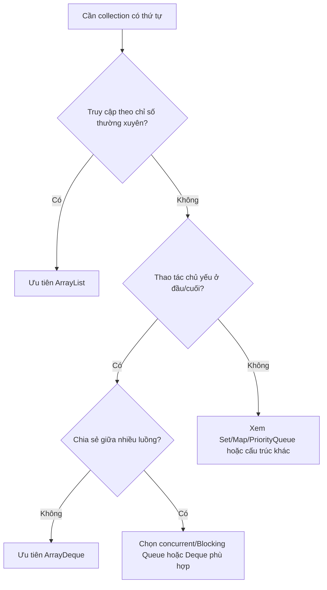

# ArrayList, ArrayDeque và lựa chọn theo kiểu truy cập

Trong Java 27, khi cần lưu một dãy phần tử **có thứ tự**, hai lựa chọn thường gặp là `ArrayList<E>` và `ArrayDeque<E>`. Cả hai đều dùng vùng lưu trữ dạng mảng có thể tăng kích thước, nhưng **không phục vụ cùng một mẫu truy cập**:

- **`ArrayList`** cung cấp giao diện `List`: truy cập, cập nhật và chèn/xóa theo **chỉ số**; đặc biệt phù hợp khi thường xuyên đọc phần tử ở vị trí bất kỳ và thêm phần tử vào cuối.
- **`ArrayDeque`** cung cấp giao diện `Deque`: thêm, đọc hoặc lấy ra phần tử ở **đầu và cuối**; phù hợp với hàng đợi FIFO, ngăn xếp LIFO và các thuật toán dùng hai đầu.

Quyết định chọn cấu trúc dữ liệu không nên dựa vào tên gọi “list” hay “queue” một cách máy móc. Hãy nhìn vào **những thao tác chiếm phần lớn thời gian chạy**: đọc vị trí `i`, thêm cuối, lấy đầu, chèn giữa, hay tìm theo giá trị. Bài học thuộc chương **Collections hiện đại** của Java 27 và chỉ dùng những API, quy ước vẫn phù hợp với Java hiện hành.

## 1. Xác định mẫu truy cập trước khi chọn collection

Ví dụ hệ thống quản lý học tập có các nhu cầu:

| Nhu cầu | Mẫu truy cập chủ đạo | Lựa chọn ban đầu |
|---|---|---|
| Hiển thị danh sách bài học, lấy bài thứ `i` | Đọc theo chỉ số, duyệt tuần tự | `ArrayList` |
| Tích lũy kết quả xử lý để báo cáo theo thứ tự | Thêm cuối, đọc và duyệt | `ArrayList` |
| Hàng đợi yêu cầu cần xử lý theo thứ tự đến | Thêm cuối, lấy đầu (FIFO) | `ArrayDeque` |
| Lịch sử thao tác hoàn tác | Đưa lên đầu, lấy đầu (LIFO) | `ArrayDeque` |
| Giữ cửa sổ các sự kiện gần nhất | Thêm cuối, loại bỏ đầu | `ArrayDeque` |
| Thường xuyên chèn/xóa ở giữa theo chỉ số | Phải đánh giá lại cấu trúc và thuật toán | Không mặc định một trong hai là tối ưu |
| Nhiều luồng cùng cập nhật một hàng đợi | Cần collection đồng thời phù hợp | Không dùng trực tiếp hai lớp trên khi chưa đồng bộ |

**Nguyên tắc:** “có thứ tự” không đồng nghĩa “hỗ trợ chỉ số”. `ArrayDeque` có thứ tự duyệt từ đầu đến cuối nhưng **không có** `get(int index)` như `List`.

### Nhìn nhanh vào hai hợp đồng

`ArrayList` triển khai `List` và `RandomAccess`; `ArrayDeque` triển khai `Deque`, mà `Deque` kế thừa `Queue` và `SequencedCollection`.

`List` và `Deque` đều là các collection có **encounter order** (thứ tự gặp phần tử), nhưng khác nhau về lời hứa API:

- `List` cho phép thao tác qua chỉ số `get(i)`, `set(i, value)`, `add(i, value)`, `remove(i)`.
- `Deque` tập trung vào `addFirst`, `addLast`, `removeFirst`, `removeLast` và những biến thể `peek`/`poll`.
- Hai giao diện cùng hỗ trợ truy cập hai đầu thông qua `SequencedCollection` từ Java 21, nhưng **cùng tên API không đồng nghĩa cùng chi phí**.

## 2. ArrayList: danh sách dạng mảng tăng kích thước

`ArrayList<E>` lưu các tham chiếu phần tử theo thứ tự xác định, cho phép phần tử trùng lặp và cho phép `null`. Đây là một implementation **thay đổi được** (*mutable*) của `List`.

Ví dụ sử dụng `ArrayList` để quản lý bài học:

```java
import java.util.ArrayList;
import java.util.List;

List<String> lessons = new ArrayList<>(
        List.of("Biến và kiểu", "Câu lệnh điều kiện", "Vòng lặp")
);

System.out.println(lessons.get(1)); // Câu lệnh điều kiện

lessons.add("Collections");          // thêm cuối
lessons.set(0, "Kiểu dữ liệu");       // thay giá trị ở chỉ số 0
lessons.add(1, "Phương thức");        // chèn vào vị trí 1

System.out.println(lessons);
// [Kiểu dữ liệu, Phương thức, Câu lệnh điều kiện, Vòng lặp, Collections]
```

Những chi tiết quan trọng:

- **Chỉ số bắt đầu từ 0**. `get(0)` đọc phần tử đầu tiên, `get(size() - 1)` đọc phần tử cuối nếu danh sách không rỗng.
- `get(index)` và `set(index, value)` có độ phức tạp thời gian `O(1)` vì truy cập phần tử bằng vị trí của mảng bên trong.
- `add(value)` hoặc `addLast(value)` thêm cuối với chi phí **`O(1)` trung bình phân bổ** (*amortized*), nhưng đôi khi phải cấp phát vùng chứa lớn hơn và sao chép các phần tử.
- `add(index, value)` và `remove(index)` thường phải dịch chuyển những phần tử phía sau vị trí đó: `O(n)` trong trường hợp tổng quát.
- `contains(value)` và `indexOf(value)` phải tìm theo nội dung: `O(n)`; không được suy từ `get(index)` nhanh rằng “tìm phần tử” cũng nhanh.

`ArrayList` có hai khái niệm **size** và **capacity**. `size()` là số phần tử logic đang có; capacity là sức chứa của mảng nội bộ. Chúng không nhất thiết bằng nhau. Chính sách tăng capacity cụ thể là chi tiết triển khai, không nên viết logic phụ thuộc vào một hệ số tăng cố định.

### Khi nào ArrayList phù hợp?

- Truy cập ngẫu nhiên `get(i)` là hoạt động quan trọng.
- Cần API `List` cho thư viện, thao tác phân trang theo chỉ số hoặc xử lý một dãy có thứ tự.
- Thêm mới chủ yếu ở **cuối**, không liên tục ở đầu.
- Muốn duyệt tuần tự trên tập hợp dữ liệu có thể thay đổi được.

`ArrayList` không tự sắp xếp phần tử. Nếu cần sắp xếp, dùng các API như `list.sort(comparator)` và cân nhắc quy tắc thay đổi thứ tự đầu vào.

## 3. ArrayDeque: hàng đợi hai đầu dạng mảng

`ArrayDeque<E>` là implementation `Deque` dựa trên mảng tăng kích thước. Nó không áp đặt giới hạn dung lượng cố định theo số phần tử và hỗ trợ thao tác ở **cả hai đầu**.

```java
import java.util.ArrayDeque;
import java.util.Deque;

Deque<String> queue = new ArrayDeque<>();

queue.addLast("Yêu cầu A");
queue.addLast("Yêu cầu B");
queue.addFirst("Yêu cầu ưu tiên");

System.out.println(queue.removeFirst()); // Yêu cầu ưu tiên
System.out.println(queue.removeFirst()); // Yêu cầu A
System.out.println(queue.peekFirst());   // Yêu cầu B, không xóa
```

Những khác biệt chủ chốt so với `ArrayList`:

- `addFirst`, `addLast`, `removeFirst`, `removeLast` chạy với chi phí **`O(1)` trung bình phân bổ** trên `ArrayDeque`.
- `ArrayDeque` **không cho phép phần tử `null`**. Thêm `null` sẽ ném `NullPointerException`.
- Không có `get(index)` hoặc `set(index, value)` trên giao diện `Deque`/`ArrayDeque`. Muốn tìm phần tử bên trong phải duyệt hoặc dùng phương thức tìm theo giá trị.
- `contains`, `removeFirstOccurrence` và `removeLastOccurrence` có độ phức tạp `O(n)`; deque không phải cấu trúc tra cứu nhanh theo khóa.
- `ArrayDeque` hỗ trợ phần tử trùng lặp, giống `ArrayList`.

Đối với thao tác thêm/xóa hai đầu liên tục, `ArrayDeque` giúp tránh chi phí dịch chuyển nhiều phần tử ở đầu của `ArrayList`. Dù vậy, **một lần mở rộng vùng lưu trữ** vẫn có thể tốn `O(n)`; mô tả đúng là *amortized*, không phải mọi lần thao tác đều đảm bảo thời gian tuyệt đối không đổi.

### Đầu và cuối của deque

`Deque` dùng các thuật ngữ:

- **Head / first**: phần tử đầu.
- **Tail / last**: phần tử cuối.
- **FIFO**: vào cuối, ra đầu.
- **LIFO**: đưa vào đầu, ra đầu.

Mọi ví dụ cần thống nhất quy ước “đầu” và “cuối”, nhất là khi thay các tên viết tắt `offer`, `poll`, `push` hoặc `pop` bằng các phương thức thể hiện rõ hướng.

## 4. Bảng so sánh chi phí thao tác

Bảng dưới đây tổng hợp độ phức tạp thường dùng trên **`ArrayList`** và **`ArrayDeque`** với `n` là số phần tử. Đây là chi phí điển hình theo hợp đồng/triển khai, không phải cam kết thời gian chạy thực tế của mọi workload.

| Thao tác | `ArrayList` | `ArrayDeque` |
|---|---|---|
| Lấy phần tử thứ `i` | `O(1)` qua `get(i)` | Không có API truy cập trực tiếp theo chỉ số; phải duyệt `O(n)` |
| Đọc phần tử đầu | `O(1)` qua `getFirst()` | `O(1)` qua `getFirst()` / `peekFirst()` |
| Đọc phần tử cuối | `O(1)` qua `getLast()` | `O(1)` qua `getLast()` / `peekLast()` |
| Thêm cuối | `O(1)` amortized | `O(1)` amortized |
| Thêm đầu | `O(n)` do dịch phần tử | `O(1)` amortized |
| Lấy/xóa đầu | `O(n)` do dịch phần tử | `O(1)` amortized |
| Lấy/xóa cuối | `O(1)` | `O(1)` amortized |
| Chèn giữa qua chỉ số | `O(n)` | Không hỗ trợ trực tiếp |
| Tìm phần tử theo giá trị | `O(n)` | `O(n)` |
| Duyệt toàn bộ | `O(n)` | `O(n)` |

Một số trường hợp biên như xóa phần tử cuối trong `ArrayList` không phải dịch mảng nên nhanh hơn thao tác xóa ở đầu. Với `ArrayDeque`, xóa **một phần tử theo giá trị ở giữa** vẫn có thể cần tìm và dịch chuyển, vì vậy không thể suy rằng *mọi* thao tác xóa trên deque đều `O(1)`.

### Minh họa khác nhau giữa đọc chỉ số và thao tác hai đầu

```java
List<String> names = new ArrayList<>(List.of("An", "Bình", "Chi"));
String second = names.get(1);       // O(1)

Deque<String> tasks = new ArrayDeque<>(List.of("A", "B", "C"));
String next = tasks.removeFirst();  // O(1) amortized

// Sai kiểu API: Deque không khai báo get(int).
// String secondTask = tasks.get(1);
```

Nếu chương trình liên tục chuyển deque thành list chỉ để gọi `get(i)`, có thể bạn đã chọn sai abstraction ban đầu. Việc chuyển hoặc sao chép dữ liệu thường có chi phí `O(n)`.

## 5. Dùng ArrayDeque như hàng đợi FIFO

Hàng đợi **first-in, first-out** dùng để xử lý yêu cầu theo thứ tự đến trước. Với `Deque`, ta thêm vào cuối rồi lấy từ đầu:

```java
import java.util.ArrayDeque;
import java.util.Deque;

public class FifoDemo {
    public static void main(String[] args) {
        Deque<String> requests = new ArrayDeque<>();

        requests.offerLast("R-101");
        requests.offerLast("R-102");
        requests.offerLast("R-103");

        while (!requests.isEmpty()) {
            String request = requests.pollFirst();
            System.out.println("Xử lý " + request);
        }
    }
}
```

Kết quả:

```text
Xử lý R-101
Xử lý R-102
Xử lý R-103
```

Đây là **mô phỏng một luồng xử lý đơn luồng**. `ArrayDeque` không phải hàng đợi đồng thời cho nhiều producer/consumer không đồng bộ. Với dữ liệu nhiều luồng, cần xem các loại queue/deque chuyên biệt ở phần về concurrency.

Với kiểu khai báo `Queue<String> queue = new ArrayDeque<>();`, bạn cũng có thể viết `offer(e)` để thêm cuối và `poll()` để lấy đầu. Dùng kiểu `Queue` khi API chỉ cần FIFO, dùng kiểu `Deque` khi thực sự cần cả hai đầu.

## 6. Dùng ArrayDeque như ngăn xếp LIFO

Ngăn xếp **last-in, first-out** phù hợp để quản lý hoàn tác, duyệt cây theo chiều sâu (*depth-first search*) hoặc xử lý trạng thái lồng nhau. Trong code Java mới, dùng `Deque` thay cho lớp `Stack` cũ.

```java
import java.util.ArrayDeque;
import java.util.Deque;

public class UndoDemo {
    public static void main(String[] args) {
        Deque<String> undo = new ArrayDeque<>();

        undo.push("Nhập tiêu đề");
        undo.push("Thêm hình");
        undo.push("Đổi màu");

        System.out.println(undo.pop());  // Đổi màu
        System.out.println(undo.pop());  // Thêm hình
        System.out.println(undo.peek()); // Nhập tiêu đề
    }
}
```

Các phép tương đương trong `Deque`:

| Cách gọi LIFO | Phép ở đầu deque |
|---|---|
| `push(value)` | `addFirst(value)` |
| `pop()` | `removeFirst()` |
| `peek()` | `peekFirst()` |

Không dùng `addLast()` để đẩy vào stack rồi `pop()` để lấy ra nếu không cố ý tạo một quy ước khác: thao tác sẽ không còn là LIFO theo cặp trên.

## 7. Chọn API ném exception hay trả giá trị đặc biệt

`Deque` cung cấp các cặp phương thức có **cùng ý nghĩa vị trí** nhưng khác cách báo trường hợp không có phần tử.

| Nhu cầu | Ném exception khi deque rỗng | Trả `null` khi deque rỗng |
|---|---|---|
| Đọc đầu mà không xóa | `getFirst()` | `peekFirst()` |
| Lấy/xóa đầu | `removeFirst()` | `pollFirst()` |
| Đọc cuối mà không xóa | `getLast()` | `peekLast()` |
| Lấy/xóa cuối | `removeLast()` | `pollLast()` |

```java
Deque<String> deque = new ArrayDeque<>();

System.out.println(deque.peekFirst()); // null
System.out.println(deque.pollFirst()); // null

// Cả hai câu lệnh dưới đây đều ném NoSuchElementException.
// deque.getFirst();
// deque.removeFirst();
```

Bởi vì `ArrayDeque` cấm chứa null, kết quả `null` từ `peekFirst` hoặc `pollFirst` có thể được hiểu là “không có phần tử”. Trái lại, `ArrayList` **có thể chứa `null`**, nên một giá trị null trong `list.get(i)` có thể thực sự là dữ liệu, không đồng nghĩa danh sách rỗng.

### Cặp add / offer

- `addFirst(e)` và `addLast(e)` ném lỗi nếu không thể thêm do hạn chế dung lượng của implementation.
- `offerFirst(e)` và `offerLast(e)` trả `boolean` để cho biết có thêm được hay không khi implementation có giới hạn.
- `ArrayDeque` **tự mở rộng, không có giới hạn cố định theo hợp đồng**, nên các thao tác thêm hợp lệ thông thường đều thành công (ngoại trừ lỗi như `null` hoặc thiếu tài nguyên). Không dùng `offer` làm cơ chế tự động áp đặt ngưỡng số phần tử.

Việc chọn API phụ thuộc vào ý nghĩa của “rỗng” hoặc “đầy”: nếu đây là một tình huống bình thường, `poll`/`peek` hoặc `offer` thường diễn đạt ý định tốt hơn; nếu đây là lỗi logic, dạng ném exception có thể hữu ích.

## 8. List cũng có thao tác hai đầu trong Java hiện đại

Từ Java 21, `SequencedCollection` cung cấp các phương thức như `getFirst`, `getLast`, `addFirst`, `addLast`, `removeFirst`, `removeLast` và `reversed`. Cả `List` và `Deque` đều tham gia vào mô hình collection có thứ tự này.

```java
import java.util.ArrayList;
import java.util.List;

List<String> sections = new ArrayList<>(List.of("Giới thiệu", "Nội dung"));
sections.addLast("Tổng kết");
sections.addFirst("Mục lục");

System.out.println(sections.getFirst()); // Mục lục
System.out.println(sections.getLast());  // Tổng kết
System.out.println(sections.reversed());
// [Tổng kết, Nội dung, Giới thiệu, Mục lục]
```

**Cảnh báo về hiệu năng:** `sections.addFirst(...)` hợp lệ nhưng **không** biến `ArrayList` thành deque hiệu quả. Với `ArrayList`, chèn đầu vẫn phải dịch các phần tử: thường `O(n)`. Ngược lại, `ArrayDeque.addFirst` được thiết kế cho thao tác hai đầu `O(1)` amortized.

**`reversed()` trả về một view theo thứ tự ngược**, không phải mặc nhiên sao chép sang collection mới. Việc thay đổi qua view có thể lan tới collection gốc nếu implementation cho phép. Khi cần một bản sao độc lập, tạo collection mới một cách tường minh, ví dụ `new ArrayList<>(sections.reversed())`.

### Vì sao không thể thay thế tùy tiện List bằng Deque?

Dù cùng có thứ tự và cùng API hai đầu, chúng khác nhau ở những phương diện quan trọng:

- `List` có truy cập theo chỉ số và quy tắc so sánh phần tử theo thứ tự của `List.equals`.
- `Deque` không cam kết truy cập bằng chỉ số; các implementation nói chung không có hợp đồng equality theo phần tử giống `List`.
- `ArrayList` chứa được null, `ArrayDeque` thì không.
- `List` thường hợp lý khi bên sử dụng cần trực tiếp quản lý vị trí; `Deque` phù hợp khi bên sử dụng chỉ quan tâm phần tử ở hai đầu.

Do đó nên chọn kiểu tham số và kiểu trả về theo **hợp đồng cần thiết nhất**, không chỉ theo phương thức tình cờ có chung.

## 9. Cửa sổ dữ liệu gần nhất: thêm cuối, loại đầu

Một ứng dụng giám sát có thể chỉ cần giữ **ba sự kiện mới nhất** để hiển thị. Nếu dùng `ArrayList` rồi liên tục `remove(0)`, thao tác này phải dịch chuyển phần còn lại. `ArrayDeque` phù hợp hơn vì chỉ thao tác ở hai đầu.

```java
import java.util.ArrayDeque;
import java.util.Deque;
import java.util.List;

public class RecentEventsDemo {
    public static void main(String[] args) {
        int limit = 3;
        if (limit <= 0) {
            throw new IllegalArgumentException("limit phải dương");
        }

        Deque<String> recent = new ArrayDeque<>();

        for (String event : List.of("E1", "E2", "E3", "E4", "E5")) {
            if (recent.size() == limit) {
                recent.removeFirst(); // bỏ sự kiện cũ nhất
            }
            recent.addLast(event);     // ghi sự kiện mới nhất
        }

        System.out.println(recent); // [E3, E4, E5]
    }
}
```

Đối với ví dụ đơn luồng, mỗi lần thêm chỉ cần tối đa một lần loại đầu. Sau khi xử lý, deque duy trì số phần tử không vượt quá giới hạn `limit`.

**Lưu ý:** Đây là giới hạn do **logic ứng dụng** áp đặt; `new ArrayDeque<>(limit)` chỉ tạo sức chứa ban đầu và **không** biến deque thành bounded queue. Nếu có nhiều luồng cùng thêm, phép kiểm tra `size()` rồi `removeFirst()`/`addLast()` không trở nên an toàn chỉ nhờ dùng deque. Cần giải pháp đồng bộ hoặc cấu trúc concurrent thích hợp.

Một sai lầm phổ biến là chọn `ArrayList` vì muốn “lưu theo thứ tự”, dù toàn bộ luồng xử lý chỉ dùng đầu/cuối. Với tình huống này, API `Deque` diễn đạt ý định tốt hơn.

## 10. Duyệt và sửa collection đúng cách

Cả hai cấu trúc đều có thể duyệt theo thứ tự phần tử:

```java
List<String> people = new ArrayList<>(List.of("An", "Bình", "Chi"));
for (String person : people) {
    System.out.println(person);
}

Deque<String> tasks = new ArrayDeque<>(List.of("A", "B", "C"));
for (String task : tasks) {
    System.out.println(task);
}
```

`ArrayList` và `ArrayDeque` có iterator được thiết kế theo cơ chế **fail-fast** ở mức nỗ lực tốt nhất. Nếu cấu trúc bị sửa trong lúc duyệt không đúng cách, có thể phát sinh `ConcurrentModificationException`. Tuy nhiên, **không được dựa vào exception này để bảo đảm tính đúng đắn hoặc an toàn luồng**; nó chỉ là công cụ hỗ trợ phát hiện một số lỗi.

### Không xóa trực tiếp phần tử bằng API của collection trong enhanced-for

Ví dụ dễ có vấn đề:

```java
List<Integer> values = new ArrayList<>(List.of(1, 2, 3, 4));

// Không nên làm:
// for (int value : values) {
//     if (value % 2 == 0) {
//         values.remove(Integer.valueOf(value));
//     }
// }
```

Nếu muốn xóa theo điều kiện, cách rõ ràng hơn là:

```java
values.removeIf(value -> value % 2 == 0);
System.out.println(values); // [1, 3]
```

`removeIf` có sẵn ở `Collection`; với `ArrayDeque` cũng có thể loại phần tử theo điều kiện phù hợp:

```java
Deque<String> queue = new ArrayDeque<>(List.of("A", "B", "C"));
queue.removeIf("B"::equals);
System.out.println(queue); // [A, C]
```

Nếu cần kiểm soát chi tiết vị trí đang duyệt, sử dụng `Iterator` và phương thức `iterator.remove()` theo hợp đồng của iterator. Với danh sách, có thể dùng `ListIterator` để có thêm các thao tác hợp lệ dành cho `List`.

### Chi phí của việc xóa theo giá trị

Dù `ArrayDeque` nhanh ở hai đầu, `removeIf`, `contains` và xóa một phần tử bất kỳ **không** được hưởng đặc tính `O(1)` của `pollFirst()`. Phải duyệt/tìm trên dãy phần tử; độ phức tạp có thể là `O(n)`. Nếu bài toán thực sự là tra cứu và xóa theo khóa, hãy xem cấu trúc dựa trên `Map` hoặc `Set` thay vì ép deque làm chỉ mục.

## 11. Null, bản sao và bất biến

Lựa chọn cấu trúc dữ liệu còn phụ thuộc vào **hợp đồng dữ liệu**, không chỉ chi phí thao tác.

### ArrayList cho phép null nhưng có thể làm mã gọi phức tạp hơn

```java
List<String> labels = new ArrayList<>();
labels.add(null);
labels.add("Có nội dung");

System.out.println(labels.size()); // 2
System.out.println(labels.getFirst()); // null
```

Nếu null không phải giá trị hợp lệ của miền, hãy từ chối hoặc chuẩn hóa nó ở ranh giới. Đừng dùng việc `ArrayList` “cho phép null” làm lý do bỏ qua validation.

### ArrayDeque không cho phép null

```java
Deque<String> events = new ArrayDeque<>();
// events.addLast(null); // Ném NullPointerException
```

Việc cấm null giúp các phương thức `pollFirst()` và `peekFirst()` dùng null nhất quán để biểu thị deque đang trống.

### Không nhầm danh sách có thể sửa với danh sách không thể sửa

Các phương thức tạo danh sách sau **không** có cùng khả năng chỉnh sửa:

```java
List<String> fixed = List.of("A", "B");
List<String> copied = List.copyOf(fixed);
List<String> mutable = new ArrayList<>(fixed);

// fixed.add("C");  // UnsupportedOperationException
// copied.add("C"); // UnsupportedOperationException
mutable.add("C");   // Hợp lệ
```

`List.of` và `List.copyOf` tạo danh sách không thể sửa theo giao diện `List` và **không chấp nhận null**. `new ArrayList<>(source)` tạo danh sách có thể sửa với các phần tử của nguồn tại thời điểm xây dựng.

Nếu cần công bố một snapshot danh sách không cho bên ngoài sửa cấu trúc:

```java
public List<String> snapshot(List<String> source) {
    return List.copyOf(source);
}
```

`List.copyOf` cung cấp danh sách không thể sửa và không phản ánh những thay đổi cấu trúc sau này của nguồn. Tuy nhiên, nếu phần tử bên trong là **đối tượng mutable**, các cách copy thông thường chỉ sao chép **nông** các tham chiếu. Một danh sách không thể sửa không tự động bảo đảm toàn bộ đồ thị đối tượng bên trong là bất biến sâu.

`new ArrayDeque<>(collection)` cũng tạo một deque mới theo thứ tự duyệt của nguồn nhưng **không** nhân bản sâu phần tử. Nếu nguồn có null, thao tác sao chép vào `ArrayDeque` có thể thất bại vì deque cấm null.

## 12. Chọn kiểu biến và API theo khả năng cần thiết

Các API tiêu dùng collection thường có thể khai báo bằng **interface** thay vì implementation cụ thể.

```java
import java.util.ArrayDeque;
import java.util.ArrayList;
import java.util.Deque;
import java.util.List;
import java.util.Queue;

List<String> results = new ArrayList<>();
Queue<String> pending = new ArrayDeque<>();
Deque<String> undo = new ArrayDeque<>();
```

- `List` thể hiện lời hứa “người gọi cần chỉ số, thứ tự và các thao tác list”.
- `Queue` thể hiện “người gọi cần luồng FIFO”, không nhất thiết phải biết cả hai đầu.
- `Deque` thể hiện “người gọi cần thao tác ở đầu hoặc cuối”.
- Chỉ dùng kiểu cụ thể `ArrayList` hoặc `ArrayDeque` trong chữ ký khi thực sự cần API riêng của implementation.

Ví dụ một phương thức tiêu thụ hàng đợi:

```java
static void drain(Queue<String> queue) {
    String next;
    while ((next = queue.poll()) != null) {
        System.out.println("Xử lý: " + next);
    }
}
```

Đoạn mã giả định hàng đợi không chứa null (đúng với `ArrayDeque`). Nếu muốn một API tổng quát tuyệt đối cho mọi implementation `Queue`, hãy chú ý hợp đồng null của implementation, vì `null` từ `poll()` chỉ được thiết kế để báo hàng đợi rỗng khi null không được dùng làm phần tử.

Một phương thức chỉ đọc và hiển thị danh sách có thể nhận `List<? extends Lesson>` thay vì một `ArrayList<Lesson>` cụ thể, nếu chữ ký tổng quát đó đúng nhu cầu. Việc sử dụng interface làm hợp đồng giúp đổi implementation sau này mà không phải thay toàn bộ code gọi.

## 13. Bộ nhớ và chọn sức chứa ban đầu

Với workload lớn, có thể cân nhắc **sức chứa ban đầu** khi dự đoán tương đối được số phần tử.

```java
int expectedCount = 50_000;

ArrayList<String> items = new ArrayList<>(expectedCount);
ArrayDeque<String> jobs = new ArrayDeque<>(expectedCount);

for (int i = 0; i < expectedCount; i++) {
    items.add("item-" + i);
    jobs.addLast("job-" + i);
}
```

Lưu ý:

- Constructor `ArrayList(int initialCapacity)` thiết lập sức chứa ban đầu, **không** tự tạo từng phần tử. `items.size()` ban đầu vẫn là 0.
- Constructor `ArrayDeque(int numElements)` tạo deque rỗng với capacity đủ để chứa số phần tử dự kiến. Nó **không** khóa tối đa phần tử ở con số đó.
- `ArrayList.ensureCapacity(minCapacity)` có thể hữu ích khi đã có danh sách và chuẩn bị thêm một số lượng lớn phần tử.
- Dự trữ quá nhiều capacity cũng tiêu tốn bộ nhớ. Không chọn một con số quá lớn mà không có dữ liệu workload.
- Không dựa vào tỷ lệ tăng mảng, giới hạn mặc định hoặc bố cục nội bộ cụ thể: các chi tiết này không phải hợp đồng API để thiết kế thuật toán.

Khi thường xuyên chèn/xóa một lượng lớn phần tử, hãy đo cả thời gian, tỷ lệ cấp phát, thời gian GC và kích thước dữ liệu thực tế. Big-O cho biết xu hướng khi `n` lớn; không phản ánh toàn bộ chi phí phân bổ bộ nhớ, cache CPU, boxing hoặc cách truy cập dữ liệu ở quy mô thực.

## 14. Không dùng ArrayList / ArrayDeque trực tiếp như collection đồng thời

Cả `ArrayList` và `ArrayDeque` đều **không thread-safe** cho các trường hợp nhiều luồng cùng truy cập và sửa mà không có cơ chế phối hợp thích hợp.

Ví dụ code sau **không an toàn** nếu được thực hiện đồng thời bởi nhiều luồng:

```java
Deque<String> queue = new ArrayDeque<>();

// Thread A:
queue.addLast("A");

// Thread B:
String value = queue.pollFirst();
```

Ngay cả khi cả hai lệnh có vẻ đơn giản, không có bảo đảm cần thiết về thread safety và visibility nếu chia sẻ deque theo cách này. Tương tự, `ArrayList` không an toàn khi nhiều luồng cùng cập nhật cấu trúc mà thiếu đồng bộ hóa.

Các lựa chọn đồng thời hiện hành cần cân nhắc theo **đặc tính cụ thể**:

| Nhu cầu | Lựa chọn có thể phù hợp | Ghi chú |
|---|---|---|
| FIFO dùng chung nhiều luồng, không cần chặn để đợi | `ConcurrentLinkedQueue` | Queue đồng thời không khóa, không hỗ trợ null |
| Hai đầu dùng chung nhiều luồng, không cần chặn | `ConcurrentLinkedDeque` | Deque đồng thời, không hỗ trợ null |
| Hàng đợi FIFO có sức chứa giới hạn và thao tác chờ khi rỗng/đầy | `ArrayBlockingQueue` | Blocking queue dạng mảng, có dung lượng cố định |
| Deque nhiều luồng, có thể chờ lấy/thêm | `LinkedBlockingDeque` | Có thể cấu hình giới hạn capacity |
| Danh sách đọc rất nhiều, cập nhật hiếm | `CopyOnWriteArrayList` | Phù hợp khi chấp nhận chi phí tạo bản sao khi sửa |

Chúng **không tương đương hoàn toàn** về thứ tự, giới hạn dung lượng, hành vi blocking, bộ nhớ hoặc hiệu năng. Chọn theo bài toán, không chỉ thay tên lớp để “làm cho thread-safe”.

Nếu muốn dùng `ArrayDeque` như một hàng đợi công việc giữa các luồng, nhiều trường hợp nên dùng một `BlockingQueue` có hợp đồng producer/consumer rõ ràng. Môi trường Java 27 cũng có virtual threads, nhưng virtual thread **không** biến một collection không an toàn thành thread-safe.

## 15. Một số tình huống cần cấu trúc khác

Không phải mọi bài toán đều được giải tốt nhất bằng hai lớp này.

### Cần ưu tiên theo độ quan trọng thay vì thứ tự đến

Nếu yêu cầu cần lấy việc có mức ưu tiên cao nhất, `PriorityQueue` có thể phù hợp hơn `ArrayDeque`. Một queue FIFO không tự sắp xếp phần tử theo ưu tiên. `addFirst` các công việc ưu tiên vào deque chỉ tạo một quy tắc ưu tiên thủ công, có thể khiến các công việc thường xuyên bị trì hoãn.

### Cần kiểm tra phần tử đã tồn tại nhanh

Nếu chương trình liên tục hỏi “phần tử X có trong collection không?”, cả `ArrayList.contains` và `ArrayDeque.contains` đều thường phải quét tuyến tính. `HashSet` hoặc một `Map` dùng khóa có thể phù hợp hơn nếu thứ tự truy cập và yêu cầu dữ liệu cho phép.

### Cần tra cứu theo khóa

`Map<K,V>` thường hợp lý hơn khi yêu cầu tra cứu theo ID, không phải theo vị trí. `ArrayList.get(i)` là lấy theo **chỉ số**, không phải “tìm một phần tử có mã số i” nếu dữ liệu không được ánh xạ trực tiếp theo index.

### Cần thao tác đồng thời và giới hạn sức chứa

Nếu có yêu cầu về backpressure hoặc producer chờ khi hàng đợi đầy, dùng loại queue/deque phù hợp có khả năng blocking và capacity được kiểm soát, thay vì `ArrayDeque` tự mở rộng vô hạn theo logic ứng dụng.

## 16. Những sai lầm phổ biến khi lựa chọn

1. **Dùng `ArrayList.remove(0)` cho FIFO có tần suất cao:** phải dịch các phần tử còn lại; với deque dùng `pollFirst()`.
2. **Dùng `ArrayList.add(0, value)` liên tục làm stack:** chi phí chèn đầu tuyến tính; với deque dùng `push`/`pop`.
3. **Cho rằng ArrayDeque truy cập được theo chỉ số:** `Deque` không khai báo `get(int)`. Nếu code cần index thường xuyên, chọn `List`.
4. **Cho rằng `ArrayDeque.contains` là `O(1)`:** tìm theo giá trị vẫn `O(n)`.
5. **Dùng null như phần tử trong `ArrayDeque`:** ném `NullPointerException`. Nếu cần một trạng thái đặc biệt, tạo giá trị miền có ý nghĩa thay vì nhét null vào queue.
6. **Gọi `removeFirst` khi deque có thể rỗng:** ném `NoSuchElementException`. Dùng `pollFirst` nếu trạng thái rỗng là bình thường.
7. **Nhầm `List.of` là `ArrayList` có thể sửa:** danh sách được tạo bởi `List.of` không cho thêm/xóa; tạo bản sao `new ArrayList<>(...)` nếu cần thay đổi.
8. **Giả định `reversed()` sao chép dữ liệu:** đó là reverse-ordered view, không mặc nhiên là bản sao độc lập.
9. **Bỏ qua tính an toàn luồng:** hai collection này không tự đồng bộ cho cập nhật nhiều luồng.
10. **Dùng API deque hai đầu nhưng gọi không thống nhất:** khi viết FIFO và LIFO, hãy giữ quy ước thêm/lấy rõ ràng để không đảo thứ tự ngoài ý muốn.

## 17. Bảng quyết định nhanh

Có thể dùng quy trình quyết định:



Đây là **điểm khởi đầu**, không phải quy tắc hiệu năng tuyệt đối. Tùy kích thước dữ liệu và tỷ lệ thao tác, giải pháp tốt nhất có thể khác. Với workload quan trọng, hãy đo bằng benchmark đại diện thay vì đoán dựa trên một ví dụ có vài phần tử.

## 18. Kiểm thử hành vi quan trọng

Hãy kiểm thử các ca cơ bản trước khi sử dụng collection trong luồng nghiệp vụ:

| Kịch bản | Kỳ vọng |
|---|---|
| `ArrayList.get(0)` khi danh sách rỗng | `IndexOutOfBoundsException` |
| `ArrayList.getFirst()` khi rỗng | `NoSuchElementException` |
| `ArrayList.add(null)` | Chấp nhận |
| `ArrayDeque.addLast(null)` | `NullPointerException` |
| `ArrayDeque.pollFirst()` khi rỗng | `null` |
| `ArrayDeque.removeFirst()` khi rỗng | `NoSuchElementException` |
| FIFO: thêm A, B, C rồi lấy đầu | A, B, C |
| LIFO: `push` A, B, C rồi `pop` | C, B, A |
| Duy trì cửa sổ gần nhất có giới hạn 3 | Chỉ còn ba phần tử cuối |
| `List.reversed()` | Thứ tự ngược, là view chứ không phải snapshot |
| Thêm vào đầu `ArrayList` | Đúng kết quả logic nhưng phải cân nhắc chi phí dịch phần tử |

Khi test collection, tách hai câu hỏi: **kết quả có đúng không?** và **cấu trúc có phù hợp với tần suất thao tác hay không?** Unit test xác minh hành vi; benchmark và profiling đo hiệu năng. Với benchmarking trên JVM, cần quan tâm warm-up, tối ưu của JIT, chi phí khởi tạo dữ liệu, GC và trường hợp phân phối dữ liệu thực tế. Không lấy một lần đo thủ công bằng `System.nanoTime()` làm kết luận chung cho mọi ứng dụng.

## 19. Bài tập áp dụng

**Bài 1 — Danh sách bài học:** Tạo `ArrayList<String>` lưu tên năm bài học. Viết phương thức trả về bài ở chỉ số do người dùng nhập sau khi kiểm tra phạm vi. Thêm một bài ở giữa và giải thích độ phức tạp.

**Bài 2 — FIFO:** Dùng `ArrayDeque<String>` chứa năm mã đơn hàng. Lấy và in theo đúng thứ tự thêm. Kiểm thử cả khi deque rỗng, dùng `pollFirst` thay vì `removeFirst` nếu không muốn ném exception.

**Bài 3 — Hoàn tác:** Viết mô phỏng thao tác `push` ba lần, `pop` hai lần, rồi `peek` một lần. Giải thích tại sao kết quả phù hợp LIFO và vì sao không nên dùng `List.add(0, x)` với tần suất lớn.

**Bài 4 — Cửa sổ dữ liệu:** Nhận một danh sách sự kiện và số nguyên `limit > 0`, trả về một deque chỉ giữ tối đa `limit` sự kiện gần nhất. Kiểm tra input rỗng và giới hạn bằng 1.

**Bài 5 — So sánh API:** Viết một hàm cần `get(i)` và một hàm chỉ cần `offer`/`poll`. Chọn giao diện tham số `List`/`Queue` thích hợp và giải thích vì sao không dùng loại concrete ở chữ ký nếu không cần.

**Bài 6 — Hiệu năng:** Tạo một workload gồm nhiều lần thêm/xóa ở đầu và một workload gồm nhiều lần `get(i)`. Nêu dự đoán dựa trên bảng độ phức tạp, sau đó thiết kế benchmark đại diện; không đo việc tạo dữ liệu và thao tác mục tiêu lẫn vào nhau.

## 20. Tài liệu tham khảo chính thức

- [Java SE 27 — `ArrayList<E>`](https://docs.oracle.com/en/java/javase/27/docs/api/java.base/java/util/ArrayList.html): API của list dựa trên mảng tăng kích thước, `RandomAccess`, capacity và chi phí thao tác.
- [Java SE 27 — `ArrayDeque<E>`](https://docs.oracle.com/en/java/javase/27/docs/api/java.base/java/util/ArrayDeque.html): deque dựa trên mảng, cấm null, độ phức tạp của thao tác hai đầu và các trường hợp tìm/xóa bên trong.
- [Java SE 27 — `List<E>`](https://docs.oracle.com/en/java/javase/27/docs/api/java.base/java/util/List.html): hợp đồng list, các thao tác theo chỉ số và những phương thức đầu/cuối từ Java 21.
- [Java SE 27 — `Deque<E>`](https://docs.oracle.com/en/java/javase/27/docs/api/java.base/java/util/Deque.html): bảng các cặp phương thức đầu/cuối, FIFO, LIFO và cách xử lý rỗng.
- [Java SE 27 — `SequencedCollection<E>`](https://docs.oracle.com/en/java/javase/27/docs/api/java.base/java/util/SequencedCollection.html): encounter order và reverse-ordered view.
- [Java SE 27 — `Queue<E>`](https://docs.oracle.com/en/java/javase/27/docs/api/java.base/java/util/Queue.html): hợp đồng hàng đợi, `offer`, `poll`, `peek`.
- [JEP 431 — Sequenced Collections](https://openjdk.org/jeps/431): lý do bổ sung API thống nhất cho những collection có thứ tự, hoàn thiện trong Java 21.

**Kết luận:** Nếu phải **truy cập nhanh bằng chỉ số** và **thêm chủ yếu vào cuối**, `ArrayList` thường là lựa chọn đơn giản, hiệu quả. Nếu phải **thêm/lấy ở đầu hoặc cuối**, làm FIFO hoặc LIFO, `ArrayDeque` phù hợp hơn. Hãy xét thêm hợp đồng `null`, trường hợp rỗng, mutability, concurrency và dữ liệu thực tế trước khi quyết định. Các API hiện đại của Java 27 giúp thao tác collection nhất quán hơn, nhưng lựa chọn cấu trúc vẫn phải dựa vào **mẫu truy cập**.
