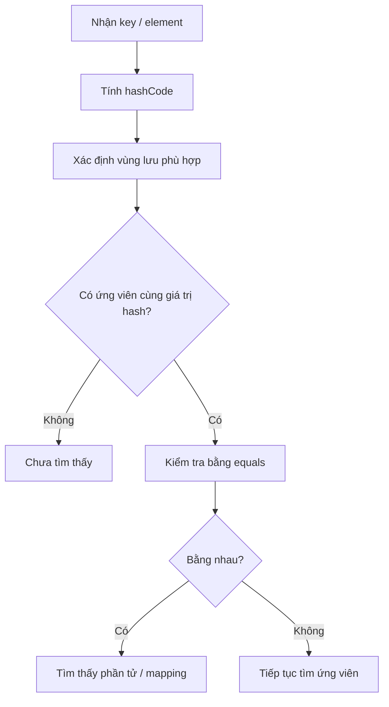

# HashSet, HashMap và ảnh hưởng của equals với hashCode

Trong Java 27, `HashSet` và `HashMap` vẫn là hai cấu trúc dữ liệu quan trọng của Java Collections Framework khi cần **tra cứu nhanh theo giá trị định danh**: kiểm tra một phần tử đã xuất hiện hay chưa, loại trùng lặp, tìm một đối tượng theo khóa, hoặc đếm số lần xuất hiện của từng giá trị.

Tuy nhiên, hai cấu trúc này không chỉ phụ thuộc vào phép so sánh `equals()`. Chúng còn dựa trên `hashCode()` để tổ chức và tìm dữ liệu. Một lớp triển khai sai hợp đồng giữa hai phương thức có thể làm `HashSet` chứa những phần tử đáng lẽ bị xem là trùng nhau, hoặc `HashMap` không tìm lại được giá trị bằng một khóa tương đương.

Bài học tập trung vào hành vi được bảo đảm bởi Java SE 27 API, sự khác biệt giữa `equals` và `hashCode`, cách lựa chọn khóa ổn định, và những tình huống cần tránh trong mã nghiệp vụ.

## 1. HashSet và HashMap giải quyết vấn đề gì?

### HashSet: tập hợp không chứa hai phần tử bằng nhau

`HashSet<E>` là một triển khai của giao diện `Set<E>`. Theo hợp đồng của `Set`, hai phần tử được xem là trùng nếu chúng bằng nhau theo `equals`.

```java
import java.util.HashSet;
import java.util.Set;

Set<String> codes = new HashSet<>();

System.out.println(codes.add("A-001")); // true
System.out.println(codes.add("B-002")); // true
System.out.println(codes.add("A-001")); // false

System.out.println(codes.size());           // 2
System.out.println(codes.contains("A-001")); // true
```

`add` trả về `false` khi tập hợp đã có phần tử được xem là bằng phần tử đang thêm. Nó không có nghĩa là đã gặp cùng **tham chiếu đối tượng**; hai đối tượng khác nhau vẫn có thể được coi là một phần tử về mặt giá trị.

`HashSet` được triển khai dựa trên một `HashMap` nội bộ. Vì thế, cả hai cùng chịu ảnh hưởng của quy tắc hashing và tính ổn định của khóa.

### HashMap: ánh xạ từ khóa sang giá trị

`HashMap<K,V>` lưu các cặp **khóa–giá trị**. Mỗi khóa chỉ xuất hiện dưới dạng một ánh xạ trong map, còn giá trị có thể trùng nhau giữa các khóa:

```java
import java.util.HashMap;
import java.util.Map;

Map<String, Integer> stock = new HashMap<>();

stock.put("A-001", 12);
stock.put("B-002", 8);
stock.put("A-001", 15); // Cập nhật value của khóa đã tồn tại

System.out.println(stock.size());           // 2
System.out.println(stock.get("A-001"));     // 15
System.out.println(stock.containsKey("C-003")); // false
```

`put` dùng khóa mới để tạo một ánh xạ, nhưng nếu đã có khóa tương đương thì nó thay thế **giá trị** gắn với khóa đó. Không nên suy ra rằng lời gọi `put` bắt buộc thay thế cả đối tượng khóa đang được lưu bên trong map.

| Câu hỏi | `HashSet<E>` | `HashMap<K,V>` |
|---|---|---|
| Lưu gì? | Các phần tử duy nhất | Một giá trị cho mỗi khóa |
| Thao tác cốt lõi | `add`, `contains`, `remove` | `put`, `get`, `containsKey`, `remove` |
| Định nghĩa trùng | Phần tử bằng nhau | Khóa bằng nhau |
| `equals`/`hashCode` áp dụng trực tiếp cho | Phần tử | Khóa |
| Có bảo đảm thứ tự duyệt? | Không | Không |
| Có chấp nhận `null`? | Có, tối đa một phần tử `null` | Có, một khóa `null` và nhiều value `null` |

Cả hai có thời gian trung bình/kỳ vọng gần `O(1)` cho các thao tác tra cứu hoặc cập nhật cơ bản **nếu các mã băm phân tán tốt**. Đây không phải cam kết thời gian hằng số cho mọi đầu vào hoặc mọi trường hợp va chạm.

## 2. equals và hashCode: hai vai trò khác nhau

Mọi đối tượng Java đều kế thừa `equals(Object)` và `hashCode()` từ `java.lang.Object`, trừ khi lớp định nghĩa lại theo quy tắc ngôn ngữ.

- `equals(other)` trả lời: **Hai đối tượng có được xem là cùng một giá trị theo quy tắc của kiểu hay không?**
- `hashCode()` trả về một số nguyên `int` dùng cho việc tổ chức các đối tượng trong cấu trúc hashing.

Nếu không ghi đè, `Object.equals` dùng so sánh tham chiếu. Khi bạn tạo hai đối tượng khác nhau nhưng có cùng nội dung nghiệp vụ, chúng không tự động bằng nhau.

```java
class Customer {
    private final String id;

    Customer(String id) {
        this.id = id;
    }
}

var left = new Customer("C-100");
var right = new Customer("C-100");

System.out.println(left == right);      // false
System.out.println(left.equals(right)); // false: mặc định so sánh tham chiếu
```

Vì vậy, trước khi dùng một đối tượng làm phần tử `HashSet` hoặc khóa `HashMap`, cần quyết định rõ **định danh/đẳng thức nghiệp vụ** của kiểu đó là gì.

### Hợp đồng equals()

Khi định nghĩa lại `equals`, quy tắc tổng quát bao gồm:

1. **Phản xạ:** `x.equals(x)` là `true` đối với `x` khác null.
2. **Đối xứng:** `x.equals(y)` và `y.equals(x)` cho cùng kết quả.
3. **Bắc cầu:** nếu `x.equals(y)` và `y.equals(z)`, thì `x.equals(z)`.
4. **Nhất quán:** các lần so sánh lặp lại có kết quả ổn định khi thông tin được dùng trong `equals` không đổi.
5. **Khác null:** `x.equals(null)` luôn là `false` đối với `x` khác null.

Không nên dùng phép so sánh `==` để thay thế `equals` khi mục đích là so sánh giá trị của các đối tượng như `String`.

### Hợp đồng hashCode()

Phần quan trọng nhất đối với hash collection là:

> Nếu `a.equals(b)` trả về `true`, thì **bắt buộc** `a.hashCode() == b.hashCode()`.

Chiều ngược lại **không đúng**: hai đối tượng có cùng hash code vẫn có thể không bằng nhau.

| Quan hệ | Kết luận |
|---|---|
| `a.equals(b) == true` | Hash code của `a` và `b` phải bằng nhau |
| `a.hashCode() == b.hashCode()` | Chưa đủ kết luận hai đối tượng bằng nhau |
| `a.hashCode() != b.hashCode()` | Hai đối tượng không được bằng nhau nếu triển khai đúng hợp đồng |
| Dữ liệu tham gia `equals` không đổi | `hashCode` phải ổn định trong cùng một lần chạy Java theo hợp đồng |

Các giá trị hash không bắt buộc giữ nguyên giữa những lần chạy ứng dụng khác nhau. `hashCode` cũng không phải mã định danh duy nhất, checksum an toàn hay cryptographic hash; không dùng nó làm khóa bền vững trong cơ sở dữ liệu hoặc chữ ký bảo mật.

## 3. HashSet và HashMap dùng hai phương thức này như thế nào?

Có thể hình dung quá trình tra cứu theo các bước:



Đây là **mô hình khái niệm**, không phải đặc tả chính xác về cấu trúc bucket, cách trộn bit hay thuật toán nội bộ của mọi phiên bản JDK. Triển khai có thể thay đổi để tối ưu hiệu năng. Điều quan trọng là các phương thức hashing dựa trên sự tương thích giữa mã băm và phép so sánh bằng nhau.

### Va chạm hash là bình thường

Hai đối tượng có thể có cùng `hashCode` nhưng khác nhau theo `equals`. Một cấu trúc hash hợp lệ phải xử lý trường hợp đó.

```java
record PoorHash(String code) {
    @Override
    public int hashCode() {
        return 1; // Đúng hợp đồng nhưng phân tán cực kém
    }
}

var a = new PoorHash("A");
var b = new PoorHash("B");

System.out.println(a.hashCode() == b.hashCode()); // true
System.out.println(a.equals(b));                  // false

var values = new java.util.HashSet<PoorHash>();
values.add(a);
values.add(b);
System.out.println(values.size());                // 2
```

Lưu ý: `PoorHash` ở đây chỉ minh họa va chạm, **không** phải cách thiết kế khuyến nghị. Mọi phần tử đều có hash bằng 1, nên một tập hợp lớn sẽ phân tán dữ liệu rất kém và có thể làm tra cứu chậm. Không sử dụng `hashCode` cố định cho kiểu khóa trong ứng dụng thực tế.

## 4. Lỗi nghiêm trọng: ghi đè equals nhưng không nhất quán hashCode

Giả sử hai key có cùng mã sản phẩm phải được xem là bằng nhau. Nếu `equals` chỉ so sánh mã nhưng `hashCode` dùng dữ liệu khác, hợp đồng bị phá vỡ.

```java
final class BrokenKey {
    private final String code;
    private final int salt;

    BrokenKey(String code, int salt) {
        this.code = code;
        this.salt = salt;
    }

    @Override
    public boolean equals(Object other) {
        return other instanceof BrokenKey key
                && code.equals(key.code);
    }

    @Override
    public int hashCode() {
        return salt; // SAI: hai khóa equal có thể trả về hash khác nhau
    }
}

var first = new BrokenKey("SKU-1", 1);
var second = new BrokenKey("SKU-1", 2);

System.out.println(first.equals(second));             // true
System.out.println(first.hashCode() == second.hashCode()); // false
```

`first` và `second` được xem là bằng nhau nhưng có hai mã băm khác nhau. Khi đưa vào `HashSet` hoặc `HashMap`, bạn **không thể dựa vào kết quả tra cứu hoặc loại trùng** như với khóa triển khai đúng. Tùy trạng thái và cấu trúc băm, tập hợp có thể giữ cả hai hoặc tìm kiếm không ra khóa tương đương.

Không cần khai thác hành vi không hợp lệ này để kiểm tra chương trình: chỉ hai dòng `equals == true` nhưng `hashCode` khác nhau đã đủ chứng minh vi phạm.

### Cách làm đúng với class thường

```java
import java.util.Objects;

final class ProductKey {
    private final String code;

    ProductKey(String code) {
        this.code = Objects.requireNonNull(code, "code").strip();
        if (this.code.isEmpty()) {
            throw new IllegalArgumentException("Mã sản phẩm không được rỗng");
        }
    }

    @Override
    public boolean equals(Object other) {
        return other instanceof ProductKey that
                && code.equals(that.code);
    }

    @Override
    public int hashCode() {
        return code.hashCode();
    }
}
```

Cả hai phương thức cùng dựa trên trường `code`. Trường `final` và `String` bất biến giúp key ổn định sau khởi tạo. `ProductKey` là `final` để tránh những rắc rối về đối xứng hoặc bắc cầu khi lớp con định nghĩa lại quy tắc equality.

Với nhiều trường, `Objects.equals(a, b)` hỗ trợ so sánh an toàn khi có null; `Objects.hash(field1, field2)` cung cấp cách kết hợp hash code thuận tiện. Nên dựa trên các trường bất biến tham gia vào equality để tính hash. Hợp đồng không bắt buộc hash phải sử dụng mọi trường trong `equals`, nhưng **không được** để hai đối tượng bằng nhau nhận hash khác nhau; bỏ qua nhiều trường còn dễ làm tăng va chạm và giảm hiệu năng.

## 5. Dùng record để có equals/hashCode nhất quán

Với các **value object** có tập thành phần rõ ràng, record là lựa chọn hiện đại và ngắn gọn trong Java 27:

```java
import java.util.Objects;

record ProductId(String code) {
    ProductId {
        code = Objects.requireNonNull(code, "code").strip();
        if (code.isEmpty()) {
            throw new IllegalArgumentException("Mã sản phẩm không được rỗng");
        }
    }
}

var left = new ProductId(" SKU-01 ");
var right = new ProductId("SKU-01");

System.out.println(left.equals(right));                  // true
System.out.println(left.hashCode() == right.hashCode());  // true
```

Trình biên dịch tự cung cấp `equals`, `hashCode` và `toString` dựa trên các record components. Compact constructor chuẩn hóa mã sản phẩm trước khi nó được ghi vào component, nên hai cách nhập mã có khoảng trắng ở hai đầu được biến thành cùng một giá trị.

`record` không tự suy ra “định danh nghiệp vụ” từ tên trường. Ví dụ:

```java
record CustomerSnapshot(String customerId, String displayName) {}

var a = new CustomerSnapshot("C-1", "Lan");
var b = new CustomerSnapshot("C-1", "Lan Nguyen");

System.out.println(a.equals(b)); // false
```

Hai record trên có cùng `customerId` nhưng khác `displayName`, nên không bằng nhau. Nếu nghiệp vụ cần tra cứu **chỉ theo ID**, dùng một kiểu khóa riêng:

```java
record CustomerId(String value) {}
```

Khi đó `Map<CustomerId, CustomerSnapshot>` phân biệt khóa theo `CustomerId`, còn các thay đổi ở `displayName` không ảnh hưởng đến lookup.

### Record vẫn có thể chứa thành phần mutable

`record` chỉ bất biến **nông**. Với component là mảng, `equals` mặc định sử dụng equality của kiểu mảng, tức so sánh tham chiếu thay vì nội dung:

```java
record BinaryKey(byte[] bytes) {}

var first = new BinaryKey(new byte[] {1, 2});
var second = new BinaryKey(new byte[] {1, 2});

System.out.println(first.equals(second)); // false
```

Mảng còn có thể bị thay đổi sau khi tạo record. Vì thế, không nên mặc định dùng `record` có component mảng hoặc collection mutable làm hash key. Nếu muốn equality theo nội dung mảng, cần thiết kế sao chép phòng vệ và cả `equals`/`hashCode` thích hợp, hoặc chuyển sang một value object bất biến có equality theo giá trị.

`List.copyOf` có thể giúp chụp snapshot của danh sách, nhưng nó vẫn chỉ bảo đảm tính bất biến nông nếu các phần tử bên trong là đối tượng mutable.

## 6. Không thay đổi dữ liệu tham gia equality/hash khi đang làm key

Đây là một trong những lỗi khó tìm nhất khi dùng `HashMap` và `HashSet`: thay đổi đối tượng sau khi đã thêm, trong khi các trường thay đổi lại ảnh hưởng đến `hashCode` hoặc `equals`.

```java
final class MutableKey {
    private String code;

    MutableKey(String code) {
        this.code = code;
    }

    void rename(String newCode) {
        code = newCode;
    }

    @Override
    public boolean equals(Object other) {
        return other instanceof MutableKey key
                && code.equals(key.code);
    }

    @Override
    public int hashCode() {
        return code.hashCode();
    }
}

var key = new MutableKey("A-01");
var cache = new java.util.HashMap<MutableKey, String>();

cache.put(key, "Đã lưu");
key.rename("B-02"); // Rất nguy hiểm khi key đang ở trong map

// Không thể tin cậy việc tra cứu sau khi key bị sửa:
System.out.println(cache.get(key));
```

Khi chèn, map đã tổ chức key dựa trên giá trị hash tại thời điểm đó. Sau khi `code` thay đổi, mã băm hoặc quan hệ equality có thể thay đổi. Map không tự tổ chức lại cấu trúc nội bộ khi một đối tượng khóa bị sửa; kết quả tra cứu không còn đáng tin cậy.

**Cách khuyến nghị:** dùng `record` hoặc class bất biến làm key. Nếu định danh thực sự cần thay đổi, hãy **xóa ánh xạ cũ bằng key còn hợp lệ trước khi thay đổi**, rồi chèn ánh xạ mới bằng một đối tượng key mới. Với ví dụ đơn giản:

```java
record Id(String code) {}

var data = new java.util.HashMap<Id, String>();
var oldId = new Id("A-01");
data.put(oldId, "Đã lưu");

var storedValue = data.remove(oldId);
data.put(new Id("B-02"), storedValue);
```

Đừng trông chờ `final` trên tham chiếu của một field mutable là đủ: nó không ngăn việc thay đổi trạng thái bên trong đối tượng.

## 7. HashMap: các thao tác cập nhật hiện đại

Các API của `Map` giúp giảm mẫu mã kiểm tra khóa rồi cập nhật thủ công. Chúng vẫn dựa trên `equals`/`hashCode` của key.

### get, containsKey và giá trị null

```java
import java.util.HashMap;
import java.util.Map;

Map<String, Integer> ages = new HashMap<>();
ages.put("Lan", 24);
ages.put("An", null);

System.out.println(ages.get("Lan"));          // 24
System.out.println(ages.get("An"));           // null
System.out.println(ages.get("Unknown"));      // null
System.out.println(ages.containsKey("An"));   // true
System.out.println(ages.containsKey("Unknown")); // false
```

`get(key) == null` **không** cho biết chắc chắn khóa không tồn tại trong `HashMap`: nó cũng có thể tồn tại và được gắn với value `null`. Dùng `containsKey` nếu cần phân biệt hai trạng thái đó.

### merge: cộng dồn số lượng theo khóa

```java
var counts = new HashMap<String, Integer>();

counts.merge("java", 1, Integer::sum);
counts.merge("java", 1, Integer::sum);
counts.merge("kotlin", 1, Integer::sum);

System.out.println(counts.get("java")); // 2
```

`merge(key, value, remappingFunction)` gắn `value` nếu khóa chưa có giá trị không null; nếu đã có, hàm `remappingFunction` kết hợp giá trị cũ với giá trị mới. Tham số `value` không được null. Nếu hàm kết hợp trả về `null`, ánh xạ sẽ bị xóa theo hợp đồng API.

### computeIfAbsent: nhóm dữ liệu vào set

```java
import java.util.HashMap;
import java.util.HashSet;
import java.util.Map;
import java.util.Set;

Map<String, Set<String>> usersByTeam = new HashMap<>();

usersByTeam.computeIfAbsent("backend", key -> new HashSet<>())
           .add("Lan");
usersByTeam.computeIfAbsent("backend", key -> new HashSet<>())
           .add("An");
usersByTeam.computeIfAbsent("frontend", key -> new HashSet<>())
           .add("Binh");

System.out.println(usersByTeam.get("backend").size()); // 2
```

`computeIfAbsent` chỉ gọi hàm tạo value khi key chưa có mapping hoặc đang được gắn `null`. Nếu hàm trả `null`, không có mapping mới được thêm. Tránh thay đổi chính map đó từ bên trong mapping function, vì hợp đồng API có những hạn chế và hành vi kiểm tra sửa đổi phụ thuộc implementation.

Khi cần ánh xạ chỉ đọc, có thể dùng `Map.copyOf(map)` hoặc `Map.of(...)` nếu đầu vào phù hợp. Chúng tạo map không thể sửa đổi qua API và **không chấp nhận key hoặc value null**; đây không phải bản sao sâu nếu value là đối tượng có thể thay đổi.

### putIfAbsent, replace và getOrDefault

```java
var config = new HashMap<String, String>();
config.putIfAbsent("mode", "safe");
config.putIfAbsent("mode", "fast"); // "safe" vẫn được giữ
config.replace("mode", "strict");   // cập nhật nếu có key
System.out.println(config.getOrDefault("missing", "default")); // default
```

`getOrDefault` vẫn trả về `null` khi key tồn tại và mapping của nó là `null`; nó không coi mọi giá trị null là “thiếu key”. Với `HashMap`, `putIfAbsent` lại xem mapping hiện có là `null` như trường hợp có thể ghi giá trị mới.

## 8. Ví dụ hoàn chỉnh: loại trùng và tổng hợp tồn kho

Ví dụ sau minh họa khóa là một record bất biến đã được chuẩn hóa; cùng một khóa có thể xuất hiện nhiều lần trong dữ liệu đầu vào nhưng `HashSet` giữ một phần tử tương đương, còn `HashMap` cộng dồn số lượng.

Lưu toàn bộ vào file `HashCollectionsDemo.java`:

```java
import java.util.Comparator;
import java.util.HashMap;
import java.util.HashSet;
import java.util.List;
import java.util.Objects;

public class HashCollectionsDemo {

    record ProductId(String code) {
        ProductId {
            code = Objects.requireNonNull(code, "code").strip();
            if (code.isEmpty()) {
                throw new IllegalArgumentException("Mã sản phẩm không được rỗng");
            }
        }
    }

    record StockEvent(String productCode, int quantity) {
        StockEvent {
            Objects.requireNonNull(productCode, "productCode");
            if (productCode.isBlank() || quantity <= 0) {
                throw new IllegalArgumentException("Dòng nhập kho không hợp lệ");
            }
        }
    }

    public static void main(String[] args) {
        var events = List.of(
            new StockEvent("A-01", 2),
            new StockEvent("B-02", 4),
            new StockEvent(" A-01 ", 3)
        );

        var distinctProducts = new HashSet<ProductId>();
        var quantities = new HashMap<ProductId, Integer>();

        for (var event : events) {
            var id = new ProductId(event.productCode());

            distinctProducts.add(id);
            quantities.merge(id, event.quantity(), Integer::sum);
        }

        var queriedId = new ProductId("A-01");
        System.out.println(distinctProducts.size());        // 2
        System.out.println(distinctProducts.contains(queriedId)); // true
        System.out.println(quantities.get(queriedId));      // 5
        System.out.println(quantities.get(new ProductId("B-02"))); // 4

        var orderedIds = distinctProducts.stream()
            .map(ProductId::code)
            .sorted()
            .toList();

        System.out.println(orderedIds); // [A-01, B-02]
    }
}
```

Biên dịch và chạy với JDK 27:

```shell
javac HashCollectionsDemo.java
java HashCollectionsDemo
```

Kết quả dự kiến:

```text
2
true
5
4
[A-01, B-02]
```

Chú ý: chúng ta **chủ động `sorted()`** trước khi hiển thị danh sách mã. Nếu duyệt trực tiếp `HashSet` hoặc `HashMap`, Java không cam kết thứ tự hiển thị. Mã nguồn không nên giả định thứ tự thấy được trên một phiên bản JDK cụ thể là hợp đồng lâu dài.

`ProductId` chỉ bỏ khoảng trắng đầu/cuối, **không** tự coi `a-01` và `A-01` bằng nhau. Nếu hệ thống cần mã không phân biệt hoa/thường, hãy định nghĩa và thực thi chính sách chuẩn hóa ở constructor (ví dụ `toUpperCase(Locale.ROOT)` khi thích hợp với miền dữ liệu), thay vì thay đổi `equals` một cách ngẫu nhiên.

## 9. HashMap và HashSet không bảo đảm thứ tự

Không có hợp đồng bảo đảm thứ tự duyệt của `HashSet` và `HashMap`. Cùng một tập dữ liệu cũng không có nghĩa là iteration order được đảm bảo theo thứ tự chèn, thứ tự sắp xếp hay mã băm. Không dùng `HashSet` để làm danh sách trình bày có thứ tự nếu thứ tự là một phần của yêu cầu nghiệp vụ.

Nếu cần thứ tự chèn, dùng `LinkedHashSet` hoặc `LinkedHashMap`:

```java
import java.util.LinkedHashMap;
import java.util.LinkedHashSet;

var set = new LinkedHashSet<String>();
set.add("B");
set.add("A");
set.add("B");
System.out.println(set); // [B, A]

var map = new LinkedHashMap<String, Integer>();
map.put("second", 2);
map.put("first", 1);
System.out.println(map.keySet()); // [second, first]
```

Mặc định, `LinkedHashMap` duy trì thứ tự chèn, nhưng nó cũng có chế độ *access-order* nếu bạn cấu hình tương ứng. Trong Java 27, `LinkedHashMap` thực thi `SequencedMap` còn `LinkedHashSet` thực thi `SequencedSet`, phù hợp khi API cần thao tác theo thứ tự encounter.

Nếu muốn sắp xếp theo comparator hoặc thứ tự tự nhiên của khóa, cân nhắc `TreeSet`/`TreeMap`. Lưu ý cấu trúc sorted dựa vào so sánh thứ tự (`compareTo` hoặc `Comparator`) để phân biệt các phần tử, nên một comparator không nhất quán với `equals` có thể tạo ra hành vi khác với hash collection.

## 10. Hiệu năng: va chạm, capacity và load factor

`HashMap` và `HashSet` mang lại hiệu năng tra cứu kỳ vọng gần hằng số khi `hashCode` có độ phân tán hợp lý.

- **Collision:** hai key khác nhau cùng hash; điều này hợp lệ, nhưng nhiều collision có thể làm thao tác chậm.
- **Capacity:** số vùng lưu (bucket) mà cấu trúc băm có thể sử dụng.
- **Load factor:** ngưỡng tỷ lệ tải ảnh hưởng tới thời điểm cấu trúc tăng capacity.
- **Resize/rehash:** khi vượt ngưỡng, bảng băm có thể phải phân phối lại các entry, làm phát sinh chi phí.

`HashMap` mặc định dùng load factor `0.75`; cấu hình mặc định thường là lựa chọn tốt. Không nên đặt capacity quá lớn cho một collection nhỏ vì việc duyệt `HashMap` hoặc `HashSet` có thể phụ thuộc vào **capacity cộng với size**.

Nếu biết trước số phần tử dự kiến, Java 27 có factory method tiện hơn việc tự tính capacity:

```java
var map = java.util.HashMap.<String, Integer>newHashMap(1_000);
var set = java.util.HashSet.<String>newHashSet(1_000);
```

`newHashMap(numMappings)` và `newHashSet(numElements)` nhận **số ánh xạ/phần tử dự kiến**, không phải chỉ số bucket trực tiếp. Cả hai xuất hiện từ Java 19 và vẫn được hỗ trợ trong Java 27. Chỉ dùng tối ưu này khi có lý do về khối lượng dữ liệu, không cần tính toán thủ công cho collection nhỏ thông thường.

`hashCode` được thiết kế để phục vụ các bảng băm, không phải để mã hóa dữ liệu an toàn. Với đầu vào không đáng tin cậy hoặc rất nhiều phần tử, khả năng va chạm và giới hạn tài nguyên vẫn cần được cân nhắc.

## 11. Null, factory methods và tập hợp không thể sửa đổi

`HashSet` chấp nhận một phần tử `null`. `HashMap` cho phép một khóa `null` và nhiều mapping có value `null`.

```java
var set = new java.util.HashSet<String>();
set.add(null);
set.add(null);
System.out.println(set.size()); // 1

var map = new java.util.HashMap<String, String>();
map.put(null, "default");
map.put("A", null);
System.out.println(map.containsKey(null)); // true
```

Tuy nhiên, các factory method dành cho collection không thể sửa đổi có hợp đồng khác:

```java
var permissions = java.util.Set.of("READ", "WRITE");
var limits = java.util.Map.of("READ", 10, "WRITE", 5);

// Set.of(null)                 -> NullPointerException
// Set.of("READ", "READ")      -> IllegalArgumentException
// Map.of("READ", null)        -> NullPointerException
// Map.of("READ", 1, "READ", 2) -> IllegalArgumentException
```

`Set.of` không loại trùng lặng lẽ khi các đối số bằng nhau; nó từ chối duplicate tại thời điểm tạo tập hợp. Đó là khác biệt so với thêm lần lượt vào `HashSet`, khi lần `add` trùng trả về `false`.

Không nhầm **unmodifiable collection** với **deep immutable object graph**. `Map.copyOf` hoặc `Set.copyOf` không biến mọi đối tượng chứa bên trong thành bất biến sâu.

## 12. Duyệt phần tử và sửa collection khi đang duyệt

`HashMap` cung cấp các view:

- `keySet()`: tập các key.
- `values()`: collection các value.
- `entrySet()`: tập các cặp key–value, thuận tiện khi cần cả hai.

```java
var prices = new java.util.HashMap<String, Integer>();
prices.put("A", 10);
prices.put("B", 20);

for (var entry : prices.entrySet()) {
    System.out.println(entry.getKey() + ": " + entry.getValue());
}
```

Những view trên thường được **backed** bởi map gốc: thay đổi map sẽ ảnh hưởng tới view và ngược lại các thao tác sửa được hỗ trợ trên view có thể ảnh hưởng map. Chẳng hạn `prices.keySet().remove("A")` xóa mapping tương ứng khỏi map.

Không sửa cấu trúc collection tùy ý trong khi đang dùng iterator hoặc enhanced `for` trên chính collection đó:

```java
var codes = new java.util.HashSet<String>();
codes.add("A");
codes.add("B");

for (var iterator = codes.iterator(); iterator.hasNext();) {
    if (iterator.next().equals("A")) {
        iterator.remove(); // Hợp lệ: xóa bằng chính iterator
    }
}
```

Iterator của `HashSet` và các view của `HashMap` có cơ chế *fail-fast* phát hiện sửa cấu trúc không đúng cách theo hướng **best effort**. Không dùng `ConcurrentModificationException` như một cơ chế bảo đảm đồng bộ, kiểm tra tính đúng đắn hay phục hồi trạng thái. Nếu muốn loại phần tử theo điều kiện, bạn cũng có thể dùng `removeIf` với các collection hỗ trợ.

## 13. Đa luồng: HashMap/HashSet không tự đồng bộ

`HashMap` và `HashSet` không được thiết kế như collection thread-safe cho các cập nhật đồng thời không được đồng bộ. Khi nhiều luồng có thể vừa đọc vừa ghi hoặc cùng sửa collection, cần thiết kế đồng bộ rõ ràng hoặc dùng cấu trúc concurrent phù hợp.

Ví dụ, `ConcurrentHashMap<K,V>` được thiết kế cho tra cứu và cập nhật đồng thời, còn `ConcurrentHashMap.newKeySet()` tạo một set dựa trên concurrent hash map:

```java
import java.util.concurrent.ConcurrentHashMap;

var visits = new ConcurrentHashMap<String, Integer>();

visits.merge("home", 1, Integer::sum);
visits.merge("home", 1, Integer::sum);

var activeIds = ConcurrentHashMap.<String>newKeySet();
activeIds.add("U-001");
```

`ConcurrentHashMap` không chấp nhận key hoặc value `null`. Các phương thức `merge`, `compute` có những bảo đảm đồng thời riêng được mô tả trong tài liệu API; không suy rộng các bảo đảm đó sang `HashMap`.

Nếu chỉ cần một bản dữ liệu cố định để nhiều luồng cùng đọc, cân nhắc tạo snapshot không thể sửa đổi với các key/value bất biến. Điều này thường dễ hiểu hơn việc chia sẻ một map mutable giữa nhiều luồng.

## 14. Checklist thiết kế key đáng tin cậy

Trước khi đưa một kiểu tùy chỉnh vào `HashSet` hoặc làm key cho `HashMap`, hãy kiểm tra:

1. **Định nghĩa equality rõ ràng:** cùng ID, cùng mã miền, hay toàn bộ thuộc tính?
2. **`equals` đúng hợp đồng:** phản xạ, đối xứng, bắc cầu, nhất quán, khác null.
3. **`hashCode` nhất quán:** mọi cặp bằng nhau bắt buộc có hash bằng nhau.
4. **Không sửa dữ liệu làm thay đổi equality/hash khi đối tượng đã là key.**
5. **Cân nhắc record hoặc final immutable class** cho value key.
6. **Xác định rõ chuẩn hóa input:** khoảng trắng, phân biệt hoa/thường, Unicode, quy tắc miền.
7. **Tránh phần tử mutable hoặc mảng** trong key nếu không có chính sách equality/copy rõ ràng.
8. **Không phụ thuộc vào iteration order** của hash collection.
9. **Kiểm soát null** theo hợp đồng API, nhất là khi chuyển giữa `HashMap` và `Map.of`.
10. **Đánh giá concurrency** nếu collection có thể bị nhiều luồng thay đổi.

Các sai lầm thường gặp: chỉ ghi đè `equals`; tính `hashCode` dựa trên trường không tham gia `equals`; thêm entity mutable vào `HashSet`; cho rằng cùng hash nghĩa là cùng object; hoặc dùng `HashMap` làm nguồn dữ liệu hiển thị theo thứ tự.

## 15. Bài tập thực hành

**Bài tập 1 — Bộ lọc mã khách hàng.** Đầu vào có các mã `" C-01 "`, `"C-02"`, `"C-01"`. Viết một record `CustomerId` loại bỏ khoảng trắng hai đầu; dùng `HashSet<CustomerId>` để đếm số khách hàng duy nhất.

**Bài tập 2 — Tần suất trạng thái.** Từ danh sách `["NEW", "PAID", "NEW", "FAILED", "PAID", "NEW"]`, dùng `HashMap<String,Integer>` và `merge` để đếm số phần tử theo trạng thái. Không dựa vào thứ tự khi duyệt map.

**Bài tập 3 — Khóa mutable.** Tạo class `SessionKey` với field `String token` có setter và `equals`/`hashCode` dựa trên `token`. Thêm đối tượng vào `HashMap`, sửa `token` rồi thử tra cứu. Giải thích tại sao kết quả không đáng tin và thay thế bằng record bất biến.

**Bài tập 4 — Collision.** Tạo hai object khác nhau có cùng hash nhưng `equals == false`. Kiểm tra vì sao một `HashSet` hợp lệ vẫn có thể chứa cả hai.

### Đáp án tham khảo bài 1 và 2

```java
import java.util.HashMap;
import java.util.HashSet;
import java.util.List;
import java.util.Objects;

record CustomerId(String value) {
    CustomerId {
        value = Objects.requireNonNull(value).strip();
        if (value.isEmpty()) {
            throw new IllegalArgumentException("ID trống");
        }
    }
}

var customerIds = List.of(" C-01 ", "C-02", "C-01");
var unique = new HashSet<CustomerId>();

for (var raw : customerIds) {
    unique.add(new CustomerId(raw));
}
System.out.println(unique.size()); // 2

var statuses = List.of(
    "NEW", "PAID", "NEW", "FAILED", "PAID", "NEW"
);
var counts = new HashMap<String, Integer>();

for (var status : statuses) {
    counts.merge(status, 1, Integer::sum);
}

System.out.println(counts.get("NEW"));    // 3
System.out.println(counts.get("PAID"));   // 2
System.out.println(counts.get("FAILED")); // 1
```

### Câu hỏi tự kiểm tra

**1.** Nếu `a.equals(b)` là `true`, `a.hashCode() == b.hashCode()` có bắt buộc không?

**2.** Nếu hai object cùng hash, chúng có bắt buộc bằng nhau không?

**3.** `map.get(key) == null` có chứng minh rằng key không tồn tại trong `HashMap` không?

**4.** Ghi đè `equals` trên một lớp nhưng để nguyên `Object.hashCode` có thể gây lỗi gì?

**5.** Có nên dùng `record Customer(String id, String displayName)` làm key nếu nghiệp vụ chỉ muốn so sánh `id`?

**6.** Làm sao duyệt `HashSet` theo thứ tự chèn trong một hệ thống cần giữ thứ tự?

**7.** `HashMap.newHashMap(1000)` dùng `1000` làm capacity bucket chính xác hay số mapping dự kiến?

**8.** Khi nào nên dùng `ConcurrentHashMap` thay vì `HashMap`?

**Đáp án gợi ý:**

1. Có, đây là yêu cầu bắt buộc của hợp đồng `hashCode`.
2. Không. Va chạm hash là hợp lệ; `equals` mới quyết định cùng giá trị.
3. Không. Khóa có thể tồn tại với value `null`; dùng `containsKey`.
4. Hai object `equals == true` có thể có hash khác nhau, khiến tập hợp/map hoạt động trái mong đợi.
5. Không lý tưởng: record đó mặc định so sánh cả `id` và `displayName`. Dùng key `CustomerId` riêng.
6. Chọn `LinkedHashSet` nếu muốn lưu và duyệt theo thứ tự chèn; `HashSet` không cam kết thứ tự.
7. Là số mapping **dự kiến**; factory tính capacity thích hợp theo quy tắc của triển khai.
8. Khi có thao tác đọc/cập nhật đồng thời và cần các bảo đảm concurrency tương ứng, sau khi đánh giá hợp đồng về null và atomic update.

## 16. Tổng kết

`HashSet` loại trùng các phần tử, còn `HashMap` gắn một giá trị với mỗi khóa. Cả hai dựa trên `hashCode` để tổ chức dữ liệu và `equals` để xác định tương đương; do đó chất lượng của **kiểu key** quan trọng không kém việc chọn collection.

Quy tắc quan trọng nhất là: **mọi đối tượng bằng nhau phải có mã băm bằng nhau, và các thuộc tính được dùng để so sánh key cần giữ ổn định trong thời gian key nằm trong hash collection**. Dùng record hoặc final immutable value object khi phù hợp; chọn các API cập nhật hiện hành như `merge` và `computeIfAbsent`, và đừng phụ thuộc vào thứ tự duyệt hoặc bảo đảm thread-safety mà `HashSet`/`HashMap` không cung cấp.

## Tài liệu tham khảo

- [Java SE 27 API — HashSet](https://docs.oracle.com/en/java/javase/27/docs/api/java.base/java/util/HashSet.html): hợp đồng tập hợp, hash table, hiệu năng, thứ tự và `newHashSet`.
- [Java SE 27 API — HashMap](https://docs.oracle.com/en/java/javase/27/docs/api/java.base/java/util/HashMap.html): hashing, collision, capacity, null, `newHashMap`, `computeIfAbsent`, `merge`.
- [Java SE 27 API — Object](https://docs.oracle.com/en/java/javase/27/docs/api/java.base/java/lang/Object.html): hợp đồng `equals` và `hashCode` của đối tượng Java.
- [Java SE 27 API — Record](https://docs.oracle.com/en/java/javase/27/docs/api/java.base/java/lang/Record.html): các phương thức equality và hashing được cung cấp cho record.
- [Java SE 27 API — Set](https://docs.oracle.com/en/java/javase/27/docs/api/java.base/java/util/Set.html): tính duy nhất, `Set.of`, `Set.copyOf` và ngữ nghĩa `equals`.
- [Java SE 27 API — Map](https://docs.oracle.com/en/java/javase/27/docs/api/java.base/java/util/Map.html): hợp đồng key, `containsKey`, `getOrDefault`, `merge`, `Map.of` và `Map.copyOf`.
- [Java SE 27 API — LinkedHashMap](https://docs.oracle.com/en/java/javase/27/docs/api/java.base/java/util/LinkedHashMap.html): thứ tự encounter và `SequencedMap`.
- [Java SE 27 API — ConcurrentHashMap](https://docs.oracle.com/en/java/javase/27/docs/api/java.base/java/util/concurrent/ConcurrentHashMap.html): truy cập đồng thời, các thao tác cập nhật và hạn chế về null.
