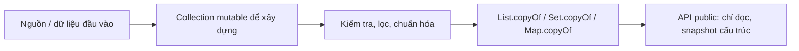

# Factory `of`, `copyOf` và collection không cho phép sửa đổi

Trong Java 27, các phương thức tĩnh `List.of(...)`, `Set.of(...)` và `Map.of(...)` tạo collection **không cho phép sửa đổi** (*unmodifiable collection*) với cú pháp ngắn gọn. Khi dữ liệu đã nằm trong một collection khác, `List.copyOf(...)`, `Set.copyOf(...)` và `Map.copyOf(...)` tạo ra kết quả không cho phép sửa đổi, tách khỏi những thay đổi cấu trúc tiếp theo của nguồn.

Những API này phù hợp để khai báo tập giá trị cố định, trả về dữ liệu chỉ đọc, bảo vệ trạng thái bên trong đối tượng và giảm khả năng chỉnh sửa ngoài ý muốn. Tuy nhiên, **unmodifiable không đồng nghĩa với bất biến sâu**, và bản sao `copyOf` khác với một *unmodifiable view*. Hiểu rõ các quy tắc về `null`, giá trị trùng, thứ tự duyệt và phần tử có thể thay đổi là cần thiết để thiết kế API đúng.

Bài học thuộc chương **Collections hiện đại**, module **JAVA_VERSION_JAVA27 — Java 27 và các kiến thức liên quan**. `List.of`/`Set.of`/`Map.of` và `Map.ofEntries` là API chính thức từ Java 9; các phương thức `copyOf` từ Java 10 và đều còn phù hợp trong Java 27. Bài tập trung vào API ổn định, không dùng các factory dạng lazy đang ở trạng thái preview của JDK 27.

## 1. Collection không cho phép sửa đổi là gì?

Một collection được gọi là *unmodifiable* khi không thể thêm, xóa, thay thế phần tử hoặc ánh xạ của nó qua các thao tác sửa đổi được cung cấp. Các collection do `of` và `copyOf` trả về sẽ ném `UnsupportedOperationException` nếu gọi thao tác sửa đổi, ví dụ:

```java
import java.util.List;

List<String> languages = List.of("Java", "Kotlin");

System.out.println(languages.get(0)); // Java
System.out.println(languages.size());  // 2

// Ném UnsupportedOperationException:
// languages.add("Scala");
// languages.set(0, "Go");
// languages.remove("Java");
```

**Điểm cần phân biệt:**

- `List<String>` là **kiểu interface**; một biến kiểu này có thể trỏ đến `ArrayList` sửa được hoặc một danh sách không sửa được. Không thể kết luận danh sách có thể sửa chỉ dựa vào kiểu `List`.
- `final List<String>` chỉ ngăn **gán lại biến**, không bảo đảm chính collection đó không thể bị sửa.
- Collection không cho phép sửa đổi vẫn có thể chứa **đối tượng phần tử có trạng thái thay đổi được**. Khi phần tử bị thay đổi, kết quả quan sát qua collection có thể khác dù không gọi `add`, `remove` hay `set`.

## 2. Bảng lựa chọn nhanh: `of` và `copyOf`

| Factory | Đầu vào | Kết quả | Cho phép `null`? | Quy tắc trùng |
|---|---|---|---|---|
| `List.of(e1, ...)` | Các phần tử | `List<E>` unmodifiable | Không | **Cho phép** phần tử trùng |
| `Set.of(e1, ...)` | Các phần tử | `Set<E>` unmodifiable | Không | **Ném lỗi** nếu trùng theo `equals` |
| `Map.of(k1, v1, ...)` | Các cặp khóa–giá trị | `Map<K,V>` unmodifiable | Không cho khóa lẫn giá trị | **Ném lỗi** nếu trùng khóa |
| `Map.ofEntries(entries...)` | Các `Map.Entry` | `Map<K,V>` unmodifiable | Không cho entry, khóa hay giá trị `null` | **Ném lỗi** nếu trùng khóa |
| `List.copyOf(collection)` | `Collection<? extends E>` | Snapshot unmodifiable ở cấp cấu trúc danh sách | Không | **Giữ lại** phần tử trùng |
| `Set.copyOf(collection)` | `Collection<? extends E>` | Snapshot unmodifiable ở cấp cấu trúc tập hợp | Không | **Loại trùng**, giữ một đại diện bất kỳ |
| `Map.copyOf(map)` | Một `Map` | Snapshot unmodifiable ở cấp ánh xạ | Không cho khóa lẫn giá trị | `Map` nguồn đã có khóa duy nhất |

Các từ “snapshot” và “bản sao” ở đây có nghĩa là **kết quả không phản ánh việc thêm/xóa/thay thế phần tử hoặc mapping của nguồn sau đó**. Chúng không hàm ý sao chép sâu đối tượng phần tử.

## 3. `List.of(...)`: danh sách cố định, có thứ tự

`List.of` cho phép tạo danh sách rỗng, một phần tử hoặc nhiều phần tử:

```java
import java.util.List;

List<String> empty = List.of();
List<String> roles = List.of("READER", "EDITOR", "ADMIN");
List<String> votes = List.of("YES", "YES", "NO");

System.out.println(roles.get(0)); // READER
System.out.println(votes.size());  // 3: List cho phép trùng.
```

Thứ tự phần tử được giữ đúng theo thứ tự tham số đã truyền. Với danh sách này:

- Có thể đọc bằng `get(index)`, `getFirst()`, `getLast()`, duyệt `for`, stream và các thao tác đọc khác.
- Không thể dùng `add`, `remove`, `set`, `sort` hay thao tác sửa đổi để thay đổi nội dung danh sách.
- Không cho phép phần tử `null`; `List.of("A", (String) null)` ném `NullPointerException` khi tạo.
- Cho phép phần tử trùng vì đó là ngữ nghĩa của `List`.

Ví dụ khai báo hằng số tham chiếu:

```java
class SupportedFormats {
    static final List<String> FORMATS = List.of("JSON", "CSV", "XML");
}
```

`static final` bảo vệ tham chiếu tới danh sách. Tính không sửa được của nội dung **đến từ `List.of`**, không phải do `final`.

### 3.1. Truyền mảng cho `List.of`

`List.of` có overload dạng varargs. Khi truyền một mảng phần tử, nó tạo danh sách gồm **các phần tử trong mảng**, không mặc nhiên là một phần tử chứa cả mảng:

```java
String[] source = {"Java", "JVM"};
List<String> values = List.of(source);

System.out.println(values.size()); // 2
source[0] = "Changed";
System.out.println(values.get(0)); // Java
```

Kết quả không phụ thuộc vào việc bạn sửa mảng nguồn sau khi tạo list. Nếu thật sự muốn danh sách có **một phần tử là cả mảng**, phải chỉ rõ kiểu:

```java
List<String[]> singleArray = List.<String[]>of(source);
System.out.println(singleArray.size()); // 1
```

Trường hợp một mảng được giữ như phần tử, bản thân **mảng đó vẫn có thể bị sửa**. Đây là một ví dụ cho thấy unmodifiable collection không bảo đảm bất biến sâu.

## 4. `Set.of(...)`: tập hợp không trùng và không có thứ tự duyệt được bảo đảm

`Set.of` phù hợp với danh sách mã quyền, trạng thái cho phép hoặc tập từ khóa cố định:

```java
import java.util.Set;

Set<String> permissions = Set.of("READ", "WRITE", "EXPORT");

System.out.println(permissions.contains("READ"));   // true
System.out.println(permissions.contains("DELETE")); // false
System.out.println(permissions.size());              // 3
```

Khác `List.of`, `Set.of` **không cho phép phần tử trùng**:

```java
// Khi chạy sẽ ném IllegalArgumentException:
// Set<String> invalid = Set.of("READ", "READ");
```

Phép xác định trùng dựa trên ngữ nghĩa bằng nhau (`equals`) của phần tử. Giá trị `null` không hợp lệ và gây `NullPointerException`. Tránh sử dụng đối tượng thay đổi `equals`/`hashCode` khi đã nằm trong một `Set`, vì có thể làm hành vi tìm kiếm, so sánh trở nên không nhất quán.

**Quan trọng:** thứ tự duyệt của `Set.of` **không được bảo đảm** và có thể thay đổi giữa các lần chạy. Đừng viết kiểm thử phụ thuộc vào kết quả `Set.toString()` hoặc `forEach` có thứ tự cố định.

```java
Set<String> codes = Set.of("C", "A", "B");

// Kết quả sắp xếp được xác định, không phụ thuộc iterator order của Set:
List<String> orderedCodes = codes.stream().sorted().toList();
System.out.println(orderedCodes); // [A, B, C]
```

Danh sách do `Stream.toList()` trả về cũng không cho phép sửa đổi, nhưng API này có **hợp đồng riêng**; không nên đánh đồng mọi collection unmodifiable đều do `of` hoặc `copyOf` tạo ra.

## 5. `Map.of(...)` và `Map.ofEntries(...)`

`Map.of` tạo tập ánh xạ khóa–giá trị không thể thêm, xóa hoặc cập nhật:

```java
import java.util.Map;

Map<String, Integer> limits = Map.of(
    "FREE", 5,
    "PLUS", 50,
    "PRO", 500
);

System.out.println(limits.get("PLUS"));            // 50
System.out.println(limits.containsKey("ENTERPRISE")); // false

// Ném UnsupportedOperationException:
// limits.put("FREE", 10);
// limits.remove("PRO");
```

Các ràng buộc:

- Khóa và giá trị **không được `null`**.
- Khóa trùng theo `equals` làm factory ném `IllegalArgumentException`, kể cả giá trị đi kèm giống hay khác nhau.
- Những **giá trị** trùng nhau được phép, vì một Map có thể ánh xạ nhiều khóa đến cùng một giá trị.
- Thứ tự duyệt khóa, giá trị hoặc entry của `Map.of` **không được bảo đảm**.

```java
// Ném IllegalArgumentException do trùng khóa:
// Map.of("A", 1, "A", 2);

// Ném NullPointerException do giá trị null:
// Map.of("A", (Integer) null);

// Hợp lệ vì giá trị có thể trùng:
Map<String, Integer> shared = Map.of("A", 1, "B", 1);
```

`Map.of` có overload cho **tối đa 10 cặp khóa–giá trị**. Với nhiều cặp hơn hoặc khi muốn trình bày từng entry rõ hơn, dùng `Map.ofEntries` kết hợp `Map.entry`:

```java
Map<String, Integer> statusCodes = Map.ofEntries(
    Map.entry("OK", 200),
    Map.entry("CREATED", 201),
    Map.entry("ACCEPTED", 202),
    Map.entry("NO_CONTENT", 204),
    Map.entry("BAD_REQUEST", 400),
    Map.entry("UNAUTHORIZED", 401),
    Map.entry("FORBIDDEN", 403),
    Map.entry("NOT_FOUND", 404),
    Map.entry("CONFLICT", 409),
    Map.entry("TOO_MANY_REQUESTS", 429),
    Map.entry("SERVER_ERROR", 500)
);

System.out.println(statusCodes.get("NOT_FOUND")); // 404
```

`Map.entry(key, value)` tạo một entry không thể sửa bằng `setValue` và không cho `null`. `Map.ofEntries` lấy các khóa/giá trị từ entry để tạo map; nó không giữ chính đối tượng `Map.Entry` đã truyền vào. Dù vậy, đối tượng **khóa hoặc giá trị** có thể vẫn là đối tượng mutable nếu người gọi truyền loại đó.

## 6. `copyOf` tạo bản chụp ở cấp cấu trúc

`of` phù hợp khi đã biết trực tiếp các phần tử; `copyOf` phù hợp khi đã có dữ liệu trong một `Collection` hoặc `Map`:

```java
import java.util.ArrayList;
import java.util.List;

List<String> working = new ArrayList<>(List.of("A", "B"));
List<String> snapshot = List.copyOf(working);

working.add("C");

System.out.println(working);  // [A, B, C]
System.out.println(snapshot); // [A, B]
```

Khi sửa cấu trúc của nguồn bằng `working.add("C")`, `snapshot` không thay đổi. Cùng nguyên tắc áp dụng cho `Set.copyOf` và `Map.copyOf` đối với phần tử/ánh xạ của nguồn.

### 6.1. Ba phương thức thường dùng

Ví dụ (với `java.util.List`, `java.util.Set` và `java.util.Map` đã được import):

```java
java.util.Collection<String> source = new java.util.ArrayList<>(
        List.of("A", "B")
);
List<String> list = List.copyOf(source);
Set<String> set = Set.copyOf(source);

Map<String, Integer> sourceMap = new java.util.HashMap<>();
sourceMap.put("A", 1);
Map<String, Integer> map = Map.copyOf(sourceMap);
```

Java suy luận type arguments từ biến và đối số thực tế. `List.copyOf` và `Set.copyOf` cùng nhận một `Collection`, còn `Map.copyOf` nhận một `Map`.

Các đặc điểm quan trọng:

- `List.copyOf` nhận `Collection` và giữ **thứ tự duyệt** của nguồn tại lúc tạo; phần tử trùng vẫn được giữ.
- `Set.copyOf` nhận `Collection`, nên có thể chuyển một `List` thành `Set`; nếu nguồn có phần tử trùng, kết quả loại trùng **không ném lỗi**. Khi các đối tượng bằng nhau nhưng không đồng nhất, một đại diện **bất kỳ** có thể được giữ lại.
- `Map.copyOf` nhận một `Map` và giữ các mapping nhưng **không cam kết thứ tự duyệt** của map kết quả.
- Cả ba không nhận nguồn `null` hoặc phần tử `null`; `Map.copyOf` cũng không nhận khóa hay giá trị `null`.
- Nếu đầu vào đã là một collection unmodifiable thích hợp, `copyOf` có thể **tái sử dụng chính đối tượng đó**. Không nên kiểm tra `==` hoặc kỳ vọng luôn có một instance mới.

### 6.2. `Set.of` khác `Set.copyOf` khi dữ liệu trùng

```java
List<String> codes = List.of("READ", "WRITE", "READ");

Set<String> distinct = Set.copyOf(codes);
System.out.println(distinct.size()); // 2

// Ném IllegalArgumentException:
// Set.of("READ", "WRITE", "READ");
```

Đây là khác biệt thiết kế quan trọng. Nếu phần tử trùng là **lỗi dữ liệu cần báo**, hãy kiểm tra tính duy nhất hoặc dùng factory `Set.of` khi bạn trực tiếp khai báo giá trị. Nếu nhu cầu là **loại trùng**, `Set.copyOf` thường phù hợp.

## 7. `copyOf` và `Collections.unmodifiableList` khác nhau thế nào?

`Collections.unmodifiableList(source)` vẫn là một API Java **được hỗ trợ và có ích**; nó trả về **read-only view** của collection nguồn. Các thao tác đọc của view phản ánh nội dung hiện tại trong collection nền, do đó nếu người khác sửa `source`, dữ liệu quan sát qua view cũng thay đổi.

```java
import java.util.ArrayList;
import java.util.Collections;
import java.util.List;

List<String> source = new ArrayList<>(List.of("A", "B"));
List<String> view = Collections.unmodifiableList(source);
List<String> snapshot = List.copyOf(source);

source.add("C");

System.out.println(view);     // [A, B, C]
System.out.println(snapshot); // [A, B]

// view.add("D");     // Ném UnsupportedOperationException.
// snapshot.add("D"); // Ném UnsupportedOperationException.
```

| Câu hỏi | `Collections.unmodifiableList(source)` | `List.copyOf(source)` |
|---|---|---|
| Có sửa được thông qua tham chiếu trả về? | Không | Không |
| Thay đổi cấu trúc ở nguồn có hiện ra? | **Có**, vì là view được backed bởi nguồn | **Không**, vì là snapshot cấu trúc |
| Có giữ tham chiếu đến đối tượng phần tử? | Có | Có |
| Có từ chối `null` trong dữ liệu? | Theo khả năng của danh sách nguồn | **Có**, `null` bị từ chối |
| Có giữ thứ tự danh sách? | Theo thứ tự hiện tại của danh sách nền | Theo thứ tự nguồn tại thời điểm tạo |
| Có thể dùng để che quyền sửa của caller nhưng vẫn hiển thị thay đổi nội bộ? | Có, khi thiết kế có chủ ý | Không, nếu cần theo dõi sửa đổi cấu trúc |

Phân biệt **“không sửa qua view”** và **“không còn thay đổi”**: view vẫn có thể thấy dữ liệu khác do nguồn thay đổi.

Trong API công khai, nếu không muốn người gọi chứng kiến bất kỳ thay đổi cấu trúc tiếp theo nào của collection nội bộ, `List.copyOf` thường là lựa chọn đơn giản. Nếu chủ ý cung cấp một cửa sổ chỉ đọc vào danh sách trạng thái cập nhật liên tục, unmodifiable view có thể phù hợp, nhưng cần nói rõ quy tắc cập nhật, đồng bộ và vòng đời dữ liệu.

`Collections.unmodifiableSet` và `Collections.unmodifiableMap` có cùng ý tưởng **view được backed bởi collection/map nguồn**, khác với snapshot của `Set.copyOf` và `Map.copyOf`.

## 8. Không cho sửa collection ≠ bất biến sâu của phần tử

Một điểm đặc biệt quan trọng: `of` và `copyOf` không sao chép sâu những đối tượng phần tử có thể thay đổi. Ví dụ:

```java
StringBuilder label = new StringBuilder("Java");
List<StringBuilder> labels = List.of(label);

label.append(" 27");

System.out.println(labels.get(0)); // Java 27
```

`labels.add(...)` vẫn không được phép, nhưng tham chiếu đến `StringBuilder` bên trong danh sách được chia sẻ với biến `label`. Thay đổi đối tượng `StringBuilder` làm kết quả đọc qua danh sách thay đổi.

Với `Map`, vấn đề còn nghiêm trọng hơn nếu **khóa có `equals` hoặc `hashCode` thay đổi** sau khi đã đưa vào map. Điều này có thể vi phạm các giả định của cấu trúc ánh xạ và làm thao tác tra cứu không còn nhất quán. Tránh dùng khóa mutable ảnh hưởng đến `equals`/`hashCode`; tương tự đối với phần tử `Set`.

Nếu cần trạng thái thật sự bất biến về mặt quan sát, hãy kết hợp collection unmodifiable với:

1. Phần tử có kiểu bất biến, ví dụ `String`, enum hoặc record có các component bất biến phù hợp.
2. Bản sao phòng vệ của dữ liệu mutable khi nhận đầu vào và khi trả ra, nếu yêu cầu.
3. Thiết kế không làm rò tham chiếu có thể sửa vào trạng thái nội bộ.

Ngay cả một `record` cũng không tự làm cho collection component trở nên unmodifiable; cần chủ động sao chép khi xây dựng record.

## 9. Defensive copy trong constructor, record và API trả về

Một pattern phổ biến là **sao chép ngay tại ranh giới đối tượng**. Ví dụ một record đại diện nhóm thành viên:

```java
import java.util.List;
import java.util.Objects;

record Team(String name, List<String> members) {
    Team {
        name = Objects.requireNonNull(name, "name").strip();
        if (name.isEmpty()) {
            throw new IllegalArgumentException("Tên nhóm không được rỗng");
        }
        members = List.copyOf(members);
    }
}
```

Trong compact constructor của `record`, Java tự gán các tham số đã xử lý vào component field sau khi thân constructor hoàn thành. `members = List.copyOf(members)` bảo đảm giá trị được lưu là một danh sách không sửa được, không chứa `null` và không bị thêm/xóa phần tử nếu danh sách truyền vào thay đổi sau đó.

Sử dụng:

```java
List<String> input = new java.util.ArrayList<>(List.of("Lan", "Minh"));
Team team = new Team("Core", input);

input.add("An");

System.out.println(team.members()); // [Lan, Minh]
// team.members().add("Binh"); // UnsupportedOperationException.
```

Vì phần tử ở đây là `String` bất biến, đây là mô hình phòng vệ thích hợp cho kiểu dữ liệu đơn giản. Nếu `members` chứa đối tượng mutable, vẫn cần quyết định có sao chép từng đối tượng hay không.

Đối với một lớp thông thường, có thể áp dụng cùng mô hình:

```java
final class PriceCatalog {
    private final Map<String, Integer> prices;

    PriceCatalog(Map<String, Integer> prices) {
        this.prices = Map.copyOf(prices);
    }

    Map<String, Integer> prices() {
        return prices;
    }
}
```

API trả về `prices` một cách an toàn ở **cấp cấu trúc mapping**, vì bên gọi không thể `put` hoặc `remove`. `String` và `Integer` cũng là kiểu bất biến. Với giá trị `Price` mutable, riêng `Map.copyOf` chưa đủ để bảo vệ trạng thái của từng `Price`.

## 10. `null` và dữ liệu trùng: lỗi hay chính sách dữ liệu?

Những factory này **từ chối `null` ngay khi tạo**. Vì vậy, chúng có thể giúp phát hiện dữ liệu đầu vào không đáp ứng hợp đồng sớm hơn:

```java
// Cả ba đều ném NullPointerException:
// List.of("A", (String) null);
// Set.of("A", (String) null);
// Map.of("A", (Integer) null);
```

Đừng dùng `null` như giá trị thay cho “không có thông tin” nếu hợp đồng muốn collection unmodifiable theo các factory này. Có thể:

- **Loại bỏ** phần tử không hợp lệ trong bước chuẩn hóa, nếu nghiệp vụ cho phép.
- **Báo lỗi đầu vào** thay vì lưu `null` âm thầm.
- Dùng một kiểu trạng thái hay đối tượng biểu diễn thiếu dữ liệu rõ ràng; chỉ dùng `Optional` như phần tử khi nó thực sự giúp thiết kế rõ hơn, không phải thay thế `null` máy móc.

Ví dụ tạo bản sao sau khi lọc:

```java
List<String> source = java.util.Arrays.asList("Java", null, "JDK");

List<String> safe = source.stream()
        .filter(java.util.Objects::nonNull)
        .toList();

List<String> fixed = List.copyOf(safe);
System.out.println(fixed); // [Java, JDK]
```

Việc bỏ `null` là **thay đổi dữ liệu**, không chỉ thay đổi kiểu collection. Hãy làm như vậy khi quy tắc nghiệp vụ đã xác định `null` phải bị loại, không tự động lọc trong mọi ứng dụng.

Với `Set.copyOf`, đầu vào chứa phần tử trùng không gây lỗi mà được chuẩn hóa thành một tập hợp. Nếu cần xác định **giá trị đầu vào có bị trùng hay không**, kiểm tra số lượng:

```java
List<String> values = List.of("A", "A", "B");
Set<String> unique = Set.copyOf(values);

boolean duplicatesFound = values.size() != unique.size();
System.out.println(duplicatesFound); // true
```

Khi phần tử thuộc kiểu mutable hoặc có cách so sánh đặc biệt, cần hiểu ý nghĩa của `equals`/`hashCode` trước khi dùng chúng làm khóa hoặc phần tử của `Set`.

## 11. Thứ tự duyệt: `List` khác `Set` và `Map`

Java 27 vẫn duy trì các hợp đồng quan trọng sau:

| Kết quả | Thứ tự duyệt có bảo đảm? | Ghi chú |
|---|---|---|
| `List.of(...)` | **Có** | Thứ tự tham số hoặc phần tử trong mảng |
| `List.copyOf(source)` | **Có** | Theo iterator của nguồn ở thời điểm tạo |
| `Set.of(...)` | **Không** | Không dựa vào thứ tự in hoặc duyệt |
| `Set.copyOf(source)` | **Không** | Không nhất thiết giữ thứ tự nguồn, kể cả khi nguồn có thứ tự |
| `Map.of(...)` / `Map.ofEntries(...)` | **Không** | Không dựa vào thứ tự entry/key/value |
| `Map.copyOf(source)` | **Không** | Không mặc nhiên bảo toàn thứ tự của `LinkedHashMap` nguồn |

Nếu ứng dụng cần **tập dữ liệu không trùng** đồng thời vẫn cần thứ tự rõ ràng, hãy cân nhắc một cấu trúc có thứ tự xác định và áp dụng bản sao phòng vệ. Ví dụ:

```java
import java.util.Collections;
import java.util.LinkedHashSet;
import java.util.Set;

LinkedHashSet<String> orderedCopy = new LinkedHashSet<>();
orderedCopy.add("B");
orderedCopy.add("A");

Set<String> orderedReadOnly =
        Collections.unmodifiableSet(orderedCopy);
```

`orderedReadOnly` bảo toàn thứ tự duyệt của `LinkedHashSet` backing. Trong ví dụ, `orderedCopy` là đối tượng private dành cho snapshot theo thiết kế; nếu có mã giữ quyền sửa nó, view sẽ phản ánh thay đổi. Trong một API, cần tránh để lộ tham chiếu sửa được tới backing collection nếu muốn thứ tự và nội dung cố định.

Tương tự, nếu thứ tự của map là yêu cầu nghiệp vụ, có thể tạo **bản sao** `LinkedHashMap` riêng rồi trả về unmodifiable view của bản sao đó. Không dùng `Map.copyOf` với giả định rằng thứ tự chèn của map gốc được giữ nguyên.

## 12. Chọn collection có thể sửa khi cần thay đổi

Không nên lạm dụng `of` và `copyOf` khi nghiệp vụ cần thêm, xóa hoặc thay thế phần tử trong vòng đời của collection. Thay vào đó, khởi tạo một collection có thể sửa từ dữ liệu ban đầu:

```java
import java.util.ArrayList;
import java.util.HashMap;
import java.util.HashSet;
import java.util.List;
import java.util.Map;
import java.util.Set;

List<String> editableList = new ArrayList<>(List.of("A", "B"));
editableList.add("C");

Set<String> editableSet = new HashSet<>(Set.of("READ", "WRITE"));
editableSet.add("DELETE");

Map<String, Integer> editableMap = new HashMap<>(Map.of("A", 1));
editableMap.put("B", 2);
```

Đây là lựa chọn bình thường và phù hợp hiện nay: *mutable* hay *unmodifiable* là một quyết định về hợp đồng dữ liệu, không phải kết luận rằng mọi mutable collection đều đã lỗi thời.

Một mô hình kết hợp thường được dùng:



Giai đoạn xử lý có thể cần collection mutable để tổng hợp; giai đoạn xuất bản API có thể chuyển sang unmodifiable collection để tránh sửa nhầm.

## 13. Danh tính đối tượng và các giả định cần tránh

Các instance được trả về từ `List.of`, `Set.of`, `Map.of` và các phương thức `copyOf` có đặc điểm **value-based** theo tài liệu Java. Bạn nên đối xử với các collection bằng nhau như các giá trị tương đương, không sử dụng danh tính tham chiếu để suy ra ý nghĩa nghiệp vụ.

```java
List<String> a = List.of("A", "B");
List<String> b = List.of("A", "B");

System.out.println(a.equals(b)); // true

// Không dựa vào a == b để quyết định nghiệp vụ.
```

Factories có thể tạo instance mới hoặc dùng lại instance sẵn có; `copyOf` đặc biệt có thể không tạo bản sao mới nếu đầu vào đã là một collection unmodifiable thích hợp. Vì vậy:

- So sánh nội dung bằng `equals`, không dùng `==` cho logic nghiệp vụ.
- Không dùng đối tượng collection từ những factory này làm **monitor khóa `synchronized`**.
- Không dựa vào `System.identityHashCode` hay tên lớp triển khai nội bộ.
- Không giả định một instance mới được cấp phát cho mỗi lời gọi factory.

## 14. Ví dụ hoàn chỉnh chạy trên JDK 27

Tạo tệp `UnmodifiableCollectionsDemo.java`:

```java
import java.util.ArrayList;
import java.util.Collections;
import java.util.List;
import java.util.Map;
import java.util.Set;

public class UnmodifiableCollectionsDemo {
    record Team(String name, List<String> members) {
        Team {
            members = List.copyOf(members);
        }
    }

    public static void main(String[] args) {
        List<String> source = new ArrayList<>(List.of("Lan", "Minh"));
        List<String> snapshot = List.copyOf(source);
        List<String> view = Collections.unmodifiableList(source);

        source.add("An");
        System.out.println("Snapshot: " + snapshot);
        System.out.println("View: " + view);

        List<String> duplicates = List.of("READ", "READ", "WRITE");
        Set<String> unique = Set.copyOf(duplicates);
        System.out.println("Unique size: " + unique.size());

        Map<String, Integer> maxItems = Map.of("FREE", 5, "PRO", 100);
        System.out.println("PRO limit: " + maxItems.get("PRO"));

        Team team = new Team("Core", source);
        source.add("Binh");
        System.out.println("Team: " + team.members());

        try {
            snapshot.add("New");
        } catch (UnsupportedOperationException ex) {
            System.out.println("Snapshot không thể sửa");
        }
    }
}
```

Chạy bằng Java 27:

```bash
java --version
java UnmodifiableCollectionsDemo.java
```

Kết quả dự kiến (không phụ thuộc thứ tự duyệt của Set hay Map):

```text
Snapshot: [Lan, Minh]
View: [Lan, Minh, An]
Unique size: 2
PRO limit: 100
Team: [Lan, Minh, An]
Snapshot không thể sửa
```

Ví dụ thể hiện ba ranh giới: `List.copyOf` tạo snapshot cấu trúc; `Collections.unmodifiableList` chỉ ngăn sửa qua view; record `Team` chụp danh sách mới vào lúc xây dựng, không phản ánh lần thêm `Binh` sau đó.

## 15. Các lỗi thường gặp

| Sai lầm | Hậu quả | Hướng xử lý |
|---|---|---|
| Gọi `add`/`put`/`remove` trên collection từ `of` hoặc `copyOf` | `UnsupportedOperationException` | Dùng collection mutable nếu cần thay đổi |
| Dùng `Set.of("A", "A")` | `IllegalArgumentException` | Xác định trùng là lỗi hay dùng `Set.copyOf` để loại trùng |
| Dùng `Map.of("A", 1, "A", 2)` | `IllegalArgumentException` | Kiểm tra trùng khóa trước khi tạo |
| Truyền `null` vào `of`/`copyOf` | `NullPointerException` | Quy định chính sách thiếu dữ liệu, kiểm tra hoặc chuẩn hóa đầu vào |
| Cho rằng `List.copyOf` là deep copy | Sửa đối tượng phần tử vẫn hiện ra trong danh sách | Dùng phần tử bất biến hoặc sao chép sâu theo hợp đồng |
| Nghĩ `Collections.unmodifiableList(source)` đóng băng nội dung | View vẫn phản ánh thay đổi của source | Dùng `List.copyOf` cho snapshot |
| Nghĩ `Set.copyOf(list)` báo lỗi khi trùng | Phần tử trùng được loại bỏ | So sánh kích thước hoặc kiểm tra trùng trước nếu cần báo lỗi |
| Dựa vào thứ tự `Set.of`/`Map.of` | Output/kiểm thử có thể thay đổi | Sắp xếp hoặc dùng cấu trúc có thứ tự xác định |
| Dùng `Map.copyOf(linkedHashMap)` để giữ thứ tự chèn | Không có bảo đảm thứ tự | Dùng bản sao `LinkedHashMap` và unmodifiable view thích hợp |
| Dùng mutable key trong `Map.of` | Thay đổi `equals`/`hashCode` có thể phá quy tắc tra cứu | Dùng khóa bất biến và ổn định |
| Dùng `==` hoặc khóa `synchronized` trên instance value-based | Phụ thuộc danh tính không được bảo đảm | Dùng `equals` và cơ chế đồng bộ riêng |

## 16. Bài tập và tình huống kiểm thử

**Bài 1.** Dự đoán kết quả:

```java
List<String> input = new ArrayList<>(List.of("X", "Y"));
List<String> copy = List.copyOf(input);
input.set(0, "Z");
System.out.println(copy.get(0));
```

Kết quả là `X` vì `copyOf` không phản ánh thao tác thay thế ở danh sách nguồn sau khi sao chép.

**Bài 2.** Với `List.of("A", "A", "B")`, so sánh kết quả của `Set.copyOf(list)` với `Set.of("A", "A", "B")`. Cách thứ nhất tạo tập hai phần tử, cách thứ hai ném `IllegalArgumentException`.

**Bài 3.** Viết constructor nhận `Map<String, List<String>>`. Nếu cần bất biến sâu ở **hai tầng collection**, `Map.copyOf(input)` là chưa đủ: cần sao chép từng danh sách con bằng `List.copyOf` rồi tạo map không cho phép sửa. Hãy kiểm thử bằng cách sửa một danh sách nguồn sau khi constructor đã hoàn tất.

**Bài 4.** Một API cần giữ thứ tự 20 mã cấu hình và trả về dữ liệu không cho caller sửa. Quyết định giữa `List.copyOf` (giữ thứ tự, cho phép phần tử trùng) và một bản sao `LinkedHashSet` được bảo vệ bằng unmodifiable view (không trùng, giữ thứ tự theo cấu trúc đó). Lựa chọn phải dựa trên việc **có cho phép trùng hay không**.

## 17. Checklist lựa chọn API trong Java 27

1. Collection **có cần thay đổi sau khi tạo** không? Nếu có, chọn mutable implementation phù hợp.
2. Dữ liệu **đã có trong collection/map** hay được khai báo trực tiếp? Dùng `copyOf` cho nguồn có sẵn, `of` cho các phần tử/mapping biết trước.
3. Có cho phép phần tử **trùng** không? `List` giữ trùng, `Set` loại trùng; `Set.of` báo lỗi nếu nhập trùng, `Set.copyOf` thì không.
4. `null` có phải giá trị hợp lệ? Các factory nêu trong bài **từ chối** `null`.
5. Có cần **thứ tự duyệt xác định** không? `List.of` và `List.copyOf` giữ thứ tự; `Set.of`/`Map.of`/`copyOf` tương ứng không bảo đảm.
6. Cần **snapshot** hay **view trực tiếp** của nguồn? `copyOf` không phản ánh thay đổi cấu trúc nguồn; `Collections.unmodifiableXxx` là view.
7. Phần tử/khóa/giá trị có **mutable** không? Cân nhắc bản sao phòng vệ từng tầng và tránh mutable key.
8. Có đang dựa vào `==`, tên lớp triển khai, hoặc `synchronized` trên collection factory không? Hãy loại bỏ các giả định danh tính đó.

**Kết luận:** `List.of`/`Set.of`/`Map.of` là lựa chọn gọn cho dữ liệu cố định; `copyOf` là lựa chọn tiện lợi để xuất bản snapshot cấu trúc không cho phép sửa; `Collections.unmodifiableXxx` vẫn có ý nghĩa khi cần view chỉ đọc vào dữ liệu được quản lý ở nơi khác. Chọn đúng loại dữ liệu, chính sách trùng, thứ tự và mức bất biến mong muốn quan trọng hơn việc dùng API ngắn nhất.

## 18. Tài liệu tham khảo chính thức

- [Java SE 27 — `List` API: Unmodifiable Lists, `of` và `copyOf`](https://docs.oracle.com/en/java/javase/27/docs/api/java.base/java/util/List.html) — thứ tự, `null`, các overload và hợp đồng sao chép.
- [Java SE 27 — `Set` API: Unmodifiable Sets, `of` và `copyOf`](https://docs.oracle.com/en/java/javase/27/docs/api/java.base/java/util/Set.html) — loại trùng, lựa chọn đại diện bất kỳ và thứ tự duyệt.
- [Java SE 27 — `Map` API: `of`, `ofEntries`, `entry` và `copyOf`](https://docs.oracle.com/en/java/javase/27/docs/api/java.base/java/util/Map.html) — khóa trùng, `null`, tính không sửa được và thứ tự không được bảo đảm.
- [Java SE 27 — `Collections` API](https://docs.oracle.com/en/java/javase/27/docs/api/java.base/java/util/Collections.html) — `unmodifiableList`, `unmodifiableSet` và `unmodifiableMap` là các view không cho sửa qua wrapper.
- [Oracle Java Core Libraries Developer Guide — Creating Unmodifiable Lists, Sets, and Maps](https://docs.oracle.com/en/java/javase/26/core/creating-immutable-lists-sets-and-maps.html) — hướng dẫn sử dụng factory và `copyOf`; nội dung về những API ổn định này vẫn áp dụng với Java 27.
