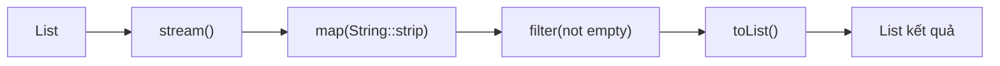
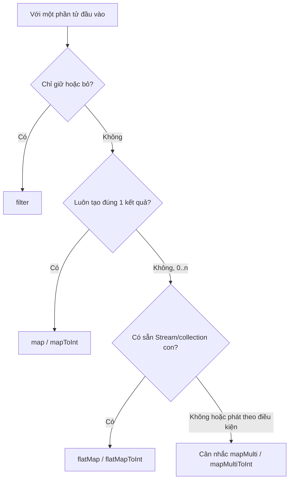

# Map, filter, flatMap và mapMulti

Trong Java 27, **Stream API** cho phép mô tả luồng biến đổi dữ liệu bằng một chuỗi thao tác: chọn phần tử cần giữ, biến đổi từng giá trị, trải phẳng những cấu trúc lồng nhau rồi tổng hợp kết quả. Bốn thao tác **`map`, `filter`, `flatMap` và `mapMulti`** có những vai trò khác nhau nhưng thường xuất hiện cùng nhau trong một pipeline.

Câu hỏi quan trọng khi chọn thao tác là: **mỗi phần tử đầu vào tạo ra bao nhiêu phần tử đầu ra?**

| Thao tác | Ý nghĩa | Số phần tử tạo ra cho một đầu vào | Kiểu hàm nhận vào |
|---|---|---|---|
| `map` | Biến đổi một phần tử thành một giá trị khác | Đúng 1 (có thể là `null` nếu mapper trả `null`) | `Function<T, R>` |
| `filter` | Chỉ giữ phần tử thỏa điều kiện | 0 hoặc 1 | `Predicate<T>` |
| `flatMap` | Biến phần tử thành một Stream và nối các Stream con | 0, 1 hoặc nhiều | `Function<T, Stream<R>>` |
| `mapMulti` | Chủ động phát ra 0, 1 hoặc nhiều giá trị qua consumer | 0, 1 hoặc nhiều | `BiConsumer<T, Consumer<R>>` về mặt ý tưởng |

Với `mapMulti`, chữ ký tổng quát thực tế của `Stream` có wildcard, nhưng ý tưởng rất dễ nhớ: **nhận một phần tử và một đầu ra `Consumer`; gọi `accept` bao nhiêu lần thì phát ra bấy nhiêu giá trị**.

`mapMulti` được đưa vào Java từ phiên bản 16; các thao tác còn lại đã là thành phần ổn định của Stream API từ lâu. Bài này chỉ sử dụng những API đã ổn định và vẫn áp dụng cho Java 27, không cần tính năng preview.

## 1. Nền tảng: nguồn dữ liệu, thao tác trung gian, thao tác kết thúc

Ví dụ ngắn:

```java
import java.util.List;

List<String> names = List.of(" An ", "", "Bình", "   ", "Chi");

List<String> cleaned = names.stream()
        .map(String::strip)
        .filter(name -> !name.isEmpty())
        .toList();

System.out.println(cleaned); // [An, Bình, Chi]
```

Pipeline có ba phần:

1. **Nguồn:** `names.stream()` tạo Stream với phần tử từ danh sách.
2. **Thao tác trung gian (*intermediate operations*):** `map` và `filter` mô tả các biến đổi. Chúng thường **lazy**: mới khai báo pipeline chưa có nghĩa đã duyệt toàn bộ nguồn.
3. **Thao tác kết thúc (*terminal operation*):** `toList()` kích hoạt quá trình tiêu thụ Stream và thu kết quả.

Sơ đồ:



Một Stream **không phải** là collection lưu dữ liệu mới ở mỗi bước. Nó biểu diễn phép tính trên nguồn; quá trình chạy thường xử lý tuần tự theo từng phần tử và hợp nhất các bước khi terminal operation yêu cầu. Không nên giả định mỗi thao tác trung gian tạo ngay một danh sách trung gian.

### Chú ý về kết quả `toList()`

`Stream.toList()` trả về danh sách **không thể sửa qua các thao tác cập nhật của `List`**. Nếu cần danh sách mutable, tạo bản sao rõ ràng:

```java
var editable = new java.util.ArrayList<>(cleaned);
editable.add("Dũng");
```

Ngược lại, `Collectors.toList()` không bảo đảm cụ thể kiểu triển khai, khả năng chỉnh sửa hay tính thread-safe của kết quả. Hãy chọn API dựa trên hợp đồng mong muốn, không dựa vào chi tiết tình cờ của một phiên bản JDK.

## 2. Ví dụ xuyên suốt: xử lý các đơn hàng

Ta sẽ dùng một mô hình dữ liệu nhỏ, hợp lệ với Java 27: đơn hàng có trạng thái thanh toán và danh sách dòng hàng. Một dòng hàng có mã sản phẩm và số lượng.

Đoạn dưới đây là ví dụ **độc lập, có thể biên dịch và chạy**. Lưu vào `StreamTransformDemo.java`:

```java
import java.util.List;
import java.util.Objects;

public class StreamTransformDemo {
    record Line(String sku, int units) {
        Line {
            Objects.requireNonNull(sku, "sku");
            if (sku.isBlank()) {
                throw new IllegalArgumentException("sku không được rỗng");
            }
            if (units <= 0) {
                throw new IllegalArgumentException("units phải dương");
            }
        }
    }

    record Order(String id, boolean paid, List<Line> lines) {
        Order {
            Objects.requireNonNull(id, "id");
            Objects.requireNonNull(lines, "lines");
            lines = List.copyOf(lines);
        }
    }

    public static void main(String[] args) {
        List<Order> orders = List.of(
                new Order("A1", true, List.of(
                        new Line("book", 2),
                        new Line("sticker", 2),
                        new Line("pen", 1))),
                new Order("A2", false, List.of(
                        new Line("eraser", 5))),
                new Order("A3", true, List.of(
                        new Line("notebook", 3)))
        );

        List<String> paidIds = orders.stream()
                .filter(Order::paid)
                .map(Order::id)
                .toList();

        List<String> paidSkus = orders.stream()
                .filter(Order::paid)
                .flatMap(order -> order.lines().stream())
                .map(Line::sku)
                .toList();

        List<String> bulkSkus = orders.stream()
                .filter(Order::paid)
                .<String>mapMulti((order, out) -> {
                    for (Line line : order.lines()) {
                        if (line.units() >= 2) {
                            out.accept(line.sku());
                        }
                    }
                })
                .toList();

        int totalUnits = orders.stream()
                .filter(Order::paid)
                .flatMap(order -> order.lines().stream())
                .mapToInt(Line::units)
                .sum();

        System.out.println("paidIds = " + paidIds);
        System.out.println("paidSkus = " + paidSkus);
        System.out.println("bulkSkus = " + bulkSkus);
        System.out.println("totalUnits = " + totalUnits);
    }
}
```

Biên dịch và chạy bằng JDK 27:

```bash
javac --release 27 StreamTransformDemo.java
java StreamTransformDemo
```

Kết quả:

```text
paidIds = [A1, A3]
paidSkus = [book, sticker, pen, notebook]
bulkSkus = [book, sticker, notebook]
totalUnits = 8
```

Bốn câu truy vấn biểu thị bốn ý định:

- `filter(Order::paid)`: chỉ giữ những đơn đã thanh toán.
- `map(Order::id)`: từ **một đơn** lấy **một mã đơn**.
- `flatMap(order -> order.lines().stream())`: từ **một đơn** lấy ra **nhiều dòng hàng**.
- `mapMulti(...)`: từ **một đơn** phát ra **những mã sản phẩm có số lượng đạt ngưỡng** mà không phải tạo một Stream con cho từng đơn.

Hai record kiểm tra bất biến ở constructor để ví dụ không phải phòng vệ liên tục với `null` hoặc số lượng âm. `List.copyOf(lines)` bảo vệ cấu trúc danh sách khỏi việc sửa trực tiếp sau khi tạo `Order`; tuy nhiên bản sao này là **shallow copy** đối với phần tử tham chiếu.

## 3. `map`: một giá trị đầu vào thành một giá trị đầu ra

Chữ ký cơ bản:

```java
<R> Stream<R> map(Function<? super T, ? extends R> mapper)
```

`map` nhận một hàm biến đổi và áp dụng hàm đó cho từng phần tử được tiêu thụ từ upstream. Nếu đầu vào có `n` phần tử và pipeline chạy hết, `map` tạo tương ứng `n` kết quả (một kết quả cho mỗi đầu vào); nó **không tự loại phần tử**.

Ví dụ:

```java
List<String> ids = orders.stream()
        .map(Order::id)
        .toList();
```

Kiểu dữ liệu của pipeline:

```text
Stream<Order>
    -- map(Order::id) -->
Stream<String>
    -- toList() -->
List<String>
```

`map` có thể biến đổi kiểu:

```java
record Product(String sku, int price) { }

List<Product> products = List.of(
        new Product("book", 70_000),
        new Product("pen", 5_000)
);

List<Integer> prices = products.stream()
        .map(Product::price)
        .toList(); // [70000, 5000]
```

Nếu đầu ra là giá trị số và tiếp theo cần tính tổng, `mapToInt` có thể giảm nhu cầu boxing so với `map` ra `Integer`:

```java
int totalPrice = products.stream()
        .mapToInt(Product::price)
        .sum(); // 75000
```

`map` cũng có thể đổi một chuỗi thành dạng chuẩn hóa:

```java
List<String> normalized = List.of("  Java  ", " STREAM ")
        .stream()
        .map(String::strip)
        .map(String::toLowerCase)
        .toList(); // [java, stream]
```

Nếu quy tắc chuẩn hóa chữ cần kết quả độc lập locale, hãy dùng overload có `Locale.ROOT` khi cần. Đây là quyết định nghiệp vụ, không phải thuộc tính tự động của `map`.

### `map` không phải `flatMap`

Nếu từ một đơn hàng, mapper trả về **cả danh sách dòng hàng**, ta sẽ có một Stream chứa **những danh sách**:

```java
Stream<List<Line>> nested = orders.stream()
        .map(Order::lines);
```

`Stream<List<Line>>` **khác** `Stream<Line>`. Nếu cần mỗi dòng hàng trở thành một phần tử riêng của pipeline, `flatMap` hoặc `mapMulti` sẽ phù hợp hơn.

## 4. `filter`: giữ lại phần tử đạt điều kiện

Chữ ký:

```java
Stream<T> filter(Predicate<? super T> predicate)
```

`filter` không thay đổi kiểu phần tử. Với mỗi phần tử được kiểm tra, nếu predicate trả `true` thì phần tử đi tiếp; ngược lại, phần tử bị bỏ khỏi pipeline.

```java
List<Order> paidOrders = orders.stream()
        .filter(Order::paid)
        .toList();
```

Có thể kết hợp nhiều điều kiện:

```java
List<Line> largeLines = orders.stream()
        .flatMap(order -> order.lines().stream())
        .filter(line -> line.units() >= 2)
        .toList();
```

Hai kiểu viết sau tương đương về điều kiện logic khi các predicate không có side effect:

```java
.filter(order -> order.paid() && !order.lines().isEmpty())

// Hoặc:
.filter(Order::paid)
.filter(order -> !order.lines().isEmpty())
```

Tách thành các `filter` riêng có thể dễ đọc hơn khi quy tắc nghiệp vụ có tên rõ ràng; hợp nhất có thể phù hợp nếu điều kiện ngắn và cùng một khái niệm.

### Thứ tự `filter` và `map`

Lọc sớm có thể tránh tạo kết quả chuyển đổi không cần thiết:

```java
orders.stream()
        .filter(Order::paid)
        .map(Order::id)
        .toList();
```

Không phải lúc nào hoán đổi hai thao tác cũng giữ nguyên ý nghĩa:

- Nếu lọc theo thuộc tính của **đơn hàng**, hãy `filter` trước khi `map` sang mã đơn.
- Nếu lọc theo kết quả **đã chuẩn hóa**, thường phải `map` trước rồi mới `filter`.
- Nếu mapper/predicate có side effect hoặc có thể ném exception, thay đổi thứ tự có thể thay đổi hành vi. Hãy tránh side effect trong intermediate operations.

`filter` không phải phép kiểm tra/ép kiểu tổng quát. Ví dụ lọc bằng `instanceof String` rồi ép kiểu trong `map` đôi khi hợp lệ, nhưng hãy ưu tiên API kiểu rõ ràng và các pattern của Java khi mô hình cần phân loại biến thể.

## 5. `flatMap`: ánh xạ sang Stream và trải phẳng một cấp

Chữ ký cho `Stream<T>`:

```java
<R> Stream<R> flatMap(
        Function<? super T, ? extends Stream<? extends R>> mapper)
```

Mapper của `flatMap` trả về **một Stream con** cho từng phần tử upstream. `flatMap` nối nội dung các Stream con thành một pipeline kết quả. Số phần tử tạo ra từ một đầu vào có thể là **0, 1 hoặc nhiều**.

Ví dụ cần lấy mọi mã sản phẩm từ các đơn:

```java
List<String> allSkus = orders.stream()
        .flatMap(order -> order.lines().stream())
        .map(Line::sku)
        .toList();
```

So sánh trực quan:

```text
Order A1 -> [book, sticker, pen]
Order A2 -> [eraser]
Order A3 -> [notebook]

map(Order::lines):
    Stream<List<Line>>
    [[book, sticker, pen], [eraser], [notebook]]

flatMap(order -> order.lines().stream()):
    Stream<Line>
    [book, sticker, pen, eraser, notebook]
```

`flatMap` **trải phẳng một cấp tại nơi áp dụng**, không phải một lời gọi tự động đệ quy qua mọi lớp lồng nhau. Với `List<List<List<String>>>`, có thể cần hai phép `flatMap` để tạo `Stream<String>`.

### Một đầu vào không tạo phần tử nào

`flatMap` có thể trả `Stream.empty()`:

```java
List<String> selected = orders.stream()
        .flatMap(order -> order.paid()
                ? Stream.of(order.id())
                : Stream.<String>empty())
        .toList();
```

Đoạn này hợp lệ nhưng trong trường hợp chỉ chọn hoặc loại một đơn rồi lấy mã, `filter` + `map` thường rõ ràng hơn:

```java
List<String> selected = orders.stream()
        .filter(Order::paid)
        .map(Order::id)
        .toList();
```

Dùng `flatMap` khi bản chất mỗi phần tử **thực sự chứa hoặc tạo ra một tập kết quả**: danh sách thành phần, các dòng sự kiện, các phần tử phân rã, v.v.

### Kết hợp với `Optional.stream()`

Một mapper có thể trả `Optional<T>` cho trường hợp có hoặc không có giá trị. Từ Java 9, `Optional.stream()` cho phép đưa giá trị hiện diện vào Stream và bỏ qua trường hợp rỗng:

```java
import java.util.List;
import java.util.Optional;

public class OptionalParsingDemo {
    public static void main(String[] args) {
        List<Integer> numbers = List.of("10", "-4", "x", "25")
                .stream()
                .map(OptionalParsingDemo::parseNonNegative)
                .flatMap(Optional::stream)
                .toList();

        System.out.println(numbers); // [10, 25]
    }

    static Optional<Integer> parseNonNegative(String value) {
        try {
            int number = Integer.parseInt(value);
            return number >= 0 ? Optional.of(number) : Optional.empty();
        } catch (NumberFormatException ignored) {
            return Optional.empty();
        }
    }
}
```

Ví dụ này độc lập với `StreamTransformDemo`; lưu vào `OptionalParsingDemo.java` nếu muốn biên dịch riêng. Mỗi `Optional.empty()` trở thành Stream rỗng, còn mỗi `Optional.of(number)` tạo một phần tử trong kết quả.

**Lưu ý:** `Optional.empty()` biểu thị không có giá trị. Nếu dữ liệu không hợp lệ là **lỗi cần báo ra**, đừng âm thầm đổi mọi lỗi thành Optional rỗng; chọn cách báo lỗi rõ ràng theo hợp đồng.

### Vòng đời Stream con

Theo hợp đồng `flatMap`, các Stream được mapper trả về sẽ được **đóng sau khi nội dung của chúng được đưa vào pipeline**. Không nên giữ hoặc tái sử dụng các Stream con đó ở nơi khác. Với nguồn chứa tài nguyên I/O, đóng Stream tổng đúng cách (ví dụ bằng `try`-with-resources) vẫn là trách nhiệm quan trọng của người gọi; việc tạo một Stream không có nghĩa tài nguyên tự động đóng ở mọi trường hợp.

## 6. `mapMulti`: phát trực tiếp nhiều giá trị từ một phần tử

`mapMulti` là thao tác trung gian có thể phát ra **không, một hoặc nhiều giá trị** từ mỗi phần tử đầu vào, tương tự `flatMap` về số lượng đầu ra. Khác biệt nằm ở cách viết mapper:

```java
<R> Stream<R> mapMulti(
        BiConsumer<? super T, ? super Consumer<R>> mapper)
```

Ở mỗi lời gọi mapper, tham số thứ nhất là giá trị đầu vào; tham số thứ hai là một `Consumer<R>` để phát giá trị đầu ra. Gọi `out.accept(value)` một lần thì phát một giá trị. Không gọi `accept` thì không phát giá trị; gọi nhiều lần thì tạo nhiều giá trị.

Ví dụ chỉ phát mã sản phẩm có số lượng ít nhất 2:

```java
List<String> bulkSkus = orders.stream()
        .filter(Order::paid)
        .<String>mapMulti((order, out) -> {
            for (Line line : order.lines()) {
                if (line.units() >= 2) {
                    out.accept(line.sku());
                }
            }
        })
        .toList();
```

Với một đơn có ba dòng, mapper có thể gọi `accept` hai lần; đơn khác không có dòng đạt điều kiện có thể không phát giá trị nào.

### So sánh trực tiếp với `flatMap`

Hai pipeline sau có cùng kết quả trên dữ liệu hợp lệ ở phần 2.

**Cách dùng `flatMap`:**

```java
List<String> result = orders.stream()
        .filter(Order::paid)
        .flatMap(order -> order.lines().stream()
                .filter(line -> line.units() >= 2)
                .map(Line::sku))
        .toList();
```

**Cách dùng `mapMulti`:**

```java
List<String> result = orders.stream()
        .filter(Order::paid)
        .<String>mapMulti((order, out) -> {
            for (Line line : order.lines()) {
                if (line.units() >= 2) {
                    out.accept(line.sku());
                }
            }
        })
        .toList();
```

`flatMap` diễn đạt “một phần tử trở thành một Stream con”, rồi dùng thêm các thao tác Stream trên từng Stream con. `mapMulti` diễn đạt “một phần tử chủ động phát một số giá trị qua consumer”; không cần tạo Stream con trong mã ứng dụng.

`mapMulti` thường hữu ích khi từ mỗi phần tử có **rất ít hoặc không có** kết quả, hoặc thao tác phát kết quả gồm nhiều nhánh điều kiện. Đây không phải bảo đảm hiệu năng tuyệt đối: cách thực hiện mặc định của `mapMulti` trong một số implementation có thể sử dụng bộ đệm trung gian. Hãy đo trên workload thật nếu hiệu năng là lý do chính.

### Ví dụ nhóm từ khóa: số lượng đầu ra thay đổi

```java
List<List<String>> groups = List.of(
        List.of("java", "stream"),
        List.of(),
        List.of("map", "filter", "flatMap")
);

List<String> words = groups.stream()
        .<String>mapMulti((group, out) -> {
            for (String word : group) {
                out.accept(word);
            }
        })
        .toList();

System.out.println(words);
// [java, stream, map, filter, flatMap]
```

Một nhóm rỗng phát 0 phần tử, nhóm thứ nhất phát 2, nhóm thứ ba phát 3. Tuy nhiên, với mục tiêu **chỉ trải phẳng list lồng nhau**, `groups.stream().flatMap(List::stream)` ngắn gọn hơn và thường dễ đọc hơn.

### Không giữ lại consumer cho lần sử dụng sau

Consumer được truyền vào mapper của `mapMulti` **chỉ được sử dụng trong thời gian mapper đang được gọi**. Không lưu `out` vào field hoặc collection để gọi `accept` từ tác vụ chạy sau, không gửi nó vào callback bất đồng bộ. `mapMulti` không phải một cơ chế publish/subscribe hay event emitter có vòng đời độc lập với Stream.

## 7. Suy luận kiểu và pattern matching với `mapMulti`

Kiểu `R` của `mapMulti` có thể không được compiler suy luận như bạn muốn khi lambda không có kiểu rõ ràng. Cú pháp **type witness** giúp xác định kiểu kết quả:

```java
List<String> ids = orders.stream()
        .<String>mapMulti((order, out) -> {
            if (order.paid()) {
                out.accept(order.id());
            }
        })
        .toList();
```

`.<String>mapMulti` chỉ rõ Stream đầu ra là `Stream<String>`. Nếu thiếu thông tin này trong một số chuỗi biểu thức, compiler có thể suy luận kiểu quá rộng như `Object`, dẫn đến lỗi khi gán vào `List<String>` hoặc gọi phương thức dành riêng cho `String`.

Một cách khác là khai báo kiểu của các tham số lambda:

```java
List<String> ids = orders.stream()
        .mapMulti((Order order, java.util.function.Consumer<String> out) -> {
            if (order.paid()) {
                out.accept(order.id());
            }
        })
        .toList();
```

Không cần dùng cả hai kỹ thuật khi compiler đã suy luận đúng; chọn cách rõ ràng và phù hợp với quy ước dự án.

### Lọc theo kiểu và phát giá trị đã được kiểm tra

`mapMulti` kết hợp được với pattern matching for `instanceof`:

```java
List<Object> values = List.of("Java", 42, "  ", "Stream", 3.14);

List<String> words = values.stream()
        .<String>mapMulti((value, out) -> {
            if (value instanceof String word && !word.isBlank()) {
                out.accept(word);
            }
        })
        .toList();

System.out.println(words); // [Java, Stream]
```

Đoạn này trích đúng các chuỗi có nội dung từ nguồn hỗn hợp mà không cần cast thủ công. Trong ứng dụng thực tế, mô hình dữ liệu có kiểu rõ ràng vẫn nên được ưu tiên hơn lưu nhiều kiểu tùy ý trong `List<Object>`.

## 8. Primitive Stream: `mapToInt`, `flatMapToInt` và `mapMultiToInt`

Khi cần tính tổng, trung bình hay thống kê dữ liệu số, Stream có các biến thể primitive: `IntStream`, `LongStream` và `DoubleStream`. Chúng giúp giảm boxing/unboxing so với việc đưa mọi số qua wrapper như `Integer`.

| Mục tiêu | API | Kết quả |
|---|---|---|
| Một đầu vào `T` thành đúng một `int` | `mapToInt(ToIntFunction<T>)` | `IntStream` |
| Một `T` thành một Stream con chứa 0..n `int` | `flatMapToInt(...)` | `IntStream` |
| Một `T` phát 0..n `int` qua `IntConsumer` | `mapMultiToInt(...)` | `IntStream` |
| Cộng các giá trị | `IntStream.sum()` | `int` |
| Lấy thống kê tổng hợp | `IntStream.summaryStatistics()` | `IntSummaryStatistics` |

Từ ví dụ đơn hàng, có thể dùng `flatMap` và `mapToInt`:

```java
int totalUnits = orders.stream()
        .filter(Order::paid)
        .flatMap(order -> order.lines().stream())
        .mapToInt(Line::units)
        .sum();
```

Hoặc phát trực tiếp các số nguyên bằng `mapMultiToInt`:

```java
int totalUnits = orders.stream()
        .filter(Order::paid)
        .mapMultiToInt((order, out) -> {
            for (Line line : order.lines()) {
                out.accept(line.units());
            }
        })
        .sum();
```

`mapMultiToInt` trả về `IntStream`; tương tự có `mapMultiToLong` và `mapMultiToDouble`. Không cần tạo `Stream<Integer>` trước khi cộng.

**Chú ý tràn số:** `IntStream.sum()` trả về `int`. Với số lượng có thể rất lớn, có thể chuyển sang `long` bằng `mapToLong`, nhưng `long` cũng có giới hạn. Khi yêu cầu phát hiện tràn số bắt buộc, cần chọn phép cộng có kiểm tra tràn hoặc kiểu số phù hợp. Ví dụ này tính **đơn vị sản phẩm**, không phải số tiền; hệ thống tiền tệ không nên dùng `double` khi cần tính chính xác thập phân.

## 9. Lazy evaluation, short-circuit và Stream dùng một lần

`map`, `filter`, `flatMap` và `mapMulti` đều là **intermediate operations**: bản thân việc ghép pipeline không chạy toàn bộ nguồn.

```java
List<String> source = List.of("java", "stream");

var pipeline = source.stream()
        .map(String::toUpperCase)
        .filter(word -> word.length() > 4);

// Chưa có terminal operation.
List<String> result = pipeline.toList();
System.out.println(result); // [STREAM]
```

Các terminal operations ngắt sớm như `anyMatch`, `findFirst` hoặc `limit` trong pipeline có thể chỉ cần tiêu thụ một phần nguồn:

```java
boolean hasLargeLine = orders.stream()
        .filter(Order::paid)
        .flatMap(order -> order.lines().stream())
        .anyMatch(line -> line.units() >= 3);
```

`anyMatch` có thể dừng khi đã tìm được dòng phù hợp; không nhất thiết xử lý toàn bộ danh sách đơn hàng.

### Không dựa vào side effect của phép biến đổi

Stream được phép thực hiện các tối ưu không làm thay đổi kết quả quan sát được theo hợp đồng. Một pipeline chỉ dùng `map` rồi `count()` trên nguồn có kích thước biết trước có thể được tối ưu để không cần gọi mapper:

```java
long count = List.of("a", "b", "c").stream()
        .map(s -> {
            // Không được dựa vào việc dòng này luôn chạy!
            System.out.println("mapping " + s);
            return s.toUpperCase();
        })
        .count();

System.out.println(count); // 3
```

Vì `map` không làm thay đổi số lượng phần tử, trong trường hợp này việc đếm có thể không phải thực hiện phép biến đổi. Không đặt thao tác ghi database, gửi email, cập nhật trạng thái hay kiểm tra bảo mật **bắt buộc xảy ra** trong `map`/`filter`/`flatMap`.

### Không tái sử dụng một Stream đã tiêu thụ

```java
var stream = orders.stream();

long count = stream.count();
// stream.map(Order::id).toList(); // Sai: stream đã tiêu thụ.
```

Muốn truy vấn khác, hãy tạo Stream mới từ nguồn có thể duyệt lại:

```java
long count = orders.stream().count();
List<String> ids = orders.stream().map(Order::id).toList();
```

Stream gắn với tài nguyên I/O có thể không thể tạo lại tùy ý; cần xét vòng đời và khả năng đọc lại của nguồn.

## 10. Encounter order, stateful operations và nguyên tắc non-interference

Với nguồn `List` có thứ tự và stream tuần tự, những thao tác như `map`, `filter`, `flatMap` và `mapMulti` bảo toàn thứ tự gặp phù hợp với hợp đồng Stream. Các giá trị được mapper của `mapMulti` phát từ một phần tử xuất hiện theo trình tự `accept` tương ứng.

Tuy nhiên, các thao tác như `sorted`, `distinct` hoặc `limit` thay đổi thứ tự, số lượng hoặc cách tiêu thụ dữ liệu. `sorted` và `distinct` là những intermediate operations **có trạng thái** (*stateful*), có thể cần giữ dữ liệu trung gian.

```java
List<String> sortedSkus = orders.stream()
        .filter(Order::paid)
        .flatMap(order -> order.lines().stream())
        .map(Line::sku)
        .distinct()
        .sorted()
        .toList();
```

Ở đây `distinct` loại trùng theo `equals`, `sorted` xếp theo thứ tự tự nhiên của `String`. Khi kết quả gửi ra người dùng hoặc dịch vụ khác, cần thống nhất có muốn giữ encounter order hay sắp xếp lại.

### Không sửa nguồn trong lúc thực thi Stream

Các hàm dùng trong Stream nói chung cần **non-interfering** (không làm thay đổi nguồn dữ liệu đang stream) và **stateless** (không phụ thuộc trạng thái mutable giữa các phần tử).

Ví dụ cần tránh:

```java
List<String> names = new java.util.ArrayList<>(
        List.of("An", "Bình", "Chi")
);

// Không đúng:
// names.stream().map(name -> {
//     names.add(name + "!"); // sửa nguồn đang được duyệt
//     return name;
// }).toList();
```

Việc sửa cấu trúc của collection nguồn từ mapper có thể gây lỗi hoặc kết quả không đáng tin cậy. Hãy tạo collection kết quả riêng, hoặc dùng vòng lặp có chủ đích nếu cần cập nhật trạng thái.

Khi cần tổng hợp, ưu tiên `sum`, `reduce` hoặc `collect` phù hợp thay vì thay đổi một biến đếm/list mutable dùng chung trong lambda; đặc biệt nếu định dùng parallel streams.

## 11. `null`, dữ liệu rỗng và lỗi trong mapper

Cách mỗi toán tử xử lý `null` là một điểm dễ nhầm.

| Trường hợp | Hành vi quan trọng |
|---|---|
| `map` trả về `null` | `null` có thể tiếp tục là một phần tử của Stream nếu các thao tác downstream chấp nhận |
| `filter` gặp phần tử `null` | Predicate phải tự xử lý null nếu nguồn có thể chứa null |
| Mapper của `flatMap` trả **Stream null** | Được xử lý như một Stream rỗng theo hợp đồng `Stream.flatMap` |
| Stream con của `flatMap` chứa phần tử `null` | Phần tử null không tự động bị loại |
| `mapMulti` phát `out.accept(null)` | Có thể đưa giá trị null xuống downstream; không nên làm nếu miền không chấp nhận null |
| `Stream.toList()` | Danh sách kết quả không thể sửa; đừng giả định nó kiểm tra và loại null |
| `List.copyOf(...)` và `List.of(...)` | Từ chối phần tử null; không tương đương `Stream.toList()` |

Nếu miền dữ liệu quy định “không có null”, nên kiểm tra tại ranh giới hoặc lọc rõ ràng trước khi gọi các phương thức như `String::strip`:

```java
import java.util.ArrayList;
import java.util.Objects;

List<String> raw = new ArrayList<>();
raw.add(" Java ");
raw.add(null);
raw.add(" Stream ");

List<String> normalized = raw.stream()
        .filter(Objects::nonNull)
        .map(String::strip)
        .filter(s -> !s.isEmpty())
        .toList();

System.out.println(normalized); // [Java, Stream]
```

`List.of` không thích hợp để dựng `raw` ở ví dụ này, vì nó cấm chứa null. Các nguồn bất biến và API mới nên ưu tiên ngăn null từ đầu thay vì đưa giá trị không rõ nghĩa sâu vào pipeline.

### Không dùng `flatMap` trả `null` như quy ước của ứng dụng

Hợp đồng `flatMap` cho phép mapper trả Stream null và xem đó như Stream rỗng, nhưng cách viết rõ hơn là `Stream.empty()`:

```java
Stream<String> words = Stream.of("A B", "", "C")
        .flatMap(s -> s.isBlank()
                ? Stream.<String>empty()
                : java.util.Arrays.stream(s.split(" ")));
```

Khi mỗi phần tử chỉ tạo 0 hoặc 1 giá trị, `filter` + `map` thường đơn giản hơn. Khi dữ liệu bị lỗi, hãy dùng exception hoặc một kiểu kết quả rõ ràng thay vì “nuốt” lỗi bằng Stream rỗng nếu bên gọi cần biết thao tác thất bại.

## 12. Nguồn I/O: xử lý lazy nhưng vẫn phải đóng tài nguyên

Stream trên `List` hay mảng thường không nắm giữ tài nguyên ngoài. Ngược lại, một số Stream từ file, socket hoặc dịch vụ dữ liệu **cần đóng**.

Ví dụ phân tích các từ trong file:

```java
import java.io.IOException;
import java.nio.file.Files;
import java.nio.file.Path;
import java.util.Arrays;
import java.util.List;
import java.util.Locale;

public class FileWords {
    public static List<String> readWords(Path path) throws IOException {
        try (var lines = Files.lines(path)) {
            return lines
                    .flatMap(line -> Arrays.stream(line.split("\\s+")))
                    .map(word -> word.toLowerCase(Locale.ROOT))
                    .filter(word -> !word.isBlank())
                    .toList();
        }
    }
}
```

`Files.lines(path)` tạo một Stream lazily đọc nội dung file. Khối `try`-with-resources bảo đảm đóng Stream, kể cả khi terminal operation hoàn tất hoặc phát sinh exception. Lưu kết quả đã được materialize bằng `toList()` bên trong khối `try` giúp không trả một pipeline còn gắn với file đã đóng.

Nếu dữ liệu quá lớn để lưu hết trong bộ nhớ, đừng mặc định dùng `toList()`. Có thể thiết kế thuật toán reduction/aggregation thích hợp hoặc xử lý theo từng phần.

**Phân biệt:** `flatMap` đóng các Stream con do mapper tạo ra sau khi sử dụng; điều đó **không** thay thế trách nhiệm đóng Stream **nguồn** có tài nguyên, cũng không bảo đảm mọi nguồn I/O được quản lý đúng chỉ nhờ gọi terminal operation.

## 13. `flatMap` hay `mapMulti`: chọn theo hình dạng dữ liệu, không theo trào lưu

Hai toán tử này đều diễn đạt phép biến đổi **0..n**, nhưng có mức độ thuận tiện khác nhau:

| Tiêu chí | `flatMap` | `mapMulti` |
|---|---|---|
| Mapper trả gì? | Một `Stream<R>` | Gọi `Consumer<R>.accept` nhiều lần |
| Trải phẳng `List<List<T>>` | Rất ngắn: `flatMap(List::stream)` | Cần lambda/vòng lặp |
| Một input phát 0 hoặc vài output theo nhiều điều kiện | Có thể viết, thường cần Stream con | Rất trực tiếp bằng `if` + `accept` |
| Trích xuất nested cấu trúc có điều kiện | Dùng pipeline lồng | Có thể dùng vòng lặp, pattern và guard |
| Primitive specialization | `flatMapToInt`, `flatMapToLong`, `flatMapToDouble` | `mapMultiToInt`, `mapMultiToLong`, `mapMultiToDouble` |
| Kiểu generic | Thường suy luận tốt từ Stream con | Đôi khi cần type witness `.<R>mapMulti` |
| Hiệu năng | Phụ thuộc mapper, nguồn và pipeline | Có thể tránh tạo nhiều Stream con trong mã ứng dụng; cần benchmark |
| Tính rõ ràng | Mạnh khi dữ liệu tự nhiên là các Stream/con collection | Mạnh khi cần tự quyết định lúc nào phát giá trị |

### Khi nào `map` + `filter` đủ tốt?

Đừng viết `flatMap` hay `mapMulti` chỉ để loại bỏ một phần tử duy nhất:

```java
List<String> paidIds = orders.stream()
        .filter(Order::paid)
        .map(Order::id)
        .toList();
```

Cách này truyền đạt rõ: kiểm tra một điều kiện, rồi biến đổi một đối tượng thành một kết quả.

### Khi nào `flatMap` là lựa chọn tự nhiên?

```java
List<String> allSkus = orders.stream()
        .flatMap(order -> order.lines().stream())
        .map(Line::sku)
        .toList();
```

Mỗi đơn chứa một collection các dòng; việc trải phẳng là trực tiếp và dễ đọc.

### Khi nào `mapMulti` đáng cân nhắc?

```java
List<String> importantSkus = orders.stream()
        .<String>mapMulti((order, out) -> {
            if (!order.paid()) {
                return;
            }
            for (Line line : order.lines()) {
                if (line.units() >= 2) {
                    out.accept(line.sku());
                }
            }
        })
        .toList();
```

Ở đây mỗi đơn có thể phát không, một hoặc nhiều mã theo quy tắc nghiệp vụ. `mapMulti` giữ toàn bộ quyết định phát trong cùng một mapper mà không cần tạo Stream con.

Nếu logic trở nên dài với nhiều cấp lồng nhau, hãy tách helper method có tên rõ, hoặc dùng vòng lặp thông thường. Stream API là công cụ tăng khả năng diễn đạt, không phải lý do biến mọi thuật toán thành lambda phức tạp.

## 14. Đừng hiểu Stream là giải pháp tự động cho parallelism

`stream()` tạo pipeline tuần tự theo mặc định. `parallelStream()` hoặc `parallel()` cho phép xử lý song song theo hợp đồng Stream, nhưng không có nghĩa chương trình luôn nhanh hơn.

```java
List<String> ids = orders.parallelStream()
        .filter(Order::paid)
        .map(Order::id)
        .toList();
```

Với nguồn `List` có encounter order, `toList()` của ordered stream giữ encounter order của kết quả. Nhưng số lượng task, thứ tự gọi lambda trên thread, timing và chi phí điều phối **không** được dùng làm cơ sở cho logic nghiệp vụ.

Những điều cần cân nhắc:

- `map`, `filter`, `flatMap` và `mapMulti` cần mapper không can thiệp nguồn và, trong đa số trường hợp, không giữ trạng thái giữa các phần tử.
- Một biến `ArrayList` hoặc `HashMap` dùng chung và bị cập nhật từ nhiều lambda có thể gây race condition.
- `forEach` trên parallel stream không bảo đảm thứ tự thực thi; `forEachOrdered` bảo đảm encounter order cho phần tử được action xử lý theo hợp đồng, nhưng không biến side effect bất kỳ thành thread-safe.
- Các thao tác stateful như `distinct` hoặc `sorted` có thể đòi hỏi đồng bộ hoặc giữ dữ liệu trung gian, làm thay đổi hiệu năng.
- Các tập dữ liệu nhỏ hoặc mapper nhẹ thường không bù được chi phí song song.
- I/O blocking, giới hạn kết nối và thứ tự nghiệp vụ cần cách thiết kế riêng, không nên thêm `parallel()` một cách máy móc.

Ưu tiên pipeline tuần tự dễ kiểm chứng trước. Khi nghi ngờ cần song song, dùng benchmark đại diện và kiểm tra các ràng buộc tài nguyên, tác dụng phụ và kết quả có thứ tự.

## 15. Kiểm thử theo cardinality, dữ liệu biên và side effect

Một bài kiểm thử cho Stream cần kiểm tra cả **số lượng và thứ tự kết quả**, không chỉ kết quả có phần tử mong muốn.

| Input | Toán tử | Kết quả mong đợi |
|---|---|---|
| `["a", "b"]` | `map(String::toUpperCase)` | `["A", "B"]` (2 → 2) |
| `[1, 2, 3, 4]` | `filter(n -> n % 2 == 0)` | `[2, 4]` (4 → 2) |
| `[[], ["x", "y"], ["z"]]` | `flatMap(List::stream)` | `["x", "y", "z"]` (3 nhóm → 3 giá trị) |
| `[[], ["x", "y"], ["z"]]` | `mapMulti` phát từng phần tử | `["x", "y", "z"]` |
| Đơn chưa thanh toán | `filter(Order::paid)` | Bị loại khỏi pipeline |
| Đơn đã thanh toán có 0 dòng | `flatMap(Order::lines)` hoặc `mapMulti` | Không phát dòng nào |
| Dòng hàng có `units == 1` | `mapMulti` với ngưỡng ≥ 2 | Không phát SKU |
| Dòng hàng có `units == 2` | `mapMulti` với ngưỡng ≥ 2 | Phát đúng 1 SKU |
| Nguồn rỗng | Cả bốn thao tác + `toList()` | Danh sách rỗng |
| Nguồn có null | `map(String::strip)` | Cần xử lý null trước, nếu không có thể NPE |

**Cách viết kiểm tra đơn giản:** dùng lại các record trong `StreamTransformDemo`, có thể thêm phương thức test hoặc dùng framework kiểm thử được dự án chuẩn hóa:

```java
static void verifySkuMapping(List<Order> orders) {
    List<String> skus = orders.stream()
            .filter(Order::paid)
            .<String>mapMulti((order, out) -> {
                for (Line line : order.lines()) {
                    if (line.units() >= 2) {
                        out.accept(line.sku());
                    }
                }
            })
            .toList();

    if (!skus.equals(List.of("book", "sticker", "notebook"))) {
        throw new AssertionError("Sai kết quả mapMulti: " + skus);
    }
}
```

Giá trị kỳ vọng trên áp dụng cho bộ dữ liệu mẫu cụ thể ở phần 2. Khi kiểm thử đơn vị, nên truyền đầu vào rõ ràng để mỗi test độc lập. Nếu có side effect ngoài ý muốn, thêm kiểm tra rằng pipeline không thay đổi danh sách nguồn hoặc đối tượng miền.

## 16. Lỗi hay gặp và cách sửa

### 16.1. Dùng `map` nhưng mong Stream được trải phẳng

```java
// Stream<Stream<Line>>: chưa trải phẳng.
var nested = orders.stream()
        .map(order -> order.lines().stream());

// Stream<Line>: đã trải phẳng.
var flat = orders.stream()
        .flatMap(order -> order.lines().stream());
```

Nếu downstream cần `Line` chứ không phải `Stream<Line>`, chọn `flatMap`.

### 16.2. Bỏ qua `filter` rồi viết mọi thứ bằng `flatMap`

`flatMap` có thể lọc bằng `Stream.empty()`, nhưng với tiêu chí chọn/loại từng đầu vào, `filter` diễn đạt tốt hơn. Sau đó `map` nếu kết quả là một-một.

### 16.3. Gọi `mapMulti` mà không rõ kiểu đầu ra

Nếu compiler suy luận `Object` hoặc báo type mismatch ở `toList()`, thử type witness `.<String>mapMulti(...)` hoặc khai báo rõ `Consumer<String>`.

### 16.4. Dùng một Stream hai lần

Sau terminal operation, Stream không thể được dùng lại. Tạo pipeline mới từ nguồn duyệt lại được; đừng lưu một Stream trong đối tượng rồi gọi `toList()` nhiều lần.

### 16.5. Tin rằng lambda trung gian luôn được thực thi

Laziness, short-circuit và tối ưu có thể khiến mapper không chạy cho một phần hoặc tất cả phần tử tùy terminal operation. Không đặt side effect bắt buộc trong `map`/`filter`.

### 16.6. Không kiểm tra `null`

`map` không tự loại null; `flatMap` và `mapMulti` cũng không bảo đảm các **phần tử** đưa xuống downstream là non-null. Định nghĩa hợp đồng null và dùng validation hoặc `filter(Objects::nonNull)` khi thích hợp.

### 16.7. Sử dụng Stream để cập nhật collection nguồn

Không sửa `List`/`Set` nguồn trong mapper. Hãy tạo kết quả mới bằng terminal operation hoặc dùng vòng lặp có kiểm soát.

### 16.8. Dùng `mapMulti` như API bất đồng bộ

Consumer đầu ra chỉ hợp lệ trong lời gọi mapper. Không lưu lại và không gọi sau khi lambda kết thúc.

### 16.9. Kết luận `mapMulti` luôn nhanh hơn `flatMap`

Khác biệt về cách viết không đảm bảo khác biệt hiệu năng ở mọi workload; benchmark JVM cần warm-up, dữ liệu đại diện và kiểm soát nhiễu. Đọc code dễ hiểu là yếu tố quan trọng không kém.

### 16.10. Lạm dụng `parallel()`

Không dùng parallel stream chỉ vì dữ liệu nhiều phần tử mà chưa kiểm tra chi phí xử lý mỗi phần tử, ordering, bộ nhớ, synchronization và các side effect.

## 17. Checklist chọn thao tác

Có thể dùng sơ đồ tư duy sau:



Khi review code:

- [ ] Mapper/predicate có đúng số lượng đầu ra mong muốn không?
- [ ] Kiểu đầu ra sau mỗi thao tác có được suy luận rõ ràng không?
- [ ] Null, dữ liệu rỗng và trường hợp không match có được xử lý theo hợp đồng không?
- [ ] Có cần giữ encounter order hay sắp xếp lại?
- [ ] Có dùng primitive Stream nếu cần reduction lớn về số không?
- [ ] Mapper có thể ném lỗi hoặc có side effect bắt buộc không?
- [ ] Có dùng Stream nguồn đúng một lần và đóng khi giữ tài nguyên không?
- [ ] `flatMap` và `mapMulti` có làm code dễ hiểu hơn một vòng lặp bình thường không?

## 18. Bài tập thực hành

**Bài 1 — `map` và `filter`.** Tạo danh sách tên người dùng có khoảng trắng đầu/cuối, loại tên trắng, chuẩn hóa tên bằng `String::strip` và chuyển về chữ thường. Hãy giải thích vì sao cần đổi thứ tự phép biến đổi và phép lọc trong một số trường hợp.

**Bài 2 — `flatMap`.** Từ `List<List<String>>` gồm nhiều nhóm chủ đề, tạo một `List<String>` chứa tất cả từ khóa. Sau đó thêm `distinct` và `sorted`; giải thích kết quả thay đổi như thế nào.

**Bài 3 — `mapMulti`.** Với danh sách `Order` có các dòng hàng, chỉ phát những SKU có `units >= 3`. Đảm bảo đơn không thanh toán và đơn không có dòng hàng không tạo output.

**Bài 4 — Primitive Stream.** Tính tổng `units` của các dòng được thanh toán bằng hai cách: `flatMap` + `mapToInt` và `mapMultiToInt`. Kiểm tra hai kết quả bằng nhau.

**Bài 5 — Pattern matching.** Cho `List<Object>` chứa `String`, `Integer` và `null` (dựng bằng `ArrayList` vì `List.of` không cho null). Dùng `mapMulti` và `instanceof` để chỉ phát chuỗi không blank. Giải thích cách xử lý null.

**Bài 6 — Lazy evaluation.** Viết pipeline chứa `map` có log và terminal `findFirst` hoặc `count`. Quan sát thứ tự/lượng log, sau đó giải thích tại sao log trong mapper không phải cơ chế xử lý side effect đáng tin cậy.

**Bài 7 — Đọc file.** Dùng `Files.lines` để phân tách các từ trong file, loại chuỗi rỗng và đưa về chữ thường. Dùng `try`-with-resources và không để rò rỉ Stream gắn tài nguyên ra ngoài.

## 19. Tài liệu tham khảo chính thức

- [Java SE 27 — `Stream<T>`](https://docs.oracle.com/en/java/javase/27/docs/api/java.base/java/util/stream/Stream.html): `map`, `filter`, `flatMap`, `mapMulti`, terminal operations và các quy tắc Stream.
- [Java SE 27 — `IntStream`](https://docs.oracle.com/en/java/javase/27/docs/api/java.base/java/util/stream/IntStream.html): primitive streams, `sum` và các phép reduction.
- [Java SE 27 — `Optional<T>`](https://docs.oracle.com/en/java/javase/27/docs/api/java.base/java/util/Optional.html): `stream()` để đưa một optional present thành một phần tử hoặc optional empty thành Stream rỗng.
- [Java SE 27 — `Collectors`](https://docs.oracle.com/en/java/javase/27/docs/api/java.base/java/util/stream/Collectors.html): các chiến lược thu thập/tổng hợp kết quả.
- [Java SE 27 — `Files`](https://docs.oracle.com/en/java/javase/27/docs/api/java.base/java/nio/file/Files.html): nguồn Stream từ file và yêu cầu quản lý tài nguyên.
- [Java SE 27 — `Collection`](https://docs.oracle.com/en/java/javase/27/docs/api/java.base/java/util/Collection.html): hợp đồng collection nguồn cho Stream.

**Kết luận:** `map` biến đổi **1 → 1**, `filter` chọn **1 → 0 hoặc 1**, còn `flatMap` và `mapMulti` xử lý **1 → 0..n**. Dùng `flatMap` khi mỗi đầu vào tự nhiên ánh xạ sang một Stream con; cân nhắc `mapMulti` khi phát kết quả có điều kiện mà không cần tạo Stream con trong mã ứng dụng. Với Java 27, chất lượng pipeline còn phụ thuộc vào kiểu đầu ra, hành vi khi rỗng, `null`, tính lazy, tác dụng phụ, khả năng quản lý tài nguyên và mức độ dễ đọc của logic.
