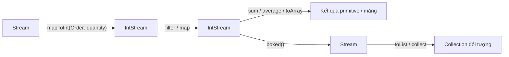

# Primitive stream và giảm chi phí boxing

Trong Java 27, Stream API có hai nhóm làm việc với dữ liệu: `Stream<T>` cho đối tượng và các **primitive stream** gồm `IntStream`, `LongStream`, `DoubleStream`. Khi xử lý nhiều số để lọc, biến đổi, tính tổng, tìm giá trị lớn nhất hoặc tính thống kê, dùng primitive stream đúng lúc có thể hạn chế việc tạo và xử lý các wrapper object như `Integer`, `Long`, `Double`.

Bài học thuộc chương **Xử lý dữ liệu bằng Stream**, module **JAVA_VERSION_JAVA27 — Java 27 và các kiến thức liên quan**. Nội dung tập trung vào những API đã ổn định trong Java SE 27 và còn phù hợp với ứng dụng hiện nay. Mục tiêu không phải tuyên bố rằng primitive stream luôn nhanh hơn mọi vòng lặp hay mọi `Stream<T>`, mà là hiểu **ranh giới boxing/unboxing**, chọn đúng pipeline và đo lường trước khi tối ưu.

Sau bài học, bạn có thể:

- Phân biệt `Stream<Integer>` và `IntStream` về kiểu dữ liệu, API và khả năng tránh boxing.
- Tạo primitive stream từ mảng nguyên thủy, dải số và dữ liệu đối tượng.
- Chuyển đổi bằng `mapToInt`, `mapToLong`, `mapToDouble`, `boxed` và `mapToObj` đúng thời điểm.
- Thực hiện `sum`, `average`, `min`, `max`, `reduce`, `summaryStatistics` mà không đóng gói từng giá trị số thành đối tượng không cần thiết.
- Nhận biết vấn đề `null`, tràn số nguyên, số thực dấu phẩy động và những giả định hiệu năng thiếu cơ sở.

## 1. Boxing và unboxing là gì?

Java có kiểu nguyên thủy `int`, `long`, `double` và kiểu wrapper tương ứng `Integer`, `Long`, `Double`.

**Boxing** chuyển một giá trị nguyên thủy sang wrapper; **unboxing** lấy lại giá trị nguyên thủy từ wrapper:

```java
int quantity = 12;

Integer wrapped = quantity;  // Autoboxing: int -> Integer.
int restored = wrapped;      // Unboxing: Integer -> int.

System.out.println(restored); // 12
```

Một wrapper có danh tính đối tượng về mặt mô hình ngôn ngữ, có thể chứa trong generic collection và có thể là `null`. Primitive `int` không thể là `null` và phù hợp với các phép toán số học trực tiếp. Việc boxing nhiều giá trị trong pipeline có thể làm tăng nhu cầu cấp phát, lưu tham chiếu, truy cập bộ nhớ và hoạt động thu gom rác; **mức độ ảnh hưởng thực tế phụ thuộc JVM/JIT, kích thước dữ liệu và workload**.

```java
Integer missing = null;

// Khi chạy sẽ ném NullPointerException vì phải unbox null:
// int value = missing;
```

Vì generics trong Java không chấp nhận primitive làm type argument thông thường, bạn không thể khai báo `Stream<int>` hay `List<int>`. Khi muốn Stream xử lý các giá trị `int` trực tiếp, dùng `IntStream`.

## 2. Ba primitive stream trong Java 27

| Stream | Kiểu phần tử | Wrapper tương ứng | Hàm biến đổi điển hình | Hàm kết thúc hữu ích |
|---|---|---|---|---|
| `IntStream` | `int` | `Integer` | `map(IntUnaryOperator)`, `filter(IntPredicate)` | `sum()`, `average()`, `min()`, `max()` |
| `LongStream` | `long` | `Long` | `map(LongUnaryOperator)`, `filter(LongPredicate)` | `sum()`, `average()`, `min()`, `max()` |
| `DoubleStream` | `double` | `Double` | `map(DoubleUnaryOperator)`, `filter(DoublePredicate)` | `sum()`, `average()`, `min()`, `max()` |
| `Stream<T>` | Tham chiếu đến đối tượng | Không cố định | `map(Function)`, `filter(Predicate)` | `collect(...)`, `reduce(...)`, `toList()` |

Các phương thức trung gian của primitive stream như `map` và `filter` dùng **functional interface chuyên biệt** (`IntUnaryOperator`, `IntPredicate`, v.v.). Kết quả sau những phép biến đổi đó vẫn là primitive stream, thay vì phải bọc mỗi số thành `Integer` hoặc `Long` chỉ để truyền sang lambda kế tiếp.

Tuy tên là Stream, **không có collection trung gian nào bắt buộc được tạo sau mỗi `filter` hoặc `map`**. Một pipeline gồm nguồn, các phép biến đổi trung gian lazy và một terminal operation. Stream được tiêu thụ một lần; để chạy phép kết thúc thứ hai, cần tạo pipeline mới từ nguồn.

## 3. So sánh `Stream<Integer>` với `IntStream`

Hai chương trình tính tổng từ 1 đến 5:

```java
import java.util.stream.IntStream;
import java.util.stream.Stream;

int sumObject = Stream.of(1, 2, 3, 4, 5)
        .filter(n -> n % 2 != 0)
        .map(n -> n * n)
        .reduce(0, Integer::sum);

int sumPrimitive = IntStream.of(1, 2, 3, 4, 5)
        .filter(n -> n % 2 != 0)
        .map(n -> n * n)
        .sum();

System.out.println(sumObject);    // 35
System.out.println(sumPrimitive); // 35
```

Kết quả nghiệp vụ giống nhau, nhưng có sự khác biệt:

- `Stream.of(1, 2, 3, 4, 5)` là `Stream<Integer>`, vì từng `int` phải phù hợp với kiểu generic `Integer`.
- Các hàm `map` và `reduce` trong pipeline đối tượng làm việc với các giá trị kiểu `Integer`, có thể dẫn đến các chuyển đổi boxing/unboxing.
- `IntStream.of(...)` chứa các phần tử `int`; `map`, `filter` và `sum` xử lý primitive values.
- Trong ví dụ tính tổng, `IntStream.sum()` biểu đạt ý định trực tiếp và tránh các wrapper số trung gian không cần thiết trong pipeline.

Không nên coi một ví dụ nhỏ là bằng chứng về tốc độ. Trình biên dịch JIT có thể tối ưu nhiều thao tác khác nhau; cần benchmark trên ứng dụng thực tế trước khi kết luận.

## 4. Tạo primitive stream từ nguồn có sẵn

### 4.1. Dãy số trực tiếp với `of`

```java
import java.util.stream.DoubleStream;
import java.util.stream.IntStream;
import java.util.stream.LongStream;

int points = IntStream.of(4, 6, 8).sum();
long bytes = LongStream.of(100L, 200L, 300L).sum();
double total = DoubleStream.of(1.5, 2.0, 3.25).sum();

System.out.println(points); // 18
System.out.println(bytes);  // 600
System.out.println(total);  // 6.75
```

Các phương thức `of` nhận các giá trị nguyên thủy (hoặc mảng tương ứng qua varargs), không yêu cầu tạo `List<Integer>` trước.

### 4.2. Dãy chỉ số với `range` và `rangeClosed`

```java
int openEnd = IntStream.range(1, 5).sum();        // 1 + 2 + 3 + 4.
int closedEnd = IntStream.rangeClosed(1, 5).sum(); // 1 + 2 + 3 + 4 + 5.

System.out.println(openEnd);   // 10
System.out.println(closedEnd); // 15
```

`range(startInclusive, endExclusive)` không bao gồm điểm cuối; `rangeClosed(startInclusive, endInclusive)` bao gồm điểm cuối. `LongStream` cũng có hai phương thức tương tự với `long`.

Ví dụ xử lý chỉ số của một danh sách mà không cần tạo một `List<Integer>` chỉ số:

```java
var products = java.util.List.of("A", "B", "C");

IntStream.range(0, products.size())
        .forEach(i -> System.out.println(i + ": " + products.get(i)));
```

Đầu ra theo encounter order của dãy trên:

```text
0: A
1: B
2: C
```

`forEach` trong pipeline tuần tự ở ví dụ này in theo thứ tự được duyệt. Nếu chuyển sang parallel stream, `forEach` không bảo đảm thứ tự; dùng `forEachOrdered` nếu thứ tự hiển thị quan trọng, hoặc tách việc xử lý khỏi việc xuất dữ liệu.

### 4.3. Mảng nguyên thủy với `Arrays.stream`

```java
import java.util.Arrays;

int[] scores = {70, 80, 95};
long[] sizes = {1_000L, 2_000L};
double[] rates = {1.2, 1.5, 1.8};

int scoreSum = Arrays.stream(scores).sum();         // IntStream.
long sizeSum = Arrays.stream(sizes).sum();          // LongStream.
double rateSum = Arrays.stream(rates).sum();        // DoubleStream.
```

Mảng nguyên thủy giúp lưu các giá trị số mà không cần một wrapper riêng cho mỗi phần tử. Đây thường là điểm khởi đầu phù hợp khi dữ liệu lớn là một tập số thuần túy.

**Lưu ý:** nguồn mảng không bị sao chép chỉ vì gọi `Arrays.stream(...)`; không sửa mảng nguồn trong khi pipeline đang xử lý nó.

### 4.4. Các nguồn nguyên thủy khác

Một số API hiện đại cung cấp primitive stream trực tiếp:

```java
IntStream letters = "ABC".codePoints(); // Stream các Unicode code points.
System.out.println(letters.sum());      // 198 (65 + 66 + 67).
```

`String.codePoints()` trả về `IntStream`; `String.chars()` cũng trả về `IntStream` nhưng cung cấp các đơn vị UTF-16. Hai phương thức có ngữ nghĩa khác nhau với ký tự Unicode nằm ngoài Basic Multilingual Plane, không nên dùng thay thế nhau một cách máy móc.

## 5. `mapToInt`, `mapToLong` và `mapToDouble`: chuyển ngay khi cần tính số

Trong ứng dụng, dữ liệu thường ở dạng **đối tượng nghiệp vụ**, ví dụ `Order`, `Employee` hoặc `Product`. Không nhất thiết phải chuyển nguồn thành `List<Integer>` trước khi tính.

```java
import java.util.List;

record Order(String id, int quantity, long amountCents, boolean paid) {}

List<Order> orders = List.of(
        new Order("A", 2, 12_500L, true),
        new Order("B", 4, 30_000L, false),
        new Order("C", 3, 22_000L, true)
);

int soldUnits = orders.stream()
        .filter(Order::paid)
        .mapToInt(Order::quantity)
        .sum();

long revenueCents = orders.stream()
        .filter(Order::paid)
        .mapToLong(Order::amountCents)
        .sum();

System.out.println(soldUnits);     // 5
System.out.println(revenueCents);  // 34500
```

Pipeline đầu tiên giữ `Stream<Order>` trong bước kiểm tra trạng thái, sau đó chuyển thẳng sang `IntStream` bằng `mapToInt`. Lambda hoặc method reference `Order::quantity` trả về `int` nên không phải tạo trung gian `Stream<Integer>`. Tương tự, `mapToLong` dùng `long` phù hợp với tiền biểu diễn bằng đơn vị nhỏ nhất.

Một lựa chọn kém trực tiếp hơn:

```java
// Tạo pipeline wrapper Integer trước khi chuyển về int:
int units = orders.stream()
        .map(Order::quantity)
        .mapToInt(Integer::intValue)
        .sum();
```

Nếu mục tiêu là tổng số lượng, ưu tiên `mapToInt(Order::quantity).sum()`. Chỉ dùng `map(...)` trả về wrapper khi các thao tác đối tượng thực sự cần thiết.

### 5.1. Từ `Stream<Integer>` đã có sang `IntStream`

Đôi khi dữ liệu **đã** nằm trong `List<Integer>`:

```java
List<Integer> weights = List.of(5, 10, 15);

int sum = weights.stream()
        .mapToInt(Integer::intValue)
        .sum();

System.out.println(sum); // 30
```

Lúc này, `mapToInt` phải **unbox** từng `Integer` được đọc từ danh sách. Primitive stream có thể giảm boxing trong **các bước số học tiếp theo**, nhưng nó không thể tự biến nguồn dữ liệu đã boxing thành mảng nguyên thủy mà không có chuyển đổi.

Nếu dữ liệu là `List<Integer>` và có thể chứa `null`, `Integer::intValue` sẽ ném `NullPointerException`:

```java
List<Integer> nullable = java.util.Arrays.asList(2, null, 4);

int filtered = nullable.stream()
        .filter(java.util.Objects::nonNull)
        .mapToInt(Integer::intValue)
        .sum();

System.out.println(filtered); // 6
```

Việc **bỏ qua** `null` chỉ phù hợp nếu quy tắc nghiệp vụ cho phép; trong các hệ thống đòi hỏi dữ liệu đầy đủ, nên từ chối dữ liệu đầu vào thay vì âm thầm loại bỏ.

## 6. Các phép biến đổi và giảm dữ liệu không cần boxing

Primitive stream vẫn có các thao tác quen thuộc như `filter`, `map`, `distinct`, `sorted`, `limit`, `skip`, `takeWhile`, `dropWhile` và `flatMap`.

```java
int[] squaredEvens = IntStream.rangeClosed(1, 8)
        .filter(n -> n % 2 == 0)
        .map(n -> n * n)
        .toArray();

System.out.println(java.util.Arrays.toString(squaredEvens));
// [4, 16, 36, 64]
```

Kết quả `toArray()` là `int[]`, **không phải** `Integer[]`. Với `LongStream` và `DoubleStream`, `toArray()` tương ứng trả về `long[]` và `double[]`.

### 6.1. `sum()` và `reduce()`

```java
int sum = IntStream.of(1, 2, 3, 4).sum(); // 10.

int product = IntStream.of(2, 3, 4)
        .reduce(1, (left, right) -> left * right); // 24.
```

`reduce(identity, operator)` dùng phép kết hợp trên giá trị nguyên thủy mà không cần tạo wrapper số cho mỗi bước. Với parallel stream, operator trong reduction phải đáp ứng các quy tắc về **tính kết hợp (associativity)** và không gây tác dụng phụ. Cộng và nhân số nguyên có tính kết hợp theo số học modulo của kiểu nguyên thủy (ngoại trừ khi ta chủ động dùng kiểm tra tràn), nhưng phép trừ không phù hợp làm toán tử reduce song song nếu cần kết quả độc lập cách chia nhóm.

### 6.2. `min()`, `max()`, `average()` và `Optional` chuyên biệt

```java
var highest = IntStream.of(12, 28, 17).max();
var mean = IntStream.of(12, 28, 17).average();

System.out.println(highest.orElseThrow()); // 28.
System.out.println(mean.orElseThrow());    // 19.0.
```

Kiểu trả về:

| Thao tác | `IntStream` | `LongStream` | `DoubleStream` |
|---|---|---|---|
| `min()`, `max()` | `OptionalInt` | `OptionalLong` | `OptionalDouble` |
| `average()` | `OptionalDouble` | `OptionalDouble` | `OptionalDouble` |
| `sum()` | `int` | `long` | `double` |
| `count()` | `long` | `long` | `long` |

Vì một stream có thể rỗng, `min`/`max`/`average` trả về dạng optional. Không gọi `getAsInt()` hoặc `getAsDouble()` khi chưa biết kết quả tồn tại; dùng `isPresent()`, `orElse(...)` hoặc `orElseThrow()` theo nghiệp vụ.

```java
System.out.println(IntStream.empty().average().isEmpty()); // true.
System.out.println(IntStream.empty().sum());               // 0.
```

Giá trị mặc định `0` của `sum()` khi stream rỗng **không** có nghĩa `average()` cũng bằng 0. Trung bình cộng của tập rỗng không được API coi là một giá trị xác định.

### 6.3. `summaryStatistics()`: nhiều thống kê trong một lần duyệt

Khi cần cùng lúc số lượng, tổng, nhỏ nhất, lớn nhất và trung bình, không tạo năm pipeline riêng:

```java
import java.util.IntSummaryStatistics;

IntSummaryStatistics stats = IntStream.of(10, 20, 30, 40)
        .summaryStatistics();

System.out.println(stats.getCount());   // 4.
System.out.println(stats.getSum());     // 100.
System.out.println(stats.getMin());     // 10.
System.out.println(stats.getMax());     // 40.
System.out.println(stats.getAverage()); // 25.0.
```

`IntSummaryStatistics` dùng `long` để lưu tổng, giúp tổng vượt phạm vi `int` trong nhiều trường hợp. `LongSummaryStatistics` vẫn lưu tổng bằng `long` nên **có thể tràn** nếu cộng quá giới hạn `long`. Có cả `DoubleSummaryStatistics` cho `DoubleStream`.

Không dùng kết quả `min`/`max` của đối tượng thống kê rỗng mà không xét `getCount()`: với tập rỗng, các giá trị khởi tạo của extrema không đại diện cho một phần tử thực.

## 7. Chuyển đổi giữa các kiểu primitive stream

`IntStream` có các phép chuyển đổi trực tiếp:

```java
long totalLong = IntStream.of(1, 2, 3)
        .asLongStream()
        .sum();

double totalDouble = IntStream.of(1, 2, 3)
        .asDoubleStream()
        .sum();

System.out.println(totalLong);   // 6.
System.out.println(totalDouble); // 6.0.
```

Các phương thức `mapToLong` và `mapToDouble` cũng cho phép biến đổi kiểu cùng lúc với tính toán:

```java
long squaredSum = IntStream.of(40_000, 50_000)
        .mapToLong(n -> (long) n * n)
        .sum();

System.out.println(squaredSum); // 4100000000.
```

Ép kiểu sang `long` **trước phép nhân** là điều quan trọng. Nếu viết `n * n` ở kiểu `int` rồi mới ép sang `long`, kết quả có thể đã bị tràn số trong bước nhân.

Chuyển từ `long` sang `double` có thể mất độ chính xác nếu giá trị có độ lớn vượt mức có thể biểu diễn chính xác bằng `double`. Cần tách rõ **tránh boxing** với **bảo toàn độ chính xác số học**; đây là hai yêu cầu độc lập.

## 8. `boxed()` và `mapToObj()`: chuyển sang đối tượng đúng lúc

Không phải mọi bài toán nên kết thúc ở primitive. Khi cần lưu kết quả trong `List<Integer>` hoặc chuyển số thành đối tượng có cấu trúc, chủ động chuyển ở ranh giới thích hợp.

### 8.1. `boxed()`

```java
import java.util.List;

List<Integer> ids = IntStream.rangeClosed(1, 5)
        .boxed()
        .toList();

System.out.println(ids); // [1, 2, 3, 4, 5].
```

`boxed()` chuyển `IntStream` thành `Stream<Integer>`; `LongStream.boxed()` thành `Stream<Long>` và `DoubleStream.boxed()` thành `Stream<Double>`. Kết quả `Stream.toList()` trong Java 27 không cho phép sửa đổi danh sách trả về.

Nếu kết quả sau cùng cần `Integer` objects thì boxing là **cần thiết ở ranh giới đó**, không phải lỗi. Mục tiêu là tránh boxing lặp lại giữa các bước trung gian không cần thiết.

### 8.2. `mapToObj()` để dựng đối tượng

```java
record Row(int index, String label) {}

List<Row> rows = IntStream.range(0, 3)
        .mapToObj(i -> new Row(i, "Hàng " + i))
        .toList();

System.out.println(rows);
// [Row[index=0, label=Hàng 0], Row[index=1, label=Hàng 1], Row[index=2, label=Hàng 2]]
```

`mapToObj` cho phép biến giá trị nguyên thủy thành một kiểu đối tượng bất kỳ, không chỉ wrapper tương ứng. Dùng `boxed()` khi cần wrapper, `mapToObj(...)` khi cần tạo đối tượng nghiệp vụ.

### 8.3. Biết lúc nào cần `Collectors`

`IntStream` không có dạng `collect(Collectors.toList())` giống `Stream<T>`. Nếu cần collector dành cho đối tượng, có thể chuyển bằng `boxed()` hoặc `mapToObj()`:

```java
import java.util.Set;
import java.util.stream.Collectors;

Set<Integer> values = IntStream.of(1, 2, 2, 3)
        .boxed()
        .collect(Collectors.toSet());
```

Ở đây boxing là hợp lý vì tập kết quả `Set<Integer>` thực sự chứa wrapper values. Nếu chỉ cần **đếm số giá trị khác nhau** hoặc tính thống kê, `IntStream.distinct().count()` có thể giữ pipeline nguyên thủy đến terminal operation:

```java
long distinctCount = IntStream.of(1, 2, 2, 3)
        .distinct()
        .count();
System.out.println(distinctCount); // 3.
```

Không suy luận rằng `distinct` tuyệt đối không bao giờ dùng bộ nhớ phụ; việc loại trùng cần cấu trúc hỗ trợ tùy triển khai. Primitive pipeline tránh **yêu cầu API** phải boxing từng phần tử ở ranh giới, nhưng JVM và thư viện vẫn có thể cần bộ nhớ để thực hiện một thao tác nhất định.

## 9. Tổng hợp theo nhóm mà không tạo `Stream<Integer>` trung gian

Một bài toán thật thường cần thống kê số từ một tập đối tượng, chẳng hạn tổng số lượng theo khu vực. Không nhất thiết làm `map(Order::quantity)` rồi lưu danh sách wrapper trước khi tổng hợp.

```java
import java.util.IntSummaryStatistics;
import java.util.List;
import java.util.Map;
import java.util.stream.Collectors;

record Order(String region, int quantity) {}

List<Order> orders = List.of(
    new Order("HN", 2),
    new Order("HCM", 5),
    new Order("HN", 3)
);

Map<String, IntSummaryStatistics> byRegion = orders.stream()
        .collect(Collectors.groupingBy(
                Order::region,
                Collectors.summarizingInt(Order::quantity)
        ));

System.out.println(byRegion.get("HN").getSum());  // 5.
System.out.println(byRegion.get("HCM").getCount()); // 1.
```

`Collectors.summarizingInt` dùng `ToIntFunction<Order>` để trích xuất `int` trong quá trình gom nhóm. Đây vẫn là một pipeline **`Stream<Order>`** vì phải xử lý bản ghi nghiệp vụ và tạo bản đồ thống kê; nó không cần tạo thêm `Stream<Integer>` hoặc `List<Integer>` chỉ để chứa số lượng.

Những collector chuyên biệt còn có `summingInt`, `summingLong`, `summingDouble`, `averagingInt` và `averagingLong`. Chúng hữu ích khi dữ liệu nguồn là đối tượng và kết quả cuối có cấu trúc nhóm. Khi chỉ cần một tổng duy nhất, `mapToInt(...).sum()` thường đơn giản hơn.

## 10. Tràn số nguyên: tránh boxing không đồng nghĩa với tính đúng

`IntStream.sum()` trả về `int`. Nếu tổng vượt `Integer.MAX_VALUE` hoặc nhỏ hơn `Integer.MIN_VALUE`, phép cộng kiểu `int` bị **overflow** theo quy tắc số học Java:

```java
int overflow = IntStream.of(Integer.MAX_VALUE, 1).sum();
System.out.println(overflow); // -2147483648.
```

Muốn cộng nhiều `int` vào kiểu `long`, **mở rộng kiểu trước khi tổng hợp**:

```java
long safeForThisInput = IntStream.of(Integer.MAX_VALUE, 1)
        .asLongStream()
        .sum();

System.out.println(safeForThisInput); // 2147483648.
```

`LongStream.sum()` cũng có giới hạn `long`. Với tổng có thể vượt `Long.MAX_VALUE`, cần xác định phương án nghiệp vụ như `BigInteger` hoặc cơ chế số học chính xác khác, chấp nhận sử dụng đối tượng khi thật sự cần.

Nếu muốn **phát hiện tràn** thay vì cho phép wraparound, có thể dùng `Math.addExact` trong một phép reduce tuần tự, nhưng kiểm thử và định nghĩa thứ tự reduce phải rõ ràng, đặc biệt nếu chuyển sang parallel stream:

```java
try {
    int checked = IntStream.of(Integer.MAX_VALUE, 1)
            .reduce(0, Math::addExact);
    System.out.println(checked);
} catch (ArithmeticException ex) {
    System.out.println("Đã phát hiện tràn int");
}
```

Kiểu `long` **không tự động phù hợp cho mọi giá trị tiền tệ** nếu quy mô tính toán có thể vượt phạm vi hoặc cần phần thập phân không cố định. Chọn số học có độ chính xác thích hợp từ đầu.

## 11. `DoubleStream` và sai số số thực

`DoubleStream` giúp xử lý `double` mà không tạo `Double` wrapper không cần thiết, nhưng số thực IEEE 754 **không biểu diễn chính xác mọi số thập phân**:

```java
double result = DoubleStream.of(0.1, 0.2).sum();
System.out.println(result); // Kết quả double có thể không biểu diễn chính xác 0.3.
```

Không so sánh số thực tiền tệ theo kỳ vọng biểu diễn thập phân chính xác tuyệt đối. Với số tiền có đơn vị nhỏ nhất cố định, nhiều hệ thống dùng `long` để lưu **đơn vị nhỏ nhất** (ví dụ số xu). Khi cần quy tắc làm tròn hay độ chính xác thập phân phức tạp, `BigDecimal` có thể phù hợp hơn, dù nó là đối tượng và không có primitive stream riêng.

Một số điểm cần nhớ:

- `DoubleStream.sum()` và `average()` có thể chịu ảnh hưởng của thứ tự cộng và sai số làm tròn; `NaN` hoặc vô cực có quy tắc riêng theo API.
- Chuyển `long` sang `double` có thể làm mất độ chính xác ở giá trị lớn.
- **Giảm boxing chỉ là mục tiêu hiệu năng**; không được đánh đổi tính chính xác nghiệp vụ để tối ưu sớm.

## 12. Khi nào primitive pipeline vẫn có thể tốn boxing?

Mục tiêu là **tránh các chuyển đổi không cần thiết**, không phải tuyên bố rằng pipeline nào có `IntStream` cũng hoàn toàn không cấp phát.

| Tình huống | Hiện tượng | Cách tiếp cận |
|---|---|---|
| Nguồn `int[]` → `Arrays.stream(array)` | Đầu vào đã là primitive | Giữ `IntStream` trong các bước số học |
| Nguồn `List<Integer>` → `mapToInt(Integer::intValue)` | Phải unbox phần tử có sẵn | Chuyển khi bắt đầu chuỗi tính số |
| `IntStream` → `boxed()` | Tạo luồng đối tượng wrapper | Chỉ chuyển khi API đích cần `Integer` |
| `Stream<Order>` → `map(Order::quantity)` | Kết quả `Integer` trong Stream đối tượng | Ưu tiên `mapToInt(Order::quantity)` nếu chỉ tính số |
| `IntStream` → `mapToObj(...)` | Tạo đối tượng theo nhu cầu | Dùng khi thật sự cần kết quả dạng đối tượng |
| `IntStream` → `toArray()` | Kết quả `int[]` | Phù hợp nếu cần mảng primitive |
| `IntStream` → `summaryStatistics()` | Một đối tượng thống kê tổng hợp | Đúng mục đích, không tạo wrapper cho từng giá trị |

Một cách biểu diễn luồng biến đổi:



Đọc sơ đồ theo nguyên tắc: **giữ dạng nguyên thủy trong đoạn pipeline làm số học, chuyển sang đối tượng ở ranh giới cần đối tượng**.

## 13. Ngữ nghĩa Stream vẫn quan trọng hơn vi tối ưu

Primitive streams vẫn tuân thủ quy tắc chung của Stream API:

1. **Lazy:** các phép trung gian như `filter` và `map` thường chưa chạy cho tới khi terminal operation được gọi.
2. **Tiêu thụ một lần:** không dùng lại cùng đối tượng stream cho nhiều terminal operations.
3. **Tránh side effects:** phép biến đổi nên không can thiệp nguồn, không phụ thuộc trạng thái chia sẻ có thể thay đổi trong pipeline.
4. **Encounter order:** nếu nguồn có thứ tự, một số thao tác bảo toàn thứ tự; `forEach` trên parallel stream không bảo đảm thứ tự thực thi.
5. **Parallel không mặc định nhanh hơn:** chia công việc, phối hợp, đồng bộ và locality có thể làm chậm tác vụ nhỏ.
6. **Nguồn vô hạn:** `iterate` hoặc `generate` có thể tạo pipeline không giới hạn; cần terminal short-circuit hoặc `limit` phù hợp.

Ví dụ một stream không được dùng lại:

```java
IntStream numbers = IntStream.rangeClosed(1, 3);
System.out.println(numbers.sum()); // 6.

// Không được dùng numbers lần nữa:
// System.out.println(numbers.average().orElse(0));

// Tạo stream mới nếu cần tính khác:
System.out.println(IntStream.rangeClosed(1, 3).average().orElseThrow()); // 2.0.
```

Một số terminal operation như `count()` có thể được triển khai mà không thực sự duyệt mọi phần tử nếu hệ thống biết kích thước chính xác. Vì thế, không dựa vào `peek` hoặc tác dụng phụ trong `map` để đảm bảo logic phải chạy trên mọi phần tử.

## 14. Benchmark đúng cách trước khi kết luận

Primitive stream thường giúp mã biểu đạt ý định và hạn chế boxing trong các phép số học, nhưng đánh giá tốc độ phải tính đến toàn pipeline:

- **Kiểu nguồn:** `int[]` hay `List<Integer>`? Nguồn đã boxing thì phải tính cả chi phí lưu/đọc wrapper.
- **Kích thước dữ liệu:** pipeline rất nhỏ có thể bị chi phí tạo/điều phối Stream chi phối; vòng lặp `for` có thể nhanh và đơn giản hơn.
- **Phép biến đổi:** lọc, sắp xếp, gom nhóm, loại trùng hay tổng hợp thuần túy có đặc điểm khác nhau.
- **JIT warmup và garbage collection:** đo một lần bằng `System.nanoTime()` dễ bị nhiễu và không cho kết luận tin cậy.
- **Phân tích cấp phát:** ngoài thời gian thực thi, quan sát allocation rate, GC pressure và footprint.
- **Parallelism:** dùng parallel stream chỉ khi workload và kích thước dữ liệu đáng giá chi phí chia/ghép.

Đối với thử nghiệm hiệu năng nghiêm túc, sử dụng **JMH (Java Microbenchmark Harness)** và xây dựng các biến thể xử lý cùng một tập dữ liệu, cùng điều kiện kiểm thử. Ưu tiên đo luồng **đầu-cuối** thay vì đo riêng một đoạn nhỏ rồi suy ra hiệu quả toàn hệ thống. Không thể khẳng định một con số phần trăm tăng tốc cho tất cả JVM, cấu hình phần cứng và workload.

Không nhất thiết phải thay mọi vòng lặp bằng Stream API. Nếu một vòng lặp trên `int[]` đơn giản, rõ ràng và hoạt động tốt, nó vẫn là lựa chọn Java hiện đại hợp lệ.

## 15. Ví dụ hoàn chỉnh: báo cáo đơn hàng

Tạo tệp `PrimitiveStreamDemo.java` và chạy trực tiếp với JDK 27:

```java
import java.util.IntSummaryStatistics;
import java.util.List;
import java.util.stream.IntStream;

public class PrimitiveStreamDemo {
    record Order(String id, int units, long cents, boolean paid) {}

    static int paidUnits(List<Order> orders) {
        return orders.stream()
                .filter(Order::paid)
                .mapToInt(Order::units)
                .sum();
    }

    static long paidRevenueCents(List<Order> orders) {
        return orders.stream()
                .filter(Order::paid)
                .mapToLong(Order::cents)
                .sum();
    }

    static IntSummaryStatistics unitStatistics(List<Order> orders) {
        return orders.stream()
                .filter(Order::paid)
                .mapToInt(Order::units)
                .summaryStatistics();
    }

    public static void main(String[] args) {
        List<Order> orders = List.of(
                new Order("A", 2, 15_000L, true),
                new Order("B", 7, 45_000L, false),
                new Order("C", 3, 20_000L, true)
        );

        System.out.println("Đã bán: " + paidUnits(orders));
        System.out.println("Doanh thu (đơn vị nhỏ nhất): "
                + paidRevenueCents(orders));

        IntSummaryStatistics stats = unitStatistics(orders);
        System.out.println("Số đơn đã thanh toán: " + stats.getCount());
        System.out.println("Số lượng trung bình: " + stats.getAverage());

        int[] squares = IntStream.rangeClosed(1, 4)
                .map(n -> n * n)
                .toArray();
        System.out.println(java.util.Arrays.toString(squares));

        var ids = IntStream.rangeClosed(1, 3)
                .boxed()
                .toList();
        System.out.println(ids);
    }
}
```

Chạy:

```bash
java --version
java PrimitiveStreamDemo.java
```

Đầu ra:

```text
Đã bán: 5
Doanh thu (đơn vị nhỏ nhất): 35000
Số đơn đã thanh toán: 2
Số lượng trung bình: 2.5
[1, 4, 9, 16]
[1, 2, 3]
```

Điểm quan trọng: dữ liệu nguồn vẫn là `Stream<Order>`, nhưng các phép tính số chuyển thẳng sang `IntStream` hoặc `LongStream`. Chỉ đoạn cuối khi cần `List<Integer>` mới dùng `boxed()`. Các phương thức `paidUnits`, `paidRevenueCents` và `unitStatistics` tạo pipeline **mới** trên danh sách nguồn, không dùng lại một Stream đã tiêu thụ.

## 16. Những lỗi thường gặp

| Sai lầm | Hệ quả | Cách làm phù hợp |
|---|---|---|
| Dùng `Stream.of(1, 2, 3)` rồi liên tục `map` và `reduce` như số nguyên thủy | Có thể tăng boxing/unboxing | Dùng `IntStream.of(...).sum()` cho số học thuần |
| Dùng `orders.stream().map(Order::units)` khi chỉ cần tổng số lượng | Chuyển sang pipeline `Integer` không cần thiết | `mapToInt(Order::units).sum()` |
| Tin rằng `mapToInt` làm biến mất wrapper vốn nằm trong `List<Integer>` | Vẫn cần unbox và giữ chi phí cấu trúc nguồn | Dùng `int[]` hoặc dữ liệu primitive ngay từ đầu nếu phù hợp |
| Unbox `Integer` bằng `null` | `NullPointerException` | Quy định chính sách `null`, từ chối hoặc xử lý rõ ràng |
| Dùng `IntStream.sum()` cho tổng có thể vượt `int` | Tràn số, kết quả sai nghiệp vụ | `asLongStream().sum()` nếu đủ phạm vi; nếu không, dùng số học chính xác hơn |
| Nhân hai `int` rồi mới cast sang `long` | Có thể tràn trước khi cast | `(long) a * b` |
| Giả định `DoubleStream` biểu diễn chính xác mọi số tiền | Sai số dấu phẩy động | Dùng `long` đơn vị nhỏ nhất hoặc `BigDecimal` |
| Gọi `sum()` rồi `average()` trên cùng stream | Stream đã bị tiêu thụ | Tạo pipeline mới hoặc `summaryStatistics()` |
| Tưởng `IntStream.collect(Collectors.toList())` hoạt động | Sai chữ ký API | Dùng `boxed().collect(...)` hoặc terminal của primitive stream |
| Dùng `parallel()` vì cho rằng luôn nhanh | Chi phí phân luồng/ghép có thể lớn hơn lợi ích | Benchmark workload cụ thể |
| Dùng `peek` để bảo đảm một hành động xảy ra trên mọi phần tử | Tác dụng phụ có thể bị bỏ qua do tối ưu hoặc short-circuit | Dùng thao tác terminal phù hợp, hoặc tách side effects khỏi pipeline |

## 17. Bài tập tự luyện

**Bài 1 — Tổng không tràn `int`.** Cho `int[] values = {Integer.MAX_VALUE, 10}`. Viết phép tổng bằng primitive stream trả về `long`. Giải thích vì sao `Arrays.stream(values).sum()` không phù hợp.

Gợi ý: `Arrays.stream(values).asLongStream().sum()`.

**Bài 2 — Tránh boxing trung gian.** Với `List<Employee>` và record `Employee(String name, int salary)`, tính tổng `salary` của nhân viên có `salary > 0` bằng `mapToLong`. Vì sao `map(Employee::salary).mapToLong(Integer::intValue)` không cần thiết?

**Bài 3 — Một lần duyệt.** Với `IntStream.of(10, 20, 30, 40)`, dùng `summaryStatistics()` để lấy `count`, `sum`, `min`, `max` và `average`. Kiểm tra rằng `getSum()` của `IntSummaryStatistics` có kiểu `long`.

**Bài 4 — Boxing ở ranh giới.** Tạo `List<Integer>` từ các số lẻ trong đoạn 1–15 bằng `IntStream.rangeClosed`, `filter`, `boxed` và `toList`. Giải thích bước nào bắt đầu tạo wrapper và vì sao nó cần thiết cho kết quả danh sách generic.

**Bài 5 — Quyết định thiết kế.** Bạn cần xử lý hàng triệu giá trị số và chỉ tính trung bình. So sánh lựa chọn lưu `int[]` với `List<Integer>`. Thảo luận về `null`, khả năng thay đổi nguồn, bộ nhớ, tính tiện dụng của API và chi phí chuyển đổi; sau đó đề xuất một thí nghiệm JMH để kiểm tra thay vì đoán số phần trăm nhanh hơn.

## 18. Checklist chọn primitive stream trong Java 27

1. Dữ liệu đang ở dạng `int[]`, `long[]`, `double[]` hay wrapper collection?
2. Pipeline thực sự xử lý **số** hay cần **đối tượng nghiệp vụ**? Đổi sang primitive ở điểm hợp lý.
3. Có thể dùng `mapToInt`, `mapToLong`, `mapToDouble` thay cho `map` tạo wrapper không?
4. Có cần `boxed()` hoặc `mapToObj()` để trả về collection/đối tượng không? Đặt chuyển đổi sát ranh giới cần đối tượng.
5. Có xử lý `null` trước khi unbox dữ liệu từ `Stream<Integer>` không?
6. Có nguy cơ **tràn số nguyên**, mất độ chính xác khi ép kiểu hoặc sai số `double` không?
7. Khi cần nhiều thống kê, có thể dùng `summaryStatistics()` thay vì nhiều lần duyệt không?
8. Có vi phạm quy tắc Stream tiêu thụ một lần, lazy hoặc tránh tác dụng phụ không?
9. Khi tối ưu hiệu năng, đã đo với workload thật, JMH, warmup và allocation/GC phù hợp chưa?

**Kết luận:** `IntStream`, `LongStream` và `DoubleStream` giúp biểu diễn các phép biến đổi số nguyên thủy trực tiếp và giảm những lần boxing không cần thiết. Lợi ích lớn nhất xuất hiện khi dữ liệu nguồn và phần lớn pipeline đều có ngữ nghĩa nguyên thủy. Hãy ưu tiên **tính đúng, sự rõ ràng và kiểu dữ liệu phù hợp**; benchmark chỉ dẫn cho quyết định tối ưu cuối cùng.

## 19. Tài liệu tham khảo chính thức

- [Java SE 27 — IntStream API](https://docs.oracle.com/en/java/javase/27/docs/api/java.base/java/util/stream/IntStream.html): `of`, `range`, `map`, `boxed`, `asLongStream`, `sum`, `average`, `summaryStatistics`.
- [Java SE 27 — LongStream API](https://docs.oracle.com/en/java/javase/27/docs/api/java.base/java/util/stream/LongStream.html): thao tác với `long`, `mapToLong`, `sum` và `boxed`.
- [Java SE 27 — DoubleStream API](https://docs.oracle.com/en/java/javase/27/docs/api/java.base/java/util/stream/DoubleStream.html): thao tác với `double`, `average`, `sum`, vấn đề sai số.
- [Java SE 27 — java.util.stream Package](https://docs.oracle.com/en/java/javase/27/docs/api/java.base/java/util/stream/package-summary.html): quy tắc pipeline, lazy, terminal, side effects và parallelism.
- [Java SE 27 — Arrays.stream](https://docs.oracle.com/en/java/javase/27/docs/api/java.base/java/util/Arrays.html): các overload dành cho `int[]`, `long[]`, `double[]`.
- [Java SE 27 — IntSummaryStatistics](https://docs.oracle.com/en/java/javase/27/docs/api/java.base/java/util/IntSummaryStatistics.html): thống kê và kiểu dữ liệu của tổng.
- [Java SE 27 — Stream.toList](https://docs.oracle.com/en/java/javase/27/docs/api/java.base/java/util/stream/Stream.html#toList()): danh sách kết quả không cho phép sửa đổi.
